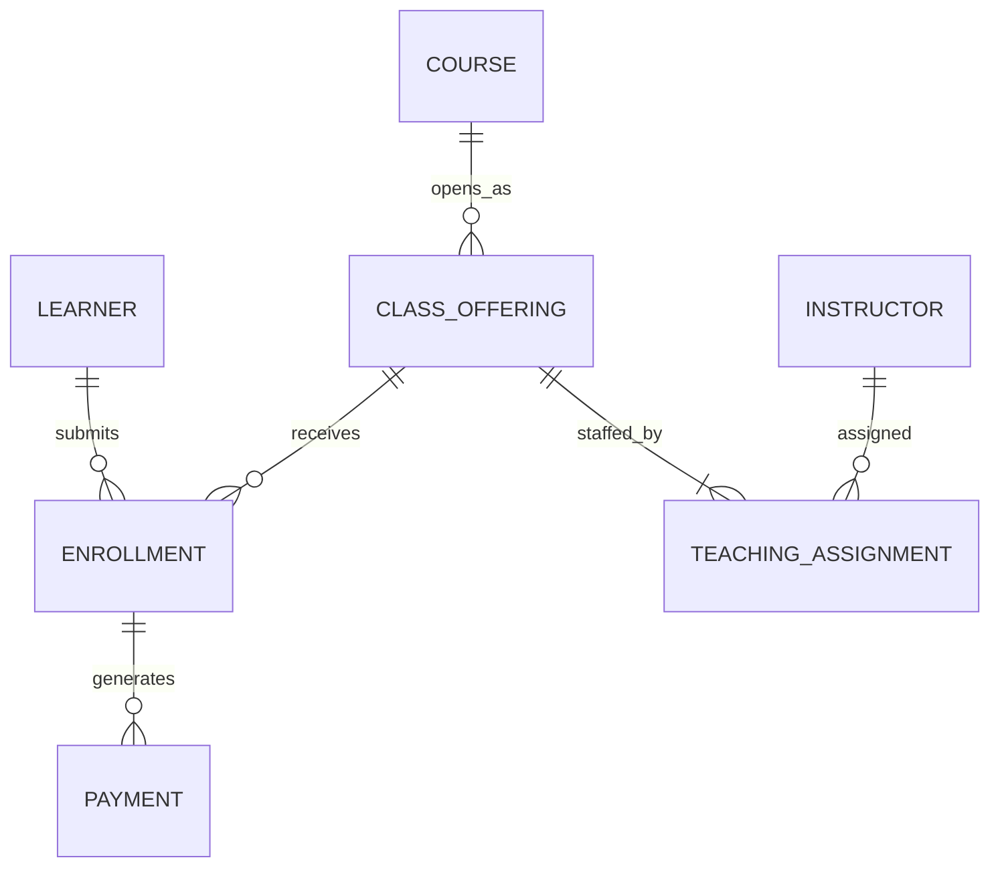

# Identifying Core Concepts from Business Scenarios and Language

In the **Conceptual Modeling** chapter, the first task is to uncover the concepts that an organization truly needs to manage and how they relate to one another. Business requirements are often written in stories, forms, domain terminology, and scattered rules. The data designer must turn those descriptions into a coherent picture of objects, roles, events, attributes, and relationships.

This is the foundational step in building the skill of translating business requirements into a clear data model. A conceptual model focuses on business meaning: what things the organization is talking about, what each thing means, how long it exists, what it connects to, and which rules must always hold true. Decisions about tables, column types, physical keys, indexes, or how data is stored in a relational, document, graph, or analytical store will be considered in later design steps.

After this lesson, learners will be able to:

- Read a business scenario and extract candidate concepts from nouns, verbs, states, and events.
- Distinguish between entities, attributes, values, roles, events, reference categories, and action-only terms.
- Test whether a concept needs its own identity and lifecycle or is merely an attribute of another concept.
- Identify relationships, participation cardinality, optionality/mandatory participation, and related business rules.
- Resolve synonyms, homonyms, scope boundaries, and ambiguities in business language.
- Produce a conceptual model that can be explained, traced back to evidence, and validated by business owners.

## 1. What Questions Does a Conceptual Model Answer?

A conceptual model describes what the organization needs to understand and manage about a business domain. It establishes a shared language among business users, analysts, architects, and development teams. The model helps answer questions such as:

- Which objects or events need to be identified individually?
- What does each concept mean and where are its boundaries?
- Which concepts are related to one another?
- How many instances of another object can one object be linked to?
- Is a relationship mandatory or optional on each side?
- Which information describes an object, and which information describes an occurrence?
- Which rules must be satisfied in all situations?
- Which terms remain ambiguous and require confirmation from an authorized stakeholder?

For example, a training center states: "Learners enroll in classes. Each class belongs to a course, has a start schedule, and has an assigned instructor. A learner can join multiple classes; a class has multiple learners." This story suggests the concepts `Learner`, `Course`, `Class Offering`, `Instructor`, and `Enrollment`, along with the relationships among them. `Enrollment` may need to be identified separately because it records the enrollment timestamp, status, and outcome of a specific learner for a specific class.

A conceptual model is not a replica of current UI forms or software structures. A form may bundle many fields together due to UI constraints; a spreadsheet may merge multiple objects into a single row; a legacy system may name columns after implementation details. The designer's job is to uncover the business meaning behind those artifacts.

### 1.1. Distinguishing Modeling Levels

| Modeling Level | Focus | Example Questions |
|---|---|---|
| Conceptual | Business concepts, relationships, and core rules | How does the center manage courses, class offerings, learners, and enrollments? |
| Logical | More detailed data structures, attributes, identifiers, relationship cardinality, and normalization | What attributes does an enrollment have? Which exact objects does an enrollment link to? |
| Physical | Implementation on a specific storage technology | Which tables, column types, indexes, and partitioning strategies are used? |

These levels are connected, yet they should not be mixed together. In a conceptual model, you can name a concept `Enrollment` and describe the rule that a learner enrolls in a class. There is no need yet to decide whether `enrollment_id` uses `BIGINT`, a UUID, or a composite key. Nor is there a need yet to choose indexes or partitioning strategies.

### 1.2. When Should a Concept Be Modeled?

A concept is worth modeling when it carries stable meaning for the business, appears across multiple processes, needs to be referenced, has a lifecycle, or has its own rules. Not every word in a requirement becomes an entity. "Quickly", "confirmed", or "frequently" may be modifiers, states, or descriptions. "Submit enrollment" may be an action; "Enrollment" is a record that must be stored and queried after the action finishes.

Start with a broad list of candidate concepts, then use evidence and test questions to decide. Do not pick an entity just because a noun appears in a sentence, and do not overlook an important concept just because the business refers to it with a verb.

## 2. Reading Scenarios and Business Language

### 2.1. Collecting Descriptions from Multiple Perspectives

To understand a business domain, gather descriptions from frontline practitioners, managers, downstream consumers of the results, and rule owners. You can use interviews, job observation, current workflows, forms, reports, contracts, and sample data. Each source reflects one perspective; inconsistencies are signals that further investigation is needed.

When asking about a process, prioritize concrete questions:

- Walk me through a recent case from start to finish.
- Who or which system creates this information?
- Which objects are tracked after the operation completes?
- When information changes, does the organization need to know the previous value?
- Are there cases where an object is transferred to another department or owner?
- Can two records with the same display name or code actually be two different objects?
- Can one person hold multiple roles?
- Which terms are used differently across departments?

Do not merely record how users want a screen to behave. Uncover the goals, rules, generated data, and how the organization identifies each object.

### 2.2. Analyzing Nouns, Verbs, States, and Time Points

Business language provides many clues:

| Sentence Component | Possible Clues | Examples |
|---|---|---|
| Object nouns | Concepts, entities, groups, or attributes | learner, course, class offering, location |
| Linking verbs | Relationships between concepts | learner enrolls in class, instructor teaches class |
| Event-creating verbs | Events or resulting records | enrollment is submitted, payment is recorded |
| Adjectives/states | Condition or characteristic of an object | open, cancelled, spots available |
| Time phrases | Effective dates, schedules, occurrence timestamps, or history | start date, enrollment timestamp, cancellation deadline |
| Conditional phrases | Constraints and business rules | may only cancel before the start date |

This is a heuristic for finding candidates, not a mechanical formula for turning every noun into an entity and every verb into a relationship. You must read the whole sentence, context, and concrete examples.

For example, the sentence "Staff confirms enrollment" has at least three interpretations to distinguish:

1. `Staff` is the actor performing the action.
2. `Enrollment` is a record created earlier and transitioned into a confirmed state.
3. `Confirmation` is an event or processing step, where the actor, timestamp, and outcome may need to be stored.

If you only extract nouns, you might miss the confirmation event. If you only extract verbs, you might fail to recognize that the enrollment record exists independently and needs to be queried.

### 2.3. Building a Glossary Before Merging Concepts

One word can have multiple meanings, and one concept can have multiple names. Build a glossary to align on shared understanding.

| Term | Agreed Definition | Example | Questions to Clarify |
|---|---|---|---|
| Course | Training content offered by the center, with objectives and syllabus | Basic Data Analysis | Does a course have syllabus versions by year? |
| Class Offering | A specific scheduled run of a course | December cohort, online | Does "class" mean "course" in the terminology of another department? |
| Learner | A person participating in a class offering | Someone whose enrollment is confirmed | Can one person also be an instructor? |
| Enrollment | A record capturing a learner's request to join a class offering | Enrollment pending confirmation | Is one person allowed to create multiple records for the same class? |
| Assigned Instructor | A person assigned to teach a class offering | Lead instructor, teaching assistant | Can a class have multiple instructors or change its assigned instructor? |

**Synonyms** are different names for the same concept within a scope. For instance, "student" and "learner" might refer to the same role if the business confirms this. **Homonyms** are the same word referring to different concepts. For example, "class" may refer to training content, a group of learners, or a scheduled offering. Do not merge concepts merely because they share a name.

Each term should have a definition, scope of use, examples, equivalent names, confirmation source, and owner. When disagreements arise, record the competing interpretations instead of silently picking one.

## 3. Process for Identifying Core Concepts

You can follow an iterative process consisting of the following steps.

### Step 1: Define the Business Domain Boundary

State clearly which activities the organization or system manages, where they begin, and where they end. A training platform might manage curriculum, class schedules, enrollments, and payments; an external accounting system might manage invoices and general ledger posting. This boundary determines which data is managed directly and which is only referenced.

Without defining scope, the model easily bloats by pulling every related concept into a single diagram. Conversely, an overly narrow scope can miss external objects that must be linked or rules for interfacing with other systems.

### Step 2: Rewrite the Scenario as Clear Business Statements

Break a long narrative into simple statements. Each statement should describe a single fact, action, relationship, or rule. For example:

- The center offers many courses.
- A course can be opened as multiple class offerings at different times.
- A class offering belongs to exactly one course.
- A learner submits an enrollment to join a class offering.
- A class offering has many enrollments; each enrollment belongs to one learner.
- A class offering can be assigned to one or more instructors.
- An enrollment can generate multiple payments.
- A learner may only cancel an enrollment before the specified deadline.

Validate words like "many", "one", "can", "must", "before", and "after" with the business. They often carry information about relationship cardinality, mandatory participation, and temporal conditions.

### Step 3: Extract a List of Candidate Concepts

Read each statement and mark:

- Nouns for managed objects: learner, course, class offering, instructor.
- Nouns for records or outcomes: enrollment, payment.
- Nouns for events: enrollment confirmation, class cancellation, payment completion.
- Nouns for attributes or values: course name, start date, capacity, status.
- Nouns for groups or categories: delivery mode, course category, payment method.
- Linking verbs: offers, belongs to, enrolls in, teaches, pays.

At this step, keep more candidates than strictly necessary. Do not rush to decide whether a term is an entity or an attribute. The goal is not to miss any concept so it can be tested in the next step.

### Step 4: Test Meaning and Independent Existence

For each candidate, ask:

1. Does the business need to distinguish individual instances of this concept?
2. Can an instance be described by its own distinct characteristics?
3. Does the concept have its own lifecycle, states, or history?
4. Can it link to multiple other objects?
5. Is there a need to search, reference, or report on it as a distinct object?
6. If the parent object is deleted or changed, does information about this concept still need to exist?

If the answer to several of these questions is yes, the concept is likely an entity. If it merely describes one facet of another object and needs no separate identification, it is likely an attribute or value. This is a guiding test, not an absolute rigid rule.

### Step 5: Identify Relationships and Participation Roles

Examine verbs and prepositional phrases to see how concepts connect. Express each relationship as a sentence with clear subject and object, such as "Learner submits Enrollment", "Enrollment applies to Class Offering", "Class Offering is organized from Course".

Identify the role on each side. In the relationship "instructor teaches class", a person may be a lead instructor or a teaching assistant. If roles affect assignments, permissions, or reporting, state them explicitly. Avoid generic relationships like "is related to" when the business needs to know the nature of the association.

### Step 6: Record Important Attributes and Rules

For each concept, list descriptive and identifying information. For each relationship, record cardinality, mandatory participation, conditions, and limits. Separate business-confirmed rules from the design team's assumptions.

### Step 7: Validate with Real-World Scenarios

Test the model against normal cases, edge cases, and exceptions. For example: a learner enrolls in two classes; a class is cancelled; a class has two instructors; an instructor is also a learner; a learner cancels after paying; an enrollment is paid in multiple installments. If the diagram cannot explain a scenario or forces readers to guess, go back and clarify the concepts and rules.

## 4. Classifying Candidate Concepts

### 4.1. Entity

An entity is a concept whose individual instances the business needs to recognize. Each entity has a stable identifier or recognition mechanism within the business scope. It typically has descriptive attributes, participates in relationships, and may have a lifecycle.

Examples in the training domain:

- `Course`: a training program with a name, objectives, and content.
- `Class Offering`: a scheduled delivery of a course with specific dates and capacity.
- `Learner`: a person who can submit enrollments and attend classes.
- `Enrollment`: a record capturing a request to join a class.
- `Instructor`: a person assigned to teach.

An entity does not have to be a tangible physical object. An enrollment record, a payment transaction, or a teaching assignment can all be entities if the organization needs to identify and manage them individually.

### 4.2. Attribute

An attribute describes a characteristic of a concept. For example, `Course Name`, `Start Date`, and `Capacity` can be attributes of their respective concepts.

Ask whether the value needs independent management or only has meaning within the context of an object. If a location is merely a descriptive string on a class offering, it can be an attribute. If a location has its own code, address, capacity, usage rules, and is referenced by many classes, it may be a `Location` entity.

From a business perspective, an attribute can be single-valued or multi-valued. For instance, a course has multiple tags; a person has multiple contact methods. If the values carry their own properties, ordering, effective dates, or relationships to other objects, consider a separate concept instead of packing them into a single text field.

### 4.3. Value or Value Object

A value describes a concept but typically has no independent business identity. For example, a time range `09:00–11:00`, a quantity `20`, or a coordinate pair for a site may only make sense when attached to a class offering.

A structured group of values can be treated as a value object during analysis, such as `Time Range` consisting of a start time and end time. Whether it is represented as a data type, a table, or an embedded structure is a later logical/physical decision.

### 4.4. Role

A role describes the capacity in which a person or organization participates in a process or relationship. The same person can be a learner in one enrollment and an instructor in another class. Roles often depend on context, time, or permissions.

Do not assume every role represents a different human being. If the same individual can both learn and teach and the organization needs a unified identity, consider a `Person` or `Individual` concept with roles `Learner` and `Instructor`. If the two groups have completely separate identifiers, lifecycles, and data, you can keep separate concepts. The decision must be based on how the organization identifies people and its rules for sharing data.

### 4.5. Event

An event records something that happened at a point in time, usually triggered by an actor or system. Examples: `Enrollment Submitted`, `Class Cancelled`, `Payment Confirmed`.

An event warrants separate recognition when the organization needs to store multiple occurrences, timestamps, origin sources, actors, outcomes, or audit trails. A `status` attribute only shows the current state and may not be enough to answer who changed the state and when.

Distinguish actions from events: "Confirm enrollment" may be a command or request to perform an action; "Enrollment confirmed" is an event that has occurred. The system may record the event as a log entry or historical record. Not every screen operation needs to become an entity; base the decision on traceability and lifecycle needs.

### 4.6. Category or Reference List

A category represents a managed set of governed values, such as `Delivery Mode` consisting of online, in-person, and hybrid. If the list is small, stable, and used solely for classification, it can be a domain-constrained attribute. If each item has a description, effective dates, sort order, administrative owner, or is referenced across multiple processes, it may be its own category concept.

Do not create an entity for every dropdown list in the UI. A list that exists solely to assist form input may not be an independent business concept.

### 4.7. Distinguishing Concepts from UI Actions

Buttons like "Search", "Save", "Print", and "Export Excel" are UI actions. They do not automatically become entities. However, the result of an action may produce data that needs to be managed. For example, the "Submit enrollment" action creates an `Enrollment` record; the "Export roster" action may create a `Report` if the organization needs to store its version, creator, and issuance timestamp.

## 5. Tests to Distinguish Entities, Attributes, and Values

When classification is unclear, apply the tests below and record the answers.

| Test Question | If the answer is "yes" | Example |
|---|---|---|
| Do individual instances need to be identified separately? | Leans toward an entity or event. | Each enrollment has its own code and status. |
| Does it have its own lifecycle or states? | Leans toward an entity/record. | An enrollment can be pending confirmation, approved, or cancelled. |
| Does it have multiple descriptive attributes of its own? | May be an entity or a value object. | A location has a name, address, capacity, and operating hours. |
| Does it have relationships with multiple other concepts? | Leans toward an entity. | A location is used by multiple class offerings. |
| Does it only make sense within the context of a parent object? | May be an attribute or value. | Capacity is declared for a specific class offering. |
| Can the value change independently and require history? | Consider a separate concept or effective-dated record. | An instructor is assigned to a class for specific periods. |
| Does the business govern this list of values? | May be a category/reference concept. | Delivery mode has an administrator and effective dates. |

Example with the term "Location":

- If you only store "Room A" to display on a class schedule, it can be an attribute.
- If a location has an address, capacity, equipment, maintenance history, and is shared across many classes, it can be an entity.
- If you only need a value set "Online/In-person", that may be a delivery mode category.

There is no universal right answer for every organization. The deciding question is whether the business needs to manage that concept as an independent object.

## 6. Identifying Relationships from Business Statements

### 6.1. Writing Relationships as Subject–Object Sentences

Every relationship should have a clear name and be readable in both directions. For example:

- Learner **submits** Enrollment.
- Enrollment **applies to** Class Offering.
- Course **is organized into** Class Offering.
- Instructor **is assigned to** Class Offering.
- Enrollment **generates** Payment.

Relationship names should express business meaning; avoid overly generic names like `has`, `relates to`, or `references` when more precise phrasing is available. Identify the roles on both sides: "submitter" differs from "approver"; "payer" differs from "learner" if the business allows it.

### 6.2. Determining Relationship Cardinality

Cardinality describes how many instances on one side can or must link to instances on the other side. Common questions include:

- How many enrollments can one learner have?
- How many learners can one enrollment belong to?
- How many instructors can one class offering have?
- How many classes can one instructor teach in the same period?

Common patterns:

| Pattern | Meaning | Example |
|---|---|---|
| One-to-one (1:1) | Each side links to at most one instance on the other side | A certification record has one unique certificate code, if business rules confirm it. |
| One-to-many (1:N) | One instance on side A can link to many instances on side B; each B belongs to one A | A course has many class offerings; each class offering belongs to one course. |
| Many-to-many (N:M) | Multiple instances on each side can link to multiple instances on the other side | Learners join many classes; each class has many learners. |

Do not infer cardinality from a single sample dataset. If current sample data shows one instructor per class, ask whether that rule is mandatory or merely current practice. The model must reflect confirmed business rules, including rare but valid cases.

### 6.3. Distinguishing Minimum and Maximum Participation

Beyond maximum counts, determine whether an object is required to participate in the relationship. A class offering might not have an instructor when first created; before starting, it must have at least one instructor. This is a time-dependent rule that cannot be fully captured by a static number without specifying the applicable stage.

| Question | Example |
|---|---|
| Can it exist with zero links? | A new learner may not have any enrollments yet. |
| When creating the object, is the link mandatory? | A class offering must be tied to a course. |
| Before activation, is there a minimum condition? | A class must have an instructor before the start date. |
| Is there a maximum limit? | A class has a maximum capacity of 30 learners. |
| Does the limit vary over time or by object type? | Online classes and in-person classes have different capacities. |

Distinguish "does not have", "does not yet have", and "is not allowed to have". These are three different meanings. A class without an assigned instructor yet may be a valid state during preparation, whereas an active class without an instructor may violate a rule.

### 6.4. Recognizing Many-to-Many Relationships with Their Own Data

When a many-to-many relationship carries attributes, history, or its own state, consider elevating the relationship into a manageable concept. In the training example, `Learner` and `Class Offering` have a many-to-many relationship. `Enrollment` records submission date, status, registration source, and confirmation outcome. Therefore, `Enrollment` is an associative concept with business meaning, not just a line connecting two concepts.

Similarly, a class can have multiple instructors and an instructor can teach multiple classes. If the organization needs to record instructor role, assignment period, and workload share, consider a `Teaching Assignment` concept.

## 7. Defining Attributes, Identifiers, and Lifecycles

### 7.1. Choosing Meaningful Business Attributes

Attributes need clear definitions, scope of application, and consistent interpretation. For example:

| Concept | Candidate Attributes | Questions to Confirm |
|---|---|---|
| Course | Name, objective, description | Is the name unique? When renamed, do historical classes keep the old name? |
| Class Offering | Start date, capacity, delivery mode | Can the start date change after learners have enrolled? |
| Learner | Learner code, display name, contact info | Does the organization-issued code remain stable if the learner updates details? |
| Enrollment | Submission timestamp, status, registration source | Are resubmissions stored individually or only one active record? |
| Teaching Assignment | Role, start time, end time | Is history of instructor reassignments retained? |

Avoid generic attribute names like `data`, `info`, `type`, or `value` when precise descriptions are possible. Each attribute should have one primary meaning. For example, do not use a single `contact` field to store an email in one case and a phone number in another without a clear rule to distinguish them.

### 7.2. Business Identifiers

Identifiers allow the organization to distinguish one instance from others. Ask:

- By what code is each object recognized in day-to-day work?
- Is the code unique across the entire organization or only within a local scope?
- Does the code change if the object is renamed, changes state, or moves departments?
- Can two objects share the same name or contact information?
- Is there a need to identify an object before an official code is assigned?

A person's name, course title, or start date is usually insufficient as a stable identifier. Two people can share a name; a course can be renamed; a class can be rescheduled. Do not assume an easily visible attribute is a business key.

At the conceptual level, you only need to establish identification needs and uniqueness rules. Choosing natural keys vs. surrogate keys, data types, and key generation strategies belongs to more detailed design steps.

### 7.3. Lifecycle and History

Each concept can have a distinct lifecycle. A course can be drafted, published, suspended, and retired. A class offering can be scheduled, open for enrollment, in progress, completed, or cancelled. An enrollment can be submitted, pending confirmation, confirmed, rejected, or cancelled.

Distinguish among:

- **Current state:** what condition the object is in right now.
- **Event:** what happened to cause the state to change.
- **History:** the sequence of changes retained for auditability or explaining outcomes.
- **Effective period:** the time interval during which a value or relationship is considered valid in the business.

For example, the attribute `status = CANCELLED` only tells you the enrollment's current state. If you need to know who cancelled it, when, why, and whether it had previously been confirmed, you must record the corresponding event or history.

## 8. Turning Business Rules into Conceptual Constraints

Constraints describe conditions that data and relationships must satisfy. At the conceptual level, express them in business language, for example:

- Each class offering belongs to exactly one course.
- An enrollment applies to exactly one learner and exactly one class offering.
- A learner cannot have two active enrollments for the same class.
- A class offering must have at least one instructor before its start date.
- A learner may only cancel an enrollment before the cancellation deadline.
- The total number of confirmed enrollments cannot exceed class capacity, unless an approved exception process applies.

Not every constraint can be expressed via relationship cardinality. Some constraints depend on attributes, time, state, or multiple objects simultaneously. Record them as separate rules with conditions and confirming stakeholders.

| Constraint Type | Content | Example |
|---|---|---|
| Identity | Distinguishes instances | Each enrollment has a unique record code within the center. |
| Scoped Uniqueness | Disallows duplicate combinations within a scope | A learner has at most one active enrollment per class. |
| Mandatory | Object must participate in a relationship or have a value | Every class offering must belong to a course. |
| Cardinality/Count | Limits the number of links | Confirmed learners cannot exceed capacity. |
| Value Domain | Value must fall within an allowed range | Capacity is a positive integer. |
| Temporal | Time-dependent condition | Cancellation is only allowed before the cancellation deadline. |
| State Transition | Only allows valid state flows | A rejected enrollment cannot transition directly to attended without a reopening process. |
| Cross-Concept | Rule spanning multiple objects | An assigned instructor must hold qualifications suitable for the course. |

For each rule, record an ID, statement, applicable conditions, valid example, invalid example, evidence source, and authorized owner. This helps ensure the rule can be verified in logical design, physical design, and testing later on.

## 9. End-to-End Example: Conceptual Model for a Training Platform

### 9.1. Business Scenario

A training center offers multiple courses. Each course can be opened as multiple class offerings at different times. Each class has a start date, capacity, and delivery mode. Learners submit enrollments to join a class. A learner can enroll in multiple classes, and a class can have multiple learners. The center assigns one or more instructors to each class. A confirmed enrollment can generate one or more payments. Learners may cancel an enrollment before the specified deadline; the center may cancel a class if organizing conditions are not met.

This scenario is a hypothetical example for learning purposes. When applying these techniques in a real organization, terms, processes, rules, and exceptions must be confirmed with business owners.

### 9.2. Extracting Candidate Concepts

| Word/Phrase in Scenario | Candidate Classification | Rationale for Review |
|---|---|---|
| Center | Organization or domain boundary | May just be context; if managing multiple centers/branches, needs its own concept. |
| Course | Entity | Has content, objectives, and multiple class offerings. |
| Class | Candidate entity | Has its own schedule, capacity, and lifecycle; must be distinguished from course. |
| Learner | Entity or role of Person | Can be identified and join multiple classes. |
| Enrollment | Associative entity | Captures a learner's request to join a class and has its own status. |
| Instructor | Entity or role of Person | Can be assigned to multiple classes. |
| Assignment | Associative entity | May need role and assignment period. |
| Payment | Business entity/event | Has its own amount, timestamp, method, and outcome. |
| Start date | Attribute of Class Offering | Describes when the class begins. |
| Capacity | Attribute of Class Offering | Limits the number of confirmed participants. |
| Delivery mode | Attribute or category | Check whether the value list is governed independently. |
| Cancel enrollment | Event or state transition | Needs timestamp, reason, and actor if traceability is required. |

This list is not yet the final model. It is an input for asking questions and verifying details.

### 9.3. Reviewing Classification Decisions

**Course vs. Class Offering:** A course describes training content; a class offering is a specific scheduled run of that course. A course can have many class offerings, and each class offering belongs to one course. Do not merge start dates into Course if the same course runs in multiple cohorts.

**Learner vs. Enrollment:** A learner is the participant; an enrollment is the record of a request to join a class. Without Enrollment, the center cannot know which class a learner requested, when, and what the outcome was. Thus, Enrollment must be identified separately.

**Class Offering vs. Teaching Assignment:** If every class has only one instructor and no change history is stored, instructor can be modeled as a direct relationship. If a class has multiple instructors, each with a specific role or teaching period, `Teaching Assignment` is a better associative concept.

**Learner vs. Instructor:** If the same person can both learn and teach, determine whether the center manages one shared user identity or two independent profiles. If using a shared identity, model `Person` and roles. If identities or lifecycles are separate, document the reason for keeping separate concepts.

**Payment:** If an enrollment can be paid across multiple installments or failed attempts must be kept, each payment transaction must be identified individually. Do not merely store a single `paidAmount` field on Enrollment if the organization needs to reconcile individual transactions.

### 9.4. Conceptual Relationship Model

The following diagram shows the core concepts and relationships. It does not yet depict physical attributes or implementation keys.



Interpretation:

- One `COURSE` can open as zero or many `CLASS_OFFERING` instances; each `CLASS_OFFERING` belongs to exactly one `COURSE`.
- One `LEARNER` can submit zero or many `ENROLLMENT` instances; each `ENROLLMENT` belongs to exactly one `LEARNER`.
- One `CLASS_OFFERING` can receive zero or many `ENROLLMENT` instances; each `ENROLLMENT` applies to exactly one `CLASS_OFFERING`.
- One `CLASS_OFFERING` requires at least one `TEACHING_ASSIGNMENT` under the example's assumptions; each assignment belongs to exactly one class.
- One `INSTRUCTOR` can have many assignments; each assignment specifies one instructor.
- One `ENROLLMENT` may have no payments yet or generate multiple `PAYMENT` instances; each payment in the example is tied to one enrollment.

The cardinalities in the diagram must be confirmed by the business. For instance, if a class can be created before an instructor is assigned, the class–assignment relationship can be optional during preparation, accompanied by a rule requiring an instructor before the start date. The conceptual diagram should be annotated with such time-dependent rules.

### 9.5. Rule Catalog Derived from the Model

| Code | Rule | Verification Method |
|---|---|---|
| CM-01 | Each class offering belongs to exactly one course. | Attempt to create a class without a course or attach it to two courses simultaneously. |
| CM-02 | Each enrollment belongs to exactly one learner and one class offering. | Check enrollment records missing either side. |
| CM-03 | A learner cannot have two active enrollments for the same class. | Create two duplicate requests across different states and confirm the definition of "active". |
| CM-04 | A class must have at least one instructor before its start date. | Test a newly created class, an upcoming class, and a started class. |
| CM-05 | Confirmed enrollments cannot exceed capacity, unless an approved exception applies. | Test near-simultaneous confirmations of multiple enrollments. |
| CM-06 | An enrollment may only be cancelled before the stated cancellation deadline. | Test cancellation before, on, and after the deadline. |
| CM-07 | Each payment transaction is uniquely identified for reconciliation. | Test multiple attempts, successful payments, and duplicate notifications. |

### 9.6. Open Questions

Before moving to the logical model, clarify:

- Can a learner re-enroll in the same class after cancelling?
- Is there a waitlist when a class reaches capacity? Does waitlist position need to be stored?
- Can an enrollment be transferred to another class, or must it be cancelled and recreated?
- Can a class have multiple instructors at the same time? Are there lead instructor and teaching assistant roles?
- Can one person be both a learner and an instructor at the same time?
- Are payments made per enrollment or can a single payment cover multiple enrollments?
- When a class is cancelled, how are its enrollments and payments handled?
- Can the delivery mode change after the class has already received enrollments?

These questions directly affect concepts, relationships, and constraints. Do not invent answers merely to make the diagram look complete.

## 10. Validating the Model with Scenarios

A model is only useful if it can explain business scenarios. Use a scenario table to test it.

| Scenario | What the Model Must Explain | Verification Question |
|---|---|---|
| A learner enrolls in three classes | One learner has multiple enrollments | Is each enrollment individually identifiable? |
| A class has 20 learners | One class has multiple enrollments | Can the count of confirmed enrollments be determined? |
| A class has two instructors | Many-to-many relationship between class and instructor | Is each person's role stored? |
| A learner cancels and re-enrolls | Enrollment lifecycle | Keep one record with history or create a new record? Which rule is right? |
| A class is cancelled after collecting payments | Class cancellation event and payments | Can affected enrollments and refund amounts be traced? |
| One person is both a learner and an instructor | Identity and roles | Does it avoid creating two separate identities for the same person? |
| A class changes its start date | Temporal attributes and history | Do we need to know both the old date and the new date? |

For each scenario, document what the model explains, what is missing, and which decisions require business confirmation. If it only explains happy-path cases, the model lacks sufficient grounding.

### 10.1. Reverse-Reading Business Questions from the Diagram

Read the diagram and convert each relationship into questions. For example:

- From `COURSE ||--o{ CLASS_OFFERING`: "How many class offerings can one course be opened as? Can one class offering belong to multiple courses?"
- From `LEARNER ||--o{ ENROLLMENT`: "Can one learner submit multiple enrollments? Can one enrollment be under multiple learners' names?"
- From `ENROLLMENT ||--o{ PAYMENT`: "Can one enrollment have multiple payment transactions? Can one transaction pay for multiple enrollments?"

Present these questions to business stakeholders for confirmation. Reverse reading helps catch reversed relationships or cardinalities assumed without evidence.

### 10.2. Checking Terminology Consistency

Each concept should have one official name in the diagram and one definition in the glossary. Do not use `Class`, `Course Session`, and `Cohort` interchangeably without confirming they mean the same thing. Relationship names must also be consistent across the diagram, rule tables, and requirements documentation.

If a term varies across departments, record equivalent names and specify the chosen canonical name. If two terms sound similar yet have different lifecycles or ownership, keep them separate until evidence justifies merging them.

## 11. Common Mistakes When Identifying Concepts

| Mistake | Why It Causes Problems | How to Fix It |
|---|---|---|
| Turning every noun into an entity | The model bloats with concepts that have no independent management meaning. | Apply tests for identity, lifecycle, relationships, and query needs. |
| Ignoring nouns representing records or events | Loses information about history, states, and individual occurrences. | Look for phrases like request, enrollment, payment attempt, confirmation, and cancellation. |
| Merging terms with similar names | Two different concepts get mixed into one object. | Write definitions, examples, and boundaries for each term. |
| Splitting synonyms into multiple entities | Creates duplicate data and synchronization headaches. | Ask business owners and standardize the glossary. |
| Confusing Course with Class Offering | Cohort schedules and capacities get attached to the content concept. | Determine which object has its own lifecycle and schedule. |
| Treating many-to-many as just a connecting line | Misses attributes and history of the relationship itself. | Consider associative entities such as Enrollment or Assignment. |
| Assuming roles are different people | One person with multiple roles gets split into multiple identities. | Identify a shared identity and context-specific roles. |
| Modeling only the final state | Cannot explain who changed it or which event occurred. | Investigate event and history requirements. |
| Recording cardinalities based only on current data | The model fails to cover valid future cases. | Confirm rules and exceptions with authorized stakeholders. |
| Putting column types and indexes into the conceptual model | Mixes business meaning with technical implementation. | Keep the model at the conceptual level; log technical requirements separately if needed. |
| Filling gaps with assumptions | Wrong rules can harden into hard-to-change constraints. | Record open questions, impact, and who needs to confirm. |

## 12. Conceptual Model Deliverables

A deliverable package may include:

| Component | Required Content |
|---|---|
| Business domain scope | Objectives, boundaries, related systems, and scope assumptions. |
| Glossary | Canonical names, definitions, equivalent names, examples, and confirming owners. |
| Concept list | Name, classification, description, identification rationale, and confirmation status. |
| Conceptual diagram | Concepts and clearly named relationships. |
| Relationship table | Both sides, roles, min/max cardinality, and participation conditions. |
| Attribute catalog | Business meaning, unit or value domain if known, data source. |
| Rule catalog | Rule code, conditions, valid/invalid examples, and owner. |
| Traceability matrix | Links concepts/relationships back to statements, forms, and confirmation sources. |
| Open questions | Unclear items, model impact, assignee, and confirmation deadline. |

Template for documenting a concept:

```text
Concept Name:
Equivalent Names:
Business Definition:
Applicable Scope:
Classification: Entity / Attribute / Value / Role / Event / Category
Instance Example:
Identification Need:
Lifecycle or States:
Relationships to Other Concepts:
Evidence Source:
Confirming Stakeholder:
Open Ambiguities:
```

Template for documenting a relationship:

```text
Relationship Name:
Side A Concept and Role:
Side B Concept and Role:
Description (A -> B):
Description (B -> A):
Min/Max Cardinality on Each Side:
Applicable Conditions or Timing:
Related Business Rules:
Evidence Source:
Confirming Stakeholder:
```

## 13. Pre-Logical Modeling Checklist

- [ ] Business domain boundaries and modeling goals have been described.
- [ ] Core scenarios have been written as clear business statements.
- [ ] Terms have definitions; synonyms and homonyms have been resolved.
- [ ] Each candidate concept has been classified with a documented rationale.
- [ ] Entities needing their own identity, lifecycle, or relationships have been evaluated.
- [ ] Attributes have not been split into entities without an independent management need.
- [ ] Events and associative records were not overlooked merely because descriptions used verbs.
- [ ] Roles are distinguished from the identity of a person or organization.
- [ ] Each relationship has a business name and can be read in both directions.
- [ ] Min/max cardinalities and mandatory participation have been confirmed.
- [ ] Rules depending on time, state, or multiple concepts are documented separately.
- [ ] The diagram explains common cases, edge cases, and exceptions.
- [ ] Each concept and rule has an evidence source or designated stakeholder to confirm.
- [ ] Open questions and unconfirmed assumptions are clearly documented.
- [ ] The model has not been mixed with physical decisions such as column types, indexes, or partitioning.

## 14. Practice Exercise

A sports center manages members and fitness classes. Members can register for multiple scheduled classes. Each class can be led by one or more coaches. One coach can teach multiple classes. Members can reserve spots in advance, attend, or cancel their reservations. Some classes maintain a waitlist when capacity is full. The center needs to know who reserved, who attended, and who cancelled, along with the timestamp of each event.

Complete the following tasks:

1. Define the business boundary and rewrite the scenario into at least eight simple statements.
2. Extract at least ten candidate concepts from nouns, verbs, states, and timestamps.
3. Classify each candidate as an entity, attribute, value, role, event, or category; explain your reasoning.
4. Clarify the difference between "fitness class", "class session schedule", and "attendance instance" if they appear in real operations.
5. Identify relationships among member, reservation, fitness class, coach, and waitlist; record min/max cardinalities.
6. Write at least six business rules, covering capacity, cancellation, waitlist, and attendance tracking.
7. Draw a conceptual diagram and validate it with these scenarios: a member reserves two classes; a class has two coaches; a member cancels and rebooks; a class reaches capacity; one person is both a member and a coach.
8. Create a glossary and a list of questions for the business owner to confirm.

**Self-assessment criteria:** readers can explain every concept in business terms; relationships clearly show both sides and cardinalities; records such as reservations or attendance instances are recognized when state/history tracking is needed; assumptions are separated from confirmed rules; the diagram explains both normal cases and exceptions.

## Conclusion

Identifying core concepts is the process of reading business language, uncovering the meaning behind terminology, and validating it against real-world scenarios. Nouns, verbs, states, and timestamps all offer clues, yet classification decisions must rest on the organization's management needs, identity, lifecycle, relationships, and rules. When the glossary, diagram, relationship tables, and evidence are linked together, the conceptual model becomes a clear foundation for developing the logical model and physical schema in subsequent steps.
