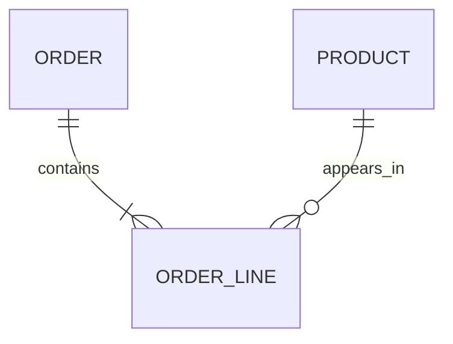
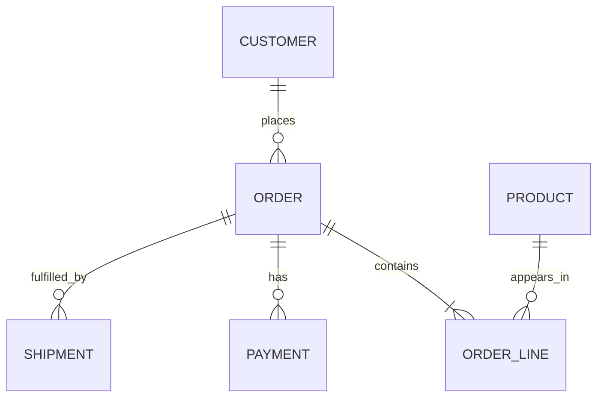
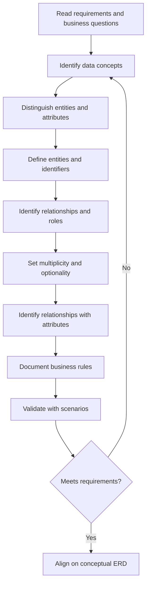

# Representing Entities and Relationships with ER Diagrams

The Entity–Relationship (ER) model is a way to describe the key data concepts of a business domain and how they relate to one another. An ER diagram (ERD) helps business, analysis, and development teams look at one shared picture: which objects the system must manage, what characteristics each object has, which relationships objects participate in, and which rules govern those relationships.

At the conceptual level, the goal is to express business semantics accurately. The diagram does not yet need to decide tables, data types, column names, indexes, or the syntax of a specific database management system. Those decisions belong to the logical and physical modeling stages. A good ERD must be clear enough for readers to test against real-world examples and technology-independent enough to translate into multiple implementation approaches.

## 1. What Questions Does an ER Model Answer?

When analyzing a system, the team needs to answer:

- Which types of business objects must the system record?
- Does each object type have its own identity, or is it merely a characteristic of another object?
- How many instances on the other side can one object link to?
- Is a relationship mandatory or optional?
- Does a relationship have its own information, such as timestamp, role, quantity, or status?
- Does any object depend on another object to exist or be identified?
- Which rules must always hold true across every valid state of the data?

An ERD clarifies the structure and semantics of data. By itself, it does not fully describe workflows, access permissions, integration protocols, UI behavior, or all state-transition rules. Those items belong in requirements and business rules documentation, then linked to components on the diagram.

### 1.1. Three Modeling Levels to Distinguish

| Level | Goal | Typical Content Represented |
|---|---|---|
| Conceptual | Align on understanding of the business domain | Entities, relationships, business-meaningful attributes, rules, and multiplicities |
| Logical | Describe detailed and consistent data structures | Detailed attributes, identifiers, candidate keys, normalization, relationship types, and logical constraints |
| Physical | Implement on a specific storage technology | Tables or collections, data types, primary/foreign keys, indexes, partitions, and storage choices |

For example, at the conceptual level you can write "Customer places Order". At the logical level, the team defines identifying attributes, descriptive attributes, and how relationships are represented. At the physical level, the team decides the `customer` table, `orders` table, column types, and indexes suited to the chosen DBMS.

Avoid introducing table names, `VARCHAR`, `UUID`, foreign key names, or index names into a conceptual diagram too early. Those details easily pull reviewers into implementation discussions before agreeing on data meaning.

## 2. Entities and Entity Types

### 2.1. What Is an Entity?

An entity is an object or concept in the business domain that the organization needs to identify and manage as a distinct individual. Examples in a sales system:

- A specific customer.
- A specific product.
- A specific order.
- A specific warehouse.
- A specific payment transaction.

An entity type describes a group of instances sharing the same meaning and common characteristics. "Customer" is an entity type; "the customer with code KH-1001" is an instance of that type.

A concept is generally worth modeling as an entity when it exhibits one or more of the following traits:

- It has an identity that must be distinguished from other instances.
- It has multiple attributes that need management.
- It has its own lifecycle or states.
- It is referenced by multiple processes or other objects.
- It has its own relationships with other concepts.
- It requires history tracking, auditing, or dedicated access control.

Not every noun in a requirements document is an entity. "Red" may simply be a value of a color attribute. "Address" may be a group of attributes on Customer, or a separate entity if addresses are shared, verified, labeled, and managed with an independent lifecycle. The decision depends on business rules.

### 2.2. Distinguishing Entities from Attributes

Ask yourself whether the concept needs to be identified and managed independently.

| Concept | Likely an Attribute When… | Likely an Entity When… |
|---|---|---|
| Address | Merely descriptive info on a single profile | Has its own code, is verified, shared, or keeps history |
| Product category | Merely a simple tag | Has a hierarchy, owner, effective-date rules, and its own relationships |
| Payment method | Only stores a fixed choice value | Needs management of configuration, provider, status, and applicability rules |
| Phone number | A simple contact value | Needs verification, history, status, or attachment to multiple subjects |
| Employee role | Merely a descriptive label | Has its own permissions, scope, and role-assignment workflow |

Promoting an attribute to an entity often clarifies the model when it has multiple relationships or its own lifecycle. However, creating an entity for every minor value makes the model verbose without delivering business benefit.

### 2.3. Strong Entities and Weak Entities

A strong entity can be identified by its own identifier under business rules. For example, a product has its own product code.

A weak entity cannot be fully identified by an independent identifier alone within the business scope; it is identified through an owner entity together with a partial local identifier. For example, an order line is numbered 1, 2, 3 within an order. The line number only has meaning when paired with the corresponding order.

Weak entities typically have these characteristics:

- Existence depends on an owner entity.
- No complete independent identifier within the business scope.
- Has a partial key, unique only within the owner's scope.
- Has an identifying relationship with the owner entity.

In the logical model, a line item may be identified by the pair `(order identifier, line sequence number)` or by a separate system-generated ID. Whichever implementation is chosen, at the conceptual level it must be clear that a line item belongs to an order and has no independent meaning without that order.

Do not call an entity weak merely because it has a foreign key or originated from a many-to-many relationship. The core criterion is dependency in identity and business meaning.

## 3. Entity Attributes

An attribute describes a characteristic that must be known about an entity or a relationship. For instance, a customer has a display name, registration date, and contact details; a line item has quantity and unit price at purchase time.

### 3.1. Common Attribute Types

| Attribute Type | Meaning | Example |
|---|---|---|
| Simple | Need not be decomposed further in the model context | Order number, quantity |
| Composite | Can be broken down into meaningful sub-parts | Address comprising street number, street, ward, city/province |
| Single-valued | Each instance has one value at a point in time per business rules | Order creation date |
| Multivalued | One instance can have multiple values | A customer has multiple contact numbers |
| Derived | Can be computed from other data by a rule | Age computed from date of birth at a point in time |
| Optional | May not yet have a valid value | Date customer verified email |
| Identifier | Distinguishes one instance from another | Unique customer code |

These types describe different dimensions and can apply simultaneously to the same attribute. For example, an address can be composite, single-valued for a specific role, yet optional for a new customer profile.

### 3.2. Composite Attributes

A composite attribute can be split into smaller parts that carry distinct meaning. For example, a shipping address may consist of:

- Recipient.
- Street number and street name.
- Ward or commune.
- District.
- Province or city.
- Postal code and country.

Decomposition is useful when the business needs to search, validate, standardize, partition deliveries, or report by individual component. If the system only displays a verbatim address block and has no need to process individual parts, it can remain a simpler value at the appropriate level.

Do not decompose merely because decomposition is linguistically possible. Base the decision on business questions and data usage rules.

### 3.3. Multivalued Attributes

A multivalued attribute is an attribute that can hold multiple values for a single instance. For example, a customer can have multiple phone numbers or a product can have multiple images.

At the conceptual level, multivalued attributes can be shown directly to accurately capture the requirement. When translating into a relational logical model, such attributes are typically extracted into a separate entity or relationship if you need to manage individual values, attach extra metadata, prevent duplicates, or query them independently.

Ask:

- Is there a limit on the number of values?
- Does each value have its own type, status, label, or effective period?
- Can the same value be shared across multiple entities?
- Is there a need to mark a primary or default value?
- Is change history needed per value?

### 3.4. Derived Attributes

A derived attribute can be computed from other attributes. For example, order total can be calculated from line items, discounts, taxes, and shipping fees according to defined rules.

Not every derived value should be stored physically. At the conceptual level, document the data source and business formula. During logical or physical design, the team evaluates whether to persist a snapshot, cache, or summary for performance, auditing, or historical needs.

For instance, age is derived from date of birth and a reference date. Storing a static age causes it to go stale over time. By contrast, the order total at confirmation time may need to be preserved as a transaction value so old invoices do not change when current pricing rules are updated.

### 3.5. Identifiers and Candidate Keys

An identifier is an attribute or set of attributes used to distinguish instances within an entity type. One entity type may have multiple valid ways of being identified.

Example for Customer:

- A system-assigned customer code.
- A customer code from a source system, if unique and stable within a defined scope.
- Another business identifier verified as unique under organizational rules.

At the conceptual level, record the identification rules and uniqueness scope. Do not yet decide whether to use auto-increment integers, UUIDs, or specific column types. Those choices belong to logical and physical design.

An attribute should not be treated as an identifier merely because existing values happen not to collide today. Confirm that the business guarantees uniqueness, stability, and controlled change procedures.

## 4. Relationships Between Entities

A relationship describes how entities participate together in an event, role, or business rule. Examples:

- Customer places Order.
- Order contains Line Item.
- Line Item references Product.
- Employee processes Order.
- Payment transaction belongs to Order.

Relationship names should use verbs or verb phrases that accurately convey business meaning. "Has" or "is linked to" are often too generic; "places", "belongs to", "approves", "hands over to", or "is assigned to" help readers understand the roles on both sides.

### 4.1. Degree of a Relationship

Degree is the number of entity types participating in a relationship.

| Degree | Meaning | Example |
|---|---|---|
| Recursive / Unary | One entity type relates to itself | Employee manages another Employee |
| Binary | Two entity types participate | Customer places Order |
| Ternary | Three entity types participate in one relationship | Supplier supplies Product to a specific Warehouse |
| Higher-order | More than three entity types participate | A business rule tying multiple roles and objects together simultaneously |

Binary relationships are common because they are easy to understand and depict. However, do not split a ternary relationship into multiple binary relationships if doing so loses the semantics of the combined tuple.

For example, "supplier supplies product to warehouse" must preserve the triple of supplier, product, and warehouse. If you only keep supplier–product and supplier–warehouse relationships, the model cannot necessarily tell which specific product that supplier delivers to which specific warehouse.

### 4.2. Recursive Relationships

A recursive relationship occurs when instances of the same entity type relate to one another. For instance, an employee manages multiple other employees.

When modeling this, name the roles on both sides to avoid ambiguity:

- Employee in the manager role.
- Employee in the direct-report role.

An employee can manage many employees, while each employee has at most one direct manager. Yet the head of the organization may have no manager. These multiplicity and optionality rules must be made explicit.

A recursive relationship differs from giving an entity a `manager_name` attribute. A relationship has identity, multiplicity, and referential constraints between instances; it can be traversed across multiple hierarchy levels or used to validate organizational structure.

### 4.3. Relationships with Their Own Attributes

A relationship can carry its own data. For example, an employee assigned to a project has a role, start date, end date, and allocation percentage. This information describes the assignment between employee and project, not the employee alone or the project alone.

When a relationship carries important attributes, consider modeling it as an associative entity at the logical level. For example, `Assignment` links `Employee` and `Project` while holding the assignment's role and timeframe.

## 5. Multiplicity and Mandatory Participation

Two critical questions when reading a relationship:

- **Cardinality (multiplicity):** How many instances on the other side can one instance on this side relate to?
- **Participation / Optionality:** Is an instance required to participate in the relationship or not?

### 5.1. Common Relationship Patterns

| Pattern | Interpretation | Example |
|---|---|---|
| One-to-one (1:1) | Each instance on side A links to at most one instance on side B, and vice versa | An employee profile has one internal account, if organizational rules guarantee it |
| One-to-many (1:N) | One instance of A can link to many instances of B; each B belongs to at most one A | One customer places many orders |
| Many-to-many (M:N) | One instance of A can link to many B's and one B can also link to many A's | One order has many products; one product appears in many orders |

Labels like "one" and "many" do not yet clarify whether participation is mandatory. For instance, a customer may not have placed any orders yet; an already created order must belong to exactly one customer in the model under consideration. Both sides must be specified explicitly.

### 5.2. Minimum and Maximum Multiplicity

Min–max notation helps prevent misunderstandings:

- `0..1`: zero or at most one.
- `1..1`: mandatory, exactly one.
- `0..N`: zero or many.
- `1..N`: mandatory, at least one and possibly many.

Example for Customer places Order:

| Direction Considered | Multiplicity | Meaning |
|---|---:|---|
| Order → Customer | 1..1 | Every order belongs to exactly one customer in this model's scope |
| Customer → Order | 0..N | A customer may have placed zero orders or many orders |

If the system allows guest checkout, the rule above must be adjusted. There may be an unregistered buyer concept, a purchase profile, or a more general customer type. Do not force every order to belong to a registered account if the business does not guarantee that.

### 5.3. Crow's Foot Notation

Crow's Foot notation is commonly used on ERDs to depict minimum and maximum counts using symbols at the ends of relationship lines:

| Symbol at Line End | Meaning |
|---|---|
| `||` | Exactly one |
| `o|` | Zero or one |
| `|{` | One or many |
| `o{` | Zero or many |

When reading a relationship line, read from each entity toward the opposite side using the symbol placed at the opposite end. For instance, `CUSTOMER ||--o{ ORDER` means one customer can have zero or many orders, and each order belongs to exactly one customer.

Other notations use circles, bars, and crow's feet with slightly different visual conventions. When sharing diagrams, document the convention explicitly and avoid mixing notations across tools.

## 6. Many-to-Many Relationships and Associative Entities

Many-to-many relationships require careful analysis because they frequently carry their own data and affect how the logical model is built.

For example, an order contains multiple products and a product can appear in multiple orders. The `Order – Product` relationship has these attributes:

- Quantity of the product in the order.
- Unit price at purchase time.
- Line-item discount amount.
- Line-specific notes or fulfillment status.

These attributes do not belong to Order alone because one order has multiple lines with different values. Nor do they belong to Product alone because the same product can be sold in different quantities and at different prices across different orders.

Therefore, the conceptual model should introduce `Line Item` as an intermediate concept:

Each line item belongs to exactly one order and references one product. An order has at least one line item in the confirmed model; a product may appear in zero line items so far or in many line items.

Associative entities are also valuable in cases such as:

- Learner enrolls in course: enrollment has registration date, grade, and status.
- Employee works on project: assignment has role, duration, and allocation percentage.
- Doctor works at clinic: affiliation has specialty, on-call schedule, and effective period.
- Product quoted by supplier: quote has price, minimum order quantity, and validity period.

An associative entity typically has its own identifier or an identifier formed from participating sides plus a local discriminator. Choosing the exact key is handled in the logical model.

## 7. Identifying Relationships and Existence Dependency

Some entities only have meaning when tied to an owner entity. Line Item is a classic example: line sequence numbers are unique only within an order, and a line item cannot exist if the order is deleted under business rules.

When modeling this kind of relationship, determine:

- What is the owner entity?
- Can the dependent entity be identified independently or not?
- How many dependent entities can one owner have?
- Must the dependent entity belong to exactly one owner?
- When the owner ends or is cancelled, under what policy must dependent data be retained, transitioned in status, or deleted?

Existence dependency does not imply always physically deleting child data when parent data is removed. In financial systems, an order may be cancelled yet still retain line items and transaction history for auditability. Lifecycle rules must be clarified before deciding storage behavior.

## 8. From Business Requirements to an ERD

You can follow an iterative workflow consisting of the steps below.

### Step 1: Define Scope and Questions to Answer

Select a sufficiently clear process or business group, and identify users and key data questions. For instance, the initial scope is order intake and fulfillment, excluding marketing campaign management.

### Step 2: Find Business Concepts

Read requirements, workflows, forms, and reports to find meaningful nouns. Flag candidates such as customer, order, line item, product, warehouse, payment transaction.

Do not turn every noun into an entity. For each candidate, ask whether it has its own identity, lifecycle, attributes, or relationships. A word may be an attribute in one scope yet an entity in another.

### Step 3: Define the Meaning and Boundaries of Each Entity

Write a one-sentence definition for each entity type. For example:

- **Order:** a purchase request received by the system and tracked through its processing lifecycle.
- **Line item:** a product entry and quantity recorded within an order.
- **Payment transaction:** a payment request or settlement record with its own identifier and outcome.

Definitions must help separate easily confused concepts. An order is not identical to a payment transaction; order status does not necessarily match payment status.

### Step 4: Identify Attributes and Identifiers

For each entity, list attributes needed to answer business questions. Classify simple, composite, multivalued, derived, and optional attributes. Define identification rules, uniqueness scope, and stability.

Only include attributes with business meaning or traceability needs; do not add technical columns like `created_at`, `updated_at`, or `version` to a conceptual diagram merely because frameworks typically generate them. Those fields may be needed in the logical or physical model once operational requirements are agreed upon.

### Step 5: Identify Relationships and Roles

Name relationships using clear verbs. Determine relationship degree, roles on each side, and attributes belonging to the relationship. For recursive relationships, assign distinct role names to each end.

### Step 6: Define Multiplicity and Optionality

Ask on each side: how many instances on the other side can one instance link to? Can it have zero links or must it have at least one? Record min–max and verify against real examples.

### Step 7: Document Business Rules

Describe rules that cannot be fully represented by lines on the diagram, such as:

- An order cannot have zero total line-item quantity once confirmed.
- Order total must be computed using transaction values as of placement time.
- A payment transaction from the same provider must not be recorded twice.
- An employee has only one direct manager at a time, except in approved cases.

### Step 8: Validate with Scenarios

Pick concrete instances and scenarios to test the diagram: a customer with no orders yet, an order with multiple lines, a product never sold yet, an order with multiple payments, an employee changing managers, an address changed after order placement. If the diagram cannot express or explain a scenario, revisit definitions, relationships, or constraints.

### Step 9: Cross-Check Against Requirements and Align

Verify that every business question has supporting data and relationships to answer it. Check whether any entity serves no requirement, whether any entity is missing, and whether stakeholders share the exact same understanding of terms.

## 9. Comprehensive Example: ERD for an Online Store

Suppose a store needs to accept orders, manage products, record payments, and track deliveries. Core questions:

1. Which customer placed which order?
2. Which products and quantities are in an order?
3. What was each product's price at placement time?
4. How many payment attempts/transactions can an order have?
5. In which parcels is the order shipped, and what is each parcel's status?

### 9.1. Entity List and Definitions

| Entity | Definition | Selected Business Attributes |
|---|---|---|
| Customer | Individual or organization making purchases | Customer code, name, contact info |
| Order | Accepted purchase request | Order number, placement timestamp, order status |
| Line Item | A product entry within an order | Line number, quantity, unit price at purchase, discount |
| Product | Item available for sale | Product code, name, description, commercial status |
| Payment | A payment transaction related to an order | Reference code, amount, timestamp, status |
| Shipment Parcel | A unit of goods handed over for transport | Parcel code, tracking number, handover timestamp, status |

### 9.2. Conceptual ER Diagram

Interpretation:

- A customer may have placed zero orders or many orders; each order belongs to one customer in this example's scope.
- A confirmed order has at least one line item; each line item belongs to exactly one order.
- A product may never have been sold or may appear in many line items; each line item references one product.
- An order may have no payments yet, multiple payments, or refund transactions governed by separate rules; the diagram should distinguish transaction types explicitly if the business requires it.
- An order may not yet be shipped or may be fulfilled across multiple parcels; each parcel in the example belongs to one order.

This diagram is a simplified conceptual model. If one parcel can carry items from multiple orders, or one order is delivered by multiple carriers, the shipping relationship must be expanded to reflect actual workflows.

### 9.3. Why Line Item Is Needed

If we only connect Order directly to Product, we know which products appear in an order, but not the quantity, unit price, and discount for each purchase entry. Those attributes belong to the relationship between Order and Product. Thus, `Line Item` is modeled as an associative entity.

This also allows storing multiple lines for the same product when the business needs separation by batch, price tier, promotion, or handling rule. Whether duplicate products are permitted in one order must be confirmed separately.

### 9.4. Rules Not Inferable from the Diagram Alone

The diagram alone does not answer questions such as:

- Can guest shoppers place orders?
- Can an order exist without line items while in draft status?
- Can an order have multiple pending payment transactions?
- Is a refund a type of payment transaction or a separate business concept?
- Can one parcel hold items from multiple orders?
- Is the shipping address stored as a snapshot on the order or referenced from the current profile address?
- When a product is discontinued, can historical line items still reference that product?

These questions must be documented as business rules or supplementary requirements. Readers should not have to guess them from ERD lines.

## 10. Choosing Notation and Diagram Layout

There are several ways to draw an ERD. Notation should match the audience, level of detail, and tooling in use.

### 10.1. Chen Notation

Chen notation typically represents:

- Entities as rectangles.
- Relationships as diamonds.
- Attributes as ovals.
- Identifying attributes underlined.
- Weak entities or identifying relationships with distinct symbols.

Chen notation is useful in teaching and conceptual discussions because it visually separates entities, relationships, and attributes. However, diagrams can grow bulky when a system has many attributes.

### 10.2. Crow's Foot Notation

Crow's Foot typically represents entities as boxes and relationships as connecting lines with multiplicity symbols at both ends. This notation is compact, practical for models with many entities, and widely used in relational data design.

When using Crow's Foot at the conceptual level, stick to business names and meaningful attributes. Do not crowd the diagram with full column types or foreign key names.

### 10.3. Guidelines for Readable Diagrams

- Use singular nouns for entity names, e.g., `Customer`, `Order`.
- Use clear verbs for relationship names, e.g., `places`, `contains`, `approves`.
- Label roles on recursive relationships or relationships with similar participating roles.
- Clearly display multiplicity and optionality on both sides.
- Avoid crossing lines; group entities by business flow or domain area.
- Annotate business rules not cleanly expressed by notation alone.
- Keep vocabulary aligned with requirements documents and the project glossary.
- Mark diagram scope and version clearly to prevent using outdated versions.

A visually neat diagram missing multiplicities or using vague names still falls short in quality. Prioritize accuracy and verifiability over decoration.

## 11. Validating the ERD

The ERD should be reviewed with domain experts and tested against real data questions.

### 11.1. Checking Each Entity

- Is the entity's definition clear and non-overlapping with other entities?
- Does it have an independent identity or management reason?
- Are attributes placed on the right entity?
- Are any multivalued or composite attributes misrepresented?
- Is the identifier genuinely unique and stable under business rules?
- Has a category value been mistaken for an independent entity?

### 11.2. Checking Each Relationship

- Does the relationship name accurately describe the action or role?
- Does the relationship degree match business rules?
- Have multiplicities on both sides been confirmed with examples?
- Is minimum participation distinguished from maximum multiplicity?
- Should any relationship with its own attributes become an associative entity?
- Do recursive relationships have clear role names?
- Was any ternary relationship split in a way that lost semantics?

### 11.3. Testing with Edge-Case Scenarios

Certain scenarios quickly expose modeling defects:

| Scenario | What to Verify |
|---|---|
| New customer with no orders yet | Does the customer–order relationship allow 0 orders? |
| New order in draft status | Can it have zero line items yet? |
| Product never sold yet | Can it exist without any line items? |
| One order with multiple payments | Does the order–payment relationship support it? |
| Employee changes manager | Does relationship history over time need to be stored? |
| Customer address changes | Does historical shipping data remain unchanged? |
| One product has multiple suppliers | Are a many-to-many relationship and quote price attributes needed? |

### 11.4. Tracing Against Business Questions

For every question in the requirements document, trace which entities, relationships, and attributes are needed to answer it. If no data path exists on the diagram, the model may be missing a concept or the question may not be defined clearly enough.

Conversely, for every entity and relationship, ask which requirement it serves. A component with no clear purpose may be unnecessary data—or an uncaptured requirement. Verify before keeping or removing it.

## 12. Common ER Modeling Mistakes

| Mistake | Consequence | Fix |
|---|---|---|
| Treating every noun as an entity | Diagram fills with trivial fragmented objects | Check identity, lifecycle, and independent management need |
| Merging distinct concepts together | Loss of semantics and muddled lifecycles | Write separate definitions and boundaries for each entity |
| Omitting multiplicities | Unclear whether links are one or many | Ask min and max counts on both sides |
| Confusing multiplicity with mandatory participation | Misses zero-link cases | Distinguish `0..1`, `1..1`, `0..N`, and `1..N` |
| Placing relationship attributes on one side | Data duplication or inability to represent individual links | Create an associative entity when the relationship has its own attributes |
| Splitting ternary relationships arbitrarily | Loses knowledge of participating tuples | Keep higher-degree relationships when semantics require them |
| Using generic relationship names | Readers fail to understand business roles | Use descriptive verbs and clear role names |
| Putting physical details into conceptual diagrams | Hard to discuss business logic; couples to specific tech | Separate conceptual, logical, and physical models |
| Skipping edge-case testing | Model only works for happy paths | Use real examples, exceptions, and zero-relationship cases |

## 13. Checklist for Completing a Conceptual ER Diagram

- [ ] Business scope and target questions are defined.
- [ ] Every entity has a clear name and business definition.
- [ ] Entities are distinguished from attributes and category values.
- [ ] Important attributes are attached to the right entity or relationship.
- [ ] Multivalued, composite, and derived attributes are identified.
- [ ] Identifiers have clear uniqueness rules and scope.
- [ ] Relationships are named with verbs and have clear roles.
- [ ] Relationship degree is correctly determined, including recursive or ternary when needed.
- [ ] Minimum and maximum multiplicities are shown on both sides.
- [ ] Many-to-many relationships with their own attributes have been evaluated as associative entities.
- [ ] Identifying relationships and existence dependencies are accurately described.
- [ ] Business rules not shown by connector lines are documented separately.
- [ ] The ERD is validated with both normal and edge-case scenarios.
- [ ] Every important business question traces back to data on the diagram.
- [ ] The diagram is not prematurely constrained by physical implementation details.

A conceptual ERD is valuable when every entity, attribute, and relationship carries business meaning, multiplicities are confirmed, and critical questions trace directly to required data. From that foundation, the team can advance to the logical model to define keys and detailed structures, and then to physical design tailored to the actual storage engine and query workload.
