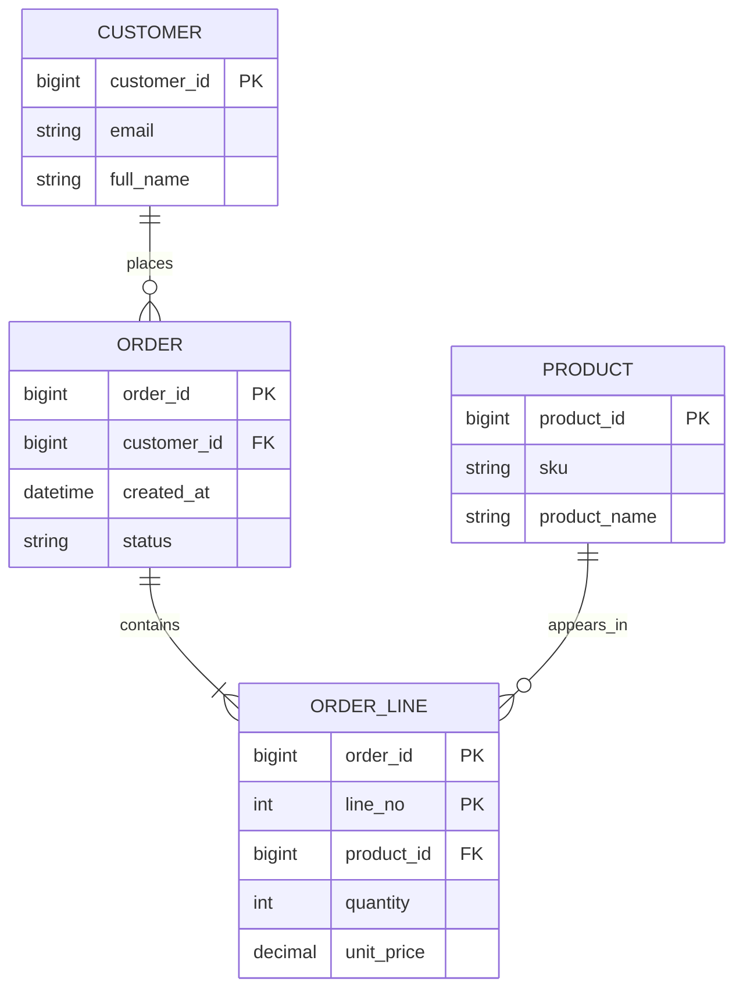
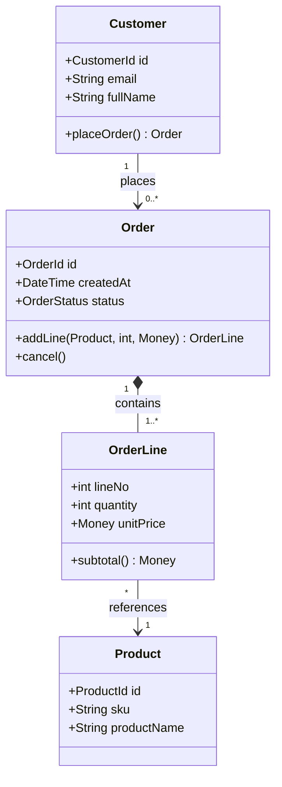

# Comparing ER Diagrams and UML Class Diagrams by Purpose

## 1. Two Diagrams Answer Two Different Sets of Questions

When analyzing a business domain, the design team needs to describe important concepts, their attributes, and how they relate to one another. Both ER (Entity–Relationship) diagrams and UML (Unified Modeling Language) class diagrams can represent the static structure of a domain, yet they originate from different purposes.

**ER diagrams focus on data that needs to be recorded and the rules linking data together.** They help answer: which entity types must the system store, what attributes does each entity have, what are the cardinalities and participation rules of their relationships, and which attributes identify an entity?

**UML class diagrams focus on the structure of classes and relationships between them in an object-oriented model.** They help answer: which classes exist in the system, what state and behavior does each class have, which class inherits from which, and how do objects associate with or own other objects?

In data design, both can support conceptual analysis. However, an ER diagram is usually the more direct choice when the primary goal is clarifying data structure and constraints. A UML class diagram is useful when bridging a domain model to object-oriented software design, including both state and behavior.

Do not assume that ER is exclusively for relational databases or that UML is exclusively for source code. ER can help analyze data for many storage models; UML can describe a business domain without yet deciding how to implement it in Java classes or database tables.

## 2. What Is an ER Diagram?

ER describes a data domain using three foundational elements:

- **Entity:** a type of object or occurrence that the business needs to identify and store information about, such as Customer, Order, Product.
- **Attribute:** information describing an entity or a relationship, such as customer email, order creation timestamp, quantity on a line item.
- **Relationship:** a business-meaningful link between entities, such as a customer placing an order or an order containing line items.

ER supports several notations. In Chen notation, entities are typically drawn as rectangles, relationships as diamonds, and attributes as ovals. In Crow's Foot notation, entities are typically represented as boxes listing attributes; symbols at both ends of connecting lines depict minimum and maximum counts. Tools may present visuals differently, yet the semantics of entities, attributes, relationships, and cardinalities must remain consistent.

### 2.1. Entities and Identifiers

An entity needs a way to distinguish individual instances. For example, two customers may share the same name yet still be two different customers. A customer code or another appropriate business identifier tells them apart.

During conceptual analysis, identify meaningful business identifiers and attributes usable for recognition. When transitioning to the logical model, the design team decides concrete primary keys, alternate keys, and uniqueness constraints.

Not every noun in business documents needs to become an entity. A concept may merely be an attribute, a classification value, or a descriptive term. For example, order status is usually an attribute with a defined value domain; it should only become its own entity if the business needs to manage additional data or independent relationships about statuses.

### 2.2. Relationships and Cardinality

ER depicts how many instances of one entity can or must link to another entity. Common patterns:

- **One-to-one (1:1):** each A links to at most one B and each B links to at most one A.
- **One-to-many (1:N):** one A can link to many B's, while each B links to one A.
- **Many-to-many (M:N):** many A's can link to many B's.

Beyond cardinality, determine whether participation is mandatory. For instance, an order must belong to exactly one customer; a customer may have placed zero orders or many orders. Relationships thus carry both minimum and maximum bounds.

An M:N relationship is typically resolved into an associative entity when moving to a relational model. For example, the Order–Product relationship carries its own attributes such as quantity and unit price at sale time; thus, Line Item is an independent data concept that needs modeling.

### 2.3. Relationship Attributes and Weak Entities

Some information belongs to the relationship itself. In the relationship between Order and Product, quantity does not belong to Product alone because the same product can be purchased in different quantities across different orders. Nor does it belong to Order alone because one order contains multiple products. Quantity and unit price at sale time belong to that specific association.

In ER, a weak entity is an entity without a complete identifier independent of an owner entity. For example, Line Item may be identified by the order number combined with a line sequence number. Line Item exists within the context of an order and typically has no independent meaning if the order is removed under business rules.

## 3. What Is a UML Class Diagram?

A UML class diagram describes classes, attributes, operations, and relationships in an object-oriented model. A class is typically drawn as a rectangle with up to three compartments:

1. Class name.
2. Attributes.
3. Operations / methods.

For example, class `Customer` may have attributes `id`, `email` and operation `placeOrder()`. Attributes describe object state; methods describe behavior provided by the object.

### 3.1. Relationships in UML

UML provides several relationship types to describe software structure:

- **Association:** indicates objects relate to one another. Role names, navigability arrows, and multiplicity can be shown at both ends.
- **Generalization (inheritance):** a subclass inherits characteristics from a superclass.
- **Aggregation:** represents a loose/shared whole–part relationship; notation uses a hollow diamond on the whole side. Lifecycle semantics should be agreed upon by the team because aggregation usage varies across teams.
- **Composition:** represents a tighter whole–part relationship; notation uses a filled diamond on the whole side. Parts typically depend on the whole for their lifecycle.
- **Dependency:** one element uses or depends on another without necessarily holding a long-lived structural link.

UML uses **multiplicity** to show object counts at each end of a relationship, such as `1`, `0..1`, `0..*`, or `1..*`. These values express bounds similar to min/max in ER, yet UML also adds navigability, roles, and object-oriented relationship semantics.

### 3.2. Inheritance, Abstract Classes, and Behavior

One advantage of class diagrams is representing type hierarchies. For example, `PaymentMethod` can be an abstract class, with `CardPayment` and `BankTransfer` as concrete classes. The model can also show operations such as `authorize()`, `capture()`, or `refund()`.

In domain analysis, inheritance should only be used when concepts genuinely have a parent–child subtype relationship and obey substitutability. Do not create a class hierarchy merely because a few entities share some attributes. A shared group of attributes sometimes only needs a reference value, an associative entity, or another structure.

A class diagram can also omit the operations compartment when the purpose is strictly data modeling. Therefore, the difference between ER and UML is not simply that UML always includes behavior while ER can never express rules; the primary difference lies in emphasis and notation semantics.

## 4. Direct Comparison by Purpose

| Criterion | ER Diagram | UML Class Diagram |
|---|---|---|
| Primary goal | Describe data structure and linking rules | Describe class structure and object-oriented relationships |
| Central elements | Entity, attribute, relationship | Class, attribute, operation |
| Identity | Explicitly marks keys/identifiers per notation | Can mark identifying attributes, though no single universal DB key convention exists across all diagrams |
| Relationships | 1:1, 1:N, M:N; min/max and participation | Association, multiplicity, navigability, aggregation, composition |
| Relationship attributes | Modeled directly or via associative entity | Can use an association class or link class |
| Inheritance | Can depict specialization/generalization in extended ER models | Has explicit generalization notation |
| Behavior/methods | Not the focus | Can depict operations and visibility |
| Constraints | Usually focuses on identity, cardinality, participation, and data rules | Can add constraints, notes, and OCL to express rules |
| Primary audience | Data analysts, data architects, DBAs, business owners | Business analysts, software architects, developers, domain modelers |
| Typical output | Conceptual model or foundation for logical data model | Domain model or software class design; can also support data modeling |

The table above describes typical usage tendencies, not rigid limits. UML can be used to depict a data model, and ER can be extended to capture richer concepts. When reading a diagram, check the conventions chosen by the project team rather than relying purely on visual style.

## 5. Modeling the Same Business Domain Both Ways

Consider a sales system with these requirements:

- A customer can place multiple orders.
- Each order belongs to exactly one customer.
- An order has at least one line item.
- Each line item references exactly one product.
- A product can appear in multiple line items.
- Each line item has quantity and unit price at placement time.

### 5.1. Representing with ER

ER focuses on data entities and relationship cardinalities:

How to read the diagram:

- A customer can have 0 or many orders; each order links to exactly one customer.
- An order has 1 or more line items; each line item belongs to exactly one order.
- A product may not yet appear in any order or may appear in many line items; each line item references exactly one product.
- `ORDER_LINE` is the associative entity between order and product, holding `quantity` and `unit_price`.

The diagram captures structural rules. By itself, it does not decide index types, partitioning strategies, currency storage, cancelled order handling, or price history preservation. Those decisions must be clarified in subsequent steps.

### 5.2. Representing with a UML Class Diagram

UML can describe the same concepts as classes, adding business operations and ownership semantics:

The class diagram shows additional details:

- `Customer` provides the order placement operation.
- `Order` can add line items and cancel the order.
- `OrderLine` has behavior to calculate line subtotal.
- Composition between `Order` and `OrderLine` expresses that line items belong to the order's lifecycle in this domain model.

Composition notation is an object-model semantic choice. It does not automatically mean the database must cascade deletes via `ON DELETE CASCADE`; physical deletion rules must be decided separately.

### 5.3. What Is Similar and Different in the Two Diagrams

Both diagrams show that Customer–Order is one-to-many, Order–OrderLine is one-to-many, and OrderLine references Product. Both also show that OrderLine must hold quantity and unit price.

However, ER emphasizes OrderLine as an associative entity that stores data and needs identification. UML emphasizes OrderLine as a component class with state, behavior, and lifecycle bound to Order. If the goal is relational schema design, the key attributes and constraints of OrderLine must be clarified. If the goal is object-oriented domain design, valid operations and how objects enforce state invariants are also vital.

## 6. Translating Between ER and UML: Equivalences and Limits

Many concepts map between the two diagrams, yet they should not be treated as completely interchangeable notations.

| Concept | In ER | In UML |
|---|---|---|
| Business object type | Entity | Class |
| Descriptive data | Attribute | Attribute |
| Link between objects | Relationship | Association |
| Link counts | Cardinality and participation | Multiplicity |
| Many-to-many with attributes | Associative entity | Association class or link class |
| Type hierarchy | Generalization/specialization in extended ER | Generalization |
| Identity | Key | Attribute or constraint describing identity |
| Business rules | Constraints and notes | Constraints, notes, OCL, or supplementary specs |

Key differences to watch for:

**First, identification is not identical.** ER typically makes entity keys explicit because the goal is identifying and linking data. UML can annotate identifying attributes or constraints, yet a class diagram by itself does not prescribe how to build primary keys, foreign keys, or unique indexes in a database.

**Second, multiplicity does not replace all data constraints.** A `1..*` multiplicity says an object must link to at least one other object in the model. Yet it does not fully resolve how the database enforces that rule at every instant, especially when creating multiple records in one transaction. Some rules require validation in business logic, transactions, triggers, or DBMS-appropriate mechanisms.

**Third, composition does not equal cascading foreign keys.** Composition describes ownership and lifecycle dependency in an object model. When translating to a database, deletion behavior, history retention, and audit requirements must be decided independently.

**Fourth, one class does not necessarily map to one table.** One class may be stored across multiple tables; multiple classes may be combined into one table; a class may exist only in memory or be computed from other data. Conversely, a technical table may be introduced to support storage without a corresponding domain class.

**Fifth, attributes in UML may be derived values or transient state.** For example, `subtotal()` is an operation computed from quantity and unit price; its return value does not necessarily need a persisted column. When moving to a data model, separate source data, derived data, and data persisted for history or performance.

## 7. When to Choose Which Diagram?

Choose the diagram based on the question to solve and the audience who will use the document.

| Situation | More Suitable Diagram | Rationale |
|---|---|---|
| Exploring entities, attributes, keys, and data links | ER | Focuses directly on data structure and constraints |
| Discussing cardinality, optionality, and M:N relationships | ER | ER notation highlights cardinality and participation directly |
| Designing domain classes for a Java application | UML class | Represents classes, operations, inheritance, and object links |
| Discussing component lifecycles and object responsibilities | UML class | Association, aggregation, and composition express object semantics |
| Preparing a logical model for a relational database | ER | Transitions smoothly to relations, keys, and constraints |
| Bridging domain analysis and software design | Both | ER clarifies data structure; UML clarifies object structure and behavior |

In real projects, both can be used sequentially: build an ER model to align on data and relationships, then create a UML class diagram to show how the application organizes objects and behavior. Both diagrams should share the same vocabulary and be reconciled whenever changes occur. Do not maintain two independent drawings with conflicting definitions of the same concept.

## 8. Process for Building and Reconciling Both Diagrams

A practical workflow may include these steps:

1. **Gather business terminology:** record nouns, events, roles, and rules appearing in requirements.
2. **Identify candidate entities or classes:** check whether each concept has its own identity, state, lifecycle, or responsibility.
3. **Define attributes:** record name, meaning, conceptual type, optionality, and data source.
4. **Define relationships:** describe meaning, both ends, min/max cardinality, and optionality.
5. **Handle relationships with attributes:** create an associative entity in ER or an association/link class in UML.
6. **Add special rules:** identity, uniqueness, inheritance, ownership, lifecycle, and business invariants.
7. **Reconcile using scenarios:** test happy paths, missing data, duplicates, transaction cancellations, and state changes.
8. **State model scope clearly:** mark what belongs to the conceptual model versus logical or software design decisions.

When translating from ER to UML, ask whether each data entity corresponds to a domain object concept; if so, what responsibilities or behaviors does that class hold? When translating from UML to ER, ask which attributes require durable storage, which associations need querying, which objects need stable identifiers, and which constraints must be enforced by the database?

## 9. Common Mistakes

- Choosing a diagram out of tool habit without defining the document's purpose.
- Treating every noun in requirements as an entity or a class.
- Assuming one UML class always maps to one table and one ER entity always maps to one class.
- Overlooking attributes on M:N relationships, losing details like line quantity or unit price.
- Mistaking multiplicity for complete database integrity enforcement.
- Using composition merely to represent a one-to-many relationship even when both objects have independent lifecycles.
- Putting too many technical methods into an ER diagram or too many physical storage details into a conceptual class model.
- Using inheritance solely to bundle shared attributes without a genuine subtype classification.
- Maintaining ER and UML diagrams with inconsistent names, cardinalities, or business rules.
- Assuming a tidy diagram proves the model is correct without validating against business scenarios.

## 10. Selection and Validation Checklist

Before finalizing the model, verify:

- [ ] The diagram's purpose and target audience are defined.
- [ ] Entities/classes represent business-meaningful concepts.
- [ ] Attributes have clear names, defined meanings, and separate source vs. derived data.
- [ ] Every relationship has an understandable name or role.
- [ ] Cardinality/multiplicity and optionality are recorded at both ends where needed.
- [ ] M:N relationships with attributes are modeled via an appropriate associative entity or link class.
- [ ] Identity, inheritance, ownership, and lifecycles are modeled intentionally.
- [ ] Constraints not directly visible on the diagram are documented in notes.
- [ ] There is no blind 1:1 assumption between classes and tables or entities and classes.
- [ ] Diagrams share common terminology and have been validated with real business scenarios.

Both ER and UML class diagrams help teams understand the structure of a business domain, yet each illuminates a different perspective. Selecting the right diagram for the purpose makes documentation readable, keeps constraint discussions grounded in the right place, and ensures the transition from conceptual modeling to data modeling or software design remains verifiable.
