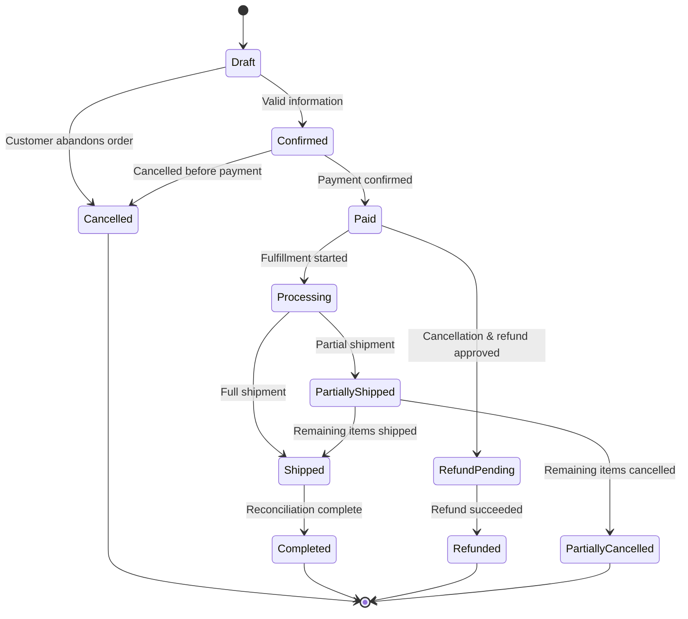

# Reviewing Models with Creation, Change, and End-of-Lifecycle Scenarios

In the **Conceptual Modeling** chapter, a diagram is only truly valuable when it explains how business objects come into existence, change, and end. A model can look reasonable when inspecting active records, yet still miss partial data creation, changing relationships, owner reassignments, transaction cancellations, or retaining history after an object ceases to be active.

Reviewing a model using lifecycle scenarios tests whether concepts, relationships, attributes, and rules reflect real-world operations. This is an essential step in translating business requirements into a clear, evolvable, and verifiable data model. When a model is stress-tested against concrete scenarios, the team can uncover missing entities, inaccurate relationship cardinalities, incomplete states, misplaced attributes, or undefined history rules.

After this lesson, learners will be able to:

- Build review scenarios covering three scenario groups: creation, change, and end of lifecycle.
- Verify the completeness of entities, attributes, relationships, identifiers, and constraints across each scenario.
- Distinguish current state, triggering events, change history, and effective periods.
- Identify the impact of changes on related objects and previously generated data.
- Evaluate how to handle cancellations, closures, archiving, deletion, and anonymization under business rules.
- Record findings, open questions, and evidence to refine the model.

## 1. Why Review Models Across the Lifecycle?

Conceptual models are often built from initial requirements and happy-path examples. Those examples may only describe normal states: a customer creates an order, staff processes it, goods are delivered. In reality, however, an object does not sit still. It is created, enriched with details, linked to other objects, transitioned through states, reassigned to new owners, cancelled, expired, or archived.

If you only inspect a model at a single point in time, the team can miss critical questions:

- Can an object be created before all information is ready?
- Can drafts or incomplete data be saved?
- Does a change affect multiple other objects?
- Can a relationship be replaced or terminated while still preserving history?
- When an object is cancelled, must related data be kept, closed, split, or deleted?
- Must historical transactions continue reflecting the details as of the time they occurred?
- Are there rules that hold true only during one lifecycle stage?

For example, an order may be created before a customer completes their shipping address. Later the customer adds the address, pays, requests exchanging one item, and finally cancels the undelivered portion. If the model only has an orders table with status `NEW` or `DONE`, the team may not know which point-in-time address to preserve, whether an order can have multiple payments, or which portion of the order was cancelled.

Lifecycle-based review helps the model answer both "what is the object?" and "how does the object change throughout its existence?".

### 1.1. Three Core Scenario Groups

| Scenario Group | Central Question | Examples |
|---|---|---|
| Creation (`create`) | When does the object appear, what data is needed, which links are mandatory? | Customer creates draft order, staff opens customer profile, system opens new class. |
| Change (`change`) | Which attributes, relationships, or states can change, who may change them, and how is history kept? | Changing shipping address, reassigning owner, adjusting class capacity. |
| End of lifecycle (`end`) | When does the object become inactive, and how is related data handled? | Cancelling order, closing class, terminating contract, archiving records. |

These three groups do not necessarily happen in a straight line. An object can be cancelled during creation, reopened after closing, or replaced by another object. Model all business-permitted transitions and document their conditions clearly.

### 1.2. Distinguishing Object Lifecycle from Relationship Lifecycle

An object can continue existing while its relationships change. For instance, an employee remains employed yet transfers to another department; a contract remains stored yet its account owner changes; a product still exists yet is no longer offered at a specific branch.

If you only store the current relationship, the team cannot answer who was previously responsible or at which branches a product was sold in the past. Therefore, examine the lifecycle of both entities and relationships. When a relationship has its own start time, end time, role, or status, it may need to be managed as an associative concept.

## 2. Preparing a Review Scenario Suite

### 2.1. Selecting Scenarios That Stress-Test the Model

You do not need to describe every UI click. Choose scenarios that expose data structure and rules. A strong scenario suite typically includes:

- Common scenarios to verify core flows.
- Edge-case scenarios to test bounds and mandatory participation.
- Relationship-change scenarios to test history and cardinality.
- Failure or cancellation scenarios to verify terminal states.
- Duplicate, concurrent, or late-arriving scenarios to test identity and consistency.
- Restoration or reopening scenarios if permitted by the business.

Example for orders:

| Group | Scenario | Question the Model Must Answer |
|---|---|---|
| Creation | Customer creates an order with multiple lines | How many lines can an order have? Does a line have its own identifier? |
| Creation | Guest shopper creates an order | Must an order always link to a customer profile? |
| Change | Customer changes address before delivery | Must current profile address and locked order address be distinguished? |
| Change | One order line ships in two waves | Must each shipment and its shipped quantity be recorded? |
| Change | Order is paid multiple times | Can one order have multiple payment transactions or attempts? |
| End | Order is cancelled after payment | Does cancellation create a refund obligation or reconciliation record? |
| End | Order completes and passes return window | Which data must remain searchable and retained? |

Scenarios should be sourced from requirements, interviews, sample data, regulations, or business owners. If the team adds hypothetical scenarios to stress-test model resilience, mark them clearly as assumptions requiring confirmation.

### 2.2. Structure of a Scenario

Each scenario should contain these fields:

| Component | Content |
|---|---|
| ID and name | Stable identifier, short descriptive title of the scenario. |
| Objective | Aspect of the model being tested. |
| Preconditions | Existing objects, attributes, relationships, and states. |
| Actor | User, department, or system triggering the action. |
| Event/Action | What happens in the scenario. |
| Applicable rules | Conditions allowing, rejecting, or adjusting the action. |
| Expected outcome | Resulting objects, relationships, states, and historical data after processing. |
| Related impact | Other objects affected. |
| Evidence | Requirement statement, data sample, document, or confirming stakeholder. |
| Review result | Model satisfies it, missing concept, wrong relationship, or needs clarification. |

Describe the scenario in business language first. Only afterward map each step against concepts on the diagram. This prevents forcing the scenario into the existing model and overlooking mismatches.

### 2.3. Lifecycle Coverage Matrix

A simple matrix helps spot which concepts have not yet been tested at each stage.

| Concept | Creation | Attribute Change | Relationship Change | End | History / Restoration |
|---|---|---|---|---|---|
| Customer | Create profile or guest checkout | Update contact, address | Merge profiles, change representative | Deactivate, deletion request | Retain transaction info per policy |
| Order | Create draft, confirm | Add details, valid adjustments | Add/remove lines, change shipping address | Cancel, complete | Track status and reconcile |
| Order line | Add product | Adjust quantity before cutoff | Switch warehouse, split shipment | Partial cancel | Preserve delivered/cancelled quantities |
| Payment | Create payment request | Update provider result | Attach to order or refund | Fail, succeed, refund | Keep every transaction and attempt |

The matrix does not replace the model. It is a gap-finding tool: an empty cell may mean it hasn't been investigated yet, not necessarily that the business forbids that operation.

## 3. Reviewing Creation Scenarios

Creation is the moment a concept or specific instance enters the business domain. Some objects are created complete in one step; others are created partially and completed later. Define clearly which moment marks the start of the lifecycle.

### 3.1. Identifying the Creation Event and Identification Moment

Ask:

- What counts as creating a new object: saving a draft, submitting a request, getting approved, or generating a transaction?
- Can the object be created before all information is present?
- At what moment is an identifier assigned?
- If a user resubmits the same request due to a missing response, does the system recognize it as a retry or a new object?
- Can the object be created from multiple channels or systems?
- Who owns the data after creation?

For example, an order could be created when a customer starts a cart, clicks confirm checkout, or when the backend accepts the request. Those three moments carry different meanings. If a cart is not yet an order, do not record every cart as an order carrying obligations. If an order is created before payment, its initial status must clearly reflect unpaid state.

### 3.2. Checking Mandatory vs. Later-Provided Data

Not every attribute must exist at creation time. Classify data by timing:

- Mandatory at creation time.
- Mandatory before transitioning to the next state.
- Can be added later.
- Generated only when another event occurs.
- Not applicable to certain subtypes.

For instance, a shipping address might not be needed when creating a draft order, yet must exist before confirming delivery. A tracking number is generated only after handing the parcel to the carrier. Marking every field as mandatory upfront may fail to represent staged creation workflows.

| Data | When It May Be Needed | Confirmation Question |
|---|---|---|
| Buyer or contact info | At order creation or before confirmation | Is guest checkout allowed? |
| Order lines and quantities | At order creation | Are draft orders allowed with zero lines? |
| Shipping address | Before delivery confirmation | Is an address snapshot saved at placement time? |
| Payment transaction | When customer pays | Are cash-on-delivery orders supported? |
| Tracking number | Upon carrier handover | Can one order have multiple tracking numbers? |

### 3.3. Checking One-to-Many and Concurrent Creation

A single creation operation can spawn multiple child objects or relationships. For instance, creating an order can simultaneously create multiple order lines. Determine which objects must be created together, which can exist independently, and what the business outcome is if part fails.

Helpful questions:

- Can an order exist without order lines?
- Can an order line be created before an order?
- When one order line is invalid, is the entire order rejected or only that line?
- If two requests to create the same object arrive nearly simultaneously, what is the deduplication rule?
- Is the business code unique across the entire system or per branch/channel?

Reviewing these cases identifies mandatory relationships, uniqueness scopes, and object-creation rules. Implementing atomic transactions, locks, or idempotency mechanisms belongs to later technical design, yet the business need must be clear right in the model.

### 3.4. Creation Scenario Examples

**CR-01 — Customer creates a draft order without a shipping address**

| Component | Description |
|---|---|
| Preconditions | Customer has selected products but has not provided an address. |
| Action | Customer saves the order in draft status. |
| Expected outcome | Draft order exists; shipping address may be absent; order is not considered ready to ship. |
| Concepts to check | Order, order line, customer/guest, shipping address, order status. |
| Open questions | How long are draft orders retained? When is an official order number assigned? |

**CR-02 — A request is resubmitted**

| Component | Description |
|---|---|
| Preconditions | Customer submitted an order creation request without receiving a response. |
| Action | Browser or app retries the request. |
| Expected outcome | System determines whether the request is a retry of the same operation or a new order per agreed rules. |
| Concepts to check | Order, order creation request, reference code, intake event. |
| Open questions | Where is the request identifier issued and does it expire? |

## 4. Reviewing Change Scenarios

Changes can affect attributes, relationships, states, or data meaning. Not all changes behave alike. Updating a contact phone number may simply update current info; changing price on a confirmed order may violate price-locking rules; changing an owner may require keeping relationship history.

### 4.1. Classifying Changes

| Change Type | Example | Question the Model Must Answer |
|---|---|---|
| Descriptive attribute | Change customer display name | Must the old name be preserved on past transactions? |
| Effective-dated attribute | Change address starting tomorrow | Does the old value remain valid for the prior period? |
| Relationship | Reassign order to another agent | Do we need to know who was assigned during each stage? |
| Child components | Add or remove line items | Can already-shipped lines be edited or deleted? |
| State | Transition from pending confirmation to confirmed | Which event authorizes transition? Is an approver needed? |
| Locked values | Price, discount rate, terms at transaction time | Do edits to master data affect past transactions? |
| External system change | Address updated from CRM or partner catalog | Which system is the authoritative source? |

### 4.2. Distinguishing Current Data from Transaction-Time Data

An object may need both current info and info locked at a point in time. For example, a customer changes addresses after placing an order. The customer profile can update to the new address, yet the old order still needs the shipping address confirmed at placement.

Ask:

- Does the change apply retroactively to completed transactions?
- Must a snapshot of information be stored at transaction time?
- For which reconciliation, legal, support, or reporting purposes must old data be retained?
- If a value was corrected due to an error, must before/after values and a reason be saved?
- Can we determine which value was accurate at a past point in time?

For example, `Customer Address` is current info on the customer profile. `Order Shipping Address` is info used for a specific transaction. The two concepts are related yet do not always share the same value over time. Referencing only the customer's current address causes past order history to shift meaning whenever the customer updates their profile.

### 4.3. Reviewing Relationship Changes

Relationships often change while entities at both ends continue existing. Determine:

- Can the relationship start or end independently?
- Must start and end timestamps be stored?
- Can multiple relationships exist simultaneously?
- Are there separate roles or conditions per link instance?
- Once a relationship ends, must historical data still be queried?

For instance, an employee transfers from sales to support. If you only overwrite `department` on the employee profile, historical reports might imply the employee always belonged to support. If transfer history is needed, model department assignment with effective start and end timestamps.

Similarly, a product can be sold at multiple branches. The product–branch relationship can have its own price, selling status, and effective date. If these values change independently, they belong to the relationship or an associative concept rather than solely as attributes of Product.

### 4.4. Reviewing Partial and Multi-Step Changes

A business action may alter only part of an object. For example, a customer cancels one line item in an order while the remaining lines still ship. If the model has only one overall status for the entire order, it may fail to show what shipped, what remains, and what was cancelled.

Check:

- Does the parent object track distinct states per child object?
- Can each part have its own timestamps, quantities, or outcomes?
- Can one part change without losing history of the remaining parts?
- By what rule is the parent object's aggregate status derived?

Do not assume parent status always suffices to describe every child object. If each line item has its own lifecycle, represent that explicitly in the model.

### 4.5. Reviewing Concurrent Changes and Conflicts

Two actors may update the same object or relationship nearly simultaneously. Examples: two staff members edit a customer profile at once; a customer cancels an order just as the warehouse confirms shipment; two transactions reserve the last remaining seat in a class.

At the business level, determine:

- Which change takes precedence?
- Is re-approval or re-confirmation required if underlying data changed?
- Is there an intermediate status while awaiting conflict resolution?
- Which values must never be silently overwritten?
- Which actor, timestamp, and update source must be recorded?

Technical mechanisms such as optimistic locking, transaction isolation, or version columns are chosen during logical/physical design. The conceptual model must capture the business rules and traceability needs those mechanisms must support.

### 4.6. Change Scenario Examples

**CH-01 — Customer changes address after order confirmation**

| Component | Description |
|---|---|
| Preconditions | Order is confirmed with shipping address A. |
| Action | Customer updates profile address to B and requests changing the order's address. |
| Expected outcome | Customer profile can use address B; order keeps address A or switches to B only under approved business conditions. |
| Concepts to check | Customer, address, order, change request, address history. |
| Open questions | When can an order no longer change its shipping address? Must an approver be recorded? |

**CH-02 — Reassigning the assigned staff member**

| Component | Description |
|---|---|
| Preconditions | Customer profile is currently assigned to staff member A. |
| Action | Manager reassigns the profile to staff member B effective at a specified time. |
| Expected outcome | Current assignee is B; history shows when A covered the account and when B started. |
| Concepts to check | Employee, customer, assignment record, effective timestamp. |
| Open questions | Can two employees co-own an account? Who is authorized to reassign? |

## 5. Reviewing End-of-Lifecycle Scenarios

Ending a lifecycle does not always mean deleting a record. An object may complete, be cancelled, expire, be discontinued, be archived, or be anonymized. These outcomes carry different business meanings and retention requirements.

### 5.1. Distinguishing Ways a Lifecycle Ends

| Ending Type | Meaning | Example | Data to Consider |
|---|---|---|---|
| Complete | Process reached its intended final outcome | Order fully delivered and reconciled | Retain transaction details and final outcome. |
| Cancel | Process stopped before completion or terminated per rule | Order cancelled by customer | Reason, timestamp, actor, and downstream impacts. |
| Expire | Value or relationship ceases to apply after a date | Contract expires, employee term ends | Effective range and historical references. |
| Discontinue | Object is no longer used for new operations | Product discontinued | Keep old transactions; block new usage per rules. |
| Archive | Move data out of routine operations while keeping it retrievable | Profiles closed for years | Retention period, access controls, and restore capability. |
| Delete | Remove data under applicable policies and obligations | Delete obsolete test data | Deletion scope, dependencies, and completion proof if needed. |
| Anonymize | Remove or transform personal identifiability | Dataset used for analytics | Re-identification risk and remaining linked data. |

Do not use a single `DELETED` status to represent every case. Specify exactly whether the business means "inactive", "not selectable for new transactions", "completed", or "must erase data".

### 5.2. Defining Termination Conditions and Authority

For each ending type, ask:

- Which event or condition triggers termination?
- Who has authority to perform or approve it?
- Are there time cutoffs or states that block termination?
- Can the object be reopened? If so, under what conditions?
- How do related objects transition in state?
- Does it trigger financial obligations, notifications, or reconciliation?
- Which data must continue existing after termination?

For instance, cancelling an order before payment may only require logging reason and timestamp. Cancelling after payment may trigger a refund workflow. Cancelling after partial shipment may apply only to unshipped items. The same action "cancel" has different data impacts depending on state and history.

### 5.3. Reviewing Dependent Relationships Upon Termination

When an object ends, follow its relationships and determine consequences:

- Do child objects terminate alongside it?
- Are related objects preserved because historical references remain?
- Should a relationship's effective date be closed instead of deleted?
- Are any objects blocked from ending while active links still exist?
- Must an event, record, refund, or replacement document be created?

For example, when a class is cancelled, enrollments should not silently vanish if the center needs to know which learners were affected. Enrollments may need to transition to an affected-by-cancellation status, generate refunds, or support transfers. The model must represent these relationships and outcomes.

At implementation time, cascade delete, setting references to null, or blocking deletion are high-impact technical choices. Do not decide that behavior solely from schema structure. First establish the business rules: which data may be deleted, which data must be kept, and why.

### 5.4. Deletion, Archiving, and Anonymization Are Not the Same

**Deletion** removes data per applicable scope and policy. **Archiving** retains data while changing access or operational storage. **Anonymization** ensures data can no longer be linked to an identifiable individual under defined criteria. One operation does not automatically substitute for another.

Determine:

- Which data must be kept for dispute resolution, reconciliation, or retention obligations?
- Can personally identifiable data be deleted or anonymized once its purpose expires?
- Do related records still contain data enabling reverse identification?
- Can aggregated data be retained after detail records are deleted?
- Must processing of deletion or anonymization requests be logged?

Do not invent retention periods arbitrarily. Retention periods must follow organizational policy and applicable regulations. At the modeling stage, record the requirement, data scope, and accountable stakeholder.

### 5.5. End-of-Lifecycle Scenario Examples

**EN-01 — Cancelling a paid order before shipment**

| Component | Description |
|---|---|
| Preconditions | Order is paid; no shipment has completed. |
| Action | Customer requests cancellation and is approved under policy. |
| Expected outcome | Order transitions to cancelled; refund record is tracked separately; original payment capture remains retained. |
| Concepts to check | Order, payment, cancellation request, refund, status event. |
| Open questions | Can cancellation happen per line item? When is an order considered fully cancelled? |

**EN-02 — Discontinuing a product**

| Component | Description |
|---|---|
| Preconditions | Product already has historical orders and transactions. |
| Action | Authorized user marks the product discontinued from a specified date. |
| Expected outcome | No new transactions are created after the effective time; historical orders still reference the product. |
| Concepts to check | Product, commercial status, effective timestamp, order line. |
| Open questions | Is selling remaining stock allowed? Can the product be reactivated? |

## 6. Reviewing States, Events, and Time

### 6.1. States Must Have Meanings and Transition Conditions

A list of state names is not enough to describe a lifecycle. For each state, record:

- Business meaning.
- Entry conditions.
- Triggering actor or event.
- Allowed next states.
- Prohibited actions in that state.
- Required data upon transition.
- Whether rolling back or reopening is allowed.

For instance, a `CANCELLED` order might not be allowed to jump straight to `SHIPPED`. If a customer changes their mind after cancelling, the business may require creating a new order rather than reopening the old one. That rule must be confirmed, not guessed from state names.

### 6.2. Current State vs. Event History

Current state answers "where is the object right now?". Event history answers "what happened, when, and by whom?". A model may need both.

Example:

| Timestamp | Event | State After Event | Actor |
|---|---|---|---|
| 09:00 | Order created | `DRAFT` | Customer |
| 09:05 | Order confirmed | `CONFIRMED` | Customer |
| 09:08 | Payment confirmed | `PAID` | Payment gateway |
| 14:30 | Partial shipment | `PARTIALLY_SHIPPED` | Warehouse |
| Next day | Remaining portion cancelled | `PARTIALLY_CANCELLED` | Customer support |

This table is an illustrative history, not necessarily the final physical layout. It shows that if you only store the final state, you cannot tell whether the order was paid before partial shipment.

### 6.3. Distinguishing Business Time from Recording Time

An event can occur at one moment yet be recorded by the system later. For instance, a carrier marks delivery complete at 10:00, while the webhook reaches the system at 10:05. If the business needs to reconcile actual event time against intake time, both timestamps must be distinguished.

Questions to clarify:

- Which timestamp reflects when the event actually occurred?
- Which timestamp reflects when the system received or recorded the event?
- Can events be back-entered days later?
- From which date to which date is the data effective?
- When two events arrive out of order, what rule determines the true state?

For time-effective data, start/end intervals may be needed. For historical data, both business effective time and system recording time (bitemporal tracking) may be needed. Specific implementation is decided in the logical/physical model.

### 6.4. Illustrative Lifecycle Diagram

The diagram below depicts a simplified order flow. Branches and states must be tailored to each organization's policies.



Not every system needs dedicated states like `REFUND_PENDING` or `PARTIALLY_CANCELLED`. If those concepts have distinct workflows, data, and reporting, consider managing them explicitly. If they merely summarize combined outcomes, they may be represented via appropriate attributes or events.

## 7. Assessing Model Consistency After Each Scenario

After walking through each scenario, do not ask only "can the diagram represent it?". Check from these perspectives:

### 7.1. Concept Completeness

- Is there any object or event in the scenario lacking a corresponding concept?
- Does any entity exist solely to represent a UI button or screen action?
- Is any relationship hidden inside a text field or concatenated code?
- Is there an intermediate record that needs independent management?

### 7.2. Relationship Accuracy

- Does every relationship have proper ends and clear roles?
- Do min/max counts cover all valid cases?
- Can the relationship change over time?
- Does the relationship have its own attributes or history?
- Is any needed relationship lost when an object changes or terminates?

### 7.3. Attribute and Identifier Accuracy

- Does every attribute belong to the right concept?
- Must the value be captured per transaction or per point in time?
- Does the identifier stay stable when names or relationships change?
- Does one attribute pack multiple meanings or multiple values?
- Can duplicate or missing valid identifiers occur?

### 7.4. Constraint Consistency

- Do any two rules contradict each other?
- Does a rule depend on state or time without the model capturing it?
- Can orphaned data occur when an object ends?
- Does a change violate a rule on a related object?
- Are exceptions and approvers clearly defined for rules?

### 7.5. Traceability and Historical Explainability

- Can you tell who created, modified, or terminated an object when business requires it?
- Can the meaning of past transactions be reconstructed after master data changes?
- Are occurrence time and recording time distinguished?
- Can you explain why a state transition happened?
- Can you determine which data must remain retained after an object ends?

## 8. Comprehensive Example: Order Lifecycle with Partial Shipment

### 8.1. Scenario

A customer orders two products in a single order. The customer may be a registered user or a guest shopper. The order is confirmed and paid in full. The warehouse ships the first product, while the second product is out of stock. The customer chooses to cancel the remaining portion and requests a corresponding refund. Later, the customer updates the address in their personal profile.

### 8.2. Checking Creation

The order needs its own identifier, placement timestamp, sales channel, and line items. Each line needs the product, quantity, and price applied at order lock. The relationship with Customer may be optional if guest checkout is allowed; in that case, clarify where buyer details are stored and whether they can later link to a profile.

Questions to answer:

- Can an order exist in draft status before an address is supplied?
- Can one order contain multiple lines for the same product, or must quantities merge?
- Is price locked at creation, confirmation, or payment?
- Can one order be paid across multiple transactions?

### 8.3. Checking Changes

When the warehouse ships partially, the model must show shipped quantity and remaining quantity. When the customer cancels the unshipped portion, cancelled quantity, reason, timestamp, and refund outcome must be recorded. A subsequent change to the customer's profile address must not alter the locked shipping address on the historical order if the business requires preserving transaction evidence.

Questions to answer:

- Can a single order line be split across multiple shipments?
- Does each shipment have its own ID, timestamp, and status?
- Does partial cancellation affect the entire order or only that line item?
- Which locked price, discount, and tax basis calculates the refund amount?
- Is the order's shipping address a snapshot taken at confirmation time?

### 8.4. Checking End of Lifecycle

The order can end as partially completed, partially cancelled, or completed after reconciliation. The original payment transaction must remain to explain funds collected; the refund transaction is a separate event or record. Shipped order lines are not deleted merely because the remaining portion was cancelled.

Questions to answer:

- Is an order considered complete when fully shipped, or when all portions are either shipped or cancelled and reconciled?
- Can the entire order be cancelled after partial shipment?
- Can a refund transaction fail or be retried?
- How long must order, shipment, and payment data be retained by policy?
- If a customer requests profile deletion, which transaction data must remain and which can be anonymized?

### 8.5. Concepts and Relationships the Model Must Explain

| Concept | Role in Lifecycle | What to Verify |
|---|---|---|
| Order | Overall transaction record | Has status and creation/confirmation/end timestamps. |
| Order line | Product detail within the order | Supports partial shipment or partial cancellation. |
| Customer | Buying subject if registered | Are guest orders allowed? |
| Buyer info / shipping address | Point-in-context details | Is a snapshot independent from the current profile needed? |
| Payment transaction | Records funds collected or attempt | Can one order have multiple transactions? |
| Shipment | Records each delivery wave | Can one shipment include multiple order lines? |
| Refund transaction | Records refunded amount | Are multiple refunds or partial refunds allowed? |
| Status event | Records state transitions | Which actor, timestamp, and reason must be saved? |

The concepts above are candidates for review. The final structure depends on management, query, reconciliation, and organizational policy requirements.

## 9. Recording Findings and Model Update Decisions

### 9.1. Classifying Review Outcomes

Every scenario should conclude with a clear outcome:

- **Satisfied:** the current model fully explains the scenario and rules.
- **Missing concept:** an entity, event, category, or associative record must be added.
- **Wrong relationship:** cardinality, optionality, or roles are inaccurate.
- **Missing attribute or history:** point-in-time or event-level info must be added.
- **Missing constraint:** the model fails to express a business condition.
- **Needs confirmation:** insufficient evidence or conflicting stakeholder interpretations.
- **Out of scope:** scenario lies outside the current modeling domain, yet interfaces with external systems must be noted.

Do not alter the diagram immediately upon hearing a single isolated opinion. Log the finding, evidence, impact, and who must confirm. Once decided, update both the model and the traceability matrix together.

### 9.2. Scenario-to-Model Traceability Matrix

| Scenario ID | Related Concepts/Relationships | Rule Tested | Outcome | Evidence / Confirming Owner |
|---|---|---|---|---|
| CR-01 | Order, order line, address | Draft order may lack address | Needs confirmation | Sales department |
| CH-01 | Customer, address, order | Order shipping address frozen at lock time | Satisfied if snapshot exists | Order processing workflow |
| CH-02 | Employee, assignment | Reassignment preserves history | Missing relationship history if only current owner stored | Department manager |
| EN-01 | Order, payment, refund | Post-payment cancellation must track refund | Needs refund record | Accounting and customer care |

The matrix traces every model component back to a scenario proving its need. Conversely, it helps surface scenarios not yet supported by the model.

### 9.3. Review Log Template

```text
Finding ID:
Scenario ID:
Review Date:
Participants:
Affected Concepts/Relationships:
Problem Description:
Evidence:
Impact if Unresolved:
Proposed Model Change:
Business Owner Decision:
Status: OPEN / CONFIRMED / REJECTED / DEFERRED
Updated Model Version:
```

## 10. Common Mistakes

| Mistake | Consequence | Fix |
|---|---|---|
| Testing only creation | Misses history gaps, relationship changes, or termination handling. | Cover creation, change, and end-of-lifecycle scenarios. |
| Testing only happy paths | Model ignores failures, cancellations, retries, and partial processing. | Add edge cases, exceptions, and recovery flows. |
| Treating every change as an attribute overwrite | Loses old values and cannot explain historical transactions. | Separate current data, snapshots, and history. |
| Treating cancel, close, delete, and archive as the same | Risks losing required data or misusing closed objects. | Distinguish meaning and rules for each ending type. |
| Storing only the final state | Cannot tell which events and actors led to that state. | Identify event and history storage needs. |
| Ignoring relationship lifecycles | Cannot trace department transfers, ownership changes, or reassignments. | Check start/end dates and relationship-specific data. |
| Assuming child data always ends with its parent | May accidentally wipe audit documents or transaction history. | Review each relationship and dependency rule. |
| Picking cascade delete solely for convenience | Historical data may vanish unexpectedly. | Lock retention rules before deciding physical deletion behavior. |
| Skipping concurrency scenarios | Misses update conflicts and resource limits. | Check precedence rules, confirmation gates, and deduplication. |
| Baking assumptions into the model as facts | Model becomes hard to validate and breaks in production. | Flag assumptions, sources, and decision owners. |

## 11. Pre-Signoff Conceptual Model Checklist

- [ ] Every key concept has at least one valid creation or initialization scenario.
- [ ] The moment an object is considered to exist and when it gets an identifier are defined.
- [ ] Stage-specific mandatory data is distinguished from data supplied later.
- [ ] Child creation, duplicate creation, and multi-channel creation have been tested.
- [ ] Attribute and relationship changes are reviewed across effective dates.
- [ ] Current data is separated from values locked in historical transactions.
- [ ] Partial changes do not erase information about remaining parts.
- [ ] Concurrent updates and conflicts have clear business rules.
- [ ] Complete, cancel, expire, discontinue, archive, delete, and anonymize are distinguished.
- [ ] Termination impacts on related objects have been checked.
- [ ] States have clear definitions and transition conditions.
- [ ] Requirements for storing events, actors, timestamps, and reasons are confirmed.
- [ ] Common, edge-case, and exception scenarios all have documented review outcomes.
- [ ] Findings are linked to evidence, confirming owners, and model versions.
- [ ] Assumptions and open questions are never presented as confirmed rules.

## 12. Practice Exercise

A service contract management platform lets staff create draft contracts, send them to customers for review, update terms, sign, and renew. A contract can be reassigned to another account manager. Upon expiration, a contract may be renewed, closed, or terminated early. Generated invoices and payments must remain queryable after a contract ends.

Complete the following:

1. List the core concepts and draw a conceptual relationship diagram.
2. Write at least three creation scenarios, including creating an incomplete draft, sending for customer review, and creating from a template.
3. Write at least four change scenarios, including revising terms, changing account manager, renewing, and updating customer info.
4. Write at least three end-of-lifecycle scenarios, including expiration, early termination, and cancellation prior to signing.
5. For each scenario, specify preconditions, event, rules, outcome, and affected objects.
6. Distinguish current contract details from the signed terms version.
7. Define how links between the contract and invoices/payments are preserved after the contract ends.
8. Build a traceability matrix and list questions for legal, sales, or accounting stakeholders to confirm.

**Self-assessment criteria:** the model explains the entire lifecycle; edits do not corrupt locked historical records; ownership assignments are traceable; ending a contract never loses invoices or payments; states, effective dates, and permissions are clearly defined; unresolved items are logged as questions with accountable owners.

## Conclusion

Reviewing a model through creation, change, and end-of-lifecycle scenarios checks whether the model captures the complete journey of objects and relationships. When each scenario is checked against concepts, attributes, identifiers, states, history, and constraints, the team uncovers gaps before moving to logical and physical design. A strong model must explain data when it comes into existence, while it evolves, and after it ceases active use—while preserving the evidence needed to verify business decisions.
