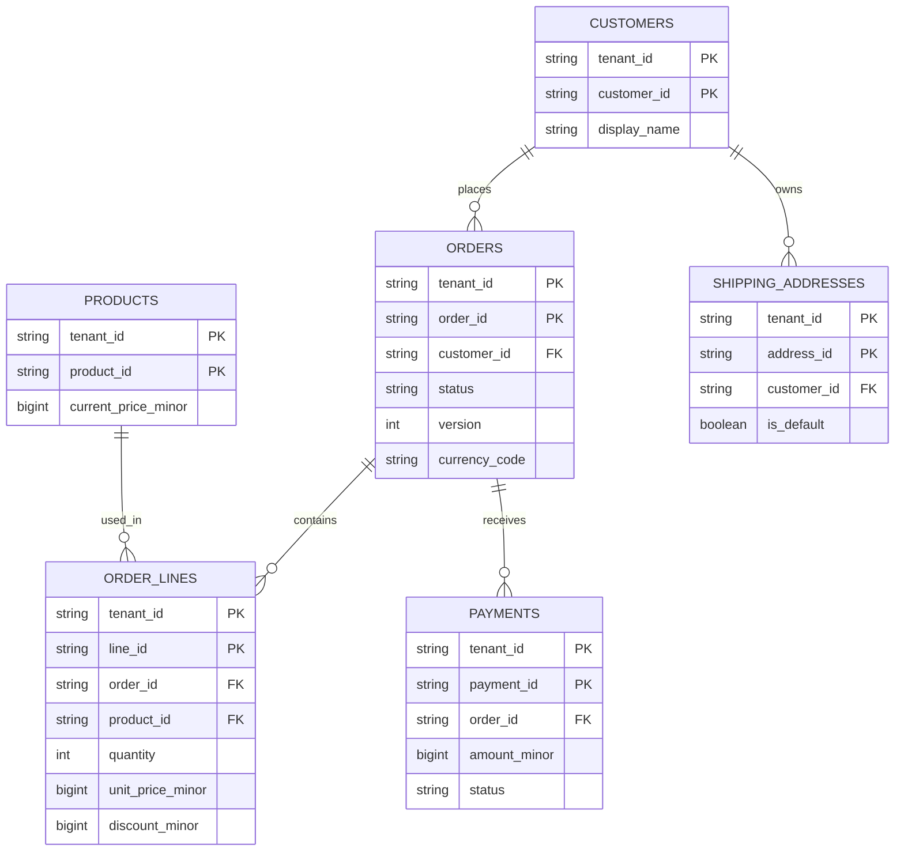
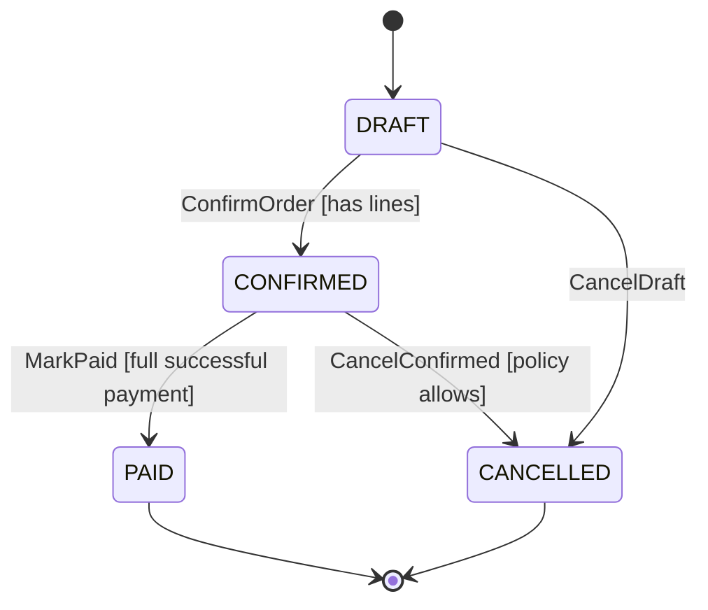
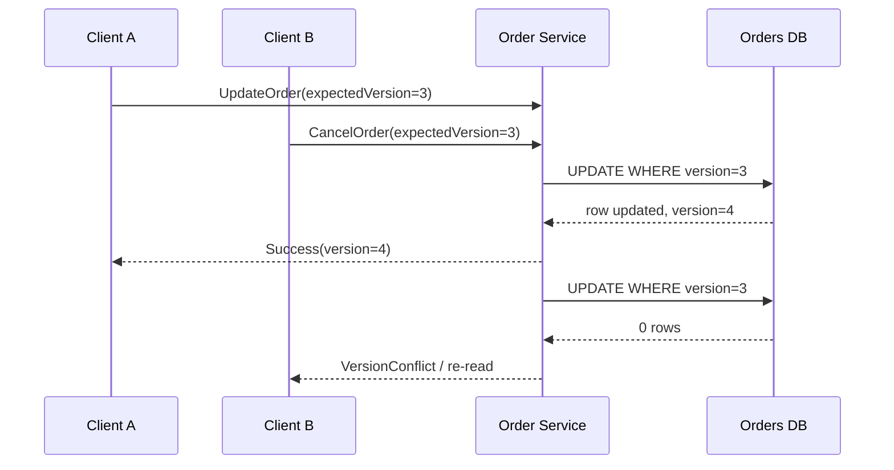

# Storing Valid Examples, Counterexamples, and Rules That Cannot Fit on Diagrams

An ER diagram depicts `Customer 1 — N Order`, `Order 1 — N OrderLine`, and `Product 1 — N OrderLine`. Readers usually grasp the **entities and relationships**, yet still do not know: can an unconfirmed order stay empty of lines; can a paid order have its historical price edited; can two customers in different tenants share code `C-01`; does a retry create a new order or return the prior result; or does `NULL` mean "unknown" or "not applicable"?

If those rules live only inside the designer's head, backend, DBA, data analytics, and QA teams easily build **different versions of the same model**. Good model documentation must capture simultaneously:

1. **Diagrams**: visualize structure, keys, relationships, and cardinality.
2. **Valid examples**: show a data state and an operation sequence **permitted** by the business contract.
3. **Counterexamples**: show data or operations **forbidden**, why, and where the system must reject them.
4. **Off-diagram rules**: define invariants, state/time-dependent conditions, calculations, permissions, exceptions, consistency guarantees, and enforcement ownership.
5. **Reproducible verification**: tests, reconciliation queries, expected error codes, versions, and accountable owners.

This lesson belongs to the **Model Documentation** chapter in **DATABASE_DATA_MODELING**. The module's goal is to translate business requirements into clear entities, relationships, constraints, keys, indexes, and physical schemas; and to compare relational, document, graph, and analytical models so they remain evolvable and verifiable. This topic bridges **design documentation** and **actual system behavior**.

After this lesson, you can:

- Write concise examples and counterexamples containing **data, initial conditions, actions, and expected outcomes**.
- Build a **rule catalog** with rule IDs, scopes, rationale, enforcement levels, evidence, and linked tests.
- Distinguish rules expressible via `PRIMARY KEY`, `FOREIGN KEY`, `CHECK`, and `UNIQUE` from rules requiring transactions, workflows, authorization, or data checks.
- Document **states, time-dependent conditions, historical immutability, concurrent updates, idempotency, and multi-tenant boundaries**.
- Link ER diagrams, SQL schemas, API contracts, events, documents, graphs, fact tables, and test cases without contradictions.
- Maintain documentation as business rules and schemas evolve, avoiding **accurate diagrams paired with stale off-diagram rules**.

## 1. What Can Diagrams Express, and What Do They Commonly Omit?

An ER diagram captures entities, key attributes, keys, relationships, and often **cardinality/optional participation**. UML class diagrams express structure and certain constraints, state diagrams show state transitions, and sequence diagrams show messages over time. Yet **no single diagram automatically captures every business rule**.

| Content | What Structural Diagrams Show | What Needs Prose, Examples, or Tests |
| --- | --- | --- |
| Order key | `order_id` and `orders` table | Whether uniqueness is **global or per tenant**; whether IDs can be reused |
| Order–line relationship | One order has many lines | `DRAFT` allows 0 lines; `CONFIRMED` requires ≥1 |
| Customer–order relationship | Order belongs to a customer | Whether linking a customer from **another tenant** is blocked |
| Order status | `status` column | Permitted state transitions, preconditions, and postconditions |
| Line price | `unit_price_minor` column | **Purchase-time snapshot** or read from current catalog |
| Discounts | `discount_minor` column | Line-level or order-level discount; whether it can exceed gross |
| Payments | `orders–payments` relationship | How much successful payment `PAID` requires; how refunds work |
| Default address | `is_default` attribute | "At most one" or "exactly one"; scoped by customer/tenant |
| Time | `valid_from`, `valid_to` | Half-open intervals, **non-overlapping** constraint, effective date |
| Concurrent updates | Unclear | Who can write; which locks/versions prevent lost updates |
| Sensitive data | Columns may be tagged | Who reads, purpose, retention, copies, and deletion workflow |
| Distributed | One entity has multiple copies | Source of truth, lag, event ordering, idempotency, reconciliation |
| Analytics | Facts linked to dimensions | **Grain**, measure additivity, and dimension history |

**Design takeaway:** a diagram is **one view** of the model, not the entire data contract.

### 1.1. Diagram Cardinality Is Insufficient for State-Dependent Conditions

For example, drawing `Order ||--|{ OrderLine` often leads readers to assume **every order always has at least one line**. Yet creating a draft order may be allowed before adding products. Drawing `Order ||--o{ OrderLine` structurally permits 0 lines, yet the diagram **fails to convey the condition "CONFIRMED status requires ≥1 line."**

A clearer approach:

- The diagram uses cardinality **compatible with valid stored states**: an order has 0..N lines.
- Separate rule: "`BR-03`: transitioning `DRAFT → CONFIRMED` requires at least one valid line."
- Valid example: a `DRAFT` order with no lines yet.
- Counterexample: calling `ConfirmOrder` on an empty draft must be rejected.
- Test: assert the API returns the business error code; state/version and audit remain unchanged.

### 1.2. One Valid Row Does Not Prove a Valid Lifecycle

A row showing `orders.status = 'PAID'` in isolation passes `CHECK (status IN (...))`. Yet it might have been inserted by a raw `UPDATE` from `CANCELLED` without any payment. **Current state validity** and **path validity leading to that state** are two separate concerns.

For auditable workflows, store **state transition rules** and potentially **event/audit history**. If a system only retains the current snapshot, never claim it can prove the full historical transition sequence.

## 2. Minimum Verifiable Model Documentation Set

A deliverable model package can include the following artifacts, whether in one Markdown file or linked documents:

| Artifact | Core Content | Primary Users |
| --- | --- | --- |
| **Business glossary** | Meanings of `Order`, `Paid`, `Quantity`, `NetAmount` | BA, domain expert, BI |
| **ER/UML/graph schema** | Entities, relationships, cardinality, keys | Architect, dev, DBA |
| **Data dictionary** | Types, NULLs, units, sources, sensitivity, defaults | Dev, data engineer |
| **Rule catalog** | Rule IDs, conditions, exceptions, enforcement points | Dev, QA, architect |
| **Valid examples** | Accepted states/events, expected numbers | QA, dev, BA |
| **Invalid examples** | Rejected inputs, reasons, error codes, preserved invariants | QA, dev, reviewer |
| **Transition/temporal contract** | States, effective time, concurrency | Dev, ops |
| **Physical DDL** | `PK`, `FK`, `UNIQUE`, `CHECK`, indexes, partitions | DBA, dev |
| **Verification** | SQL integrity queries, API tests, reconciliation | QA, data engineer |
| **Decision record** | Design choices, trade-offs, assumptions, change paths | Maintainers |
| **Ownership/version** | Owner, version, effective date, changelog | Whole team |

Each artifact **answers a different question**. You do not need to duplicate all content everywhere, yet **stable IDs and clear links** must let readers navigate from diagrams to related rules and tests.

### 2.1. A Good Example Has Its Own Identifier

Naming an example `EX-VALID-03: DRAFT_WITHOUT_LINES` beats vague prose like "draft orders may be empty." It can be referenced directly in reviews, tickets, tests, and migration docs.

A counterexample `EX-INVALID-04: CROSS_TENANT_CUSTOMER` should also record:

- Initial conditions.
- Faulty data or command.
- Violated **Rule ID**.
- Expected rejection point: database constraint, service API, workflow, or pipeline.
- Expected outcome: **no state change**, no success event emitted, and proper error type.
- Permitted exceptions, if any.

### 2.2. Naming and Versioning Conventions

A sample numbering scheme:

```text
BR-001 ... BR-999         Business rule
EX-V-001 ...              Valid example
EX-X-001 ...              Invalid/counterexample
T-API-001 ...             API/behavior test
T-DB-001 ...              Database constraint test
T-DQ-001 ...              Data quality/reconciliation test
ADR-001 ...               Architecture/design decision
DOC-MODEL-1.0             Documentation revision
```

IDs are illustrative, not a mandatory standard. What matters is **stable IDs** traceable across rule changes. Never rewrite an old rule into something different while keeping the same ID, causing historical test cases to point to the wrong rule.

## 3. Running Case Study: Multi-Tenant Order Management

A sales system has these requirements:

1. Customers create orders in `DRAFT` status, possibly before selecting products.
2. Each order line has a product, quantity, **unit price at purchase**, and line discount.
3. Each order belongs to **one tenant**; `order_id` or `customer_id` only needs to be unique **within a tenant**.
4. Upon confirmation, an order must contain at least one valid line.
5. Once paid in full, the order may transition to `PAID`.
6. A customer may store multiple shipping addresses, with at most one marked as default.
7. Once confirmed, old order-line prices must never change when current catalog prices change.
8. Client commands may be retried; the same logical request must never create two orders or two payments.
9. Every mutation must be traceable under data protection rules.

To stay focused on model semantics, this example handles **whole VND**, **line-level** discounts, and one or more payments per order where the sum of **successful** payments must equal the amount due before moving to `PAID`. Taxes, shipping fees, returns, order-level discounts, and multi-currency payments are omitted. These are **scope boundaries of the example**, not universal laws for all retail systems.

### 3.1. Defining Data Grain

| Entity | What Does One Row Mean? | Business Key |
| --- | --- | --- |
| `customers` | One customer within a tenant | `(tenant_id, customer_id)` |
| `products` | One current product within a tenant | `(tenant_id, product_id)` |
| `orders` | One current order within a tenant | `(tenant_id, order_id)` |
| `order_lines` | One product line of an order | `(tenant_id, line_id)` |
| `payments` | One recorded payment | `(tenant_id, payment_id)` |
| `shipping_addresses` | One saved address for a customer | `(tenant_id, address_id)` |

**Grain dictates counting.** If O-101 has two lines, `COUNT(*)` on `order_lines` returns **2 order lines**, not **2 orders**. Documentation must establish this distinction before discussing reports.

### 3.2. Illustrative ER Diagram



In Mermaid, multiple columns labeled `PK` indicate **composite key intent**; exact column order, `UNIQUE`, tenant-scoped `FK`s, and indexes belong in DDL. The diagram above **does not** express:

- `CONFIRMED` must have at least one line.
- `PAID` only after full payment.
- Confirmed line prices are immutable snapshots.
- At most one default address per customer.
- Valid state transitions.
- Write permissions, history, and timestamp rules.
- Concurrency and idempotency conditions when two requests arrive simultaneously.

Therefore, underneath the diagram you need a **rule catalog** and verifiable examples.

## 4. Business Rule Catalog: From Prose to Invariants

Never write "orders must be valid" and expect everyone to agree. Each rule needs **a name, scope, preconditions, invariant, exceptions, enforcement, and tests**.

### 4.1. Rule Catalog for the Example

| ID | Rule | Scope | Primary Mechanism | Examples/Tests |
| --- | --- | --- | --- | --- |
| **BR-001** | Customer, order, and product IDs are unique only within a tenant | Keys | Composite PK/UNIQUE | EX-V-01, EX-X-01 |
| **BR-002** | Orders/lines cannot FK to data in another tenant | Relationships | Composite FK + auth scope | EX-X-02 |
| **BR-003** | `DRAFT` allows 0 lines; `CONFIRMED/PAID` require ≥1 | State + relationship | Transaction/service | EX-V-02, EX-X-03 |
| **BR-004** | `quantity > 0`, `unit_price_minor ≥0`, `0 ≤ discount ≤ gross` | Per line | CHECK + monetary validation | EX-X-04, EX-X-05 |
| **BR-005** | Line amounts preserve locked unit price, never recomputing from `current_price` | History | Service/contract + tests | EX-V-03, EX-X-06 |
| **BR-006** | Allow only defined state transitions | Workflow | Transaction/service | EX-X-07 |
| **BR-007** | `PAID` requires sum of successful payments equal to order net total | Cross-table | Transaction/service + DQ | EX-V-04, EX-X-08 |
| **BR-008** | At most one `is_default = true` address per customer within a tenant | Cross-row | Partial unique index | EX-X-09 |
| **BR-009** | No editing/deleting lines after `CONFIRMED`, except dedicated adjustment workflows | State | Service/DB guard | EX-X-10 |
| **BR-010** | Retrying the same command never applies business side effects twice | Command/system | Idempotency key + transaction | EX-X-11 |
| **BR-011** | Concurrent updates never drop versions/states | Concurrency | Optimistic version/locking | EX-X-12 |
| **BR-012** | Every committed change carries valid audit metadata | Traceability | Transaction/outbox + DQ | EX-X-13 |
| **BR-013** | Only read/write data within authorized tenant and permitted purpose | Protection | Authorization/RLS policy | EX-X-14 |
| **BR-014** | Reports never sum across currencies or multiply rows via JOINs | Analytics | Semantic contract + DQ | EX-X-15 |

**Distinguish "primary enforcement" from "secondary evidence."** A `CHECK` constraint on an order line enforces a local row invariant, yet cannot prove the service ran the workflow correctly. Likewise, a service unit test does not replace database constraints if other write paths can bypass the service.

### 4.2. Detailed Rule Template to Copy

```yaml
ruleId: BR-003
name: "Confirmed order must contain at least one line"
scope: "Order aggregate within one tenant"
statement: >
  DRAFT status allows zero order lines.
  When transitioning DRAFT to CONFIRMED, the order must have
  at least one valid line and satisfy all line constraints.
preconditions:
  - "Caller is authenticated and authorized for ConfirmOrder"
  - "Order exists and is currently DRAFT"
  - "Client supplies valid expected_version"
invariant:
  - "status IN (CONFIRMED, PAID) => line_count >= 1"
exceptions:
  - "Draft orders with no products yet"
enforcement:
  - "OrderService.ConfirmOrder inside transaction"
  - "Integrity reconciliation detects drift"
errors:
  - "ORDER_HAS_NO_LINES"
  - "INVALID_ORDER_TRANSITION"
positiveExamples: [EX-V-02, EX-V-04]
negativeExamples: [EX-X-03]
tests: [T-API-003, T-DQ-003]
owner: "Order domain owner"
status: "ACTIVE"
```

The YAML structure is merely a **format for expressing rules**, not a self-executing verification engine. In real docs, link `tests` to actively maintained tests in code so test IDs don't exist only on paper.

### 4.3. Constraints Need Explicit Quantifiers and Conditions

Compare three statements:

- "Customer addresses must be valid." — far too vague.
- "Customer has a default address." — unclear whether **at least one** or **at most one**, and when it applies.
- "Within each `(tenant_id, customer_id)`, the count of addresses with `is_default = true` **must not exceed 1**; having a default address is not required if the customer hasn't picked one." — testable.

Similarly, "an order contains products" is not equal to "every order must have at least one line **including DRAFT**." A common bug happens when diagrams, code, and QA all say "must" while assuming **different lifecycle points**.

## 5. Illustrative SQL Schema and Database Constraint Scope

The following uses **PostgreSQL** syntax to demonstrate mechanisms. Other SQL/warehouse engines vary in `CHECK`, `FK`, or partial index enforcement; never assume identical syntax and behavior.

### 5.1. Tenant-Scoped Keys and Relationships

```sql
CREATE TABLE customers (
    tenant_id TEXT NOT NULL,
    customer_id TEXT NOT NULL,
    display_name TEXT NOT NULL,
    PRIMARY KEY (tenant_id, customer_id)
);

CREATE TABLE products (
    tenant_id TEXT NOT NULL,
    product_id TEXT NOT NULL,
    title TEXT NOT NULL,
    current_price_minor NUMERIC(20,0) NOT NULL,
    PRIMARY KEY (tenant_id, product_id),
    CHECK (current_price_minor >= 0)
);

CREATE TABLE orders (
    tenant_id TEXT NOT NULL,
    order_id TEXT NOT NULL,
    customer_id TEXT NOT NULL,
    status TEXT NOT NULL DEFAULT 'DRAFT',
    version BIGINT NOT NULL DEFAULT 1,
    currency_code CHAR(3) NOT NULL DEFAULT 'VND',
    placed_at TIMESTAMPTZ NOT NULL,
    PRIMARY KEY (tenant_id, order_id),
    FOREIGN KEY (tenant_id, customer_id)
        REFERENCES customers(tenant_id, customer_id),
    CHECK (status IN ('DRAFT', 'CONFIRMED', 'PAID', 'CANCELLED')),
    CHECK (version > 0),
    CHECK (currency_code = 'VND')
);

CREATE TABLE order_lines (
    tenant_id TEXT NOT NULL,
    line_id TEXT NOT NULL,
    order_id TEXT NOT NULL,
    product_id TEXT NOT NULL,
    quantity INTEGER NOT NULL,
    unit_price_minor NUMERIC(20,0) NOT NULL,
    discount_minor NUMERIC(30,0) NOT NULL DEFAULT 0,
    PRIMARY KEY (tenant_id, line_id),
    FOREIGN KEY (tenant_id, order_id)
        REFERENCES orders(tenant_id, order_id),
    FOREIGN KEY (tenant_id, product_id)
        REFERENCES products(tenant_id, product_id),
    CHECK (quantity > 0),
    CHECK (unit_price_minor >= 0),
    CHECK (discount_minor >= 0),
    CHECK (discount_minor <= quantity * unit_price_minor)
);

CREATE TABLE payments (
    tenant_id TEXT NOT NULL,
    payment_id TEXT NOT NULL,
    order_id TEXT NOT NULL,
    external_payment_ref TEXT NOT NULL,
    amount_minor NUMERIC(30,0) NOT NULL,
    status TEXT NOT NULL,
    PRIMARY KEY (tenant_id, payment_id),
    UNIQUE (tenant_id, external_payment_ref),
    FOREIGN KEY (tenant_id, order_id)
        REFERENCES orders(tenant_id, order_id),
    CHECK (amount_minor > 0),
    CHECK (status IN ('PENDING', 'SUCCEEDED', 'FAILED'))
);
```

Key observations:

- Primary key `(tenant_id, order_id)` and matching FKs protect **relationships within tenant boundaries**. Using `FOREIGN KEY(customer_id)` alone when IDs collide across tenants allows cross-tenant linking.
- `quantity` is a positive integer; `unit_price_minor` is whole VND for this example. `NUMERIC` avoids floating-point issues for reconcilable money.
- Purchase price in `order_lines.unit_price_minor` is separate from `products.current_price_minor`. When catalog prices change, past order lines remain unchanged.
- `CHECK (status IN (...))` only checks text enum membership, **not valid state transitions**.
- The `version` column supports optimistic concurrency, **yet only works if every write path checks and increments `version`**.
- The `payments` table holds multiple payments per order; it does not prove payment totals are sufficient or that `PAID` was set legitimately.

### 5.2. One Default Address per Customer: Cross-Row Rule

```sql
CREATE TABLE shipping_addresses (
    tenant_id TEXT NOT NULL,
    address_id TEXT NOT NULL,
    customer_id TEXT NOT NULL,
    label TEXT NOT NULL,
    is_default BOOLEAN NOT NULL DEFAULT FALSE,
    PRIMARY KEY (tenant_id, address_id),
    FOREIGN KEY (tenant_id, customer_id)
        REFERENCES customers(tenant_id, customer_id)
);

CREATE UNIQUE INDEX one_default_address_per_customer
    ON shipping_addresses (tenant_id, customer_id)
    WHERE is_default = TRUE;
```

A partial unique index in PostgreSQL enforces **at most one** default address per customer–tenant. It **does not require every customer to have one**. If business changes to "every active customer must have exactly one default address," add checks in the workflow/transaction or an appropriate constraint mechanism.

**Subtle rule:** to switch default from address A to B in a single transaction, **clear A's flag first, then set B's flag**, or use an equivalent atomic statement. Setting B first triggers a partial unique index failure even though the end state has only one default. Concurrent default-switching requests also require concurrency handling and retries rather than relying on arbitrary SQL row order.

### 5.3. What the Database Cannot Express Fully with DDL Alone

These requirements **are not guaranteed by the schema alone**:

1. `CONFIRMED` must have ≥1 line.
2. `PAID` requires successful payments summing exactly to the amount due.
3. No editing prices/lines after confirmation.
4. Only `DRAFT → CONFIRMED → PAID` and declared transitions are allowed.
5. Retrying the same `command_id` applies effects once.
6. Authorization to view or edit orders within a tenant.
7. Audit events emitted upon transaction commit without forbidden fields.
8. `order_lines.unit_price_minor` is the exact snapshot **at order acceptance**, not the latest price.

Some rules can be enforced via triggers, stored procedures, advanced constraints, or transaction protocols depending on the engine. However, **enforcement must be explicitly designed and tested**, never assumed from a few arrows on an ER diagram.

## 6. Storing Valid Examples: Data States with Clear Oracles

A valid example set should use **synthetic IDs, small numbers, and fixed timestamps** reproducible from scratch. Avoid real customer info or production dumps, since building test fixtures never justifies storing personal data outside permitted purposes.

### 6.1. Loadable Valid Fixture

Assume a single tenant `T-01` and VND currency. Note that records in `CONFIRMED/PAID` states below are **valid state snapshots** assumed to have passed through proper workflows and audits; inserting fixtures directly **is not proof** that the system enforces state transitions properly.

```sql
INSERT INTO customers (tenant_id, customer_id, display_name)
VALUES
('T-01', 'C-01', 'Customer One'),
('T-01', 'C-02', 'Customer Two');

INSERT INTO products (
    tenant_id, product_id, title, current_price_minor
) VALUES
('T-01', 'P-BOOK', 'Book', 180000),
('T-01', 'P-PEN', 'Pen pack', 25000);

INSERT INTO orders (
    tenant_id, order_id, customer_id,
    status, version, currency_code, placed_at
) VALUES
('T-01', 'O-101', 'C-01',
 'CONFIRMED', 2, 'VND', '2026-10-01 09:00:00+07'),
('T-01', 'O-102', 'C-01',
 'DRAFT', 1, 'VND', '2026-10-01 09:30:00+07'),
('T-01', 'O-103', 'C-02',
 'PAID', 3, 'VND', '2026-10-02 10:00:00+07');

INSERT INTO order_lines (
    tenant_id, line_id, order_id, product_id,
    quantity, unit_price_minor, discount_minor
) VALUES
('T-01', 'L-001', 'O-101', 'P-BOOK',
 1, 150000, 0),
('T-01', 'L-002', 'O-101', 'P-PEN',
 2, 20000, 5000),
('T-01', 'L-003', 'O-103', 'P-BOOK',
 1, 150000, 0);

INSERT INTO payments (
    tenant_id, payment_id, order_id, external_payment_ref,
    amount_minor, status
) VALUES
('T-01', 'PAY-001', 'O-103', 'PROVIDER-TRANS-001',
 150000, 'SUCCEEDED');

INSERT INTO shipping_addresses (
    tenant_id, address_id, customer_id, label, is_default
) VALUES
('T-01', 'ADDR-01', 'C-01', 'Home', TRUE),
('T-01', 'ADDR-02', 'C-01', 'Office', FALSE);
```

### 6.2. Reference Verification Table (*Oracle*)

| Object | Status | Lines | Gross VND | Discount VND | Net VND | Why Valid |
| --- | --- | ---: | ---: | ---: | ---: | --- |
| O-101 | CONFIRMED | 2 | 190,000 | 5,000 | **185,000** | Has lines, valid snapshot prices and discount |
| O-102 | DRAFT | 0 | 0 | 0 | **0** | Draft order allowed without items yet |
| O-103 | PAID | 1 | 150,000 | 0 | **150,000** | Successful payment = 150,000 |
| **Total source lines** | — | **3** | **340,000** | **5,000** | **335,000** | No row multiplication |

Key cross-checks:

- Count of **orders** in `orders` is **3**; count of **order lines** in `order_lines` is **3**—matching numerically here by coincidence, **not sharing the same grain**.
- Count of orders **with at least one line** is **2**; O-102 is an empty `DRAFT`.
- O-101 has **two lines**, yet is only **one order**.
- Total line sales in the example are **335,000 VND** if summing all lines, yet a "paid order sales" KPI only counts **150,000 VND** from O-103. **Never equate line totals with paid-order metrics.**
- `P-BOOK.current_price_minor = 180,000`, whereas the historical price in both lines is **150,000**. Recomputing history from current catalog prices yields wrong totals.
- C-01 has **two addresses**, with only one default: `ADDR-01`.

### 6.3. Valid Examples Should Not Just Be Table Snapshots

For every behavior, record a sequence:

```text
EX-V-02 — ConfirmOrder with lines
Given:
  Order O-101 is DRAFT, version 1
  Has two valid lines L-001 and L-002
  Caller is authorized in T-01
When:
  ConfirmOrder(orderId=O-101, expectedVersion=1)
Then:
  Order.status = CONFIRMED
  Order.version = 2
  Lines preserve quantity/price/discount
  One business audit event exists for v2
  Corresponding outbox event can be published
  No sensitive data in public event payload
```

The fixture in Section 6.1 depicts **the post-operation state**. To test the workflow, tests must create a `DRAFT` and call the real API rather than inserting `CONFIRMED` directly and claiming the system guards transitions.

### 6.4. Valid Examples Indexed by Stable ID

| ID | Valid Condition and Outcome | Proven Rule | How to Verify |
| --- | --- | --- | --- |
| **EX-V-01** | Two tenants share `customer_id = C-01` yet have distinct `(tenant_id, customer_id)` keys; no cross-linking | BR-001, BR-002 | Tenant-scoped PK/FK and API isolation |
| **EX-V-02** | `O-102` in DRAFT with 0 lines; `O-101` transitions from 2-line DRAFT to CONFIRMED | BR-003, BR-006 | Fixture + behavior test checking status/version |
| **EX-V-03** | `P-BOOK.current_price_minor = 180000` while historical line locks `150000`; O-101 total stays 185000 | BR-004, BR-005, BR-009 | Test catalog update then reconcile line snapshots |
| **EX-V-04** | `O-103` has net 150000 and one SUCCEEDED payment of 150000, transitioning to PAID | BR-003, BR-007 | Payment workflow test + DQ sum |
| **EX-V-05** | C-01 has two addresses, only ADDR-01 is default | BR-008 | Partial unique index and verification query |
| **EX-V-06** | Resending the same command with identical fingerprint returns prior result without emitting duplicate business events | BR-010 | API retry/idempotency test |

These IDs are **illustrative test/contract names**, not a claim that every case has been executed in a live environment. In particular, EX-V-01 and EX-V-06 require separate fixtures or integration tests; the current `INSERT` set covers only T-01 and does not implement an idempotency table in that snippet.

## 7. Storing Counterexamples: Where and Why Must Rules Reject?

A good counterexample is the **minimal failing case** that violates a rule while identifying **the expected enforcement point**. Without distinguishing where rules are enforced, readers might assume the schema guards a rule that only exists in the application layer.

### 7.1. Counterexamples the Database Must Reject

| ID | Faulty Operation or Data | Rule | Caught By |
| --- | --- | --- | --- |
| EX-X-01 | Two customers sharing `(tenant_id, customer_id)` | BR-001 | PK |
| EX-X-02 | Tenant T-02 order referencing `C-01` existing only in T-01 | BR-002 | Composite FK |
| EX-X-04 | Line with `quantity = 0` | BR-004 | CHECK |
| EX-X-05 | Line with discount exceeding gross | BR-004 | CHECK |
| EX-X-09 | C-01 having two default addresses | BR-008 | Partial unique index |
| EX-X-16 | Payment with duplicate `external_payment_ref` in tenant | Unique payment ref | UNIQUE |

The snippets below are **illustrative counterexamples**. They are designed to **fail**, not SQL migrations to run in production. When testing manually in PostgreSQL, run each case independently in a test environment and `ROLLBACK` after failure; an errored transaction enters an aborted state until rolled back.

```sql
-- EX-X-02: C-01 exists only in T-01, not in T-02.
-- Expected: foreign key violation.
INSERT INTO orders (
    tenant_id, order_id, customer_id,
    status, version, currency_code, placed_at
) VALUES (
    'T-02', 'O-X', 'C-01',
    'DRAFT', 1, 'VND', '2026-10-03 00:00:00+07'
);
```

```sql
-- EX-X-04: quantity must be > 0.
-- Expected: check constraint violation.
INSERT INTO order_lines (
    tenant_id, line_id, order_id, product_id,
    quantity, unit_price_minor, discount_minor
) VALUES (
    'T-01', 'L-BAD-QTY', 'O-101', 'P-PEN',
    0, 20000, 0
);
```

```sql
-- EX-X-05: gross = 2*20000 = 40000,
-- discount=50000 > gross. Expected: CHECK failure.
INSERT INTO order_lines (
    tenant_id, line_id, order_id, product_id,
    quantity, unit_price_minor, discount_minor
) VALUES (
    'T-01', 'L-BAD-DISCOUNT', 'O-101', 'P-PEN',
    2, 20000, 50000
);
```

```sql
-- EX-X-09: ADDR-01 is already C-01's default.
-- Expected: partial unique index violation.
UPDATE shipping_addresses
SET is_default = TRUE
WHERE tenant_id = 'T-01'
  AND address_id = 'ADDR-02';
```

**Purpose of counterexamples:** confirm the database must reject and preserve invariants, not force learners to memorize one engine's SQLSTATE codes. If tests check error codes, specify the **engine/version** and the mapping to the **domain error** promised by the API.

### 7.2. Counterexamples Passing DDL Yet Rejected by the API

| ID | Scenario | Business Expectation |
| --- | --- | --- |
| EX-X-03 | `ConfirmOrder` on an empty `DRAFT` | `ORDER_HAS_NO_LINES`; state/version unchanged |
| EX-X-06 | Reprice a `CONFIRMED` line using new catalog price | `ORDER_LINES_LOCKED` |
| EX-X-07 | Transition `PAID → DRAFT` | `INVALID_ORDER_TRANSITION` |
| EX-X-08 | Transition `CONFIRMED → PAID` with only 100,000 paid on a 185,000 order | `PAYMENT_NOT_SETTLED_FULLY` |
| EX-X-10 | Delete a line from a confirmed order leaving it empty | Disallowed, unless via valid adjustment workflow |
| EX-X-11 | Resend identical `CreateOrder(commandId)` | Return prior result or idempotent status, no second order |
| EX-X-12 | Two clients both edit version 3 | One update wins; the other receives proper version conflict/retry |
| EX-X-13 | Update succeeds yet committed audit event is missing | Reconciliation detects and remediates per runbook |
| EX-X-14 | Client T-02 reads T-01 order despite knowing order ID | Denied by authorization, no data leaked |
| EX-X-15 | Join order lines with payments then SUM money | BI test catches fan-out, refuses publishing wrong KPI |

These counterexamples matter because **the current database does not reject them automatically**. If an internal channel can run direct SQL updates, either **restrict write paths** or implement equivalent DB-level enforcement; writing documentation alone never prevents invalid states.

### 7.3. Also State the Post-Rejection Outcome

A solid test asserts more than HTTP `409` or `422`. It verifies:

```text
Before:
  O-102: DRAFT, version 1, 0 lines
Action:
  ConfirmOrder(O-102, expectedVersion=1)
Expected:
  response.code = ORDER_HAS_NO_LINES
  orders.status = DRAFT
  orders.version = 1
  no OrderConfirmed event
  no payment created
  audit of denied attempt only if policy requires,
  never audit as a committed business change
```

HTTP codes follow the API contract; **stable business error codes** are usually more useful for linking documentation, backend, and QA.

## 8. States and Transitions Do Not Fully Fit on ER Diagrams

### 8.1. A Simple State Machine



Even with **guard conditions**, prose is still needed to clarify:

- At which transaction point is **`[has lines]`** checked?
- During `MarkPaid`, from which source are payments verified as **successful**?
- After `CONFIRMED`, can lines be added/deleted/edited before payment?
- Does `CANCELLED` from `CONFIRMED` require releasing reservations or compensating external actions outside the DB?
- Does refunding after `PAID` create a `REFUNDED` state or a separate fact? **The current example does not model refunds.**

### 8.2. State Transition Condition Table

| From | Command | To | Preconditions | Postconditions |
| --- | --- | --- | --- | --- |
| None | `CreateOrder` | DRAFT | Customer exists in tenant, valid caller | New order, version 1 |
| DRAFT | `AddLine` | DRAFT | Valid product; valid qty and discount | New line; explicit version/aggregate policy |
| DRAFT | `ConfirmOrder` | CONFIRMED | ≥1 line, version matches | Line snapshots locked, audit vN |
| DRAFT | `CancelDraft` | CANCELLED | Order exists and caller authorized | No new lines allowed |
| CONFIRMED | `MarkPaid` | PAID | `SUCCEEDED` payments match amount due | Audit, version incremented |
| CONFIRMED | `CancelConfirmed` | CANCELLED | Policy permits, reservations handled | Record reason and consequences |
| PAID | `SetDraft` | — | Forbidden | Return `INVALID_ORDER_TRANSITION` |

If `AddLine` increments the aggregate version, state explicitly when version increments and which tests/assertions rely on it; **never treat version 2 in a fixture as a universal constant across all paths**.

### 8.3. Cross-Table Invariants Must Be Checked Within One Consistency Context

Rules:

\[
\operatorname{status}(o)=\text{CONFIRMED}
\Rightarrow
\operatorname{lineCount}(o)\ge 1
\]

and:

\[
\operatorname{status}(o)=\text{PAID}
\Rightarrow
\sum\nolimits_{\text{successful payments}} amount
=
\sum\nolimits_{\text{order lines}} (quantity\cdot unitPrice-discount)
\]

express invariants far more precisely than "order must be valid." Yet math alone is incomplete:

- Compute **within the same tenant and order**.
- Use the same currency unit and version/snapshot.
- Define when a payment counts as `SUCCEEDED`.
- Define rounding, taxes, shipping, and returns if present in production.
- Specify transaction isolation or locking when two requests concurrently add lines or payments.
- Document exceptions and anomaly handling.

This is a textbook example of **rules not derivable from arrows on a diagram**.

## 9. Calculations, Metrics, and Units Also Need Verification Examples

### 9.1. Why Lock Down Formulas?

For O-101:

```text
L-001: 1 × 150,000 - 0     = 150,000 VND
L-002: 2 × 20,000 - 5,000  =  35,000 VND
ORDER NET                       185,000 VND
```

If a developer uses `products.current_price_minor` (180,000 and 25,000), the historical order gets calculated as `230,000 VND` before discount or **225,000 VND** after discount. That is a **historical price semantics bug**, even though FKs and data types are valid.

Documentation should state:

> `OrderLine.unit_price_minor` is the **snapshot unit price locked at confirmation/placement** per contract; `Product.current_price_minor` is only for quotes and future transactions. Subsequent legitimate adjustments require dedicated events/versions, never silent overwrites.

Note that "at order creation," "at confirmation," and "at payment" **differ**; pick the exact price-lock point in the real system. In this lesson, line prices in `CONFIRMED` status are considered locked.

### 9.2. Money and Quantities Must Have Units

The example uses whole VND, yet a multi-currency system needs `currency_code` and exchange-rate/conversion policies when aggregating into a reporting currency. You cannot `SUM(100 USD, 100 EUR)` and label it `200 VND`.

Likewise, quantity `2 boxes` differs from `2 pieces` if packaging rules exist; the model needs units of measure and per-product/variant factors where required. An ER diagram with `amount` and `quantity` columns alone is insufficient to define valid sums.

### 9.3. Metric Grain Must Be One Explicit Sentence

Examples:

- `order_lines`: **one row** represents one line item, not one order.
- `payments`: **one payment**, and an order may have multiple payments.
- `fact_sales_line`: **one valid sales line per analytics policy**.
- `fact_payment`: **one payment event**; never join directly with line facts at incompatible grains and sum amounts.

A valid query can return hugely inflated totals due to **fan-out**. Documentation should keep the counterexample "joining two facts 2×3 yields 6 rows" so readers understand why each fact must pre-aggregate to a **common grain** before joining.

## 10. Concurrency and Idempotency: Same Data, Different Operation Order

### 10.1. Lost Updates Invisible to Diagrams

Suppose two clients read `orders.version = 3`:

```text
Client A reads v3: wants to update contact_ref
Client B reads v3: wants to CancelOrder

A updates successfully → version 4
B overwrites the whole row using stale v3 without checking
Result: A's change is lost or an invalid state is written
```

An **optimistic concurrency contract** may require:

```sql
UPDATE orders
SET
    status = :next_status,
    version = version + 1
WHERE tenant_id = :tenant_id
  AND order_id = :order_id
  AND version = :expected_version
  AND status = :expected_status
RETURNING version, status;
```

If zero rows update, the backend must distinguish **not found**, **version conflict**, **invalid transition**, and **unauthorized** per API contract, without leaking order existence across tenants. When rules require reading `order_lines` or `payments`, ensure all related write paths **coordinate locks/isolation**; CAS on the `orders` row alone does not stop another transaction from adding/deleting lines mid-check.

### 10.2. "Same Request" Requires a Stable ID Definition

To prevent `CreateOrder` from creating two orders on client retry, use a `command_id` scoped by `tenant_id` and actor/command type per policy.

```sql
CREATE TABLE processed_commands (
    tenant_id TEXT NOT NULL,
    command_id TEXT NOT NULL,
    command_type TEXT NOT NULL,
    request_fingerprint TEXT NOT NULL,
    result_ref TEXT,
    processed_at TIMESTAMPTZ NOT NULL,
    PRIMARY KEY (tenant_id, command_id)
);
```

A PK on command ID alone **is not enough**: handle cases where the same `command_id` is resent with a **different payload**, define which outcome can be replayed, commit it within the business transaction, and set idempotency-key retention. If keys expire too early, a very late retry can trigger a duplicate effect.

### 10.3. Documenting Counterexamples with Sequence Diagrams



Documentation must specify **Client B's behavior** after the error: report conflict, re-read and prompt the user, or conditionally retry. Never blindly auto-retry a high-impact cancellation ignoring the newly committed state.

## 11. Time Rules Need Both Valid Examples and Counterexamples

### 11.1. From Effective Dates to Half-Open Intervals

A customer may change default addresses over time or a product may switch categories. To keep history, store versions:

```text
(address_id=A-01, valid_from=2026-10-01, valid_to=2026-11-01)
(address_id=A-02, valid_from=2026-11-01, valid_to=NULL)
```

Using **`[valid_from, valid_to)`**:

- Start bound **inclusive**.
- End bound **exclusive**.
- Adjacent intervals can meet on 01/11 **without overlapping**.
- For the same object and role, if rules allow at most one active record, intervals must never overlap.

**Counterexample:** A-01 valid `[01/10, 10/11)` and A-02 valid `[05/11, +∞)` under the rule "one default address at a time" ⇒ `[05/11,10/11)` overlaps.

### 11.2. Overlap Checking Needs More Than `UNIQUE(start_date)`

`UNIQUE(customer_id, valid_from)` only prevents two rows from sharing the **same start date**; it does not prevent overlaps across different start dates. Depending on the engine, use range **exclusion constraints** or appropriate transactions/validation.

Example overlap-detection query on a **hypothetical** history table `default_address_history` with `valid_from` and `valid_to`:

```sql
SELECT
    a.tenant_id,
    a.customer_id,
    a.address_id AS first_address,
    b.address_id AS second_address
FROM default_address_history AS a
JOIN default_address_history AS b
  ON a.tenant_id = b.tenant_id
 AND a.customer_id = b.customer_id
 AND a.history_id < b.history_id
 AND a.valid_from < COALESCE(
       b.valid_to, TIMESTAMPTZ 'infinity'
     )
 AND b.valid_from < COALESCE(
       a.valid_to, TIMESTAMPTZ 'infinity'
     )
WHERE a.is_default = TRUE
  AND b.is_default = TRUE;
```

This table is **not part of the fixture DDL created earlier**; the query illustrates a temporal pattern when the system requires it. Ensure `valid_to > valid_from` and sanitize invalid timestamps before running reconciliation. If the rule is "exactly one default" rather than "at most one," also check for **gaps** in history.

### 11.3. Valid Time Differs from Recording Time

An edit may be recorded on 05/11 with retroactive effect from 15/10. If you need to answer both:

- "Which value was **actually in effect** on 20/10?"
- "Which value **did the system know/record** on 20/10?"

a single `valid_from` field is insufficient; you may need **record/transaction time**, snapshots, event logs, or a bitemporal model. Documentation must clarify whether you want to reconstruct **business history**, **knowledge history**, or both. Otherwise, "as-of" queries can return two different yet plausible-looking answers.

### 11.4. Late-Arriving Data and Retroactive Edits

Suppose an order confirmation event occurs at 09:00 while the warehouse receives it at 09:30. Never use `ingested_at` as order date when metrics require **business event time**. Retain event time, track ingestion lag, and document **watermark/restatement** policies. These rules rarely fit on ER diagrams and belong in data contracts and tests.

## 12. SQL Data Checks to Catch Violated Rules

Even with rules enforced in the application layer, maintain **reconciliation queries** to catch legacy data, bypasses, buggy migrations, or diverging logic.

### 12.1. Detecting Confirmed Orders with Zero Lines

```sql
SELECT
    o.tenant_id,
    o.order_id,
    o.status
FROM orders AS o
LEFT JOIN order_lines AS l
  ON l.tenant_id = o.tenant_id
 AND l.order_id = o.order_id
WHERE o.status IN ('CONFIRMED', 'PAID')
GROUP BY o.tenant_id, o.order_id, o.status
HAVING COUNT(l.line_id) = 0;
```

Expected on fixture: **0 error rows**. O-102 has 0 lines yet is `DRAFT`, so it is not flagged. This proves how **state-dependent rules** differ from unconditional row-count rules.

### 12.2. Detecting PAID Orders with Missing or Mismatched Payments

```sql
WITH line_totals AS (
    SELECT
        tenant_id,
        order_id,
        SUM(quantity * unit_price_minor - discount_minor)
            AS due_minor
    FROM order_lines
    GROUP BY tenant_id, order_id
),
paid_totals AS (
    SELECT
        tenant_id,
        order_id,
        SUM(amount_minor) AS paid_minor
    FROM payments
    WHERE status = 'SUCCEEDED'
    GROUP BY tenant_id, order_id
)
SELECT
    o.tenant_id,
    o.order_id,
    lt.due_minor,
    COALESCE(pt.paid_minor, 0) AS paid_minor
FROM orders AS o
LEFT JOIN line_totals AS lt
  ON lt.tenant_id = o.tenant_id
 AND lt.order_id = o.order_id
LEFT JOIN paid_totals AS pt
  ON pt.tenant_id = o.tenant_id
 AND pt.order_id = o.order_id
WHERE o.status = 'PAID'
  AND (
      lt.due_minor IS NULL
      OR COALESCE(pt.paid_minor, 0) <> lt.due_minor
  );
```

Expected: **0 error rows** because O-103 has `due_minor = paid_minor = 150,000`. In a system with refunds, partial captures, taxes, or fees, adapt the formula and valid statuses; **never copy this query straight into production while ignoring the business contract**.

### 12.3. Reconciling Line Amounts by Order

```sql
SELECT
    l.tenant_id,
    l.order_id,
    COUNT(*) AS line_count,
    SUM(l.quantity * l.unit_price_minor) AS gross_minor,
    SUM(l.discount_minor) AS discount_minor,
    SUM(
        l.quantity * l.unit_price_minor - l.discount_minor
    ) AS net_minor
FROM order_lines AS l
WHERE l.tenant_id = 'T-01'
GROUP BY l.tenant_id, l.order_id
ORDER BY l.order_id;
```

Expected output:

| order_id | line_count | gross_minor | discount_minor | net_minor |
| --- | ---: | ---: | ---: | ---: |
| O-101 | 2 | 190000 | 5000 | 185000 |
| O-103 | 1 | 150000 | 0 | 150000 |

**O-102 does not appear** because it has no lines; that is expected for a query starting from `order_lines`. To include **empty orders too**, start from `orders` and `LEFT JOIN` with proper `COALESCE` handling on measures.

### 12.4. Checking Exceptions Not Derivable from One SQL Query

`BR-005` states **snapshot prices must match confirmation time**, which cannot be proved via `unit_price_minor <> current_price_minor`: differing prices **can be valid**, while equal prices do not prove the lock happened at the right time.

You need evidence such as:

- Price quote/version used at order lock.
- Timestamp and currency/unit.
- `OrderConfirmed` event and line snapshots.
- Test confirming updating `products.current_price_minor` does not mutate past facts.
- Audit or reconciliation where needed.

**Lesson:** attach each rule to the **right verification method**, rather than forcing everything into `SELECT ... WHERE value <> ...`.

## 13. From Rule Catalog to Automated Tests

### 13.1. Gherkin Example: Valid Case

```gherkin
Feature: Confirm Order

  Scenario: Confirm a draft order with valid lines
    Given tenant "T-01" has draft order "O-101" at version 1
    And the order has line "L-001" with quantity 1
    And the caller is authorized to confirm the order
    When the caller confirms the order with expected version 1
    Then the order status is "CONFIRMED"
    And the order version is 2
    And exactly one committed audit event exists for version 2
```

### 13.2. Counterexample Must Assert Zero Side Effects

```gherkin
  Scenario: Reject confirmation of an empty draft
    Given tenant "T-01" has draft order "O-102" at version 1
    And the order has no lines
    When the caller confirms order "O-102" with expected version 1
    Then the command fails with "ORDER_HAS_NO_LINES"
    And the order status remains "DRAFT"
    And the order version remains 1
    And no "OrderConfirmed" event is emitted

  Scenario: Reject cross-tenant order access
    Given order "O-101" exists only in tenant "T-01"
    And the caller belongs only to tenant "T-02"
    When the caller requests order "O-101"
    Then the request is denied without returning order data
```

A strong test suite verifies **return values, post-operation state, audits, outbox, and authorization**, not merely "assert HTTP 400."

### 13.3. From Gherkin to Multi-Layer Verification

| Rule | Unit Test | Database Test | API/Integration Test | Data-Quality Job |
| --- | --- | --- | --- | --- |
| Positive quantity | Pricing function | CHECK rejects 0 | CreateLine returns error | Zero invalid lines |
| Confirm needs lines | Validator | No simple constraint | Reject confirm empty | Find empty CONFIRMED |
| Paid in full | Policy/aggregate | Check/trigger if present | Payment/MarkPaid concurrency | Find underpaid PAID |
| One default address | Domain function | Partial unique index | Two requests race | Find >1 default |
| Snapshot price | Price policy | Dedicated column | Catalog edit keeps old order intact | Compare source events/snapshots |
| Multi-tenant isolation | Authorization function | Scoped FK/PK | Cross-tenant denial | Zero orphans/cross-scope |
| Retry command | Idempotency function | Unique command key | Retry during timeout/crash | No duplicate business events |

The same rule may require **multiple test layers** due to different write paths, network failures, and migrations. Yet avoid duplicating every check across every tool without value; clarify the **authoritative enforcement layer** versus **drift-detection layers**.

## 14. Documenting Exceptions and Open Decisions

### 14.1. Accepted Exceptions Must Have Boundaries

For example, `BR-009` says "do not edit lines after confirmed." If the business permits **post-sale adjustments**, never just write "except in special cases." Write:

```text
Exception: POST_CONFIRMATION_ADJUSTMENT
Applies to: confirmed/paid orders
Authorized by: approved adjustment workflow
Allowed changes: create adjustment record, not silent overwrite
Required evidence: reason_code, actor_ref, adjustment_id
Accounting effect: explicit delta with date and currency
Audit: source order version + adjustment event
Tests: T-API-ADJ-01, T-DQ-ADJ-02
```

This clarifies that **exceptions** do not undermine the invariant: original lines stay intact, while adjustments become **separate events** with their own grain.

### 14.2. Distinguish Decided Rules from Open Questions

Documentation should include an "Open decisions" section:

| ID | Issue | Impact | Owner | Status |
| --- | --- | --- | --- | --- |
| Q-01 | Lock price at draft creation or confirmation? | Snapshots, promos, audit | Pricing owner | Decided: at confirmation |
| Q-02 | Allow partial payments? | BR-007, payment fact, statuses | Payments owner | Undecided |
| Q-03 | Can PAID orders be refunded? | State machine, event history | Order/Finance | Out of example scope |
| Q-04 | Active customers allowed 0 or 1 default? | BR-008, UI, and migration | Customer owner | Decided: at most 1 |
| Q-05 | How long must data be retained? | Retention, audit, deletion | Data protection owner | Per approved policy |

An **undecided** rule must never be quietly encoded as a `CHECK` as if settled. Conversely, once a decision is approved, update related **diagrams, catalogs, examples, tests, and migrations**.

### 14.3. Concise Decision Record (ADR) with Rationale

```text
ADR-021 — Line price is a snapshot at ConfirmOrder

Context:
  Catalog prices change over time; historical order totals must be reproducible.

Decision:
  Store unit_price_minor on order_lines.
  Upon confirmation, lock line prices per BR-005/BR-009.

Alternatives:
  Join current product price on every order calculation.
  Store catalog history and recompute by timestamp.

Rationale:
  Transactions require immutable locked amounts for straightforward reconciliation.

Consequences:
  Price data is intentionally denormalized.
  Post-confirmation price edits require separate adjustments.

Evidence:
  EX-V-03, EX-X-06, T-API-PRICE-HISTORY.
```

An ADR does not replace the rule catalog. It answers **why the design was chosen**, while the rule catalog states **what the system must currently enforce**.

## 15. Data Types, NULLs, Defaults, and Identifiers Also Need Counterexamples

### 15.1. NULL Does Not Equal 0 or Empty String

For instance, `contact_verified_at = NULL` could mean **not yet verified**, **verification not required**, or **missing historical data**. If those three cases drive different business behavior, use an explicit **status/code**, never overloading one NULL without rules.

Similarly:

```text
discount_minor = 0     -- explicitly no discount
discount_minor = NULL  -- unknown/not applicable, per contract
no discount row        -- no discount event yet, may differ
```

In the sample DDL, `discount_minor NOT NULL DEFAULT 0` is a business decision: every line always has a defined discount, defaulting to 0. If the real system supports pending vouchers, model **pending discount** explicitly instead of writing 0 and misinterpreting it.

### 15.2. UNIQUE and NULL Behavior Must Be Specified by Engine

With a nullable `external_reference` column, `UNIQUE(external_reference)` in many SQL engines (including PostgreSQL under standard settings) **permits multiple NULLs** per distinct semantics. If business requires uniqueness even for "missing reference," decide whether you truly want **at most one row without a reference** and implement the right constraint.

Never infer **NULL behavior** from the keyword `UNIQUE` without checking engine and version. PostgreSQL offers `NULLS NOT DISTINCT` in supported versions, or partial indexes tailored to requirements.

### 15.3. Unique IDs Do Not Prevent Wrong Links

A system with global UUIDs avoids `order_id` collisions yet can still allow **referencing a customer from another tenant** if FKs check ID without scope. Separate:

- **Identity uniqueness:** do two objects share the same key?
- **Relationship integrity:** does the foreign key point to an existing object?
- **Scope integrity:** does the referenced object belong to the right tenant/owner?
- **Authorization:** is the caller permitted to act on that object?

These concepts complement one another; **none replaces the others**.

## 16. Examples/Counterexamples for Document, Graph, and Analytical Models

Model documentation is not just relational ERs. The same **positive / negative / rule / verification** approach applies across data structures.

### 16.1. Document: Aggregate Boundaries and Embedded Data

An order document might look like:

```json
{
  "tenantId": "T-01",
  "orderId": "O-101",
  "status": "CONFIRMED",
  "version": 2,
  "currencyCode": "VND",
  "lines": [
    {
      "lineId": "L-001",
      "productId": "P-BOOK",
      "quantity": 1,
      "unitPriceMinor": 150000,
      "discountMinor": 0
    },
    {
      "lineId": "L-002",
      "productId": "P-PEN",
      "quantity": 2,
      "unitPriceMinor": 20000,
      "discountMinor": 5000
    }
  ]
}
```

**Valid:** a `CONFIRMED` document has at least one line, no duplicate `lineId`s, valid monetary math, and all product references within valid scope.

**Counterexample:** a document with `status = CONFIRMED` yet `lines = []`, or two elements sharing the same `lineId` treated as one by the app. If the document DB only checks array types without schema validation/custom rules, it can store documents that "look structurally valid" yet break business rules.

Document atomic updates on **one aggregate document**, array line uniqueness, document size limits, history, and links to external products. Embedding never eliminates reference validation or tenant authorization.

### 16.2. Graph: Multiplicity and Endpoint Roles

Example relationship:

```cypher
(:Customer {tenantId: 'T-01', customerId: 'C-01'})
  -[:PLACED]->
(:Order {tenantId: 'T-01', orderId: 'O-101'})
  -[:CONTAINS]->
(:OrderLine {lineId: 'L-001'})
```

**Valid:** every `PLACED` edge connects a Customer and Order in the same tenant; each Order has exactly one **buyer** under the example's rules.

**Counterexample:** an Order has two `PLACED` edges to two different Customers when business allows only one; or a `CONTAINS` edge pointing to a line belonging to another order.

A graph that structurally permits multiple edges **does not automatically enforce business cardinality**. You need validation queries, write contracts, and transactional strategies when adding/removing edges. Also separate "buyer" from "recipient"; never merge two roles onto one meaningless edge.

### 16.3. Analytics: Fact Grain and Additivity

Suppose `fact_order_line` represents **one order line**; `fact_payment` represents **one payment**. If O-101 has two lines and three payments, joining both facts directly on `order_id` yields **2 × 3 = 6 rows**, multiplying monetary amounts.

**Valid example:** aggregate each fact to `(tenant_id, order_id)` after aligning currency and grain, then join the aggregated results. **Counterexample:** join raw facts, run `SUM(payment_amount)`, and call it revenue. Documentation must specify which measures are additive, semi-additive, and non-additive; `COUNT(DISTINCT order_id)` usually cannot be summed across product categories if an order spans multiple categories.

### 16.4. Time-Series: "Missing Row" Differs from "Zero Value"

A device measures every 5 minutes: timestamp `09:10` has no sample. That may be a **missing observation**. A sample `value=0` is an **observed zero** and can be a valid reading.

**Counterexample:** blindly applying `COALESCE(value,0)` to temperature or flow rate when missing without a rule. **Rules to document:** expected cadence, config validity, watermarks, quality status, permitted interpolation, max gap, and metric coverage thresholds.

This is another example showing `(device_id, observed_at, value)` **is insufficient to define a valid average**.

### 16.5. Data Protection: Never Copy Sensitive Fields into Test Docs

Good examples use **synthetic/fake data**, yet even with pseudonymous IDs, tests should verify access paths and where data gets copied. A rule like "search projections must never contain raw phone numbers" requires:

- Field allowlists/event schemas.
- Negative examples with payloads containing forbidden fields.
- Tests rejecting invalid schemas or verifying redaction.
- Checks on consumers/log collectors.
- Deletion/rebuild policies so old data never resurrects.

A diagram with keys and arrows does not by itself prove privacy or retention enforcement.

## 17. Traceability: Connecting Requirements, Rules, Examples, and Test Code

### 17.1. Traceability Matrix

| Requirement | Rule | Documentation | Examples/Counterexamples | Verification | Owner |
| --- | --- | --- | --- | --- | --- |
| Confirm only with lines | BR-003 | State machine + glossary | EX-V-02, EX-X-03 | T-API-003, T-DQ-003 | Order |
| Immutable historical unit price | BR-005, BR-009 | Data dictionary + ADR-021 | EX-V-03, EX-X-06 | T-API-PRICE | Pricing/Order |
| PAID needs full payment | BR-007 | Payment contract | EX-V-04, EX-X-08 | T-API-PAY, T-DQ-PAY | Payments |
| One default address | BR-008 | ER + DDL | EX-X-09 | T-DB-ADDR | Customer |
| Retry protection | BR-010 | Command API | EX-X-11 | T-INT-IDEMPOTENCY | Platform/Order |
| Tenant isolation | BR-002, BR-013 | Data contract + IAM | EX-X-02, EX-X-14 | T-DB-FK, T-API-AUTH | Security/Order |

The matrix answers immediately when `BR-007` changes: **which tests must be updated, which screens are affected, and which models/DDL need review**. One sentence in a wiki cannot control impact across repositories or services.

### 17.2. Machine-Readable Rules and Test Drift

Some rules can be expressed in machine-readable form, e.g.:

```yaml
field: order_lines.quantity
type: integer
nullable: false
minExclusive: 0
dbConstraint: "CHECK (quantity > 0)"
ruleId: BR-004
validExamples: [1, 2, 100]
invalidExamples: [0, -1, null]
```

This is the **easily automated subset**. Rules like `PAID requires successful payments` or `forbid line edits after CONFIRMED` cannot be captured completely via `minExclusive` or `nullable`. If generating JSON Schema/OpenAPI from metadata, explicitly flag **rules not covered by the generator**.

### 17.3. Every Rule Needs One Accountable Owner

Documentation should distinguish **definition owner** from **implementation owner** where needed. For example, Payments defines what constitutes successful settlement, Order Service executes the `PAID` transition, and the Data team reconciles KPIs. Without one rule-approval owner, teams can maintain three incompatible definitions while all believing they are right.

## 18. Model Changes: Old Valid Examples Can Become New Counterexamples

### 18.1. Schema Migration Is More Than Changing DDL

Suppose legacy rules allowed multiple default addresses due to historical data, and then changed to **at most one default**. Adding a unique index may fail because old data violates it. A migration plan needs:

1. Inventory existing data and count customers with >1 default.
2. Define a policy to select a valid default or prompt for confirmation.
3. Run traceable migration/backfill scripts.
4. Execute before/after integrity queries.
5. Add the constraint to block new violations.
6. Update the data dictionary, rule ID/version, examples, counterexamples, and tests.
7. Document any data handled under **temporary exceptions**.

Never silently delete rows just to make an index "succeed." Transaction history, permissions, and customer records can be harmed during cleanup.

### 18.2. State-Transition Updates Require Replay Testing

If adding `PAID → REFUNDED`, design:

- Are partial refunds allowed?
- Is a refund an order state or a separate event fact?
- Which currency and event time apply to payments/refunds?
- Are reversals, invoices, or accounting adjustments required?
- Must old events be replayed into new projections?
- Does the "paid sales" dashboard have a new definition?

All of these affect **state diagrams, rule catalogs, fixtures, negative tests, analytics, and event schemas**. Merely appending `REFUNDED` to `CHECK(status IN (...))` is insufficient.

### 18.3. Compatibility and Documentation Versioning

A compact revision table:

| Revision | Change | Impact | Action |
| --- | --- | --- | --- |
| 1.0 | DRAFT/CONFIRMED/PAID/CANCELLED | Initial contract | Baseline fixtures |
| 1.1 | Add `command_id` retry guard | API, outbox, audit | Idempotency tests |
| 1.2 | Support separate refunds | Payment/refund facts, KPI | Expand rules and migrations |
| 2.0 | Change product key scope | PK/FK, tenant routing | Migration and compatibility plan |

These milestones are illustrative, not a real system's history. Each revision should record **effective date, approving owner, migrations, and test pass/fail status**. When schemas are versioned, link schema versions to rule versions so historical data can be interpreted under the contract active when it was created.

## 19. Checklist for Writing High-Quality Examples and Counterexamples

### 19.1. Checklist for Every Example

- Has a **stable ID** linked to at least one rule.
- States **grain/object** and tenant scope.
- Uses **synthetic, minimal, readable** data.
- Includes preconditions and valid timestamps/states.
- Includes clear actions or illustrative records.
- States expected outcomes, including amounts/counts/units where relevant.
- Notes engine/API version when dependent on syntax or error behavior.
- Can be **recreated, reset, and re-tested** repeatably.
- Exposes no secrets or real personal data.
- Does not bundle multiple unrelated rule violations into one counterexample, obscuring why it failed.
- Has an owner and test status: automated/manual/pending.

### 19.2. Specific Checklist for Counterexamples

- Targets **one primary violation cause** whenever possible.
- Identifies the **expected rejection point**: DB, API, workflow, pipeline, or BI publication.
- Specifies **error code/domain outcome** rather than just "fails."
- Checks **no unintended side effects**: state, payment, audit, outbox, cache.
- Specifies duplicate/race handling if concurrency is involved.
- For analytics, notes the **typical wrong output** alongside the right output.
- If current DDL **cannot block the error**, explicitly marks it as a gap guarded at another layer.

### 19.3. Spotting Documentation That Only Looks Good on Paper

Be suspicious if documentation:

- Has a polished ER diagram yet **no rule IDs or test cases**.
- Writes "backend validates" for every constraint without naming endpoints/transactions.
- Defines every monetary field as `amount DECIMAL` without currency, unit, or rounding.
- Contains only valid records and **no counterexamples**.
- Lists DB-rejected negative examples without **checking service side effects**.
- Lacks ownership or definitions for terms like `PAID`/`ACTIVE`.
- Changes schemas without updating examples and tests.
- Uses real codes or production data "for realism."

## 20. Common Mistakes

1. **"The diagram captures all business rules."** State transitions, concurrency, time, permissions, and metrics need separate contracts.
2. **"Drawing Order 1..N lines is enough."** `DRAFT` may allow 0 lines while `CONFIRMED` requires ≥1.
3. **"Valid examples only need to INSERT cleanly."** The DB may not enforce cross-table/workflow invariants.
4. **"A counterexample only needs one sentence of bad data."** It must explain why it is invalid and where it must be rejected.
5. **"CHECK status in list guarantees valid state flow."** It only validates membership of the current value.
6. **"Having an FK prevents wrong-tenant links."** FKs without tenant scope can still cross-link tenants.
7. **"UNIQUE behaves identically for NULLs across all SQL engines."** Engine semantics and configuration must be checked.
8. **"Zero and NULL are just formatting choices."** They can carry distinct business meanings.
9. **"Catalog price equals historical order price."** Snapshots or governed historical lookups are required.
10. **"Syntactically valid SQL equals a valid metric."** Join fan-out, wrong grain, mixed currencies, or stale states corrupt KPIs.
11. **"Only one actor appears on the diagram, so auth checks aren't needed."** Authorization requires explicit policies and negative tests.
12. **"Unit tests alone are enough."** Some rules require integration tests, DB constraints, and DQ reconciliations.
13. **"Having a version column prevents lost updates."** Every write path must compare and increment version properly.
14. **"Idempotency means the broker never sends duplicates."** Retries are normal; commands and consumers need idempotent contracts.
15. **"Having an audit event proves commit."** Must align with authoritative sources and transaction boundaries.
16. **"UNIQUE(valid_from) prevents time overlaps."** It fails to catch overlapping intervals with different start dates.
17. **"Same data in a different operation order makes no difference."** Concurrency and workflows require race testing.
18. **"A few counterexamples last forever."** Adding new states/features/tenants requires expanding examples.
19. **"Only update the ER when the schema changes."** Rule catalogs, tests, events, and data dictionaries must change too.
20. **"No need to record design rationale."** Without ADRs, future teams may reverse decisions for local optimizations.
21. **"Document or graph DBs enforce cardinality like SQL FKs."** Depends on engine and write model; verify explicitly.
22. **"Real production data makes tests more reliable."** Synthetic edge-case data works without leaking PII.
23. **"Legacy states don't need docs after migration."** Historical records still need interpretation under their contemporaneous policy version.
24. **"A relationship table is enough for data protection."** Purpose, permissions, retention, and derived copies need separate rules.

## 21. Practice Exercises and Solution Hints

### Exercise 1 — Diagrams Don't Say Enough

A diagram shows `Order 1 — N OrderLine`. The business allows creating empty draft orders.

**Prompt:** should the database ban all orders with 0 lines? Write a clearer rule.

**Hint:** **no**, if `DRAFT` is allowed to be empty. Use 0..N on the diagram and add BR-003: transition `DRAFT → CONFIRMED` only with ≥1 valid line. Test both **valid** empty drafts and **rejected** confirmation of empty drafts.

### Exercise 2 — Counterexamples Need Expected Outcomes

A tester writes "an order without products is wrong."

**Prompt:** rewrite this as a testable counterexample.

**Hint:** "`EX-X-03`: Given `O-102` is `DRAFT`, version 1, 0 lines; When `ConfirmOrder`; Then return `ORDER_HAS_NO_LINES`, status/version unchanged, no `OrderConfirmed` event." That captures the failure **at the exact business milestone**.

### Exercise 3 — Tenant-Scoped Keys

T-01 and T-02 both have customers with `customer_id = C-01`. An order in T-02 points to T-01's C-01.

**Prompt:** which PK/FK fixes this?

**Hint:** PK `(tenant_id, customer_id)`; order FK `(tenant_id, customer_id)` referencing customers. APIs must also verify tenant permissions rather than relying solely on FKs.

### Exercise 4 — Historical Prices

P-BOOK currently costs 180,000 VND, while L-001 records locked price 150,000 VND.

**Prompt:** should L-001 be flagged as an error for differing from the catalog? Which test fits?

**Hint:** no. Differing prices are **valid** when `unit_price_minor` is a lock-time snapshot. Test updating `products.current_price_minor` and verify old order totals **stay unchanged**.

### Exercise 5 — UNIQUE Does Not Solve Temporal Overlaps

Two default address versions start on 01/10 and 05/10, both remaining active past 10/10.

**Prompt:** does `UNIQUE(customer_id, valid_from)` block this?

**Hint:** no, because `valid_from` differs. Check overlaps across **effective intervals** under the rule "at most one default address at any instant," using range constraints if supported or equivalent transactions/validation.

### Exercise 6 — PAID Does Not Prove Full Payment

An order has line net 185,000 VND, only 100,000 VND in successful payments, yet status was set to `PAID`.

**Prompt:** does `CHECK(status IN (...))` prevent this? Which rules and verification are needed?

**Hint:** no. BR-007 must check in the transaction/workflow; a DQ query comparing `SUM(SUCCEEDED payments)` with `SUM(line net)` for the same order/currency must catch the 85,000 VND shortfall.

### Exercise 7 — COUNT and Grain

O-101 has two lines, O-102 is an empty draft, O-103 has one line.

**Prompt:** `COUNT(*)` on both `orders` and `order_lines` equals 3. Why can't you say both measure the same thing?

**Hint:** `orders` counts **orders**; `order_lines` counts **order lines**. Equal counts are coincidence. Orders with at least one line equal **2**; `O-102` drops out in an INNER JOIN.

### Exercise 8 — Concurrent Commands

Two clients read version 3 and both attempt to edit the same order.

**Prompt:** what must docs specify beyond `version BIGINT`?

**Hint:** every update must supply `expected_version` using CAS/locking; one succeeds and increments version, while the other receives a version conflict. Tests ensure zero lost updates and zero duplicate committed audits at the same version.

### Exercise 9 — Order Creation Retry

A client sends `CreateOrder(commandId=REQ-7)` twice due to a timeout.

**Prompt:** does having a unique `order_id` alone guarantee idempotency?

**Hint:** no, if the service generates a new `order_id` on each call. You need scoped idempotency keys, request fingerprints, stored outcomes, and transactions; identical requests return the prior outcome or equivalent mechanism.

### Exercise 10 — Data Dictionary and NULL

A `verified_at` column can be NULL either when unverified or when verification is not required.

**Prompt:** what else must be documented?

**Hint:** define NULL explicitly or add `verification_status` to separate `PENDING`, `NOT_REQUIRED`, and `VERIFIED`. Provide examples for each state and tests forbidding `VERIFIED` without policy-required proof.

### Exercise 11 — Document Validation

An `Order` document has `status = CONFIRMED` yet `lines = []`.

**Prompt:** does valid JSON syntax mean the document is valid?

**Hint:** no. JSON Schema checks types, whereas state–line conditions require appropriate rules/validation. Document counterexamples and test committed commands, not merely JSON parsing.

### Exercise 12 — Multi-Role Graphs

An `Order` has `PLACED` edges to two customers when business allows only one buyer.

**Prompt:** what must documentation add beyond the graph diagram?

**Hint:** cardinality rule of **exactly one buyer** within tenant scope, edge direction, and semantic role; negative tests adding a second edge; verification queries/transaction policies to prevent duplicates.

### Exercise 13 — Docs Evolving with Business

Product wants to allow `PAID → REFUNDED`.

**Prompt:** which artifacts must be reviewed?

**Hint:** state diagram, transition table, rule catalog, API errors, fixtures, valid/invalid examples, payment/refund model, event contracts, analytics KPIs, security/audits, migrations, and tests. Never just append `REFUNDED` to an enum.

### Exercise 14 — Fixing a Vague Rule

Current rule: "Orders must have reasonable amounts."

**Prompt:** rewrite into verifiable rules.

**Hint:** positive quantity; non-negative unit price; discount between 0 and line gross; line net = quantity×price−discount; consistent currency; order total equals line sum per policy; `PAID` only when successful payments match amount due in the example. Each rule needs valid/invalid examples and enforcement points.

### Exercise 15 — Handoff Criteria

Documentation has an ER diagram, DDL, and captions, yet zero examples or test cases.

**Prompt:** is it enough for multiple teams to implement consistently?

**Hint:** unlikely. It needs a glossary, owned rule catalog, examples/counterexamples, SQL reconciliation/tests, open decisions, version history, and update workflows for schema/business changes. Above all, document **invariants not enforced by the DB**.

## Summary

**A data model diagram is a structural map, not the full business contract.** Trustworthy documentation captures **valid examples** for allowed states and operations, **counterexamples** for behaviors that must be rejected, and **off-diagram rules** covering state conditions, time, history, calculated values, access controls, concurrency, idempotency, and tenant boundaries. Every rule needs **an ID, clear definition, enforcement location, exceptions, accountable owner, and verification evidence**. SQL schemas guard many local invariants, yet cross-row, cross-state, and cross-service laws require proper workflows/transactions and reconciliations. When updating a model, synchronize **diagrams, rule catalogs, fixtures, API/event contracts, migrations, and tests**. The ultimate goal is not a pretty document, but enabling **others to implement, critique, and prove the model works accurately without guessing the designer's intent**.
