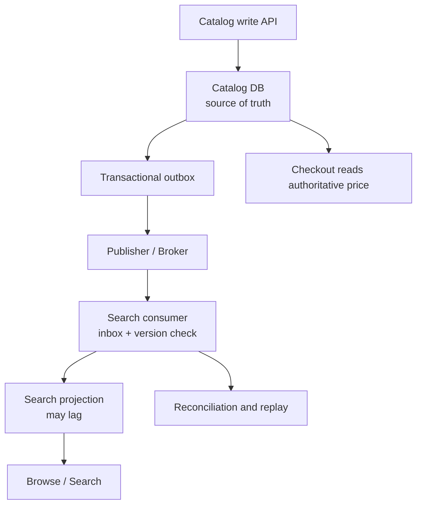
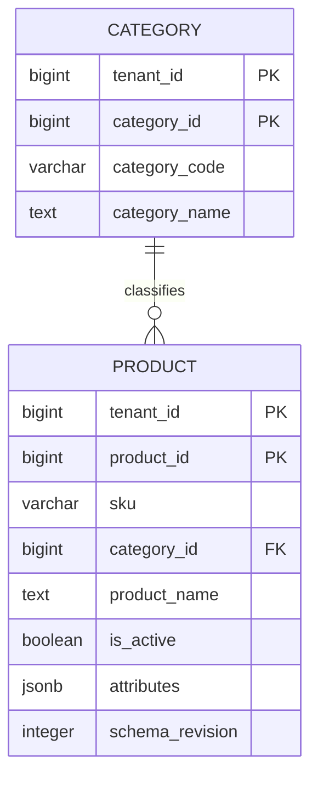
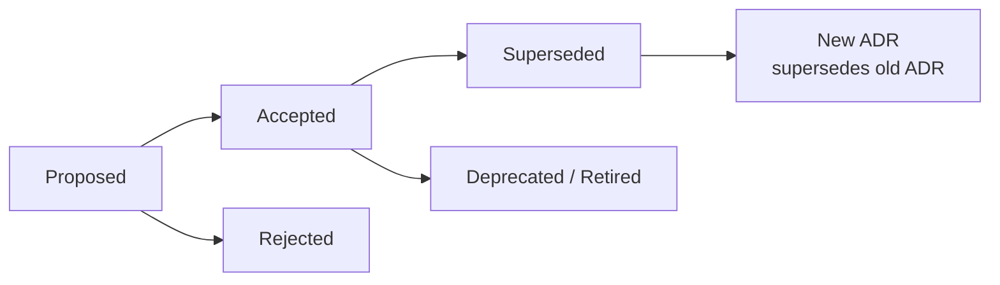

# Recording Architecture Decisions, Considered Alternatives, and Trade-Off Rationale

## 1. A Data Model Must Not Only Be "Right," It Must Explain Why

In the `DATABASE_DATA_MODELING` module, learners practice turning business requirements into clear data models: from entities, relationships, constraints, normalization, keys, indexes, and physical schemas to comparing relational, document, graph, and analytical modeling approaches. In the **Model Documentation** chapter, deliverables are not just ER diagrams or `CREATE TABLE` scripts. A model may run fine today yet become hard to maintain if nobody understands **why it was designed that way, why alternatives were rejected, and what conditions invalidate the decision**.

For example, a team chooses to store product attributes in `JSONB` instead of creating dozens of relational tables. Six months later, a new teammate spots a slow JSON query and proposes normalizing everything. Both proposals can be sensible in different contexts. If the original decision never recorded:

- How frequently new attribute types are added;
- Which fields need `UNIQUE` or `FOREIGN KEY`;
- Frequent read queries;
- Strength of business constraints and write throughput;
- Migration cost for existing data;
- Test results already gathered;

then the discussion easily restarts from scratch, or the model changes based on personal intuition instead of verified requirements.

An **Architecture Decision Record (ADR)** is a structured record capturing *one significant architectural decision* along with its context, options, rationale, consequences, and revisit triggers. In data modeling, ADRs complement ERDs, data dictionaries, migration scripts, API contracts, and operational docs; they **do not replace** those artifacts.

### Learning Outcomes

After this lesson, learners can:

1. Distinguish **facts, assumptions, constraints, options, decisions, and evidence** in model documentation.
2. Write ADRs in a traceable structure: context, drivers, options, trade-offs, decision, consequences, and verification criteria.
3. Compare relational, JSON/document, graph, and analytical models without turning ADRs into technology advocacy.
4. Tie every decision to **grain, keys, invariants, time, queries, ownership, and non-functional requirements**.
5. Explicitly record unknowns, data confidence levels, and triggers forcing re-evaluation.
6. Use ADRs in design reviews, schema changes, migrations, cutovers, rollbacks, and incident handling.
7. Distinguish **proposed** documents from **accepted** ones verified against real data.

## 2. Architecture Decisions Differ from Current-State Descriptions

A document stating "the database has a `product` table with these columns" is a **structural description**. A document stating "choose stable technical key `product_id` with unique (`tenant_id`, `sku`), instead of using `sku` as PK, because SKUs can change and be reused under catalog entry policies" is **recording a decision**.

| Information Type | Question Answered | Where It Normally Lives |
|---|---|---|
| **Business requirements** | What must the system do? | Requirements, acceptance criteria, business examples |
| **Current state** | Which tables, data, and flows currently exist? | Data catalog, ERD, schema registry, runbooks |
| **Decisions** | Which structure did we choose and why? | ADRs with owner, status, options, and rationale |
| **Invariants** | What must always remain true of the data? | ADRs to explain; constraints/tests to enforce |
| **Deployment process** | How do we migrate/cutover/rollback? | Migration plans, scripts, operational checklists |
| **Measurements** | Did the solution meet requirements? | Benchmarks, test reports, monitoring dashboards |
| **Change history** | When was a decision replaced? | New ADRs and `supersedes`/`superseded by` links |

A good ADR links these sources using **traceable identifiers**, rather than copying every SQL script, benchmark number, and test doc into one bloated file that quickly goes stale.

**Pragmatic rule:** information needed by future readers to understand *why* belongs in the ADR; information reflecting *exact current state* should come from verified schemas/tools and be linked.

## 3. Asking the Question: Which Decisions Deserve an ADR?

Not every `ALTER TABLE` or column rename needs its own ADR. Prioritize writing one when a choice:

- Affects **data semantics** and is hard to reverse, e.g., changing fact grain or identity rules.
- Creates **cross-team/service coupling**, e.g., shared schemas, contracts, ownership.
- Has multiple genuinely viable alternatives, each optimizing a different set of criteria.
- Significantly impacts **performance, consistency, security, scalability, or cost**.
- Introduces **intentional architectural debt**, e.g., keeping a temporary JSON column or dual-writing for 90 days.
- Forces live data migration involving legacy data and older consumers.
- Involves historical reproducibility, taxes, pricing, privacy, or long-term retention.

Common examples worth recording:

| Decision | Why an ADR Is Needed |
|---|---|
| Using surrogate keys over natural keys for customers | Code-change rules, FK history, duplicate source IDs |
| Choosing SCD Type 2 for product categories | Past reporting semantics, retroactive edits, versioning cost |
| Using `JSONB` for variant attributes | Trade-off between schema flexibility and FKs, queries, validation |
| Partitioning event tables by day/month | Queries, retention, uniqueness, and partition operations |
| Splitting order data into a bounded context | Ownership, contracts, eventual consistency, and migrations |
| Using a bridge table for multi-valued dimensions | Grain, fanout, allocation weights, and sum checks |
| Using snapshot facts instead of always-join-current | Receipt reproducibility, double storage, retroactive-fix impact |

Examples that may not need a new ADR: adding a minor index already covered by an existing ADR without changing semantics, editing a column description, or low-risk internal refactoring. Organizations may set their own risk thresholds.

## 4. Minimum ADR Structure for Another Reader to Understand and Verify

A common template includes:

| Field | What It Should Contain | What to Avoid |
|---|---|---|
| **ID and title** | `ADR-DATA-027: Extensible product attributes` | Overly broad title like "DB Design" |
| **Status** | `Proposed`, `Accepted`, `Superseded`, `Rejected`... | Marking `Accepted` while still just an idea |
| **Date/owner/reviewers** | Who owns the decision and when | Listing only the author without an accountable owner |
| **Scope** | Bounded contexts, tables, sources, and consumers involved | "Applies system-wide" without evidence |
| **Context** | Problem, current state, pain points, upcoming changes | Describing only the preferred solution |
| **Decision drivers** | Read/write patterns, invariants, SLAs, compliance, cost | Unmeasurable adjectives like "fast," "flexible" |
| **Options** | Multiple realistic alternatives, including doing nothing | Straw-man options rigged so the favorite wins |
| **Trade-offs** | Positive/negative impacts and who bears the cost | Listing only pros of the winning option |
| **Decision** | What is chosen, what is not, and exact scope | Saying "will consider" while marking `Accepted` |
| **Evidence** | Query workloads, metrics, PoCs, sources, confidence level | Imaginary benchmark numbers presented as measured results |
| **Consequences** | Migrations, code, tests, operations, security | Ignoring post-go-live maintenance cost |
| **Verification criteria** | Invariant tests, workload measurements, acceptance thresholds | "Test thoroughly" without definition |
| **Revisit conditions** | Shifts that trigger revisiting the choice | No mechanism to update decisions |
| **Links** | ERDs, DDL, migrations, tickets, benchmarks, related ADRs | Duplicating volatile details verbatim |

**An ADR is a historical record of reasoning.** When system context changes, write a new ADR explaining why it supersedes the old one, rather than quietly rewriting history to make a current choice look inevitable.

## 5. Distinguishing Fact, Assumption, Constraint, Preference, and Open Question

A specific-sounding statement is not automatically a fact.

| Label | Example | How to Handle in an ADR |
|---|---|---|
| **Measured fact** | "In a 7-day trace, 82% of reads filter by tenant and SKU." | Cite source, measurement date, dataset, confidence |
| **Assumption** | "Custom attribute types will grow 2×/year." | Name who confirmed it and a verification trigger |
| **Hard constraint** | "Tenant A data must never be read by tenant B." | Design mandatory enforcement and cross-tenant tests |
| **Soft objective** | "Prioritize faster rollout of new product types." | Frame KPIs/cost trade-offs against other objectives |
| **Preference** | "The team is familiar with PostgreSQL." | Treat as capability advantage, not absolute technical proof |
| **Open question** | "Must attribute codes inside JSON be strictly unique?" | Assign responder, deadline, and impact on options |
| **Decision** | "Choose a B-tree on (`tenant_id`, `sku`)." | State why, write-index trade-offs, and scope |

If workload data is missing, write "**Not yet measured; assumed for PoC design**," rather than writing "p95 = 50ms" as if benchmarked. An accepted ADR may still carry assumptions, provided it **openly discloses risks and verification plans**.

### One Way to Present Evidence

```text
Evidence E-04
  Type: query log analysis
  Scope: active tenants, 7 consecutive days
  Metric: share of requests filtering on (tenant_id, sku)
  Value: TBD — measurement not yet run
  Accountable owner: Data Platform
  Reproducibility: run query classifier script on anonymized logs
  Limitation: test workload may differ from campaign spikes
```

What matters is **traceability of evidence**, not attaching hundreds of raw data pages to every ADR.

## 6. Documenting Decisions Tightly Coupled to the Data Model

A schema ADR should answer questions hard to deduce from an ERD:

1. **Grain:** is one row a product, variant, sales line, daily snapshot, or change event?
2. **Identity:** which key stays immutable when codes/labels change? What is the tenant/source namespace?
3. **Cardinality:** 1–n or n–n; is a bridge or group bridge needed?
4. **Optionality:** which columns are `NOT NULL`, `CHECK`, `UNIQUE`, FKs, and scope boundaries?
5. **Time:** current state, valid-time, recorded-time, SCD2, or transaction snapshot?
6. **Consistency:** which transactions must be atomic, and which events can sync eventually?
7. **Read paths:** which queries start from tenant, device, product, or time range?
8. **Data growth:** row counts, row sizes, skew, retention, and partition keys?
9. **Ownership:** who has write authority? Who consumes only via contracts?
10. **Migration:** can legacy data migrate without losing meaning? Which cutovers/rollbacks are valid?

**Never answer an item merely with "indexed" or "normalized to 3NF."** For instance, 3NF resolves certain update anomalies and functional dependencies, yet says nothing about temporal semantics, security, or frequent deep-hierarchy queries.

## 7. Base Decisions on Workload, Not Performance Gut Feelings

Two schemas can both be relationally valid yet behave drastically differently on reads.

Suppose Catalog has these access paths:

| Query | Assumed Frequency/Importance | Filter Conditions |
|---|---|---|
| Q1: look up product by SKU | High, checkout path | `tenant_id` + `sku` |
| Q2: list products in a category | High, catalog pages | `tenant_id` + `category_id` + status |
| Q3: filter by color, material, extended attributes | Medium, faceted search | `tenant_id` + custom attributes |
| Q4: 12-month attribute-group report | Low on OLTP, scan-heavy | By time, category, and attribute values |
| Q5: add a new attribute type | Infrequent yet needs speed | Schema validation and admin UI |

Frequencies in this table are **illustrative assumptions**. If the real organization lacks query statistics, the ADR must state "unverified," making measurement part of the plan.

An index decision must tie directly to Q1–Q5. Saying "added `GIN` on JSONB so queries are fast" is not enough: measure actual predicates, selectivity, pages read, latency, insert/update overhead, and index growth at scale.

## 8. Alternatives Must Be Described Fairly

Illustrative scenario: every product type shares stable core attributes (SKU, name, category, status) plus extensible attributes (color, material, features) varying by category. Three main options:

### A. Purely Relational: Typed Columns and Normalized Attribute Tables

```text
product(product_id, tenant_id, sku, name, category_id, ...)
attribute_definition(attribute_id, tenant_id, code, data_type, ...)
product_attribute_value(product_id, attribute_id, value_*, ...)
```

**Pros:** centralized attribute catalog management, clearer FKs/uniqueness, rich relational constraints. **Cons:** EAV can require many joins, type consistency is hard if generic value columns are sloppy, read/pivot cost increases. Distinguish typed attribute tables from "everything-as-a-string" EAV.

### B. Hybrid Relational + `JSONB`

```text
product(tenant_id, product_id, sku, category_id,
        name, active, attributes_jsonb, ...)
```

**Pros:** core keys and columns have strict constraints, adding extensible attributes is flexible, reading a product document is convenient. **Cons:** JSONB lacks native FKs for nested fields; schema validators must be built, GIN indexes carry overhead; analytical queries get more complex.

### C. Document-Oriented Product Aggregate

```text
product_document:
  id, tenant, sku, category, variants[], attributes{}, ...
```

**Pros:** flexible aggregate representation, fast per-product shape evolution, convenient ID reads. **Cons:** cross-document uniqueness, transactions, indexing, category links, and reporting depend on the DBMS; OLTP-to-analytics sync/migration requires clarity.

**No single option wins on every axis.** If Q3 dominates and attributes demand strict FKs/uniqueness, B may lose to A; if Q1 dominates and extensions are rarely filtered, B can stay simple; if document aggregates fit and the engine meets validation/index/transaction needs, C is valid.

## 9. Criterion-Linked Trade-Off Tables, Not Cosmetic Scorecards

Comparison template:

| Criterion | Option A: Relational Attributes | B: Hybrid JSONB | C: Document |
|---|---|---|---|
| Protecting core SKU/category keys | Strong via FK/UNIQUE | Strong via typed core + FK | Depends on engine index/constraint features |
| Changing attribute structure | Update definition/type and mappings | Add key, update validator | Flexible document schema |
| Attribute filter queries | Joins and typed indexes | GIN/expression indexes tuned to workload | Product-scoped indexes/path queries |
| Reading full product profile | Multi-join may need cache/projection | Single row + JSONB | Natural document aggregate |
| Unique/FK on extended fields | Controllable via design | Not natively enforced on nested keys | Engine- and design-dependent |
| Attribute history management | Add version/valid-time | Version whole document or specific diffs | Version/document history |
| Frequent edits to one small field | Update single value row | May rewrite JSONB segment | May update document field; cost varies by engine |
| Large multi-attribute reports | Normalizable/pivotable | ETL flattens into mart | ETL into mart/read schema |
| Migration from current RDBMS | Minimal infra change, table changes | Minimal infra change | Introduces new engine and sync |

The table describes **capabilities and risks**, not benchmark results. Before scoring, identify which criteria are **mandatory constraints** (e.g., never lose category FKs or tenant isolation) versus **soft optimizations** (e.g., fewer DDLs when adding a color).

### Why Weighted Scores Alone Do Not Make a Decision

Suppose a team weights flexibility 40%, queries 30%, integrity 20%, and operations 10%. If weights are tuned so the preferred option wins, the total score is just **quantified bias**.

A safer approach:

1. Apply **go/no-go** criteria first: eliminate any option violating hard constraints.
2. Give remaining criteria a rating scale and **evidence source**.
3. Run **sensitivity analysis**: if Q3 grows 10× or migration cost triples, does the ranking flip?
4. Record the decision, trade-offs, and **revisit triggers** in the ADR, not merely a scorecard.

## 10. Full ADR Example: Extensible Attributes in a Multi-Tenant Catalog

This is a **learning example**, not a decision approved for a real production system. Status is **Proposed**, with no benchmark results yet; performance numbers belong only once real measurements exist.

### ADR-DATA-027 — Storing Extensible Product Attributes

| Property | Illustrative Value |
|---|---|
| ID | `ADR-DATA-027` |
| Status | **Proposed** |
| Date drafted | 2026-11-22 |
| Owner | Catalog Team |
| Required reviewers | Data Platform, Security, Analytics, Catalog Business Team |
| Scope | Multi-tenant OLTP Catalog; does not alter sales fact schemas |
| Need | Add attribute types while preserving core product keys/constraints |
| Proposed decision | **B: Hybrid typed core + JSONB for extensible attributes** |
| Evidence | Q1–Q5 are assumed workloads; benchmarks and DQ checks pending |
| Acceptance criteria | Satisfies core constraints, tenant tests, validator, query benchmarks, migration |

### 10.1. Context

Products have a stable identity via `product_id`; SKUs are unique within a tenant and managed separately upon code edits. Each product currently belongs to one category. Attributes like `color`, `material`, or `battery_capacity_wh` vary across product types; addition frequency is not yet measured.

Transactional apps require low-latency Q1/Q2 and occasional Q3 attribute filtering. Historical reporting and long-term aggregations run in a separate data mart. The team wants to avoid a DDL migration for every rare attribute, yet refuses to leave **pricing/tax/sellability** attributes in JSON without validation and owners.

### 10.2. Options Considered

- **A – Typed Relational/EAV:** enables fine-grained attribute governance and constraints, yet adds tables/joins and type/range enforcement overhead.
- **B – Hybrid JSONB:** typed/constrained core columns with validated, selectively indexed extended attributes; primary risk is semantics/types/FKs inside JSON.
- **C – Document DB:** convenient for fast-evolving aggregates, yet adds infrastructure, category identity sync, and legacy migration without sufficient justification today.
- **D – Fixed-column relational schema:** low short-term cost, yet DDLs and sparse columns may multiply if custom attributes grow as projected.

Do not dismiss C claiming "NoSQL has no transactions" or A claiming "SQL cannot scale"; those generalizations are inaccurate. Evaluate **specific** engine capabilities, workloads, and team operational readiness.

### 10.3. Proposed Decision and Boundaries

Adopt **B** initially **if** experiments pass acceptance criteria. Core identity, category, list price, active state, and strictly constrained codes live in typed columns. `attributes JSONB` holds only extended attributes registered in an owned registry/validator. Never use JSONB to replace tenant/category FKs or obscure access controls.

**Accepted trade-offs:**

- Filtering on certain attributes is harder to constrain than typed columns.
- Requires schema validators, migration rules, and attribute governance versioning.
- GIN/expression indexes add write/storage overhead; Q3 must be benchmarked.
- Analytical consumers should flatten critical attributes into marts instead of coupling to arbitrary JSON paths.

**Conditions triggering ADR review:**

- A JSON attribute becomes frequently used in checkout, pricing/tax, or `UNIQUE`/`FK` constraints.
- Q3 breaches latency SLAs or JSONB updates cause write amplification beyond measured budgets.
- Invalid payload rates rise or data lineage breaks.
- Per-attribute versioning/retroactive edit needs grow so complex that whole-document versioning becomes unwieldy.

### 10.4. Consequences

Catalog must implement versioned schema validation, key migration rules, null/missing contracts, tenant checks, workload indexes, legacy column migrations, and regression tests. Analytics must own flattening ETL with grain/semantic tests. This decision does not apply to invoices, ledgers, or inventory entities with stricter relational/transactional demands.

**Do not mark this ADR Accepted based solely on this example text.** A real ADR requires PoC results, reviewer sign-off, and evidence passing quality gates before moving from Proposed to Accepted.

## 11. Translating Decisions into Verifiable DDL

PostgreSQL 16 illustration for Option B, with a minimal standalone schema:

```sql
CREATE TABLE category (
    tenant_id BIGINT NOT NULL,
    category_id BIGINT GENERATED ALWAYS AS IDENTITY,
    category_code VARCHAR(60) NOT NULL,
    category_name TEXT NOT NULL,
    CONSTRAINT pk_category PRIMARY KEY (tenant_id, category_id),
    CONSTRAINT uq_category_code
        UNIQUE (tenant_id, category_code)
);

CREATE TABLE product (
    tenant_id BIGINT NOT NULL,
    product_id BIGINT GENERATED ALWAYS AS IDENTITY,
    sku VARCHAR(80) NOT NULL,
    category_id BIGINT NOT NULL,
    product_name TEXT NOT NULL,
    is_active BOOLEAN NOT NULL DEFAULT TRUE,
    attributes JSONB NOT NULL DEFAULT '{}'::jsonb,
    schema_revision INTEGER NOT NULL DEFAULT 1,
    created_at TIMESTAMPTZ NOT NULL DEFAULT clock_timestamp(),
    CONSTRAINT pk_product PRIMARY KEY (tenant_id, product_id),
    CONSTRAINT uq_product_sku UNIQUE (tenant_id, sku),
    CONSTRAINT fk_product_category_tenant
        FOREIGN KEY (tenant_id, category_id)
        REFERENCES category (tenant_id, category_id),
    CONSTRAINT ck_product_sku_nonblank
        CHECK (char_length(btrim(sku)) > 0),
    CONSTRAINT ck_product_attributes_object
        CHECK (jsonb_typeof(attributes) = 'object'),
    CONSTRAINT ck_product_schema_revision
        CHECK (schema_revision > 0)
);

-- Candidate for Q2: filter category and active state within tenant.
CREATE INDEX idx_product_tenant_category_active
    ON product (tenant_id, category_id, is_active);

-- Candidate for Q3: containment predicate on attributes.
CREATE INDEX idx_product_attributes_gin
    ON product USING GIN (attributes jsonb_path_ops);
```

**Reading invariants actually enforced by the DBMS:**

1. `PRIMARY KEY(tenant_id, product_id)` identifies rows within a tenant. The identity sequence may be global, yet composite PK/FKs still encode tenant boundaries in the model.
2. `UNIQUE(tenant_id, sku)` blocks duplicate SKUs **within a tenant**; if SKUs can change or be reused after discontinuation, add alias/history or soft-delete rules. Never infer cross-time immutability from current uniqueness alone.
3. Composite FK (`tenant_id`, `category_id`) stops a product in tenant 42 from referencing a category in tenant 43. It does not guarantee effective-time alignment if categories are versioned.
4. `jsonb_typeof(attributes) = 'object'` guards **top-level shape**. It **does not** guarantee `color` is a valid string, `battery_capacity_wh` is positive, or all keys are approved.
5. `schema_revision` versions the **attribute structure rules** in this example; it is neither a DB migration version nor proof that values passed validation.
6. `jsonb_path_ops` accelerates certain `@>` containment filters; it does not optimize every JSON operator. If workloads use `?` or other path queries, compare against `jsonb_ops` or expression indexes and verify operator support.

### Queries Q1 and Q2

```sql
-- Q1: lookup by SKU within tenant.
SELECT product_id, product_name, category_id, attributes
FROM product
WHERE tenant_id = 42
  AND sku = 'SKU-1001';

-- Q2: list active products in a category.
SELECT product_id, sku, product_name
FROM product
WHERE tenant_id = 42
  AND category_id = 7
  AND is_active = TRUE
ORDER BY product_id
LIMIT 100;
```

Q1 can leverage the index created by `uq_product_sku`. Q2 may benefit from the category–active index depending on row counts, selectivity, pagination, and planner statistics. `ORDER BY product_id` may require a sort or another index on hot read paths; measure rather than guessing from DDL.

### Query Q3 and Tenant Scope Limits

```sql
-- Containment query: find red products.
SELECT product_id, sku, product_name
FROM product
WHERE tenant_id = 42
  AND attributes @> '{"color": "red"}'::jsonb;
```

In PostgreSQL, the GIN index on `attributes` can assist `@>`, while the tenant filter uses another scan/index per the query plan. With many tenants and massive workloads, evaluate composite indexing, partitioning, or promoting typed columns. **A global JSON index does not prove tenant isolation is efficient**; security still requires access policies or RLS, not just developers remembering `WHERE tenant_id`.

### Never Hide Critical Constraints Inside JSONB

If `serial_number` must be unique per tenant, `supplier_id` needs an FK, or `tax_category` governs invoicing, placing them inside JSONB without extra DB/validation safeguards invites bugs. The ADR must state **promotion rules** moving attributes from JSON to typed columns or dedicated tables, plus legacy migration plans.

## 12. Defining Proper Validator Boundaries

A JSON payload can be syntactically valid yet domain-invalid:

```json
{
  "color": 123,
  "battery_capacity_wh": -20,
  "supplier_id": "unknown"
}
```

To protect data, the ADR must specify:

- **Schema registry/definition:** key catalog, types, units, ranges per category/version, required vs. optional fields.
- **API/ingestion validation:** types, business rules, units, enums, and write permissions.
- **DB validation:** invariants expressible via `CHECK`, FKs, unique constraints, indexes, or triggers; clarifying what the DB genuinely enforces.
- **Legacy data rules:** handling deprecated keys, renamed keys, unit shifts, or invalid values via migrations/quarantine.
- **Telemetry:** invalid payload rate, rare keys, unindexed hot attributes, validation latency, and schema churn.

**Never write "JSONB is validated in the application" as an unverifiable promise.** Name the validator owner, which endpoints/batches pass through it, whether direct SQL writes are locked down, and which tests prove it cannot be bypassed.

## 13. Normalization ADRs: Why Split Tables, Why Keep Denormalization

In relational modeling, **normalization** controls data dependencies and reduces update anomalies. Yet a sound decision may intentionally retain copies:

- `order_line.product_name_at_sale` to preserve receipt content even if product names change.
- `fact_sales_line.reporting_group_at_sale` for as-sold reporting.
- `customer_summary.total_paid` as a UI read model.

These choices **do not share the same purpose**, even though all are forms of denormalization.

| Scenario | Why Duplicate Data? | What the ADR Must State |
|---|---|---|
| Transaction snapshot | Protect business/legal history | Which values lock, when, who can amend, corrections |
| Cache/materialized projection | Speed up reads, accepting staleness | Source of truth, refresh/CDC, lag, reconcile/rebuild |
| Denormalized reporting fact | Avoid heavy joins, simplify BI | Grain, dimension sources, as-of policy, backfill |

When multiple data marts compare metrics, a **conformed dimension** (a dimension with unified definitions across facts/marts) can warrant its own ADR: who owns keys and version history, whether buyer actually equals billing party, and whether classifications follow current state or event time. Conformed dimensions in analytics do not force every OLTP domain to share one write table.
| JSON document aggregate | Read many attributes in one fetch | Boundary, schema version, validation, and indexes |

Documentation saying merely "denormalize for speed" is incomplete. Readers need to know **whether and how long data may lag**, how desync is repaired, which value is canonical, and whether extra write cost is acceptable.

## 14. Key ADRs: Identity, Namespaces, and Evolvability

Choosing between natural keys and surrogate keys must not be oversimplified to "UUIDs are always good" or "BIGINT is always fast."

### Options to Weigh

- **Natural key:** `(tenant_id, sku)` as PK; works when codes are strictly immutable, yet every FK may break if SKUs change.
- **Surrogate key:** `(tenant_id, product_id)` as PK; SKU has a separate unique constraint, allowing code changes without losing identity.
- **Distributed ID/UUID:** convenient for multi-source ID generation, yet affects index width, locality, write ordering, debugging, and identifier exposure risk.
- **Composite source identity:** `(tenant_id, source_system, external_ref)` as integration identity; may require a mapping table to prevent namespace collisions.

### Questions Every Key ADR Must Answer

1. Can SKUs be edited, deleted, reissued, merged, split, or reused?
2. Must IDs be generated offline/multi-region? What is the collision policy?
3. Is `tenant_id` part of FKs/unique constraints or only a filter column?
4. How does wide-key choice impact index sizes on huge child tables?
5. Does the key carry historical version meaning or only current-row identity?
6. When migrating to a new source, how is the old-to-new ID mapping verified?

**Never treat technical keys and business codes as two names for the same concept.** A key valid today becomes semantically broken if reused over time.

## 15. Time and History ADRs: Hard to Recover Once Data Is Lost

Suppose users ask "which segment did the customer belong to at purchase time?" Three storage choices yield different outcomes:

| Option | Can Answer | Cannot Answer Without Additions |
|---|---|---|
| Store only current `customer.segment` | Current state | Segment effective at purchase time |
| SCD Type 2 with `valid_from/valid_to` | Segment per currently accepted effective history | What the system **previously believed** before retroactive edits |
| Snapshot `segment_at_sale` on fact | Segment locked on the transaction | Full history of customer changes outside transactions |
| Bitemporal | Valid time and recorded/system time | Still requires semantic definitions, write protocols, and retention |

The ADR must state the **historical questions** to answer, not just drop the name "SCD2." Mandatory elements:

- Which event sets `event_time`/`valid_from`? Are retroactive effective dates allowed?
- Must both **as-booked** and **restated** views be preserved?
- Are late-arriving records matched to the right historical version?
- Are gaps allowed between versions, or must intervals cover the entire timeline?
- Who is authorized to edit history and under what approval flow?
- How do retention and privacy policies limit history duration?

**Historical data overwritten before adopting a new model cannot be resurrected by a DDL migration alone.** Without reliable sources, the ADR must state that limitation rather than fabricating imaginary past versions.

## 16. Index and Partition ADRs: Quantitative Workload Decisions

An index speeds up SELECTs at the cost of INSERT/UPDATE/DELETE maintenance. Partitioning shrinks time-range scans while adding operational overhead and uniqueness/FK constraints.

### Index Decision Template

```text
Candidate I-03
  Target: product
  Index: (tenant_id, category_id, is_active)
  Query: Q2 — active products within a category
  Expected benefit: fewer scanned pages than broad product scans
  Cost: larger index footprint and status-update write overhead
  Evidence: EXPLAIN (ANALYZE, BUFFERS) on representative dataset — TBD
  Guardrail: measure p95 Q2 and write throughput under concurrent load
  Revisit: if Q2 moves to a search engine or read model
```

### Illustrative Benchmark Query

```sql
EXPLAIN (ANALYZE, BUFFERS)
SELECT product_id, sku, product_name
FROM product
WHERE tenant_id = 42
  AND category_id = 7
  AND is_active = TRUE
ORDER BY product_id
LIMIT 100;
```

`EXPLAIN (ANALYZE, BUFFERS)` **executes** the SELECT. Inspect not only total runtime, but actual vs. estimated row counts, buffers, sorts, scans, index access, and tenant skew. Benchmarks require matching schema, fresh `ANALYZE` stats, representative data, and explicit warm/cold cache conditions.

### When Deciding on Partitioning

The ADR must record:

- Which query/retention pattern drives the partition key?
- Target partition count and size?
- How far back can late-arriving data hit older partitions?
- Are there global unique constraints to preserve?
- Plan for pre-creating partitions, archiving/detaching/dropping, and rollback?
- Per-partition indexes, ingest speed, and partition pruning?

**PostgreSQL 16:** time-partitioned tables cannot enforce arbitrary parent-level `UNIQUE`/PK constraints missing the partition key. Never shove a timestamp into a source unique key just to make DDL compile if doing so lets the same event slip into two partitions. A strong ADR specifies an explicit uniqueness strategy (ledger, grain shift, different engine) and its rationale.

## 17. Consistency and Integration ADRs: Who Owns the Source of Truth?

Suppose Catalog stores prices and Search displays prices in search results. Two options:

1. API dual-writes synchronously to both the Catalog DB and Search index.
2. Catalog writes once, publishes changes via outbox/CDC, and Search builds an idempotent projection.

If choosing option 2, the ADR must state:

- Catalog is the **write owner**; Search is a **read projection**.
- Acceptable lag between Catalog and Search; which UIs must read Catalog directly to prevent stale prices at checkout.
- How event loss is prevented: local transactional outbox, publisher retries, inbox/dedup.
- Ordering by product/tenant, retroactive updates, and delete/tombstone handling.
- Full index rebuild procedure after incidents; comparing product counts and content checksums.
- Operational ownership when backlogs spike or consumers fail.

Never write "eventual consistency will sort itself out" or "outbox guarantees end-to-end exactly-once." Outbox prevents losing events across DB commits and broker publishes, yet consumers still need idempotency, retries, ordering, and reconciliation.

### Responsibility Diagram



**The primary decision is not "whether to use Kafka."** The core questions are who owns writes, what consistency consumers require, and how recovery works on desync. Specific technologies are evaluated inside that context.

## 18. Security, Multi-Tenancy, and Privacy ADRs

A data design can meet read latency targets yet fail tenant isolation:

- Do all tenant-scoped unique constraints and FKs include `tenant_id` in the right position?
- Do queries enforce authorization beyond "developers remember to add `WHERE tenant_id`"?
- What RLS, DB roles, service owners, and cross-tenant tests exist?
- Do sensitive fields appear inside JSON, events, logs, DLQs, or snapshots?
- Is there a requirement to mask/erase PII while retaining transaction history per law?
- Do backups and read replicas share matching access and retention policies?

For example, a `GIN` index on `attributes` creates no vulnerability on its own, yet if an app permits table-wide filtering without enforcing tenant scope, queries can leak data. ADRs must assess security at the **system** level rather than evaluating SQL schemas in a vacuum.

**Data minimization is a real trade-off.** Packing all customer info into one canonical document simplifies consumers while widening sensitive data exposure. Splitting contracts by purpose increases mapping work in exchange for shrinking PII blast radius.

## 19. Supporting Artifacts: ERDs, Data Dictionaries, and Lineage

The ADR is the "why"; supporting artifacts specify exact structure and flow.

### Condensed ERD for the Catalog Example



The Mermaid diagram outlines only high-level structure. **Tenant-scoped composite constraints** and versioning/validation policies live in DDL and ADRs. Readers must not infer from the diagram that JSONB enforces FKs on internal keys.

### Example Data Dictionary

| Field | Definition | Owner | Constraint/Source |
|---|---|---|---|
| `product.product_id` | Technical product identity | Catalog | Composite PK with tenant |
| `product.sku` | Current unique business code within tenant | Catalog | `UNIQUE(tenant_id, sku)` |
| `product.category_id` | Current category used by Catalog | Catalog | Composite FK to category |
| `product.attributes` | Extended attributes per schema revision | Catalog | JSON object + validator |
| `product.is_active` | Whether product is listed as active | Catalog | `BOOLEAN NOT NULL`, domain lifecycle rules |
| `product.schema_revision` | Structural schema version of attributes | Catalog | Positive integer, validator/version |

### Lineage

```text
Catalog API / Import
   -> Schema validation + tenant authorization
   -> product (OLTP canonical)
   -> outbox / CDC
       -> Search projection (serving search)
       -> Analytics flatten (serving reporting)
       -> Data quality metrics
```

When a data mart query returns bad numbers, lineage lets you trace backward from chart to transforms, events, and write sources. Link ADRs to lineage diagrams and contracts, not only ERDs.

## 20. Review Process: Auditing Both Solution and Reasoning

A meaningful review asks more than "does this match team style?" Useful questions:

1. Is the problem concrete enough to evaluate?
2. Were at least one realistic alternative and the status quo analyzed fairly?
3. Which requirements are hard constraints versus tradeable goals?
4. Are grain, identity, FKs, constraints, time semantics, and query workloads settled?
5. What is measured evidence versus assumption? Which measurements remain unrun?
6. What is the worst-case failure mode and who owns remediation?
7. Do tests prove critical invariants, including concurrency and late data?
8. If rollback/migration is needed, can old data revert without information loss?
9. Which observable triggers would force replacing this decision?
10. Could a new engineer reconstruct the reasoning and verify current state?

### Who Should Review?

| Change | Required Reviewers by Risk |
|---|---|
| Keys/FKs and identity | Domain owner, DBA/Data Platform, primary consumers |
| Fact grain or history policy | Domain, Analytics, Finance if relevant, Data Quality |
| Large partitions/indexes | DBA/SRE, ops team, query owners |
| Shared/cross-service contracts | Producer, consumers, Security/Compliance if PII involved |
| Retention/audit | Legal/Compliance and data governance where applicable |
| Breaking migrations | System owner, release management, ops support |

Do not send every ADR to a company-wide committee. Reviews focused on **owners and directly impacted parties** move faster and go deeper. Add reviewers only when real accountability or risk applies.

## 21. Status Lifecycle: Accepted Does Not Mean "True Forever"

A typical ADR lifecycle:



- **Proposed:** problem, options, and proposal drafted; awaiting review/measurements.
- **Accepted:** owner/reviewers approved in a specific context; acceptance criteria recorded.
- **Rejected:** evaluated and declined; still worth keeping to avoid repeating debates.
- **Superseded:** replaced by a newer ADR because requirements/evidence shifted; old ADR preserves historical context.
- **Deprecated/Retired:** decision/structure no longer in use; notes how the system transitioned.

**Never silently edit an Accepted ADR to change a past choice.** Fixing typos or adding links is fine, but new architectural decisions belong in a new ADR linked via `supersedes`/`superseded_by`. When circumstances change, preserving history helps the organization learn why.

### Using a Decision Log

An ADR index table aids discovery:

| ID | Topic | Status | Owner | Supersedes/Superseded By |
|---|---|---|---|---|
| ADR-DATA-009 | Tenant-scoped product keys | Accepted | Catalog | — |
| ADR-DATA-027 | JSONB extended attributes | Proposed | Catalog | — |
| ADR-DATA-041 | Product attribute versioning | Proposed | Catalog | May depend on ADR-DATA-027 |

IDs and statuses in this table are **illustrative examples**, not references to existing files in this repository. The goal is demonstrating navigation and dependencies across decisions.

## 22. Migration, Cutover, and Rollback Belong in ADR Consequences

Decisions altering keys, JSON shapes, or data history rarely execute like a simple column rename. ADRs should link to an **expand → migrate → contract** rollout plan.

### Example: Promoting a JSON Attribute to a Typed Column

Suppose `battery_capacity_wh` currently lives inside `attributes`, yet begins impacting safety checks and filter queries. A new ADR decides to promote it to a typed column.

```sql
-- EXPAND: nullable new column so legacy readers/writers don't break immediately.
ALTER TABLE product
    ADD COLUMN battery_capacity_wh NUMERIC(12,2);

-- Once JSON values are verified numeric and non-negative,
-- backfill from legacy values. Illustrative for clean data only.
UPDATE product
SET battery_capacity_wh =
    (attributes ->> 'battery_capacity_wh')::numeric(12,2)
WHERE battery_capacity_wh IS NULL
  AND jsonb_typeof(attributes -> 'battery_capacity_wh') = 'number';
```

**This snippet is unsafe to run blindly across arbitrary production data.** You must handle `JSON null`, missing keys, numbers out of `NUMERIC(12,2)` bounds, negative values, malformed legacy payloads, concurrent writers, and rounding rules. When promoting JSON to a typed column:

1. **Expand:** add column and indexes/constraints if safe; legacy readers keep running.
2. **Observed dual-read:** prefer the new field when synced, fall back to legacy JSON per rule; measure fallback rate and drift.
3. **Write coordination:** designate one source-of-truth field and guard both old and new writers with verified logic; never treat both columns as arbitrary independent write targets.
4. **Batched backfill:** manage locks, batch transactions, and conditions preventing overwriting newer writes.
5. **Validate:** verify coverage, equality per unit/rounding, all consumers, and access controls.
6. **Cutover:** switch reads to the typed column once verified; maintain rollback readiness for a defined window.
7. **Contract:** drop the JSON key/compatibility code only after all legacy readers/writers stop and archival/replay concerns are resolved.

**ADR consequence:** adding a column gives critical values stronger types/constraints in exchange for migration effort, extra indexes, compatibility steps, and potential downtime/locking risks if mishandled.

### Rollback Conditions

If the typed field introduces rules **unrepresentable** in legacy JSON (or data was edited with different precision/semantics), rolling back application code alone can lose information. The ADR must distinguish:

- Is **code rollback** still compatible with newly written data?
- Does **schema rollback** drop newly written fields?
- Can **data rollback** convert backward without semantic loss?
- Is **roll-forward** safer once past the point of no return?

Never write "rollback by reverting the commit" without assessing impact on live data.

## 23. Tying Decision Logs to Tests and Monitoring

An ADR gains credibility through repeatable checks:

| Decision | Invariant to Verify | Test Type |
|---|---|---|
| Tenant-unique SKU | No two products share an SKU within a tenant | DB `UNIQUE`, unit/integration, duplicate import tests |
| Tenant-scoped category FK | Product cannot point to another tenant's category | Composite FK, cross-tenant tests |
| JSONB extended attributes | JSON object, keys/types/units match schema revision | Schema validator, property-based tests, quarantine |
| SCD Type 2 | Non-overlapping versions; events map by timestamp | Temporal constraints, as-of tests, gap scans |
| Transaction snapshots | Receipt prices/names stay fixed when catalog edits | Integration tests, audit/reversal policies |
| Outbox/inbox | Retries never multiply business effects | Concurrency, crash/recovery, replay tests |
| Historical partitions | Unique source identity isn't broken by partition keys | Cross-partition integration tests |
| Time-series rollups | Late samples are reflected without double counting | Replay/idempotency, raw vs. rollup checks |

**No test can make architectural choices on an owner's behalf.** Tests prove an invariant holds; ADRs record **why that invariant was chosen and when it should change**.

### Preventing Drift Between Docs and Reality

When schemas change:

- Check related Accepted ADRs for conflicts.
- Upon conflict, write a new ADR or record superseding rationale—never edit silently.
- Review new DDL/migrations alongside ADRs and tests.
- Refresh data catalogs/extracted schemas from actual database state.
- Use CI to check links, syntax, ID status, migrations, and automatable invariants.

An ADR claiming "column `sku` is always unique" after a migration dropped the unique index is **documentation debt** liable to cause incidents. Conversely, auto-regenerating DDL alone never explains *why* uniqueness changed.

## 24. Designing Experiments to Validate Options

A valuable PoC highlights **the differences between options**, not merely proving all of them run "hello world."

### Catalog Benchmark Checklist

1. **Data:** tenant counts, products/tenant, active ratios, JSON sizes, key frequencies, category cardinality, and whale tenants.
2. **Reads:** Q1/Q2/Q3, filtering common/rare attributes, pagination, concurrent reads, p50/p95/p99 latency.
3. **Writes:** creating products, editing a single JSON key, updating category, upserting by SKU, bulk imports.
4. **Correctness:** tenant isolation, FKs, uniqueness, JSON validators, nulls/missing keys, products missing optional attributes.
5. **Storage:** heap/table size, index size, WAL/redo volume, memory/cache footprint, and rows touched per update.
6. **Recovery:** index rebuilds, backfills, rollback/forward migrations, provenance preservation.
7. **Operations:** team skills, backup/restore, monitoring, schema rollouts, infrastructure cost.

### Recording Measurements for Reproducibility

```text
Benchmark record B-12
  Environment: TODO — specify DB/version/CPU/RAM/storage
  Dataset: TODO — tenant count, distribution, skew, JSON size
  Workload: Q1/Q2/Q3 mix percentages and concurrency
  Baseline: Option A
  Candidate: Option B
  Metrics: p50/p95/p99, throughput, write latency, index disk
  Result: NOT YET MEASURED — no claim on which option is faster
  Repeatability: scripts/seeds/data hashes and run date
  Owner: Data Platform
  Decision impact: if SLA breached, redesign indexes or change model
```

**Never benchmark on ten rows and conclude an option scales to hundreds of millions of rows.** Results also depend on warm/cold caches, PostgreSQL settings, tenant skew, writer concurrency, and background load; ADRs must document those bounds.

## 25. ADR Anti-Patterns That Drain Documentation Value

| Poor Practice | Problem | Improvement |
|---|---|---|
| "Chose PostgreSQL because it's best." | Lacks context or criteria | Specify workload, constraints, options, and measurements |
| "Use JSON for flexibility." | Omits FKs, validation, and queries | Separate core vs. extension fields, guardrails, indexes |
| "NoSQL lacks transactions." | Inaccurate across many engines | Evaluate exact engine/version capabilities |
| "Normalized to 3NF so no issues." | Ignores temporal, tenant, perf, integration | Document invariants, time, ownership, and queries |
| "Benchmark: 10× faster" with no source | Unreproducible, looks fabricated | Record environment, dataset, scripts, and metrics |
| Listing only pros of the winner | Hides costs and risks | Fairly document rejected options and accepted debt |
| Marking everything `Accepted` at draft time | Confuses proposals with approved decisions | Use `Proposed`/`Accepted`/`Rejected` accurately |
| "Rollback via code revert." | Risks losing migrated data | Identify v2-only data and points of no return |
| Pasting entire DDL and query logs into ADRs | Obscures rationale, goes stale | Summarize invariants and link to verified sources |
| Cramming 20 independent choices into one ADR | Hard to supersede a single part | Scope to one decision unit with owner/lifecycle |
| Writing an ADR for every column rename | Excessive review overhead | Use migration/changelogs for minor tweaks |
| Recording outcome without revisit triggers | "Permanent decisions" never adapt | Add metrics/triggers/owners and review dates |
| Using vague "customer" across domains | Buyer, payer, recipient differ | Define bounded contexts and explicit contracts |
| Presenting unmeasured guesses as facts | Builds reasoning on sand | Label assumptions, risks, and validation plans |

## 26. Reusable ADR Template for Any Data Modeling Decision

The following is a **documentation template**; fill bracketed placeholders for real decisions. Sections need not be equal in length; what matters is providing enough clarity to review and reproduce.

```markdown
# ADR-DATA-[ID]: [One specific decision]

- Status: Proposed | Accepted | Rejected | Superseded
- Date: YYYY-MM-DD
- Owner: [Team/Role]
- Reviewers: [Accountable individuals/teams]
- Scope: [Bounded contexts, tables, APIs, tenants, consumers]
- Related: [ERDs, DDL, migrations, tests, incidents, other ADRs]

## 1. Problem and Context
- What business question must we solve?
- What is the current model and its evidenced limitations?
- What happens if we do nothing?

## 2. Requirements and Decision Drivers
- Mandatory: [Grain, FKs, tenant isolation, privacy, audit...]
- Objectives: [Queries Q1..Qn, SLAs, write rate, cost...]
- Assumptions/unknowns: [With owners and validation deadlines]

## 3. Options Considered
- A: [Structure and pros/cons]
- B: [Structure and pros/cons]
- C: [Status quo or alternative]
- Rationale for rejecting each option and evidence limits

## 4. Proposed/Accepted Decision
- Chosen: [One option within explicit scope]
- Not chosen: [Rejected options]
- Invariants: [PK/FK/UNIQUE/CHECK, valid time, grain...]
- Accepted exceptions: [...]

## 5. Trade-Offs and Consequences
- Positives: [...]
- Negatives/accepted debt: [...]
- Privacy/security, analytics, and consumer impacts: [...]
- Migration, operational, and monitoring costs: [...]

## 6. Evidence and Verification Criteria
- Measured facts + sources: [...]
- Needed benchmarks/tests: [...]
- Go/no-go gates and blocking failures: [...]

## 7. Rollout and Rollback
- Expand/migrate/contract: [...]
- Dual-read/write, backfill, consistency: [...]
- Cutover conditions and hard-to-reverse points: [...]

## 8. When to Revisit?
- Triggers on scale, SLA, semantics, cost: [...]
- Owner and measurement method: [...]

## 9. History
- When Proposed/Accepted/Superseded, and by whom?
- Superseding or superseded ADRs: [...]
```

**Do not turn the template into a bureaucratic checklist.** If no second viable option exists, explain which hard constraints rule alternatives out; if metrics aren't gathered yet, keep status `Proposed` and list validation actions.

## 27. Practice Exercise: Modeling Decisions for Orders and Product Attributes

**Context:** an e-commerce platform has 15 million multi-tenant products and 120 million order lines. Catalog supports product types with extensible attributes; orders must preserve exact sale-time price and product name. Roughly 70% of Catalog reads are SKU lookups (this is an **exercise assumption**, not a measured fact). Finance requires price traceability on invoices; Analytics wants revenue reports both by **sale-time** category and **current** category. Two partner ingestion systems supply products, each using its own product code namespace.

Three proposals are under debate:

- **Option A:** put all product attributes in EAV; order lines join directly to current Product.
- **Option B:** product typed core + JSONB; `order_line` stores name/price snapshots and a stable product key; versioned categories support historical reporting.
- **Option C:** document product aggregate; emit full events to Analytics and Search, with orders storing separate snapshots.

### Tasks

1. Write **two separate ADRs**: one for Catalog structure and one for preserving attribute/price history on `order_line`. Explain why they should not be merged into one decision.
2. For the Catalog ADR, specify Q1–Q5 and at least one hard constraint. Propose how to **measure** instead of treating the 70% figure as fact.
3. Define grain for `product`, `product_variant`, `order`, and `order_line`; explain errors if merged into one document or table without clarifying cardinality.
4. Build a comparison table for A/B/C across FK/uniqueness, schema flexibility, filter queries, write cost, transactions, migrations, team skills, and privacy.
5. Identify which attributes must never sit casually in JSONB because they need strict business constraints.
6. Choose a key policy: surrogate `product_id` and namespaced external references; explain how SKU changes preserve historical identity.
7. Design as-of categories and sale-time price/name snapshots; contrast "as-sold reporting" vs. "reclassified reporting."
8. Write a suite of `CHECK`/FK/unique/temporal tests for critical invariants, including cross-tenant isolation.
9. Design a concrete benchmark scenario: tenant count, skew, JSON size, Q1–Q5, and read/write metrics.
10. Draft an expand–migrate–contract plan for promoting a JSON key to a typed column, covering concurrent updates and rollback.
11. List at least three **ADR revisit triggers** post-launch (e.g., query mix, latency, invalid JSON rate).
12. Incident drill: a March revenue report shifted categories due to joining current state. Identify which ADR and tests should have caught the risk.

### Decision Record Quality Checklist

- [ ] Title states a concrete architectural decision; includes owner, status, date, and scope.
- [ ] Context/pain points are not confused with the preferred solution.
- [ ] Grain, identity, namespaces, cardinality, constraints, and time policies are explicit.
- [ ] Hard constraints, tradeable objectives, assumptions, and open questions are separated.
- [ ] Realistic alternatives are compared fairly, including the status quo.
- [ ] Selection rationale and **accepted** downsides are concrete, not just "faster."
- [ ] Evidence cites sources/datasets; unmeasured claims are marked unmeasured.
- [ ] Tests verify invariants and procedures measure representative workloads.
- [ ] Security/privacy, analytics, consumer, migration, and operational consequences are covered.
- [ ] Cutover, rollback, deprecation, and irreversible data states are analyzed.
- [ ] Revisit triggers and monitoring owners are assigned.
- [ ] Links to ERDs, data dictionaries, DDL/migrations, contracts, and related ADRs are verifiable.

**Good model documentation does not only answer "what did we build," but also "why did we choose it, what other options were viable, which costs did we accept, and what evidence would change our minds."** ADRs forge a chain of accountability linking business requirements, logical/physical models, queries, constraints, operations, and evolution. When every decision carries clear context, alternatives, trade-offs, verification criteria, and history, data models can evolve intentionally rather than being reverse-engineered from legacy table columns.
