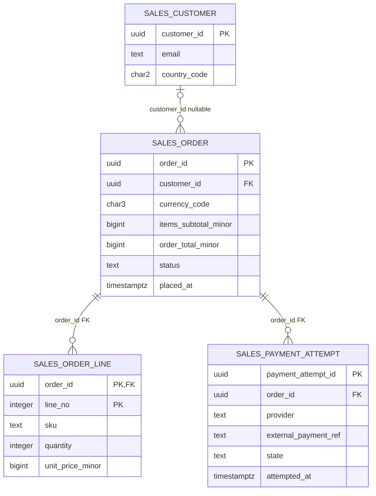
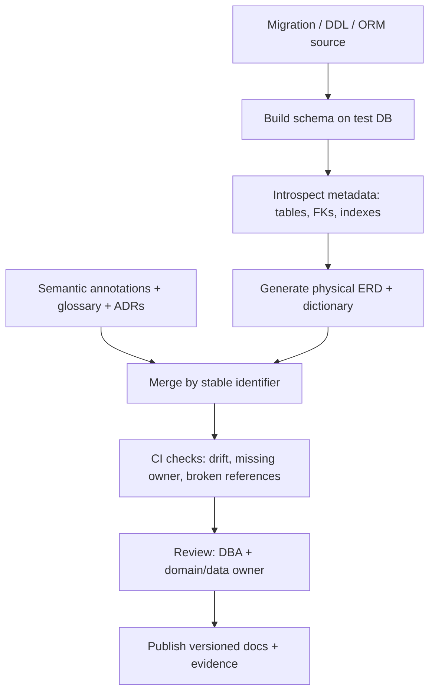

# Diagrams Generated from Implementation and Their Limits Without Business Meaning

A development team uses a tool to **generate an entity–relationship diagram (ERD)** from a PostgreSQL database. The diagram displays every table, column, primary key, and foreign-key line. The team concludes: "We have data model documentation; newcomers just open the diagram to understand the system." Yet when asked **"can an order have zero lines?"**, **"does `PAID` mean cash collected or only authorized?"**, and **"does a `NULL` `customer_id` mean a guest checkout or missing source data?"**, the ERD cannot answer.

Diagrams generated from source code, ORMs, or database metadata carry high value: they reflect **technical structures actually declared or deployed**. However, most business meaning resides in **operational rules, domain language, data contracts, time policies, and constraints never encoded as DB constraints**. A structurally accurate diagram can still mislead readers about the model.

This lesson belongs to the **Model Documentation** chapter of the **DATABASE_DATA_MODELING** module. The module trains the skill of turning business requirements into clear entities, relationships, keys, constraints, indexes, and physical schemas; and comparing relational, document, graph, and analytical models so systems evolve and verify cleanly. We will learn how to **generate diagrams from current implementation**, recognize **what tools can and cannot infer**, and add a semantic documentation layer maintainable alongside implementation changes.

## 1. What Questions Do Auto-Generated Diagrams Answer?

A reverse-engineering tool can read information from:

- **DDL/migrations:** `CREATE TABLE`, `ALTER TABLE`, indexes, foreign keys, `CHECK` constraints, data types, and declared partition structures.
- **Database catalog:** tables, columns, constraints, indexes, views, partitions, and metadata of the **current** database.
- **ORM mappings:** entities, fields, annotations, associations, inheritance, and naming strategies described in **application code**.
- **Schema-as-code:** DBML files, Prisma schemas, schema registries, Avro/JSON Schema, GraphQL schemas, etc., depending on the ecosystem.
- **Analytical warehouses or catalogs:** fact/dimension tables, columns, declared descriptions, technical lineage, and configured relationships.

Outputs can be ERDs, UML class diagrams, table dependency graphs, index models, lineage diagrams, or HTML docs. However, **generation sources do not always agree**: an ORM may declare an association not enforced by a DB FK; the latest migration may not be deployed yet; a view may lack FKs even when its output represents a business relationship.

### 1.1. Three Model Levels to Distinguish

| Level | Primary Question | Typical Representation | Inferable Completely from DDL? |
| --- | --- | --- | --- |
| **Conceptual** | Which concepts, boundaries, and rules exist in the business? | Customers, orders, payments, ownership, glossary terms | **No** |
| **Logical** | How are entities, attributes, keys, relationships, and invariants modeled? | ERD with cardinality, business keys, relationship types, rules | **Partially** |
| **Physical** | Which structures does the database use to store and access data? | Tables, types, PK/FK, indexes, partitions, constraints | **Substantially extractable**, within granted metadata permissions |

A tool redrawing a physical schema **does not automatically turn it into a conceptual model approved by domain experts**. The reverse is also true: a clean conceptual diagram does not prove database PK/FK/indexes enforce those constraints.

## 2. From Schema to ERD: A Sales System Example

Suppose a sales service stores customers, orders, order lines, and payment attempts. To see the limits of an auto-generated diagram clearly, start with an **illustrative PostgreSQL DDL**:

```sql
CREATE TABLE sales_customer (
    customer_id UUID PRIMARY KEY,
    email TEXT,
    country_code CHAR(2)
);

CREATE TABLE sales_order (
    order_id UUID PRIMARY KEY,
    customer_id UUID REFERENCES sales_customer(customer_id),
    currency_code CHAR(3) NOT NULL,
    items_subtotal_minor BIGINT NOT NULL
        CHECK (items_subtotal_minor >= 0),
    order_total_minor BIGINT NOT NULL
        CHECK (order_total_minor >= 0),
    status TEXT NOT NULL CHECK (
        status IN ('CREATED', 'PAID', 'SHIPPED')
    ),
    placed_at TIMESTAMPTZ NOT NULL
);

CREATE TABLE sales_order_line (
    order_id UUID NOT NULL
        REFERENCES sales_order(order_id),
    line_no INTEGER NOT NULL CHECK (line_no > 0),
    sku TEXT NOT NULL,
    quantity INTEGER NOT NULL CHECK (quantity > 0),
    unit_price_minor BIGINT NOT NULL
        CHECK (unit_price_minor >= 0),
    PRIMARY KEY (order_id, line_no)
);

CREATE TABLE sales_payment_attempt (
    payment_attempt_id UUID PRIMARY KEY,
    order_id UUID NOT NULL
        REFERENCES sales_order(order_id),
    provider TEXT NOT NULL,
    external_payment_ref TEXT NOT NULL,
    state TEXT NOT NULL CHECK (
        state IN ('AUTHORIZED', 'CAPTURED', 'DECLINED')
    ),
    attempted_at TIMESTAMPTZ NOT NULL,
    UNIQUE (provider, external_payment_ref)
);
```

### 2.1. What the Tool Can Draw

The diagram below **illustrates reverse-engineering output** from the DDL's keys and columns; it is not raw export output from a specific tool:



The diagram and DDL establish verifiable facts:

1. `sales_order.order_id` identifies a row in the orders table.
2. `sales_order.customer_id` allows `NULL` and, when non-NULL, references an existing customer.
3. Each `sales_order_line` references an order; composite key `(order_id,line_no)` blocks two lines with the same sequence number in one order.
4. A `sales_payment_attempt` references an order; `(provider,external_payment_ref)` is unique within table scope.
5. `status` and `state` values outside their lists are rejected by `CHECK` while constraints are active.
6. Several monetary values must be non-negative, and timestamp columns are declared `TIMESTAMPTZ`.

**Limit of cardinality notation:** seen from the `NOT NULL FK`, every order line has exactly **one existing parent order**; yet from the order side, the database **does not require at least one order line**. Thus the FK line indicates **0..n** lines per order, even if business demands 1..n once an order is confirmed.

### 2.2. What the Diagram Does Not Confirm

| Business Question | Proven by DDL/ERD? | Why? |
| --- | --- | --- |
| Must a confirmed order have at least one line? | **No** | An FK does not mandate child rows |
| Does `customer_id NULL` mean guest checkout? | **No** | Could mean unsynced, anonymized, legacy bug, or N/A |
| Does `PAID` mean captured, settled, or only authorized? | **No** | `CHECK` only checks string membership, not business definitions |
| Does `order_total_minor` equal sum of lines? | **No** | May include discounts, taxes, shipping fees, rounding |
| Does an order have multiple payment attempts due to valid retries? | **Partially** | 1–n permits it, yet hides retry/capture logic |
| Is email a unique customer identity? | **No** | No UNIQUE constraint; even UNIQUE doesn't prove identity semantics |
| Does `sku` reference a valid product? | **No** | DDL declares no FK to products |
| Can an order reach `SHIPPED` before `PAID`? | **No** | Value CHECKs do not enforce **state transitions** |
| Are amounts in cents or currency minor units? | **Not fully** | `_minor` hints at it, yet currency/exponent rules live outside DB |
| How long is data kept and who can read it? | **No** | Retention/authorization may sit in apps, policies, or other systems |

**Takeaway:** a diagram shows *what structures exist*, without explaining *why those structures were chosen* or *which interpretations are permitted*.

## 3. A Technical Relationship Does Not Automatically Equal a Business Relationship

Tools typically render **FKs** as connector lines. Readers can misinfer:

- `sales_order.customer_id` nullable → "Orders have no customer" or "guest checkout." In reality, it might be **a customer known via external ID whose profile hasn't arrived yet**.
- `sales_order_line.order_id` NOT NULL → "Orders always have an order line." The database only ensures **an order line cannot be orphaned**, not that **every order has lines**.
- No FK on `sku` → "Products are unrelated to orders." The relationship may live in an external catalog service using business keys instead of local FKs.
- Multiple `sales_payment_attempt` rows → "Orders are paid multiple times." They could be declined **attempts**, an uncaptured authorization, or retries of one request.

### 3.1. Distinguishing Possible Cardinality from Required Cardinality

| Physical Structure | What the DB Enforces | Additional Business Rules Often Needed |
| --- | --- | --- |
| Nullable FK in child table | 0 or 1 parent row per child row | Why NULL is permitted, when it must be populated |
| NOT NULL FK in child table | Child row must have one parent row | When created, parent open/close lifecycle |
| Multiple child rows sharing FK | Parent may have 0..n children | Min/max thresholds, ordering, semantic uniqueness |
| UNIQUE on a column | Blocks duplicate values per DB unique/NULL rules | Is the column truly a business identity? |
| No FK | No local FK constraint here | Relationship may be managed by another service, code, or ETL |
| CHECK on enum | Restricts valid values per row | Transition laws and actor permissions |

In multi-database or microservice architectures, **cross-service FKs** are rarely enforced by a single DB. Diagrams extracted from each DB separately omit the link; drawing a fake connector identical to a real FK also misleads readers. Distinguish **contracted logical references** from **DB-enforced FKs**.

## 4. Terminology: Table and Column Names Are Not Enough for Exact Meaning

The following pairs are easily conflated:

| Seemingly Clear Column Name | Possible Different Meanings |
| --- | --- |
| `status = 'ACTIVE'` | Account can log in, contract is in effect, or order is processing? |
| `amount` | Pre-tax, post-tax, gross, net, captured, settled? |
| `balance` | End-of-day balance, available balance, ledger balance, or period delta? |
| `created_at` | When event occurred, when system received it, or when row hit DB? |
| `customer_id` | CRM customer, login user, payer, or shipping recipient? |
| `rate` | Percentage, 0..1 ratio, annual interest rate, FX rate, units per hour? |
| `deleted_at` | Soft delete, business expiration, or hidden from UI? |
| `version` | Optimistic locking, contract version, SCD version, or migration version? |

A data dictionary needs **definition, unit, nullability, source of truth, lifecycle, validity, and examples**. For instance:

| Field | Technical Description | Semantics That Must Be Added |
| --- | --- | --- |
| `order_total_minor` | `BIGINT NOT NULL` | Total in smallest unit of `currency_code`, including/excluding fees, taxes, and vouchers per policy |
| `sales_order.status` | `CREATED/PAID/SHIPPED` | Transition preconditions, decision owner, whether reversible |
| `placed_at` | `TIMESTAMPTZ` | When customer confirmed checkout or when OMS received it? |
| `customer_id` | Nullable UUID FK | How NULL is classified across guest, unresolved, withheld, or source error |
| `payment_attempt.state` | `AUTHORIZED/CAPTURED/DECLINED` | Authorization is not collected cash; source and confirmation timing |

**Column names like `amount_cents` or `_minor` are documentation cues**, yet the system still needs explicit currency, precision, and rounding rules. Consistent vocabulary helps readers avoid "valid SQL, wrong KPI."

## 5. Reading PostgreSQL Metadata to Generate Grounded Diagrams

An ERD-generation workflow from a live database can query system catalogs. The following examples are **read-only**, suitable when an account has permission to inspect the target schema.

### 5.1. Listing Tables, Columns, Types, Nullability, and Comments

```sql
SELECT
    ns.nspname AS schema_name,
    tbl.relname AS table_name,
    attr.attnum AS ordinal_position,
    attr.attname AS column_name,
    format_type(attr.atttypid, attr.atttypmod) AS data_type,
    NOT attr.attnotnull AS is_nullable,
    pg_get_expr(def.adbin, def.adrelid) AS default_expression,
    col_description(attr.attrelid, attr.attnum) AS column_comment
FROM pg_catalog.pg_class AS tbl
JOIN pg_catalog.pg_namespace AS ns
  ON ns.oid = tbl.relnamespace
JOIN pg_catalog.pg_attribute AS attr
  ON attr.attrelid = tbl.oid
LEFT JOIN pg_catalog.pg_attrdef AS def
  ON def.adrelid = tbl.oid
 AND def.adnum = attr.attnum
WHERE ns.nspname = 'public'
  AND tbl.relkind IN ('r', 'p')
  AND attr.attnum > 0
  AND NOT attr.attisdropped
ORDER BY ns.nspname, tbl.relname, attr.attnum;
```

Key points:

- `relkind='r'` denotes regular tables; `'p'` denotes partitioned parent tables in PostgreSQL. Depending on the question, filter out **child partitions** so parent and child are not drawn as separate business entities.
- `pg_get_expr` exposes default expressions; generated columns, identities, storage details, or complex constraints require additional catalog queries.
- `col_description` retrieves comments added via `COMMENT ON COLUMN`, with **no guarantee** that comments exist or still match business rules.
- Permissions, PostgreSQL versions, and object types affect returned metadata. Illustrative queries are not exhaustive extractors across every engine version.

### 5.2. Listing PK, FK, UNIQUE, and CHECK Constraints

```sql
SELECT
    ns.nspname AS schema_name,
    tbl.relname AS table_name,
    con.conname AS constraint_name,
    con.contype AS constraint_type,
    pg_get_constraintdef(con.oid, true) AS definition
FROM pg_catalog.pg_constraint AS con
JOIN pg_catalog.pg_class AS tbl
  ON tbl.oid = con.conrelid
JOIN pg_catalog.pg_namespace AS ns
  ON ns.oid = tbl.relnamespace
WHERE ns.nspname = 'public'
  AND con.contype IN ('p', 'f', 'u', 'c')
ORDER BY ns.nspname, tbl.relname, con.conname;
```

Common codes: `p` is primary key, `f` foreign key, `u` unique, `c` check. The query outputs **textual constraint definitions** for quick inspection. Production graph generators should extract **source–target column mappings via OID/`attnum` metadata**, rather than regex-parsing formatted SQL strings, given quoted identifiers, schemas, composite keys, and varied syntax.

For indexes, query `pg_indexes`/index catalogs; for views, partition hierarchies, and triggers, query appropriate catalogs. Still, **seeing a trigger/function exist does not prove rules inside the code are understood**. Complex logic in PL/pgSQL or services still requires dedicated documentation and tests.

### 5.3. Reading What Is Actually Deployed

A migration file in Git can differ from a live database because:

- Migrations have not run yet or failed on an environment.
- Manual hotfixes were never captured in migrations.
- A tenant/database has a different schema mid-rolling deployment.
- Catalog permissions expose only a subset of objects.
- New DDL ran while views, ORM entities, or consumers lag behind.

Therefore, documentation must record **extraction source, environment, timestamp, app/schema version, and object scope**. "ERD from production on date X" is a point-in-time snapshot, not automatically the canonical model across all environments.

## 6. An ORM Class Diagram Does Not Equal a Database Diagram

Example Java application using JPA/Hibernate:

```java
import jakarta.persistence.*;
import java.util.ArrayList;
import java.util.List;
import java.util.UUID;

@Entity
@Table(name = "sales_order")
class SalesOrderEntity {
    @Id
    @Column(name = "order_id", nullable = false)
    private UUID id;

    @ManyToOne(fetch = FetchType.LAZY, optional = true)
    @JoinColumn(name = "customer_id")
    private CustomerEntity customer;

    @OneToMany(mappedBy = "order", fetch = FetchType.LAZY)
    private List<SalesOrderLineEntity> lines = new ArrayList<>();
}
```

This is an **illustrative relationship snippet**: `CustomerEntity` and `SalesOrderLineEntity` are omitted, so it is not a complete program. In JPA, `@ManyToOne` and `@OneToMany` tell tools association mapping intent; however:

- Empty `lines` upon entity instantiation may be valid while building an aggregate, even if business requires at least one line at order confirmation.
- `FetchType.LAZY` is a data-loading strategy, **not business cardinality**.
- `optional=true` in an ORM does not prove the database shares the same `NULL` constraint.
- Mappings can drift from deployed DDL, especially when schemas use separate migrations rather than ORM auto-DDL.
- An object-graph association may lack a physical FK (when joining across services); conversely, a table may hold FKs unmapped as object references in code.

**Do not blend diagram levels:** publish a class/association diagram for aggregate code and a physical ERD for the DB. When they differ, explain the differences instead of layering them together and calling it one source of truth.

## 7. "Absent from the Diagram" Does Not Mean "Does Not Exist"

Graphs generated from a single source **only know objects present and declared in that source**. These relationships and rules are easily missed:

| Relationship/Rule | Why Might It Be Missing? | What Must Be Added? |
| --- | --- | --- |
| Link via **business key** without FK | FK lives in another service or external data | Identity contract, namespace, ownership, and tests |
| Policy **order must have lines before confirmation** | Requires multi-row check, no simple row CHECK | Aggregate invariant, command state, tests |
| **States and transitions** | DB only CHECKs enum values | State machine, guards, authorized actors |
| **SCD Type 2** | PK/FK hides effective-time semantics | Valid-from/to, overlap rules, as-of joins |
| **Soft delete and retention** | May sit in jobs, policies, or services | Data policy and deletion timeline |
| **Multi-tenant data** | `tenant_id` might skip composite FKs | Permission boundaries, cross-tenant tests, routing |
| **External system identities** | No cross-database/service FKs | Mapping tables, event contracts, resolvers |
| **Semi-additive measures** | DB sees `NUMERIC` without stock vs. flow | Grain, aggregation rules, time dimensions |
| **PII, security classification** | DDL lacks mandatory sensitivity tags | Data classification, access controls, data owners |
| **Source of truth** | Multiple systems share similar field names | Owner, source of truth, pipeline, freshness SLAs |

Missing FK lines on an ERD can also happen when a tool **lacks permission to read FKs**, filters schemas, or simplifies drawings. For critical decisions, state **what lies out of scope**.

## 8. Adding a Business Meaning Layer (*Semantic Overlay*)

Rather than manually tweaking lines on auto-generated diagrams, maintain two independent yet linked layers:

1. **Structural snapshot:** versioned output from DDL/catalog/schema-as-code reflecting columns, types, PK/FK, and indexes.
2. **Semantic overlay:** approved by domain owners, documenting entities, grain, states, measure contracts, source of truth, relationship rationale, and off-DDL constraints.

**Illustrative** metadata example, not the syntax of a specific catalog product:

```yaml
model: sales_order
model_version: 3
owner_team: order-domain
source_of_truth: order-service
grain: "One purchase request identified by order_id"
business_key: [order_id]
description: >
  An order contains order lines; PAID status is written only
  after valid capture evidence per product policy.
fields:
  customer_id:
    nullable_reason:
      - guest_checkout
      - unresolved_customer_identity
    note: "Data source must distinguish reasons; DB does not yet enforce."
  items_subtotal_minor:
    unit: "Smallest unit per currency_code"
    definition: >
      Sum of order lines per approved pricing and discount rules.
  status:
    owner: order-domain
    values:
      PAID: "Satisfies domain payment recognition criteria"
invariants:
  - "Confirmed order must have at least one valid line"
  - "SHIPPED is valid only via order-domain workflow"
evidence:
  - "Domain rule: ConfirmOrder"
  - "Integration test: order-without-lines-is-rejected"
reviewed_by: "order-domain + data-owner"
```

The overlay must bind to **actual tables/fields** and be reviewed on schema or semantic changes. If `sales_order` is renamed to `orders`, stale metadata must trigger a drift alert and get updated rather than leaving unmapped business comments floating.

### 8.1. Attributes Every Entity Entry Should Carry

| Documentation Property | Example for `sales_order` | Purpose |
| --- | --- | --- |
| **Business definition** | An accepted purchase request for processing | Avoids conflating order with shipment/invoice |
| **Grain** | One row per order ID | Guides counting, dedup, and joins |
| **Business key** | `order_id` managed by OMS | Distinguishes SK/PK from external IDs |
| **Owner** | `order-domain` team | Who approves semantic changes? |
| **Source of truth** | Order service, not BI exports | Resolves data conflicts |
| **Lifecycle** | Created → confirmed → paid/shipped per workflow | Validates transitions inexpressible via FKs |
| **Optionality meaning** | `customer_id` nullable for categorized reasons | Never equates NULL with N/A |
| **Time semantics** | `placed_at` is order lock time, UTC | Accurate reporting periods and late events |
| **Security** | Customer ID is linkable personal data | Access control and minimization |
| **Retention** | Per approved policy per field | Governs erasure and backups |

### 8.2. Documentation Must Separate Verified Facts from Hypotheses

Suppose analytics suspects `PAID` only occurs upon payment capture. Before verifying code and policies, do not document "PAID = CAPTURED" as settled fact. Write **"needs confirmation with order-domain; lacks end-to-end verification"**, open a tracking item, and update once proven.

Labeling a diagram "verified" just because DDL parsed cleanly reflects **overconfidence**. Tag provenance per claim: **"DB enforced"**, **"application validated"**, **"source contract"**, **"business approved"**, or **"assumed/not verified"**.

## 9. Difference Between Enforced Constraints and Expected Rules

Constraints span multiple layers:

| Layer | Example | Enforcement Point | Verification Method |
| --- | --- | --- | --- |
| **Database enforced** | PK, NOT NULL, FK, CHECK | DB DDL | Catalog queries, negative insert/update tests |
| **Application invariant** | Confirmed order has ≥1 line | Aggregate/service | Unit + integration tests, command rejections |
| **Inter-service contract** | Payment capture drives `Paid` | Events/APIs + ACL | Contract tests, E2E, event replay |
| **Data quality rule** | 100% delivered orders have tracking within 24h | ETL/warehouse | SQL checks, alerts, and SLAs |
| **Analytical semantic rule** | Conversion rate = conversions/eligible sessions | Metric definition | Reconciliation and golden fixtures |
| **Governance policy** | PII readable only by authorized group | IAM/RLS/audit | Permission tests and policy reviews |

Never style an application-contract connector as a physical FK. Likewise, never write "DB guaranteed" if a rule is only checked in a web form while batch jobs, CDC, or other APIs can bypass it.

### 9.1. Rules Hard to Express on ERDs

Diagrams alone rarely capture:

- **Cross-row/cross-table invariants:** confirmed orders need lines; total merchandise must not exceed budget.
- **Workflow/time:** orders must be paid before dispatch (with approved exceptions); events occurring before/after effective instants.
- **Multi-source agreement:** identifying customers across CRM/OMS requires mappings and late-data handling.
- **Concurrency:** never create two captures for one idempotency key under concurrent workers.
- **Retention/PII:** erase from replicas and projections, not just primary table rows.
- **Dimensional aggregation:** `closing_balance` does not sum across days; `conversion_rate` never SUMs.

With only an ERD, engineers can write **valid** SQL that produces **wrong** semantics.

## 10. SQL Supplies Supporting Evidence for Business Rules

Diagrams do not prove non-structural constraints, yet they pair well with **data-quality queries** and tests. For the example DDL:

### 10.1. Finding Orders Without Lines

```sql
SELECT o.order_id, o.status
FROM sales_order AS o
LEFT JOIN sales_order_line AS l
  ON l.order_id = o.order_id
WHERE o.status IN ('PAID', 'SHIPPED')
GROUP BY o.order_id, o.status
HAVING COUNT(l.line_no) = 0;
```

If business requires every `PAID` or `SHIPPED` order to have at least one line, this query should return empty. If the domain allows service-fee orders without SKU lines, rewrite the rule; **never guess from drawings**.

### 10.2. Reconciling Recorded Subtotals Against Order Lines

```sql
SELECT
    o.order_id,
    o.items_subtotal_minor,
    COALESCE(
        SUM(l.quantity * l.unit_price_minor), 0
    ) AS computed_items_subtotal
FROM sales_order AS o
LEFT JOIN sales_order_line AS l
  ON l.order_id = o.order_id
GROUP BY o.order_id, o.items_subtotal_minor
HAVING o.items_subtotal_minor IS DISTINCT FROM COALESCE(
    SUM(l.quantity * l.unit_price_minor), 0
);
```

This query is only a **candidate check** if `items_subtotal_minor` literally equals `SUM(quantity × unit_price_minor)`. It produces false positives if the system has **line discounts, returns, line taxes, repricing, or different rounding policies**. Before enabling alerts, business owners must publish the formula and verification examples. Never equate `order_total_minor` with subtotal, since total may include taxes, fees, and order-level discounts.

### 10.3. Payment Identity and Order Status

`sales_payment_attempt.state = 'CAPTURED'` does not automatically require `sales_order.status = 'PAID'`. An order may have multiple attempts, partial captures, refunds, or captures tied to different shipments. If business requires tighter coupling, specify:

- Domain-recognized payment/capture IDs;
- Independent settlement/refund states where needed;
- External payment ID mappings and verification sources;
- Transition invariants and late-event handling;
- Tests defining when order status may transition.

**Never write a check** claiming "whenever one payment attempt is CAPTURED, the order must be PAID" without accounting for partial captures, timeouts, workflows, and cancellations. An ERD with FK arrows resolves none of those.

## 11. Database Comments: Helpful Yet Insufficient

PostgreSQL supports attaching comments to objects:

```sql
COMMENT ON TABLE sales_order IS
    'One row per order_id; owner: order-domain.';

COMMENT ON COLUMN sales_order.items_subtotal_minor IS
    'Sum of order lines in smallest unit of currency_code; '
    'reconciled per order-domain pricing policy.';

COMMENT ON COLUMN sales_order.customer_id IS
    'Nullable for multiple reasons; see guest/unresolved identity '
    'classification rules in semantic contract.';
```

Comments help because:

1. They live right next to deployed schemas; tools can extract them.
2. They are easy to spot during table/column exploration and migration reviews.
3. Automation can flag missing comments on sensitive columns or critical KPIs.

Yet comments do not enforce invariants and can grow **stale, vague, or false**. Detailed explanations of workflows, state machines, lineage, privacy, and query examples belong in dedicated versioned docs linked from comments/ERDs to the canonical location.

A sound rule is **keep short descriptions near the source, keep detailed decisions and evidence in governed docs**, with link/owner checks. Never cram entire domain rulebooks into multi-thousand-character DB comments.

## 12. ADRs and Model Decisions ERDs Cannot Represent

An **Architecture Decision Record (ADR)** records **why** a model was chosen, rejected options, trade-offs, and revisit triggers. Example:

```text
ADR-017: Do not declare an FK from sales_order_line.sku to
catalog_product in the Order database.

Context:
- Catalog and Order are owned by two bounded contexts.
- Product IDs are issued and validated via the Catalog API.
- SKUs may be discontinued while still appearing on historical orders.

Decision:
- Store SKU plus description/price snapshots for order history.
- Validate source and namespace when creating lines.
- Do not pretend a distributed FK exists across two databases.

Consequences:
- Order service is responsible for validating external data.
- Mapping errors are caught via audits/reconciliation.
- SKU contract changes require migrations or an ACL.

Review trigger:
- When Catalog/Order share one DB or mapping error rates
  exceed approved operational thresholds.
```

An ERD can only show **an absent FK**, not whether that absence is **intentional architecture** or **unresolved technical debt**. ADRs connect business/architectural choices to the schema, stopping future maintainers from "fixing the missing FK" in ways that break service boundaries.

### 12.1. Minimum Documentation for a Decision

- Problem/question to solve.
- Business and non-functional constraints (latency, transactions, independent deployment, retention).
- Chosen option and rationale.
- Rejected options and trade-offs.
- Consequences for keys, relationships, indexes, migrations, and permissions.
- Approving owner, decision date, version, and revisit triggers.

ADRs need not be verbose, yet must **preserve the model's rationale** across DDL and team changes.

## 13. Publishing Diagrams Without Misleading Readers

A clear documentation suite should include:

| Doc Layer | Source | Contents | Primary Audience |
| --- | --- | --- | --- |
| **Physical ERD** | Live catalog/DDL | Tables, columns, PK/FK, types, constraints, indexes | DBAs, backend, data engineers |
| **Logical/conceptual view** | Domain analysis, use cases, semantic contract | Concepts, grain, expected cardinality, lifecycles | Product, domain experts, architects |
| **Business glossary** | Business owners | Term definitions, KPIs, units, calculation rules | BI, analytics, product |
| **Data dictionary** | Metadata + annotations | Field descriptions, sources, nulls, sensitivity, owners | Data users |
| **Lineage** | Pipeline metadata + verification | Where data is produced/transformed to each target | Ops, compliance, BI |
| **ADRs and contracts** | Reviewed decisions/versions | Why the model looks this way, compatibility, trade-offs | Engineering teams/owners |
| **Validation evidence** | Tests, quality queries, migration CI | Which claims are verified | Reviewers, SRE, data stewards |

Diagrams need a **legend**:

- **Solid line:** physical FK declared and enforced by the database (when verified).
- **Dashed line:** logical/contract relationship across services or ETL, **not an FK**.
- **Color/tag for table kind:** operational, fact, dimension, lookup, audit, projection.
- **Grain and owner labels:** what does one row mean, who approves it?
- **Snapshot metadata:** environment, schema revision, extraction timestamp, permission/scope, generator version.

Never use colors or solid/dashed lines arbitrarily without a legend; readers easily mistake "intended" relationships for enforced constraints.

### 13.1. Two Side-by-Side Diagrams Beat One Blended Diagram

The physical diagram shows:

```text
sales_order (0..n) ----> sales_payment_attempt
  FK payment_attempt.order_id
```

The domain diagram can express:

```text
Order ----> PaymentAuthorization / Capture
  "Order transitions to Paid only when payment policy is met
   and capture evidence is verified"
```

Both descriptions **complement** each other. Readers simply need to know which drawing depicts **implementation structure** and which depicts **semantics/business rules**.

## 14. Automating Generation While Keeping Human Semantic Approvers

A pragmatic *docs-as-code* workflow:



**Important:** a diagram generated from **migrations applied to a temporary DB** shows what migrations intend to build; a diagram generated from a **live database** shows what that environment actually holds. If both matter, compare **expected vs. observed** and publish drift rather than anointing one side as the sole truth.

### 14.1. Automatable Checks

1. Every critical table/entity must have a business definition and owner.
2. Every KPI/monetary/ratio/time column must carry unit, grain, or temporal semantics.
3. All new FKs/PKs/UNIQUE constraints appear accurately in ERDs and data dictionaries.
4. Every field referenced in semantic overlays still exists in the new schema.
5. Adding enum values triggers review of contracts/transition docs and tests.
6. Dropping columns checks affected consumers, views, BI models, and ADRs.
7. Generated metadata is not published if the tool lacked permissions for required schemas.
8. Diagrams never replace quality gates for business invariants or authorization.

These checks work well in CI or data catalogs, though **avoid blocking every change simply because comment prose isn't polished**. The aim is preventing critical properties from vanishing as models evolve.

## 15. Schema Drift: A Pretty Diagram Gone Stale

Drift is divergence among **intended model, deployed implementation, and published docs**. At least three types exist:

| Drift Type | Example | How to Detect |
| --- | --- | --- |
| **Structural drift** | Production has a column absent from repo migrations | Compare normalized catalog/DDL by revision |
| **Mapping drift** | JPA annotation says `optional=false` yet DB FK is nullable | Compare ORM mappings against deployed schema |
| **Semantic drift** | `status='PAID'` shifted from captured to authorized without comment update | Contract reviews, tests, business policy diffs |

Reverse-engineering tools detect structural drift well, yet **cannot detect semantic drift automatically**. When column names stay fixed while KPI definitions or state meanings shift, only domain reviews and semantic tests catch it.

### 15.1. Recommended Change Workflow

- **Before migration:** state business purpose and change scope.
- **At code review:** update DDL/ORM, glossary, tests, and ADRs if semantics change.
- **In CI:** apply migrations on a test DB, generate diagrams, diff structure, catch missing fields/owners.
- **At deploy:** extract live catalog, tag environment/revision, check schema drift.
- **Post-deploy:** verify invariants, lineage, query performance, and metric freshness.
- **On deprecation:** identify consumers, run expand–migrate–contract, archive doc versions.

**An ERD snapshot is not an evolution log.** Contextual diffs and effective dates are needed to explain changes to operators.

## 16. Relationship Diagrams Are Not Lineage Diagrams

An ERD answers "which table has a foreign key to which table?" Data lineage answers "**which source value is transformed by which job into which report column?**" Those are two different questions.

Suppose:

```text
sales_order.order_total_minor
  --> ETL currency conversion (rate version R3)
  --> warehouse.fact_order.amount_vnd
  --> mart.daily_revenue_by_region
  --> BI card "Daily revenue"
```

The `sales_order` ERD does not tell you:

- Whether the report excludes cancelled/returned orders.
- Whether FX conversion uses transaction date or close date.
- How late data refreshes.
- When sources amend old orders, whether the mart restates.
- Whether "revenue" counts **gross order total** or **net revenue**.

Pair **ERD + lineage + metric definitions** whenever docs support BI and financial decisions. Missing any of the three lets users query the schema accurately yet draw wrong conclusions about the business.

## 17. Adapting to Document, Graph, Wide-Column, and Analytical Models

Not every data system has SQL DDL/FKs for PostgreSQL-style ERD generation.

| Model | Auto-Extractable Info | What Risks Going Missing |
| --- | --- | --- |
| **RDBMS** | Tables, types, PK/FK, indexes, CHECKs, views | App invariants, status semantics, cross-service sources |
| **Document** | JSON Schema/validators, sample doc shapes, collections/indexes | Version-optional fields, unenforced refs, null vs. omitted meaning |
| **Graph** | Node/edge labels, types, property keys, constraints | Edge meanings, directionality, confidence, effective timing |
| **Wide-column/KV** | Partition/clustering keys, column families, key patterns | Intended access paths, tenant boundaries, eventual consistency, TTL, row semantics |
| **Analytics/warehouse** | Fact/dim physical schemas, partitioning/clustering, column metadata | **Grain**, additive/semi/non-additive measures, KPI denominators, SCD semantics |

### 17.1. Document: Observed Schemas Can Mislead

If a tool samples 1,000 documents and finds `phone` in 95%, that **does not prove** `phone` is optional by contract; the remaining 5% could be corrupted data, legacy v1 documents, or unbackfilled payloads. Conversely, JSON Schema only states permitted structure, not that historical documents obey the current validator.

Documentation must state **schema versions, collection scope, sample completeness, active validators, null/omitted semantics**, and legacy document migration rules.

### 17.2. Graph: Having an Edge Does Not Make Every Traversal Valid

A graph diagram `CUSTOMER — PURCHASED → PRODUCT` may not reveal:

- Is the edge created on paid orders or merely placed orders?
- When is the relationship effective?
- Is a customer buying the same item three times one edge with a count or three event edges?
- Can multi-hop traversals be used to infer permissions?

Collapsing multiple transactions into one `PURCHASED` edge can **lose event detail**; the diagram shows edge types without explaining grain.

### 17.3. Wide-Column: Partition Keys Reveal Access Paths, Not Rules

A Cassandra table with `PRIMARY KEY ((tenant_id, device_id, event_day), event_time, event_id)` lets readers infer lookup by tenant–device–day. Yet the diagram **does not reveal** whether late events bucket by event time or ingest time, how TTL counts from write date, or how duplicate event IDs are deduplicated.

### 17.4. Warehouse: Semantic Overlays Are Essential

A fact table has numeric `closing_balance` and `conversion_rate`, yet an ERD never reveals:

- Closing balance is **semi-additive**: never `SUM` across days to get month-end balance.
- Conversion rate is **non-additive**: compute from summed numerator over summed denominator with matching definitions.
- SCD Type 2 requires joining on the **version active at event time**, not just current dimensions.
- Whether one fact row represents **one transaction**, **one transaction line**, or **one daily snapshot**.

For data warehouses, add **fact grain, measure additivity, degenerate dimensions, surrogate/business keys, SCD policies, and source freshness** alongside technical diagrams.

## 18. Avoid Turning Diagrams into a Security Risk

Auto-extracted diagrams can expose **payment table names, customer info, identifying keys, permission structures, and sensitive relationships**. An accidentally public doc can hand unauthorized parties a map of integration points and data paths.

Best practices:

- Classify environments and who may view diagrams.
- Restrict catalog-extraction privileges; never use admin credentials just to draw diagrams unnecessarily.
- Redact sensitive field names in broad distributions per policy; keep full versions restricted to authorized roles.
- Never embed **real data values**, tokens, connection strings, PII, or production sample rows in diagrams.
- Separate diagrams for public, internal, and highly sensitive systems.
- Maintain retention and takedown workflows for stale docs, especially when schemas drop retired objects.

**Metadata itself is data requiring governance.** An ERD containing zero customer rows can still expose identity and linkage architecture.

## 19. A Quality Criteria Set for Model Documentation

| Criterion | Passing Signs | Warning Signs |
| --- | --- | --- |
| **Matches deployment** | Includes environment, revision, timestamp, extraction scope | Unclear whether drawn from DB or ORM |
| **Matches semantics** | Grain, statuses, units, owners, and contracts reviewed | Column names only |
| **Clear expected vs. actual** | Physical FK lines and logical lines have a legend | Every relationship drawn as an enforced FK |
| **Reproducible** | Generator configs/instructions live in repo | Hand-drawn image with lost source files |
| **Tracks changes** | Versioned diffs and doc revisions | ERD manually redrawn every few months |
| **Tested** | PK/FK + business invariants + quality queries | Assuming `CHECK` covers all business logic |
| **Easy to navigate** | Tables/columns link to glossary, ADRs, contracts | One giant image where metadata is unsearchable |
| **Maintainable** | Semantic overlays have owners and review triggers | Unowned comments/descriptions |
| **Secure** | Sensible view permissions and metadata redaction | Sensitive schemas exposed publicly |
| **Honest limits** | Declares source limits, assumptions, unverified claims | Calling one snapshot the "single source of truth" |

### Maturity Assessment

1. **Level 0 — Unknown origin:** ad-hoc drawings lacking revisions or owners.
2. **Level 1 — Structural snapshot:** regenerable from catalog/DDL with known version.
3. **Level 2 — Semantic overlay:** documents grain, policies, owners, and sources of truth.
4. **Level 3 — Linked evidence:** connects contract tests, quality queries, ADRs, and lineage.
5. **Level 4 — Continuous maintenance:** CI detects drift, domain owners review semantic shifts, and versioned docs publish automatically.

You do not need a massive enterprise catalog platform to reach a solid level. For smaller modules, auto-generated Mermaid/DBML diagrams, reviewed data dictionary files, and CI checks already work remarkably well.

## 20. Practice Exercises

### Exercise A — From DDL to a Bounded ERD

Given the four-table schema in Section 2, draw a physical ERD showing PK, FK, nullability, and relationships. List **at least five statements** the ERD cannot confirm—such as "shipped orders must have lines," the meaning of `PAID`, why `customer_id` is `NULL`, and total-amount definitions.

**Hint:** separate two columns: "DB enforced" vs. "Business desired." An omission from DDL does not mean a rule is false; it means **it is not proven by that source**.

### Exercise B — ERD and Warehouse Data

A fact table has `snapshot_date`, `account_id`, and `closing_balance`. The generated ERD shows full PK/FKs; BI writes `SUM(closing_balance)` across 30 days to report monthly balance.

Explain why the SQL is valid yet semantically wrong. Add `grain`, `measure_type`, `valid_aggregations`, `closing_time_zone`, and `missing_snapshot_policy` to the semantic overlay.

**Hint:** closing balance is a **semi-additive** stock; period-end totals select the cutoff/as-of snapshot and sum eligible accounts within the same currency, never across days.

### Exercise C — ORM Disagrees with DB

A JPA entity declares `@ManyToOne(optional=false)`, yet the production FK column remains nullable because a migration hasn't finished. The ORM-generated diagram shows a mandatory relationship; the catalog diagram shows optional.

Propose how to resolve drift, an expand–migrate–contract rollout order, legacy read/write tests, and how to publish docs before the migration completes.

**Hint:** never assume the ORM is right. Check actual schema, business contracts, existing NULL rows, and safe constraint-rollout plans; document both current state and target state.

### Exercise D — Cross-Service Relationships

Order service stores `sku` as TEXT with no FK to Catalog service. A reviewer notices the missing link on the ERD and suggests adding an FK across to the Catalog database.

Write a short ADR: context, decision, consequences, SKU verification rules, and how to document **logical references** separately from **physical FKs**.

**Hint:** a domain relationship still exists without a DB-enforced FK; use API/event contracts, namespaces, and appropriate tests.

### Exercise E — Diagrams in CI

Design a pipeline taking new migrations, spinning up a test schema, generating an ERD, diffing against the live database, and validating semantic overlays. Pick at least four quality gates, handling when a new table lacks an owner, and a version-publishing plan.

**Hint:** generators can verify structure and links; domain owners must confirm semantics. Distinguish intended migration state from live production state.

### Exercise F — Documents and Observed Schemas

A tool samples 1,000 documents and infers `phone` is optional. Across 10 million real documents, v1/v2/v3 schemas coexist and some sources dropped `phone` due to ingestion bugs.

Design documentation clarifying **valid optional**, **missing due to error**, **unknown**, **not applicable**, and **redacted**, plus per-source quality checks.

**Hint:** samples cannot prove business contracts; document schema versions, data sources, reason codes, and real data metrics measuring missing rates.

### Exercise G — Payment Semantics and KPIs

`sales_payment_attempt` has enum `AUTHORIZED/CAPTURED/DECLINED`, while `sales_order.status` has `PAID`. A dashboard counts every `AUTHORIZED` attempt as a "paid order."

Define two separate KPIs (authorized, confirmed captured), specify grain and denominators, handle multiple attempts per order, and propose source-of-truth checks.

**Hint:** never conflate authorization with capture; avoid multiplying orders when joining multiple payment attempts—use business IDs, dedup, and payment contracts.

## 21. Pre-Publication Checklist for Auto-Generated Diagrams

- [ ] Clearly states whether the diagram is **conceptual**, **logical**, or **physical**; never blurs all three under one label.
- [ ] Extraction source is explicit: live catalog, migrations, ORM mappings, or external metadata.
- [ ] Includes environment, schema revision, extraction timestamp, tool/version, permission scope, and excluded objects.
- [ ] Regenerable from source rather than relying solely on orphaned manual drawings.
- [ ] PK/FK, nullability, types, indexes, partitions, and key constraints extracted accurately per engine.
- [ ] **Physical FK** lines differ visually from **logical/contract relationships** with a clear legend.
- [ ] Business-critical relationships not enforced by FKs are documented separately.
- [ ] Every key entity states **grain**, business definition, owner, and source of truth.
- [ ] Sensitive/metric columns specify units, NULL semantics, timestamps, classification, and usage rules.
- [ ] Workflows, state transitions, cross-row/table invariants, and additivity are documented outside the drawing.
- [ ] Unverified assumptions are flagged; never labeled "DB guaranteed."
- [ ] Linked to glossary, ADRs, lineage, API/event contracts, and data-quality rules where applicable.
- [ ] Has owners and semantic review workflows when columns, enums, sources, metrics, or grain change.
- [ ] Checks drift across expected schemas, deployed schemas, and published documentation.
- [ ] Has contract/integration tests and queries verifying rules beyond FK/CHECK.
- [ ] Published diagrams expose no PII, secrets, access details, or policy-restricted specifics.
- [ ] Documentation versions alongside implementation changes; readers can tell "accurate as of when?"

**Takeaway:** **Diagrams generated from implementation are structural snapshots, not business explanations.** Leverage reverse engineering to eliminate manual copying and catch drift, yet pair it with **grain, conceptual definitions, relationship validity, sources of truth, time policies, units, and test evidence**. When technical structure is auto-generated and semantics have accountable owners, model documentation genuinely empowers teams to understand data accurately and evolve systems safely.
