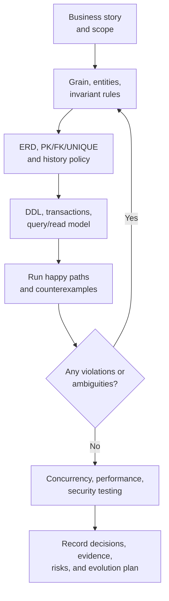
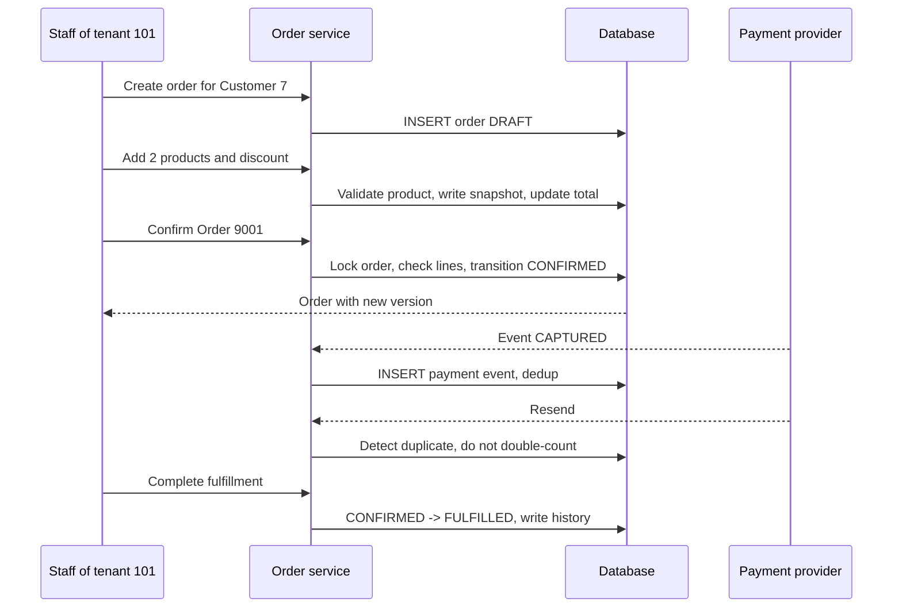
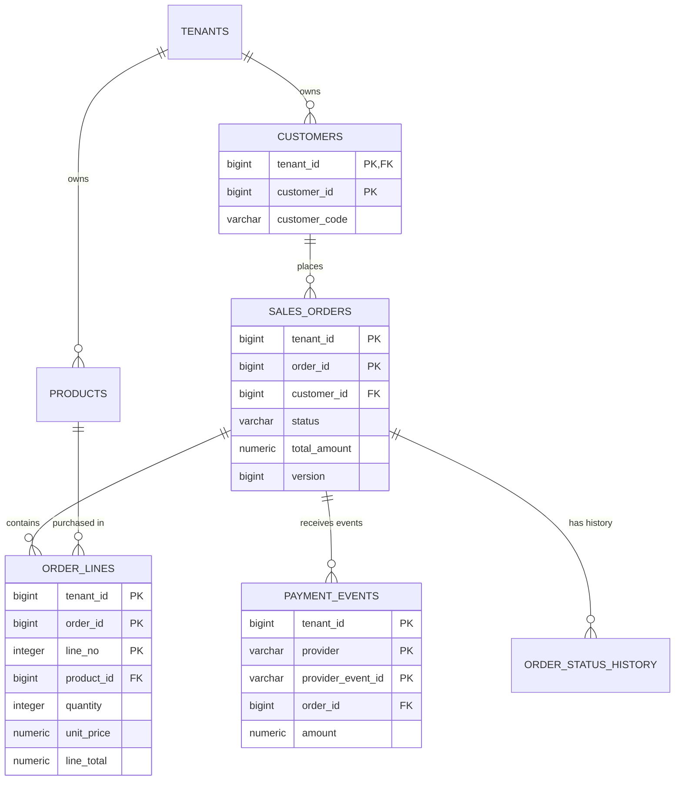
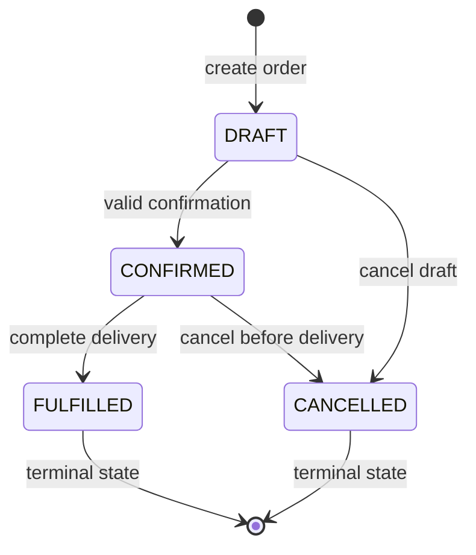

# End-to-End Design Review with Business Scenarios

An ER diagram with `customers`, `sales_orders`, and `order_lines` tables that looks reasonable does not prove the model is correct. When two staff members edit an order at the same time, a payment webhook is resent, a customer renames a purchased product, or a tenant attempts to access another tenant's data, flaws in **grain, keys, relationships, state, transactions, and data boundaries** are exposed.

**Data design validation** is therefore more than reading DDL or counting tables. We must walk through a chain of scenarios from business requirements to write operations, post-commit persisted data, read queries, reporting, failures, recovery, and future changes. A model passes validation when it can explain **what it protects, by what mechanism, and with what verification evidence**.

This lesson belongs to the **Design Validation** chapter in the **DATABASE_DATA_MODELING** module. Its goal is to practice translating requirements into an entity–relationship model and constraints, lowering them into a physical SQL schema, evaluating indexes, transactions, and partitioning when needed, while recognizing where document, graph, or analytical models may serve better. The running scenario is a multi-tenant SaaS order management application for multiple businesses.

> **Example scope:** Illustrated DDL and queries use PostgreSQL; all monetary amounts are represented in USD with two decimal places to keep the focus on validation techniques. Multi-currency systems, taxes, physical inventory, and formal legal/financial accounting require separate extension contracts and must not be inferred from this example.

## 1. At What Layers Must a Model Be "Correct"?

A good review must distinguish at least five layers:

| Layer | Validation question | Evidence |
|---|---|---|
| **Business** | Does the data accurately express what is happening and the exceptions? | User stories, examples, counterexamples, glossary |
| **Logical** | Are grain, identity, cardinality, relationships, nullability, and dependencies right? | ERD, invariant table, normalization review |
| **Physical** | Do PKs, FKs, `UNIQUE`, `CHECK`, indexes, and data types enforce the contract? | DDL, negative SQL tests, query plans |
| **Behavioral** | Do concurrent writes, retries, failures, and state transitions preserve invariants? | Transaction tests, idempotency, state-machine tests |
| **Operational** | Are queries fast enough, tenants isolated, schemas evolvable, and data recoverable? | Load tests, permission tests, migration/restore rehearsal |

No layer replaces another. For example, `FOREIGN KEY(customer_id)` can guarantee that a customer exists, yet **cannot** guarantee the customer belongs to the same tenant; `CHECK(total_amount >= 0)` does not guarantee the order total equals the sum of its lines; and a query that runs fast on ten rows does not prove it will be fast enough at millions of rows.

### 1.1. Scenario-Driven Validation Loop



**Key point:** a review is a process for producing **testable decisions**, not a meeting where everyone says "the diagram looks fine."

## 2. Running Case Study: SaaS Order Management

The system serves multiple businesses (**tenants**). Each tenant has its own customer list, product catalog, and orders. A staff member creates a draft order, adds order lines, confirms the order, receives payment events from a payment gateway, and completes fulfillment. When an error is discovered, the system needs history to explain who did what.

### 2.1. Numbered Specific Requirements

| Code | Business requirement | What must be validated |
|---|---|---|
| R01 | Each business manages its own data separately | No cross-tenant reads/writes/FKs |
| R02 | Customer codes and product codes may collide across two tenants | Unique only within a tenant |
| R03 | An order belongs to one customer; an order has many lines | Proper cardinality and FKs |
| R04 | A line stores the product, quantity, price at sale time, and discount amount | Price snapshot, numeric constraints |
| R05 | Order total equals the sum of line amounts | Recalculated and reconciled at appropriate write points |
| R06 | Orders transition through `DRAFT → CONFIRMED → FULFILLED`; valid cancellation path exists | State machine, transactions |
| R07 | After confirmation, order lines cannot be silently modified | Locking mechanism and operation restrictions |
| R08 | Duplicate delivery of the same payment webhook must not double-count money | Idempotency key + payload check |
| R09 | Viewing an old order must reproduce the product price and name at sale time | Do not join current catalog price instead of snapshot |
| R10 | Revenue reports by day and customer are required | Queries by grain, time, status |
| R11 | Two staff members updating the same order must not silently overwrite each other | Lock/version, race condition tests |
| R12 | Schema evolution, backup/restore, and deletion/anonymization by policy must be supported | Migration, lineage, retention |

### 2.2. What Is **Out** of Scope

In this lesson's version, the system does not yet model taxes, shipping fees, multiple currencies, varying units of measure, inventory reservation, returns, or formal accounting. **Payments are recorded as events**; money reconciliation rules and refund states are specified separately, without equating a "confirmed order" with "cash received."

This is an essential review skill: an out-of-scope omission must be **recorded as an assumption or follow-up item**, rather than silently hardcoding formulas into the data.

### 2.3. Clarifying Questions Before Drawing Tables

1. Is `order_code` unique platform-wide or per tenant? Can it be reused after cancellation?
2. Must a closed/deactivated customer still appear on historical orders?
3. Should changing a product's price alter already-confirmed orders?
4. Are draft orders allowed with zero lines? Is **confirming** an empty order allowed?
5. Who is authorized to confirm or cancel, and from which states?
6. Can the payment provider send duplicates, arrive late, or change payload content under the same ID?
7. Does "revenue" mean confirmed order total, cash received, or revenue recognized after delivery?
8. In what time zone is data stored? According to what time zone are reporting dates calculated?
9. Can one tenant have millions of orders while another tenant has only a few hundred?
10. What level of single-tenant restore and sensitive-data handling is required?

A review cannot conclude that a model is "correct" while these questions affect keys, calculations, and permissions yet remain unanswered.

## 3. Walking the Business Story Over Time

Instead of scanning the diagram from table to table, trace **one specific order**:



Along this sequence, every operation must have answers to:

- **Which inputs are trusted?** Is the tenant context authenticated? Is the price supplied by the client or fetched from the catalog?
- **Which rows change?** Are lines, order total, version, and history written in the same transaction?
- **What gets rejected?** Empty orders, another tenant's product, stale version, invalid status?
- **What happens on mid-flight failure?** Can it roll back? Will a retry write duplicates?
- **What is the observable outcome?** After commit, which query proves the data is correct?

### 3.1. The Happy Path Is Not Enough

A test that only creates an order, adds one line, and reads it back misses many bugs. Deliberately construct **counterexamples**:

| Counterexample | Risk to uncover |
|---|---|
| Customer belongs only to tenant 202 while order is in 101 | FK lacks tenant scope |
| Two orders with the same `order_code` in one tenant | Incorrect unique key |
| Product changes price after order placement | Historical price drifts with catalog |
| Confirming an order with no lines | Missing invariant at state transition |
| Two users add a line and confirm simultaneously | Race between collection and status |
| Webhook `evt-abc` arrives twice | Duplicate write, skewed reports |
| Webhook with same ID but different amount | Source conflict silently ignored |
| Deleting a customer that already has orders | Loss of historical evidence or FK violation |
| Daily report run in a different time zone | Daily metrics shifted |
| Large tenant and 100 small tenants running concurrently | Query/Index/noisy-neighbor issues |

For each counterexample, write the **expected result** before running it. A test that merely "does not throw an exception" does not prove the invariant holds.

## 4. From Story to Entities, Grain, and Relationships

### 4.1. Entity Inventory

| Entity | Grain (one row) | Identifier in model |
|---|---|---|
| `Tenant` | One organization using the system | `tenant_id` |
| `Customer` | One customer of a tenant | `(tenant_id, customer_id)` |
| `Product` | One catalog product of a tenant | `(tenant_id, product_id)` |
| `SalesOrder` | One order of a tenant | `(tenant_id, order_id)` |
| `OrderLine` | One line of an order | `(tenant_id, order_id, line_no)` |
| `PaymentEvent` | One message with a source ID from a provider | `(tenant_id, provider, provider_event_id)` |
| `OrderStatusHistory` | One timestamped status change | `history_id` + order FK |

Why doesn't `PaymentEvent` have the grain "one successful payment"? Because a provider can emit `FAILED`, `CAPTURED`, or `REFUNDED` messages; the **event message** grain separates delivery count from business value. To compute actual money received, you must inspect the event type and authoritative payment/transaction links rather than running `SUM(amount)` across all events.

### 4.2. Logical-Level ERD



### 4.3. Cardinality and Lifecycle Questions to Follow Up

- A tenant has **0..n** customers/products/orders; an order belongs to **exactly one** customer in the same tenant.
- A draft order has **0..n** lines; a confirmed order must have **at least one** line per R07/R05.
- A line belongs to exactly one order and points to one product; does a line cease to exist once the order is cancelled? **Cancelling a status does not mean deleting lines.**
- A payment event belongs to an existing order; events may arrive late after the order has already changed status.
- Status history is audit data; arbitrary cascade deletes alongside an order can break audit/history requirements.

You cannot simply draw a `1–N` notation and consider it fully specified. "Having at least one line at confirmation" is a **state-conditional constraint**, distinct from standard FKs and storage cardinality.

## 5. Write Invariants Before Choosing Constraints

An **invariant** is a statement that must hold across all valid data states. Each should have a clear code and enforcement point:

| Code | Invariant | Protected at DB? | Additional mechanism |
|---|---|---|---|
| I01 | Customer, product, order, and line never reference across tenants | Yes | Composite FK containing `tenant_id` |
| I02 | Customer, product, and order codes are unique within a tenant | Yes | `UNIQUE(tenant_id, code)` |
| I03 | `quantity > 0`, prices and discounts non-negative | Yes | `CHECK` |
| I04 | `discount_amount <= quantity × unit_price` | Yes | `CHECK` |
| I05 | `line_total` matches line formula | Yes in sample DB | Generated column |
| I06 | `order.total_amount = SUM(lines.line_total)` | Not via a simple `CHECK` | Transactional write, reconciliation |
| I07 | `CONFIRMED` order must have at least one line | Not via a standard FK | Transition service/trigger |
| I08 | No line edits once order leaves `DRAFT` | Not via a simple row `CHECK` | Write command path, lock/trigger |
| I09 | State transitions belong to allowed set | Needs transition logic | Conditional update, history |
| I10 | A provider event ID is recorded once per tenant/provider | Yes | PK/unique, duplicate payload check |
| I11 | Two edits at the same version cannot both silently succeed | Yes via conditional update | Version CAS/lock |
| I12 | Actors without tenant permission cannot read/write | Not via PK/FK alone | Authorization, role/RLS, and tests |

The critical principle is **do not force every invariant into a `CHECK` constraint**. Standard SQL `CHECK` constraints inspect values **of a single row** and cannot reliably enforce aggregate queries across multiple related rows. Multi-table invariants may require transactions, triggers, stored procedures, or an appropriate aggregate design.

### 5.1. Locking Down Money Rules and Formula Versions

For this exercise:

```text
line_total = quantity * unit_price - discount_amount
order_total = SUM(line_total)  // same tenant, same order
currency = USD; decimal scale = 2
```

`unit_price` is the **price snapshot at line-addition time** or at order lock-in per the pricing contract. In this example, when adding a line, the service reads from the server-managed catalog and writes the snapshot; it does not trust prices sent by the client. On confirmation, the service preserves those snapshot prices rather than updating them to new catalog prices.

If the business requires quotes to be refreshed at confirmation time, that is a different rule and requires changing the test scenarios. A model is validated against **one chosen contract**, not every conceivable interpretation.

## 6. Normalization and Historical Snapshots: Avoiding Both Extremes

The model should separate `customers`, `products`, and `sales_orders` to avoid duplicating actively managed master data. Yet `OrderLine` can still hold `unit_price` and `product_name_snapshot` — this is **intentional redundancy** to preserve transaction history.

### 6.1. Functional Dependencies and Keys

Within a tenant:

```text
(tenant_id, customer_id) -> customer_code, display_name, status
(tenant_id, product_id)  -> sku, display_name, current_price
(tenant_id, order_id)    -> order_code, customer_id, status, total, version
(tenant_id, order_id, line_no)
    -> product_id, quantity, unit_price, discount, line_total
```

`customer_code` and `sku` can also serve as candidate keys within a tenant via `UNIQUE` rules. Before choosing uniqueness, ask whether codes may be reused after soft-deletion; if so, define a partial unique index or disallow reuse instead of picking arbitrarily.

### 6.2. Why Keep a Price Snapshot?

Suppose Product 17 is sold at `120.00` on Monday and the catalog increases to `135.00` on Tuesday. If Monday's order report pulls `products.current_price` and multiplies by quantity, historical revenue changes even though no new transaction occurred.

Solution:

- An FK to Product identifies which product the line purchased.
- `unit_price` and `product_name_snapshot` preserve price/name as of transaction time.
- `line_total` is computed from the line's snapshot, not current catalog pricing.

You do not need to copy **every column** of Product onto the line. Retain only attributes with historical meaning and traceability needs. If renaming or cost-basis policies are complex, a price history table or product revision model may be preferable to a simple snapshot.

### 6.3. Why Store Derived Order Totals?

`total_amount` equals the sum of lines and is stored on the order to support fast listings and status checks. This is justified denormalization, but it introduces invariant I06: every line change must bring the order total into consistency before commit.

For orders with millions of lines or extremely high update frequency, how totals are computed and stored may change; the lesson is that **if you store derived data, you must have a synchronization and validation mechanism**, not that totals should always be stored.

## 7. Translating the Logical Model into Testable DDL

Below is an illustrative PostgreSQL schema for the core tables:

```sql
CREATE TABLE tenants (
    tenant_id BIGINT PRIMARY KEY,
    tenant_code VARCHAR(80) NOT NULL UNIQUE
);

CREATE TABLE customers (
    tenant_id BIGINT NOT NULL REFERENCES tenants(tenant_id),
    customer_id BIGINT NOT NULL,
    customer_code VARCHAR(64) NOT NULL,
    display_name VARCHAR(200) NOT NULL,
    customer_status VARCHAR(16) NOT NULL
        CHECK (customer_status IN ('ACTIVE', 'ANONYMIZED')),
    PRIMARY KEY (tenant_id, customer_id),
    CONSTRAINT uq_customer_code_tenant
        UNIQUE (tenant_id, customer_code)
);

CREATE TABLE products (
    tenant_id BIGINT NOT NULL REFERENCES tenants(tenant_id),
    product_id BIGINT NOT NULL,
    sku VARCHAR(80) NOT NULL,
    display_name VARCHAR(200) NOT NULL,
    current_price NUMERIC(19, 2) NOT NULL
        CHECK (current_price >= 0),
    is_active BOOLEAN NOT NULL DEFAULT TRUE,
    PRIMARY KEY (tenant_id, product_id),
    CONSTRAINT uq_product_sku_tenant
        UNIQUE (tenant_id, sku)
);

CREATE TABLE sales_orders (
    tenant_id BIGINT NOT NULL REFERENCES tenants(tenant_id),
    order_id BIGINT NOT NULL,
    order_code VARCHAR(64) NOT NULL,
    customer_id BIGINT NOT NULL,
    status VARCHAR(16) NOT NULL
        CHECK (status IN ('DRAFT', 'CONFIRMED',
                         'FULFILLED', 'CANCELLED')),
    currency_code CHAR(3) NOT NULL DEFAULT 'USD'
        CHECK (currency_code = 'USD'),
    total_amount NUMERIC(19, 2) NOT NULL DEFAULT 0
        CHECK (total_amount >= 0),
    version BIGINT NOT NULL DEFAULT 0 CHECK (version >= 0),
    created_at TIMESTAMPTZ NOT NULL DEFAULT CURRENT_TIMESTAMP,
    confirmed_at TIMESTAMPTZ,
    fulfilled_at TIMESTAMPTZ,
    cancelled_at TIMESTAMPTZ,
    PRIMARY KEY (tenant_id, order_id),
    CONSTRAINT uq_order_code_tenant UNIQUE (tenant_id, order_code),
    CONSTRAINT fk_order_customer_tenant
        FOREIGN KEY (tenant_id, customer_id)
        REFERENCES customers(tenant_id, customer_id),
    CONSTRAINT ck_order_confirmed_time
        CHECK (
            status NOT IN ('CONFIRMED', 'FULFILLED')
            OR confirmed_at IS NOT NULL
        ),
    CONSTRAINT ck_order_fulfilled_time
        CHECK (status <> 'FULFILLED' OR fulfilled_at IS NOT NULL),
    CONSTRAINT ck_order_cancelled_time
        CHECK (status <> 'CANCELLED' OR cancelled_at IS NOT NULL)
);

CREATE TABLE order_lines (
    tenant_id BIGINT NOT NULL,
    order_id BIGINT NOT NULL,
    line_no INTEGER NOT NULL CHECK (line_no > 0),
    product_id BIGINT NOT NULL,
    quantity INTEGER NOT NULL CHECK (quantity > 0),
    unit_price NUMERIC(19, 2) NOT NULL
        CHECK (unit_price >= 0),
    discount_amount NUMERIC(19, 2) NOT NULL DEFAULT 0
        CHECK (discount_amount >= 0),
    product_name_snapshot VARCHAR(200) NOT NULL,
    line_total NUMERIC(19, 2)
        GENERATED ALWAYS AS (
            quantity * unit_price - discount_amount
        ) STORED,
    PRIMARY KEY (tenant_id, order_id, line_no),
    CONSTRAINT fk_line_order_tenant
        FOREIGN KEY (tenant_id, order_id)
        REFERENCES sales_orders(tenant_id, order_id),
    CONSTRAINT fk_line_product_tenant
        FOREIGN KEY (tenant_id, product_id)
        REFERENCES products(tenant_id, product_id),
    CONSTRAINT ck_line_discount_cap
        CHECK (discount_amount <= quantity * unit_price)
);

CREATE TABLE payment_events (
    tenant_id BIGINT NOT NULL,
    provider VARCHAR(40) NOT NULL,
    provider_event_id VARCHAR(120) NOT NULL,
    order_id BIGINT NOT NULL,
    event_type VARCHAR(20) NOT NULL
        CHECK (event_type IN ('CAPTURED', 'FAILED', 'REFUNDED')),
    amount NUMERIC(19, 2) NOT NULL CHECK (amount > 0),
    occurred_at TIMESTAMPTZ NOT NULL,
    received_at TIMESTAMPTZ NOT NULL DEFAULT CURRENT_TIMESTAMP,
    PRIMARY KEY (tenant_id, provider, provider_event_id),
    CONSTRAINT fk_payment_order_tenant
        FOREIGN KEY (tenant_id, order_id)
        REFERENCES sales_orders(tenant_id, order_id)
);

CREATE TABLE order_status_history (
    history_id BIGINT GENERATED ALWAYS AS IDENTITY PRIMARY KEY,
    tenant_id BIGINT NOT NULL,
    order_id BIGINT NOT NULL,
    from_status VARCHAR(16) NOT NULL,
    to_status VARCHAR(16) NOT NULL,
    order_version BIGINT NOT NULL CHECK (order_version >= 0),
    changed_at TIMESTAMPTZ NOT NULL DEFAULT CURRENT_TIMESTAMP,
    reason VARCHAR(240),
    CONSTRAINT fk_history_order_tenant
        FOREIGN KEY (tenant_id, order_id)
        REFERENCES sales_orders(tenant_id, order_id),
    CONSTRAINT uq_history_order_version
        UNIQUE (tenant_id, order_id, order_version)
);

CREATE INDEX idx_orders_tenant_created
    ON sales_orders(tenant_id, created_at DESC, order_id DESC);
CREATE INDEX idx_orders_tenant_status_created
    ON sales_orders(tenant_id, status, created_at DESC, order_id DESC);
CREATE INDEX idx_lines_tenant_product
    ON order_lines(tenant_id, product_id);
CREATE INDEX idx_payment_order
    ON payment_events(tenant_id, order_id, occurred_at);
CREATE INDEX idx_history_order_time
    ON order_status_history(tenant_id, order_id, changed_at DESC);
```

### 7.1. Physical Assumptions That Must Be Stated Explicitly

- The DDL does not auto-generate `tenant_id`, `customer_id`, `product_id`, or `order_id`. The example assumes the application or an ID service allocates IDs safely **within a tenant**; in deployment, a concurrency-safe ID generator that prevents collisions under concurrent writes is required.
- `currency_code` only accepts `USD` to avoid mixing currencies and fractional precision in this lesson. A real multi-currency system needs exchange rate rules, decimal scale per currency, and aggregation rules.
- `product_name_snapshot` is non-null even if Product is renamed. Do not use cascade deletes that remove Products/Customers referenced by historical orders.
- `order_status_history` records **status transitions**; version numbers in history may have gaps because editing draft lines also increments the order version.
- `payment_events` has a provider event key to prevent duplicate ingestion. **This is not yet a cash-received ledger**: a `CAPTURED` event may be offset by `REFUNDED`, and logic determining actual settled money must inspect source events/transactions.
- Indexes outside PK/UNIQUE are **workload hypotheses**; verify them with `EXPLAIN` before treating them as optimal.
- When calling the example a "standalone script," understand it only creates **the schema**: it does not yet include seed data, DB roles, RLS, jobs, stored procedures, triggers, or production migration configuration.

### 7.2. What Does the DB Guarantee vs. Not Yet Guarantee?

| Check | Status with DDL |
|---|---|
| Tenant A order pointing to Tenant B customer | DB rejects via composite FK |
| Two customers with same code in Tenant A | DB rejects |
| Two different tenants with same customer code | Valid |
| Line with quantity = 0 | DB rejects |
| Discount greater than line value | DB rejects |
| `line_total` mismatching formula | DB maintains generated column |
| Confirming an order with no lines | **Not protected by DDL alone** |
| Editing lines after CONFIRMED | **Not protected by DDL alone** |
| Order total differing from line sum | **Not protected by order-row `CHECK`** |
| Payment event ID sent again | DB blocks duplicate key row |
| Webhook with duplicate ID but different amount | **Requires payload check**, not just unique |
| Actor lacking tenant permission | **Requires authorization/RLS**, not just FK |

Explicitly flagging "not yet protected" is a **useful review outcome**, not a failure. A design becomes dangerous when everyone assumes the DDL enforces something that only a service convention actually checks.

## 8. Validating Keys and Constraints with Minimal Seed Data

A simple seed assuming empty tables:

```sql
INSERT INTO tenants(tenant_id, tenant_code)
VALUES (101, 'ACME'), (202, 'BETA');

INSERT INTO customers(
    tenant_id, customer_id, customer_code,
    display_name, customer_status
)
VALUES
    (101, 7, 'CUS-001', 'ACME Customer', 'ACTIVE'),
    (202, 7, 'CUS-001', 'BETA Customer', 'ACTIVE'),
    (202, 9, 'CUS-009', 'BETA-Only Customer', 'ACTIVE');

INSERT INTO products(
    tenant_id, product_id, sku,
    display_name, current_price
)
VALUES
    (101, 17, 'SKU-17', 'Headphones Model A', 120.00),
    (202, 17, 'SKU-17', 'Headphones Model B', 135.00);
```

### 8.1. Checking Uniqueness Scope

Both `(101, 'CUS-001')` and `(202, 'CUS-001')` are valid. Now try adding another in tenant 101:

```sql
INSERT INTO customers(
    tenant_id, customer_id, customer_code,
    display_name, customer_status
)
VALUES (101, 8, 'CUS-001', 'Duplicate code in ACME', 'ACTIVE');
-- Expected: UNIQUE(tenant_id, customer_code) error.
```

Run tests that **expect an error** in separate transactions or a test harness that handles rollback; PostgreSQL marks a transaction as aborted once any statement fails.

### 8.2. Checking Same-Tenant Foreign Keys

```sql
INSERT INTO sales_orders(
    tenant_id, order_id, order_code, customer_id, status
)
VALUES (101, 9001, 'O-9001', 9, 'DRAFT');
-- Expected: FK error because only Customer (202, 9) exists,
-- not Customer (101, 9).
```

A foreign key on `customer_id` alone could accidentally match customer `9` in another tenant if IDs are not globally unique. A composite FK on `(tenant_id, customer_id)` proves the schema rejects that dangerous case.

### 8.3. Data Mutation Tests

Do not test only valid data. Mutate one variable at a time:

- `quantity = 0` or `-1` → `CHECK` error.
- `unit_price = -0.01` → `CHECK` error.
- `discount_amount` greater than line gross amount → `CHECK` error.
- `line_no = 0` → `CHECK` error.
- `product_id` exists only in tenant 202 while line is in 101 → FK error.
- Duplicate `order_code` within tenant 101 → unique error.
- `currency_code = 'EUR'` → `CHECK` error **under this lesson's USD assumption**, not because EUR is invalid in real life.

A quality test must state **why it was rejected**, not merely assert "SQL failed."

## 9. Walking the Happy Path: Create Order and Add Lines

After seeding, create a valid order:

```sql
BEGIN;

INSERT INTO sales_orders (
    tenant_id, order_id, order_code,
    customer_id, status, total_amount, version
)
VALUES (101, 9001, 'O-9001', 7, 'DRAFT', 0, 0);

COMMIT;
```

### 9.1. Why Must Adding Lines Update the Total in the Same Transaction?

For every draft-line modification command, the lesson's write protocol is:

1. Start a transaction.
2. Lock **the parent order row** with `SELECT ... FOR UPDATE`.
3. Verify the order is still `DRAFT` and the user has permission in the tenant.
4. Read the product name/price from the **same tenant's** catalog; write the snapshot to the line.
5. Insert/update/delete the line as requested.
6. Recompute `total_amount` via `SUM(line_total)` and increment `version`.
7. Commit **both line and total** together.

Example of adding a line with price pulled from the catalog rather than the client:

```sql
BEGIN;

SELECT status, version
FROM sales_orders
WHERE tenant_id = 101 AND order_id = 9001
FOR UPDATE;
-- Service must verify status = DRAFT before continuing.

INSERT INTO order_lines (
    tenant_id, order_id, line_no, product_id,
    quantity, unit_price, discount_amount,
    product_name_snapshot
)
SELECT
    101, 9001, 1, p.product_id,
    2, p.current_price, 10.00,
    p.display_name
FROM products AS p
WHERE p.tenant_id = 101
  AND p.product_id = 17
  AND p.is_active = TRUE;
-- Service checks exactly 1 row was inserted; if 0, rollback.

UPDATE sales_orders AS o
SET total_amount = (
        SELECT COALESCE(SUM(l.line_total), 0)
        FROM order_lines AS l
        WHERE l.tenant_id = o.tenant_id
          AND l.order_id = o.order_id
    ),
    version = version + 1
WHERE tenant_id = 101
  AND order_id = 9001
  AND status = 'DRAFT'
RETURNING total_amount, version;

COMMIT;
```

With two units at `120.00` and a `10.00` discount for **one line of quantity 2**, we get `line_total = 2 × 120.00 − 10.00 = 230.00`. The order total after the transaction is `230.00` and version increments from 0 to 1.

### 9.2. What Cannot Be Inferred from Sample SQL

`SELECT ... FOR UPDATE` works only if **every line-editing path and confirmation path follows the same parent-order locking protocol**. If a batch job has privilege to `INSERT INTO order_lines` directly without locking, it could add lines after confirmation. If you want **strong DB enforcement** even against arbitrary SQL, use triggers/stored procedures and restrict table write privileges, or ensure writes go exclusively through a verified API.

Also check the actual row count inserted by `INSERT ... SELECT`. If the product does not exist or is inactive, the `SELECT` returns 0 rows, and the transaction must not be treated as successful merely because no error was raised.

### 9.3. Concurrent Product Price Changes

The transaction above locks the order **without locking Product**. If a product's price can change concurrently, reading `current_price` for the snapshot may observe a committed catalog version depending on timing and isolation level; decide whether that is an acceptable contract or whether you need price-table locking/versioning, a quote ID, or effective-dated pricing policies. A review must not quietly assume "price at add time" is an uncontested point-in-time guarantee under concurrent updates.

## 10. Validating the State Machine at Confirmation Time

Valid states within the example's scope:



A `FULFILLED` order does not revert to `DRAFT` to edit prices. Post-delivery returns or refunds are **different business events/workflows** that require separate modeling when expanding scope.

### 10.1. Confirmation as a Single Transaction

Assume the client read order version 1:

```sql
BEGIN;

SELECT status, version, total_amount
FROM sales_orders
WHERE tenant_id = 101 AND order_id = 9001
FOR UPDATE;
-- Service verifies status=DRAFT, version=1,
-- and actor has confirm permission in tenant 101.

SELECT COUNT(*) AS line_count,
       COALESCE(SUM(line_total), 0) AS calculated_total
FROM order_lines
WHERE tenant_id = 101 AND order_id = 9001;
-- Must have >= 1 line, all measures valid;
-- calculated_total = 230.00.

UPDATE sales_orders
SET status = 'CONFIRMED',
    confirmed_at = CURRENT_TIMESTAMP,
    total_amount = 230.00,
    version = version + 1
WHERE tenant_id = 101 AND order_id = 9001
  AND status = 'DRAFT' AND version = 1
RETURNING version;
-- Service requires exactly one row, new version = 2.

INSERT INTO order_status_history(
    tenant_id, order_id, from_status,
    to_status, order_version, reason
)
VALUES (101, 9001, 'DRAFT', 'CONFIRMED', 2, 'Customer approved');

COMMIT;
```

The literal `230.00` in the `UPDATE` is **the result just verified inside the transaction**, hardcoded only to illustrate one concrete case; production applications must **bind** `:calculated_total` from the query run while holding the lock, never a constant in product logic.

If count = 0, status does not match, version changed, or writing history fails, the service must roll back the entire transaction. Never commit `CONFIRMED` without writing history when auditing is mandatory.

### 10.2. Why Not Just `CHECK(status IN ...)`?

`CHECK(status IN (...))` blocks **out-of-set values**, yet does not block a direct jump `DRAFT → FULFILLED` because both values are valid. Enforcing state transitions inside the DB requires triggers/stored procedures or conditional updates from the current state combined with restricted write paths.

### 10.3. Contender: A Concurrent Add-Line Command

Suppose transaction T1 is confirming while T2 adds a line:

```text
T1: lock order 9001       ------ holds lock ------
T1: check lines and total
T2: request lock order 9001 -> waits
T1: status -> CONFIRMED, commit
T2: acquires lock, sees CONFIRMED -> rollback
```

If both T1 and T2 obey `FOR UPDATE` on the parent order row, this protocol serializes operations affecting invariants. If T2 can insert straight into lines without locking the parent, T1 is not protected by the order lock alone. This scenario requires a **transaction integration test**, not just a service unit test.

### 10.4. Is History Written Properly?

`order_status_history` stores from/to status and the post-transition version. `UNIQUE(tenant_id, order_id, order_version)` prevents two history records for the same version. However, it **does not automatically ensure** every status change has a history row if someone updates `sales_orders` directly. Mandatory auditing must be written in the same transaction through a controlled command path or a DB trigger.

## 11. Payment Webhooks: Validating Retries and Source Conflicts

A provider may send a `CAPTURED` event for order 9001 with `provider_event_id = 'evt-abc'` and amount `230.00`. Because delivery can retry, the same event may arrive multiple times. One row in `payment_events` represents **one event with a unique source ID**, not "one HTTP request arriving at the server."

### 11.1. Idempotent Writes Under Constraints

```sql
INSERT INTO payment_events (
    tenant_id, provider, provider_event_id,
    order_id, event_type, amount, occurred_at
)
VALUES (
    101, 'PAYMENT_X', 'evt-abc',
    9001, 'CAPTURED', 230.00,
    TIMESTAMPTZ '2026-11-22 03:00:00+00'
)
ON CONFLICT (
    tenant_id, provider, provider_event_id
) DO NOTHING
RETURNING provider_event_id;
```

For a new event, the statement returns one row; on key conflict, it returns 0 rows. **Do not immediately conclude "identical retry, success"** when 0 rows return: query the existing event and compare meaningful fields (`order_id`, `event_type`, `amount`, `occurred_at`/payload hash per provider contract). If the payload differs, log a conflict and investigate.

Note: a provider might scope event ID uniqueness differently (for example, globally per provider or per merchant account). `PRIMARY KEY(tenant_id, provider, provider_event_id)` is valid **under this lesson's assumptions**; in real integrations, inspect the source's ID contract.

### 11.2. "Event Count" Does Not Equal "Money Received"

An order may have `CAPTURED`, `FAILED`, and `REFUNDED` events; there can be multiple payments, partial captures, or refunds. Therefore:

```sql
-- NOT a valid calculation of actual money received:
SELECT SUM(amount)
FROM payment_events
WHERE tenant_id = 101 AND order_id = 9001;
```

That query adds `FAILED`/`REFUNDED` as positive money. In a real accounting model, you should have **payment/charge/refund** identifiers and dedicated state/ledger rules; events are the source for reconstruction, while actual money received needs a proper reconciliation formula.

In this lesson we can verify a narrower goal: each event ID appears at most **once**, and a valid `CAPTURED` event has an amount matching provider details; do not assume the order must immediately transition to `FULFILLED`.

### 11.3. Late or Out-of-Order Events

`occurred_at` is when the event happened according to the provider; `received_at` is when the system received it. If `REFUNDED` arrives before `CAPTURED` due to networking or transport, do not infer financial state from arrival order. You need a payment reference, sequence/version, or provider reconciliation rules to build accurate state.

If a downstream task must be emitted after recording a payment event, consider a **transactional outbox** or idempotent consumer. Committing an event to the DB and then publishing a message non-atomically can leave a recorded event without downstream work; retries must handle this.

## 12. Reviewing Read Queries and Reports Against Real Questions

A physical design is insufficient if essential queries **fail to return the right rows or cannot handle real load**. Use three screens to validate the read path.

### 12.1. List of 50 Most Recent Orders in a Tenant

```sql
SELECT o.order_id, o.order_code,
       o.status, o.total_amount,
       o.created_at, c.display_name AS customer_name
FROM sales_orders AS o
JOIN customers AS c
  ON c.tenant_id = o.tenant_id
 AND c.customer_id = o.customer_id
WHERE o.tenant_id = :tenant_id
ORDER BY o.created_at DESC, o.order_id DESC
LIMIT 50;
```

The query joins on **both tenant and customer ID**, preventing wrong customer matches if local IDs collide across tenants. The list page does not need to load all lines, payments, and history. When using an ORM, a projection/DTO for displayed columns is usually better than hydrating a large object graph.

The index `(tenant_id, created_at DESC, order_id DESC)` can support filtering and ordering; the query still needs a customer PK lookup. Measure the actual query plan rather than inferring speed from the index name.

### 12.2. Order Detail and Lines

```sql
SELECT o.order_code, o.status, o.total_amount,
       l.line_no, l.quantity, l.unit_price,
       l.discount_amount, l.line_total,
       l.product_name_snapshot
FROM sales_orders AS o
LEFT JOIN order_lines AS l
  ON l.tenant_id = o.tenant_id
 AND l.order_id = o.order_id
WHERE o.tenant_id = :tenant_id
  AND o.order_id = :order_id
ORDER BY l.line_no;
```

Because a `DRAFT` order may have no lines yet, `LEFT JOIN` keeps empty orders. With thousands of lines, returning every line in one response can cause memory pressure; impose limits or child pagination based on actual requirements.

**Do not join multiple collections `lines × payments × history` in a single large query** without checking row multiplication. If an order has 20 lines, 5 payment events, and 10 history records, joining three independent sets can produce `20×5×10 = 1,000` intermediate rows for a single order.

### 12.3. Revenue Report: Lock Down the Metric Definition

If the business asks for "total value of confirmed or fulfilled orders by **confirmation date**," you can write:

```sql
SELECT
    (o.confirmed_at AT TIME ZONE 'Asia/Ho_Chi_Minh')::DATE
        AS business_date,
    COUNT(*) AS order_count,
    SUM(o.total_amount) AS confirmed_order_value
FROM sales_orders AS o
WHERE o.tenant_id = :tenant_id
  AND o.status IN ('CONFIRMED', 'FULFILLED')
  AND o.confirmed_at >= :from_instant
  AND o.confirmed_at < :to_instant
GROUP BY business_date
ORDER BY business_date;
```

This metric is **the value of orders currently in confirmed/fulfilled status, grouped by confirmation date** — not accounting revenue by default, nor does it include orders cancelled after confirmation. Document that definition explicitly.

If you want **value as of historical confirmation time**, the current `orders.total_amount` column may fall short if orders are later adjusted or transition to `CANCELLED`. You need a confirmation-time snapshot/ledger/event plus adjustment handling. A review must spot the difference between **queries over current state** and **immutable historical reporting**.

### 12.4. Measures Cannot Be Summed Arbitrarily

`total_amount` is summable in this example because every order is USD under the same definition. If EUR or VND is added in the future, `SUM(total_amount)` across a tenant becomes meaningless unless grouped by `currency_code` or converted using defined exchange rates. A **multi-currency** requirement is thus a data design and metric change, not just editing `CHECK(currency_code='USD')`.

### 12.5. Use Keyset Pagination for Deep Pages

With descending order on `created_at`, `order_id`, fetch the next page via:

```sql
SELECT order_id, order_code, created_at, status
FROM sales_orders
WHERE tenant_id = :tenant_id
  AND (created_at, order_id) < (:last_created_at, :last_order_id)
ORDER BY created_at DESC, order_id DESC
LIMIT 50;
```

This is PostgreSQL's tuple comparison syntax, using **the last cursor from the previous page**. It fits large lists with frequent deep pagination, provided filters and a stable ordering definition stay consistent. Keyset pagination alone does not resolve concurrent data mutations between pages.

## 13. Verifying Data Protection Across Every Access Path

### 13.1. Tenant ID Is a Scope, Not an Access Credential

A request:

```text
GET /tenants/202/orders/9001
Authorization: bearer token of user only in tenant 101
```

must be rejected before reading tenant 202 data, even though the API route carries a valid tenant ID. Proper flow:

```text
Authenticate principal
  -> authorize active membership + action in requested tenant
  -> resolve trusted tenant context
  -> execute tenant-scoped query/command
  -> return only authorized fields
```

Every search query, export, pagination endpoint, cache, and background job must preserve this scope. When IDs are allocated per tenant, a cache key containing only `order_id` is insufficient; you need at least tenant + object ID, plus appropriate permissions/versioning if the cache holds sensitive data.

### 13.2. DB RLS Is an Additional Layer, Not a Replacement for Authorization

A PostgreSQL design can apply tenant Row-Level Security on `sales_orders` and child tables:

```sql
ALTER TABLE sales_orders ENABLE ROW LEVEL SECURITY;
ALTER TABLE sales_orders FORCE ROW LEVEL SECURITY;

CREATE POLICY orders_tenant_access
ON sales_orders
FOR ALL TO app_runtime
USING (
    tenant_id =
    NULLIF(current_setting('app.tenant_id', true), '')::BIGINT
)
WITH CHECK (
    tenant_id =
    NULLIF(current_setting('app.tenant_id', true), '')::BIGINT
);
```

This is an **illustrative extra example** and does not automatically apply to `customers`, `products`, `order_lines`, or `payment_events`. To avoid leaks through those tables, protect them accordingly and restrict DB role privileges.

This assumes `app_runtime` was created and granted necessary privileges by a DBA and is **not** a superuser, a bypassing table owner, or a `BYPASSRLS` role. The server verifies the tenant, then sets `app.tenant_id` on the proper transaction/connection. A custom setting is **not an unforgeable credential** if an actor can execute arbitrary SQL under the same runtime role. Thus, GUC-based RLS does not replace SQL injection defenses, authentication, or DB privileges.

### 13.3. Sensitive Data and History

If a Customer requests anonymization under an applicable policy, you can retain the surrogate customer ID and order relationships while replacing personally identifiable fields in line with retention rules. **Do not cascade-delete customer → order → payment history** simply because a user stops using the app.

Conversely, keeping PII indefinitely "for reconciliation" is not automatically valid either. Classify which data must be retained, what can be deleted/anonymized, audit viewing rights, and retention periods per specific legal/contractual requirements. SQL FKs ensure structural integrity, not data-protection compliance.

### 13.4. System Permissions Must Be Tested by Scenario

| Actor | Tenant | Action | Expected |
|---|---|---|---|
| Staff A | 101 | View order 101/9001 | Per valid role |
| Staff A | 101 | View order 202/9001 | DENY |
| Staff B | 202 | Edit line of order 101 | DENY |
| Reporting job tenant 101 | 101 | Aggregate orders of 101 | Only tenant 101 |
| Support admin | Multiple tenants when granted | Investigate a case | Dedicated scoped role and audit |

Never run DB role unit tests as a superuser and conclude RLS works. In integration tests, use **the actual application DB role**, including cases where tenant context is unset and pooled connections are reused after rollback.

## 14. History, Time, and Authoritative Sources

### 14.1. `created_at`, `confirmed_at`, and `occurred_at` Are Not Interchangeable

- `created_at`: when the order was created in the system.
- `confirmed_at`: when it transitioned to confirmed status.
- `payment_events.occurred_at`: when the provider says the event occurred.
- `payment_events.received_at`: when our system received the event.
- `order_status_history.changed_at`: when our system recorded the status change.

A late-arriving event should not be bucketed under receipt date if the report asks for event date. For local-date reporting, specify the business time zone; `TIMESTAMPTZ` stores an instant, whereas date bucketing is a time-zone interpretation.

### 14.2. Current State and Historical Events Differ

An order currently in `FULFILLED` only tells you its **current** state; it does not tell you how many times it was confirmed, cancelled, or restored, who acted, or how many webhooks arrived. History/events help explain the path, though full reconstruction from events requires a complete stream, ordering, and clear replay rules.

Avoid treating `order_status_history` as "a ledger of every attribute change" when it only tracks transitions. If you need audits for price overrides, line edits, or permission access, design dedicated events/audit logs intentionally.

### 14.3. Deletion Rules and Historical Existence Relationships

Review questions to answer:

- Can a draft with lines be hard-deleted, or is soft-delete needed?
- Can a confirmed order ever be deleted? By whom and why?
- Do payment/audit tables have different retention obligations than catalog tables?
- After customer anonymization, should old invoices still display valid snapshots?
- Do we need the ability to recover an order after operator error?

Use `ON DELETE CASCADE` only when **the business lifecycle** genuinely allows all child records to be removed with the parent. That is a history-retention decision, not merely a delete optimization.

## 15. Query Plans, Realistic Load, and Physical Design

### 15.1. Measure the Real Workload, Not an Arbitrary SELECT

Build a hypothetical dataset:

```text
Tenant 101: 1,000,000 orders, average 5 lines/order
Tenant 202:       500 orders, average 2 lines/order
Tenant 303:    10,000 orders, many webhooks/payments
90% requests: view list of 50 most recent orders
 7% requests: view detail of one order
 3% requests: aggregate by day and status
```

These numbers are a **test scenario**, not production telemetry. When measuring, observe:

- p50/p95/p99 latency, throughput, and error rate per endpoint/tenant.
- Query plans, rows scanned/returned, buffers, sorts, and lock waits.
- DB CPU, I/O, RAM; application query count and heap usage.
- Transaction duration, connection count, and connection pool wait time.
- Noisy-neighbor effects when a large tenant runs reports while a small tenant reads lists.

### 15.2. Use `EXPLAIN` on Business Queries

```sql
EXPLAIN (ANALYZE, BUFFERS)
SELECT order_id, order_code, total_amount, created_at
FROM sales_orders
WHERE tenant_id = 101
  AND status = 'CONFIRMED'
ORDER BY created_at DESC, order_id DESC
LIMIT 50;
```

PostgreSQL may choose an index scan, bitmap scan, or sequential scan depending on cardinality and statistics. A sequential scan on a tiny test table does not prove an index is wrong; measure on representative data and distributions.

### 15.3. Indexes Have Trade-Offs

Tenant/time indexes speed up many read queries while adding `INSERT`/`UPDATE` overhead, storage, and maintenance costs. `idx_orders_tenant_created` and `idx_orders_tenant_status_created` can coexist if the workload needs both unfiltered and status-filtered lists; measure benefits vs. costs rather than assuming "more indexes are always better."

### 15.4. Partitioning Is Not a Default Solution

If tables grow to billions of rows with date-based retention, consider time partitioning; if queries are heavily tenant-isolated, consider tenant partitioning/hashing or sharding when a single instance no longer suffices.

With PostgreSQL partitioned tables, PKs/UNIQUEs must satisfy partition-key rules, so you cannot keep `UNIQUE(tenant_id, order_code)` as-is while changing the partition key without checking. A new layout must be re-validated for **keys, FKs, uniqueness, query pruning, migrations, and tenant mobility**.

Do not partition merely because you have multiple tenants; `tenant_id` in shared tables with solid indexes may be plenty for the current stage.

## 16. Traceability Map: From Requirements to Tests

A **traceability** matrix keeps reviews from missing features or tests:

| Requirement | Model element | Enforcement mechanism | Scenario/Test |
|---|---|---|---|
| R01 tenant isolation | `tenant_id` on all tenant-owned tables | Composite FK + auth/RLS | Cross-tenant insert/read |
| R02 tenant-scoped code uniqueness | Customer/Product/Order code | Composite unique | Same-tenant collision / cross-tenant match |
| R03 order–customer–line relations | Relationship FKs | Composite FK | Orphan and wrong-tenant |
| R04 price snapshot | `OrderLine.unit_price`/name | Catalog write path + NOT NULL/CHECK | Product price change after sale |
| R05 order total | `line_total`, `total_amount` | Generated + transaction + reconcile | Edit/add line, compare SUM |
| R06 state machine | `status`, timestamps, history | Transition command + condition | `DRAFT→FULFILLED` rejected |
| R07 freeze lines | Order/Line | Parent lock + write restriction/trigger | Confirm vs. add line |
| R08 webhook idempotency | `payment_events` | Provider event PK + payload compare | Retry same/different payload |
| R09 accurate history | Price/name snapshot, history | Immutable after confirm | Catalog rename/reprice |
| R10 reporting | Timestamps, total, status | Query matching metric definition | Compare against period seed |
| R11 concurrent updates | `version` and state | Compare-and-swap, row lock | Two editors same version |
| R12 operations | Schema migration, backup, PII policy | Migration/rehearsal | Backfill, restore, audit |

This matrix should be a **living artifact**: whenever a requirement changes, review which data elements, read/write paths, and tests are impacted. You do not need expensive management tooling; a table with owners, versions, and test links already grounds discussions in facts.

## 17. Validating Invariants with Reconciliation SQL

Beyond per-command positive/negative tests, run **violation-detection queries** over large datasets, especially after migrations, imports, or pipeline bug fixes.

### 17.1. Order Total Differing from Line Sum

```sql
SELECT o.tenant_id, o.order_id, o.status,
       o.total_amount AS stored_total,
       COALESCE(SUM(l.line_total), 0) AS calculated_total
FROM sales_orders AS o
LEFT JOIN order_lines AS l
  ON l.tenant_id = o.tenant_id
 AND l.order_id = o.order_id
GROUP BY o.tenant_id, o.order_id, o.status, o.total_amount
HAVING o.total_amount <> COALESCE(SUM(l.line_total), 0);
```

Expected empty **if** the design requires order totals to match lines in every state (as in this lesson). If a system intentionally keeps stale totals on `DRAFT` during uncommitted edits, other transactions still observe only committed data under isolation; permitting persistent drift must be documented as a different contract.

### 17.2. Confirmed Orders Without Lines

```sql
SELECT o.tenant_id, o.order_id, o.status
FROM sales_orders AS o
WHERE o.status IN ('CONFIRMED', 'FULFILLED')
  AND NOT EXISTS (
      SELECT 1
      FROM order_lines AS l
      WHERE l.tenant_id = o.tenant_id
        AND l.order_id = o.order_id
  );
```

Expected empty. `NOT EXISTS` expresses the "at least one" invariant more cleanly than counting collections in Java after over-fetching entities.

### 17.3. Duplicate Source Payment Events

```sql
SELECT tenant_id, provider, provider_event_id,
       COUNT(*) AS copies
FROM payment_events
GROUP BY tenant_id, provider, provider_event_id
HAVING COUNT(*) > 1;
```

With the PK declared and enforced by PostgreSQL, this query must return empty. In analytics warehouses that do not enforce uniqueness, the test is directly valuable. This query **does not catch** same source ID with a different payload when ingestion used `DO NOTHING`: you must log conflicts or check payloads during ingestion.

### 17.4. Status Timestamps Violating Minimum Rules

```sql
SELECT tenant_id, order_id, status,
       confirmed_at, fulfilled_at, cancelled_at
FROM sales_orders
WHERE (status IN ('CONFIRMED','FULFILLED')
       AND confirmed_at IS NULL)
   OR (status = 'FULFILLED' AND fulfilled_at IS NULL)
   OR (status = 'CANCELLED' AND cancelled_at IS NULL);
```

The current DDL `CHECK` constraints already block these cases; the extra test is valuable when data comes from systems without constraint enforcement, after schema changes, or as a pre-migration check. It **does not** validate every chronological ordering rule (such as fulfilled before confirmed), so add separate tests or checks if the business requires them.

### 17.5. Reconciling History Against Current Status

Fetch the latest transition ordered by effective order version:

```sql
WITH last_transition AS (
    SELECT DISTINCT ON (tenant_id, order_id)
        tenant_id, order_id, to_status, order_version
    FROM order_status_history
    ORDER BY tenant_id, order_id, order_version DESC
)
SELECT o.tenant_id, o.order_id, o.status, h.to_status
FROM sales_orders AS o
JOIN last_transition AS h
  ON h.tenant_id = o.tenant_id
 AND h.order_id = o.order_id
WHERE o.status <> h.to_status;
```

`DISTINCT ON` is PostgreSQL-specific. The query assumes history logs every **transition** and versions increase monotonically. It will not catch orders missing history altogether because of `JOIN`; to check missing rows, use `LEFT JOIN` plus status or expected-event conditions.

Never blindly overwrite the order from history or vice versa when drift appears. Investigate the authoritative source, failed transactions, data repair needs, and audit requirements before backfilling.

### 17.6. SQL Audits Are Point-in-Time Evidence

An empty query result at time `T` **does not prove** all future transactions will preserve the invariant. You must combine:

1. **Preventive enforcement** via PK/FK/CHECK/unique and controlled write paths.
2. **Behavioral testing** for each command and race condition.
3. **Periodic reconciliation** over committed data.
4. **Telemetry/alerting** when violations are detected.

That is why both *preventive* and *detective controls* are required, not just a neat audit query.

## 18. Testing Concurrency, Idempotency, and General Properties

### 18.1. Two Editors on the Same Version

Suppose two users both read Order version 1:

```text
T1: read version=1
T2: read version=1
T1: update status/fields WHERE version=1 -> 1 row
T1: commit, order version=2
T2: UPDATE ... WHERE version=1 -> 0 rows
T2: report conflict; DO NOT overwrite silently
```

A standard update:

```sql
UPDATE sales_orders
SET version = version + 1
WHERE tenant_id = :tenant_id
  AND order_id = :order_id
  AND status = 'DRAFT'
  AND version = :expected_version
RETURNING version;
```

This statement only illustrates **version compare-and-swap**; actual fields being edited must be updated in the same statement/transaction per the business action. With a line collection, increment the order version only when operations affecting the aggregate are coordinated via the parent lock.

### 18.2. Two Concurrent Transactions Adding Lines

If both pick `line_no = MAX(line_no) + 1` without coordination, they can choose the same number. `PRIMARY KEY(tenant_id, order_id, line_no)` blocks duplicate writes, yet does not turn both operations into "added successfully."

Solutions:

- Hold `SELECT ... FOR UPDATE` on the order before assigning `line_no`.
- Or allocate IDs/line sequences via a concurrency-safe mechanism rather than unlocked `MAX+1`.
- Perform controlled retries on conflict.

Verification point: after two valid requests, both lines exist under distinct keys **if** the business promises both succeed; if one request hits a conflict, the API must report it clearly instead of silently dropping a line.

### 18.3. Invalid State Transition Tests

Create a test table:

| From | To | Expected |
|---|---|---|
| DRAFT | CONFIRMED (with valid line) | ALLOW |
| DRAFT | CONFIRMED (no lines) | DENY |
| DRAFT | FULFILLED | DENY |
| CONFIRMED | FULFILLED | ALLOW |
| CONFIRMED | CANCELLED (before delivery) | Per contract, ALLOW in this lesson |
| FULFILLED | DRAFT | DENY |
| CANCELLED | CONFIRMED | DENY |
| CONFIRMED | CONFIRMED second time | Idempotent response or conflict per contract; never create two history transitions |

Do not check only the transition code path; after every operation, re-read **status, timestamps, version, history, and lines** and verify them.

### 18.4. Property-Based Tests for Invariants

Beyond a few fixed-ID tests, generate random sequences of actions:

```text
createDraft
addLine(qty>0, price>=0)
changeDiscount(valid/invalid)
removeLine
confirm
cancel
fulfill
retryPaymentEvent(same/different payload)
```

After **every successfully committed transaction**, assert:

```text
I01: all FK references stay within tenant
I03: quantity > 0 and discounts within range
I05: line_total = qty * unit_price - discount
I06: order_total = SUM(line_total)
I07: confirmed/fulfilled order has at least one line
I08: lines do not change after confirmation
I09: transitions obey allowed-state graph
I10: payment event source key occurs at most once
```

A good property-based test **shrinks failing cases** to pinpoint the minimal sequence causing a violation, such as: "createDraft → addLine → confirm concurrently with removeLine." This uncovers edge cases beyond human-authored happy paths.

### 18.5. Failure Injection Tests

Intentionally fail at specific points:

- After inserting a line but before updating the total.
- After updating order status but before inserting history.
- After writing a payment event but before dispatching a downstream job.
- After writing to the DB but before returning the API response to the client.
- During a migration/backfill while live traffic continues.

Requirement: data is never committed **halfway** within a transaction; retries do not create duplicates; out-of-transaction work has a recovery mechanism. A response timeout does not prove the transaction rolled back: the client may need to look up by idempotency key before retrying order creation.

## 19. Validating Schema Changes and Legacy Data

After the initial release, the business asks to add `sales_orders.approved_by` or allow order-level discounts. A design can be right today yet brittle to evolve if every change requires downtime or invalidates existing rows.

### 19.1. Expand–Backfill–Contract

Example adding a `sales_channel` attribute:

```sql
ALTER TABLE sales_orders
ADD COLUMN sales_channel VARCHAR(20);
```

Steps:

1. **Expand:** add a nullable column or new structure compatible with old code.
2. **Deploy code** that reads/writes the new column while tolerating missing values in old rows.
3. **Batch backfill** from authoritative sources; do not guess the channel from order codes without evidence.
4. **Validate** null rates, out-of-set values, and data discrepancies.
5. **Contract:** once data and all writers comply, add `NOT NULL`/`CHECK` and remove legacy logic.

```sql
-- Validation example before enforcing NOT NULL:
SELECT COUNT(*) AS missing_channel
FROM sales_orders
WHERE sales_channel IS NULL;
```

Do not blindly run `UPDATE sales_orders SET sales_channel = 'WEB'` across all orders just to hit 0 NULLs if actual history spans multiple channels.

### 19.2. Adding Uniqueness After Data Already Exists

If `UNIQUE(tenant_id, customer_code)` is newly requested on a legacy system, check for duplicates before creating the constraint:

```sql
SELECT tenant_id, customer_code, COUNT(*) AS copies
FROM customers
GROUP BY tenant_id, customer_code
HAVING COUNT(*) > 1;
```

If duplicates exist, you cannot just add the unique constraint and hope the migration runs. You need an owned merge/recoding procedure that handles affected FKs and integration paths.

### 19.3. Backfilling Measures Must Follow Rules from Occurrence Time

If rounding rules change or tax is added next year, do not update `unit_price` or `line_total` on historical orders using today's formula without an explicit retroactive decision. Locked-in prices are evidence; every correction requires a source and audit trail.

### 19.4. Rollback Is Not Always Running the Down Migration

Adding a column is usually easier to roll back at the application tier than dropping a column holding newly written data. Once new-schema writes begin, a down migration can lose data; you need backups, feature flags, compatibility strategies, and a restore plan. A safe migration must be rehearsed on a **representative data copy** before production.

### 19.5. Restore Drills and Tenant Boundaries

In a shared database, physical backups may restore **the entire DB** rather than a single tenant. If you need to restore tenant 101 without overwriting tenant 202, restore the backup into an isolated environment, extract the specific tenant's tables/keys, reconcile, and merge in a controlled way. Test on simulated data with colliding IDs across tenants; do not treat the mere existence of a backup as proof of targeted recovery.

## 20. Reviewing Choices Across Relational, Document, Graph, and Analytical Models

Our order example involves multi-table transactions with FKs, uniqueness, transactions, and state-changing invariants. A **relational database** is typically a sound starting point for this example's OLTP workload. Still, a review should understand alternatives rather than forcing every problem into a relational table.

| Need | Model worth considering | What must be validated |
|---|---|---|
| Orders with transactions, FKs, unique keys, and state | Relational OLTP | Same-tenant scope, locking, history, write paths |
| Provider-varying webhook payloads | Event envelope + validated JSON or document | Source ID, schema versioning, payload conflicts |
| Multi-hop permissions, groups, documents | Graph/ReBAC or relational edge table | Cycles, traversal, revocation, tenant isolation |
| Revenue reporting over hundreds of millions of rows | Fact table/columnar warehouse | Grain, reconciliation, late events, freshness |
| Product catalogs with varying attributes | Relational core + justified JSON/document | Indexing, data validation, schema bounds |

### 20.1. Document Models Do Not Eliminate Identity Needs

If storing an order as one document containing an array of lines, answer:

- Where are customer/Product snapshots stored, and how can referenced data evolve?
- Are there limits on document or order-line size?
- Will concurrent updates to two different lines overwrite the whole document?
- How is per-tenant uniqueness of `order_code` enforced?
- Do we need cross-document transactions with payments/idempotency/events?

A document aggregate can simplify updating lines within one order if the engine supports appropriate atomic updates, yet it **does not automatically solve payments or tenant authorization**.

### 20.2. Graph Models Do Not Replace Auditing

A graph `user → memberOf → project → contains → document` makes multi-hop permission queries convenient. Yet permission grants still need effective timestamps, tenant-scoping rules, versioned changes, and verification of access paths after revocation. Fast graph traversal alone does not prove the policy is right.

### 20.3. Analytical Facts Have a Different Grain Than OLTP Orders

A reporting `fact_order_line` can be loaded from finalized order lines with date, product, and tenant dimensions plus monetary measures. It is **not** the primary place to accept order-confirmation commands; its freshness and correction semantics also differ from OLTP transactions. Reviews must verify reconciliation between facts and sources by date, tenant, and currency, not just admire a pretty dashboard.

## 21. Running a Design Review with Verifiable Outputs

### 21.1. Roles That Should Participate

| Role | What to ask |
|---|---|
| Business owner / product | Are scenarios, exceptions, status meanings, and metrics accurate? |
| Backend / domain engineer | Are write commands, transactions, idempotency, and state machines clear? |
| Data modeler / DB engineer | Grain, PK/FK/UNIQUE, normalization, schema migration, and query plans? |
| Security / privacy | Tenant scope, roles/RLS, sensitive data, retention, audit? |
| Data / analytics | Metric definitions, recognition timing, reconciliation, and freshness? |
| SRE / operations | Backup, restore, monitoring, failure injection, p95 latency? |
| QA / test engineer | Positive, negative, concurrency, property-based, and migration tests? |

Every project does not need seven distinct individuals; one person can wear multiple hats. What matters is **broad enough coverage** and clear ownership for every assumption and open item.

### 21.2. Minimum Input Package

1. **Business specification** and scope (including what is unsupported).
2. **Invariant list** with codes I01..I12 and enforcement points.
3. **ERD and data dictionary**: grain, cardinality, nullability, units, identifiers, history.
4. **Draft DDL or migration** and tenant/role policies.
5. **Representative business commands** with transaction boundaries.
6. **Sample queries/reports** and expected data volumes.
7. **Test cases** covering positive, negative, concurrency, and failure modes.
8. **List of open assumptions/risks**, owners, and pending decisions.

An ERD lacking definitions for `status`, `version`, `confirmed_at`, or the `revenue` metric is not sufficient input for a deep review.

### 21.3. 45–60 Minute Walkthrough Script

The timings below are **organizational guidelines**, not technical constraints:

| Activity | Focus | Output |
|---|---|---|
| 0–10 min | Lock scope, glossary, user stories | Ambiguous terms |
| 10–20 min | Walk from order creation to confirmation and payment | Missing invariants/transactions |
| 20–30 min | Test cross-tenant, duplicates, stale version, cancel | Counterexamples and expected results |
| 30–40 min | Inspect list/detail/report queries, indexes, data protection | Read/security/performance issues |
| 40–50 min | Migrations, historical data, backup/retry | Operational risks |
| 50–60 min | Finalize decisions, owners, verification tests | Fix plan and sign-off criteria |

Never let meeting duration take precedence over quality. If critical questions remain unanswered, mark the review **open** and withhold sign-off instead of guessing.

### 21.4. Using "What If...?" Questions

For each major operation, ask in turn:

```text
What if the resource does not exist?
What if it belongs to another tenant?
What if the data is sent twice?
What if two users edit at the same time?
What if information arrives late or out of order?
What if one table update succeeds and another fails?
What if source data changes after the transaction?
What if a query reads 1,000,000 rows instead of 10?
What if we need to delete or restore a single tenant?
What if the new schema version runs alongside old code?
```

These questions help a review uncover **rare paths that corrupt data**, rather than stopping at "does this table have a PK?"

## 22. Triaging Findings and Sign-Off Decisions

A review needs an actionable tracking scheme:

| Severity | Example | Resolution criteria |
|---|---|---|
| **Blocker** | FK allows cross-tenant references; confirm vs. edit-line race corrupts data | Must fix or redesign before acceptance |
| **High** | Duplicate webhook inflates amounts; audit lost on commit | Needs idempotency/transaction control and tests |
| **Medium** | Index mismatches workload; export lacks pagination | Measure/fix per performance targets and release scope |
| **Low** | Inconsistent column naming; unclear data dictionary | Fill in before handoff |
| **Assumption** | Price-refresh rule at confirmation undecided | Assigned owner and decision deadline; do not assume valid |

### 22.1. Short Architecture Decision Record (ADR)

```text
ADR-007: Use composite PK (tenant_id, order_id)
Context: Order IDs are allocated per tenant; ID collisions across tenants are valid.
Decision: Composite PK on Order and Line; FKs must include tenant_id.
Alternatives: Global UUID PK + UNIQUE(tenant_id, id).
Why: Easy to enforce tenant boundaries at the DB level for this use case.
Consequences: Wider FKs/indexes; slightly more complex ORM mapping.
Validation: Negative FK tests, uniqueness tests, tenant query tests.
Owner: Data platform & order service.
Status: Accepted after integration tests pass.
```

This is an example ADR, not a mandatory template. The goal is that six months later, the team understands **why** a direction was chosen and what must be re-verified when changing it.

### 22.2. "Pass" Must Be Evidence-Based

Useful sign-off criteria:

- Questions that alter invariants have been decided and recorded.
- Key invariants have a **preventive control** or an explicitly accepted risk.
- Cross-tenant, state, duplicate, and concurrent-update counterexamples have tests with expected results.
- Key queries have performance verification plans on representative data.
- Audit, backup/restore, and migration paths have owners.
- Zero unresolved **blockers** remain.

Do not treat a green build or runnable DDL as sufficient evidence for sign-off. Each type of evidence answers a different question.

## 23. Design Bugs Easily Caught by a Walkthrough

**Bug 1 — Starting from a table list instead of scenarios.** A neat model that cannot answer who creates/cancels/confirms or what the transactional consequences are.

**Bug 2 — Ambiguous grain.** One "payment" row used for webhooks, charges, and refunds causes double counting.

**Bug 3 — Unscoped business keys.** `order_code` made globally unique even when two tenants are allowed the same code.

**Bug 4 — FKs containing only local IDs.** Tenant A's order can reference Tenant B's customer, or the database cannot enforce same-tenant semantics.

**Bug 5 — Failing to separate state from events.** Storing only current status and expecting accurate transition history later.

**Bug 6 — Using current catalog price to read old orders.** Historical prices mutate after the sale.

**Bug 7 — Storing derived totals without synchronization.** Order totals drift from lines after a bulk edit command.

**Bug 8 — Assuming `CHECK` suffices for multi-row invariants.** A single `CHECK` on the order cannot verify "has lines" and "`SUM(line)`."

**Bug 9 — Confirming an order without locking in the same order as line writers.** A race spawns lines after confirmation.

**Bug 10 — Using unlocked `MAX(line_no)+1`.** Two writers allocate the same line number and one request loses its intended outcome.

**Bug 11 — Using only `ON CONFLICT DO NOTHING` for webhooks.** Same provider event ID with a different payload is silently dropped.

**Bug 12 — Summing all payment events as revenue.** `FAILED`/`REFUNDED` or retries have different semantics than cash received.

**Bug 13 — Using current state for immutable historical reports.** Orders once confirmed and later cancelled rewrite past reports.

**Bug 14 — Correct counts on tiny datasets masking N+1 queries in production.** Each order separately fetches its lines and payments.

**Bug 15 — Joining multiple collections at once.** SQL row count multiplies across relations, creating heavy load.

**Bug 16 — Skipping permission checks in batches/exports/caches.** The detail API is safe, while another path leaks cross-tenant data.

**Bug 17 — Testing RLS as a superuser.** Passing tests do not prove the application runtime role is actually restricted.

**Bug 18 — Using `FLOAT` for money.** Rounding and reconciliation behave erratically compared to decimal business math.

**Bug 19 — Conflating event time with receipt time.** Late webhooks distort period reports.

**Bug 20 — Migrations that only add columns alongside simultaneous deploys.** Still-running old code may break on the new schema.

**Bug 21 — Having backups without testing per-tenant restore.** Accidentally restoring the whole database overwrites other tenants' data.

**Bug 22 — Reviews that omit owners and open risks.** Everyone assumes someone else is handling unprotected invariants.

## 24. Practice Exercise: Reviewing a Flawed Design

**Prompt:** A team submits its first design for the same application:

```sql
-- THIS IS AN INTENTIONALLY FLAWED DESIGN FOR REVIEW, DO NOT DEPLOY.
CREATE TABLE customers_bad (
    customer_id BIGINT PRIMARY KEY,
    tenant_id BIGINT NOT NULL,
    customer_code VARCHAR(64) NOT NULL UNIQUE
);

CREATE TABLE orders_bad (
    order_id BIGINT PRIMARY KEY,
    tenant_id BIGINT NOT NULL,
    customer_id BIGINT NOT NULL
        REFERENCES customers_bad(customer_id),
    status VARCHAR(16) NOT NULL,
    total_amount DOUBLE PRECISION NOT NULL
);

CREATE TABLE order_lines_bad (
    order_id BIGINT NOT NULL REFERENCES orders_bad(order_id),
    product_id BIGINT NOT NULL,
    quantity INTEGER NOT NULL,
    line_total DOUBLE PRECISION NOT NULL
);

CREATE TABLE payment_webhooks_bad (
    provider_event_id VARCHAR(120),
    order_id BIGINT,
    amount DOUBLE PRECISION
);
```

The team says: "We already have PKs, FKs, and a webhook table. Whenever we need permission checks we'll add `WHERE tenant_id`. Monthly reports will sum `orders_bad.total_amount`. It's good to ship as-is."

### 24.1. Tasks for the Learner

1. Identify **at least 12** flaws or missing assumptions in the DDL; classify them across business, logical, physical, behavioral, and operational layers.
2. For each flaw, write **one counterexample scenario**, input data, and expected outcome.
3. Rewrite PK/UNIQUE/FK constraints so Tenant A cannot mistakenly reference Tenant B's customer.
4. Propose an `OrderLine` structure preserving price snapshot, quantity, discount, and line total.
5. Write the invariant for order total and explain why `CHECK(total = SUM(lines))` is not the right implementation in standard DDL.
6. Draw the state machine and test valid/invalid transitions.
7. Specify the **confirm vs. addLine** transactions and parent locking strategy.
8. Define an idempotency key for provider events; handle duplicate IDs with differing payloads.
9. Write a report query for "confirmed order value by confirmation date" and explain how it differs from "cash received."
10. Design cross-tenant tests across APIs, SQL, caches, exports, and jobs.
11. Propose indexes for two key queries and a dataset to benchmark performance.
12. Plan a migration from the flawed schema to one with tenant-scoped FKs without ignoring existing duplicate/corrupt rows.

### 24.2. Sample Suggested Answers

**Key issues:** Global `customer_code UNIQUE` forbids two tenants from sharing a code; `orders_bad.customer_id` references only a global ID without enforcing same-tenant scope; order/line tables lack tenant keys on FK paths. Choose composite keys or surrogate PKs with properly scoped composite unique/FK constraints.

**Calculation issues:** `DOUBLE PRECISION` is unsuitable for monetary amounts requiring exact decimals; `quantity` lacks `CHECK > 0`; lines lack `unit_price` and `discount_amount` so totals cannot be explained. `orders_bad.total_amount` has no synchronization mechanism with lines.

**State issues:** `status` has no valid value set, transitions are uncontrolled, and history, version, timestamps, and the "confirm requires lines" rule are missing.

**Webhook issues:** No PK/unique on `(provider, provider_event_id)` at the proper source scope; retries will insert duplicate rows, and event type, timestamps, payload verification, and tenant FK links are absent.

**Security issues:** No tenant-scoped FKs, and tenant authorization, DB roles, RLS, cache keys, or exports are unspecified; a stray `WHERE tenant_id` does not guard every write path.

**Operational issues:** Missing indexes for tenant/time lists and payment/order queries; no design for migration, backfill, rollback, restore, retention, or invariant monitoring.

### 24.3. Mandatory Counterexamples to Run

Seed data:

```text
Tenant A (101): Customer ID 7, Code CUS-001
Tenant B (202): Customer ID 7, Code CUS-001
Tenant B (202): Customer ID 9, Code CUS-009

Order 101 / 9001: valid only if Customer belongs to 101
Order 202 / 9001: independent of Order 101 / 9001
```

With the "bad" schema, ID 7 cannot be reused across two tenants, and `customer_code` is globally unique. That is **concrete proof** it fails multi-tenant requirements — not merely a cosmetic issue.

Continue testing:

- Two users concurrently add a line and confirm; require no new lines after confirmation.
- Product changes price from `120.00` to `135.00`; confirmed orders must retain the `120.00` snapshot.
- A webhook `evt-abc` is sent twice; the meaningful event must be recorded only once.
- A Tenant 101 client attempts to view Order 202/9001; must DENY despite matching order IDs.
- A confirmed order transitions to `CANCELLED`; clarify which reports follow current state vs. historical state.
- Inserting a `line_total` inconsistent with quantity/price; the schema must block it or reconciliation must catch it.

### 24.4. Sample Grading Rubric

| Criterion | Passing standard |
|---|---|
| Requirements and grain | Clearly states each row, owner, and state |
| PK/FK/UNIQUE | Same-tenant and scoped uniqueness backed by negative tests |
| Measures/historical snapshots | Prices, discounts, and totals have clear sources and formulas |
| Transactions | Tests confirm/addLine, version conflicts, rollbacks |
| Idempotency | Same event ID does not duplicate; differing payloads are detected |
| Queries/reports | Correct tenant, time, metric definitions, and measured indexes |
| Security | No bypass across API/job/cache/export |
| Operations | Tested migrations and restores, plus a backfill plan |
| Explanations | Each decision states assumptions, trade-offs, and evidence |

## 25. Key Takeaways

**End-to-end design validation** means tracing a concrete scenario: requirements → grain and invariants → entities/relationships → PK/FK/CHECK and schema → transactional writes → post-commit data → read queries/reports → errors, concurrency, security, and future evolution. A model can be syntactically valid SQL while remaining wrong on price history, tenant scope, state rules, or numeric aggregation.

Use **happy paths to understand the flow**, **counterexamples to probe boundaries**, **SQL constraints to prevent invalid data**, **transaction tests to catch races**, and **reconciliation/load tests for evidence at scale**. Invariants not enforced by the DB must have an explicit owner, controlled command path, and matching tests — never mark them "handled" just because a current service happens to have an `if` statement.

The output of a strong design review is not "ERD approved," but a **clear list of decisions, assumptions, risks, safeguards, and verification evidence** sufficient for others to implement, operate, extend, or adjust the model without compromising data integrity.
