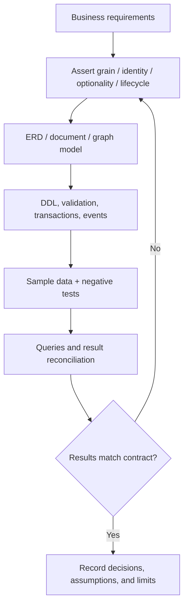
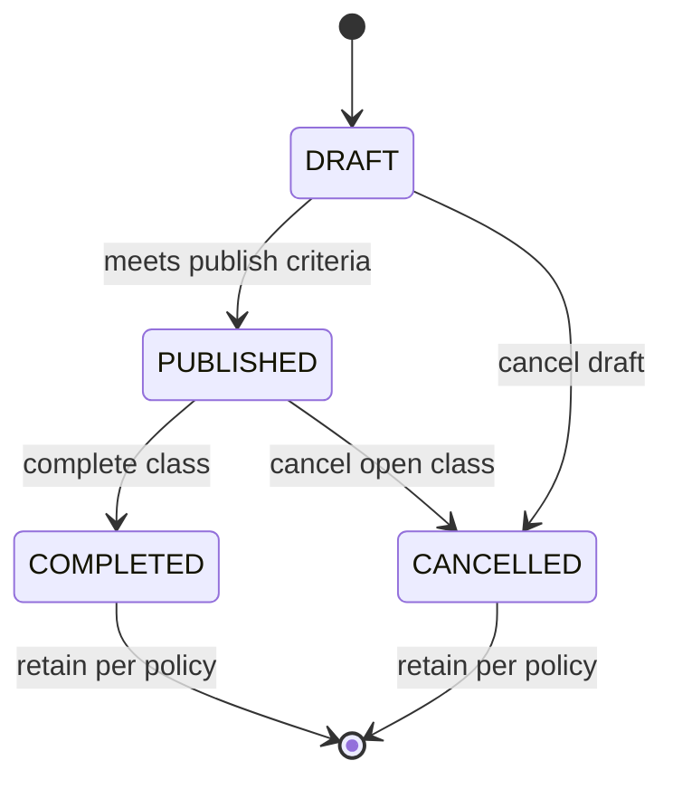
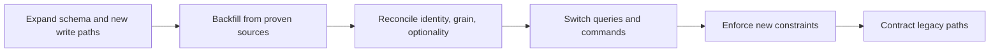

# Checking Grain, Identity, Optionality, and Lifecycle

## 1. Why Validate a Design Before Implementation?

A data schema can create tables cleanly, include all foreign keys, execute queries, and still **model the business wrongly**. Fundamental bugs usually lie not in SQL syntax, but in four questions that were never answered consistently:

1. **Grain:** What exact unit does each row, document, or node/edge represent?
2. **Identity:** When are two records the same entity, and when are they two distinct entities?
3. **Optionality:** Can an entity exist without this attribute or relationship? What does "absent" mean?
4. **Lifecycle:** How is an entity born, how does it change state, expire, get cancelled, get retained, and get deleted?

Consider an online learning platform selling courses to enterprises. The designer creates `enrollments(learner_id, course_id, status, ...)` and adds `UNIQUE(learner_id, course_id)`. Later, real business cases emerge:

- A learner retakes **the same course** in a **different cohort/class**.
- A learner cancels an enrollment and re-enrolls in the same class, depending on policy.
- A class is created before an instructor is assigned.
- A finalized order must not change price even if the course price changes.
- Two enterprises have learners sharing the same internal code.
- An in-flight enrollment is retried due to a client timeout.

Without validating those four questions, the system may reject valid actions, allow duplicate records, link across enterprises, or lose history.

This lesson belongs to the **Design Validation** chapter of the **DATABASE_DATA_MODELING** module. The module trains the skill of turning business requirements into data models—from entities, relationships, and constraints down to keys, indexes, and physical schemas—while comparing relational, document, graph, and analytical structures to choose a design that fits, evolves cleanly, and can be verified.

**Learning outcome:** You will learn how to build an assumption–invariant–evidence matrix, validate grain, identity, optionality, and lifecycle using data and queries, and translate sound rules into DDL, transactions, APIs, events, and test suites.

## 2. Distinguishing a "Plausible Design" from a "Validated Design"

A polished ER diagram is not proof that the schema is right. Evidence must show that every modeling decision **traces back to a business question** and **is verified with concrete scenarios**.

| Component | Question to answer | Required evidence |
| --- | --- | --- |
| Grain | Does one row represent an entity, a version, an attempt, or a transaction? | Grain statement, boundary data, counts |
| Identity | What makes two rows the same object? | Business key, uniqueness scope, ID change/merge policy |
| Optionality | Which fields/relationships are required and at what stage? | State-based rule table, missing-value scenarios, SQL constraints |
| Lifecycle | Which states exist and how do they transition? | State machine, transition table, transaction tests |
| Time | What does "as of when" mean? | Effective dates, event time, UTC/zone, interval boundaries |
| Scope | Which organization or permissions own it? | Namespaced keys, policies, negative tests |
| Evolution | When requirements change, does old data keep its meaning? | Migration scenarios, backward compatibility |
| Query | Does it return the right row count, right meaning, and avoid double-counting? | Query samples, EXPLAIN, invariant checks |

Validation should combine **semantic validation**, **physical constraint validation**, and **behavioral validation**:



A thorough validation tests both **valid data** and **data that must be rejected**; inserting a few "pretty" rows is never enough.

## 3. What Is Grain and Why Express It in One Sentence?

**Grain** defines **the exact unit represented by each record**. If you cannot state "one row is one ..." in a single unambiguous sentence, the model is not clear enough to validate.

Examples:

- `Learner`: one learner profile within one organization.
- `CourseTemplate`: one course content definition owned by a subject/owner.
- `ClassOffering`: one scheduled run/cohort of a course.
- `Enrollment`: one enrollment of one learner into one class offering.
- `EnrollmentAttempt`: one submission of an enrollment request, **not necessarily creating an enrollment**.
- `LessonCompletion`: one lesson-completion event or one completion state, depending on definition.
- `OrderLine`: one line item in an order with locked-in price and quantity.
- `DailyEnrollmentSnapshot`: one snapshot of enrollment counts at a defined point in time and grouping level.

### 3.1. Same Fields, Different Grain

Compare:

```text
enrollments:
  tenant_id, learner_id, offering_id, status

enrollment_attempts:
  tenant_id, attempt_id, learner_id, offering_id,
  request_time, outcome

enrollment_events:
  tenant_id, event_id, enrollment_id, event_type,
  occurred_at
```

All three tables may hold learner/offering IDs, yet they answer three different questions:

- **Is there currently an enrollment?**
- **How many enrollment attempts occurred?**
- **Which events happened over the enrollment's lifecycle?**

If someone clicks "Enroll" twice on a slow network, there may be **two HTTP attempts**, **one committed command**, **one enrollment**, and **one business event**. Never collapse all of those into one grain just because they share learner and offering IDs.

### 3.2. Common Grains in Analytical Modeling

| Kind | What is one row? | Example |
| --- | --- | --- |
| **Entity state** | One currently managed entity | One active Learner |
| **Entity version / SCD2** | One effective-dated version of an entity | Learner address from T1 to T2 |
| **Transaction fact** | One event or transaction line | One finalized order line |
| **Periodic snapshot fact** | One periodic snapshot | Active learners at end of each day |
| **Accumulating snapshot fact** | One multi-milestone process | An enrollment record with enrolled, approved, completed timestamps |
| **Event log** | One event with its own ID | EnrollmentCancelled |
| **Relationship** | One scoped/effective-dated association | Learner assigned to class in term X |

A table's name does not determine its grain. `payments` could be **a payment request**, **a gateway attempt**, **a captured transaction**, or **a ledger posting**; each grain choice yields different keys and counting rules.

## 4. Validating Grain with Counts and Edge Cases

### 4.1. Build a "When Is a New Row Created?" Table

| Business change | Create new Learner? | Create new Enrollment? | Create new Attempt/Event? |
| --- | --- | --- | --- |
| Edit learner display name | No | No | May emit audit event |
| Learner tries to enroll but class is full | No | No | Failed attempt |
| Learner successfully enrolls in class L1 | No | Yes if none exists per rule | Event and attempt |
| Client retries an already-committed command | No | No | May log technical attempt; do not re-record business action |
| Learner is allowed to retake course in class L2 | No | Yes | Yes |
| Learner cancels L1 | No | No if only status changes | Cancellation event |
| Learner re-enrolls in L1 after cancelling | No | Depends on "one lifetime enrollment" vs. "multiple enrollments" model | Command/event |

The last row has no universal answer. The design team must pick:

- **Option A:** one Enrollment per learner–offering pair; re-enrolling updates that same row's lifecycle.
- **Option B:** each accepted registration is a new Enrollment with its own `enrollment_id` and a constraint blocking two **currently active** enrollments simultaneously.

These two options differ in grain, history, unique constraints, and reporting. If the business hasn't distinguished them, document the assumption and bring the question to business sign-off.

### 4.2. Checking Fan-Out from Mixed Grains

Suppose `orders` has one row/order, `order_lines` has many rows/order, and `payments` has many attempts/order:

```text
Order O-1: total = 200
  2 order lines
  3 payment attempts
```

The query:

```sql
SELECT SUM(o.total_minor)
FROM orders AS o
JOIN order_lines AS l ON l.order_id = o.order_id
JOIN payment_attempts AS p ON p.order_id = o.order_id;
```

can count Order O-1's total **6 times** due to the `2 × 3` join combinations. That is a **grain incompatibility** error, not merely a missing `DISTINCT`.

The fix depends on the question:

- Need total order amount: sum at order grain without unnecessary 1–n joins.
- Need line-item total: sum at order-line grain.
- Need payment attempt count: count at attempt grain.
- Need measures from two 1–n tables together: aggregate each source separately to the same grain first, then JOIN the aggregated results.

### 4.3. Warning Signs of a Broken Grain

- A row must store an unbounded array just to record every change.
- Multiple columns `date1/date2/date3` exist only to store "first time, second time."
- A unique constraint blocks valid "retake course" behavior.
- Transaction totals jump after joining a descriptive table.
- A delete operation has to guess whether to delete historical records or only current state.
- "Paid orders" and "successful payment attempts" are treated as the same metric.

**Grain validation must happen before index tuning.** Indexes cannot fix broken unit-of-data semantics.

## 5. Identity: Business Identity, Record Identity, and Version Identity

**Identity** answers: which two rows represent the same entity across changes, and what makes them two distinct business records?

### 5.1. Key Types to Distinguish

- **Business key:** a business-meaningful value or authoritative source identifier identifying an entity.
- **Surrogate key:** a technical key identifying a row or version, such as a sequence-generated ID.
- **Durable key:** an identifier that remains stable across versions or sources when the model requires it.
- **Composite key:** multiple fields forming a properly scoped identity, such as `(tenant_id, learner_code)`.
- **Event ID:** identifies a single event, distinct from the aggregate ID or an HTTP request ID.
- **Idempotency key:** identifies a retried processing intent within a defined scope and retention window.

Examples:

```text
Learner identity:
  (tenant_id = ORG-A, learner_code = U-100)

Enrollment identity:
  (tenant_id = ORG-A, enrollment_id = E-501)

CourseOffering identity:
  (tenant_id = ORG-A, offering_id = L-2026-11)

Event identity:
  event_id = 88f5...

Request idempotency scope:
  (tenant_id, command_type, idempotency_key)
```

Two organizations can both use code `U-100` without referring to the same person. Globally unique UUIDs lower collision odds, yet do not replace ownership policies, authorization, or identity reconciliation.

### 5.2. Mandatory Questions About Identity

1. Who issues the key? Is uniqueness guaranteed system-wide or only within a tenant/source?
2. Can the key change, be revoked, or be reused?
3. Can one person own multiple profiles across two organizations?
4. If two profiles are confirmed duplicates, are they merged? Where will historical data point?
5. If one profile is split into two entities due to data-entry error, can historical links be separated?
6. Will a retried command create another copy of the same entity?
7. When importing from another CRM, are source codes namespaced?
8. If a record is deleted, can the old business key be reused for a new person?

**Names, emails, and phone numbers are usually poor durable identities** because they can change, collide, be recycled, or constitute personal data. They can be used for search or matching signals under clear policies, not assumed to be strict same-as identity.

### 5.3. No-Reuse ID Policy

For example, Enrollment `E-501` is cancelled. If that ID were later issued to another Enrollment, old events, receipts, and reports would become ambiguous.

A simple rule:

```text
An Enrollment's identity must never be reused
for a different enrollment, even after cancellation.
```

If personal data deletion is requested, the system must still comply with deletion and retention policies. That does not automatically force keeping full payloads forever; a minimal registry/tombstone may be needed for the permitted retention period to enforce non-reuse under contract.

## 6. Validating Identity with Keys, Constraints, and Merge/Split Scenarios

### 6.1. Primary Key and Unique Key Are Two Separate Decisions

A table may use a surrogate PK:

```sql
CREATE TABLE learners (
    learner_sk bigint GENERATED ALWAYS AS IDENTITY PRIMARY KEY,
    tenant_id text NOT NULL,
    learner_code text NOT NULL,
    display_name text NOT NULL,
    UNIQUE (tenant_id, learner_code)
);
```

In this example:

- `learner_sk` is the technical row key.
- `(tenant_id, learner_code)` is the business identity requiring uniqueness.
- `display_name` is not a key.
- An FK from Enrollment may point to `learner_sk`, though if `tenant_id` is stored separately on Enrollment, you must verify **the FK does not permit cross-tenant references**.

A surrogate PK does not replace a unique business key if the business truly forbids two profiles with the same code in one tenant.

### 6.2. Composite FKs Guard Scope

An alternative design uses composite PKs:

```sql
CREATE TABLE learners_by_tenant (
    tenant_id text NOT NULL,
    learner_code text NOT NULL,
    display_name text NOT NULL,
    PRIMARY KEY (tenant_id, learner_code)
);

CREATE TABLE offerings_by_tenant (
    tenant_id text NOT NULL,
    offering_code text NOT NULL,
    title text NOT NULL,
    PRIMARY KEY (tenant_id, offering_code)
);

CREATE TABLE enrollments_by_tenant (
    tenant_id text NOT NULL,
    enrollment_id text NOT NULL,
    learner_code text NOT NULL,
    offering_code text NOT NULL,
    status text NOT NULL,
    PRIMARY KEY (tenant_id, enrollment_id),
    FOREIGN KEY (tenant_id, learner_code)
       REFERENCES learners_by_tenant (tenant_id, learner_code),
    FOREIGN KEY (tenant_id, offering_code)
       REFERENCES offerings_by_tenant (tenant_id, offering_code)
);
```

An Enrollment in tenant A must not point to a Learner in tenant B merely because they share `learner_code`. Including `tenant_id` in both FKs provides **physical proof** of the intra-tenant reference boundary.

If the business allows cross-tenant enrollments, a dedicated authorization/grant model is needed. Never strip the tenant condition from FKs without modeling permissions and ownership.

### 6.3. Validating Identity with Intentional Collisions

The test set must include:

```text
(ORG-A, U-100) -> An
(ORG-B, U-100) -> Bình
(ORG-A, U-101) -> Chi
```

Expected:

- Three valid profiles; A/U-100 and B/U-100 must not be merged.
- Creating another A/U-100 must be rejected by the unique constraint or business logic.
- An Enrollment in A must not reference a profile in B.
- Queries, read models, and caches must carry full scope.

### 6.4. Identity Merge/Split Cannot Be Handled by Arbitrary ID Overwrites

If a source discovers two codes in one tenant belong to the same learner, you need:

- A verification workflow, audit trail, and approval source.
- Rules for selecting the durable identity/canonical profile.
- Old-alias → new-identity mappings with effective dates and provenance.
- Handling of historical relationships and facts.
- Reversibility or adjustment if a merge was mistaken.

When splitting a wrongly merged profile, updating every FK with a single `UPDATE` cannot recover lost provenance. Identity resolution is therefore a **historical business decision**, not mere data cleanup.

## 7. Optionality: Missing Value vs. Missing Relationship

An attribute or relationship may be:

- **Required from creation:** every Enrollment must have a learner and an offering.
- **Optional at creation, required before a milestone:** a class may lack an instructor in `DRAFT` but must have one before `PUBLISHED`.
- **Permanently optional:** a learner may have no avatar.
- **Not applicable:** an online course type needs no physical classroom.
- **Unknown or unverified:** residential address has not been provided yet.
- **Temporarily absent due to async processing:** payment reference has not arrived yet.
- **Removed/redacted by data policy:** no longer shown even though a value once existed.

These situations **do not mean the same thing**. A nullable column can represent several of them, yet if the business must distinguish them, explicit states or structures are needed.

### 7.1. Optionality and Cardinality on Both Sides of a Relationship

For Learner–Enrollment–Offering:

```text
One Enrollment:
  must point to exactly one Learner
  must point to exactly one Offering

One Learner:
  may have 0..n Enrollments

One Offering:
  may have 0..n Enrollments
```

For an offering and instructor:

```text
One Offering in DRAFT:
  may have 0..n InstructorAssignments

One Offering in PUBLISHED:
  must have >= 1 active InstructorAssignment

One Instructor:
  may lead 0..n Offerings
```

Cardinality should specify both **min** and **max** on each side. Writing only "one-to-many" without `0..n` or `1..n` can drop mandatory conditions.

### 7.2. Validating with a State Matrix

| Attribute/relationship | DRAFT | PUBLISHED | COMPLETED | Explanation |
| --- | --- | --- | --- | --- |
| `offering.title` | Required | Required | Required | Minimum display identity |
| `offering.instructor` | May be absent | At least one valid person | Keep assignment history | Publishing precondition |
| `offering.start_at` | May be absent | Required | Required, preserve history | Operational milestone |
| `offering.room` | N/A if online | May depend on modality | Snapshot if needed | Depends on delivery modality |
| `offering.cancel_reason` | N/A | N/A | Optional unless CANCELLED | State-conditional |
| `learner.avatar` | Optional | Optional | Optional | Non-mandatory business datum |

Sometimes more states are involved (such as `CANCELLED`); this table illustrates **stage-based requirements**, not a single universal lifecycle for all classes.

### 7.3. Rules Must State "By When"

"A class needs an instructor" is too vague. Rewrite it as:

> "An offering in `PUBLISHED` status must have at least one valid instructor assignment at publication time."

This wording lets you validate the `PublishOffering` command precisely without blocking incomplete drafts.

## 8. NULL, Absent, and Unknown: Do Not Collapse All Missing States into One

In SQL, `NULL` represents an absent value under the model's semantics; in three-valued logic, `column = NULL` never returns `TRUE`. Always use `IS NULL` / `IS NOT NULL` when checking.

```sql
-- Find offerings without an instructor in an illustrative column.
SELECT offering_id
FROM offerings
WHERE instructor_id IS NULL;
```

However, that condition **does not say why it is missing**. If you must distinguish:

```text
instructor_state:
  UNASSIGNED
  ASSIGNING
  ASSIGNED
  NOT_REQUIRED
```

use an explicit state with matching constraints or a separate assignment table. Avoid inserting sentinel codes like `instructor_id = 'UNKNOWN'` into a real FK just to dodge NULLs when "UNKNOWN" is not a real business instructor.

### 8.1. Differences Across Storage Models

| System/model | Representation | Validation risk |
| --- | --- | --- |
| Relational SQL | `NULL`, 0 child rows, state column | NULL and non-existent relationships get confused |
| JSON/document | Missing field, JSON `null`, empty array | Three states may mean different things; schema validator must define them |
| Graph | No edge, existing edge, missing edge property | Missing edge could mean unknown or unrelated |
| Event | No event yet, created event, deleted/cancel event | "Haven't seen an event" does not prove nothing happened |
| Analytics | Unknown member, `NULL` dimension FK, "Not applicable" | Mixing unknown and N/A skews reports |

### 8.2. Three-Valued Logic and Uniqueness

```sql
SELECT *
FROM learners
WHERE phone_number = NULL; -- wrong if looking for NULL values
```

In SQL, comparing against `NULL` yields `UNKNOWN`, so use:

```sql
SELECT *
FROM learners
WHERE phone_number IS NULL;
```

In PostgreSQL, a standard `UNIQUE` constraint permits **multiple NULL values** because NULLs are not considered equal under default semantics. If the business allows at most one profile with a NULL value (rare), choose a constraint appropriate to the engine/version; do not assume `UNIQUE` limits NULL to one occurrence.

### 8.3. Build Structured Conditions Instead of Guessing

For example, `room_id` applies only to onsite classes:

```sql
CHECK (
  (delivery_mode = 'ONLINE' AND room_id IS NULL)
  OR
  (delivery_mode = 'ONSITE' AND room_id IS NOT NULL)
)
```

This is an **illustrative rule**; if hybrid classes allow an optional room, adjust the constraint to match the business. Do not turn one assumption into a universal rule for every product.

## 9. Validating Optionality with Conditional Constraints

### 9.1. NOT NULL Cannot Express Every State-Based Condition

If `learner_id` is mandatory on every Enrollment, use `NOT NULL`. But if a `DRAFT` offering may omit `start_at`, putting `start_at NOT NULL` at creation time **forbids a valid scenario**.

You can use a conditional `CHECK` on **the same row**:

```sql
CREATE TABLE offering_drafts (
    tenant_id text NOT NULL,
    offering_id text NOT NULL,
    status text NOT NULL,
    title text NOT NULL,
    start_at timestamptz,
    delivery_mode text NOT NULL,
    room_id text,
    PRIMARY KEY (tenant_id, offering_id),
    CHECK (status IN ('DRAFT','PUBLISHED','COMPLETED','CANCELLED')),
    CHECK (delivery_mode IN ('ONLINE','ONSITE')),
    CHECK (status <> 'PUBLISHED' OR start_at IS NOT NULL),
    CHECK (delivery_mode <> 'ONLINE' OR room_id IS NULL)
);
```

This is an illustrative rule: if `COMPLETED` also requires `start_at` or a hybrid class allows a room, update the `CHECK`. Never copy constraints blindly before confirming semantics.

### 9.2. "At Least One Child Record" Is Not a Simple CHECK

The requirement "a `PUBLISHED` offering has at least one instructor" spans multiple rows:

```text
course_offerings(tenant_id, offering_id, status)
instructor_assignments(tenant_id, offering_id, instructor_id)
```

A `CHECK` reading only one table's row cannot guard the existence of rows in another table. The `PublishOffering` command must verify assignments within an **appropriate transaction boundary**, while guarding against a concurrent transaction removing the last instructor right before/after publishing.

One approach is to require both publishing and unassigning operations to lock the same Offering row as a coordination point, use suitable isolation/retries, and back it with concurrent write tests. Triggers or deferred constraints can be options where supported, though ordering and transaction semantics still require verification.

### 9.3. Composite FKs with Nullable Columns Need Attention

In PostgreSQL under default `MATCH SIMPLE` composite FK semantics, if any component of the referencing key is `NULL`, the check may not fire as the designer expects. For **mandatory** relationships, declare the referencing columns `NOT NULL`:

```sql
tenant_id text NOT NULL,
learner_id text NOT NULL,
FOREIGN KEY (tenant_id, learner_id)
  REFERENCES learners_by_tenant(tenant_id, learner_id)
```

An FK alone does not prove "there is always a Learner" if another rule leaves the referencing column nullable.

### 9.4. Maximum Cardinality Can Also Be an Invariant

"Offering has `0..n` Enrollments" does not capture a 30-seat capacity limit. The number of **seat-holding** Enrollments must not exceed capacity; that may require atomic conditional updates, reservation ledgers, transactions, and numeric checks. A one-to-many arrow on an ERD does not enforce quantity caps.

## 10. Lifecycles Need a State Machine, Not Just a Status Column

A candidate offering lifecycle:



This is **not a universal diagram for every product**. Some domains need `SUSPENDED`, `REOPENED`, or allow cancellation only before the start time. Base the design on real rules.

### 10.1. State Transition Matrix

| From | To | Condition | Consequence |
| --- | --- | --- | --- |
| DRAFT | PUBLISHED | Has schedule, instructor, publish permission | Opens enrollment |
| DRAFT | CANCELLED | Has cancel reason/permission per policy | Cannot publish later if policy forbids |
| PUBLISHED | COMPLETED | Meets class-closing criteria | Finalizes outcomes/progress |
| PUBLISHED | CANCELLED | Authorized; apply enrolled-learner policy | Refund/transfer classes if required |
| COMPLETED | PUBLISHED | Forbidden in this example | Open a new offering for retakes |
| CANCELLED | PUBLISHED | Forbidden in this example | Do not silently resurrect offering |

**State transitions must guard permissions, preconditions, and side effects**, not just run `UPDATE status='PUBLISHED'`.

### 10.2. One State Often Drives Other Optionality

- `DRAFT`: `start_at` and instructor may be missing.
- `PUBLISHED`: `start_at` and valid assignment are mandatory.
- `COMPLETED`: completion timestamp required per business contract.
- `CANCELLED`: if root-cause analysis is needed, record cancel reason and timestamp.
- `ARCHIVED`: may be separate archival metadata rather than replacing business status.

A design carrying `is_active`, `is_deleted`, and `status` simultaneously must define valid combinations. Otherwise, `status='COMPLETED'` with `is_active=true` is ambiguous.

### 10.3. Current Status Does Not Tell Every Transition

Knowing only `status=COMPLETED` does not tell you when it was published, who approved it, failed attempts, or a cancel-then-reopen history. When history matters, record a state-transition log or event history with identity, version, actor, and timestamp.

## 11. Validating Concurrency, Versions, and Idempotency

### 11.1. A Conditional State Transition

Suppose Offering is `DRAFT`, version 7. After verifying conditions inside the transaction:

```sql
UPDATE course_offerings
SET status = 'PUBLISHED',
    version = version + 1,
    published_at = now()
WHERE tenant_id = :tenant_id
  AND offering_id = :offering_id
  AND status = 'DRAFT'
  AND version = 7
RETURNING offering_id, status, version;
```

If 0 rows return, the command must not report success. Either the state changed or a concurrent write intervened. The application must classify the error safely.

**Limitation:** The `UPDATE` above does not itself verify "has instructor" if the assignment table is updated concurrently by another flow. Coordinate related operations around the shared invariant.

### 11.2. Distinguishing Request, Command, Enrollment, and Event

```text
request_id:
  one technical call; a retry may carry a new request_id

idempotency_key:
  identifies the same retried intent within scope
  (tenant_id, command_type, key)

enrollment_id:
  identity of an accepted enrollment record

event_id:
  identity of a published business event
```

If the client times out after the command commits, retrying with the same idempotency key must not create a second Enrollment. Conversely, **two distinct idempotency keys** could still request the same learner–offering pair; business uniqueness must reject or handle it per policy.

### 11.3. Capacity Must Be Protected at Commit

A class has one seat left. Two learners both read the dashboard showing one open seat — a read model that may lag.

```sql
UPDATE course_offerings
SET reserved_count = reserved_count + 1,
    version = version + 1
WHERE tenant_id = :tenant_id
  AND offering_id = :offering_id
  AND status = 'PUBLISHED'
  AND reserved_count < capacity
RETURNING offering_id, reserved_count;
```

Accept the enrollment only if the `UPDATE` succeeds and the Enrollment is created within **the same transaction/consistency boundary**. If inserting the Enrollment fails, roll back the seat reservation. Cancellation/release flows need reconciliation so the counter never drifts from reality.

### 11.4. Concurrent Write Tests

```text
Initial:
  capacity=1, reserved_count=0

Two concurrent commands:
  Enroll(learner A)
  Enroll(learner B)

Expected:
  exactly 1 Enrollment takes the seat
  reserved_count=1
  the other command returns full or waitlisted per policy
```

Running the two commands **sequentially** proves nothing about race safety.

## 12. Lifecycle and Time: When Is a State Effective?

An entity can have multiple timestamps:

| Field | Meaning |
| --- | --- |
| `created_at` | System created the record |
| `occurred_at` | Business event occurred |
| `effective_from` | Validity start boundary |
| `effective_to` | Validity end boundary |
| `recorded_at` | Store received/recorded the information |
| `updated_at` | Most recent technical modification |
| `cancelled_at` | Business cancellation timestamp |
| `deleted_at` | Policy deletion/hiding timestamp |

These timestamps are not synonymous. An enrollment occurring on Nov 1, entered on Nov 3, and taking effect on Nov 10 represents three distinct temporal events.

### 12.1. Half-Open Intervals Prevent Boundary Overlap

Use `[effective_from, effective_to)` with the predicate:

```text
effective_from <= t
AND (effective_to IS NULL OR t < effective_to)
```

Example:

```text
Instructor A: [2026-10-01, 2026-11-01)
Instructor B: [2026-11-01, 2026-12-01)
```

At the exact start of November, A's validity has ended and B's begins. Standardize time zones and timestamp precision.

### 12.2. Overlap vs. Gap

If a class has only **one primary instructor** at any moment:

- **No overlap:** no two `PRIMARY` assignments are simultaneously effective.
- **No gap:** while `PUBLISHED`, there must always be at least one `PRIMARY` if the business requires it.

PostgreSQL can use exclusion constraints over ranges to block overlaps when data types and extensions fit. **No gap** may require dedicated transactional checks and tests; forbidding overlaps does not prove continuous coverage.

### 12.3. Business History vs. System-Known History

- **Business valid time:** when an attribute was in effect.
- **System recorded time:** when the system learned/updated the fact.

A real change occurring on Oct 1 but submitted on Nov 15 creates two different axes. If you must answer "what did the Oct 20 report know?", business `effective_from/effective_to` alone is insufficient; system history or a bitemporal model may be needed.

### 12.4. Deletion Has Multiple Meanings

- **Cancel:** ends business validity while potentially preserving history.
- **Archive/soft delete:** hides from daily operations; define who may still read it.
- **Erasure/physical delete:** removes data per applicable policy across sources and replicas.

Never treat `is_deleted=true` as sufficient for every data-protection requirement, and never erase financial/academic history simply because a user cancelled an Enrollment.

## 13. A Relational Schema Validating All Four Axes

The PostgreSQL example below explicitly chooses **one lifetime Enrollment per `(tenant, learner, offering)` pair**. If the business allows creating new enrollments when re-enrolling in the same class, change the grain and keys.

```sql
CREATE TABLE dv_learners (
    tenant_id text NOT NULL,
    learner_id text NOT NULL,
    display_name text NOT NULL,
    PRIMARY KEY (tenant_id, learner_id)
);

CREATE TABLE dv_offerings (
    tenant_id text NOT NULL,
    offering_id text NOT NULL,
    title text NOT NULL,
    status text NOT NULL DEFAULT 'DRAFT',
    start_at timestamptz,
    capacity integer NOT NULL,
    reserved_count integer NOT NULL DEFAULT 0,
    version bigint NOT NULL DEFAULT 1,
    published_at timestamptz,
    cancelled_at timestamptz,
    PRIMARY KEY (tenant_id, offering_id),
    CHECK (status IN ('DRAFT','PUBLISHED','COMPLETED','CANCELLED')),
    CHECK (capacity >= 0),
    CHECK (reserved_count >= 0 AND reserved_count <= capacity),
    CHECK (version > 0),
    CHECK (
        status <> 'PUBLISHED'
        OR (start_at IS NOT NULL AND published_at IS NOT NULL)
    ),
    CHECK (status <> 'CANCELLED' OR cancelled_at IS NOT NULL)
);

CREATE TABLE dv_enrollments (
    tenant_id text NOT NULL,
    enrollment_id text NOT NULL,
    learner_id text NOT NULL,
    offering_id text NOT NULL,
    status text NOT NULL,
    enrolled_at timestamptz NOT NULL,
    cancelled_at timestamptz,
    version bigint NOT NULL DEFAULT 1,
    PRIMARY KEY (tenant_id, enrollment_id),
    UNIQUE (tenant_id, learner_id, offering_id),
    FOREIGN KEY (tenant_id, learner_id)
       REFERENCES dv_learners(tenant_id, learner_id),
    FOREIGN KEY (tenant_id, offering_id)
       REFERENCES dv_offerings(tenant_id, offering_id),
    CHECK (status IN ('ACTIVE','COMPLETED','CANCELLED')),
    CHECK (version > 0),
    CHECK (status <> 'CANCELLED' OR cancelled_at IS NOT NULL)
);

CREATE INDEX dv_enrollments_by_offering
ON dv_enrollments(tenant_id, offering_id, status);
```

### 13.1. What Does This DDL Protect?

- **Grain:** one Enrollment row per learner–offering pair over its lifetime under the assumption.
- **Identity:** PK `(tenant_id, enrollment_id)` and `UNIQUE(tenant_id, learner_id, offering_id)`.
- **Scope:** composite FKs keep Learner and Offering inside the same tenant.
- **Optionality:** `start_at` may be missing in `DRAFT`, but not in `PUBLISHED`.
- **Lifecycle:** status restricted to allowed values plus several state-conditional rules.
- **Row capacity:** counter non-negative and never exceeding capacity per row.

### 13.2. What Has the DDL Not Proven?

- Whether state transitions follow the valid order.
- Whether a `PUBLISHED` offering has a valid instructor assigned.
- User permissions to publish/cancel.
- Whether `reserved_count` matches actual seat-holding Enrollments.
- Whether a retried command triggers side effects twice.
- Whether late-arriving effective dates from sources are processed accurately.
- Whether deletes/revocations propagate to caches and read projections.

### 13.3. Allowing Retakes in the Same Offering

When multiple separate enrollments are needed for the same pair, the lifetime `UNIQUE` above is **too strict**. You can shift to the grain "one Enrollment per accepted registration," giving each its own `enrollment_id` and enforcing **at most one `ACTIVE` Enrollment per pair**:

```sql
-- Use only after dropping the lifetime UNIQUE above
-- and adjusting state-transition policies.
CREATE UNIQUE INDEX one_active_enrollment_per_pair
ON dv_enrollments(tenant_id, learner_id, offering_id)
WHERE status = 'ACTIVE';
```

You cannot keep the old lifetime `UNIQUE` and expect the partial unique index to allow re-enrollment. This is a **grain change** requiring data, API, and report migrations.

## 14. Reconciliation SQL for Existing Data

### 14.1. Finding Identity Duplicates for the Chosen Grain

```sql
SELECT tenant_id, learner_id, offering_id, COUNT(*) AS n
FROM dv_enrollments
GROUP BY tenant_id, learner_id, offering_id
HAVING COUNT(*) > 1;
```

Must return empty in the one-lifetime-enrollment model. If the newer model allows multiple enrollments, this query is no longer an error; instead check for overlapping `ACTIVE` enrollments or overlapping effective intervals.

### 14.2. Checking Same-Tenant Foreign Keys

```sql
SELECT e.tenant_id, e.enrollment_id,
       e.learner_id, e.offering_id
FROM dv_enrollments AS e
LEFT JOIN dv_learners AS l
  ON l.tenant_id = e.tenant_id
 AND l.learner_id = e.learner_id
LEFT JOIN dv_offerings AS o
  ON o.tenant_id = e.tenant_id
 AND o.offering_id = e.offering_id
WHERE l.learner_id IS NULL
   OR o.offering_id IS NULL;
```

With FKs active and valid data, this returns 0 rows. It is useful in staging/backfill before constraints are enabled.

### 14.3. Checking State-Required Attributes

```sql
SELECT tenant_id, offering_id, status, start_at, published_at
FROM dv_offerings
WHERE status = 'PUBLISHED'
  AND (start_at IS NULL OR published_at IS NULL);
```

### 14.4. Checking Counter vs. Actual Enrollments

If `reserved_count` is defined strictly as the count of `ACTIVE` Enrollments:

```sql
SELECT o.tenant_id, o.offering_id,
       o.reserved_count,
       COUNT(e.enrollment_id) AS active_enrollments
FROM dv_offerings AS o
LEFT JOIN dv_enrollments AS e
  ON e.tenant_id = o.tenant_id
 AND e.offering_id = o.offering_id
 AND e.status = 'ACTIVE'
GROUP BY o.tenant_id, o.offering_id, o.reserved_count
HAVING o.reserved_count <> COUNT(e.enrollment_id);
```

If `COMPLETED` also holds seats or pending reservations exist, fix the comparison formula. **Never alter data to match a formula the business has not approved.**

## 15. Assigning Invariants to the Right Layer

| Invariant | Primary safeguard | Supplement |
| --- | --- | --- |
| Learner code unique within tenant | PK/UNIQUE | Migration checks |
| Enrollment references same tenant | Composite FK | Write authorization |
| Quantity > 0 | CHECK | Input validation |
| PUBLISHED requires at least one instructor | Command transaction/locking | Reconciliation |
| Capacity non-negative / never exceeded | Conditional write + transaction | Counter check |
| Only authorized roles can publish | Authorization | Audit |
| Retries create no new Enrollment | Idempotency + business UNIQUE | Logging |
| Projections never leak tenants | Scoped keys, RLS/ACL, query policy | Negative tests |
| Accurate end-of-day metrics | Authoritative source + reconciliation | Cutoffs/versions |
| No policy-violating retention of sensitive data | Lifecycle workflow/retention | Audits and replica checks |

Do not expect a single `CHECK` to guard multi-table and user-permission rules. Nor should you trust only the frontend to guard invariants. **Defense layers complement each other.**

### 15.1. A Validated Write Path

1. Authenticate user and tenant.
2. Check permissions and Offering status.
3. Check capacity/business conditions inside a transaction.
4. Perform conditional writes handling version and idempotency.
5. Let PK/FK/UNIQUE/CHECK reject remaining errors.
6. Write outbox records if read projections are needed.
7. Reconcile authoritative source against replicas at appropriate intervals.

If you guard only in the service, a bad batch import can bypass it. If you guard only in the DB, complex permissions and workflows can still break.

## 16. Validating in Document, Graph, and Analytical Models

### 16.1. Document: What Does One Document Represent?

```json
{
  "tenantId": "ORG-A",
  "offeringId": "L-2026-11",
  "status": "PUBLISHED",
  "instructors": [
    {"instructorId": "I-20", "assignedAt": "2026-10-01T00:00:00Z"}
  ]
}
```

Validation questions:

- Does the document represent **one current Offering** or **the history of all assignments**?
- Does `instructors` hold only active instructors or expired ones too?
- Do the instructors belong to the same tenant or have valid sharing grants?
- If the array grows over years, should an `Assignment` collection be split out?
- Do concurrent enrollment/offering updates risk lost updates?
- Do absent JSON fields, `null`, and `[]` carry distinct semantics?

Schema validation can check types and fields, yet does not automatically enforce cross-document constraints or business permissions.

### 16.2. Graph: What Is an Edge's Grain?

```text
(Learner)-[:ENROLLED_IN]->(Offering)
(Instructor)-[:TEACHES]->(Offering)
```

Determine:

- Is the `ENROLLED_IN` edge **current state** or **one historical enrollment**?
- Can two edges exist between the same node pair? If so, what distinguishes their identity?
- Do edges have validity intervals; are overlaps forbidden?
- Do nodes/edges belong to the same tenant or hold valid grants?
- When deleting an edge, is audit data lost?

If you need to store multiple registrations while keeping a clean graph, introduce an `Enrollment` node with its own identity or a relationship model that stores events appropriately.

### 16.3. Analytics: Summation Must Match Grain

```text
fact_enrollment_daily:
  snapshot_date, tenant_id, offering_id, active_count

Question: active count at month-end?
  take the snapshot on the cutoff date and sum across offerings.

Incorrect:
  SUM(active_count) across all 30 days
  if the metric means active learners at month-end.
```

A snapshot metric can be summed across offerings on the same date, yet **cannot be summed across dates**. Grain validation covers not only key design, but also permitted aggregations.

## 17. From Requirements to Design Acceptance Tests

A design is validated when backed by **testable assertions**: concrete statements specifying input setup, action, expected result, and responsible layer.

### 17.1. Minimum Test Matrix

| Axis | Scenario | Expected outcome |
| --- | --- | --- |
| Grain | One learner takes the same course in two offerings | Two valid enrollments across distinct offerings |
| Grain | Client retries the same enrollment command | Does not create an extra business Enrollment |
| Grain | JOIN order × line × payment attempt | Does not multiply order amounts |
| Identity | A/U-100 and B/U-100 | Two separate Learners |
| Identity | Two A/U-100 rows | Rejected if business key is unique within tenant |
| Identity | Merge two verified profiles | Mapping has source/lineage; FKs retain meaning |
| Optionality | Create DRAFT Offering without instructor | Permitted if business allows |
| Optionality | PUBLISH class with no instructor | Rejected |
| Optionality | ONLINE class with a room forbidden by policy | Rejected |
| Optionality | Missing contact ≠ NOT_APPLICABLE | Represented and analyzed accurately |
| Lifecycle | DRAFT → PUBLISHED when criteria met | Succeeds, version incremented |
| Lifecycle | CANCELLED → PUBLISHED under forbidding policy | Rejected |
| Lifecycle | Two concurrent commands claiming the last seat | At most one succeeds |
| Lifecycle | Cancel enrollment then retry cancel | No duplicate refunds or side effects |
| Temporal | Event right at `effective_to` | Belongs to next version, not both |
| Temporal | Two overlapping effective versions violating policy | Blocked or detected |
| Temporal | Late adjustment from last month | Applied per effective date, fact reconciled |
| Scope | Join query for A and B with colliding local IDs | Never returns wrong-tenant match |
| Evolution | Legacy rows missing new field | Backfilled or quarantined per policy |
| Deletion | Delete/hide at source | Read models, caches, search obey lifecycle |

### 17.2. Tests Must Deliberately Create "Hard" Data

Test suites with non-colliding IDs, always-complete fields, and always-valid states miss bugs. Include:

```text
ORG-A / learner U-100
ORG-B / learner U-100   (same code, different person)

Course C-01
  Offering L1: DRAFT, no instructor yet
  Offering L2: PUBLISHED, instructor assigned

Learner A/U-100:
  Enroll in L2 first time
  Retry exact same request
  Cancel
  Attempt to re-enroll in L2
  Enroll in L3 of the same Course C-01
```

On "re-enroll in L2," there must be an explicit expected outcome per the grain decision: update the old Enrollment, create a new Enrollment, or reject. **If there is no clear answer, the test is exposing a requirements gap**, not a test bug.

### 17.3. Property-Based Tests

Beyond single hand-crafted examples, generate random inputs asserting invariants:

```text
For every Enrollment E:
  exists exactly one Learner L with
    (L.tenant, L.id) == (E.tenant, E.learner)

  exists exactly one Offering O with
    (O.tenant, O.id) == (E.tenant, E.offering)

For each (tenant, learner, offering):
  active_enrollment_count <= 1
  -- holds only if this rule was chosen

For every Offering O:
  0 <= O.reserved_count <= O.capacity

For every legal transition:
  next_status belongs to allowedTransitions(previous_status)

For every effective timestamp t:
  at most one primary instructor interval contains t
  -- holds only if one primary instructor is required
```

Property-based tests must run against **the authoritative store** with real transactions and concurrency; checking DTOs after reading does not adequately guard race conditions.

### 17.4. A Test Must Explain Why It Failed

If the "two learners enroll for one seat" test fails, determine:

- Did the counter exceed capacity?
- Were two `ACTIVE` Enrollments created?
- Was a duplicate caused by a retry?
- Did the transaction commit while projection lagged?
- Did a read model serve stale state?

Distinguish **write consistency** bugs from **read freshness** lag. A slow-updating UI does not necessarily mean source writes were corrupted, though it may still violate product SLAs.

## 18. Validating with Change History and Late-Arriving Data

In distributed systems, a valid current row does not prove history has always been accurate. The design must specify whether **current state alone** suffices or milestones must be reconstructible.

### 18.1. Illustrative Event Log

```text
Enrollment E-501
  v1 EnrollmentCreated   at 2026-11-01T10:00Z
  v2 EnrollmentActivated at 2026-11-02T08:00Z
  v3 EnrollmentCancelled at 2026-11-05T12:00Z
```

Checkpoints:

- `event_id` is unique within storage scope.
- `aggregate_version` increases monotonically within an Enrollment.
- `occurred_at` differs from `recorded_at` when events arrive late.
- Retrying the same event creates no new business event.
- Valid events cannot drive the state machine along forbidden edges.
- When handling out-of-order events, projections need version/gap rules or full snapshots.

### 18.2. Late-Arriving Data Can Alter Historical Interpretation

Suppose in late November we receive notice of an Enrollment effective October 15. If October's report asks for "enrollments effective during October," using only `recorded_at` misses it.

Decide:

1. Which **business date** takes precedence for reporting?
2. Are already-published reports allowed to be restated?
3. If a fact already carries historical dimension keys, must FKs be restated?
4. Do we need to preserve "what the report knew at publish time" alongside revised figures?
5. What if a late source event lacks sufficient evidence of its effective date?

This sits at the intersection of **grain**, **identity/versioning**, and **temporal lifecycle**. Never equate `recorded_at` with `effective_at` simply because both are timestamps.

### 18.3. Soft Delete Is Not a Complete Event State

A `deleted_at` column may filter records out of current queries, yet audits still need to know:

- Who requested it?
- For what reason?
- Is this a business cancellation or personal-data erasure?
- Must related records change state or reject new commands?
- Do search/cache replicas receive a revocation event?
- What retention or recovery rules apply?

Adding `is_deleted` without defining lifecycle and access rules creates a hard-to-validate "half-existent state."

## 19. When Changing the Model: Migrations Must Preserve Record Meaning

Data models evolve as business understanding sharpens. A good design **migrates data without silently turning an old row into a wrong new meaning**.

### 19.1. Example: Changing Enrollment Grain

**Before:** one unique Enrollment for `(tenant, learner, course)`.

**After:** one Enrollment for `(tenant, learner, offering)` to support retaking the same course in different classes.

A migration path:

1. Confirm `CourseTemplate` and `ClassOffering` are distinct-grain entities.
2. Create the Offering table and map old Enrollments to the right Offering where evidence exists.
3. Quarantine/classify Enrollments whose historical class cannot be determined instead of guessing an Offering.
4. Add new keys and composite FKs.
5. Update queries, read models, and reports to distinguish course-level vs. offering-level counts.
6. Backfill in batches with checkpoints and reconciliation.
7. Cut over write and read paths in a controlled sequence.
8. Drop the old unique key only once old writers are gone and data is verified.

Never simply rename `course_id` to `offering_id` and assume old values carry the new meaning.

### 19.2. Expand–Migrate–Contract



During transition, two representations may coexist. Identify the **authoritative source**, avoid inconsistent dual-writes, and retain rollback safety.

### 19.3. When Adding a Required Column

Never add `NOT NULL` immediately if legacy rows lack real values:

- Add a nullable column or a transitional state if appropriate.
- Identify the authoritative backfill source.
- Use `UNKNOWN`/`NOT_APPLICABLE` only when it is a **defined business value**, not a dummy string to bypass constraints.
- Inspect value ranges, missing rates, and unrecoverable cases.
- Enforce `NOT NULL` only once both data and all writers comply.

A "technically successful" migration that fills in wrong defaults is **a data modeling bug**.

### 19.4. Identity Changes Have Wide Blast Radius

When changing a business key or splitting one entity into several, examine:

- FKs in OLTP and historical tables.
- Event/outbox keys, CDC, deduplication.
- Caches, search indexes, vector indexes.
- Dimension surrogate keys and fact FKs.
- API URLs, external references, imports/exports.
- Published datasets and audit logs.

Plan mappings/aliases, effective dates, and reconciliation — not just a PK edit.

## 20. Complete Case Study: Enterprise Training Platform

### 20.1. Context and Requirements

A SaaS delivers courses to enterprises:

- Tenants have their own learners; learner codes may collide across tenants.
- One `CourseTemplate` is used across many `ClassOfferings`.
- Each offering starts in `DRAFT`, transitions to `PUBLISHED`, and may become `COMPLETED`/`CANCELLED`.
- `DRAFT` needs no instructor yet; `PUBLISHED` requires at least one valid instructor.
- A learner may retake the same template in another offering.
- Within a single offering, a learner cannot hold two `ACTIVE` enrollments simultaneously.
- `CANCELLED` enrollments may be retained for history. If re-enrolling in the same offering is allowed, the new registration gets a new ID.
- Offering seats must never exceed capacity, even under concurrent writes.
- Dashboards list offerings and current learner counts with a few seconds' lag allowed; enrollment write decisions must never rely on stale data.
- Reports must know when enrollments occurred and support adjustments when events arrive late.

### 20.2. Choosing Grain

| Entity | Grain | Proposed identity |
| --- | --- | --- |
| Tenant | One subscribing organization | `tenant_id` |
| Learner | One learner profile in a tenant | `(tenant_id, learner_id)` |
| CourseTemplate | One owned content template | `(owner_id, template_id)` |
| ClassOffering | One run/cohort of a course | `(tenant_id, offering_id)` |
| Enrollment | One **accepted enrollment registration** | `(tenant_id, enrollment_id)` |
| EnrollmentAttempt | One command submission attempt | `(tenant_id, request_id)` or scoped technical ID |
| EnrollmentEvent | One recorded business change | `event_id` and aggregate version |
| DailyClassSnapshot | One offering on a snapshot date | `(tenant_id, offering_id, snapshot_date)` |

Because we chose **one Enrollment per registration**, we prevent two simultaneous `ACTIVE` enrollments per learner/offering rather than forbidding all historical rows for that pair.

### 20.3. Relationships and Optionality

```text
Tenant 1 -- 0..n Learner
Tenant 1 -- 0..n ClassOffering

CourseTemplate 1 -- 0..n ClassOffering
  (if templates are shared, a grant/visibility policy is required)

Learner 1 -- 0..n Enrollment
ClassOffering 1 -- 0..n Enrollment
Enrollment 1 -- 0..n EnrollmentEvent

ClassOffering DRAFT:
  0..n instructor assignments allowed

ClassOffering PUBLISHED:
  >= 1 active instructor assignment

Enrollment ACTIVE:
  valid learner + offering, holding a seat
```

Check ownership and tenant scope on every relationship, not just root columns.

### 20.4. Designing Constraints for the New Grain

To allow multiple cancelled Enrollments for a pair while limiting to at most one `ACTIVE`:

```sql
-- Illustrative table separate from section 13's dv_enrollments example:
CREATE TABLE cs_enrollments (
    tenant_id text NOT NULL,
    enrollment_id text NOT NULL,
    learner_id text NOT NULL,
    offering_id text NOT NULL,
    status text NOT NULL,
    enrolled_at timestamptz NOT NULL,
    cancelled_at timestamptz,
    PRIMARY KEY (tenant_id, enrollment_id),
    FOREIGN KEY (tenant_id, learner_id)
       REFERENCES dv_learners(tenant_id, learner_id),
    FOREIGN KEY (tenant_id, offering_id)
       REFERENCES dv_offerings(tenant_id, offering_id),
    CHECK (status IN ('ACTIVE','COMPLETED','CANCELLED')),
    CHECK (status <> 'CANCELLED' OR cancelled_at IS NOT NULL)
);

CREATE UNIQUE INDEX cs_one_active_enrollment
ON cs_enrollments(tenant_id, learner_id, offering_id)
WHERE status = 'ACTIVE';
```

**Limitation:** if a `COMPLETED` Enrollment still counts as "holding enrollment eligibility," indexing only `ACTIVE` is insufficient. Lock down which statuses block new registrations and whether time-interval overlaps must also be checked.

### 20.5. Business Scenarios and Expected Outcomes

| Action | Expected outcome |
| --- | --- |
| Create L1 DRAFT without instructor | Succeeds |
| Publish L1 without instructor | Fails; remains DRAFT |
| Assign instructor then publish L1 | Succeeds in valid transaction |
| An enrolls in L1 | Creates E1 ACTIVE, reserves one seat |
| Retry An's exact command | Returns E1 / matching result, no E2 |
| Bình enrolls when one seat remains | At most one final command succeeds, no overbooking |
| An enrolls in L1 again with a new command | Blocked while E1 is ACTIVE |
| An cancels E1 | E1 CANCELLED; seat/refund handled per policy |
| An re-enrolls in L1 if policy permits | Creates E2 ACTIVE with distinct ID from E1 |
| An enrolls in L2 of same template | Valid; not blocked by course-level uniqueness |
| ORG-B has Learner U-100 | Never conflated with ORG-A/U-100 |
| E1 cancel event reaches read model late | Read may lag within SLO; commands hit write side |
| Late historical event arrives | Re-evaluate report by effective time, log lineage |

### 20.6. Pre-Acceptance Reconciliation

Verify minimum evidence:

- Every Enrollment references valid Learner/Offering within the same tenant.
- No two `ACTIVE` enrollments share `(tenant, learner, offering)`.
- `ACTIVE` enrollment counts match the counter if that is the chosen metric.
- Every `PUBLISHED` Offering has an active instructor assignment.
- State transitions contain no forbidden edges.
- Retried commands never trigger side effects twice.
- Joins across 1–n tables do not inflate revenue/learner counts.
- Reports use the right grain and timestamps.
- Dashboard freshness is bounded, especially on last-seat enrollment.
- Migrations, archival, and deletions do not skip replicas.

This is a **design with declared assumptions**, not a complete production schema. Production rollout must add authentication, authorization, payment workflows, sync timings, indexes, sizing, and proper error handling.

## 21. Self-Check Exercises

### Exercise A — Split Shipments

An order has five product lines. One line can ship in two parcels; one parcel can contain multiple lines.

**Ask:** What are the grains of Order, OrderLine, Shipment, and ShipmentLine? What should `ShipmentLine`'s unique key be based on? If a parcel fails delivery and is re-attempted, is that the same Shipment or a new `DeliveryAttempt`?

**Hint:** Do not confuse "one parcel" with "one delivery attempt." Summing shipped quantities requires line/parcel quantity grain.

### Exercise B — Optional Shipping Address?

A digital order has no shipping address; a physical order requires one before `CONFIRMED`.

**Ask:** Should `shipping_address_id` be table-wide `NOT NULL`? Write a conditional rule using `order_type` and `status`. When the source address changes, does an old order display the new address or a placement-time snapshot?

### Exercise C — Third-Party Identifiers

Two payment providers send the same `transaction_id = 12345`. Each provider guarantees uniqueness only within its own merchant account.

**Ask:** What is a properly scoped business key? If `transaction_id` alone were made unique, what bug occurs? Do a payment attempt and a settled payment share the same grain?

### Exercise D — Cumulative Reporting

A snapshot table stores `active_learners` daily. A report author `SUM`s all days in a month and labels it "total active learners at month-end."

**Ask:** Where is the grain/aggregation error? Write how to query the cutoff-date snapshot or define a "learner-days" metric if daily summation is truly intended.

### Exercise E — Illegal State Transition

A system allows `CANCELLED → ACTIVE` via a direct `UPDATE`, whereas policy requires creating a new Enrollment to preserve history.

**Ask:** How do you fix grain, identity, and lifecycle? Which test must fail? Do legacy rows that were previously "resurrected" need migration?

### Exercise F — Late-Arriving Data

On Nov 15 the warehouse learns a learner completed on Oct 30. October's month-end report was already finalized.

**Ask:** Use effective time or recorded time? Restate the report or not? How do you store both the published figure and the revised figure if the business needs both?

## 22. Common Mistakes

**"A table with a PK means the right grain was chosen."**  
A PK only distinguishes technical rows; grain must match the business unit. An auto-increment ID can hide stuffing multiple entity types into one table.

**"Matching field names mean matching identity."**  
`course_id` on `CourseTemplate` differs from an offering's `offering_id`; `learner_code` across two tenants does not mean the same person.

**"A unique email is a great business identity."**  
Emails can change, collide, be recycled, and constitute PII. Using one as a durable key requires proof from the source contract, not an assumption.

**"Optional means NULL is allowed in every state."**  
A field may be optional in `DRAFT` and mandatory in `PUBLISHED`.

**"Zero child rows means the value is 0."**  
It could mean not loaded yet, not applicable, unknown, or truly zero; define and test it.

**"An FK guarantees at least one child row."**  
A child-to-parent FK does not ensure a parent has children; reverse minimum cardinality requires separate enforcement.

**"CHECK guards every invariant."**  
It does not guard user permissions, transition sequences, or multi-row invariants under concurrency without extra mechanisms.

**"Counting or summing rows after any JOIN stays at the same grain."**  
Joining multiple 1–n relationships multiplies monetary totals and enrollment counts.

**"Just SELECT to check open seats and then INSERT."**  
Two transactions can observe the same open seat; use atomic conditional writes/locking and transactions.

**"Retries creating new rows are fine because the user clicked twice."**  
Technical retries differ from a new enrollment intent; enforce idempotency and business uniqueness.

**"Soft delete satisfies every deletion requirement."**  
Data can linger in caches, exports, events, and backups; policies must cover the entire lifecycle.

**"`updated_at` is when the event happened."**  
Updated time is not valid time. Historical queries need the right timestamp.

**"Only change the schema; reports don't need updates."**  
Changing grain or identity alters `COUNT`, `SUM`, `JOIN`, uniqueness, and historical semantics.

## 23. Design Package to Deliver

Instead of handing off only an ERD and DDL, an acceptance-ready package should include:

| Artifact | Contents |
| --- | --- |
| **Grain catalog** | Every table/collection/fact/node/edge with a "one record is one ..." statement |
| **Identity policy** | BK, SK, namespaces, ID allocation, non-reuse, merge/split |
| **Optionality matrix** | Attributes/relationships, min/max, and state-based rules |
| **Lifecycle spec** | State machine, transition table, permissions, preconditions, side effects |
| **Temporal conventions** | Valid/system time, time zones, half-open intervals, late arrivals |
| **Constraint map** | Rule → PK/FK/UNIQUE/CHECK/index/transaction/policy |
| **Sample datasets** | Valid cases, boundary cases, intentional ID collisions, missing data |
| **Acceptance tests** | Both positive and negative tests, concurrency, retries |
| **Query contracts** | Expected `COUNT`/`SUM`/`JOIN`, snapshots, pagination, SLAs |
| **Migration plan** | Backfill, reconciliation, cutover, conditional rollback |
| **Ownership & audit** | Who approves rules, where lineage lives, data lifecycle |

### 23.1. Sample Decision Record

```yaml
decisionId: DV-ENROLLMENT-GRAIN
entity: Enrollment
grain: "One accepted enrollment registration of a learner into a class offering"
identity:
  surrogate: [tenant_id, enrollment_id]
  businessRule: "At most one ACTIVE per tenant + learner + offering"
optionality:
  learner: required
  offering: required
  cancelled_at: required_if_status_cancelled
lifecycle:
  allowed: [ACTIVE, COMPLETED, CANCELLED]
  reEnrollmentAfterCancel: "Create a new enrollment_id when policy permits"
tests:
  - duplicate_active_rejected
  - same_course_different_offering_allowed
  - retry_does_not_create_duplicate
  - cross_tenant_reference_rejected
owner: "Enrollment domain team"
```

This is an **illustrative decision-record format**, not a default system config or schema validator. Real values must be confirmed by the business and relevant teams.

### 23.2. Sample Acceptance Criteria

A decision is considered **design-validated** when it has:

- An unambiguous grain and identity statement.
- At least one documented boundary case.
- Appropriate constraints or enforcement mechanisms.
- Tests proving invalid data is rejected and valid data is accepted.
- Sample queries that avoid distortion from JOINs or aggregations.
- Policies for states, timestamps, late-arriving data, and deletion.
- An explicit owner and documented open assumptions.

Never write "PASS" merely because the database creates the tables. Many rules cannot be proved by isolated constraints and require behavioral tests.

## 24. Execution Workflow and Final Checklist

### 24.1. Twelve-Step Process

1. **Read requirements:** identify entities, commands, queries, and access permissions.
2. **Write grain statements:** "one row/document/event/fact is one ...".
3. **Probe repetition and change cases:** retries, retakes, class transfers, refunds, merges.
4. **Define identity:** business keys, namespaces, surrogate keys, versions, event IDs.
5. **Write uniqueness and reference rules:** per-tenant, time-scoped, or system-wide.
6. **Build optionality/cardinality matrix:** min/max and state-based conditions.
7. **Draw lifecycle:** states, transitions, preconditions, permissions, and impacts.
8. **Define time semantics:** valid/recorded/created, validity intervals, late arrivals.
9. **Design physical layer:** DDL, FKs, CHECKs, indexes, and DB limits.
10. **Choose transaction/integration mechanisms:** concurrency, idempotency, events, projections.
11. **Test/reconcile:** positive, negative, race, orphan, aggregate, historical queries.
12. **Document decisions and migration:** approvers, assumptions, limits, evolution plan.

### 24.2. Validation Checklist

- [ ] Every table, document, node/edge, event, and fact has a concrete grain statement.
- [ ] Entities, versions, attempts, transactions, and snapshots are clearly separated.
- [ ] No multi-way 1–n JOINs cause unintended metric fan-out.
- [ ] Business keys have trustworthy sources and uniqueness scopes.
- [ ] Surrogate keys, durable keys, event IDs, and idempotency keys do not mix roles.
- [ ] Identifiers from multiple tenants/sources are properly namespaced.
- [ ] Merge/split, non-reuse, and duplicate-handling rules are defined.
- [ ] Every relationship states min/max cardinality, not just "1:n."
- [ ] Optionality distinguishes unknown, not-applicable, absent, and pending.
- [ ] State-required fields are enforced at the right lifecycle point.
- [ ] Required columns and FKs have appropriate `NOT NULL`/constraints.
- [ ] State machines and transition tables are approved.
- [ ] Commands verify permissions, preconditions, and concurrency at commit.
- [ ] Retries are handled idempotently without extra side effects.
- [ ] Business time is never conflated with system-recorded time.
- [ ] Validity intervals specify boundary conventions and overlap/gap handling.
- [ ] Late-arriving data and historical corrections have restatement plans if needed.
- [ ] Cancel, archive, soft delete, and erasure carry distinct meanings.
- [ ] Tests include cross-tenant colliding IDs and intentionally missing fields.
- [ ] Negative tests cover uniqueness, FKs, state transitions, permissions, and capacity.
- [ ] Concurrency tests cover multi-row invariants.
- [ ] `COUNT`/`SUM` queries match grain and never sum snapshots across invalid time axes.
- [ ] Documents and graphs are validated for identity/scope/lifecycle just like relational tables.
- [ ] Migrations include backfills, reconciliation, and handling for unverifiable legacy data.
- [ ] Rule owners and decision records are in place before acceptance.

**Key takeaway:** **Grain** determines what a record represents; **identity** determines when two records refer to the same entity; **optionality** determines when attributes or relationships may be absent; **lifecycle** determines how an entity changes and ends. All four axes must be validated together via **business questions, boundary data, constraints, transactions, queries, and negative tests**. Having a valid ERD and DDL without proving right grain, right identity, right preconditions, and right lifecycle leaves the design semantically unverified.
