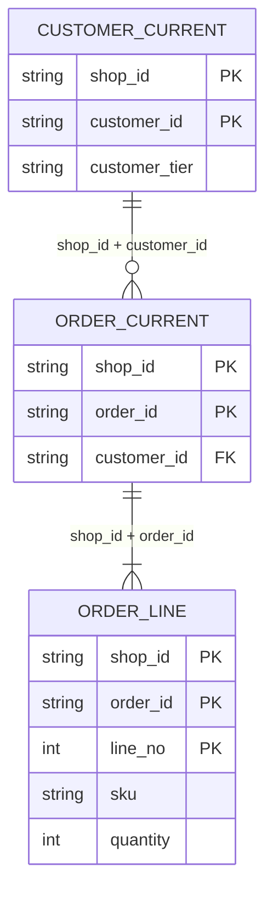
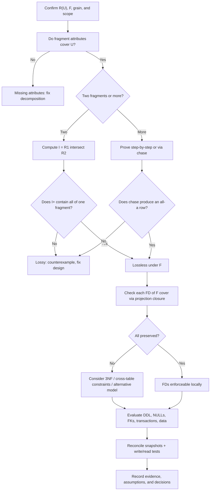

# Proving Lossless-Join Decomposition and Checking Dependency Preservation

## Learning Objectives

After this lesson, you will be able to:

- State precisely what **lossless-join decomposition** means for a relational schema and a confirmed set of functional dependencies.
- Distinguish **lossless join** from **dependency preservation**: they are two independent properties requiring separate validation.
- Compute **attribute closures** \(X^+\), identify superkeys/candidate keys, and apply the condition **the intersection of two schemas determines all attributes of one side** to prove binary lossless decomposition.
- Construct **counterexamples producing spurious tuples** when lossless decomposition fails.
- Compute/use **projections of functional dependencies** onto each subschema and check whether the original dependencies remain derivable from local constraints.
- Use the **chase algorithm** to validate decompositions into more than two schemas when the binary test is no longer directly sufficient.
- Explain the trade-off between **3NF** (which can synthesize a lossless, dependency-preserving decomposition) and **BCNF** (lossless decomposition, yet may lose local FD enforcement).
- From business requirements, build a **design evidence table** covering the FD set, decomposition, proofs, SQL constraints, counterexamples, tests, and practical limits.
- Distinguish mathematical conclusions in the relational model from real-world deployment conditions such as **NULLs**, tenant-scoped composite keys, asynchronous ingestion, and SQL bag semantics.

In the **DATABASE_DATA_MODELING** module, we learn how to turn business requirements into entities, relationships, constraints, normalization, keys, indexes, and suitable physical schemas. The **Design Validation** chapter requires the next step: rather than merely claiming "splitting tables reduces duplication," we must **prove that splitting neither generates nor loses valid tuples and that required dependency rules remain reliably enforced**.

This lesson's two primary requirements are:

1. **Lossless join:** joining projections taken from the same valid relation must reconstruct the exact original relation.
2. **Dependency preservation:** source functional dependencies must be derivable from dependencies checkable locally within individual fragments, without forcing multi-table joins on every write.

The first protects **data meaning after decomposition**; the second protects **constraint enforcement and update operations**.

---

## 1. Starting from Relations, Keys, and Functional Dependencies

Let \(R(U)\) be a relational schema where \(U\) is its set of attributes. For example:

\[
U=\{A,B,C\}
\]

A **relation instance** \(r\) is a set of tuples over \(U\). In the theoretical relational model, data follows **set semantics**: the same tuple does not appear twice.

A **functional dependency** (FD) \(X\to Y\) means: in every relation instance valid under the business rules, **any two tuples agreeing on \(X\) must agree on \(Y\)**.

\[
r\models X\to Y
\iff
\forall t_1,t_2\in r:
t_1[X]=t_2[X]\Rightarrow t_1[Y]=t_2[Y].
\]

For example:

\[
F=\{A\to B,\ B\to C\}
\]

then \(A\to C\) also holds by **transitivity** of functional dependencies.

### 1.1. Functional Dependencies Come from Business Contracts, Not Accidental Data

Suppose `order_lines` has columns:

| shop_id | order_id | line_id | customer_id | sku | quantity |
| --- | --- | --- | --- | --- | ---: |
| shop_17 | ord_908 | 1 | user_42 | A17 | 2 |
| shop_17 | ord_908 | 2 | user_42 | B03 | 1 |

These two current rows fit the rule:

\[
(shopId,orderId)\to customerId
\]

yet observing two rows **does not prove** the rule always holds. Confirm the business contract: does one order in one shop have exactly one customer under the modeled business version? Can orders transfer ownership? If history is kept, does the key need timestamps or versions?

Conversely, you cannot infer \(orderId\to customerId\) platform-wide if `orderId` is unique only **within a single shop**. Before any proof, establish **the key's uniqueness scope**.

### 1.2. Attribute Closure and Superkeys

The **closure** \(X_F^+\) is the set of all attributes derivable from \(X\) under FD set \(F\).

Closure algorithm:

```text
closure(X, F):
    result = copy(X)
    repeat:
        changed = false
        for each dependency L -> R in F:
            if L subset-of result:
                add all attributes of R to result
                if result changed: changed = true
    until not changed
    return result
```

With \(F=\{A\to B,\ B\to C\}\):

```text
Start: A+ = {A}
A -> B:   A+ = {A,B}
B -> C:   A+ = {A,B,C}
Stop:     A+ = {A,B,C}
```

Since \(A_F^+=U\), \(A\) is a **superkey** of \(R(A,B,C)\), and in this example a **candidate key** because no proper subset of \(A\) determines all of \(U\).

**Superkey:** \(X_F^+\supseteq U\).

**Candidate key:** a minimal superkey by inclusion; no attribute can be dropped while still determining all of \(U\).

### 1.3. Notation Used in This Lesson

| Symbol | Meaning |
| --- | --- |
| \(U\) | Full set of attributes of the original relation |
| \(F\) | Confirmed set of FDs for \(R(U)\) |
| \(F^+\) | All FDs derivable from \(F\) |
| \(X_F^+\) | Attribute closure of \(X\) under \(F\) |
| \(\pi_V(r)\) | Projection of relation instance \(r\) onto attribute set \(V\) |
| \(\pi_V(F)\) | Set of all FDs in \(F^+\) involving only attributes in \(V\) |
| \(\bowtie\) | Natural join over common attributes |
| \(\rho=\{R_1,\ldots,R_n\}\) | A schema decomposition whose attribute sets union to \(U\) |

Do not confuse **projecting a data instance** \(\pi_V(r)\) with **projecting a constraint set** \(\pi_V(F)\). They share the name projection, yet operate on different objects.

## 2. What Exactly Is Lossless-Join Decomposition?

We decompose \(R(U)\) into subschemas:

\[
\rho=\{R_1(U_1),R_2(U_2),\ldots,R_n(U_n)\},
\qquad
\bigcup_{i=1}^n U_i=U.
\]

The decomposition is **lossless** with respect to \(F\) if:

\[
\boxed{
\forall r\text{ over }U,\quad
r\models F
\Rightarrow
r=\bowtie_{i=1}^{n}\pi_{U_i}(r)
}
\]

The condition **"for every relation valid under \(F\)"** is crucial. Never test only the current dataset. A small sample may join back cleanly today while the decomposition still fails once other valid tuples appear.

### 2.1. Why Can Joining Projections Produce Spurious Tuples?

When projecting a row into multiple tables, columns absent from each fragment are dropped. If the join attributes **do not uniquely distinguish the original groups**, the join can pair the left half of one row with the right half of another and invent a **spurious tuple**.

Under set semantics with exact projections and natural joins:

\[
r\subseteq\bowtie_{i}\pi_{U_i}(r)
\]

because every original row appears in each corresponding projection and therefore rejoins with itself. The problem with a lossy decomposition is typically **inventing extra spurious rows**, not losing original rows under ideal projection/join.

In SQL implementations with `NULL`s, filters, asynchronous ingestion, or missing referential constraints, an actual `INNER JOIN` **can still drop rows**. Distinguish those operational issues from the mathematical definition above.

### 2.2. Counterexample: Bad Split Generates Two Non-Existent Rows

Given:

\[
R(A,B,C),\quad F=\{A\to B\},\quad
R_1(A,B),\ R_2(B,C).
\]

Valid initial instance:

| A | B | C |
| --- | --- | --- |
| a1 | b1 | c1 |
| a2 | b1 | c2 |

FD \(A\to B\) holds because each `A` value determines one `B`.

Project onto \(R_1(A,B)\):

| A | B |
| --- | --- |
| a1 | b1 |
| a2 | b1 |

And \(R_2(B,C)\):

| B | C |
| --- | --- |
| b1 | c1 |
| b1 | c2 |

Join back on `B`:

| A | B | C | Assessment |
| --- | --- | --- | --- |
| a1 | b1 | c1 | Original tuple |
| a1 | b1 | c2 | **Spurious tuple** |
| a2 | b1 | c1 | **Spurious tuple** |
| a2 | b1 | c2 | Original tuple |

The join produces **4 tuples instead of 2**. This is a **sufficient counterexample to refute** losslessness. Conversely, testing a few datasets that happen not to generate spurious tuples **is insufficient to prove** a decomposition is lossless across all valid instances.

```sql
-- SQL illustrating the counterexample; data is already projected.
WITH r1(a,b) AS (
    VALUES ('a1','b1'), ('a2','b1')
),
r2(b,c) AS (
    VALUES ('b1','c1'), ('b1','c2')
)
SELECT r1.a, r1.b, r2.c
FROM r1
JOIN r2 ON r1.b = r2.b
ORDER BY r1.a, r2.c;
```

The query uses standard `VALUES` and CTE syntax and yields four combinations. Its purpose is to highlight that **the correlation between A and C was lost when keeping only B for the join**.

## 3. Lossless Theorem for Binary Decomposition

Suppose \(R(U)\) is decomposed into \(R_1(U_1)\) and \(R_2(U_2)\), with \(U_1\cup U_2=U\). Let:

\[
I=U_1\cap U_2.
\]

**Exact criterion under FD set \(F\):**

\[
\boxed{
\rho\text{ is lossless under }F
\iff
(I\to U_1)\in F^+
\quad\text{or}\quad
(I\to U_2)\in F^+
}
\]

This can be checked via attribute closures:

\[
U_1\subseteq I_F^+
\quad\text{or}\quad
U_2\subseteq I_F^+.
\]

Interpretation: **the common attributes of the two fragments must determine all attributes of at least one fragment**. When that holds, the join cannot cross-match part of that fragment onto incompatible record groups.

This theorem applies when the constraints under consideration are **FDs** in the relational model; if the business enforces other constraint types, state the logical basis used for any conclusion.

### 3.1. Lossless Example: A→B, B→C and Split AB | BC

Given:

\[
U=\{A,B,C\},\quad F=\{A\to B,\ B\to C\}
\]

and:

\[
U_1=\{A,B\},\quad U_2=\{B,C\}.
\]

We have:

\[
I=U_1\cap U_2=\{B\}
\]

and from \(B\to C\):

\[
B_F^+=\{B,C\}.
\]

Because \(U_2=\{B,C\}\subseteq B_F^+\), **the decomposition is lossless**.

In business terms: each `B` value determines exactly one `C`; therefore when an `AB` row joins `BC` on `B`, it cannot mix two different `C`s for the same `B` as long as the data obeys \(B\to C\).

### 3.2. Complete Proof: Why Does Determining One Side Prevent Spurious Tuples?

Assume \(I\to U_2\in F^+\).

Take any tuple \(t\) in \(\pi_{U_1}(r)\bowtie\pi_{U_2}(r)\). Because it came from joining projections, there exist original tuples \(t_1,t_2\in r\) such that:

- \(t\) takes its \(U_1\) attributes from \(t_1\).
- \(t\) takes its \(U_2\) attributes from \(t_2\).
- \(t_1\) and \(t_2\) match on the intersection \(I\).

Since \(I\to U_2\), \(t_1[I]=t_2[I]\) implies \(t_1[U_2]=t_2[U_2]\). Thus \(t\) equals the original tuple \(t_1\) across all of \(U_1\cup U_2=U\). No spurious tuples exist. The reverse inclusion holds trivially from projections, so the join equals \(r\).

**This proof holds for all \(r\models F\)**, independent of test row counts.

### 3.3. How to Prove "Not Lossless"

In Section 2's counterexample:

\[
U_1=\{A,B\},\quad U_2=\{B,C\},\quad I=\{B\}.
\]

The set \(F=\{A\to B\}\) yields only:

\[
B_F^+=\{B\}.
\]

Since \(B_F^+\) contains neither \(A\) nor \(C\), the intersection determines neither side completely; **the decomposition is not lossless under that FD set**. The four-tuple table in Section 2 supplies a concrete witness.

Note: the test must use **the closure \(F^+\)**, not merely scan the literally written list of FDs. Sometimes the intersection determines one side **through multi-step inference**.

### 3.4. Multi-Step Inference Example

Given:

\[
R(A,B,C,D),\quad
F=\{A\to B,\ B\to C,\ C\to D\}
\]

and decomposition:

\[
R_1(A,B,C),\quad R_2(A,D).
\]

The intersection is \(\{A\}\). Closure:

```text
Initial A+      = {A}
A -> B          = {A,B}
B -> C          = {A,B,C}
C -> D          = {A,B,C,D}
```

Because \(A_F^+\) contains all of \(R_2(A,D)\), the decomposition is **lossless** even though no base FD line literally says `A -> D`.

## 4. Losslessness and Dependency Preservation Are Two Separate Questions

A design can **rejoin losslessly** and still **fail to enforce a vital FD within a single table**.

### 4.1. Definition of Dependency Preservation

For decomposition \(\rho=\{R_1(U_1),\ldots,R_n(U_n)\}\) and \(F\) over \(U\), let:

\[
F_i=\pi_{U_i}(F)
=\{X\to Y\in F^+\mid X\cup Y\subseteq U_i\}.
\]

And:

\[
G=\bigcup_{i=1}^{n} F_i.
\]

**The decomposition is dependency-preserving** if:

\[
\boxed{G^+=F^+}.
\]

Since every \(F_i\) is derived from \(F\), \(G^+\subseteq F^+\) always holds. Hence we need only check whether **each FD in \(F\), or in an equivalent cover of \(F\), is derivable from \(G\)**:

\[
\forall X\to Y\in F:\quad Y\subseteq X_G^+.
\]

**Subtlety:** \(F_i\) includes **all FDs implied by \(F\) whose attributes fall inside \(U_i\)**, not just base FDs that happen to sit inside \(U_i\). For example, from \(A\to B\) and \(B\to C\), the projection onto `AC` includes \(A\to C\).

### 4.2. Why Does Dependency Preservation Matter?

If every constraint fits inside one table or follows from local constraints, the system can check it during inserts/updates on the relevant table.

If an FD is **not preserved**, child tables can enter states that satisfy every local FD individually yet **violate a source FD** when joined. To prevent that, the system must:

- Join or query across tables on every related write.
- Use complex triggers/transactions or a strictly controlled write layer.
- Maintain extra helper tables/constraints.
- Or revise the decomposition to preserve FDs.

FD preservation does not mean all SQL constraints have already been declared; rather, it tells you **whether per-subschema checks are logically strong enough to protect the original FDs**.

### 4.3. Example That Is Both Lossless and Dependency-Preserving

Still using:

\[
R(A,B,C),\quad F=\{A\to B,\ B\to C\},
\quad \rho=\{AB,BC\}.
\]

- **Lossless:** intersection \(B\) determines all of `BC`.
- **Preserving:** \(A\to B\) lives in `AB`; \(B\to C\) lives in `BC`.

Because both original FDs exist in child tables, \(G^+\) covers \(F\), and implied FDs such as \(A\to C\) are protected through them.

```sql
-- One SQL representation when key columns are NOT NULL.
CREATE TABLE r_bc (
    b VARCHAR(40) PRIMARY KEY,
    c VARCHAR(40) NOT NULL
);

CREATE TABLE r_ab (
    a VARCHAR(40) PRIMARY KEY,
    b VARCHAR(40) NOT NULL,
    FOREIGN KEY (b) REFERENCES r_bc(b)
);
```

`PRIMARY KEY(b)` on `r_bc` enforces one `C` per `B`; `PRIMARY KEY(a)` on `r_ab` enforces one `B` per `A`. The FK also supports operational referential integrity. However, see the section on **independently populated tables**: FDs and FKs alone do not ensure every `r_bc` row originates from `r_ab` if the application requires exact projections of a single base relation `R`.

## 5. Lossless Yet Not Dependency-Preserving Decomposition

Take again:

\[
R(A,B,C),\quad F=\{A\to B,\ B\to C\}
\]

but decompose into:

\[
R_1(A,B),\qquad R_2(A,C).
\]

Intersection:

\[
I=\{A\},\quad A_F^+=\{A,B,C\}.
\]

Since \(I\to AB\) and \(I\to AC\) in \(F^+\), the decomposition is **lossless**.

**However**, projecting FDs onto each fragment yields:

- On `AB`: \(A\to B\).
- On `AC`: \(A\to C\).

From those two FDs **\(B\to C\) cannot be derived**. Thus the decomposition is **not dependency-preserving**.

### 5.1. Counterexample: Locally Valid Child Tables Violate Source FD When Joined

`R1(A,B)`:

| A | B |
| --- | --- |
| a1 | b1 |
| a2 | b1 |

`R2(A,C)`:

| A | C |
| --- | --- |
| a1 | c1 |
| a2 | c2 |

Each child table is locally valid:

- In `R1`, each `A` maps to one `B`: \(A\to B\) holds.
- In `R2`, each `A` maps to one `C`: \(A\to C\) holds.

Join on `A`:

| A | B | C |
| --- | --- | --- |
| a1 | b1 | c1 |
| a2 | b1 | c2 |

The joined result **violates \(B\to C\)**, because `B = b1` pairs with two distinct `C` values.

There is no contradiction with losslessness: the lossless theorem applies to **decomposing an original relation already satisfying \(F\)** and joining it back. Those two example child tables satisfy local FDs yet **are not projections of any single base relation valid under \(F\)**. That exact gap manifests the loss of FD preservation.

### 5.2. Lesson from the Counterexample

Two questions must be checked independently:

1. If the original data is valid, does decomposing and rejoining create spurious tuples?
2. If child tables are updated while checking only local FDs, can they reach a state whose join violates original constraints?

Passing question 1 **does not guarantee** passing question 2.

### 5.3. Comparing Decompositions of the Same Schema

For \(R(A,B,C)\), \(F=\{A\to B,B\to C\}\):

| Decomposition | Lossless? | Preserves FDs? | Primary reason |
| --- | --- | --- | --- |
| `AB, BC` | Yes | Yes | Intersection `B` determines `BC`; both FDs local |
| `AB, AC` | Yes | No | Intersection `A` determines both; cannot derive `B→C` from `A→B, A→C` |
| `AB, BC` while **knowing only** \(A\to B\) | No | Yes for \(A\to B\) | Intersection `B` determines neither fragment; spurious tuples occur |
| `ABC` (no split) | Yes (trivial) | Yes (trivial) | Relation unchanged |

Row three **changes the assumed FD set**. A decomposition can be lossless under a stronger constraint set yet lossy under a weaker one; always record \(R\), \(F\), and \(\rho\) together in the proof record.

## 6. Checking Dependency Preservation Without Enumerating All of \(F^+\)

By definition, we use:

\[
G=\bigcup_i\pi_{U_i}(F).
\]

Yet \(F^+\) can contain exponentially many implied dependencies. Enumerating every FD on every attribute subset is usually unnecessary.

**For FDs, you can check a dependency \(X\to Y\) using an alternating closure algorithm across fragments**, computing only \(X_F^+\) over the source FD set.

### 6.1. Algorithm to Test One FD

```text
preserved(X -> Y, F, decomposition):
    Z = copy(X)

    repeat:
        changed = false

        for each relation schema Ri:
            localKnown = Z ∩ Ri

            # Attributes in Ri implied by
            # known attributes currently inside Ri.
            localImplied = closure(localKnown, F) ∩ Ri

            if Z union localImplied differs from Z:
                Z = Z union localImplied
                changed = true

    until not changed

    return Y subset-of Z
```

Why this algorithm is valid:

- \(Z\cap U_i\) are the already-known attributes inside fragment \(R_i\).
- Every attribute in \((Z\cap U_i)_F^+\cap U_i\) is derived via **an FD using only attributes of \(U_i\)**, which is precisely the information captured by projection \(\pi_{U_i}(F)\).
- Each pass feeds results from one fragment into the other fragments, simulating inference across the union of local constraints.
- At fixpoint, \(Z\) reaches the closure under all FDs implied by **the union of fragments**. If \(Y\subseteq Z\), the tested FD is preserved.

**Never confuse this algorithm with computing \(X_F^+\) directly in one shot.** Direct \(X_F^+\) always confirms every \(X\to Y\) in \(F\), regardless of whether the decomposition broke local enforcement. **Intersecting with each \(R_i\)** is what models per-table boundaries.

### 6.2. Step-by-Step Trace on a Preserving Decomposition

Given:

\[
F=\{A\to B,\ B\to C,\ C\to D\},
\quad
\rho=\{AB,BC,CD\}.
\]

Test derived FD \(A\to D\):

| Step | Fragment | \(Z\) before | Locally derivable attributes | \(Z\) after |
| --- | --- | --- | --- | --- |
| Init | — | \(\{A\}\) | — | \(\{A\}\) |
| 1 | \(AB\) | \(\{A\}\) | \(A\to B\) | \(\{A,B\}\) |
| 2 | \(BC\) | \(\{A,B\}\) | \(B\to C\) | \(\{A,B,C\}\) |
| 3 | \(CD\) | \(\{A,B,C\}\) | \(C\to D\) | \(\{A,B,C,D\}\) |

Thus \(D\in Z\); dependency \(A\to D\) follows from the child tables even though it **is not declared as a single physical constraint**.

### 6.3. Trace on a Non-Preserving Decomposition

Given:

\[
F=\{A\to B,B\to C\},
\quad
\rho=\{AB,AC\}.
\]

Test \(B\to C\), initializing \(Z=\{B\}\):

- At `AB`, \(Z\cap AB=\{B\}\). Under \(F\), \(B_F^+=\{B,C\}\), yet intersecting with `AB` leaves only \(\{B\}\). Nothing added.
- At `AC`, \(Z\cap AC=\varnothing\). Assuming \(F\) has no FDs from \(\varnothing\) to other attributes, nothing added.
- Loop terminates with \(Z=\{B\}\), missing `C`.

Conclusion: **\(B\to C\) is not preserved**.

### 6.4. Why Just Scanning Which Table Contains Each Base FD Is Not Enough

Consider:

\[
F=\{A\to B,\ B\to C,\ A\to C\},
\quad
\rho=\{AB,BC\}.
\]

FD \(A\to C\) does not sit with both sides in **one** table, yet it is implied by \(A\to B\) in `AB` and \(B\to C\) in `BC`. Hence it is still preserved.

Similarly, an FD spanning multiple tables **can** be implied by a chain of local FDs. The check tests **derivability**, not literal string presence of an FD inside one subschema.

### 6.5. Using a Minimal Cover to Reduce Verification Effort

An **equivalent cover** \(F_c\) satisfies \(F_c^+=F^+\). Typically we prepare a **minimal / canonical cover**:

1. Split each FD's right-hand side into single attributes if needed by the algorithm.
2. Remove extraneous attributes from left-hand sides without changing closure.
3. Remove redundant FDs while keeping the closure equivalent.
4. If convenient for 3NF synthesis, regroup FDs sharing the same left-hand side.

Once \(F_c^+=F^+\), you need only verify **each FD in \(F_c\)** lies in \(G^+\). There is no need to test thousands of derived FDs.

Note: if the business rules are wrong, a mathematically sound canonical cover computed over a flawed FD set still yields a business-wrong design. **Confirm FDs before optimizing FD representation.**

## 7. The BCNF Case: Lossless Yet Possibly Non-Preserving

### 7.1. Classic Example Where a Dependency Is Lost

Given:

\[
R(A,B,C),\qquad F=\{AB\to C,\ C\to B\}.
\]

Compute keys:

- \((AB)^+=\{A,B,C\}\), so `AB` is a candidate key.
- \((AC)^+=\{A,C,B\}\) via \(C\to B\), so `AC` is also a candidate key.
- \(C^+=\{C,B\}\), so `C` is **not a superkey**.

FD \(C\to B\) violates **BCNF** because `C` is not a superkey of \(R\). Decomposing on this dependency:

\[
R_1(C,B),\qquad R_2(A,C).
\]

Intersection is `C`; \(C\to CB\), so **the decomposition is lossless**.

### 7.2. Which Dependency Is Lost?

In \(R_1(C,B)\), FD \(C\to B\) can be enforced locally. In \(R_2(A,C)\), no non-trivial FD from \(F\) constrains the two columns in either direction.

Specifically, \(AB\to C\) **does not sit inside a single table** and cannot be derived from \(C\to B\).

Run the preservation check with \(X=AB\):

- `CB` receives `B`, yet \(B_F^+=\{B\}\), yielding no `C`.
- `AC` receives `A`, yet \(A_F^+=\{A\}\), yielding no `C`.
- `C` is never added; \(AB\to C\) **loses preservation**.

### 7.3. Witness for Dependency Loss

`R1(C,B)`:

| C | B |
| --- | --- |
| c1 | b1 |
| c2 | b1 |

`R2(A,C)`:

| A | C |
| --- | --- |
| a1 | c1 |
| a1 | c2 |

Each table still obeys \(C\to B\); joining on `C` yields:

| A | B | C |
| --- | --- | --- |
| a1 | b1 | c1 |
| a1 | b1 | c2 |

Two tuples share `AB` yet differ on `C`, **violating \(AB\to C\)**.

### 7.4. Why 3NF Can Be the Better Fit

In the example above, `A`, `B`, and `C` are all **prime attributes** because each belongs to some candidate key. FD \(C\to B\) has prime right-hand side `B`, so the original relation is **already in 3NF though not in BCNF**.

If keeping both \(AB\to C\) and \(C\to B\) locally checkable is the priority, **keeping `R(A,B,C)` in 3NF** may be wiser than forcing BCNF.

Trade-off:

| Goal | 3NF | BCNF |
| --- | --- | --- |
| Reduce FD-driven redundancy | Good, though a few edge cases remain | Stricter on determinants |
| Synthesis procedure preserving all FDs | Yes for FDs | Not guaranteed |
| Lossless decomposition procedure | Yes | Yes |
| Cost to enforce FDs post-split | Locally enforceable via synthesis | May need extra joins/transactions/triggers |
| Universally "better"? | No | No |

**Reaching a higher normal form does not make the overall system better** if key invariants get pushed onto complex checks the application is not equipped to enforce.

## 8. 3NF Synthesis Algorithm Preserving FDs

A practical technique is **3NF synthesis** built from a minimal cover.

### 8.1. Steps

Given \(R(U)\) and \(F\):

1. Build a **minimal cover** \(F_c\) equivalent to \(F\).
2. For each group of FDs sharing a left-hand side \(X\to Y_1,\ldots,X\to Y_k\), create a subschema containing \(X\cup Y_1\cup\cdots\cup Y_k\). Algorithm variants may split or group differently while preserving guarantees.
3. Drop a subschema if all its attributes are contained in another subschema, provided the chosen synthesis variant permits it.
4. If no subschema **contains a candidate key of `R`**, add one subschema consisting of a candidate key of `R`.
5. Confirm all attributes of `U` are covered, then review technical schema goals.

Executed properly, 3NF synthesis produces a **3NF decomposition that is both dependency-preserving and lossless**.

**Warning:** the claim "as long as one table contains a candidate key, every decomposition is lossless" is **false** taken out of algorithmic context. The lossless guarantee comes from **the full synthesis construction**, not an isolated glance for a key.

### 8.2. Example Requiring an Extra Key Table

Given:

\[
R(A,B,C,D),\quad F=\{A\to B,\ B\to C\}.
\]

`D` is not determined by `A`, `B`, or `C` via any FD. The candidate key is **`AD`**:

\[
(AD)^+=\{A,B,C,D\}.
\]

From \(F_c\), create:

- \(R_1(A,B)\) for \(A\to B\).
- \(R_2(B,C)\) for \(B\to C\).

Neither fragment contains key `AD`, and `D` is uncovered. Add:

- \(R_3(A,D)\).

Result:

\[
\rho=\{AB,BC,AD\}.
\]

**Preserving:** \(A\to B\) in `AB`, \(B\to C\) in `BC`.

**Lossless:** join `AB` with `BC` on `B` — lossless because \(B\to BC\). Join the intermediate `ABC` with `AD` on `A` — lossless because \(A\to ABC\). Starting from projections of one valid `R`, the final join recovers `R` exactly.

Picking only `AB` and `BC` and forgetting `D` would not even decompose all of `R`, losing attributes from the schema altogether.

### 8.3. Simpler Example: Dependency Chain

With \(R(A,B,C,D)\), \(F=\{A\to B,B\to C,C\to D\}\), fragments:

\[
AB,\ BC,\ CD
\]

preserve all base FDs and provide lossless join steps. Key `A` appears in `AB`. This is the exact structure used in the chase section next.

### 8.4. Deployment Choices Beyond Normalization

3NF tables do not have to serve as **direct read models** for dashboards with heavy access paths. You can maintain:

- **Write/conformed model** protecting FDs, keys, and constraints.
- **Indexes, materialized views, or projections** for fast API reads.
- **Facts/dimensions** for analytics, with explicit grain/lineage definitions.

Derived data may be intentionally denormalized. Never use the existence of redundant read models as an excuse to skip FD enforcement on **the authoritative write source**.

## 9. Chase: Testing Losslessness Across More Than Two Fragments

For two fragments, the intersection criterion \(I\) is convenient. For **many fragments** and complex dependencies, use the **chase/tableau algorithm** to test losslessness under an FD set.

Chase works by treating each fragment as a sample row and applying all FDs to see which symbols **are forced to become identical**.

### 9.1. Building the Initial Tableau

Suppose \(U=\{A,B,C,D\}\) is decomposed into three fragments:

\[
R_1(A,B),\quad R_2(B,C),\quad R_3(C,D).
\]

Create one row per fragment and one column per attribute in `U`:

- If attribute \(A_j\) **is in that fragment**, place distinguished symbol \(a_j\) — the same symbol for that column across all matching rows.
- If \(A_j\) **is absent from the fragment**, place a distinct symbol \(b_{ij}\) unique to row and column.

Initial tableau:

| Row | A | B | C | D |
| --- | --- | --- | --- | --- |
| \(R_1(AB)\) | \(a_A\) | \(a_B\) | \(b_{1C}\) | \(b_{1D}\) |
| \(R_2(BC)\) | \(b_{2A}\) | \(a_B\) | \(a_C\) | \(b_{2D}\) |
| \(R_3(CD)\) | \(b_{3A}\) | \(b_{3B}\) | \(a_C\) | \(a_D\) |

**Note:** cells in column `A` are either \(a_A\) or distinct `b`s, never \(b_{2A}=b_{3A}\) initially. Symbols merge only when an FD forces them to.

### 9.2. Chase Rules Under FDs

For each FD \(X\to Y\):

1. Find two tableau rows sharing identical symbols on **all attributes in `X`**.
2. Those two rows must agree on `Y`. If they differ, equate the corresponding symbols.
3. When equating a `b` symbol with \(a_j\), **prefer \(a_j\)** and replace every occurrence across that column uniformly.
4. When equating two `b` symbols, pick one canonical representative consistently and propagate everywhere.
5. Repeat over all FDs until no changes occur.

**Success criterion:** once chase reaches a fixpoint, **at least one row consists entirely of distinguished symbols \(a_A,a_B,a_C,a_D\)**. Then the decomposition is lossless under the given FDs.

If no row becomes all \(a_j\) at saturation, the decomposition is **not lossless under those FDs**. This is the standard relational test for FDs — do not substitute gut feelings about "the tables share some columns."

### 9.3. Step-by-Step Chase on a Chain of FDs

Given:

\[
F=\{A\to B,\ B\to C,\ C\to D\}.
\]

Step 1: rows \(R_1\) and \(R_2\) share `B` = \(a_B\). By \(B\to C\), they must share `C`; since \(R_2\) has \(a_C\), replace \(b_{1C}\) with \(a_C\):

| Row | A | B | C | D |
| --- | --- | --- | --- | --- |
| \(R_1\) | \(a_A\) | \(a_B\) | \(a_C\) | \(b_{1D}\) |
| \(R_2\) | \(b_{2A}\) | \(a_B\) | \(a_C\) | \(b_{2D}\) |
| \(R_3\) | \(b_{3A}\) | \(b_{3B}\) | \(a_C\) | \(a_D\) |

Step 2: \(R_1\) and \(R_3\) share `C` = \(a_C\). By \(C\to D\), they share `D`; replace \(b_{1D}\) with \(a_D\):

| Row | A | B | C | D |
| --- | --- | --- | --- | --- |
| \(R_1\) | \(a_A\) | \(a_B\) | \(a_C\) | \(a_D\) |
| \(R_2\) | \(b_{2A}\) | \(a_B\) | \(a_C\) | \(b_{2D}\) |
| \(R_3\) | \(b_{3A}\) | \(b_{3B}\) | \(a_C\) | \(a_D\) |

Row \(R_1\) is now **all `a`s**. Therefore \(\{AB,BC,CD\}\) is **lossless**.

Moreover, all base FDs sit inside appropriate tables (`AB`, `BC`, `CD`), so it is also **dependency-preserving**.

### 9.4. Chasing a Lossy Case

Given \(R(A,B,C)\), \(F=\{A\to B\}\), \(\rho=\{AB,BC\}\).

Tableau:

| Row | A | B | C |
| --- | --- | --- | --- |
| \(AB\) | \(a_A\) | \(a_B\) | \(b_{1C}\) |
| \(BC\) | \(b_{2A}\) | \(a_B\) | \(a_C\) |

FD \(A\to B\) applies only when two rows agree on `A`. Here \(a_A\) differs from \(b_{2A}\), so nothing equates. At termination, **no row is all \(a_A,a_B,a_C\)**. The decomposition is **lossy**, matching Section 2's spurious-tuple counterexample.

### 9.5. Can Chase Be Avoided for Many Fragments?

Yes, if you can present **a step-by-step merge/split sequence** where every step is proved lossless over its attribute subset and applicable FDs. With `AB → ABC → ABCD` above, we proved each step.

However, **you cannot arbitrarily pick two of `n` fragments, check once, and claim the whole thing is lossless**. For multi-fragment schemas lacking an obvious sequential ordering, chase is the safer general method.

## 10. Real-World Case: Decomposing Order Data by Business Invariants

Consider a multi-shop commerce application with initial representation:

```text
ORDER_LINE_SNAPSHOT(
    shop_id, order_id, line_no,
    customer_id, customer_tier,
    sku, quantity
)
```

Business assumptions at **one consistent data-snapshot instant**:

1. An order in a shop belongs to exactly one customer.
2. A customer in a shop holds exactly one **current** tier as of snapshot time.
3. Each line of an order determines its SKU and quantity.
4. `order_id` and `customer_id` are unique only within `shop_id`, not platform-wide.

Hence:

\[
\begin{aligned}
F_1:&\quad(shopId,orderId)\to customerId\\
F_2:&\quad(shopId,customerId)\to customerTier\\
F_3:&\quad(shopId,orderId,lineNo)\to (sku,quantity).
\end{aligned}
\]

**Note:** these FDs describe a snapshot of **current state**. If full historical tiers over time must be retained, \(F_2\) no longer holds inside a single unversioned table lacking timestamps/versions. Redefine \(R\) and \(F\) before applying this proof.

### 10.1. Candidate Key

Start with:

\[
K=\{shopId,orderId,lineNo\}.
\]

- From \(F_1\), derive `customerId`.
- From \(F_2\) and `shopId`, derive `customerTier`.
- From \(F_3\), derive `sku` and `quantity`.

Thus:

\[
K_F^+=U.
\]

Among the given FDs, none derives `shopId`, `orderId`, or `lineNo` from other attributes; hence all three are mandatory in the key. `K` is a **candidate key** for the snapshot relation under the stated assumptions.

### 10.2. Proposed Decomposition

| Table | Attributes | Grain |
| --- | --- | --- |
| `order_current` | `shop_id, order_id, customer_id` | One order in a shop |
| `customer_current` | `shop_id, customer_id, customer_tier` | One customer in a shop, current state |
| `order_line` | `shop_id, order_id, line_no, sku, quantity` | One line item of an order |

The union of attributes covers all of `U`:

\[
U_{\text{order}}\cup U_{\text{customer}}\cup U_{\text{line}}=U.
\]

Relationship diagram:



Joining on **the full composite keys** is essential. Joining only on `customer_id` when that ID is only shop-unique can attach a tier from another shop's customer.

### 10.3. Step-by-Step Lossless Proof

Let \(R_L=\text{order\_line}\), \(R_O=\text{order\_current}\), \(R_C=\text{customer\_current}\).

**Step 1: join order lines with order header.**

Intersection:

\[
U_L\cap U_O=\{shopId,orderId\}.
\]

By \(F_1\):

\[
(shopId,orderId)\to customerId.
\]

So the intersection determines all of \(R_O\), and \(R_L\bowtie R_O\) is **lossless** over the combined attributes.

**Step 2: join step-1 result with current customer.**

Intersection with \(R_C\):

\[
I=\{shopId,customerId\}.
\]

By \(F_2\), \(I\to customerTier\), so the intersection determines all of \(R_C\). The second join is **lossless**.

Conclusion: for every snapshot `r` satisfying \(F\), projecting `r` into these three tables and joining on full common attributes recovers `r` exactly.

### 10.4. Checking Dependency Preservation

- \(F_1\) is enforced locally in `order_current`.
- \(F_2\) is enforced locally in `customer_current`.
- \(F_3\) is enforced locally in `order_line`.

Every source FD has a local enforcement home, so the decomposition **preserves source FDs**. No three-table join is needed on every `INSERT`/`UPDATE` to verify whether one of these three FDs is violated, assuming the engine and schema declare matching constraints.

### 10.5. Illustrative DDL in Relational SQL

```sql
CREATE TABLE customer_current (
    shop_id        VARCHAR(50) NOT NULL,
    customer_id    VARCHAR(50) NOT NULL,
    customer_tier  VARCHAR(30) NOT NULL,
    PRIMARY KEY (shop_id, customer_id)
);

CREATE TABLE order_current (
    shop_id      VARCHAR(50) NOT NULL,
    order_id     VARCHAR(50) NOT NULL,
    customer_id  VARCHAR(50) NOT NULL,
    PRIMARY KEY (shop_id, order_id),
    FOREIGN KEY (shop_id, customer_id)
        REFERENCES customer_current(shop_id, customer_id)
);

CREATE TABLE order_line (
    shop_id   VARCHAR(50) NOT NULL,
    order_id  VARCHAR(50) NOT NULL,
    line_no   INTEGER NOT NULL,
    sku       VARCHAR(80) NOT NULL,
    quantity  INTEGER NOT NULL,
    PRIMARY KEY (shop_id, order_id, line_no),
    FOREIGN KEY (shop_id, order_id)
        REFERENCES order_current(shop_id, order_id),
    CHECK (quantity > 0)
);
```

These constraints support:

- **FDs:** primary keys enforce a single value for the remaining attributes per determinant.
- **FKs:** prevent creating order lines without an order, or orders without a customer under the example contract.
- **Domain constraint:** quantity must be positive if this line type does not support negative quantities.

**Never equate FDs with FKs.** Dependency \(X\to Y\) states that a determinant uniquely determines `Y` within the same relation; an FK states **the existence of a referenced row in another table**. The two constraints carry distinct responsibilities.

### 10.6. Distinguishing Logical Proof from Independently Loaded Tables

The lossless theorem applies to **projections of one valid original instance**. In production, the three tables may hold independent data:

- `customer_current` holds customers who have never placed an order.
- An order was created without order lines yet.
- An `order_line` ingestion job finishes before the `order_current` job.
- Read replicas of the tables sit at different versions.

A customer row without orders is **valid in its own business entity**, even though it never appears in a projection of `ORDER_LINE_SNAPSHOT`. Conversely, when reconstructing **order-line snapshots** via join, a line-less order contributes zero rows. These differences **do not refute** the lossless theorem; they remind us that **independently living tables carry richer semantics than raw projections of one base relation**.

For APIs to read consistent results, consider transactions, enforced FKs, shared checkpoints/snapshots, isolation levels, incomplete-object policies, and failed-load handling.

### 10.7. Requirement Changes Alter FDs

Suppose customer tiers change over time and reports want "tier at order creation time." Then a single `customer_current` row is no longer enough. Add a historical dimension:

```text
customer_tier_history(
    shop_id, customer_id, tier_version,
    valid_from, valid_to, customer_tier
)
```

You may have:

\[
(shopId,customerId,tierVersion)\to(customerTier,validFrom,validTo)
\]

plus a **non-overlapping validity interval** constraint per customer. Non-overlap is a **temporal constraint** that cannot be expressed completely by a plain FD.

When joining orders with tier history where `order_created_at` falls in `[valid_from, valid_to)`, verify **each order matches at most one version**. Overlapping intervals would multiply sales rows on join. This requires **cardinality/temporal constraint checks** beyond FD proofs.

## 11. Self-Checking with Java Code

In a Java learning setup, you can turn these theorems into pure functions over attribute sets. The example below focuses strictly on FDs — it does not query a database and does not infer FDs from data.

### 11.1. Closure, Binary Losslessness, and FD Preservation Check

```java
import java.util.ArrayList;
import java.util.HashSet;
import java.util.List;
import java.util.Set;

public final class DecompositionChecks {

    record FD(Set<String> lhs, Set<String> rhs) {}

    static Set<String> closure(Set<String> initial, List<FD> fds) {
        Set<String> result = new HashSet<>(initial);
        boolean changed;

        do {
            changed = false;
            for (FD fd : fds) {
                if (result.containsAll(fd.lhs())) {
                    changed |= result.addAll(fd.rhs());
                }
            }
        } while (changed);

        return result;
    }

    // Valid for a decomposition of two schemas covering U.
    static boolean losslessBinary(
            Set<String> r1,
            Set<String> r2,
            List<FD> fds
    ) {
        Set<String> intersection = new HashSet<>(r1);
        intersection.retainAll(r2);

        Set<String> implied = closure(intersection, fds);
        return implied.containsAll(r1) || implied.containsAll(r2);
    }

    // Tests FD X -> Y using FD projections of the fragments.
    static boolean preservesOne(
            FD required,
            List<Set<String>> schemas,
            List<FD> fds
    ) {
        Set<String> known = new HashSet<>(required.lhs());
        boolean changed;

        do {
            changed = false;

            for (Set<String> schema : schemas) {
                Set<String> localKnown = new HashSet<>(known);
                localKnown.retainAll(schema);

                Set<String> localImplied =
                        closure(localKnown, fds);
                localImplied.retainAll(schema);

                changed |= known.addAll(localImplied);
            }
        } while (changed);

        return known.containsAll(required.rhs());
    }

    public static void main(String[] args) {
        List<FD> fds = List.of(
            new FD(Set.of("A"), Set.of("B")),
            new FD(Set.of("B"), Set.of("C"))
        );

        Set<String> ab = Set.of("A", "B");
        Set<String> bc = Set.of("B", "C");
        Set<String> ac = Set.of("A", "C");

        System.out.println(closure(Set.of("A"), fds));
        // Contains A, B, C; Set print order is unspecified.

        System.out.println(losslessBinary(ab, bc, fds));
        // true

        System.out.println(losslessBinary(ab, ac, fds));
        // true

        FD bToC = fds.get(1);
        System.out.println(preservesOne(
            bToC, List.of(ab, ac), fds
        ));
        // false

        System.out.println(preservesOne(
            bToC, List.of(ab, bc), fds
        ));
        // true
    }
}
```

`losslessBinary` assumes **`r1 ∪ r2` equals the exact attribute set `U`** and the FD list matches the business contract. Before using it in an automated tool, validate that:

- All attributes in FDs and fragments belong to `U`.
- The fragments cover all of `U`.
- The FD list is verified against the right business scope.
- Non-FD constraints have separate validators.
- Inputs do not split one attribute into two names via casing or aliases.

`preservesOne` tests **one FD**. To conclude the entire decomposition preserves dependencies, test every FD in an **equivalent cover**. Complexity varies with attribute count, fragment count, and FD count, yet local closure iteration avoids enumerating all of \(F^+\).

### 11.2. Do Not Treat This Code as a Complete "Real-Data Validator"

The program above verifies **logical schema properties under assumptions**. It does not prove live data obeys `F`, that triggers are installed, or that replication never serves skewed snapshots.

A design tool should output two layers:

1. **Logical proof:** lossless/dependency preservation for `R`, `F`, and decomposition.
2. **Implementation validation:** DDL constraints, data audits, write-flow tests, recovery, and sync checks.

## 12. Reconciling Theory with Real SQL

### 12.1. NULL Alters Comparison Semantics

Theoretical FDs assume deterministically comparable values. SQL routinely uses `NULL` for missing/unknown; `NULL = NULL` does not behave like ordinary value equality.

Clarify:

- Can determinant attributes be `NULL`?
- Does `UNIQUE` on a nullable column treat multiple `NULL`s as violations? Behavior depends on DBMS/settings.
- Does `JOIN ... ON a.key = b.key` drop rows containing `NULL`?
- Where do `GROUP BY` and `DISTINCT` differ from ordinary equality?

**Never take a nullable key and apply FD theorems as if it were an ordinary non-null identifier** without clarifying the model.

For important keys, use `NOT NULL`, `PRIMARY KEY`/`UNIQUE`, and explicit "unknown" states. If `NULL`s cannot be avoided, justify losslessness under an extended model and test the joins explicitly rather than claiming the basic FD theorem already covers SQL `NULL`s.

### 12.2. SQL Uses Bags (Multisets), Theory Uses Sets

SQL normally keeps duplicate rows unless using `DISTINCT` or set operators. Two child tables lacking uniqueness can cause `JOIN` to multiply rows even when the output attribute tuples are identical.

Example:

```text
R1:
  (a1,b1)
  (a1,b1)  # Duplicate row from ingestion bug

R2:
  (b1,c1)
  (b1,c1)  # Duplicate row

JOIN -> 4 identical rows with values (a1,b1,c1)
```

In set theory, there is only one tuple \((a1,b1,c1)\). **Set-theoretic lossless decomposition does not prevent SQL row multiplication when duplicates exist.** Check keys/unique constraints, source grain, and duplicate-event handling.

### 12.3. Two-Step Writes Can Expose Skewed Intermediate State

Suppose `order_current` and `order_line` are written by two workers without a shared transaction. An API querying between the two steps may see zero order lines or only partial lines.

This does not mean the decomposition theory is lossy. It is an **update consistency issue**:

- Transactions spanning tables when supported and required.
- Write ordering aligned with FKs/constraints.
- `DRAFT`/`READY` states so incomplete aggregates are never published.
- Versions/checkpoints or snapshot isolation on read paths.
- Outbox/CDC and read-model lag handling across distributed sources.

**Lossless join, dependency preservation, transactional consistency, and referential integrity are four distinct validation dimensions.**

### 12.4. Non-Functional Dependencies and Cross-Table Constraints

FDs cannot capture every business requirement:

- An order **must have at least one** order line.
- Every item SKU **must exist** in the catalog.
- A customer **cannot have two simultaneously active tiers** in history.
- The sum of line totals **equals** the order total per approved formula.
- A booking must not **overlap** in time/resources.
- Ledger entries in a transaction must balance per accounting rules.

These conditions may need **foreign keys, checks, exclusion constraints, triggers, aggregate invariants, transactions, or application logic**. The FD lossless theorem does not enforce them automatically.

### 12.5. Matching Column Names Do Not Guarantee Matching Semantics

Natural join in mathematical proofs joins **shared attributes defined to be the exact same attribute**. In real SQL, `NATURAL JOIN` matches every identically named column — accidentally pairing unrelated `status`, `created_at`, or `id` columns.

Prefer **`JOIN ... ON` with explicit composite keys** and clear aliases. Never infer a shared FD or key solely from identical column names.

## 13. Data Testing: Necessary, Yet Not a Proof

A design should carry both **mathematical proof** and **practical tests**. They complement each other.

### 13.1. Comparing Reconstructed Output Against the Original

If the original table `original_r` is available for comparison and fragments `r_ab`, `r_bc` were loaded from one consistent snapshot:

```sql
-- Columns A,B,C must share types, semantics, and complete keys.
WITH rebuilt AS (
    SELECT ab.a, ab.b, bc.c
    FROM r_ab AS ab
    JOIN r_bc AS bc ON bc.b = ab.b
)
SELECT a,b,c FROM rebuilt
EXCEPT
SELECT a,b,c FROM original_r;
```

That checks one direction: hunting for **spurious tuples** in the reconstruction. Also run the reverse direction:

```sql
WITH rebuilt AS (
    SELECT ab.a, ab.b, bc.c
    FROM r_ab AS ab
    JOIN r_bc AS bc ON bc.b = ab.b
)
SELECT a,b,c FROM original_r
EXCEPT
SELECT a,b,c FROM rebuilt;
```

If both queries return empty on the same consistent snapshot, the result is **set-equivalent on the tested data**. Yet that still **does not prove losslessness across all valid instances**; the theorem or chase provides that proof.

`EXCEPT` normally uses set semantics and follows DBMS `NULL` rules for set operators. If you need to verify **duplicate multiplicities of the same tuple**, use a bag-aware reconciliation (such as grouping and comparing counts over full value tuples, or `EXCEPT ALL` where supported). Never hide duplicates with `DISTINCT` and claim operational data is clean.

### 13.2. Checking an Actual FD in Data

Example checking \(B\to C\) in `r_bc`:

```sql
SELECT b, COUNT(DISTINCT c) AS distinct_c
FROM r_bc
GROUP BY b
HAVING COUNT(DISTINCT c) > 1;
```

This query catches some violations of \(B\to C\), though **`COUNT(DISTINCT c)` ignores `NULL`s**, making it insufficient if `C` can be `NULL`. Depending on the engine, enforce `NOT NULL`/key constraints and test `NULL`s explicitly.

Once a constraint is confirmed, enforcing it via `PRIMARY KEY`/`UNIQUE` on the determinant beats relying solely on post-write alerts. When the determinant is not a table key or the FD is conditional, consider restructuring tables or dedicated enforcement logic.

### 13.3. Testing Join Cardinality

In the order model, each order line must match **at most one** order header and at most one current customer record by composite key.

Tests:

- Does `order_line` row count change before vs. after joining `order_current`?
- Does any `(shopId, orderId)` have more than one header?
- Does any `(shopId, customerId)` have more than one current customer row?
- Are there orphan order lines?
- Is any tenant A order joined to a tenant B customer?
- Does total `quantity` or `amount` drift after joining?

Matching total row counts after a join is not proof: **dropping one row and doubling another** leaves the total count unchanged. Reconcile by **row keys and attribute values**, not just coarse counts.

### 13.4. Automated Counterexample Test Suite

For each binary decomposition plan, run targeted cases:

| Case | FD set and decomposition | Expected |
| --- | --- | --- |
| Lossless positive | \(F=\{A\to B,B\to C\}\), `AB + BC` | Checker returns true |
| Lossy negative | \(F=\{A\to B\}\), `AB + BC` | Checker returns false; 2-row data yields 4 rows |
| Preservation positive | \(F=\{A\to B,B\to C\}\), `AB + BC` | All source FDs preserved |
| Preservation negative | \(F=\{A\to B,B\to C\}\), `AB + AC` | Lossless true, `B→C` not preserved |
| BCNF trade-off | \(F=\{AB\to C,C\to B\}\), `AC + BC` | Lossless true, `AB→C` not preserved |
| Multi-fragment | \(F=\{A\to B,B\to C,C\to D\}\), `AB + BC + CD` | Chase produces an all-`a` row |
| Tenant scope | \((shopId,orderId)\to customerId\) | Joining on `orderId` alone fails |
| Nullability | Nullable join keys | Tested per engine semantics, not theorem alone |
| Retry ingest | Same business key ingested twice | Unique key / duplicate check blocks |
| Partial update | Fragments at mismatched versions | Never publish inconsistent join |

Keep test fixtures inside the **design decision record** alongside mathematical conclusions, DDL, and source assumptions.

## 14. Design Validation Must Document Assumptions and Evidence

A decomposition review report should never say merely "3NF pass" or "BCNF pass." It should produce an **evidence table** that anyone else can re-verify without guessing FDs or data conditions.

### 14.1. Sample Validation Report

```text
Design: ORDER_LINE_SNAPSHOT v1
Scope: current state, one consistent snapshot
U:
  shop_id, order_id, line_no,
  customer_id, customer_tier, sku, quantity

FDs confirmed by business owner:
  (shop_id, order_id) -> customer_id
  (shop_id, customer_id) -> customer_tier
  (shop_id, order_id, line_no) -> (sku, quantity)

Candidate key:
  (shop_id, order_id, line_no)

Decomposition:
  ORDER_CURRENT(shop_id,order_id,customer_id)
  CUSTOMER_CURRENT(shop_id,customer_id,customer_tier)
  ORDER_LINE(shop_id,order_id,line_no,sku,quantity)

Lossless evidence:
  ORDER_LINE ⋈ ORDER_CURRENT:
    intersection = (shop_id, order_id)
    intersection -> ORDER_CURRENT (by F1)
  JOIN result ⋈ CUSTOMER_CURRENT:
    intersection = (shop_id, customer_id)
    intersection -> CUSTOMER_CURRENT (by F2)

Dependency preservation evidence:
  F1: enforced locally at ORDER_CURRENT
  F2: enforced locally at CUSTOMER_CURRENT
  F3: enforced locally at ORDER_LINE

Required DDL:
  Composite PRIMARY KEYs, composite FOREIGN KEYs, NOT NULL,
  business domain CHECKs

Requirements NOT implied by FDs alone:
  Must ORDER have at least 1 LINE?
  Disallow duplicate SKUs within the same order?
  Non-overlapping historical tiers?
  Tenant access permissions?
  Consistent transactions on write/ingestion?

Conclusion:
  Lossless under F = PASS
  Dependency preservation under F = PASS
  Data constraints/transactional checks = SEPARATE TESTS REQUIRED
```

A **PASS under `F`** verdict is valid only for **the confirmed `F`**. If new FDs emerge or business rules change, re-evaluate the decomposition.

### 14.2. Proofs Do Not Replace Verifying Completeness of `F`

How to elicit functional dependencies:

1. Ask the business owner: "Can one `X` ever validly have two `Y`s at the same time?"
2. Clarify **time horizon**: current state, history, within a period, or lifetime of the entity.
3. Clarify **uniqueness scope**: tenant/shop, country, source system, version.
4. Identify **business exceptions**: ownership transfers, refunds, multiple recipients, key re-issuance.
5. Inspect live data to **hunt for counterexamples**, never treating a clean finite sample as absolute proof.
6. Record the approver, contract version, and test cases.

Finding a violating dataset means either **the data is dirty** or **the assumed FD is wrong**. Investigate business rules before altering data or dropping constraints.

### 14.3. Decision Flowchart for Evaluating a Proposed Decomposition



This diagram covers only lesson-level **FD and lossless-join checks**. Production systems also require performance, permissions, security, retention, partitioning, and non-FD business constraints.

## 15. Common Misconceptions and Proof Errors

| Misconception | Why it is wrong | Proper verification |
| --- | --- | --- |
| Joining current rows produces right output, so it's lossless | Tests only one instance; misses counterexample combinations | Use theorem with \(F^+\) or chase |
| Two tables sharing a column means lossless | The intersection may determine neither side | Compute closure of the intersection |
| Common column is an FK, so it's lossless | FK is an existence constraint, not the needed FD | Prove one side is unique on the intersection |
| Ignoring tenant scope | `orderId` may collide across shops | Use full composite keys |
| R1 contains a key of R, so every decomposition is lossless | False for arbitrary decompositions | Step-by-step proof or chase |
| Confusing \(X_F^+\) with \(X_G^+\) | Source `F` always implies itself; `G` captures local FDs | Fragment-intersection closure algorithm |
| Checking only whether each base FD sits verbatim in one table | An FD may follow from a chain of local FDs | Closure test from projected FDs |
| Testing dependency preservation with a single join | Child tables can pass locally while their join breaks source FDs | Compute \(G^+\); build witness on failure |
| BCNF automatically preserves all FDs | BCNF splits can lose FDs | Example \(AB\to C,C\to B\) |
| 3NF always means "don't decompose" | 3NF synthesis can yield multiple fragments | Use canonical cover and add key if needed |
| Confusing 3NF/BCNF with access control and performance | Logical normalization does not dictate indexes or partitions | Evaluate workload/physical design separately |
| Nullable SQL `UNIQUE` enforces every FD | `NULL` semantics vary by DBMS | `NOT NULL` and engine tests |
| Practical SQL `JOIN` duplicates/drops rows so lossless theorem is wrong | Dirty/partial snapshots, bag semantics, `NULL`s differ from set model | Separate logical proof from pipeline testing |
| Every 1:N relationship must always be split | Grain, FDs, and update goals vary | Prove per concrete model |
| Using `SUM(DISTINCT amount)` to mask join fan-out | Drops legitimate equal-valued rows | Prove join cardinality via keys |
| Focusing only on FDs and forgetting FKs or temporal checks | Many invariants are not FDs | Separate constraint test checklist |
| Inferring FDs from small datasets | Small tables easily fit accidental correlations | Confirm with business and seek counterexamples |
| Altering source data to "fit" an unapproved FD | May destroy valid business cases | Investigate contract first |
| Independently loaded tables treated as projections of one snapshot | Missing rows or version skew may exist | Transactions, checkpoints, reconciliation |
| Picking a decomposition once and forgetting it as schema evolves | FDs and keys can change | Version design proofs and regression tests |

### 15.1. Preserving FDs Does Not Mean the Schema Is Physically Optimal

A decomposition proved lossless, dependency-preserving, and in 3NF may still:

- Require too many joins on hot queries.
- Have mismatched indexes.
- Increase round-trips in distributed systems.
- Create contention on a shared reference dimension table.
- Perform poorly for OLAP aggregations.

Those concerns call for **evaluating read paths, transactions, workloads, indexes, partitions, and read models**. Never drop correctness proofs for **the authoritative data source** in the name of performance. Whenever denormalizing, document where FDs/invariants are enforced.

### 15.2. Preserving FDs Does Not Preserve Every Kind of Dependency

Beyond FDs, there are:

- **Multivalued dependencies (MVDs):** an attribute independently determines multiple sets of values.
- **Join dependencies (JDs):** a relation is constrained by joining multiple projections.
- **Inclusion dependencies / FKs:** cross-table references.
- **Check and aggregate constraints:** value domains, totals, or multi-row set rules.
- **Temporal constraints:** no two effective intervals overlap.

The binary FD lossless condition and projection algorithm in this lesson **do not prove** preservation of those broader dependency types. When requirements go beyond FDs, extend the constraint model and verification methods.

## 16. Practice Exercises and Reasoning Guides

### Exercise A — Lossless and Preserving Together

Given:

\[
R(A,B,C),\quad F=\{A\to B,B\to C\}
\]
\[
\rho=\{AB,BC\}.
\]

**Tasks:**
1. Compute \(B_F^+\).
2. Apply the binary lossless criterion.
3. Show where each FD in `F` is locally enforceable.
4. State the candidate key of `R`.

**Solution guide:** \(B_F^+=\{B,C\}\); intersection `B` determines `BC`, so lossless. \(A\to B\) in `AB`, \(B\to C\) in `BC`, so preserving. \(A^+=ABC\), so `A` is the candidate key.

### Exercise B — Lossless Yet Not Preserving

Use the same `F` above, with \(\rho=\{AB,AC\}\).

**Tasks:**
1. Compute the closure of the intersection.
2. Identify the lost dependency.
3. Construct two child tables with locally valid rows whose join violates the source FD.

**Solution guide:** intersection `A`, \(A_F^+=ABC\), so lossless. \(B\to C\) is not preserved. Witness:

```text
AB: (a1,b), (a2,b)
AC: (a1,c1), (a2,c2)

Join:
(a1,b,c1), (a2,b,c2)

Same B yet different C -> violates B -> C
```

### Exercise C — A Dataset That Joins Wrongly

Given \(F=\{A\to B\}\) and \(\rho=\{AB,BC\}\).

**Task:** prove the decomposition is lossy and construct a two-row relation `r` whose projected join produces four rows.

**Solution guide:** intersection `B` has closure `{B}`, determining neither `AB` nor `BC`. Take `r = {(a1,b,c1),(a2,b,c2)}`. Joining `AB` and `BC` yields four combinations, adding two spurious tuples. FD \(A\to B\) still holds on `r`.

### Exercise D — BCNF and a Lost Constraint

Given:

\[
R(A,B,C),\quad F=\{AB\to C,C\to B\}.
\]

**Tasks:**
1. Find candidate keys.
2. Why does \(C\to B\) violate BCNF?
3. Split into `CB`, `AC` and prove losslessness.
4. Check whether \(AB\to C\) is preserved.

**Solution guide:** `AB` and `AC` are the two candidate keys. `C` is not a superkey, so \(C\to B\) violates BCNF. Intersection `C` determines `CB`, so lossless. There is no way to derive \(AB\to C\) from local FD \(C\to B\), so it is not preserved; see Section 7's witness.

### Exercise E — Three-Fragment Chase

Given:

\[
R(A,B,C,D),\quad
F=\{A\to B,B\to C,C\to D\}
\]
\[
\rho=\{AB,BC,CD\}.
\]

**Task:** build the three-row tableau with `a` and `b` symbols, chase each FD until an all-`a` row appears or no changes remain.

**Solution guide:** row `AB` starts as \((a_A,a_B,b_{1C},b_{1D})\). `B→C` turns \(b_{1C}\) into \(a_C\). `C→D` turns \(b_{1D}\) into \(a_D\). An all-`a` row appears, so the decomposition is lossless.

### Exercise F — Two-Table Split Repeating an Implied Dependency

Given \(R(A,B,C,D)\), \(F=\{A\to B,B\to C,C\to D\}\), and:

\[
\rho=\{ABC,AD\}.
\]

**Questions:** Is it lossless? Is it dependency-preserving?

**Hint:** intersection `A` determines all of `AD`, so **lossless**. On `ABC` we have \(A\to B,B\to C\). On `AD` we have \(A\to D\) (an implied FD), yet \(C\to D\) cannot be derived from those FDs; hence **not preserving**.

### Exercise G — Attribute Never Appearing on a Right-Hand Side

Given:

\[
R(A,B,C,D),\quad F=\{A\to B,B\to C\}.
\]

**Tasks:** find the candidate key, perform 3NF synthesis, and explain why an extra fragment is needed.

**Solution guide:** `AD` is the candidate key, because `D` is never derived from `A,B,C`. Fragments `AB,BC` leave `D` uncovered; adding `AD` gives `AB,BC,AD`, which is both lossless and dependency-preserving per Section 8's proof.

### Exercise H — Data Testing Is Not Proof

A team tests 100,000 existing rows, joins the two split tables, gets the exact row count and checksum, and concludes "lossless decomposition is proved."

**Questions:** Is the conclusion valid? What evidence is still missing?

**Hint:** no. The dataset may omit counterexample combinations. You still need `R`, `F`, keys, decomposition, intersection closure or chase, and preservation checks — followed by separate live-data and SQL-semantics reconciliation.

### Exercise I — Tenant-Scoped FDs

Within each shop, `order_id` is unique, yet two shops can share `order_id=908`. A decomposition splits `orders` and `order_items` and joins solely on `order_id`.

**Questions:** What is wrong? How do you fix keys and proof?

**Hint:** missing `shop_id` scope; there is no global FD \(orderId\to...\) when the source does not guarantee global uniqueness. Use determinant `(shop_id, order_id)`, composite PKs/FKs, and joins over both columns; re-prove under updated `F`.

### Exercise J — Customer History and Temporal Constraints

Current FD:

\[
(customerId)\to tier.
\]

The product asks to store each tier upgrade over time and join by order creation date.

**Questions:** Does the FD still hold across the entire history table? Is FD-based lossless validation alone enough?

**Hint:** no. Add time/version to grain, define validity intervals and non-overlap constraints, and verify as-of joins match exactly one version. These are extra validations beyond plain FDs.

### Exercise K — Review Checklist for a New Proposal

A new design has 6 normalized tables and 12 source FDs. The team supplies DDL and states "it's in BCNF."

**Task:** draft a validation checklist before merging the schema.

**Hint:**
- Record \(U, F\) and the scope of every FD.
- Find candidate keys and minimal cover.
- Confirm all attributes are covered.
- Prove losslessness via valid sequence or chase.
- Check preservation via \(\pi_{U_i}(F)\), not just column names.
- Log unpreserved FDs and alternative enforcement mechanisms.
- Cross-check SQL PK/FK/UNIQUE/NOT NULL, permissions/tenant scope, and `NULL` semantics.
- Test ingestion, history/time zones, join cardinality, and concurrent updates.
- Save the decision record with owner, test fixtures, and assumptions.

## 17. Step-by-Step Project Validation Workflow

Apply this workflow to any relational decomposition task:

1. **Lock grain, attributes, and semantics.** What does one row represent, as of what time, in what tenant scope?
2. **List confirmed functional dependencies.** Separate business-enforced FDs from accidental data correlations.
3. **Compute closures and candidate keys.** Identify strong/weak determinants; do not drop composite keys.
4. **Minimize the FD cover if needed.** Keep \(F_c^+=F^+\).
5. **Write decomposition \(\rho\).** Give each fragment its attributes, grain, keys, and purpose.
6. **Check attribute coverage.** The union of all \(U_i\) must equal `U`; never drop a column without policy.
7. **Prove losslessness.** Two fragments via intersection closure; more fragments via sequential proof or chase.
8. **Check FD preservation.** Compute logically from FD projections; run closure iteration across fragments for each FD in an equivalent cover.
9. **Evaluate 3NF vs. BCNF.** If BCNF loses a vital FD, consider 3NF or transactional enforcement alternatives.
10. **Map to SQL constraints.** PK, unique, not null, FK, check, and triggers/transactions where needed.
11. **Run runtime tests.** `NULL`/duplicates, tenant keys, join cardinality, partial writes, snapshots, migrations.
12. **Reconcile data loads.** Compare key sets, source vs. rebuilt tuples, partitioned checksums, and key metrics.
13. **Decide read paths.** If denormalizing/indexing for performance, document the authoritative source and sync mechanism.
14. **Version the evidence.** When requirements change, update `F`, proofs, and regression tests.

**Acceptance criteria** should distinguish:

| Component | Required standard |
| --- | --- |
| **Logical soundness** | Lossless PASS under approved `F`, or exact justification if otherwise |
| **Dependencies** | Preserving PASS; if FAIL, compensating enforcement for missing FDs |
| **Schema** | Appropriate keys, value domains, FKs, and tenant scopes |
| **Live data** | Key/tuple/metric reconciliation, not just row counts |
| **Operations** | No invalid partial writes; handles migrations/replays/transactions |
| **Documentation** | FD set, keys, proofs, test fixtures, owner, and version |

## Knowledge Summary

A decomposition is **lossless** when, **for every base relation valid under the confirmed FD set**, joining its projections recovers the exact original relation without inventing spurious tuples. For two fragments \(R_1,R_2\) with \(I=R_1\cap R_2\), the necessary and sufficient FD condition is:

\[
\boxed{I\to R_1\ \text{or}\ I\to R_2\ \text{is in}\ F^+.}
\]

For more than two fragments, prove step-by-step or run **chase**, looking for a tableau row that becomes entirely distinguished symbols \(a_j\).

A decomposition **preserves functional dependencies** if the union of locally derivable FDs across fragments suffices to derive all source FDs:

\[
\boxed{
\left(\bigcup_i\pi_{R_i}(F)\right)^+=F^+.
}
\]

**Losslessness and dependency preservation are not equivalent.** For example, `AB,AC` is lossless under \(F=\{A\to B,B\to C\}\) yet fails to preserve \(B\to C\); BCNF decompositions can face the same trade-off. **3NF synthesis** is a vital tool for designing decompositions that are both lossless and dependency-preserving.

Finally, mathematical results are trustworthy only when **the FD set reflects true business rules and key scopes**. Real SQL also introduces `NULL`s, duplicate rows, FKs, version-skewed loads, transactions, and non-FD constraints. Every proposed decomposition therefore needs **logical proof, enforceable constraints, and operational testing**.

Before approving a schema, ask: **"Are the FDs confirmed at the right grain and tenant scope? Is joining the projections guaranteed to produce zero spurious tuples across all valid states? Which dependencies remain locally enforced, and for any that don't, what mechanism actually guards them? When data mutates concurrently or reloads, does the reconstructed view preserve the exact semantics we proved?"**
