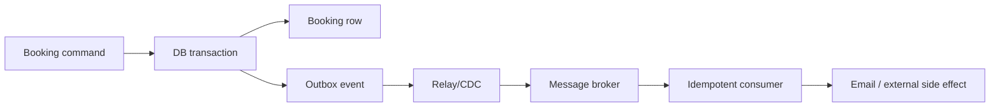

# Checking Constraints Under Concurrent Operations or Late-Arriving Data

A schema with primary keys, foreign keys, and `CHECK` constraints can pass every single-threaded test and still fail in production. Two users booking the same meeting room for the same time slot can both observe "available." Two order requests can both read inventory of 1 and conclude stock is sufficient. A consumer receiving `PAID` later than `REFUNDED` can regress an order back to "paid." Data from sensors, partners, or external systems can also arrive after the business timestamp, making summary tables or version history inconsistent.

These failures are rarely caused by syntax errors in SQL. They stem from **the gap between a constraint evaluated on a single row and an invariant that must hold across all execution schedules**, even when multiple transactions run concurrently, messages replay, or records arrive out of event order.

This lesson belongs to the **Design Validation** chapter of the **DATABASE_DATA_MODELING** module. Following the module's goals, we translate requirements into entities, relationships, keys, indexes, physical schemas, and testable rules, comparing relational, document, graph, and analytical models under live updates and integration. The focus is producing **testable evidence** for invariants covering uniqueness, quantities, schedules, states, validity intervals, idempotency, and completeness of derived data.

Examples use **PostgreSQL 15+** and **Java 17+** pseudocode. Actual guarantees depend on isolation levels, constraints, DBMS versions, and application write protocols; a single clean run is never proof of safety across all schedules.

## 1. What Is an Invariant and Why Is Sequential Testing Insufficient?

A **business invariant** is a condition that must hold at committed observation points, typically **after every committed transaction** or after a well-specified compensating process.

Examples:

- Each tenant has no two accounts sharing the same normalized email.
- A resource has no two **currently active** bookings overlapping in time.
- An SKU's available stock in a warehouse never goes negative when confirming a reservation.
- Two requests sharing an idempotency key never create two independent orders.
- Current state is never overwritten by an **older** snapshot from the same monotonically versioned source.
- A payment is never applied twice merely because a webhook is resent.
- Two historical validity records for the same entity never overlap in time.
- Published aggregate datasets reflect **the agreed event scope and late-data policy**.

Every invariant needs a **scope** (tenant, room, SKU, account, source system), **timing** (event time, validity time, commit time), and **enforcement point** (database, transaction/application, distributed coordinator, or pipeline).

### Data Correctness Is More Than "Every `INSERT` Succeeds"

A design can fail in at least four ways:

1. **Accepting invariant-violating state:** two overlapping bookings both commit.
2. **Losing valid updates:** one writer overwrites another writer's change.
3. **Duplicating or re-applying effects:** the same payment or event applies twice.
4. **Overwriting newer state with stale data or mis-bucketing history:** late messages regress state or land in the wrong bucket.

`CHECK(quantity >= 0)` inspects one row; it does not prevent two transactions from computing off **the same stale read**. `UNIQUE` checks only the exact columns and scope declared. A `FOREIGN KEY` does not ensure events referencing a parent row **arrived in order**.

## 2. Writing a Validation Contract for Every Constraint

Instead of vaguely stating "no double room bookings," specify:

| Contract attribute | Booking example | Inventory example |
|---|---|---|
| **Entity and grain** | One request holding/booking one room for an interval | One SKU × warehouse × tenant balance |
| **Scope key** | `(tenant_id, room_id)` | `(tenant_id, warehouse_id, sku_id)` |
| **Invariant condition** | No two `HELD`/`CONFIRMED` bookings intersect | `available_qty >= 0` |
| **Included states** | Excludes `CANCELLED` | Only reserved/committed amounts per workflow |
| **Time semantics** | Interval `[start_at, end_at)` in absolute instants | Transaction commit time and business time |
| **Safeguard** | Exclusion constraint or proved serialization/locking | Atomic conditional `UPDATE` on the same row |
| **Adversarial schedule to test** | Two transactions inserting overlapping intervals | Two transactions debiting one balance |
| **Expected outcome** | At most one valid booking commits | At most one stock deduction when 1 unit remains |
| **Failure handling** | Return "time slot already booked" | Return "insufficient stock" |
| **Observability/audit** | Constraint conflicts and committed bookings | Balance, reservations, retries, idempotency |

A design document lacking an "**adversarial schedule to test**" column creates false confidence: many concurrency bugs are invisible under sequential requests.

### Distinguishing Safeguard Mechanisms

- **`PK`/`UNIQUE`:** identity constraints preventing duplicate key tuples within DB scope.
- **`CHECK`/`NOT NULL`:** single-row predicates; cannot check sums or other rows.
- **`FK`:** referential constraints within the same DB scope, with configurable check timing.
- **`EXCLUDE` / range constraints:** block pairs of rows satisfying a conflict relation, such as same room and intersecting intervals.
- **Conditional `UPDATE`:** combines predicate check and single-row mutation into one DB-coordinated action.
- **Transaction + locking/isolation:** protects multi-row or multi-table invariants if every writer obeys the protocol.
- **Message idempotency, ordering, watermarks:** protect invariants across time or systems; single-row SQL constraints are rarely enough.

## 3. Understanding Three Common Race Condition Patterns

### 3.1. Lost Update

Two transactions read `stock = 10`. T1 computes `10 - 3 = 7`; T2 computes `10 - 4 = 6`. If both run `UPDATE stock SET quantity = :stale_calculated_value`, the final row becomes `6` or `7` instead of `3`, depending on isolation and execution order.

**Core issue:** the application computes from a stale snapshot instead of performing an atomic subtraction against the protected value.

### 3.2. Check-Then-Act

T1 and T2 both run:

```text
SELECT COUNT(*) FROM bookings WHERE room=7 AND overlaps(requested_slot);
→ 0
```

Both then execute `INSERT` with distinct booking IDs. Without proper constraints or locking, both commit overlapping slots. Running `SELECT` right before `INSERT` **does not fuse the two statements into an atomic check**.

### 3.3. Write Skew — Each Transaction Edits a Different Row

T1 checks "at least one on-call doctor remains" and marks Doctor A off duty. Concurrently, T2 checks the same condition and marks Doctor B off duty. Because they update **two different rows**, row-level write locks do not conflict; both commit, leaving zero on-call doctors.

Write skew proves why "every row has clean `CHECK`s" is insufficient for **multi-row invariants**. Under snapshot-based isolation, two transactions can read the same valid snapshot and commit non-overlapping row writes that jointly violate the invariant.

## 4. Transaction Isolation Levels: What They Guarantee and What They Do Not

| Concept | Practical meaning | Risks still requiring protection |
|---|---|---|
| **`READ COMMITTED`** | Each statement sees committed data per DB rules; PostgreSQL takes per-statement snapshots | Check-then-insert, non-repeatable reads, multi-row logic |
| **`REPEATABLE READ`** | Consistent transaction-level snapshot reads in PostgreSQL | Write skew / serialization anomalies on multi-row predicates |
| **`SERIALIZABLE`** | Committed outcomes match some valid serial order if **all participating operations** obey the protocol | Transactions may abort with serialization failures; must retry **the entire transaction** |
| **Row lock** | Transaction locks selected/modified rows | Does not lock "absence of rows" when none exist yet; does not guard arbitrary predicates |
| **Advisory lock** | Application-coordinated logical lock via DB | Writers bypassing the lock break invariants; must manage keys, scope, and protocol |
| **Enforced constraints** | DB checks invariants expressed as PK/UNIQUE/FK/EXCLUDE/CHECK | Does not guard undeclared or out-of-scope rules |

**In PostgreSQL**, `READ UNCOMMITTED` behaves effectively like `READ COMMITTED`; `REPEATABLE READ` is snapshot-based and prevents several anomalies yet **is not equivalent to `SERIALIZABLE`**. Other DBMSs implement identically named isolation levels differently; verify documentation and run tests on the exact target engine and version.

### Serializable Is Not a "Flip a Switch and Done" Setting

PostgreSQL can raise **SQLSTATE `40001`** when an execution schedule cannot be serialized. The application must:

1. Roll back the failed transaction.
2. Retry **the entire read–compute–write unit**, not just the final `UPDATE`.
3. Keep external side effects idempotent or emit them post-commit via an outbox.
4. Bound retries with backoff and fail cleanly once exhausted.
5. Ensure every relevant writer participates in the required protocol.

Besides `40001`, **`40P01` (deadlock detected)** can occur. Retry policies must be selective rather than infinitely retrying every SQL error.

**Serializable is a transaction-schedule property** — it never replaces defining business keys, time zones, idempotency, or late-event semantics.

## 5. Example 1 — Double Booking Even When Both `SELECT`s Return 0

A room-booking platform requires:

> For the same tenant and room, no two bookings in `HELD` or `CONFIRMED` status may have overlapping intervals. `CANCELLED` bookings do not hold the room.

Two concurrent transactions:

```text
T1 (10:00)                              T2 (10:00)
BEGIN                                   BEGIN
SELECT overlapping bookings -> 0        SELECT overlapping bookings -> 0
INSERT booking A [13:00,14:00)          INSERT booking B [13:30,14:30)
COMMIT                                  COMMIT
```

With only a PK on `booking_id`, both inserts have distinct IDs so **the PK catches nothing**. `SELECT COUNT(*)` reflects only what existed in the snapshot at query time; it claims no exclusive lock over future intervals.

### Counterexample: Adding a UNIQUE Start Time

`UNIQUE(tenant_id, room_id, start_at)` is insufficient: `[13:00, 14:00)` and `[13:30, 14:30)` have distinct start times yet still overlap.

Similarly, `UNIQUE(room_id, DATE(start_at))` both fails to prevent intra-day overlaps in other formulations and wrongly blocks two non-overlapping bookings on the same day. Model **interval intersection directly**, rather than forcing it into equality.

## 6. PostgreSQL: Using Exclusion Constraints for Interval Invariants

PostgreSQL supports `tstzrange` (time-zone-aware timestamp ranges) and the overlap operator `&&`. With `btree_gist` enabling equality on scalar keys inside GiST indexes, declare:

```sql
-- Run as a role permitted to create extensions in the test DB.
CREATE EXTENSION IF NOT EXISTS btree_gist;

CREATE TABLE room_bookings (
    tenant_id BIGINT NOT NULL,
    booking_id BIGINT NOT NULL,
    room_id BIGINT NOT NULL,
    slot TSTZRANGE NOT NULL,
    status_code TEXT NOT NULL,

    CONSTRAINT pk_room_bookings
        PRIMARY KEY (tenant_id, booking_id),

    CONSTRAINT ck_booking_status
        CHECK (status_code IN ('HELD', 'CONFIRMED', 'CANCELLED')),

    CONSTRAINT ck_booking_slot
        CHECK (
            NOT isempty(slot)
            AND NOT lower_inf(slot)
            AND NOT upper_inf(slot)
            AND lower_inc(slot)
            AND NOT upper_inc(slot)
        ),

    CONSTRAINT ex_no_overlapping_active_bookings
        EXCLUDE USING gist (
            tenant_id WITH =,
            room_id WITH =,
            slot WITH &&
        )
        WHERE (status_code IN ('HELD', 'CONFIRMED'))
        DEFERRABLE INITIALLY IMMEDIATE
);
```

**Grain:** one row is one booking identified by `(tenant_id, booking_id)`. Two rows conflict if they share **tenant + room + intersecting intervals**, and both are active holds.

- `[start, end)` allows back-to-back bookings: `[13:00, 14:00)` and `[14:00, 15:00)` **do not overlap**.
- `TSTZRANGE` stores absolute instants; clients must resolve time zones on input, especially across DST transitions.
- `CHECK` enforces only finite, non-empty, half-open range representation — not non-overlap.
- `EXCLUDE` is the constraint blocking **pairs of rows** sharing a room and intersecting `slot`.
- `WHERE` excludes `CANCELLED` rows from holding the room; transitioning `CANCELLED` back to `CONFIRMED` triggers the check as a new hold.
- `DEFERRABLE INITIALLY IMMEDIATE` checks per statement by default; authorized workflows can defer intentionally within a transaction while still requiring the invariant before commit.

### Two-Session Verification

**Session A:**

```sql
BEGIN;

INSERT INTO room_bookings
    (tenant_id, booking_id, room_id, slot, status_code)
VALUES (
    42, 1001, 7,
    tstzrange(
        TIMESTAMPTZ '2026-11-22 13:00:00+07',
        TIMESTAMPTZ '2026-11-22 14:00:00+07',
        '[)'
    ),
    'CONFIRMED'
);

-- Keep transaction open here while Session B attempts its insert.
-- After observing blocking behavior, COMMIT.
```

**Session B, while A is still uncommitted:**

```sql
BEGIN;

INSERT INTO room_bookings
    (tenant_id, booking_id, room_id, slot, status_code)
VALUES (
    42, 1002, 7,
    tstzrange(
        TIMESTAMPTZ '2026-11-22 13:30:00+07',
        TIMESTAMPTZ '2026-11-22 14:30:00+07',
        '[)'
    ),
    'HELD'
);
```

Session B **waits** on A's commit/rollback decision. If A commits, B receives **exclusion violation `23P01`** (or the corresponding failure when the constraint is checked) and rolls back; if A rolls back, B proceeds cleanly.

**Verifiable conclusion:** once both transactions finish, no two `HELD`/`CONFIRMED` bookings share the same tenant/room with overlapping intervals.

Do not expect identical log ordering or timings on every run; OS and transaction scheduling vary. Assert **the post-commit invariant** and proper error handling.

### Limitations to State Explicitly

If bookings span **two independent databases**, neither DB's exclusion constraint sees the other DB's rows. Assign one authoritative owner per room/slot, use distributed coordination, or adopt a business-approved consistency model.

## 7. Without Exclusion Constraints: Alternatives and Risks

Not every engine supports range exclusion constraints. Options include:

1. **`SERIALIZABLE` transactions** checking overlap then inserting, ensuring all writers participate and retry serialization failures.
2. **Locking a parent `room` row:** `SELECT ... FOR UPDATE` on `(tenant_id, room_id)`, check overlap while holding the lock, then insert. Every booking writer for that room must lock **the same parent row**.
3. **Materializing discrete slots** with `UNIQUE(room, slot)` if the domain truly uses fixed slot buckets; never arbitrarily discretize continuous time.
4. **Per-room advisory locks** in PostgreSQL using stable hash keys across all writers; watch hash collisions and lock scopes, and never mistake an advisory lock for a constraint.
5. **Single-writer booking service** per room via routing in distributed architectures.

### A Classic `FOR UPDATE` Mistake

```sql
SELECT *
FROM room_bookings
WHERE room_id = 7
  AND slot && tstzrange(:start, :end, '[)')
FOR UPDATE;
```

If **zero matching bookings** exist yet, the query locks zero rows in `room_bookings`. Another transaction can still insert an overlapping booking. Locking a real parent `rooms` row obeyed by every writer is fundamentally different from "locking currently existing overlapping rows."

**Multi-row constraints must be proved under concurrent schedules**, not by reading "looks good" in a single session.

## 8. Example 2 — Two Orders Competing for the Last Unit of Stock

Model one balance per **tenant × warehouse × SKU**:

```sql
CREATE TABLE stock_balance (
    tenant_id BIGINT NOT NULL,
    warehouse_id BIGINT NOT NULL,
    sku_id BIGINT NOT NULL,
    available_qty BIGINT NOT NULL,
    reserved_qty BIGINT NOT NULL DEFAULT 0,
    version BIGINT NOT NULL DEFAULT 0,

    CONSTRAINT pk_stock_balance
        PRIMARY KEY (tenant_id, warehouse_id, sku_id),
    CONSTRAINT ck_stock_quantities
        CHECK (available_qty >= 0 AND reserved_qty >= 0),
    CONSTRAINT ck_stock_version CHECK (version >= 0)
);

INSERT INTO stock_balance (
    tenant_id, warehouse_id, sku_id,
    available_qty, reserved_qty
) VALUES (42, 1, 501, 1, 0);
```

Invariant: when confirming a **reservation**, never reserve more than recorded available stock. A broken approach:

```text
T1: reads available_qty = 1
T2: reads available_qty = 1
T1: writes available_qty = 0 and accepts Order A
T2: writes available_qty = 0 and accepts Order B
```

The final balance stays `0` and `CHECK >= 0` still passes, yet the system accepted **two orders** for one unit. This is a **write-protocol** and balance–reservation mismatch bug, not necessarily a negative balance.

### Using an Atomic Conditional `UPDATE`

```sql
UPDATE stock_balance
SET
    available_qty = available_qty - 1,
    reserved_qty = reserved_qty + 1,
    version = version + 1
WHERE tenant_id = 42
  AND warehouse_id = 1
  AND sku_id = 501
  AND available_qty >= 1
RETURNING available_qty, reserved_qty, version;
```

Under PostgreSQL `READ COMMITTED`, two transactions updating **the same row** serialize via the row lock. Once the first commits, the second re-evaluates the `WHERE` predicate against the updated row; if `available_qty >= 1` no longer holds, it returns **0 rows**, signaling reservation failure.

**Never execute the `UPDATE` and ignore `row count`/`RETURNING`.** Returning 0 rows could mean missing SKU, wrong tenant/warehouse, or insufficient stock; classify errors accurately.

### Two-Session Verification

**Session A:**

```sql
BEGIN;

UPDATE stock_balance
SET available_qty = available_qty - 1,
    reserved_qty = reserved_qty + 1,
    version = version + 1
WHERE tenant_id = 42
  AND warehouse_id = 1
  AND sku_id = 501
  AND available_qty >= 1
RETURNING available_qty, reserved_qty;

-- Keep transaction open.
```

**Session B:**

```sql
BEGIN;

UPDATE stock_balance
SET available_qty = available_qty - 1,
    reserved_qty = reserved_qty + 1,
    version = version + 1
WHERE tenant_id = 42
  AND warehouse_id = 1
  AND sku_id = 501
  AND available_qty >= 1
RETURNING available_qty, reserved_qty;
```

After A commits, B cannot deduct further because available stock is depleted. If A rolls back, B succeeds. Afterward, verify:

```sql
SELECT available_qty, reserved_qty, version
FROM stock_balance
WHERE tenant_id = 42
  AND warehouse_id = 1
  AND sku_id = 501;
```

**Checking `available_qty >= 0` alone is not enough:** also verify **each reservation is created exactly once** and total transitions match ledgers/documents. If two retried requests for the same order both run that `UPDATE`, stock can be debited twice without ever going negative.

## 9. Idempotency Must Coordinate with Balance Mutations

An order may resend a reservation request due to client timeouts, queue retries, or worker restarts. Separate:

- **Business command:** reserve `1` SKU for `(tenant, order_id, line_no)`.
- **Balance effect:** decrement `available` and increment `reserved`.
- **Idempotency key:** one order line can reserve at most once per contract.

### Illustrative DDL

```sql
CREATE TABLE stock_reservations (
    tenant_id BIGINT NOT NULL,
    order_id BIGINT NOT NULL,
    line_no INTEGER NOT NULL,
    warehouse_id BIGINT NOT NULL,
    sku_id BIGINT NOT NULL,
    quantity BIGINT NOT NULL,
    status_code TEXT NOT NULL DEFAULT 'ACTIVE',

    CONSTRAINT pk_stock_reservations
        PRIMARY KEY (tenant_id, order_id, line_no),

    CONSTRAINT fk_reservation_balance
        FOREIGN KEY (tenant_id, warehouse_id, sku_id)
        REFERENCES stock_balance (tenant_id, warehouse_id, sku_id),

    CONSTRAINT ck_reservation_qty CHECK (quantity > 0),
    CONSTRAINT ck_reservation_line CHECK (line_no > 0),
    CONSTRAINT ck_reservation_status
        CHECK (status_code IN ('ACTIVE', 'RELEASED', 'CONSUMED'))
);
```

A clean workflow runs **in the same transaction**:

1. `INSERT` into `stock_reservations` with key `(tenant_id, order_id, line_no)`.
2. On unique conflict, **do not deduct stock again**; load the existing reservation and verify payload/quantity/status per idempotency policy.
3. If the new insert succeeded, run `UPDATE stock_balance ... WHERE available_qty >= quantity RETURNING`.
4. If the `UPDATE` returns 0 rows, **roll back the entire transaction**, including the newly inserted reservation.
5. If stock suffices, commit both reservation and balance atomically; emit downstream events via an outbox if needed.

If using `INSERT ... ON CONFLICT DO NOTHING RETURNING ...` to tell new vs. duplicate apart, check whether a row actually inserted — **never** proceed to deduct stock on the conflict branch. Also never assume a conflicting request with a different quantity or SKU is a harmless retry.

**Both conditions must hold together:**

\[
\text{reservation identity unique}
\quad\land\quad
\text{available stock atomic}.
\]

Having only one still permits double reservations or corrupted balances.

### Reserving Multiple SKUs

When an order has multiple lines, wrap all lines in an all-or-nothing transaction, lock resources in a consistent order to reduce deadlocks, and handle duplicate SKUs across distinct lines of the same order. Never deduct one SKU line while forgetting remaining lines or skipping transaction rollback.

## 10. Optimistic Locking and `version` Serve a Different Role Than `CHECK`

One way to coordinate edits is **optimistic concurrency control**:

```sql
UPDATE stock_balance
SET available_qty = :new_available,
    version = version + 1
WHERE tenant_id = :tenant_id
  AND warehouse_id = :warehouse_id
  AND sku_id = :sku_id
  AND version = :expected_version
  AND :new_available >= 0
RETURNING version;
```

If 0 rows return, the version changed and the caller must re-read and recompute. This is a row-version **compare-and-swap**.

However:

- It does not clarify what `:new_available` was computed from.
- It does not guard **multi-row** invariants when updating only one row's version.
- If any writer forgets to increment `version`, the protocol breaks.
- It does not replace idempotency keys: two semantically identical requests reading successive versions can still deduct twice.

For single-SKU reservations, `UPDATE available_qty = available_qty - :qty WHERE available_qty >= :qty` is usually simpler and better targeted than read–compute–write with optimistic versions. For multi-field user-edited workflows, `version` detects conflicting edits; match the mechanism to **the invariant**.

## 11. Cross-Table Constraints and Multi-Step Transactions

Another example: an order's total must equal **the sum of its lines and finalized adjustments**. `CHECK(total_minor = ...)` on `orders` cannot query child lines.

Options:

- **Single source of truth:** store lines and adjustments as authoritative; compute aggregates on read or via rebuildable projections.
- **Synchronous transaction:** update lines/adjustments and the order total together in one transaction with proper locking/versioning.
- **Ledger + async projection:** ledger is authoritative; projection tracks watermarks and checks freshness/accuracy.
- **Constraint triggers or engine features:** evaluate check timing, isolation, and contention carefully if enforced inside the DB.

### Why Eager Aggregation on Event Receipt Often Fails

Suppose a system receives `OrderLineAdded` before `OrderCreated`. If a consumer assumes ideal ordering, FKs and totals fail. If the consumer drops the event for lacking a parent, it risks **losing valid lines**. You need buffering/staging, retries, or revised integration contracts.

An OLTP system may need **strong guarantees at commit**; an asynchronous analytics table may promise only **eventual consistency within a lag bound**, exposing incomplete/stale markers. Distinguish both guarantee tiers in design and testing.

## 12. Late-Arriving Data: Define Time Semantics Before Checking Correctness

An event typically carries at least three timestamps:

- **`occurred_at` / event time:** when the phenomenon occurred at the source per contract.
- **`received_at` / processing time:** when our system received the message/event.
- **`committed_at` / database time:** when the DB transaction committed the change.

For historical validity, add:

- **`valid_from`, `valid_to`:** business interval during which a fact/attribute holds.
- **`recorded_at` / system time:** when our system learned/recorded a version of that fact.

The two axes—"**when true in business**" and "**when known to the system**"—underpin bitemporal modeling when explaining historical corrections.

### Example: Arrival Order Differs from Occurrence Order

| Event | `occurred_at` | `received_at` | `source_version` | Full state |
|---|---|---|---:|---|
| E11 | 10:02 | 10:10 | 11 | `PAID` |
| E12 | 10:05 | 10:08 | 12 | `REFUNDED` |

Applying messages **in receipt order** sees `REFUNDED` first and `PAID` second, regressing state from newer to older. The mistake is equating `received_at` with **business version order**.

For **full-state snapshots monotonically versioned by one authoritative source**, accepting only higher versions works. For **delta/action events**, you cannot discard lower versions arbitrarily: each delta may still need to be applied once in valid business order.

## 13. Two Strategies for Out-of-Order Events

### 13.1. Latest-State Projection: Accept Only Newer Snapshot Versions

Define a current-state projection table:

```sql
CREATE TABLE payment_state_projection (
    tenant_id BIGINT NOT NULL,
    payment_id TEXT NOT NULL,
    source_version BIGINT NOT NULL,
    state_code TEXT NOT NULL,
    occurred_at TIMESTAMPTZ NOT NULL,
    source_event_id TEXT NOT NULL,

    CONSTRAINT pk_payment_state_projection
        PRIMARY KEY (tenant_id, payment_id),
    CONSTRAINT ck_payment_version CHECK (source_version >= 0),
    CONSTRAINT ck_payment_state CHECK (
        state_code IN ('INITIATED','AUTHORIZED','PAID','REFUNDED')
    ),
    CONSTRAINT ck_payment_event_id
        CHECK (btrim(source_event_id) <> '')
);
```

When receiving a **full-state snapshot**:

```sql
INSERT INTO payment_state_projection (
    tenant_id, payment_id, source_version,
    state_code, occurred_at, source_event_id
)
VALUES (
    :tenant_id, :payment_id, :source_version,
    :state_code, :occurred_at, :source_event_id
)
ON CONFLICT (tenant_id, payment_id)
DO UPDATE SET
    source_version = EXCLUDED.source_version,
    state_code = EXCLUDED.state_code,
    occurred_at = EXCLUDED.occurred_at,
    source_event_id = EXCLUDED.source_event_id
WHERE payment_state_projection.source_version
    < EXCLUDED.source_version;
```

If E12/version 12 is already applied, E11/version 11 arriving later cannot regress the projection. The conditional predicate executes atomically inside the DB write, not as a disconnected pre-write `SELECT`.

**Limitations of this pattern:**

- `source_version` must be **monotonic per payment and source**; never mix versions from two independent sources.
- Messages must carry **full state** so version 12 stands accurately even before version 11 arrives.
- Never use this pattern to drop **monetary deltas** or business actions carried by version 11.
- If two version-12 messages carry **different payloads**, detect the conflict/revision rather than assuming identical-version messages are harmless retries.
- If the source has **deletes/tombstones**, store a deletion version/state strong enough so old messages never resurrect the entity.
- Source version order does not replace **allowed state-transition checks**. If a source emits a higher version with an illegal status, quarantine and reconcile.

### 13.2. Event-Delta Processing: Every Event Must Apply Exactly Once

With `PaymentCaptured(+100)` followed by `PaymentRefunded(-40)`, a balance projection must apply every valid business event; you cannot just keep **`max source_version`** and skip late unapplied deltas.

You need:

1. Stable **event identity** to block replays.
2. Ordering or dependency checks when transitions require sequential application.
3. A **ledger** or accepted source-event log.
4. Projections built from valid events and capable of rebuilding.
5. Procedures for handling gaps, missing events, and compensations.

A source arriving in sequence `10, 12, 11` can:

- Buffer `12` until `11` arrives if strict contiguous steps are required, or
- Persist both `11` and `12` in the ledger and rebuild state in right logical order if the model permits, or
- Use a complete version-12 snapshot as a checkpoint **after** verifying prior events were incorporated per source contract.

Never treat `source_version > current_version` as a universal rule for both snapshots and deltas.

## 14. Inbox, Event IDs, and Correctness on Message Replay

Messaging systems commonly promise *at-least-once* delivery. Consumers should be **idempotent**.

An inbox table may look like:

```sql
CREATE TABLE processed_events (
    consumer_name TEXT NOT NULL,
    source_system TEXT NOT NULL,
    source_event_id TEXT NOT NULL,
    payload_fingerprint BYTEA NOT NULL,
    processed_at TIMESTAMPTZ NOT NULL DEFAULT CURRENT_TIMESTAMP,

    CONSTRAINT pk_processed_events
        PRIMARY KEY (consumer_name, source_system, source_event_id),
    CONSTRAINT ck_event_consumer CHECK (btrim(consumer_name) <> ''),
    CONSTRAINT ck_event_source CHECK (btrim(source_system) <> ''),
    CONSTRAINT ck_source_event CHECK (btrim(source_event_id) <> '')
);
```

Invariant: within **one business consumer**, a `source_event_id` from `source_system` applies **at most once** per contract.

### An Event-Processing Transaction

```text
BEGIN
  1. INSERT (consumer, source, event_id, fingerprint) into inbox
  2. If ID already exists:
     - verify payload fingerprint matches
     - if identical: treat as retry; do not re-apply DB side effects
     - if different: quarantine/conflict; never silently ignore
  3. If newly inserted: apply ledger/aggregate/state mutation
  4. Write outbox record if downstream events are needed
COMMIT
ACK message only after commit is confirmed
```

The inbox insert must share **the same DB transaction** as the business mutation to prevent marking "processed" without committing the business update (or vice versa). If the side effect hits **an external service outside the DB**, use an outbox, target-side idempotency keys, or compensating workflows; an internal inbox **does not** make two separate systems commit atomically.

### Retrying After an Uncertain Commit Outcome

A client timing out after sending `COMMIT` **does not know** if the transaction succeeded. Never re-submit a "debit money / reserve stock" command as a brand-new request with a new ID. Preserve the **idempotency key** and query the outcome or safely retry under the same request identity.

**Business-level exactly-once** requires proving identity, atomicity, and recovery mechanisms. Broker delivery flags alone never guarantee external side effects happen once.

## 15. Late Arrival Does Not Mean Wrong Update: Choose a History Policy

A price change might be entered on Nov 22 yet take effect retroactively from Nov 01. A Nov 10 sale ingested after Nov 22 needs **the transaction's locked price** or the effective historical rule, depending on business policy — never blindly today's current list price.

Distinguish:

- **Late-arriving event:** event occurred earlier yet arrived later.
- **Late-arriving dimension:** entity classification/attribute arrived after its facts.
- **Retroactive correction:** previously known data amended retroactively into the past.
- **Out-of-order delivery:** messages from one source arrive out of business sequence.
- **Duplicate/replay:** the same event redelivered, not a new event.
- **Missing event:** event never arrived or was lost; never treat as `0` or non-occurrence.

Each impacts **current-state tables**, **validity history**, **event streams**, and **time-series reports** differently.

### Two Bitemporal Axes for Evaluating Corrections

| Time axis | Question |
|---|---|
| `valid_time` | From when to when was this information true in the business? |
| `recorded/system time` | When did the system learn/record this information? |

If you must answer both "what did the system **believe** on Nov 15 was the price on Nov 10?" and "what do we now know was the true price on Nov 10?", a single `updated_at` column is insufficient. Retain versioned/audited records with knowledge timestamps and validity intervals, and specify correction handling.

## 16. Enforcing Non-Overlapping Dimension Validity Intervals

A product category history table can use:

```sql
CREATE EXTENSION IF NOT EXISTS btree_gist;

CREATE TABLE product_category_history (
    tenant_id BIGINT NOT NULL,
    sku_id BIGINT NOT NULL,
    valid_period TSTZRANGE NOT NULL,
    category_code TEXT NOT NULL,
    recorded_at TIMESTAMPTZ NOT NULL DEFAULT CURRENT_TIMESTAMP,

    CONSTRAINT ck_category_nonblank
        CHECK (btrim(category_code) <> ''),
    CONSTRAINT ck_valid_period
        CHECK (
            NOT isempty(valid_period)
            AND NOT lower_inf(valid_period)
            AND lower_inc(valid_period)
            AND NOT upper_inc(valid_period)
        ),

    CONSTRAINT ex_product_category_no_overlap
        EXCLUDE USING gist (
            tenant_id WITH =,
            sku_id WITH =,
            valid_period WITH &&
        )
);
```

Here `valid_period` permits an **unbounded upper bound** for the current version while requiring a finite lower bound; `[)` keeps boundaries non-overlapping. The constraint prevents **two overlapping historical records for the same tenant/SKU**.

### How Does a Late Correction Impact This?

Initially:

```text
[2026-11-01, ∞) -> category A
```

On Nov 22 a partner notifies that from Nov 15 the product belongs to category `B`. Inserting `[15/11, ∞) -> B` directly fails the exclusion constraint due to overlap with row `A`. You must **truncate `A` to `[01/11, 15/11)`** and insert `B` inside a properly locked transaction.

```sql
-- Example pattern: run only after identifying the exact row to split.
BEGIN;

UPDATE product_category_history
SET valid_period = tstzrange(
    lower(valid_period),
    TIMESTAMPTZ '2026-11-15 00:00:00+07',
    '[)'
)
WHERE tenant_id = 42
  AND sku_id = 501
  AND valid_period @> TIMESTAMPTZ '2026-11-15 00:00:00+07';

INSERT INTO product_category_history (
    tenant_id, sku_id, valid_period, category_code
) VALUES (
    42, 501,
    tstzrange(
        TIMESTAMPTZ '2026-11-15 00:00:00+07',
        NULL,
        '[)'
    ),
    'B'
);

COMMIT;
```

This snippet is a **conceptual template**, not a general production migration. When multiple prior intervals exist, a correction spans intervals, or concurrent writers edit history simultaneously, verify affected row counts, boundary splits, locking, and overlap/gap edge cases. Starting from `[01/11, ∞)`, the expected result is two non-overlapping adjacent intervals.

**Important:** the table above stores **currently recognized effective history**, not a full audit log of every historical belief the system ever held. To answer "what did the system know at write time X?", design dedicated audit/bitemporal tracking rather than overwriting old intervals in place.

## 17. Historical Validity Data Must Be Joined at the Right Point in Time

Suppose a sales fact has `sale_time` and `sku_id`. The right join for classification **at sale time** is:

```sql
-- sales_events is an illustrative fact table, not created in the DDL above.
SELECT
    f.tenant_id,
    f.sale_event_id,
    f.sale_time,
    h.category_code
FROM sales_events AS f
LEFT JOIN product_category_history AS h
  ON h.tenant_id = f.tenant_id
 AND h.sku_id = f.sku_id
 AND h.valid_period @> f.sale_time;
```

Replacing the time predicate with `h.sku_id = f.sku_id` joins facts against **every version** of the product and **multiplies measures**. Joining only the current category turns the report into "current classification" instead of "classification at sale time" — two different contracts.

### When Dimensions Arrive Late

A fact may arrive before the `product_category_history` row covering `sale_time`. Options include:

- **Staging:** hold facts waiting for the dimension within an accepted lag window.
- **Unknown member:** load the fact linked to `UNKNOWN`, then backfill the surrogate key once the mapping arrives, with auditing and time limits.
- **Late-arriving resolution:** preserve business ID and event time for later mapping backfill.
- **Reconciliation:** track unresolved fact counts and rebuild affected aggregates.

Never blindly attach **today's current** dimension to historical facts when the contract specifies as-of classification. Unresolved facts should appear explicitly as **unknown/pending**, never silently dropped from revenue by `INNER JOIN`.

## 18. Watermarks and Time Windows in Asynchronous Reporting

An hourly order-count dashboard may group by event time:

```text
Bucket: [10:00, 11:00)
Event E1 occurred 10:50, received 10:51
Event E2 occurred 10:40, received 11:10
Event E3 occurred 10:55, received 11:45
```

If a batch job freezes the bucket at `11:00` without handling late events, `E2` and `E3` vanish from the 10:00 hour's metrics.

A **watermark** marks the timestamp before which the pipeline considers events sufficiently complete per processing contract. For instance, an **allowed lateness of 15 minutes** treats the 10:00–11:00 bucket as provisional and closes it once the watermark passes the end boundary. Exact watermark calculation depends on frameworks, source partitions, latency, and paused sources — there is no single universal formula.

### Closing a Period Does Not Physically Stop Older Events

`E3` arrives at `11:45`, beyond the 15-minute policy. The system must choose and publish:

1. **Restate:** recompute hour 10, version the output, and notify downstream consumers.
2. **Exception/quarantine:** leave the closed report untouched and create an exception task per policy.
3. **Correction ledger:** append adjustment entries/versions rather than silently overwriting published totals.

Never treat "no events arrived for 15 minutes" as physical proof no older events exist. A watermark is an **assumption-backed operational SLA**, not magic that eliminates late data.

### Bucket Boundaries and Time Zones

Use half-open `[start, end)` intervals so an event at `11:00` lands in `11:00–12:00`, never both. Store absolute instants as `TIMESTAMPTZ`; when bucketing by business day, specify a named time zone such as `Asia/Ho_Chi_Minh`.

`received_at` measures ingestion latency — **never** substitute it for `occurred_at` to bucket events by occurrence time unless the report explicitly asks "how many events did our servers receive per hour?"

## 19. Incorporating Late Events into Aggregates Without Double-Counting

Suppose `sales_event_inbox` holds every valid deduplicated sales event keyed by `(source_system, source_event_id)`. A daily aggregate by `tenant, business_date, currency` can be recomputed from valid events:

```sql
-- Illustrative sales_event_inbox columns:
-- tenant_id, source_system, source_event_id,
-- occurred_at, currency_code, amount_minor, accepted.
SELECT
    tenant_id,
    (occurred_at AT TIME ZONE 'Asia/Ho_Chi_Minh')::DATE
        AS business_date,
    currency_code,
    COUNT(*) AS event_count,
    SUM(amount_minor) AS total_minor
FROM sales_event_inbox
WHERE accepted = TRUE
GROUP BY
    tenant_id,
    (occurred_at AT TIME ZONE 'Asia/Ho_Chi_Minh')::DATE,
    currency_code;
```

This is a **conceptual query** on a source table not created earlier in this lesson. It holds only if `sales_event_inbox` is **already deduplicated** by event identity, each row is one valid sales event, and `amount_minor` shares uniform meaning/units.

### Two Aggregate Update Patterns

- **Incremental:** each new valid event increments the aggregate once; needs idempotency, transaction/projection checkpoints, and late-bucket handling.
- **Partition/bucket rebuild:** recompute from the deduplicated source and swap results atomically; higher compute cost, yet far simpler to reconcile under complex corrections.

If an event replays into a naive `UPDATE agg SET amount = amount + event.amount`, totals inflate. If a full rebuild reads an inconsistent snapshot against a live stream, it can overwrite newer state with older state. Enforce **cutoffs/generations**, watermarks, and post-rebuild catch-up.

### Signed Corrections

A refund event is not always a negative sales line. When reports ask for both "gross sales" and "refunds in period," use two separate-grain facts aggregated independently before drilling across — never raw-join both facts on `product_id` and multiply amounts. If using a signed ledger model, define signs and business event types explicitly.

## 20. Foreign Keys and Event Ordering Across Two Systems

A producer may emit `OrderCreated` and `OrderLineAdded` across two streams. If a consumer sees the line before the order, FKs fail.

**At least three valid designs exist depending on contract:**

1. **Choose a single source/channel guaranteeing ordering per aggregate key** if the broker and producer support and enforce it.
2. **Staging + retry:** land parentless child rows in an authorized/retained staging inbox, create the parent on arrival, then promote children into the main table.
3. **Emit complete aggregate snapshots** or change the integration contract so parent and lines process in one valid transaction.

### What Problem Does a `DEFERRABLE` FK Actually Solve?

In PostgreSQL, a `DEFERRABLE` FK delays checking until the end of **one transaction**. That helps when parent and child are inserted **inside the same transaction** in an inconvenient statement order.

It **does not** solve a parent message arriving **one minute later in a different transaction**. A transaction cannot commit an FK-violating child row hoping the system heals itself later — unless you choose staging or a different contract.

### Never Disable FKs Simply Because Messages Arrive Unevenly

Turning off FKs so consumers "stop throwing errors" creates unbounded orphans and causes inner-join queries to drop valid events. When eventual referential integrity is required, **explicitly design the staging area**, recovery SLAs, orphan alerts, and promotion rules into guarded tables.

## 21. Transactions, Outboxes, and Side Effects Outside the Database

A booking commits to the DB and then needs an email notification. Sending the email **before commit** risks confirming a rolled-back booking. Committing first and crashing before sending risks a booked room with no email.

A **transactional outbox** narrows this gap:



The booking row and outbox event commit in **the same transaction**. Relays may redeliver, so consumers must be idempotent. If the email provider lacks idempotency, having an outbox alone cannot promise users **never** get a duplicate email; combine retry policies, deduplication, or explicitly accepted residual risk.

### Which Invariants Are Strong vs. Eventual?

| Scope | Designable guarantee |
|---|---|
| Two booking rows in same DB | Non-overlapping at commit via `EXCLUDE` |
| Stock + reservation in same DB | Atomic update within one transaction |
| Booking + outbox in same DB | Commit or roll back together |
| Outbox → broker | At-least-once delivery; consumer needs idempotency |
| Broker → email provider | Needs target idempotency/protocol or retry tolerance |
| CDC → data mart | Eventual consistency with lag, replays, watermarks, reconciliation |

Never lump all layers into one blanket "exactly once" claim when layers carry distinct guarantees.

## 22. Protecting Constraints Under Partitioning and Sharding

A `UNIQUE` constraint may apply only within one partition or shard. If `UNIQUE(tenant_id, source_event_id)` must hold across all history while partitioning by receipt date, the same event replayed next month escapes local index checks.

Similarly, bookings for one room sharded by `booking_id` could land on two shards; each shard enforces its own exclusion constraint blindly without seeing the other shard's bookings.

### Validating Routing Scope

- Does the same uniqueness key **always route to the same authoritative writer**?
- If sharding by tenant, is `tenant_id` present in PKs, FKs, queries, and uniqueness rules?
- During shard splits/migrations, is there a window where two shards accept writes?
- Can a late event route to a different partition because `received_at` differs from `occurred_at`?
- When detaching/dropping old partitions, do you lose deduplication memory of processed events?
- Is there a global registry / central idempotency store, or real DBMS global uniqueness?

**Testing on a single partition does not prove system-wide invariants.** Test identical events across day/month boundaries, two tenants, two shards, rebalancing, and failover retries.

When partitioning stock by warehouse, ensure **each SKU–warehouse balance has a single write owner** at any time or an equivalently safe distributed update protocol. Two independently writable replicas without merge coordination cannot enforce oversell limits.

## 23. Designing a Two-Session PostgreSQL Test Suite

A strong test deliberately drives **two transactions into the contention point** together rather than hoping CI triggers a race by luck.

### 23.1. Two-Connection Test Pattern

```text
Connection A                         Connection B
BEGIN                                BEGIN
read/prepare sync point              read/prepare sync point
[barrier: both reach milestone]      [barrier]
execute competing write              execute competing write
COMMIT/ROLLBACK                      COMMIT/ROLLBACK
          ↓
read final state via Connection C
          ↓
assert invariants, events/ledgers, row counts, side effects
```

**Never** share one JDBC `Connection` across two threads and call it a concurrent transaction test; one connection cannot represent two parallel independent transactions.

### 23.2. Expected Outcomes by Protocol

| Test | Correct outcome |
|---|---|
| Two overlapping bookings | At most one active booking commits; the other hits conflict/wait and clean error |
| Two adjacent bookings | Both succeed since `[a, b)` and `[b, c)` do not intersect |
| Two bookings in different rooms | Both succeed |
| Two bookings in different tenants | No conflict when scoped per tenant |
| Two reservations when stock = 1 | One succeeds, one fails; no double debit |
| Reserve then Transaction A rolls back | B can subsequently reserve |
| Same order-line request resent | No second reservation or stock deduction |
| Same idempotency key, different payload | Conflict error; never silently overwrite |
| Serializable write skew | One transaction aborts/retries or serial schedule preserves invariant |
| Child arrives before parent | Valid staging/retry; zero orphans in main tables |
| Event version 12 before version 11 | Latest-state projection retains 12 |
| Late delta event | Delta neither lost nor applied twice |
| Retroactive price/category correction | Non-overlapping intervals; impacted facts re-evaluated |
| Late event past watermark | Restated/quarantined per policy; metric emitted |
| Retry across two months/shards | Event identity never duplicated across required global scope |

### 23.3. Verify Persisted Values, Not Just Error Codes

Seeing `23P01` confirms the constraint fired, yet still verify **committed table state**:

```sql
-- Zero pairs of active bookings on the same tenant/room with overlapping slots.
SELECT
    a.tenant_id,
    a.room_id,
    a.booking_id AS left_booking,
    b.booking_id AS right_booking
FROM room_bookings AS a
JOIN room_bookings AS b
  ON b.tenant_id = a.tenant_id
 AND b.room_id = a.room_id
 AND b.booking_id > a.booking_id
 AND b.slot && a.slot
WHERE a.status_code IN ('HELD', 'CONFIRMED')
  AND b.status_code IN ('HELD', 'CONFIRMED');
```

Must return **0 rows**. Even with the constraint active, an independent audit query remains valuable during migrations, backfills, ETL, and on engines lacking equivalent constraints.

For inventory, verify `available_qty`, `reserved_qty`, and **count of `ACTIVE` reservations** together — never a single balance column in isolation.

## 24. Java: Transaction Retries, Idempotency, and Side-Effect Safety

Java alone cannot guard races when multiple app instances share a DB. Safeguards must live in transactions and shared persistent state.

An appropriate structure:

```java
// Java 17 pseudocode: API names below are illustrative,
// NOT an existing framework.
public ReservationResult reserveWithRetry(ReserveCommand cmd) {
    final int maxAttempts = 3;
    for (int attempt = 1; attempt <= maxAttempts; attempt++) {
        try {
            // Each attempt opens ONE fresh transaction.
            return transactionRunner.run(() -> {
                Reservation existing =
                    reservations.findByBusinessKey(
                        cmd.tenantId(), cmd.orderId(), cmd.lineNo());

                if (existing != null) {
                    return verifyIdempotentMatch(existing, cmd);
                }

                // Insert guarded by DB UNIQUE business key;
                // races after SELECT are caught by DB uniqueness.
                Reservation created = reservations.insert(cmd);

                int updated = stock.atomicReserve(
                    cmd.tenantId(), cmd.warehouseId(),
                    cmd.skuId(), cmd.quantity());

                if (updated != 1) {
                    throw new InsufficientStockException();
                }

                outbox.insertReservationCreated(created);
                return ReservationResult.created(created.id());
            });
        } catch (DatabaseException ex) {
            if (isUniqueViolation(ex)) {
                // Do not retry as a new command risking double debit.
                // Verify request matches committed reservation;
                // if payload differs, return business conflict.
                return inspectCommittedReservation(cmd);
            }
            if (!isRetryableTransactionFailure(ex)
                || attempt == maxAttempts) {
                throw ex;
            }
            boundedBackoffWithJitter(attempt);
        }
    }
    throw new IllegalStateException("unreachable");
}
```

**Critical assumptions:**

- `transactionRunner.run` starts a **fresh** transaction per attempt; never retry a single statement inside an already-aborted transaction.
- `reservations.insert` relies on DB uniqueness; the prior `findByBusinessKey` is merely a fast-path check for repeats, **not** a race guard.
- `stock.atomicReserve` executes a conditional `UPDATE` and checks affected row count.
- When `InsufficientStockException` aborts the transaction, the transaction runner must roll back properly — never commit a reservation when stock deduction fails.
- `inspectCommittedReservation` returns "already processed" only if business key, payload, and state match; if a competing transaction is still uncommitted, wait/retry per policy.
- `isRetryableTransactionFailure` retries only bounded transient transaction errors such as serialization failures or deadlocks; **unique/exclusion conflicts are business conflicts**, never infinitely retried.
- Never send emails or charge cards directly **inside a retryable callback**; use an outbox or idempotent external APIs.

### Self-Invocation Pitfall in Proxy-Based Transaction Frameworks

When frameworks manage `@Transactional` via proxies, calling another `@Transactional` method inside the same class may bypass the proxy depending on configuration. While this lesson is framework-agnostic, integration tests must prove transactions actually open and roll back in the deployed structure rather than trusting annotations by sight.

## 25. Designing Late-Data Tests: Timelines and Expected States

A test dataset must include **two distinct orderings**: occurrence order and receipt order. Example:

| Receipt order | Event ID | Occurrence time | Source version | Payload type | Value |
|---:|---|---|---:|---|---|
| 1 | E12 | 10:05 | 12 | Full-state snapshot | `REFUNDED` |
| 2 | E11 | 10:02 | 11 | Full-state snapshot | `PAID` |
| 3 | E12 | 10:05 | 12 | Retry identical payload | `REFUNDED` |
| 4 | E12-conflict | 10:05 | 12 | Different payload, same logical version | `PAID` |
| 5 | E13 | 10:06 | 13 | Valid tombstone/delete | `DELETED` |

### Expected Outcomes

1. After E12: current state `REFUNDED` / version `12`.
2. After E11: state **stays `REFUNDED` / version `12`**, while E11 may still be audited if required.
3. After E12 retry: zero duplicate side effects; state remains `12`.
4. After same-version differing payload: route to conflict/quarantine — **never** silently pick the later arrival.
5. After E13 tombstone: current state records deletion/version `13` or equivalent anti-resurrection guard.
6. Replaying E11/E12 after tombstone **must never resurrect the entity**.

Section 13's `payment_state_projection` illustrated full state without `DELETED`/tombstone. To test steps 5 and 6, **extend the schema/protocol** with appropriate deletion/tombstone states first. Never run tombstone tests against an unextended schema and claim the model failed; define the contract first.

### Testing Distinct Events with Identical Monetary Amounts

Two legitimate events both `PaymentCaptured(+100)` must be recorded **twice as two real transactions**. `SUM(DISTINCT amount)` breaks this; deduplicate by **event identity**, never by amount or timestamp.

## 26. Data Quality and Reconciliation After Concurrency / Late Data

Production needs continuous operational controls because CI cannot exercise every runtime interleaving.

| Metric | Meaning | Action on abnormal spike |
|---|---|---|
| `unique_conflict_rate` | Frequency of business-key collisions | Inspect retries, duplicate requests, clients |
| `exclusion_conflict_rate` | Frequency of overlapping bookings | Inspect load, UX, room hotspots |
| `serialization_retry_rate` | Count of `40001` / retries | Inspect contention and long transactions |
| `deadlock_rate` | `40P01` errors | Review lock ordering and transactions |
| `stock_reservation_mismatch` | Reservations/ledger disagree with balance | Halt order acceptance if invariant threatened |
| `duplicate_event_id` | Replays / colliding event IDs | Separate clean retries from payload conflicts |
| `out_of_order_event_count` | Events arriving out of version sequence | Monitor producer/consumer behavior |
| `late_event_count` | Events exceeding allowed lateness | Trigger restatement or quarantine |
| `watermark_lag` | Gap between processing and event time | Detect slow pipelines / stalled partitions |
| `unresolved_dimension_rate` | Facts lacking an as-of dimension | Backfill mappings / unknown members |
| `overlapping_validity_count` | Intersecting historical versions | Block history publication |
| `projection_stale_rate` | Derived version lagging behind source | Rebuild / repair |
| `orphan_reference_count` | Staged child without parent past SLA | Investigate dropped messages |
| `reconciliation_amount_delta` | Source vs. derived monetary mismatch in same scope | Break down by tenant/currency/date |

### Reconciliation Must Match Grain and Scope

- Compare **business-key identities**, not just `COUNT(*)`.
- Compare by **tenant/source/version** without mixing systems.
- Compare monetary totals **within the same currency**, status, and event-time window.
- Reconcile stock snapshots against movements/reservations at one fixed audit instant; never sum multi-day snapshots.
- Compare accepted inbox events against applied mutations.
- Compare materialized/read projections against source versions, not just row counts.
- Surface quality flags for **unknown, gap, stale**; never convert unarrived data into `0`.

A system-wide total can look balanced if Group A is off by `+100` and Group B is off by `-100`. Checking within business-meaningful groups therefore beats a single global delta.

## 27. Different Storage Models, Same Validation Principles

### 27.1. Relational Databases

`PK`/`UNIQUE`/`FK`/`CHECK`/`EXCLUDE` express many invariants inside the DB. Use transactions, locking, isolation, and readbacks to prove multi-row invariants. For late data, add event identity, sequence/versioning, valid time, and correction workflows because SQL constraints alone do not know which message is business-newer.

### 27.2. Document Databases

A document may embed `currentStock`, reservations, or bookings. **Atomic single-document updates** work well if the entire invariant fits inside that single document and the engine guarantees atomicity. Once an invariant spans multiple documents or partitions, you need transactions or a single constraint owner.

Verify unique indexes across **the real sharding scope**. A newer-arriving document edit does not mean newer event time. Version checks, conditional updates, idempotency, and readbacks still apply just as in relational databases.

### 27.3. Graph Databases

A graph may hold `Room → Booking` or `Customer → Payment` edges. Querying "no overlapping edge" and then creating an edge still races under parallel transactions. Unique edge IDs do not prevent **two edges violating a forbidden business relationship**.

When merging late-arriving nodes/edges, enforce identity, valid time, and deduplication. If a backdated historical edge arrives later, past path analyses can shift; downstream metrics must be re-evaluated.

### 27.4. Warehouses / Stream Analytics

Warehouses often append events and build facts by event time. The "each event counted once" invariant needs **source-ID deduplication**, watermarks, and correction policies. When dimensions arrive late, facts need as-of resolution and rebuilds of affected aggregates.

Where a warehouse declares metadata `FK`/`UNIQUE` without enforcing them, **assertions and reconciliation** must compensate. Never treat "SQL succeeded" as proof of accurate numbers.

## 28. Pre-Release Constraint Review Workflow

Teams can follow a 12-step review sequence:

1. **State the goal:** which business workflows must stay correct under concurrent requests or late events?
2. **Define grain/identity:** is one row a booking, reservation, payment snapshot, or event?
3. **Write invariants:** tenant/resource scope, included statuses, time rules, and terminal states.
4. **Catalog race sources:** same-row lost updates, check-then-insert, write skew, duplicate delivery, out-of-order, retroactive fixes.
5. **Pick enforcement points:** `PK`/`UNIQUE`/`EXCLUDE`, atomic `UPDATE`, `SERIALIZABLE`, parent locks, inbox/outbox, or distributed owners.
6. **Draw adversarial timelines:** two concurrent checks, higher version arriving before lower, late dimensions / backdated fixes.
7. **Build minimal datasets:** covering success, conflicts, rollbacks, missing data, and late arrivals.
8. **Write expected outcomes:** post-commit row counts, amounts, states/versions, responses, and side effects.
9. **Test on real DBs:** matching engine, isolation level, partitioning/sharding, and multi-connection behavior.
10. **Test rollbacks/retries:** classify errors cleanly, retry safely, avoid duplicate side effects.
11. **Reconcile derived stores:** verify CDC, search, caches, data marts, and event history converge accurately.
12. **Prepare operations:** metrics, alerts, runbooks, retention, and history-correction policies.

### Illustrative Acceptance Gates

| Gate | Evidence |
|---|---|
| Constraints | Real DDL executed; violating tests rejected |
| Concurrency | Two independent connections driving adversarial interleavings |
| No duplicate effects | Idempotency + reservation/ledger readbacks |
| Isolation/retry | Bounded retry tests for `40001`/`40P01` |
| Out-of-order | State never regresses; deltas never drop |
| Late dimensions | As-of joins and report rebuilds match |
| Time semantics | UTC/local time zones, `[)` boundaries, valid/recorded times |
| Partition/shard | Uniqueness/room/stock scopes hold across routing |
| Audit/lineage | Traceable source, event ID, rule version, reason |
| Derived consistency | Aggregates/search/caches meet agreed watermarks/SLAs |
| Security | Zero cross-tenant leaks or privilege escalation during staging/retries |
| Recovery | Network faults, rollbacks, replays, and restores verified |

## 29. Anti-Patterns to Eliminate

| Anti-pattern | Why it is unsafe | Replacement |
|---|---|---|
| `SELECT COUNT=0` then `INSERT` booking | Two transactions both observe empty | `EXCLUDE` or serialization / owner lock |
| `UNIQUE(room_id, start_at)` for overlaps | Misses overlapping slots with different starts | Range overlap constraint |
| `SELECT ... FOR UPDATE` on missing rows | Ordinary row locks cannot lock "gaps" | Lock parent room or use `SERIALIZABLE`/`EXCLUDE` |
| Read stock then `UPDATE SET stock=:old-qty` | Lost updates and double acceptance | Atomic conditional `UPDATE` + reservation ID |
| Only `CHECK(stock >= 0)` | Does not stop accepting two orders for one item | Unique reservation + coordinated transaction |
| Creating reservation after deducting stock in separate txn | Effects can be lost or duplicated | Same transaction or explicit compensating saga |
| Retrying all SQL errors infinitely | Load spikes, duplicates, no clean failure | Separate conflicts from retryables; bound retries |
| Sending email / charging inside retryable txn | Side effects can fire multiple times | Outbox + target idempotency |
| Ordering events by `received_at` for latest state | Late messages regress state | Source version / event-time contract |
| Dropping older delta versions below max version | Loses unapplied valid deltas | Ledger/inbox + ordering/rebuild |
| Deduplicating by amount, timestamp, or raw payload | Two real business events can look identical | Properly scoped source event identity |
| Treating missing events as zero | Hides gaps and late data | Unknown / coverage / watermarks |
| Using `DEFERRABLE` FK to wait for later-txn message | FKs defer only within one transaction | Staging/retry or revised contract |
| Joining facts to all SCD versions | Multiplies measure rows | Valid-time match and non-overlap |
| Permanently locking buckets after 5 minutes | Late events corrupt totals | Restatement / quarantine policy |
| Assuming per-shard `UNIQUE` is global | Duplicates slip across shards | Key routing or global constraint |
| Single-threaded unit tests only | Never reproduces races | Two connections / barriers / readbacks |
| Passing tests because both requests returned 200 | May be silently accepting invariant violations | Assert final invariants and side effects |

Invariants must be evaluated by **post-commit and post-late-processing outcomes**, never merely HTTP status codes or "success" messages.

## 30. Practice Exercise: Technician Scheduling and Payment Recording

A multi-tenant service platform manages:

- `technician_bookings`: one technician can have many bookings; `HELD` and `CONFIRMED` bookings must never overlap within the same tenant.
- `service_slots`: emits available slots, though multiple requests may book concurrently.
- `parts_stock`: SKU–warehouse balances with reservations tied to repair request lines.
- `payments`: payments carry multiple states; webhooks can retry and arrive out of order.
- `payment_events`: **delta** refund/capture events that must apply exactly once.
- `service_category_history`: time-effective service categories; category corrections sometimes arrive late.
- `fact_service_revenue_daily`: daily revenue aggregated by service date, tenant, currency, and category.
- The system plans tenant-based sharding and migrating a large tenant to another shard.

Tasks:

1. **Define invariants** for bookings, stock, reservations, payment state, event identity, category history, and revenue aggregates.
2. Specify **grain, PK, FK, unique scope, timestamps, and status** for every entity; show explicitly where `tenant_id` lives.
3. Design a PostgreSQL **exclusion constraint** for technician schedules using `TSTZRANGE` and `[)`; explain why unique start time fails.
4. Write a **two-session script** for two overlapping bookings; state expected commit/conflict outcomes when A commits vs. rolls back.
5. Design an **atomic conditional `UPDATE`** for stock with row count/`RETURNING` and a business-key unique reservation.
6. Create a test where **two requests reserve the last part** while one request retries; prove both stock and reservation stay consistent.
7. Explain **write skew** if an invariant requires "always keep at least one technician on duty" and two transactions update different rows; choose serializable or locking.
8. Design a **full-state snapshot** consumer with `source_version` preventing older versions from overwriting newer state.
9. Design an inbox/ledger for **delta refund/capture** events with event IDs, deduplication, and gap/out-of-order handling.
10. Design an **outbox** emitting booking confirmations without sending notifications for rolled-back transactions.
11. Build a timeline with a **retroactive category correction**; show interval splitting, as-of joins, and revenue rebuilds.
12. Define a **watermark** policy for the daily fact and how to handle events arriving after period close.
13. Test **child arriving before parent under FK**: staging/retry without disabling FKs globally.
14. Evaluate uniqueness across two shards during tenant migration; design key ownership and safe cutover.
15. Write at least **15 test cases** covering concurrency, rollbacks, conflicts, late data, duplicates, tombstones, currencies, time zones, and restores.
16. Propose metrics and alerts: `booking_overlap_count`, `stock_reservation_mismatch`, `late_event_count`, `inbox_duplicate_count`, `projection_lag`, and `reconciliation_amount_delta`.
17. Compare at least two enforcement designs for the booking invariant (`EXCLUDE` vs. parent lock/`SERIALIZABLE`) on verifiability, contention, throughput, and writer-bypass risk.

**Passing criteria:** never rely on unlocked `SELECT`s to protect invariants; distinguish full snapshots from delta events; enforce idempotency and source ordering; test with **two independent transactions** and post-commit reconciliation; state explicitly where strong vs. eventual consistency applies.

## 31. Implementation and Validation Checklist

- [ ] Invariants written concisely with tenant, entity, and state scope.
- [ ] Grain and identity clear for every fact, event, and reservation.
- [ ] DB constraints cover **the full required scope**, not just one arbitrary shard.
- [ ] **Two-transaction tests** exercise intentional concurrent interleavings.
- [ ] Atomic `UPDATE` or locking/serialization guards balance mutations.
- [ ] Unique business keys guard idempotency under retries.
- [ ] No external side effects execute inside retryable transaction blocks.
- [ ] Separate handling for `40001`/`40P01` vs. business conflicts.
- [ ] Event identity, source sequence, and snapshot/delta semantics documented.
- [ ] Event-time / valid-time used instead of misusing received-time.
- [ ] Missing/gap/stale states represented honestly instead of defaulting to `0`.
- [ ] FKs with late parents handled via staging/retries or explicit contracts.
- [ ] History non-overlap checks and fact rebuilds on late corrections.
- [ ] Post-watermark aggregates define clear late-correction policies.
- [ ] Tested across tenant, partition, shard, and migration boundaries.
- [ ] Readbacks and reconciliation check **final committed values**, not just HTTP responses.
- [ ] Metrics, runbooks, owners, and rollout halt criteria in place.

## 32. Summary

- **Constraint validation must cover concurrency and late-arriving data**: sequential tests miss lost updates, check-then-act races, write skew, event replays, and out-of-order delivery.
- **`PK`/`UNIQUE`/`CHECK`/`FK`** enforce declared rules within their real scope; **interval**, **balance**, and **cross-row** invariants often require `EXCLUDE`, atomic `UPDATE`, locking, or `SERIALIZABLE`.
- **Two transactions both observing "not present yet" does not mean both may write.** Place atomic enforcement inside the DB or lock owner.
- **Safe inventory needs both a balance predicate and unique reservation** in the same transaction when using one DB — never just `CHECK(stock >= 0)`.
- **Full-state snapshots** can use source versions to drop older states; **delta/action events** must process by event identity and proper ordering/ledgers rather than skipping lower versions.
- **Event time, received time, valid time, and recorded time** mean different things. Late corrections alter valid history and require rebuilding derived outputs.
- **Watermarks are latency policies**, never physical proof no late events remain; define restatement vs. quarantine rules.
- **Inbox/outbox, idempotency, versioning, and consumer guards** handle replays, while external side effects need dedicated protocols.
- **Never measure success by HTTP 200 counts or error-free jobs.** Verify committed states, constraint rejections, unique events, balances, lineage, coverage, and reconciliation totals.
- A trustworthy design has **explicit invariants, adversarial execution schedules, clear enforcement mechanisms, and repeatable test evidence** on the exact target technology.
