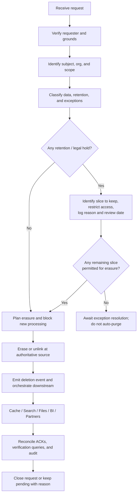
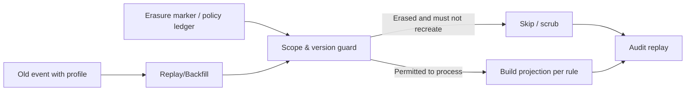

# Reviewing Access Permissions, Organization Scope, and Data Erasure Requirements

A SaaS platform serves multiple businesses. Staff in **Organization A** create customer `C-17` and view order history. Another employee belonging exclusively to **Organization B** tries calling the API with customer code `C-17`. Meanwhile, Organization A's customer requests personal-data erasure; the application deletes the profile from the main table, yet a search index and an analytics sync copy still retain the name and email.

Two seemingly separate problems—**cross-organization data leakage** and **incomplete erasure**—both stem from a model that fails to specify completely: **who owns the data, what scope each relationship belongs to, who may perform which action, which copies the data flows through, and how expired copies are retired**.

A design review cannot stop at an ERD with PKs/FKs or an endpoint with auth middleware. You must trace from business requirements down to **keys and constraints**, **authorization layers**, **query paths**, **sync pipelines**, **retention**, and **adversarial violation tests**.

This lesson belongs to the **Design Validation** chapter of the **DATABASE_DATA_MODELING** module. The module builds the skill of translating requirements into entities, relationships, constraints, normalization, keys, indexes, and physical schemas—comparing relational, document, graph, and analytical models for evolvability and verifiability. We use a SaaS customer and order management system as our running example; while data-protection principles apply broadly, real retention and deletion rules must always rest on **legal roles, policies, and organizational obligations**, never on a generic technical formula.

## 1. Three Questions to Answer Before Choosing a Schema

An effective review starts with three explicit contracts:

1. **Who is allowed to do what with a record?** Principals may be users, services, background jobs, or partners. Permissions to **read, create, edit, export, share, erase, and restore** are not identical by default.
2. **Which scope owns the record?** By organization (*organization/tenant*), project, branch, group, owner, or approved sharing grant; one person may participate in multiple organizations.
3. **Once retention authority expires, what must disappear or become inaccessible?** Scope includes the primary database, secondary tables, caches, search indexes, files, logs, analytics warehouses, replicas, external processors, and replay/restore mechanisms.

Saying "employees only see their own company's customers" is underspecified. Clarify:

- Can an employee be **invited into multiple companies**?
- Can child organizations view parent-organization data, and vice versa?
- Does a departed employee lose access to records they previously created?
- May an organization admin **bulk-export** customer profiles?
- If one person is a customer of **two organizations**, does an erasure request at A delete B's data?
- Must certain records be partially retained for transactional/accounting obligations and merely detached from identifying attributes?

Until those questions are answered, adding a `tenant_id` column or enabling Row-Level Security (RLS) solves only **part** of the problem.

## 2. Distinguishing Identity, Role, Permission, and Scope

These concepts do not substitute for one another:

| Concept | Question | Example |
| --- | --- | --- |
| **Identity / principal** | Who is making the request? | Employee `user_id` or job `service_id` |
| **Authentication** | What proof confirms who the principal is? | Signed session or bearer token |
| **Authorization** | Is this principal permitted this action? | `customer:read`, `customer:erase` |
| **Role (RBAC)** | Which permission bundle is assigned? | Owner, operator, analyst, auditor |
| **Attribute / policy (ABAC)** | Which contextual conditions must hold? | Active membership, processing purpose, record status |
| **Scope** | Over which dataset slice does permission apply? | `org_id`, `project_id`, one branch |
| **Ownership** | Who governs and decides on the data? | Organization and domain/data owner |
| **Data subject** | To whom does the personal data relate? | Identified customer |
| **Processor / downstream** | Who stores or processes copies? | Search index, BI pipeline, integrated vendor |

A user holding `ADMIN` in Organization A is **not** thereby a platform-wide admin. A support engineer may receive time-bounded support access, yet that access needs grounds, scope, auditing, and purpose limits.

### 2.1. RBAC and ABAC Must Work Together

**RBAC** works well for clear role bundles: support agents read profiles, finance staff read invoices. **ABAC/policies** add contextual conditions: the user still holds active membership in that org, the record belongs to that org, the subject isn't locked under investigation, and the user acts under an authorized purpose.

An authorization decision can be expressed as:

\[
\mathrm{Allow}(p,a,r,c)
= \mathrm{Authenticated}(p)
\land \mathrm{ActiveMember}(p,\mathrm{Org}(r))
\land \mathrm{HasPermission}(p,a,\mathrm{Org}(r))
\land \mathrm{ContextPolicy}(p,a,r,c)
\]

where `p` is principal, `a` is action, `r` is resource, and `c` is context. This is a **logical contract**, not a single SQL expression for every system. Some actions follow distinct rules: a customer requesting access to their own data may go through a dedicated identity-verification workflow rather than an employee org role.

**Default-deny rule:** If identity, organization, permission, or context cannot be verified, **deny**; never infer "allow" simply because an endpoint omitted `org_id`.

## 3. Draw a Permission Matrix Before Drawing Relationships

| Example principal | View customers in org | Edit profile | Bulk export | Request erasure | Execute approved erasure |
| --- | --- | --- | --- | --- | --- |
| Support staff, active membership | Assigned records only | Per role and status | No by default | Forward request | No |
| Admin of **Org A** | Inside A | Inside A per policy | Only if explicitly granted | Intake/approve scope per policy | No by default |
| Staff belonging only to **Org B** | Inside B; **never** sees A | Inside B | Per B's policy | Valid workflows only | No |
| Analytics service | Granted necessary slice only | Never edits source profiles | Never extracts raw PII out of scope | No | No |
| Erasure job | Never used as general profile-browse API | No arbitrary edits | No | Never self-approves requests | Approved scope only, audited |
| Verified data subject | Dedicated access workflow | Dedicated edit workflow | Receives policy-appropriate copy | May submit request | Zero direct database access |

This matrix illustrates how to structure permissions, **not a legal mandate or universal SaaS default**. Its purpose is forcing designs to declare **action + resource + scope + conditions**.

`GET /customers/{id}` and `POST /customers/export` need distinct checks. Permission to look up one profile does not grant permission to dump an organization's entire customer directory.

## 4. Data Grain and Organization Scope Must Flow Through Relationships

Grains for the example tables:

| Table | Grain | Mandatory scope |
| --- | --- | --- |
| `organization` | One registered organization | `org_id` identifies the organization |
| `organization_membership` | One user within one organization | `(org_id, user_id)` |
| `customer_profile` | One customer profile managed by one org | `(org_id, customer_id)` |
| `sales_order` | One order belonging to one org | `(org_id, order_id)` |
| `sales_order_line` | One line item within an org's order | `(org_id, order_id, line_no)` |

Never treat the creating employee's `user_id` as **sole ownership**. Employees leave companies while customer profiles stay within the organization per policy. Nor assume `customer_id` is globally unique across systems, as external IDs may be issued in local namespaces.

### 4.1. Why Adding `org_id` Alone Is Not Enough

Suppose an order has `org_id = A` while `customer_id` points to a profile in B. If the FK is merely `REFERENCES customer_profile(customer_id)` and `customer_id` is globally unique, the database permits **cross-organization** references even though the order says `org_id = A`. If lookups use only client-supplied IDs, the app also risks disclosing B's data.

A stronger approach embeds **scope into keys and FKs**:

```text
customer_profile:
  PK (org_id, customer_id)

sales_order:
  PK (org_id, order_id)
  FK (org_id, customer_id)
       -> customer_profile(org_id, customer_id)

sales_order_line:
  PK (org_id, order_id, line_no)
  FK (org_id, order_id)
       -> sales_order(org_id, order_id)
```

Composite FKs prevent an order in A from referencing a profile in B via matching key values. They **do not replace authorization**: user B can still guess A's IDs and probe the API. Both **data-layer constraints** and **request-level authorization** are required.

## 5. Sample PostgreSQL Schema: Scope Inside PK/FK

The statements below are **PostgreSQL** examples without assuming an existing project's schema. The goal is encoding "no cross-org references" into database-enforceable constraints.

```sql
CREATE TABLE organization (
    org_id UUID PRIMARY KEY,
    display_name TEXT NOT NULL
);

CREATE TABLE app_principal (
    user_id UUID PRIMARY KEY
);

CREATE TABLE organization_membership (
    org_id UUID NOT NULL REFERENCES organization(org_id),
    user_id UUID NOT NULL REFERENCES app_principal(user_id),
    org_role VARCHAR(24) NOT NULL
        CHECK (org_role IN ('OWNER', 'MANAGER', 'STAFF', 'AUDITOR')),
    membership_state VARCHAR(16) NOT NULL
        CHECK (membership_state IN ('ACTIVE', 'SUSPENDED', 'REVOKED')),
    PRIMARY KEY (org_id, user_id)
);

CREATE TABLE customer_profile (
    org_id UUID NOT NULL REFERENCES organization(org_id),
    customer_id UUID NOT NULL,
    full_name TEXT,
    email TEXT,
    created_at TIMESTAMPTZ NOT NULL DEFAULT now(),
    PRIMARY KEY (org_id, customer_id)
);

CREATE TABLE sales_order (
    org_id UUID NOT NULL REFERENCES organization(org_id),
    order_id UUID NOT NULL,
    customer_id UUID,
    customer_ref_state VARCHAR(16) NOT NULL,
    ordered_at TIMESTAMPTZ NOT NULL,
    amount_minor BIGINT NOT NULL CHECK (amount_minor >= 0),
    currency_code CHAR(3) NOT NULL,
    PRIMARY KEY (org_id, order_id),
    FOREIGN KEY (org_id, customer_id)
        REFERENCES customer_profile(org_id, customer_id),
    CONSTRAINT ck_customer_ref_state CHECK (
        (
            customer_id IS NOT NULL
            AND customer_ref_state = 'KNOWN'
        )
        OR
        (
            customer_id IS NULL
            AND customer_ref_state IN ('GUEST', 'ERASED')
        )
    )
);

CREATE TABLE sales_order_line (
    org_id UUID NOT NULL,
    order_id UUID NOT NULL,
    line_no INTEGER NOT NULL CHECK (line_no > 0),
    sku TEXT NOT NULL,
    quantity INTEGER NOT NULL CHECK (quantity > 0),
    PRIMARY KEY (org_id, order_id, line_no),
    FOREIGN KEY (org_id, order_id)
        REFERENCES sales_order(org_id, order_id)
);
```

**Why does `customer_ref_state` matter?** A guest checkout (`GUEST`) differs from an order whose customer link was subsequently detached (`ERASED`). Both have `customer_id IS NULL`, yet differ in cause and data-recovery behavior. The `ERASED` marker is strictly internal; it **does not prove all personal data was erased** from the order or external systems.

### 5.1. Example Limitations

- `org_id` in PK/FK guards referential boundaries, yet does not verify **caller permission** to read/write that org.
- One customer may hold separate profiles in A and B; never assume they are the same person solely from name/email.
- `amount_minor` illustrates transactional data; retaining/erasing accounting records must follow policy, not mere FK presence.
- If orders hold shipping addresses, notes, emails, or identifying fields in other tables, deleting `customer_profile` alone is insufficient.
- Parent–child org trees, project sharing, and hierarchical tenancy **are not modeled here**; never infer inherited access from an FK.
- Composite PKs require designing indexes and access paths to match workloads; never slap `org_id` onto every index blindly without query plans.

### 5.2. Testing a Cross-Organization Reference

Suppose customer `C-17` exists only in A. An `INSERT` creating an order with `org_id=B` and `customer_id=C-17` checks `(B, C-17)` via the composite FK and rejects it **if B has no customer `C-17`**. Even if B has a different customer with colliding local ID `C-17`, the order links strictly to **B's customer**, never silently to A's.

That is the exact property desired: **identical local/secondary IDs can never cross scope boundaries**. When a transaction genuinely spans two organizations, model an explicit sharing grant rather than stripping `org_id` from FKs.

## 6. Queries Must Enforce Scope at Every Data Access Point

An order-read API query can look like:

```sql
SELECT
    o.org_id,
    o.order_id,
    o.customer_ref_state,
    o.amount_minor,
    o.currency_code
FROM sales_order AS o
WHERE o.org_id = $1
  AND o.order_id = $2;
```

The application must take `$1` from **the organization verified in the principal's permission context**, never trusting raw `org_id` values edited by clients in URLs or bodies. If a user belongs to multiple organizations, the system must **select an explicit active scope** and verify active membership and role at action time.

Properly scoped line query:

```sql
SELECT
    o.order_id,
    l.line_no,
    l.sku,
    l.quantity
FROM sales_order AS o
JOIN sales_order_line AS l
  ON l.org_id = o.org_id
 AND l.order_id = o.order_id
WHERE o.org_id = $1
  AND o.order_id = $2
ORDER BY l.line_no;
```

**Common bug:** joining solely on `order_id` when IDs can collide across organizations. The query still runs yet can multiply rows or pull wrong-tenant data. Composite FKs protect write integrity, while **joins and filters** must use the full composite key.

### 6.1. Access Paths Often Forgotten for Scoping

- `GET /customers/{id}` and detail screens.
- Search/autocomplete by name, email, or phone.
- Exports, CSVs, batch reports, dashboard widgets.
- Background order jobs, webhook handlers, and reprocessing scripts.
- Cached responses and cache keys (must include full scope so A's cache never serves B).
- Download URLs, attachments, object storage keys.
- Metrics, logs, and traces capturing linkable user IDs.
- WebSockets, notifications, and subscriptions firing after membership revocation.
- Cross-tenant admin queries and internal support tools.

Do not test only standard HTTP controllers; enforce permissions consistently across **every read/write path**, including pipelines bypassing HTTP middleware.

## 7. Row-Level Security: A Defense Layer, Not the Whole Auth System

PostgreSQL **Row-Level Security (RLS)** enforces row-level policies on tables. Configured properly, RLS limits blast radius if a repository omits `WHERE org_id = ...`. Even so, **RLS is only one defense layer**: it does not authenticate end users, check access purpose, enforce export permissions, or guard downstream copies.

Example assuming the DB defines runtime role `app_runtime`, **which is not a superuser, lacks `BYPASSRLS`, and does not own the tables**:

```sql
ALTER TABLE customer_profile ENABLE ROW LEVEL SECURITY;
ALTER TABLE customer_profile FORCE ROW LEVEL SECURITY;

CREATE POLICY customer_scope_select
ON customer_profile
FOR SELECT
TO app_runtime
USING (
    org_id = NULLIF(
        current_setting('app.org_id', true), ''
    )::UUID
);

CREATE POLICY customer_scope_insert
ON customer_profile
FOR INSERT
TO app_runtime
WITH CHECK (
    org_id = NULLIF(
        current_setting('app.org_id', true), ''
    )::UUID
);

CREATE POLICY customer_scope_update
ON customer_profile
FOR UPDATE
TO app_runtime
USING (
    org_id = NULLIF(
        current_setting('app.org_id', true), ''
    )::UUID
)
WITH CHECK (
    org_id = NULLIF(
        current_setting('app.org_id', true), ''
    )::UUID
);

GRANT SELECT, INSERT, UPDATE
ON customer_profile TO app_runtime;
```

**Explanation:**

- `USING` restricts which rows are visible for reads or targeted by updates.
- `WITH CHECK` validates scope on newly inserted rows and post-update values.
- When `app.org_id` is unset, comparisons fail and no rows are exposed; malformed UUID strings throw errors, so validate context beforehand.
- Here `DELETE` is not granted to `app_runtime`; erasure runs through a **separate verified workflow**.
- `FORCE ROW LEVEL SECURITY` subjects **table owners** to RLS in normal cases, yet **superusers and `BYPASSRLS` roles still bypass policies**; govern DB roles and privileged connections strictly.
- RLS policies do not grant SQL privileges; `GRANT` is still required.

### 7.1. Setting Context Inside a Transaction

After verifying user access in Organization A, set context for the exact transaction:

```sql
BEGIN;
SET LOCAL app.org_id = '11111111-1111-4111-8111-111111111111';

SELECT customer_id, full_name
FROM customer_profile;

COMMIT;
```

`SET LOCAL` lasts only for the current transaction, avoiding tenant context leaking across pooled connections. However:

1. **Any role permitted to run arbitrary SQL can normally set a custom GUC** like `app.org_id`. This variable is **not an authentication credential** and cannot be trusted if clients have direct SQL access.
2. Only a trusted backend, after verifying principal and membership, may set context; never let users supply `app.org_id` directly.
3. Test connection pooling, transaction boundaries, and prepared statements on the real stack.
4. Other tables like `sales_order`, `sales_order_line`, file tables, and search indexes **need matching boundaries**; RLS on one table never protects the whole system.
5. Admin/batch jobs may need broader privileges yet must enforce strict scope, purpose limits, auditing, and tests.

If an application passes user-controlled SQL onto an `app_runtime` connection, RLS relying on a user-modifiable custom setting **cannot protect tenants**. Isolate execution privileges, rely on verified identity tokens, and control who can set identity contexts.

## 8. Organization Scope May Be a Tree or a Sharing Graph

Not every SaaS uses a flat `org_id` column. Example:

```text
Conglomerate P
  |-- Subsidiary A
  |      |-- Branch A1
  |      +-- Branch A2
  +-- Subsidiary B

Employee X belongs to A1
Employee Y holds aggregate reporting permission across A and B
```

Questions to define:

- Do permissions **inherit** downward from parent orgs to child orgs?
- Can a customer/order be shared between two independent organizations?
- Is the scope for **aggregate reporting** broader than for **detailed PII access**?
- Does transferring a project from A to B change data ownership or only viewing rights?
- Multi-org members can switch context mid-session; how do caches and async jobs handle it?

A tree model may use `parent_org_id` plus a closure table if hierarchical scope queries are frequent. Flexible sharing may use `resource_grant(resource_id, grantee_org_id, permission, expires_at)`. **Never pick a physical layout** before defining permission rules and conflict resolution.

Never treat `parent_org_id` as proof that every member of P can read every child profile. **Permission inheritance is a policy decision, never an automatic consequence of an FK.**

## 9. Data Erasure: Define Precisely What Must Happen

"Delete customer" covers distinct goals:

| Request | Possible meaning | What NOT to assume |
| --- | --- | --- |
| **Hide from UI** | Mark record inactive/archived | Does not mean deleted from the database |
| **Soft delete** | Set `deleted_at` to filter some queries | PII remains in the row and replicas |
| **Hard delete** | Remove row from a specific store | Does not prove indexes, backups, files, or logs were cleared |
| **Unlink identity** | Detach orders from personal profile | Does not prove remaining data cannot re-identify |
| **True anonymization** | Eliminate identifiability under threat model and context | Hashed/encrypted email can still count as personal data |
| **Valid erasure request** | Workflow verifying grounds, legal holds, execution, reconciliation | Does not always mean "wipe every byte instantly" in every case |
| **Retention expiry deletion** | Retention window elapsed per defined policy | Never apply one single TTL to every data category |

Erasure handling must respect **accounting/record-keeping obligations, data-subject rights, processing grounds, contracts, and applicable regulations**. This lesson sets no fixed legal deadline; technical designs must give policy owners explicit places to **erase, retain with bounds, restrict access, or deny with grounds**.

### 9.1. Erase from Which Scope?

One individual can appear in multiple capacities:

- As a **customer of Organization A**.
- Simultaneously as a **customer of Organization B**.
- As an **authenticated user** managing their own login account.
- Across **orders, invoices, support logs**, and attachments spanning multiple systems.

An erasure request for customer data controlled by A **does not automatically** authorize wiping records B holds under independent grounds. Conversely, a platform-wide account erasure may span multiple scopes. **Verify scope and each party's legal/operational role first.**

## 10. Lifecycle of a Controlled Erasure Request

A pipeline may progress through:



This diagram does **not** mean data under legal hold still gets deleted at the next step. In the retention branch, the plan must **classify each data category**: what can be erased, what must be held, which access/processing restrictions apply, and release criteria. If all related data must be held at that stage, the request pauses instead of reaching purge.

### 10.1. Request State Machine

| State | Meaning |
| --- | --- |
| `RECEIVED` | Request logged, not yet fully verified |
| `VERIFIED` | Requester/subject and processing authority verified |
| `SCOPED` | Inventoried datasets and systems to check |
| `BLOCKED` | Blocker requires resolution: legal hold, identity conflict, missing proof |
| `APPROVED` | Erase/restrict/retain decisions finalized per data class |
| `PROPAGATING` | Target systems and jobs executing |
| `VERIFYING` | Verifying each target and anti-resurrection guards |
| `COMPLETED` | Defined completion criteria met, including policy-handled exceptions |
| `REJECTED` | Request invalid or disallowed, with logged reason |

Never mark `COMPLETED` solely because `DELETE FROM customer_profile` affected one row. Async steps may still fail, search indexes may lag, or analytics copies may remain stale.

## 11. Data Lineage Map as Input to Erasure

Before promising an erasure SLA, map everywhere data travels:

| Surface | Example data | Action to evaluate | Verification signal |
| --- | --- | --- | --- |
| Operational DB | Profiles, addresses, accounts, FK links | Delete, detach, or restrict per policy | Cleared fields no longer queryable |
| Cache | Profile JSON, recent customer lists | Invalidate and scope keys | Cache misses / zero stale revival |
| Search index | Full names, emails, phone numbers | Delete/update docs, refresh per engine | Search returns zero hits |
| Object storage | Invoices, ID scans, support files | Delete or justify hold; handle object versions | Targeted object/version list reconciled |
| Event bus / CDC | Events carrying PII or link keys | Retention, tombstones, replay filters | Replays never recreate erased profile |
| Warehouse / BI | Facts, dimensions, marts, exports | Policy-based delete/rekey/anonymize + rebuild | Verification query on refreshed snapshot |
| Logs / monitoring | URLs, emails, request bodies, trace IDs | Minimize collection, redact, retain/expire | Audit queries across log stores |
| Backups / replicas | Snapshots, WAL/archives, replicas | Backup lifecycle, access limits, restore guards | Restore drills never resurrect erased data |
| External processors | CRM, email marketing, support desks | Notify and confirm per contract | ACK with identity and timestamp |
| Derived ML/data systems | Feature stores, search embeddings, training sets | Assess linkability and rebuild policy | Documented removal/minimization runbooks |

Not every store holds **identical data risk**. A daily store-revenue dashboard may no longer identify individuals, whereas a fact table storing `customer_id` or linkable event IDs remains personal/pseudonymous data. Classify by **linkability and context**, not by labels like "analytics."

## 12. Retaining Transactions While Erasing Personal Profiles: A Business Decision

Many systems have valid grounds to retain **certain transaction records** for a defined window while removing or restricting **personal identifiers**. Yet no generic SQL formula decides what stays. Separate:

- `customer_profile`: name, email, and identifying attributes;
- `sales_order`: business figures needed for reconciliation where retention grounds exist;
- `shipping_address`/`support_notes`/`attachments`: may hold standalone PII requiring separate inspection;
- external ID mappings and downstream copies: assess re-identification risk.

In Section 5's schema, one illustrative plan **detaches the customer link from retained orders**, marks `ERASED`, and deletes `customer_profile`:

```sql
-- Preconditions:
-- 1) Verified request and scope.
-- 2) Approved order-retention / profile-erasure policy.
-- 3) Inventoried all other PII locations.
-- 4) Running under a scoped, audited role/job.

BEGIN;

UPDATE sales_order
SET customer_id = NULL,
    customer_ref_state = 'ERASED'
WHERE org_id = $1
  AND customer_id = $2;

DELETE FROM customer_profile
WHERE org_id = $1
  AND customer_id = $2;

COMMIT;
```

In PostgreSQL, detaching the order FK **before** deleting the profile avoids referential integrity errors in the sample schema. Still:

- If other tables reference `customer_profile`, `DELETE` still fails; inventory every FK and policy.
- If `sales_order` or related tables store emails, addresses, receipts, or notes with names, this SQL **does not complete erasure**.
- Removing `customer_id` from orders does not automatically make remaining data **non-reidentifiable**; tracking IDs, addresses, timestamps, and other tables may still link back.
- Retained transactions may still need restricted access; never treat `ERASED` as open access.
- This snippet omits outbox emission, retries, and downstream confirmations — handle those via orchestration around the transaction.

**Never slap `ON DELETE CASCADE` recklessly** from customers to orders and order lines: erasing a profile can wipe mandatory accounting transactions. Conversely, `ON DELETE RESTRICT` forces workflows to address every dependency explicitly before purging.

## 13. Tracking Requests, ACKs, and Anti-Resurrection Guards

An erasure orchestration schema should retain enough metadata to **audit completed actions** without storing unnecessary PII as a permanent "shadow profile."

An **illustrative** schema using governed IDs and restricted access:

```sql
CREATE TABLE erasure_request (
    request_id UUID PRIMARY KEY,
    org_id UUID NOT NULL REFERENCES organization(org_id),
    subject_ref UUID NOT NULL,
    state VARCHAR(20) NOT NULL CHECK (
        state IN (
            'RECEIVED', 'VERIFIED', 'SCOPED', 'BLOCKED',
            'APPROVED', 'PROPAGATING', 'VERIFYING',
            'COMPLETED', 'REJECTED'
        )
    ),
    reason_code TEXT,
    received_at TIMESTAMPTZ NOT NULL DEFAULT now(),
    resolved_at TIMESTAMPTZ,
    UNIQUE (request_id, org_id, subject_ref)
);

CREATE TABLE erasure_target_status (
    request_id UUID NOT NULL REFERENCES erasure_request(request_id),
    target_name TEXT NOT NULL,
    status VARCHAR(16) NOT NULL CHECK (
        status IN ('PENDING', 'SENT', 'ACKED', 'FAILED', 'EXEMPT')
    ),
    attempt_count INTEGER NOT NULL DEFAULT 0
        CHECK (attempt_count >= 0),
    last_attempt_at TIMESTAMPTZ,
    acknowledged_at TIMESTAMPTZ,
    reason_code TEXT,
    PRIMARY KEY (request_id, target_name)
);

CREATE TABLE erasure_outbox (
    event_id UUID PRIMARY KEY,
    request_id UUID NOT NULL REFERENCES erasure_request(request_id),
    org_id UUID NOT NULL,
    subject_ref UUID NOT NULL,
    event_kind TEXT NOT NULL
        CHECK (event_kind = 'ERASE_SUBJECT_V1'),
    created_at TIMESTAMPTZ NOT NULL DEFAULT now(),
    published_at TIMESTAMPTZ,
    UNIQUE (request_id, event_kind),
    FOREIGN KEY (request_id, org_id, subject_ref)
        REFERENCES erasure_request(request_id, org_id, subject_ref)
);
```

Here `subject_ref` coordinates orchestration **without a direct FK to `customer_profile`** because the profile may be deleted before the request finishes. Still, `subject_ref` remains identity-linkable metadata; protect it with its own retention and access controls. Never equate "UUID without email" with "fully anonymized data."

The composite FK on `erasure_outbox` also ensures **`(request_id, org_id, subject_ref)` matches the logged request**: a producer cannot emit an outbox row using the same `request_id` while swapping `org_id` or `subject_ref`. This guards key consistency in the database; authorization to approve requests is still enforced by the workflow/auth layer, never by FKs alone.

### 13.1. Outbox Emission Does Not Mean Downstream Is Erased

One transaction updates the source and writes `erasure_outbox`. Workers dispatch deletion events to search, warehouse, and object-storage jobs, recording ACKs or failures. Because delivery can retry, every consumer must be **idempotent** on `event_id`/`request_id` and scope.

If a consumer ACKs before the index actually refreshes deletions, define whether ACK means "received," "applied," or "verified unqueryable." **Never collapse all ACKs into "done."**

### 13.2. Replays and Backfills Can Resurrect Deleted Profiles

Old event logs, backfill files, or backup snapshots still contain pre-erasure data. When replaying pipelines:



You need a sufficiently durable, scoped **anti-resurrection mechanism**: deletion markers/tombstones, version watermarks, or a policy ledger so readers and reprocessors know records prior to a cutoff were erased. Since tombstones themselves can link to individuals:

- Never retain them indefinitely without bounds.
- Never copy names, emails, or tokens into deletion markers.
- Scope precisely by `(org_id, subject_ref)` and effective version/window.
- Distinguish **a legitimate new registration post-erasure** from replaying old erased events.
- Ensure restores/backfills apply valid deletion ledgers **before reopening user access**.

"Erasure complete" must mean data does not **reappear** simply because a late batch ran.

## 14. Backups, Replicas, and Retention Windows

Database backups, WAL archives, object versions, and standby replicas hold data from **before an erasure request**. Never promise "running `DELETE` removes a row from all backups instantaneously," nor use backup complexity as an excuse to ignore data governance.

Your design must answer:

1. Which backups hold PII, how long are they kept, and who can access them?
2. Does policy permit immutable backups to expire naturally at the end of an approved retention window?
3. When restoring an older backup, how are **post-backup erasure requests** reapplied before opening read access?
4. Is sensitive data in archives/logs encrypted, access-restricted, audited, and purged on schedule?
5. Have real restores and deletion-replays been tested?

One architectural option is **scoped encryption** with key destruction (*cryptographic erasure*) to render old copies unreadable. Even then, never claim erasure is complete if **plaintext copies, unencrypted replicas, derived datasets, or shared keys** remain. Evaluate concrete implementations against policy.

### 14.1. Retention Policies Are Per Data Category

| Data category | Retention policy questions |
| --- | --- |
| Marketing profile | Do processing grounds still hold, or was consent withdrawn / erasure requested? |
| Shipping details | How long needed for delivery, disputes, and reconciliation? |
| Transaction records | What statutory/contractual retention and access restrictions apply? |
| Access logs | How long needed for security/investigations, and do they contain PII? |
| Raw events | Do they hold identifiers, and are they genuinely needed for replay? |
| Backups | RPO/RTO, snapshot lifecycles, ability to reapply deletions |
| Erasure audit trail | What minimum proof must remain, and for how long? |

Never set "keep everything 30 days" when obligations and purposes differ. Policies need owners, versions, grounds, enforcement, exception workflows, and review schedules.

## 15. Race Condition: Erasing While Data Is Still Arriving

Imagine:

```text
09:00  CRM event carrying customer C-17 enters queue
09:01  Erasure job deletes customer_profile(C-17)
09:02  Consumer reads older CRM event -> re-INSERTs C-17 profile
09:03  Search index syncs -> customer reappears
```

If erasure merely executes `DELETE` without coordinating writers, it can "succeed" for a second and fail in final state.

Architectural safeguards:

- Put the subject into **`pending erasure`** state to block unjustified new processing.
- Pause/fence producers or flag ingestion filters.
- Emit deletion markers/events with clear **version/ordering** so consumers never treat older events as newest state.
- Check the deletion ledger during backfills, reindexing, and replays.
- Track checkpoints/watermarks and lag across every pipeline.
- Run verification queries right after purge, then re-verify after queues drain.
- Lock down import endpoints and support scripts that could re-seed records from stale exports.

**Never rely simply on "latest timestamp wins"** when source clocks are untrusted or valid time differs from ingestion time. For ordering, use authoritative source versions/sequences or a well-defined comparison rule.

## 16. Authorization Testing: Must Test Unauthorized Actors

To prove multi-tenancy is safe, testing **negative cases** is often just as important as testing happy paths.

| Test Case | Scenario | Expected Result |
| --- | --- | --- |
| **Cross-tenant read** | User B requests a customer ID belonging only to A | Does not return A's customer info |
| **ID collision** | Both organizations have local ID C-17 | Returns strictly within scope, never joins across |
| **Cross-tenant write** | B sends `org_id=A` in request body | Rejected, nothing written to A |
| **Join missing `org_id`** | Repo joins `order_line` on `order_id` only | Test catches wrong row count / cross-tenant data |
| **List/search pagination** | B crafts filters/sorts to surface A's records | No leaked results, counts, or facets |
| **Export** | Staff with single-record read only invokes bulk export | Blocked by separate permission check |
| **Membership revoked** | Employee A loses membership after logging in | Subsequent requests lose access per policy |
| **Multi-org principal** | User belongs to both A and B, switches scope | Results/cache match only the active scope |
| **Parent/child org** | Branch employee tries accessing parent company data | Allowed only if inheritance policy confirms |
| **Background job** | Worker reads profiles across multiple orgs | Clear role, scope, audit, and purpose |
| **Admin/bypass RLS** | Privileged path used by a job | Does not expose an arbitrary PII query endpoint |
| **Attachment URL** | User B uses a file URL belonging to A | Rejected or URL is permission- and time-bound |
| **Cache key** | Switching from A to B with identical `customer_id` | Does not reuse A's cached data |
| **Webhook** | Payload contains forged `org_id` | Scope derived from verified source mapping |
| **Mass assignment** | Client adds `is_admin`/`org_id` fields on update | Disallowed fields remain unchanged |

**IDOR/BOLA** (*Insecure Direct Object Reference / Broken Object Level Authorization*) is the class of vulnerabilities where a system grants access to a resource merely because the caller knows its ID. Unpredictable UUIDs do not replace authorization checks; tests must assume an attacker **knows** real IDs.

### 16.1. Verifying Scope at Two Layers

For example, a test can:

1. Create Organizations A and B, each with a customer sharing the same local `customer_id` if the model permits.
2. Assign Employee X exclusively to A, and Employee Y exclusively to B.
3. Call read and update APIs using B's IDs under X's session; expect rejection/no data disclosure per contract.
4. Use a database connection with the runtime role and A's scope to run a query intentionally omitting `WHERE org_id`; when RLS is working, results contain no rows from B.
5. Attempt to write a row with `org_id=B` while in context A; `WITH CHECK` must block it.
6. Test privileged roles/jobs separately—do not confuse admin role behavior with runtime behavior.

Testing RLS solely via a **superuser** connection gives misleading results because privileged roles bypass policies. Testing only APIs without database tests misses batch/maintenance paths.

## 17. Erasure Testing: "Gone from the UI" Is Not Enough

| Test Case | Expectation |
| --- | --- |
| Unverified-identity erasure request | Does not wrongly delete profile; pending/rejected with reason |
| Two duplicate requests for same subject and scope | Idempotent; produces no conflicting side effects |
| Subject appears in both A and B | Scope verified; does not mistakenly erase B's data |
| Transactions must be retained per policy | Retains only permitted slice and removes/restricts unneeded PII |
| FK from orders to profile | No FK error or unintended cascade wiping orders |
| Profile deleted, search not yet updated | System-wide request not yet marked complete |
| Downstream fails to receive event | Retry + DLQ/alert, request remains pending |
| Outbox delivers event twice | Consumer is idempotent, no errors or duplicate records |
| Replay old event after erasure | Old data does not resurrect if erasure policy still applies |
| Restore backup taken prior to erasure | Deletion ledger reapplied before serving access |
| Object storage has older versions | Target versions inventoried and handled per policy |
| Customer linked via email hash | Re-identification risk checked; not assumed anonymized |
| Soft delete while BI still reads raw table | BI respects deletion state/policy or executes appropriate erasure |
| Late correction arrives after erasure | Does not silently recreate personal data from source |
| Legal hold applied | Access/retention restricted per decision, not erased against policy |
| Membership revoked mid-job | Job authority verified against approved scope, each step audited |
| Partially completed request | Status, reasons, and remaining remediation deadlines transparent |

### 17.1. Verify Two Distinct Properties

- **Safety:** never erase another organization's data; never lose mandatory records; never send A's info to B.
- **Liveness:** valid requests never stay stuck forever in a queue; targets are processed, retried, and reconciled to a justified terminal state.

A pipeline can be **safe yet never finish** (leaving every request pending), or **finish fast yet unsafe** (wrongly erasing data or leaving copies behind). The design requires both.

## 18. Relational, Document, Graph, and Warehouse Carry Different Risks

| Data Model | How Scope Is Expressed | Authorization Risks | Erasure Risks |
| --- | --- | --- | --- |
| **Relational** | Composite PK/FK `(org_id,id)`, RLS, and service auth | Joins missing scope, roles bypassing RLS, FKs lacking tenant | Wrong cascades, FKs blocking purge, data in audit/CDC |
| **Document** | `org_id` in document, org-keyed partition/index, access rules | Queries missing filter, shared collections, nested PII | Nested fields, old document versions, search indexes/backups |
| **KV/Wide-column** | Key prefix/partition key by org+entity, API keyspace policy | Right lookup key with wrong auth; shared cache | TTL/tombstones, replicas, compaction/replay, multi-projection deletes |
| **Graph** | Vertex/edge ownership, relationship traversal policies | Traversing edges cross-tenant or misassigned share edges | Deleting vertex leaves edges, properties, indexes, or inference paths |
| **Warehouse/columnar** | Per-tenant datasets/marts or row policies/authorized views | Exports/BI queries crossing scope, joining cross-tenant facts | SCDs, materialized aggregates, partitions, snapshots, and extracts |

### 18.1. Document: Keys Must Carry Scope

A shared collection holds documents like `{"org_id":"A","customer_id":"C-17",...}`. If code calls `findOne({customer_id:"C-17"})` instead of filtering by org/authorization, it can return another tenant's record. A compound unique index on `(org_id,customer_id)` protects uniqueness within scope, but **does not replace query authorization**.

If a document contains multiple nested PII components, deleting a top-level `email` field does not remove emails inside `contacts[]` or historical snapshots.

### 18.2. Graph: Edge Traversal Must Be Controlled Along the Entire Path

Suppose user A is allowed to traverse from `Customer(A)` to `Order(A)`. A `SHARED_WITH` edge to partner B can allow traversal into B's vertices; the engine may return two-hop results if the query omits scope filters. Policies must define **vertices, edges, relationship types, and permissions at every hop**, especially when cross-organization sharing is a real business feature.

Deleting a `Customer` node does not guarantee PII attributes are removed from edges, search indexes, or derived results. You must understand how the engine handles orphan edges and indexes.

### 18.3. Warehouse: Aggregates and PII Have Different Lifecycles

A table of revenue aggregated by day and store may no longer identify customers. Yet a transaction fact table storing `customer_id`, IP, or address details can still link back to individuals. Erasure must start from **grain**, data fields, and linkability—not from labels like "reporting" or "analytics only."

If removing an individual from a fact table affects aggregates, decide whether to **recompute metrics** or retain non-identifying totals per policy. Never assume anonymous aggregates are always safe: in very small cohorts, an aggregate can still allow re-identification of personal data.

## 19. Measure Validation Quality Instead of Counting Tables with `tenant_id`

Technical metrics to track:

- **Percentage of API/job paths with object-level authorization checks** and negative test coverage per resource.
- **Count of cross-tenant reference errors** or improperly scoped joins caught in testing/data quality checks.
- **Count of revoked memberships where tokens/caches still permit access** within a defined measurement window.
- **Count of export/bulk-read paths** with complete owners, permissions, and audits.
- **Count of erasure requests by state**, oldest request age, and blocking reasons.
- **Percentage of downstream targets verified complete**, not merely event-acknowledged.
- **Count of resurrected records after replay/restore** during validation drills.
- **Count of data sources with approved lineage maps, retention policies, and owners**.
- **Actual time to reflect erasure** across search/caches/warehouses versus internal SLAs.
- **Percentage of retention exceptions with documented justification, review dates, and access checks**.

Avoid putting raw emails, raw `customer_id`s, or request payloads into **metric labels**, due to high cardinality and leakage risk; use aggregate counters, reason codes, and properly access-controlled audit logs.

### 19.1. Review Table for Capturing Evidence

| Validation Item | Expected Evidence | Approving Owner |
| --- | --- | --- |
| Resource scope | `org_id` contract, composite PK/FK, schema diff | Domain + database |
| Read/write permissions | Role/action/scope matrix, API negative tests | Product + security |
| DB-layer protection | RLS/GRANT/role tests under non-privileged user | DBA + security |
| Cross-org sharing | Inheritance/sharing policies and tests | Domain owner |
| Source erasure | Verified/approved workflow + transaction/audit | Data steward + backend |
| Downstream erasure | Lineage, delivery status, ACK semantics, search/BI tests | Data platform |
| Backups and replay | Restore runbook, anti-resurrection guards, drills | SRE + security |
| Retention/exceptions | Active policy doc, review/hold workflows | Authorized governance team |

**A "security reviewed" checkbox does not replace the evidence above.** Nor should you claim absolute guarantees simply for having RLS, encrypted backups, or a GDPR-style workflow; assurance levels must align with the threat model and actual data paths.

## 20. Practice Exercises

### Exercise A — Cross-Tenant FK

Both organizations A and B have a local customer ID equal to `C-17`. Design `customer`, `order`, and `order_line` tables so an order of A cannot reference a customer of B. Write the composite PK/FKs and a properly org-scoped join query.

**Hint:** FKs `(org_id,customer_id)` and `(org_id,order_id)`, query joining on the full key; membership/authorization checked separately.

### Exercise B — Multi-Org Employee

User U is `MANAGER` of A and `AUDITOR` of B; later, A's membership is revoked. What can U still read in B? Can U export all of A's data because they previously managed it? Describe RBAC/ABAC, cache invalidation, and negative tests.

**Hint:** Roles are **scoped and time-bound**, not global labels. Export/restore require separate action permissions.

### Exercise C — RLS and Spoofed Context Variables

The application sets `SET LOCAL app.org_id` before PostgreSQL RLS queries. Another endpoint lets users submit arbitrary SQL via the same `app_runtime` role. Explain why RLS reading a custom setting **is insufficient to prevent scope spoofing**, then propose privilege reduction, execution path protection, and tests with both regular and privileged roles.

**Hint:** A custom GUC is not an authenticated token; the backend must verify membership and never let clients manipulate scope/SQL directly.

### Exercise D — Erase Customer While Retaining Orders

A customer requests profile erasure; the system has `customer_profile`, `sales_order`, `shipping_address`, `support_note`, and `invoice`. Certain accounting records must be retained per policy. Build a matrix of data to erase/retain/restrict, the execution order to avoid FK violations, and how to explain `customer_ref_state='ERASED'` without falsely claiming full anonymization.

**Hint:** Detaching references may be one step, not the entire workflow; check PII in every table and access controls on retained records.

### Exercise E — Search Index and Backfill

An erasure job deletes a profile at 10:00. The search index updates 5 minutes later; at 10:03 a backfill job reads an old event and re-writes the profile. Design markers/versions, outbox, retries, "applied"-level ACKs, and tests proving the data does not reappear.

**Hint:** Never close a request solely on source-DB deleted row counts; verify downstream and govern reprocessors.

### Exercise F — Multi-Organization Request

A person is a customer of both A and B and submits a request to "erase all my data." Define identity and scope verification steps, A/B's roles, independent retention decisions, platform-owned user data, and how to return a response with transparent exceptions.

**Hint:** Never auto-erase B simply because a request was verified in A; nor overlook platform-operated user account data.

### Exercise G — Backups and Recovery

A backup exists from Day 01; Customer C's erasure is processed on Day 10; on Day 15 a restore from Day 01 is required. Design the steps so users do not see C reappear after restore, while preserving valid transactions and complying with backup policies.

**Hint:** Restore into an isolated environment, reapply the deletion ledger/corrections, and verify before opening access. Never treat PITR alone as completing erasure.

### Exercise H — Graph / Analytics Scope

In a graph, A's customer has a `SHARED_WITH` edge to partner B. A warehouse stores facts with `org_id` and a cross-org summary report. Distinguish edge-traversal permissions, detailed read permissions, summary visibility, protections against small-group re-identification, and cross-org test cases.

**Hint:** Read scope does not automatically inherit across an edge; small-cohort aggregates can still leak personal information.

## 21. Pre-Approval Design Checklist

- [ ] Defined **principal, action, resource, scope, and conditions** for every read/write/delete path.
- [ ] Built **per-organization** RBAC/ABAC matrices rather than one global role across tenants.
- [ ] Distinguished end users, org owners, data subjects, service accounts, and privileged jobs.
- [ ] Defined grain, ownership, and **organization scope** for every fact and entity.
- [ ] Evaluated PK/FK/UNIQUE/indexes with scope; cross-tenant references blocked unless explicitly permitted.
- [ ] Verified queries, joins, search, exports, caches, attachments, and background jobs all enforce scope.
- [ ] Verified API authorization, DB RLS/GRANTs, and downstream layers **independently**; never trust client-supplied org IDs.
- [ ] Audited RLS boundaries: table owners, `BYPASSRLS`, connection pooling, custom GUCs, and privileged roles.
- [ ] Designed cross-org sharing or parent–child inheritance via **explicit policies**, never inferred from FKs.
- [ ] Threat-modeled IDOR/BOLA, bulk exports, cross-tenant joins, logs, file URLs, and replays.
- [ ] Included requester verification, subject identification, scoping, and retention/exception decisions in erasure workflows.
- [ ] Distinguished soft delete, hard delete, detaching, anonymization, access restriction, and policy-driven erasure.
- [ ] Avoided reckless `CASCADE` deletes across transaction/accounting records.
- [ ] Mapped PII lineage across databases, caches, search, files, events, warehouses, backups, and external processors.
- [ ] Implemented outbox/ACK/retry/idempotency for async erasure; `COMPLETED` has explicit verification criteria.
- [ ] Built **anti-resurrection** controls for replays, backfills, and restores with governed marker retention.
- [ ] Verified backup, archive, encryption, restore, and RPO/RTO policies within appropriate scope.
- [ ] Added negative tests for cross-tenant access, concurrent writes, missing mappings, legal holds, and deletion propagation.
- [ ] Assigned owners/audits to every exception, retained slice, retention window, and access decision.
- [ ] Verified metrics and audit logs do not accidentally create an ungoverned PII copy.
- [ ] Declared "validated" only with schema, authorization, integration, and restore/replay evidence.

**Remember:** **Data protection does not start at a Delete button or login middleware.** It starts with the model stating accurately **which organization owns each record, who holds permissions on each relationship, and how keys and queries preserve scope**—and continues across **every downstream copy and the entire erasure lifecycle**. A trustworthy design proves both sides: unauthorized actors **cannot view or mutate data**, and valid erasure requests **execute within the right scope, erase nothing unintended, and never resurrect data after syncs or restores**.
