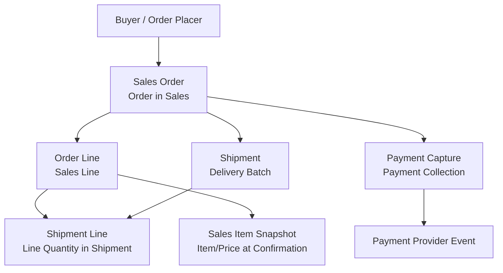
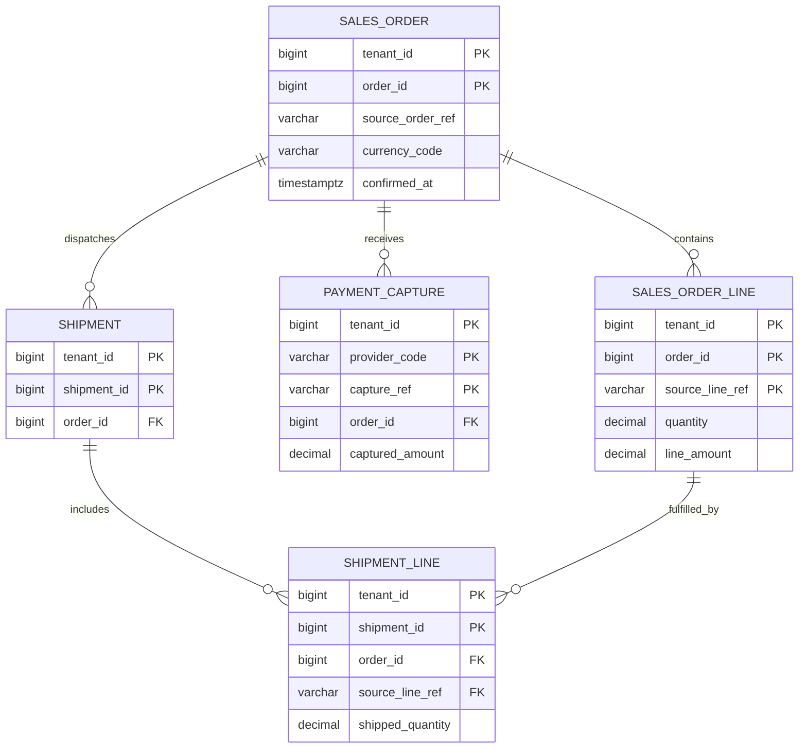
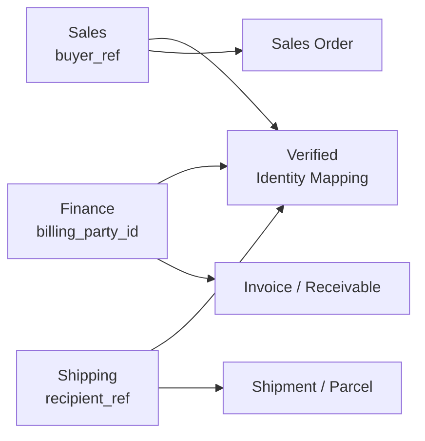
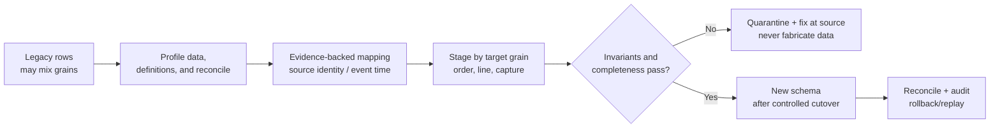

# Drawing Tables Before Aligning on Concepts and Grain

## 1. Mistakes That Happen Before the First SQL Statement

In the `DATABASE_DATA_MODELING` module, learners practice turning business requirements into a clear data model: identifying entities, relationships, and constraints before choosing normalization, keys, indexes, physical schemas, and appropriate representations in relational, document, graph, or analytical systems. In the **Common Pitfalls** chapter, a foundational mistake is **starting to draw tables and columns before stakeholders agree on what the data is about and what a single row represents**.

For example, a development team hears the requirement:

> "Store orders, products, payments, and deliveries to report revenue."

A design immediately appears:

```text
ORDER(
  order_id, customer_id, product_id, quantity,
  total_amount, paid_amount, shipping_status
)
```

It looks simple, yet it cannot answer:

- Does an order have **one or multiple product lines**?
- Can an order be **paid in multiple installments** or paid by multiple parties?
- Does "paid" mean **authorized, captured, or reconciled**?
- Can an order be delivered in **multiple parcels** or partially delivered?
- Does `customer_id` represent the **buyer, payer, or recipient**?
- Is `total_amount` **before or after taxes, discounts, fees, and refunds**?
- Is "revenue" recognized upon **order placement, confirmation, delivery, invoicing, or cash receipt**?
- Does one row of `ORDER` represent the **current order**, a **status transition**, or an **event line**?

When these questions remain unanswered, adding `PRIMARY KEY`, `FOREIGN KEY`, or indexes only makes the database management system enforce **an understanding that may not even be correct**.

**Key message:** do not turn business ambiguity into the false certainty of a schema. Before choosing tables, lock down **vocabulary, boundaries, identity, relationships, grain, timing, and calculation rules**.

### Learning Objectives

After this lesson, learners will be able to:

1. Spot signs that a team is "drawing tables instead of clarifying business semantics."
2. Build a **glossary** and counterexamples to align terminology across teams.
3. Write **grain** statements for entities, transaction facts, event facts, and snapshots.
4. Distinguish business identity from surrogate keys, namespaces, versions, and states.
5. Prove why joining with the wrong cardinality **multiplies row counts and revenue**.
6. Progress from requirements -> conceptual model -> logical model -> constrained physical schema.
7. Validate a model with sample data, SQL, invariants, edge cases, and reconciliation before tuning performance.

## 2. Why "Drawing Tables First" Is Tempting Yet Dangerous

Writing DDL early creates an illusion of progress: you already have tables, Java entities, repositories, CRUD APIs, and migrations. ERD tools, ORMs, and code generators make this very fast. However, **the speed of turning an assumption into a table does not measure the quality of that assumption**.

| Symptom | Common Reason | Downstream Consequence |
|---|---|---|
| Creating an `orders` table purely from the order entry screen | Treating the UI as the domain structure | Cannot represent multiple lines or payment installments |
| Using `customer_id` in every table | Same word "customer" | Conflating buyer, payer, recipient, and legal entity |
| Choosing `status VARCHAR` before defining the workflow | Assuming status is a single generic attribute | Different domains reuse the same status values with different meanings |
| Making `amount` a single number | Not asking about units and monetary components | Wrong taxes, discounts, refunds, or currencies |
| Adding one `created_at` and using it for every report | Not separating business timestamps | Late-arriving events land in the wrong reporting period |
| Putting `UNIQUE(order_id)` on the order line table | Not stating the row grain | Can only store one product per order |
| Joining three one-to-many tables and running `SUM` | Trusting that valid FKs guarantee valid math | Row multiplication and double counting |
| Adding a `json_payload` column when semantics are unclear | Avoiding domain discussions | Hard-to-verify constraints and blurred ownership |
| Choosing partitions before knowing read paths | Optimizing by gut feel | Fails to support primary queries and may break unique identity |

A system can have **zero SQL syntax errors** and still be completely wrong about revenue, timing, or access permissions. That is a modeling failure, not a syntax failure.

## 3. Aligning Terminology: Same Name Does Not Mean Same Meaning

A **ubiquitous language** or **business glossary** is a vocabulary with definitions, scope, examples, and owners. It is not simply translating table names into another language.

For a marketplace, record at least:

| Term | Definition to Confirm | Should Not Default to Synonyms |
|---|---|---|
| **Order** | Purchase request managed by Sales; has a code, lines, and lifecycle | Invoice, payment transaction, shipment |
| **Order line** | A specific sold item within an order, with quantity and agreed price | A catalog product or a shipping parcel |
| **Order confirmation** | Sales accepts the terms of sale according to a business rule | Cash collected, accounting revenue recognized |
| **Payment** | Could be an intent, attempt, authorization, capture, or refund | A single always-accurate `paid_amount` number |
| **Delivery / Shipping** | Could be a delivery batch, shipment, parcel, and delivery status | A single status for the entire order |
| **Customer** | Buyer role in Sales, or an entity with a verified identity | Payer, recipient, legal entity on the invoice |
| **Product** | Sellable variant in Catalog per ID/SKU policy | Inventory SKU, batch/lot, legal/accounting product |
| **Revenue** | Measure following an approved recognition policy | Order total, cash collected, balance due |
| **Sales date** | Business milestone defined for sales reporting | `created_at` or arbitrary ingestion time |

A glossary is useful when each term carries:

- **Definition and boundary**: does it apply to Sales, Finance, Shipping, or the whole enterprise?
- **Positive examples** and **examples that do not belong to the concept**.
- **Units and scope**: VND, USD, pieces, kilograms, tenant/source.
- **Cardinality**: how many lines, captures, or shipments can one order have?
- **State transition rules** and effective timestamps.
- **Owner** responsible for deciding the meaning when disagreements arise.
- **Open questions** and verification actions needed.

**Do not try to build a "super-glossary" forcing every domain to share a single meaning.** Finance may call the liable party "customer," while Sales calls the person placing the order "buyer." When genuine semantic differences exist, keep distinct terms and document the mapping between domains.

## 4. Question-Driven Workshops Instead of Column-Naming Sessions

Before drawing an ERD, pick **one concrete transaction** and ask counter-questions:

> Order `SO-100` of tenant 42 has two lines: L01 with 2 units of product A at 50,000 VND/unit and L02 with 1 unit of product B at 200,000 VND. The order was accepted on March 31. The customer paid 200,000 VND in capture P01 and 100,000 VND in capture P02 the next day. Line L01 shipped immediately; L02 shipped three days later.

From this single example, the team must be able to answer:

1. `SO-100` is the identity of the **order**, not line L01 or capture P01.
2. The order has **2 lines**, and the merchandise subtotal before tax/discount/fees is **300,000 VND**.
3. There are **2 payment captures**, not a single payment attribute.
4. "Fully paid" depends on the sum of valid captures, refunds, and reconciliation rules.
5. An order can be **partially delivered**, so a single `shipping_status` is insufficient for all operational questions.
6. Acceptance date, payment capture date, and shipping date can fall into **different reporting months**.
7. If P01 is resent due to a retry, it is not a new capture.

Do not rush to replace examples with diagrams. Add **counterexamples**:

- An order has **three lines with the same SKU** but different prices, promotions, or delivery addresses.
- A single line can be **split across two shipments**.
- A payment attempt fails before another attempt succeeds.
- Two tenants have the same code `SO-100`; the same tenant has colliding order codes across two sources.
- A SKU code changes after purchase; the customer still needs accurate historical documents.
- The buyer, cardholder, and delivery recipient are three different people.
- An item goes partially out of stock; quantities are canceled or modified after confirmation.

If the schema cannot express cases accepted by the business, the problem is not a missing `notes` column.

## 5. Separating "Concepts" from "Tables" in the Conceptual Model

A **conceptual model** describes business-meaningful objects, events, and their relationships without locking the design into a specific DBMS.



The diagram above intentionally **separates** concepts:

- Order vs. capture, because one order can have multiple captures.
- Order line vs. shipment line, because one line can be fulfilled across partial deliveries.
- Buyer vs. payer or recipient, because these are **roles** that can differ.
- Sales item snapshot vs. the current product in the catalog.

At this stage, ask: "Can a shipment contain lines from multiple orders?" If yes, the relationship differs from a design allowing only one order per shipment. When evidence is lacking, record an **assumption** rather than drawing an FK as if the requirement were settled.

### A Relationship Question Tree

For every pair of concepts A–B:

- How many Bs (**minimum/maximum**) can one A have?
- Can one B belong to multiple As?
- Does the relationship carry **its own attributes**, such as `shipped_quantity` or `effective_from`?
- Does the relationship exist independently? Does it need change history?
- When A is deleted/canceled, is B retained or canceled as well? Who owns the data?
- Are cross-tenant or cross-system references required?

These questions usually matter far more than deciding whether to name tables singular or plural.

## 6. Grain: Stating What a Single Row Represents

**Grain** is the smallest unit of truth that one row represents by design. This term is especially critical for analytical fact tables, yet equally valuable for transactional and associative tables in OLTP.

A solid grain statement includes:

1. **One business unit**: one order, one line, one capture, one event, one inventory day, etc.
2. **Identity scope**: tenant, source, line code, or event ID.
3. **Point in time / state**: current state, confirmation event, or end-of-day snapshot?
4. **Versioning rule**: can the same object have multiple rows over time or not?

| Candidate Name | What One Row Actually Represents | Semantically Unique Key | Can Money Be Summed Across Rows? |
|---|---|---|---|
| `sales_order` | One Sales order in its current state | (`tenant_id`, `source_system`, `source_order_ref`) | Do not sum `order_total` after a one-to-many join |
| `sales_order_line` | One line within an order | (`tenant_id`, `order_id`, `source_line_ref`) | Yes, if the measure matches the grain and currency |
| `payment_capture` | One successful payment capture per provider | (`tenant_id`, `provider`, `capture_ref`) if that namespace suffices | Yes, by capture event and separate refund rules |
| `payment_attempt` | One attempt calling a provider, including failures | Durable `attempt_id` | Do not treat every attempt as collected cash |
| `shipment_line` | A quantity of an order line included in a shipment | (`shipment_id`, `order_line_id`) if lines do not repeat within a shipment | Sum shipped quantities, do not default to revenue |
| `fact_sales_line` | One accepted sales line per contract | Source line ref within order and namespace | Additive subject to currency/status conditions |
| `fact_inventory_daily` | Inventory of one SKU at one warehouse at end of day | (`date_key`, `warehouse_key`, `sku_key`) | Balances must **not** be summed across multiple days |

**There is no single "one true grain" for all applications.** A current-order table and an order-event log have different grains and can coexist. What is wrong is creating one `orders` table and letting a row's meaning shift depending on the screen or report.

### A Sentence Template to Lock Down Grain

> Each row of **[structure name]** represents **[event/state/relationship]** of **[entity]** within **[namespace]** at **[point or interval in time]**, uniquely identified by **[business key]**; **[revisions/adjustments]** are handled by **[rule]**.

If you cannot fill in every blank, you are not ready to finalize the physical `PRIMARY KEY`.

## 7. Counting Rows to Verify Grain Before Discussing Indexes

For the `SO-100` example:

| Structure | Data | Expected Row Count |
|---|---|---:|
| Order | `SO-100` | 1 |
| Order line | `L01`, `L02` | 2 |
| Payment capture | `P01`, `P02` | 2 |
| Shipment | Shipped earlier / shipped later | 2 |
| Shipment line | L01 in S01; L02 in S02 | 2 |

Total sales line value is:

\[
2\times50\,000+1\times200\,000=300\,000\ \mathrm{VND}
\]

Total successfully captured cash is:

\[
200\,000+100\,000=300\,000\ \mathrm{VND}
\]

The two totals match in the **illustrative** data, which does not mean they always match in real orders: there may be taxes, fees, tips, discounts, refunds, pending payments, or FX differences. **Reconciliation requires identical monetary definitions and recognition criteria.**

Ask: if captures P01/P02 are recorded as two rows in `sales_order`, the order row count becomes 2; if lines L01/L02 also create two rows, row counts multiply. That is why grain must be defined for **each fact type**.

## 8. Confusing Concepts Means Confusing Keys

A common mistake is choosing keys prematurely because they look unique:

- `order_ref` is not guaranteed unique **across tenants or source systems**.
- `sku` can change or be reused; it is not necessarily an immutable product identity.
- `payment_id` may identify a **payment intent** while a single payment has multiple captures, refunds, or events.
- `created_at` is almost never an ID: multiple rows can share the same timestamp, and retries arrive at different times.
- `row_id BIGSERIAL` only identifies a physical row; it does not prevent the same source event from being ingested twice.

Distinguish clearly:

| Concept | Example | Role |
|---|---|---|
| **Business key** | (`tenant_id`, `source_system`, `order_ref`) | Identifies the order within source scope |
| **Surrogate key** | `order_id BIGINT` | Internal joins, stays stable when business codes change |
| **Event identity** | `provider_capture_ref`, `source_event_id` | Distinguishes valid events belonging to the same order |
| **Idempotency key** | Key of a source request/event that must not be processed twice | Protects against retries; requires scope and lifecycle |
| **Version/revision** | `source_order_version`, `event_sequence` | Distinguishes changing versions/events |
| **Dimension version SK** | `customer_sk` of an SCD2 row | Reconstructs dimension attributes for a validity interval |

**A surrogate PK alone does not prove the grain is right.** If an order line is sent twice and each insert receives a new `line_id`, the database sees two PK-valid rows while reports may double-count revenue.

### Tenant/Source Is a Real Namespace, Not Decorative Columns

Both `WEB` and `POS` systems can issue `order_ref='0001'` within tenant 42; two tenants can also reuse the same code. Uniqueness must reflect **the scope guaranteed by the source contract**, for example:

```text
(tenant_id, source_system, source_order_ref)
```

If a POS system only guarantees unique order codes within a single store, the key also needs `store_ref` or a source normalization layer. Never add a random field to a unique constraint just to silence duplicate errors, as doing so allows the same transaction to be ingested multiple times.

## 9. Time and State Are Part of a Row's Meaning

"Transaction date" is not a complete definition. An order can have:

| Milestone | Nature | Potentially Related Report |
|---|---|---|
| `placed_at` | Buyer submits the order request | Orders placed |
| `confirmed_at` | Sales accepts the order | Accepted sales lines |
| `authorized_at` | Provider places a hold on funds | Payment capacity, not necessarily collected |
| `captured_at` | Provider records cash capture | Collected cash flow |
| `invoiced_at` | Billing issues the invoice | Invoice reporting |
| `shipped_at` | Shipment is dispatched | Fulfillment operations |
| `delivered_at` | Parcel is successfully delivered | Delivery SLA |
| `loaded_at` | Data pipeline receives the record | Ingestion latency, not automatically the sales date |

If Sales records an order at 23:50 on March 31 Vietnam time and Finance captures payment on April 1, "monthly confirmed orders" and "monthly cash collected" reports can **legitimately fall into different months**.

### Valid Time Differs from Transaction Time

If a customer changes segment effective March 15, but the system receives the update on March 20:

- **Valid time**: the segment applies from March 15 per business rules.
- **Recorded/transaction time**: the system learned/recorded the change on March 20.
- A current *as-of* report may use the March 15 effective date.
- A report asking "what did the system know on March 17?" also requires recorded-time / bitemporal history or equivalent audit logs.

You cannot replace all of these milestones with a single `updated_at` column and claim historical reports are always accurate.

## 10. SQL Anti-Pattern: One Table Carrying Three Grains

Consider an intentionally flawed DDL:

```sql
-- ILLUSTRATIVE ANTI-PATTERN: DO NOT DEPLOY IN PRODUCTION.
CREATE TABLE orders_bad (
    order_ref VARCHAR(80) PRIMARY KEY,
    buyer_ref VARCHAR(80) NOT NULL,
    product_sku VARCHAR(80) NOT NULL,
    quantity INTEGER NOT NULL,
    unit_price NUMERIC(18,2) NOT NULL,
    payment_ref VARCHAR(80),
    captured_amount NUMERIC(18,2),
    shipment_ref VARCHAR(80),
    created_at TIMESTAMPTZ NOT NULL DEFAULT CURRENT_TIMESTAMP
);
```

This design allows only one unique `order_ref` across the entire table, meaning one order can store only **one row**. Yet the business allows one order to have two lines, two captures, and two shipments:

- Inserting line L02 for `SO-100` collides on the PK.
- Changing the PK to (`order_ref`, `product_sku`) still fails for two lines with the same SKU and multiple captures/shipments.
- Changing the PK to (`order_ref`, `product_sku`, `payment_ref`, `shipment_ref`) creates **synthetic combinations that are not real events** and fails to distinguish captures/refunds meaningfully.
- `NULL` in `payment_ref` cannot distinguish uncollected, no provider, or error state.
- `created_at` cannot define when Sales confirmed, Finance captured, or Shipping dispatched.
- There is no tenant/source namespace, currency, stable line ID, or domain constraints.

**You cannot fix a grain error by mechanically adding more columns to the PK.** When relationships have different cardinalities, they need separate relational structures, each with its own grain.

## 11. Fanout: Valid Joins Can Still Produce Wrong Reports

Suppose you have already separated `sales_order`, `sales_order_line`, and `payment_capture`. Proper separation **does not mean every join can be summed directly**.

```text
Order SO-100
  Lines:
    L01 = 100.000 VND
    L02 = 200.000 VND
  Captures:
    P01 = 200.000 VND
    P02 = 100.000 VND

JOIN order -> line -> capture:
  (L01, P01)
  (L01, P02)
  (L02, P01)
  (L02, P02)
```

The joined row count is \(2\times2=4\). Then:

\[
\sum \mathrm{line\_amount\ after\ join}
=100\,000+100\,000+200\,000+200\,000
=600\,000
\]

and:

\[
\sum \mathrm{captured\_amount\ after\ join}
=200\,000+100\,000+200\,000+100\,000
=600\,000
\]

Both are **double** the true value of each set. This does not prove duplicate rows exist in the base tables; it is **fanout caused by combining two independent one-to-many relationships**.

```sql
-- INTENTIONALLY WRONG AGGREGATION SEMANTICS:
SELECT
    o.source_order_ref,
    SUM(l.line_amount) AS wrong_merchandise_sum,
    SUM(p.captured_amount) AS wrong_capture_sum
FROM sales_order AS o
JOIN sales_order_line AS l
  ON l.tenant_id = o.tenant_id
 AND l.order_id = o.order_id
JOIN payment_capture AS p
  ON p.tenant_id = o.tenant_id
 AND p.order_id = o.order_id
WHERE o.tenant_id = 42
  AND o.source_system = 'WEB'
  AND o.source_order_ref = 'SO-100'
GROUP BY o.source_order_ref;
```

**Do not use `SUM(DISTINCT l.line_amount)` to fix fanout.** If two valid lines both cost 100,000 VND, `DISTINCT` silently drops one of them. The right fix is to aggregate **independently at the source grain** before joining, or read each measure from its respective source.

## 12. Logical Model After Locking Down Concepts and Grain

Once stakeholders confirm that an order has multiple lines and multiple captures, the model can look like:



This diagram is an **illustrative logical model**, not a production migration. In the example, one shipment belongs to one order; if the real system consolidates multiple orders onto one truck trip, you must distinguish **shipment** from **transport trip** rather than overloading one table for both.

### Splitting Many-to-Many Relationships That Carry Attributes

An order line can ship across multiple shipments; a shipment contains multiple lines. `shipment_line` is not merely an empty junction table, because it holds `shipped_quantity` and potentially `picked_quantity`, lot/serial numbers, or return status. The grain of `shipment_line` must be confirmed:

> One row is the portion of an order line placed into **one shipment**, with the quantity dispatched in that batch.

If multiple scan events occur within the same shipment and line and each event must be preserved, you must add an **event identity** or extract a `shipment_scan_event` table; do not let a composite PK drop real events.

## 13. PostgreSQL 16 DDL: Enforcing Order and Line Grain

The following standalone example uses PostgreSQL 16. It **intentionally limits scope**:

- An order belongs to one tenant/source and has multiple lines.
- Lines of an order share **the same currency** stored on the header.
- A line has a stable `source_line_ref` **within the order scope**.
- A capture is confirmed by the provider as successful cash collection; authorizations, failed attempts, and refunds have separate models.
- Taxes, discounts, and shipping fees are excluded; `line_amount = quantity × unit_price` is strictly **gross merchandise value**.

### 13.1. Order Header and Order Lines

```sql
CREATE TABLE sales_order (
    tenant_id BIGINT NOT NULL,
    order_id BIGINT GENERATED ALWAYS AS IDENTITY,
    source_system VARCHAR(40) NOT NULL,
    source_order_ref VARCHAR(80) NOT NULL,
    buyer_ref VARCHAR(80) NOT NULL,
    placed_at TIMESTAMPTZ NOT NULL,
    confirmed_at TIMESTAMPTZ,
    order_state VARCHAR(20) NOT NULL DEFAULT 'DRAFT',
    currency_code VARCHAR(3) NOT NULL,

    CONSTRAINT pk_sales_order PRIMARY KEY (tenant_id, order_id),
    CONSTRAINT uq_sales_order_source
        UNIQUE (tenant_id, source_system, source_order_ref),
    -- Composite FK target ensuring captures match the order currency.
    CONSTRAINT uq_sales_order_currency
        UNIQUE (tenant_id, order_id, currency_code),
    CONSTRAINT ck_order_state
        CHECK (order_state IN ('DRAFT', 'CONFIRMED', 'CANCELLED')),
    CONSTRAINT ck_confirmed_time
        CHECK (order_state <> 'CONFIRMED' OR confirmed_at IS NOT NULL),
    CONSTRAINT ck_order_currency
        CHECK (currency_code ~ '^[A-Z]{3}$'),
    CONSTRAINT ck_order_ref_nonblank
        CHECK (char_length(btrim(source_order_ref)) > 0)
);

CREATE TABLE sales_order_line (
    tenant_id BIGINT NOT NULL,
    order_id BIGINT NOT NULL,
    source_line_ref VARCHAR(80) NOT NULL,
    sales_item_ref VARCHAR(80) NOT NULL,
    quantity NUMERIC(14,3) NOT NULL,
    unit_price NUMERIC(18,2) NOT NULL,
    line_amount NUMERIC(20,2)
        GENERATED ALWAYS AS (ROUND(quantity * unit_price, 2)) STORED,

    CONSTRAINT pk_sales_order_line
        PRIMARY KEY (tenant_id, order_id, source_line_ref),
    CONSTRAINT fk_line_order_same_tenant
        FOREIGN KEY (tenant_id, order_id)
        REFERENCES sales_order (tenant_id, order_id),
    CONSTRAINT ck_line_quantity_positive CHECK (quantity > 0),
    CONSTRAINT ck_line_price_finite
        CHECK (unit_price BETWEEN 0 AND 999999999999),
    CONSTRAINT ck_line_ref_nonblank
        CHECK (char_length(btrim(source_line_ref)) > 0)
);
```

**What to read from this DDL:**

1. `sales_order` has an internal PK (`tenant_id`, `order_id`) and a unique constraint on the **source order business identity**; two tenants are allowed to have colliding order codes.
2. `sales_order_line` has PK (`tenant_id`, `order_id`, `source_line_ref`), allowing one order to have multiple lines. Two lines with the same SKU are still allowed if `source_line_ref` differs.
3. The composite FK ensures an order line belongs to the header's tenant; a standalone FK on `order_id` alone does not express every tenant invariant when identity is not globally unique.
4. `line_amount` is a generated column from quantity and unit_price **assuming no discounts or taxes**. Real systems need appropriate measures, rounding policies, and adjustment handling.
5. `CHECK` constraints only enforce declarative single-row invariants. They do not guarantee that a `CONFIRMED` order has at least one line, do not enforce valid state transitions, and do not ensure the buyer belongs to a real entity without that table/context.
6. `UNIQUE(tenant_id,order_id,currency_code)` is redundant for uniqueness given the composite PK, yet is declared as a three-column FK target to keep payments in the same currency; that is a **trade-off adding index and write overhead** that should be weighed carefully.

Do not copy this DDL blindly for every sales system without adapting grain, state machine, currency, taxes, quantities, and identity to actual business rules.

### 13.2. Successful Payment Captures Table

```sql
CREATE TABLE payment_capture (
    tenant_id BIGINT NOT NULL,
    provider_code VARCHAR(40) NOT NULL,
    capture_ref VARCHAR(100) NOT NULL,
    order_id BIGINT NOT NULL,
    currency_code VARCHAR(3) NOT NULL,
    captured_at TIMESTAMPTZ NOT NULL,
    captured_amount NUMERIC(18,2) NOT NULL,

    CONSTRAINT pk_payment_capture
        PRIMARY KEY (tenant_id, provider_code, capture_ref),
    CONSTRAINT fk_capture_order_currency
        FOREIGN KEY (tenant_id, order_id, currency_code)
        REFERENCES sales_order (tenant_id, order_id, currency_code),
    CONSTRAINT ck_capture_amount_positive
        CHECK (captured_amount > 0 AND captured_amount < 999999999999),
    CONSTRAINT ck_capture_ref_nonblank
        CHECK (char_length(btrim(capture_ref)) > 0)
);

-- Supports reconciliation queries for captures by order.
CREATE INDEX idx_capture_by_order
    ON payment_capture (tenant_id, order_id, captured_at);
```

Here `capture_ref` is assumed unique **within a tenant and provider**. If a provider only guarantees uniqueness within a merchant account, the PK namespace must include `provider_account_ref`; this must be verified against the source contract.

`payment_capture` **does not** store failed `payment_attempt` records, authorization holds, or refunds. Those have distinct event/semantic meanings and may require separate event tables. `FOREIGN KEY` enforces existence and currency, **not** that total captures ≤ order total—that is a **cross-row/cross-table** invariant requiring transactional business workflows and concurrency control. In practice, fees, tips, adjustments, or split tenders may exist, so total invariants must be defined upfront.

## 14. Loading Sample Data to Verify DDL and Grain

The following snippet runs only on a clean test schema after creating the three tables in Section 13. It does not rely on the generated `order_id` having value 1.

```sql
WITH created_order AS (
    INSERT INTO sales_order (
        tenant_id, source_system, source_order_ref, buyer_ref,
        placed_at, confirmed_at, order_state, currency_code
    )
    VALUES (
        42, 'WEB', 'SO-100', 'BUYER-19',
        '2027-03-31 10:00:00+00'::timestamptz,
        '2027-03-31 10:01:00+00'::timestamptz,
        'CONFIRMED', 'VND'
    )
    RETURNING tenant_id, order_id
)
INSERT INTO sales_order_line (
    tenant_id, order_id, source_line_ref,
    sales_item_ref, quantity, unit_price
)
SELECT
    o.tenant_id, o.order_id,
    v.source_line_ref, v.sales_item_ref, v.quantity, v.unit_price
FROM created_order AS o
CROSS JOIN (
    VALUES
        ('L01'::varchar(80), 'SKU-A'::varchar(80),
         2.000::numeric(14,3), 50000.00::numeric(18,2)),
        ('L02'::varchar(80), 'SKU-B'::varchar(80),
         1.000::numeric(14,3), 200000.00::numeric(18,2))
) AS v(source_line_ref, sales_item_ref, quantity, unit_price);

INSERT INTO payment_capture (
    tenant_id, provider_code, capture_ref,
    order_id, currency_code, captured_at, captured_amount
)
SELECT
    o.tenant_id, 'PAYMENT-GW', v.capture_ref,
    o.order_id, o.currency_code, v.captured_at, v.captured_amount
FROM sales_order AS o
CROSS JOIN (
    VALUES
        ('P01'::varchar(100),
         '2027-03-31 10:05:00+00'::timestamptz,
         200000.00::numeric(18,2)),
        ('P02'::varchar(100),
         '2027-04-01 09:00:00+00'::timestamptz,
         100000.00::numeric(18,2))
) AS v(capture_ref, captured_at, captured_amount)
WHERE o.tenant_id = 42
  AND o.source_system = 'WEB'
  AND o.source_order_ref = 'SO-100';
```

**Important testing caveat:** the sample snippet marks the order as confirmed while creating the header before lines are inserted. In a real application, **wrap order and line creation inside a single transaction**, check acceptance criteria before emitting events/committing, and never let a consumer observe an order as complete while another transaction has not yet written all lines. The example demonstrates runnable data, not a replacement for synchronized state workflows.

Reading back the figures:

```sql
SELECT
    o.tenant_id, o.source_order_ref,
    l.source_line_ref, l.sales_item_ref,
    l.quantity, l.unit_price, l.line_amount
FROM sales_order AS o
JOIN sales_order_line AS l
  ON l.tenant_id = o.tenant_id
 AND l.order_id = o.order_id
WHERE o.tenant_id = 42
  AND o.source_order_ref = 'SO-100'
ORDER BY l.source_line_ref;
```

Expected two lines: L01 = 100,000 VND, L02 = 200,000 VND. Captures P01 = 200,000 VND and P02 = 100,000 VND. **The two captures do not create extra sales lines**.

## 15. Writing Grain-Safe Reports by Aggregating Before Joining

Instead of joining raw lines with raw captures and summing, aggregate each set independently:

```sql
WITH line_totals AS (
    SELECT
        tenant_id, order_id,
        COUNT(*) AS line_count,
        SUM(line_amount) AS merchandise_amount
    FROM sales_order_line
    GROUP BY tenant_id, order_id
),
capture_totals AS (
    SELECT
        tenant_id, order_id,
        COUNT(*) AS capture_count,
        SUM(captured_amount) AS captured_amount
    FROM payment_capture
    GROUP BY tenant_id, order_id
)
SELECT
    o.tenant_id,
    o.source_order_ref,
    o.currency_code,
    COALESCE(l.line_count, 0) AS line_count,
    COALESCE(l.merchandise_amount, 0) AS merchandise_amount,
    COALESCE(c.capture_count, 0) AS capture_count,
    COALESCE(c.captured_amount, 0) AS captured_amount
FROM sales_order AS o
LEFT JOIN line_totals AS l
  ON l.tenant_id = o.tenant_id
 AND l.order_id = o.order_id
LEFT JOIN capture_totals AS c
  ON c.tenant_id = o.tenant_id
 AND c.order_id = o.order_id
WHERE o.tenant_id = 42
  AND o.source_system = 'WEB'
  AND o.source_order_ref = 'SO-100';
```

Expected result:

| Order | Sales Lines | Total Merchandise Value | Captures | Total Captured |
|---|---:|---:|---:|---:|
| SO-100 | 2 | 300,000 VND | 2 | 300,000 VND |

Both `CTE`s have a grain of **one row per order**; therefore joining those totals onto `sales_order` does not multiply measures. This protects cardinality, but **does not automatically turn `captured_amount` into recognized revenue**; financial reporting still requires its own definition and handling of refunds/adjustments.

### How to Check for Fanout Before Summing

```sql
SELECT
    o.tenant_id,
    o.order_id,
    COUNT(*) AS joined_rows,
    COUNT(DISTINCT l.source_line_ref) AS distinct_lines,
    COUNT(DISTINCT (p.provider_code, p.capture_ref))
        FILTER (WHERE p.capture_ref IS NOT NULL) AS distinct_captures
FROM sales_order AS o
LEFT JOIN sales_order_line AS l
  ON l.tenant_id = o.tenant_id
 AND l.order_id = o.order_id
LEFT JOIN payment_capture AS p
  ON p.tenant_id = o.tenant_id
 AND p.order_id = o.order_id
WHERE o.tenant_id = 42
  AND o.source_order_ref = 'SO-100'
GROUP BY o.tenant_id, o.order_id;
```

With 2 lines × 2 captures, `joined_rows = 4`, `distinct_lines = 2`, `distinct_captures = 2`. `COUNT(DISTINCT ...)` is useful for **diagnostics and counting distinct entities**, yet it is still not a substitute for aggregating monetary measures at their proper grain.

## 16. Do Not Force Every Noun into Its Own Table

After spotting the concept of "order," teams often just list all nouns and create one table per noun. That is also insufficient:

- **Value object:** a confirmed shipping address may be a snapshot value inside the shipment rather than an FK to the user's current address.
- **Lifecycle event:** `OrderConfirmed` is an event with an event identity and timestamp, not merely a boolean column added to every related table.
- **Business rule:** "do not capture more than the eligible amount" is a multi-row invariant that cannot be expressed by a table name.
- **Relationship with attributes:** allocating item quantities to a shipment carries `shipped_quantity`, not just two linked IDs.
- **Aggregate boundary:** Sales and Payment Provider have distinct transactional lifecycles; do not merge write ownership just because both relate to one order.
- **Read model:** a UI screen may need an `order_summary` holding totals, but that is a derived projection, not a new source of truth.

A requirement mentioning the noun "payment status" does not necessarily call for a `payment_status` table. First determine whether it is a current attribute, a state-change event, or an aggregate derived from captures and refunds.

## 17. Normalization Cannot Fix Wrong Concepts

1NF/2NF/3NF/BCNF normalization is valuable once attribute meanings and functional dependencies are established. However, if data mixes three grains in one row, splitting tables "by repeating columns" without consulting business semantics can still produce wrong schemas.

For example:

```text
Order O100:
  line L01
  line L02
  payment P01
  payment P02
```

A flawed design might introduce an intermediate table `order_line_payment` with four pairs: (L01,P01), (L01,P02), (L02,P01), (L02,P02). Yet **there is no evidence that P01 pays specifically for L01 or L02**. The two true relationships may simply be:

```text
Order -> Lines
Order -> Captures
```

If the business truly allocates a capture across lines, there must be an **allocation rule** and a relationship whose grain is "an amount of one capture applied to one line," such as `payment_allocation` with amounts and total constraints. Never invent all Cartesian pairs just to perform decomposition.

**Functional dependencies are only valid when confirmed by the business.** Observing that all sample rows have one shipping address per order does not prove `order_id -> recipient_address` is a permanent invariant if orders are allowed to split deliveries across multiple addresses.

## 18. Differences Among OLTP Entities, Event Facts, and Analytical Facts

The same concept of "order" can appear in multiple models with different grains:

| Model | Grain | Updated? | Purpose |
|---|---|---|---|
| `sales_order` OLTP | One current order | Yes, per state machine | Order processing workflow |
| `order_status_event` | One state transition with event ID | Usually append-only | Audit, replay, workflow analysis |
| `fact_sales_line` | One accepted sales line | Per immutable/adjustment policy | Sales reporting |
| `fact_payment_capture` | One successful capture | Usually append-only | Cash inflows |
| `fact_order_daily_snapshot` | One order at end of snapshot day | Periodic snapshot | Aging and backlog analysis |
| `fact_inventory_daily` | End-of-day stock for one SKU/warehouse | Periodic snapshot | Stock tracking; semi-additive |

A fact table does not become correct simply by prefixing it with `fact_`. You must write:

> Each row of `fact_sales_line` represents **one accepted sales line**, unique by tenant, source, order code, and line code; post-acceptance adjustments are recorded according to **an approved rule**, not re-ingested as new unidentifiable rows.

If a payment event fact uses a single `payment_id` while the provider emits multiple captures, refunds, and chargebacks, the grain is mixed. You need `event_type` and a distinct event identity, or separate fact tables per event type.

## 19. Wrong Grain Turns Revenue into Non-Summable Numbers

A measure can only be aggregated accurately within its grain and definition:

- **Additive:** `line_amount` can be summed across sales lines **with the same currency and revenue policy**, not across arbitrary many-to-many joins.
- **Semi-additive:** end-of-day inventory can be summed across SKUs/warehouses at a single point in time, but you cannot sum daily inventory across multiple days to call it month-end inventory.
- **Non-additive:** return rates, profit margin %, conversion rates; must be computed from appropriate numerators, denominators, and scopes.

Even when the DDL is right, the query:

```sql
SELECT p.category_name, SUM(f.line_amount)
FROM fact_sales_line AS f
JOIN product AS p ON p.product_id = f.product_id
GROUP BY p.category_name;
```

can be wrong if `product` holds the **current** category while the report needs the category **at the time of sale**. Table/column names in this snippet are illustrative and **do not belong to the DDL in Section 13**. For historical reporting, you need an SCD2 product version, a point-of-sale category snapshot, or an appropriate as-of contract.

**Grain and point-in-time semantics must go hand in hand.** Saying only "each row is one sale" without specifying **when it counts as a sale**, how refunds are handled, and which attributes are historically frozen produces conflicting reports that all look plausible.

## 20. Bounded Contexts: Do Not Equate Buyer, Payer, and Recipient

Another consequence of drawing tables first is creating a `customer` table and scattering `customer_id` across every domain.



An order placed by an employee on behalf of a company:

- Buyer: the employee placing the order.
- Payer/bill-to: the corporate legal entity.
- Recipient: the warehouse receiving clerk.

The three roles can be completely different. A global `customer_id` is useful only if **the underlying identity is genuinely defined and verified**, not as a shortcut to collapse all roles and reduce FKs.

In domain-oriented design:

- Sales owns the order and order acceptance rules.
- Billing owns invoices, taxes, and receivables.
- Payment owns provider transaction states.
- Shipping owns shipments, parcels, and delivery attempts.

`OrderConfirmed` does not automatically imply `PaymentCaptured` or `InvoiceIssued`. Systems can integrate via contracts/ACLs without sharing a single `order_status` table.

## 21. Switching to Document, Graph, or Analytics Does Not Erase Grain Errors

| Representation | How Is It Easily Misunderstood? | Mandatory Question |
|---|---|---|
| **Relational** | Choosing PK/foreign keys first; joining multiple one-to-many relationships causes fanout | What does one row represent? What is the relationship cardinality? |
| **Document** | Stuffing order, lines, captures, and shipments into one JSON and treating the whole thing as one event | Does each array element have its own identity? Are there versions/transactions? |
| **Graph** | Every `Order–has–Payment` edge looks valid, yet traversals return multiple paths | How many valid paths exist, and do measures multiply when summed across edges? |
| **Time-series/event log** | One row per timestamp without a source event ID | Can timestamps collide? Do retries create new events? |
| **Analytics/star schema** | Mixing order-level and line-level measures in the same fact | What are the grain, additivity, and as-of dimension rules? |

### Document Example

```json
{
  "tenant_ref": "tenant-42",
  "order_ref": "SO-100",
  "lines": [
    {"line_ref": "L01", "quantity": 2, "unit_price": "50000.00"},
    {"line_ref": "L02", "quantity": 1, "unit_price": "200000.00"}
  ],
  "captures": [
    {"capture_ref": "P01", "amount": "200000.00"},
    {"capture_ref": "P02", "amount": "100000.00"}
  ]
}
```

This document represents **an order aggregate snapshot** containing nested collections. It does **not** mean every element in `lines` is paired with every element in `captures`. When flattening to a warehouse, you must preserve each element's distinct identity and aggregate measures only at their matching grain. If the document is updated from one capture to two, that is a snapshot mutation—not automatically two independent events unless event IDs and temporal semantics are present.

### Graph Example

An order links to two captures and two shipments; the graph has four edges from the order to those nodes. A combined traversal of `Order → Captures` and `Order → Shipments` can yield a 2×2 combination just like SQL. Switching from joins to traversals **does not make multiplication disappear**.

## 22. From Requirements to Schema: An Eight-Step Process

A pragmatic workflow to avoid the "draw tables first" trap:

1. **Collect the questions to answer.** Write them as business queries and behaviors: who can do what, what reports are needed, at what milestones, and at what precision?

2. **Align domain glossaries.** Define buyer, payer, order, line, capture, refund, shipment, item, revenue; record owners and ambiguous cases.

3. **Build real examples and counterexamples.** Include at least one order with multiple lines, multiple captures, partial delivery, retries, two tenants, cancellations, and refunds; never rely solely on a one-order–one-product happy path.

4. **Lock down grain for every structure.** Write a sentence "each row = ..."; distinguish current state, events, and snapshots.

5. **Lock down identity, cardinality, time, and state.** Namespaced source keys, internal IDs, 1–n/n–n, optionality, event time, valid time, source versions.

6. **Draw the conceptual model, then the logical model.** Separate entities, value objects, events, associations, and aggregate boundaries; verify cardinalities against sample cases.

7. **Choose the physical model and constraints.** PK/UNIQUE/FK/CHECK, transactions, indexes/partitions driven by queries, schema migrations, and write ownership; document trade-offs.

8. **Test with data and reports.** Load the scenario suite and prove row counts, zero double counting, tenant isolation, timing semantics, idempotency, missing-data handling, and migrations.

**This order does not forbid early prototypes.** You can sketch quick tables to gather feedback, provided you label them **unconfirmed assumptions** and remain ready to change them. The pitfall happens when a prototype is treated as immutable truth without discovery.

## 23. Review Checklist Before Approving an ERD

| Review Question | Example Warning Sign | Acceptance Evidence |
|---|---|---|
| "What does one row mean?" | "Either an order or a line" | Unambiguous grain statement |
| "Which key represents the source event?" | Only an auto-increment PK | Business/source identity and idempotency |
| "What is the maximum cardinality?" | UI only shows one payment | Examples of multiple captures, refunds, shipments |
| "Can events arrive late?" | Using `created_at` for reporting | Event time and load time separated |
| "Which concept is current state?" | Inserting a row on every update into a current table | Clear split between current state and append-only events |
| "What namespace scopes this code?" | Global `UNIQUE(order_ref)` across the DB | Clear tenant/source/store scope |
| "What does null mean?" | NULL = 0 = not yet available | Missing, not applicable, and unknown distinguished |
| "Across which dimensions are measures additive?" | `SUM(total)` after joining two child tables | Fanout test and grain-aware aggregation |
| "Who owns the data?" | Sales and Finance both update `order` | Clear write owner and integration contract |
| "Which version do historical reports use?" | Joining current dimension | SCD2/snapshot/as-of policy |
| "Which constraints does the DB enforce?" | All validation lives in the API | Specific constraints, transactions, tests, and monitoring |
| "How do we handle changing requirements?" | Rename column and deploy in one shot | Expand/migrate/contract migration and rollback |

A good review does not require every answer to be finalized immediately. However, unanswered questions must be **logged as assumptions/open questions with an owner and verification plan**, not turned into premature constraints.

## 24. Testing Invariants, Not Just Whether SQL Executes

Minimum test cases derived from the example:

| Test ID | Scenario | Expected Outcome |
|---|---|---|
| T01 | One order with two lines L01/L02 | Stores two line rows and one order |
| T02 | Two lines with the same SKU but different `line_ref` | Both valid if allowed by the domain |
| T03 | Re-inserting the same source line | PK/unique rejects it or pipeline handles retry idempotently |
| T04 | Two tenants with the same `SO-100` | Not treated as the same order |
| T05 | Two sources in the same tenant with the same order ref | Source namespaces do not collide |
| T06 | Captures P01 and P02 on the same order | Stores two captures; does not increase sales line count |
| T07 | Retry with the same capture ref | Does not record an extra capture |
| T08 | Same capture ref with a different amount | Flags contract/correction violation, does not silently ignore |
| T09 | Order line of tenant A referencing order of tenant B | Composite FK rejects it |
| T10 | Capture currency differs from order currency | Composite FK rejects it in the example schema |
| T11 | Order with no captures yet | Retains order and lines, reports captured = 0 per scope |
| T12 | Order with two lines × two captures | Independent totals = 300,000 each; raw join exposes fanout |
| T13 | Order confirmed March 31, captured April 1 | Two reports reflect their respective business periods |
| T14 | Partial refund | Records separate refund event; does not arbitrarily delete original capture |
| T15 | Buyer ≠ payer ≠ recipient | Role model does not force a single shared ID |
| T16 | SKU changes after sale | Historical documents retain accurate data/snapshots |
| T17 | Category dimension changes retroactively | Produces as-booked/restated results per policy |
| T18 | One shipment with multiple lines and one line across multiple batches | Bridge/ship-line preserves quantities without loss |
| T19 | Concurrent writers updating order status | State transitions obey transactions/optimistic versioning |
| T20 | Duplicate and out-of-order events | Pipeline uses event identity/revision and reconciles |

### Verifying Identity and Row Counts

```sql
-- Each source order must have at most one row in its namespace.
SELECT tenant_id, source_system, source_order_ref, COUNT(*)
FROM sales_order
GROUP BY tenant_id, source_system, source_order_ref
HAVING COUNT(*) > 1;

-- Count sales lines and captures for an order without joining the two child tables.
SELECT
    o.source_order_ref,
    (SELECT COUNT(*)
     FROM sales_order_line AS l
     WHERE l.tenant_id = o.tenant_id
       AND l.order_id = o.order_id) AS line_count,
    (SELECT COUNT(*)
     FROM payment_capture AS p
     WHERE p.tenant_id = o.tenant_id
       AND p.order_id = o.order_id) AS capture_count
FROM sales_order AS o
WHERE o.tenant_id = 42
  AND o.source_system = 'WEB'
  AND o.source_order_ref = 'SO-100';
```

Expected output from the illustrative data: `line_count = 2` and `capture_count = 2`. The first duplicate query must return zero rows as long as the `UNIQUE` constraint is enforced; in analytical systems that do not enforce uniqueness, it serves as a mandatory data quality check.

### Verifying Confirmation State

The DDL constraint only requires `confirmed_at` to be non-null when state is `CONFIRMED`. It **does not** prove:

- The order has at least one line.
- Totals have been validated.
- The state transitioned from DRAFT to CONFIRMED according to the workflow.
- Two concurrent confirmation/capture requests did not exceed limits.

Cross-table and workflow conditions must be verified inside **transactions with concurrency control**, typically through the aggregate owner and tested under concurrent updates; a single-row `CHECK` on the header cannot guard everything.

## 25. When Legacy Data Was Created at the Wrong Grain: Do Not Migrate Blindly

Suppose a legacy system stores one row with:

```text
order_ref, sku, quantity, order_total, paid_amount, shipped_at
```

The goal is to migrate to `sales_order`, `sales_order_line`, `payment_capture`, and `shipment`. Ask:

1. Which components are included in `order_total`? Are currency and taxes present?
2. Is `paid_amount` a **cumulative** collected amount or the amount of one specific capture?
3. If multiple captures occurred, does legacy data still retain per-capture IDs/timestamps?
4. If an order had multiple lines while the legacy table stored only one SKU, where do the missing lines live?
5. Is `shipped_at` the time of a partial shipment or "fully delivered date"?
6. Are logs, CDC, or event archives available to reconstruct what the snapshot lost?

**A single total column cannot accurately be split back into multiple historical payment transactions.** Never fabricate synthetic captures to satisfy the new schema; when source detail is missing, use a legacy summary state, an exception table, or an agreed handling policy.

### A Viable Migration Path



Follow `expand → migrate → contract`: add the new schema while old consumers remain live, backfill with checkpoints and idempotency, run dual-read/shadow-checks to catch discrepancies, shift write ownership gradually, and drop the legacy schema only after proving no readers or writers depend on it. When changing **grain**, do not expect old and new row counts to match; reconcile against defined relationships and business measures.

## 26. Making Decisions Based on Examples, Constraints, and Queries

A well-documented architecture decision should state:

| Component | Example Content |
|---|---|
| **Context** | One order with multiple lines/captures; needs drill-down and accurate tenant-level reporting |
| **Hard constraints** | Prevent source duplicates; separate captures/refunds; never join across tenants |
| **Option A** | Single `orders` table with JSON/array lines and captures |
| **Option B** | Separate relational tables for order, line, capture, shipment |
| **Option C** | Domain event log + dedicated projections for OLTP and analytics |
| **Selection** | Depends primarily on transactional consistency, workload, event semantics, and operations team |
| **Trade-offs** | B: more tables/joins but explicit constraints; A: convenient aggregate reads but complex partial updates; C: strong replayability but higher operational complexity |
| **Verification** | 20-case test suite, fanout queries, concurrency/idempotency, read/write performance |
| **Revisit when** | Order/line/capture scope changes, source schemas differ, scale or query mix shifts |

Do not pick Option B "because relational is standard" or Option C "because event sourcing is modern." These patterns can be combined: relational OLTP as the source of truth, an outbox emitting events, and a warehouse building facts at dedicated grains.

If business rules and workloads remain unclear, **the right decision right now may be to hold off on finalizing the physical model** while scheduling discovery/PoC with domain owners. That is a responsible decision, not unmotivated delay.

## 27. Hands-On Exercise: Catching Grain Errors Before Creating Tables

**Context:** a repair-service booking platform handles 30,000 appointments per day. One appointment can include multiple services, multiple technicians, deposit payments and final settlement payments, partial service cancellations, changes to the invoice recipient, and daily reporting of completed jobs. Partner source A supplies `booking_id` scoped by branch; partner source B reuses `booking_id` after six months. Some events arrive late and retries occur.

### Tasks

1. **Glossary:** define booking, booking item, service execution, appointment, payment attempt, capture, refund, technician assignment, buyer, and bill-to. Pick at least three easily confused pairs and give counterexamples.
2. **Grain:** write a single-row statement for `booking`, `booking_item`, `service_execution_event`, `payment_capture`, `technician_assignment`, and the completed-jobs reporting fact.
3. **Identity:** design the booking code namespace across both partners, and decide whether surrogate keys, external IDs, event IDs, and revisions are needed.
4. **Cardinality:** map relationships between booking–item, item–technician, booking–capture, and execution–refund; note which relationships carry their own time/quantity attributes.
5. **Time:** separate scheduled, started, completed, captured, and loaded times; specify which milestone drives the "jobs completed per day" metric.
6. **Measures:** distinguish booked revenue, collected deposits, refunded amounts, and accounting-policy revenue; state which aggregations are valid or invalid.
7. **Schema:** once the items above are locked down, propose DDL with PK/FK/UNIQUE/CHECK scoped by tenant/source; do not start with a 40-column `bookings` table.
8. **Fanout detection:** construct a booking with 3 items, 2 technicians, and 2 captures; show how many rows a raw join produces and propose the correct reporting query.
9. **Retry/correction:** the same capture ID is sent three times, and one correction revises the amount with a revision number. Write idempotency and conflict-handling rules.
10. **Historical accuracy:** a technician transfers teams and a service updates its price list; should historical reports use snapshots or as-of dimensions?
11. **Migration:** you discover legacy records containing only `booking_total` with no item details; state what **cannot be reverse-engineered**.
12. **Review:** write a short ADR explaining the chosen model and the conditions that require revisiting it in production.

### Pre-Delivery Schema Checklist

- [ ] Every ambiguous term has a definition, owner, and counterexample.
- [ ] Every table/fact has a clear grain statement whose meaning does not shift per report.
- [ ] Current-state entities, events, and snapshots are clearly separated.
- [ ] Business keys, surrogate keys, source namespaces, versions, and idempotency keys serve distinct roles.
- [ ] Cardinality/optionality have been tested against multi-line, multi-payment, and split-delivery cases.
- [ ] Business timestamps and system timestamps are explicit; a single `created_at` never substitutes for all of them.
- [ ] States, currencies, units of measure, refunds, and null/missing values have explicit contracts.
- [ ] Measures have documented grain, additivity, and as-of rules.
- [ ] Multi-child joins are tested against fanout and double counting.
- [ ] Domain boundaries (Sales/Finance/Shipping or equivalent) have clear owners and semantic mappings.
- [ ] FK/UNIQUE/CHECK constraints are credited only for what they actually enforce.
- [ ] Sample data, negative tests, concurrency, migration, and reconciliation have been executed or planned.

**Drawing tables is the step of representing a model, not discovering business truth.** When key concepts remain vague and grain is unstated, even a tidy schema can drop events, conflate identities, or multiply revenue. Lock down vocabulary, edge cases, identity, cardinality, timestamps, and invariants first—then use SQL, documents, graphs, or analytics to implement a model that can be explained, verified, and evolved.
