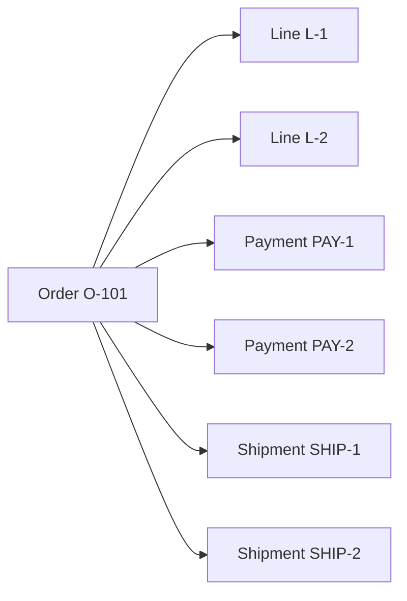
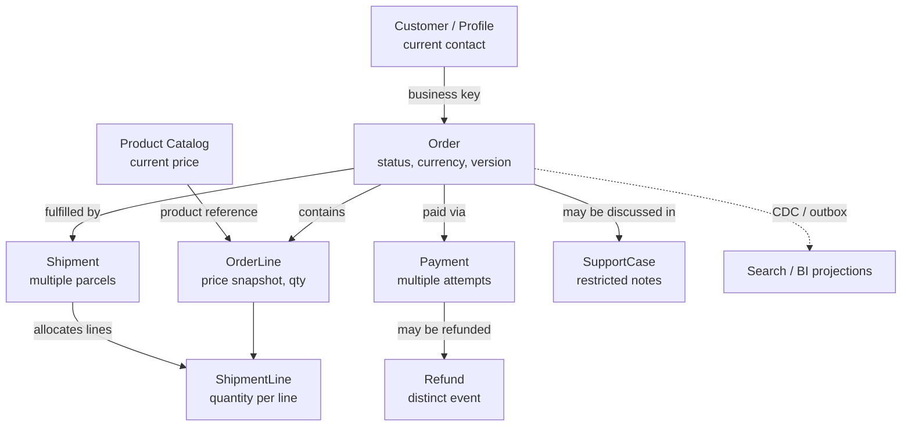
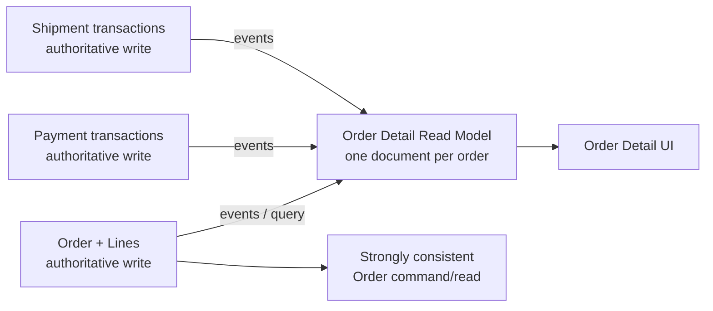
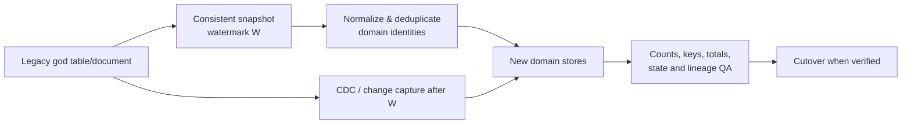
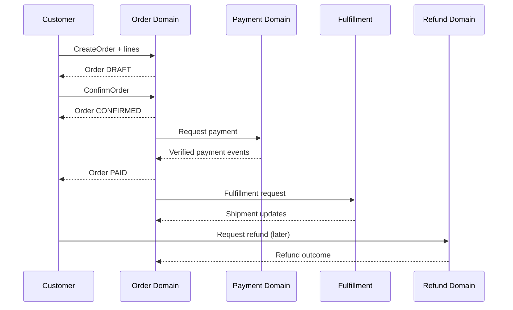

# One Table or One Document Mixing Too Many Concepts With Different Lifecycles

A sales system starts with a single `order_details` table to display everything on one screen: buyer, order lines, unit price, payment attempts, shipping parcels, tracking codes, refunds, and support notes. When the system is small, a single query seems sufficient. Months later, an order has **multiple payments**, each order is split into **multiple parcels**, **refunds occur after delivery**, and customers update their phone numbers. The original table no longer makes clear **what a single row represents**. `SUM` calculations multiply revenue, concurrent updates overwrite one another, deleting old records destroys evidence that must be kept, and contact details are duplicated everywhere.

A different version of the same mistake appears in a document database: a `customer_order_everything` document embeds the current customer profile, every order, every payment, every shipment, every support ticket, and analytics features. The document feels convenient for the first read, yet turns into a **lifecycle and ownership bottleneck**: changing a payment status rewrites the entire large object, deleting contact data can touch hundreds of embedded copies, and unbounded arrays make reads and writes progressively harder.

This is the **anti-pattern of mixing multiple concepts with different lifecycles into one storage unit or write contract**—often called a *god table*, *wide catch-all table*, *god document*, or oversized aggregate. The issue **is not that wide tables are always wrong**, nor that "more normalized tables are always better." The issue is that **identity, grain, ownership, creation timing, mutation conditions, consistency guarantees, and retention periods** of distinct facts are conflated.

This lesson belongs to the **Common Pitfalls** chapter of the **DATABASE_DATA_MODELING** module. Its goal is to develop the skill of turning business requirements into clear data models—from entities, relationships, constraints, keys, and indexes to physical schemas—while comparing relational, document, graph, and analytical models to choose structures that are easy to evolve and verify. This lesson equips you to **detect**, **draw boundaries around**, and **verify** a model when a single data store is carrying too many responsibilities.

After this lesson, you will be able to:

- Distinguish **a large read-oriented object** from **an aggregate requiring atomic updates**, and **a wide analytical table** from **an operational source with unclear grain**.
- Spot defects via **multiple candidate keys, independent 1–N relationships, conditional NULLs, update/insert/delete anomalies, fan-out, and ownership conflicts**.
- Redesign a sales domain with **Customer, Order, OrderLine, Payment, Shipment, Refund, and SupportCase** separated by lifecycle.
- Decide when to **embed snapshots or dependent parts in a document** versus when to **reference**, build projections, or extract events/facts.
- Write `PK`, `FK`, `UNIQUE`, `CHECK`, versioning, and cross-table checks while stating the exact limits of each mechanism.
- Plan a lossless migration that separates authoritative sources from copies and builds a **reconciliation benchmark dataset** to test for discrepancies.

## 1. Define "Different Lifecycles" Before Drawing Diagrams

Two concepts have **different lifecycles** when they are not always **created, modified, confirmed, canceled, or retained** at the same time and under the same accountable owner.

Compare them side by side:

| Concept | When Is It Created? | When Does It Change? | Who Owns It? | When Does It End or Retain History? |
| --- | --- | --- | --- | --- |
| **Customer profile** | Upon registration/onboarding | Customer updates contact info, verification, data restrictions | Customer/Profile domain | Per profile purpose and retention policy |
| **Order** | When customer initiates a purchase request | Lines added while draft; confirmed or canceled per state | Order domain | Order completes, yet transaction records must be kept per policy |
| **OrderLine** | When selecting items in an order | Quantity/price edited while draft; price locked | Order domain | Typically a historical snapshot of the order |
| **Payment attempt/transaction** | When initiating payment | Pending, success, failure, settlement | Payment domain | Has separate logs and retention periods |
| **Shipment** | When creating a delivery plan/parcel | Packed, handed-over, delivered, failed | Fulfillment domain | Can ship partially and track independently |
| **Refund** | When a refund request arises | Requested, approved, succeeded, failed | Refund/Payment domain | Can occur days after delivery |
| **Support case** | When customer opens a case | Messages, assignment, resolution | Support domain | Separate retention and access controls |
| **Analytics feature** | When computed by a pipeline | Recomputed per version or expired | Analytics/ML domain | Expiry may precede or outlive the order |

**Different lifecycles do not require separate databases, schemas, or microservices.** A modular monolith can use a single PostgreSQL database while keeping tables, keys, transactions, and write permissions properly separated. Conversely, a document database can still be modeled cleanly if each document respects **aggregate boundaries** and consistent update policies.

### 1.1. Four Questions to Ask Before Merging

1. **Identity and grain:** which single entity or event does one row/document represent? How many instances exist per parent?
2. **Time and state:** when the parent transitions to a new state, does the child continue changing independently?
3. **Ownership and transactions:** does the same business component hold authority to update all fields? Which fields must commit atomically?
4. **Queries, retention, permissions:** are they frequently read together? Must portions be deleted/restricted separately or retained for different durations?

Merging can make sense if the answers point to **truly the same boundary**. Merging solely because "a UI screen displays them together" is insufficient: **read shape** and **write model** are two distinct decisions.

### 1.2. Structure, Consistency, and Deployment Are Three Separate Decisions

- **Logical model:** which entities exist, what are their keys and relationships, and which invariants always hold?
- **Consistency boundary / aggregate:** which set of invariants must a command protect within a single consistent transaction?
- **Physical / read model:** how should normalized tables, nested documents, graph edges, search indexes, or analytical projections be stored to serve the workload?

An aggregate does not have to be **one table**, and a single table can hold multiple rows for the same entity type. A document can represent an aggregate, yet doing so does not automatically prove the aggregate boundary was chosen well. Never treat "one table = one domain" or "one document = one business workflow" as a rigid rule.

## 2. Counterexample: An `order_everything` Table With Unclear Grain

Suppose you have this table:

```sql
-- COUNTEREXAMPLE. Do not use as an implementation pattern.
CREATE TABLE order_everything (
    tenant_id TEXT,
    order_id TEXT,
    customer_id TEXT,
    customer_name TEXT,
    customer_phone TEXT,
    product_id TEXT,
    quantity INTEGER,
    unit_price_minor BIGINT,
    line_discount_minor BIGINT,
    payment_id TEXT,
    payment_status TEXT,
    payment_amount_minor BIGINT,
    shipment_id TEXT,
    tracking_code TEXT,
    shipment_status TEXT,
    refund_id TEXT,
    refund_amount_minor BIGINT,
    support_note TEXT,
    updated_at TIMESTAMPTZ
);
```

An immediate question arises: **what is the primary key?**

- `(tenant_id, order_id)` is not unique because one order has multiple lines, payments, and shipments.
- `(tenant_id, order_id, product_id)` is insufficient if one product appears on multiple lines or across multiple payments.
- `(tenant_id, order_id, payment_id)` is insufficient if a payment relates to multiple lines or parcels.
- `(tenant_id, order_id, product_id, payment_id, shipment_id)` creates a synthetic combination **not defined by the business** and can still collide.
- Adding an arbitrary `row_id` only gives **each record a technical ID**; it does not resolve what a row actually represents.

**A surrogate key cannot fix an ambiguous grain.** Having multiple independent 1–N relationships inside the same table produces **multiplicative combinations**.

### 2.1. Benchmark Reconciliation Dataset

Tenant `T-01` has order `O-101` placed by customer `C-01`. The order has two lines:

| line_id | product_id | Quantity | Locked Unit Price (VND) | Discount (VND) | Line Net (VND) |
| --- | --- | ---: | ---: | ---: | ---: |
| L-1 | P-BOOK | 2 | 100,000 | 10,000 | 190,000 |
| L-2 | P-PEN | 1 | 30,000 | 0 | 30,000 |

There are **two successful payments**, totaling 220,000 VND:

| payment_id | Amount (VND) | Status |
| --- | ---: | --- |
| PAY-1 | 120,000 | SUCCEEDED |
| PAY-2 | 100,000 | SUCCEEDED |

There are **two shipments** under the same order:

| shipment_id | Contents | Status |
| --- | --- | --- |
| SHIP-1 | Two books from L-1 | DELIVERED |
| SHIP-2 | One pen box from L-2 | IN_TRANSIT |

Later, a **30,000 VND refund** may occur because L-2 was returned; a refund is an **event on a different date** from the sale and requires its own status and authoritative source. For now, the benchmark dataset does not subtract refunds from order total until the **pre-/post-refund** KPI rule is defined.

The true figures are:

- **1 order**, **2 order lines**, **2 payments**, **2 shipments**.
- Gross = `2×100,000 + 1×30,000 = 230,000 VND`.
- Discount = `10,000 VND`.
- Initial net sales = **220,000 VND**.
- Total successful payments = **220,000 VND**.
- Both shipments can change status **independently** without creating extra orders.

### 2.2. Cartesian Multiplication When Combining Data

If the source only models `Order → Lines`, `Order → Payments`, and `Order → Shipments` and those three child sets are **independent**, joining them on the order produces:

\[
2\ \text{lines} \times 2\ \text{payments} \times 2\ \text{shipments}
= 8\ \text{rows}
\]



It does not mean a specific payment "belongs" exclusively to one line or one shipment unless the business defines an explicit allocation relationship. An `order_everything` table misleads readers into assuming every combination is meaningful, when it is actually just a JOIN artifact.

Example of a dangerous query:

```sql
-- COUNTEREXAMPLE: this query uses the separated tables from Section 7.
SELECT
    o.tenant_id,
    o.order_id,
    COUNT(*) AS joined_rows,
    SUM(l.quantity * l.unit_price_minor
        - l.discount_minor) AS false_sales_minor,
    SUM(p.amount_minor) AS false_payments_minor
FROM orders AS o
JOIN order_lines AS l
  ON l.tenant_id = o.tenant_id
 AND l.order_id = o.order_id
JOIN payments AS p
  ON p.tenant_id = o.tenant_id
 AND p.order_id = o.order_id
 AND p.status = 'SUCCEEDED'
JOIN shipments AS s
  ON s.tenant_id = o.tenant_id
 AND s.order_id = o.order_id
WHERE o.tenant_id = 'T-01'
  AND o.order_id = 'O-101'
GROUP BY o.tenant_id, o.order_id;
```

With the benchmark records:

```text
joined_rows         = 8
false_sales_minor   = 880000   -- wrong: 220000 × 4
false_payments_minor= 880000   -- wrong: 220000 × 4
correct_sales_minor = 220000
correct_paid_minor  = 220000
```

Two wrong sums **matching each other** does not prove the calculation is right. Row multiplication can produce false reconciliation where "both sides are scaled equally." Nor is arbitrary `DISTINCT` a solution: two distinct payments can share the **exact same amount**, two lines can share the same price, and `SUM(DISTINCT amount)` drops legitimate transactions.

## 3. Six Failure Modes From Mixing Multiple Lifecycles in One Table

### 3.1. Update Anomaly: Changing One Entity Touches Many Rows

Customer C-01 changes phone numbers. If the table holds 8 combinatorial rows for one order, `customer_phone` is duplicated 8 times; across 100 orders, the copies multiply further.

If only part of the rows get updated:

```text
O-101 / L-1 / PAY-1 / SHIP-1: phone = NEW
O-101 / L-1 / PAY-2 / SHIP-1: phone = OLD
... other combinations
```

The system now has **multiple "current" values** for an attribute supposed to have a single owner. Running `UPDATE ... WHERE customer_id` can accidentally overwrite **historical snapshots** that the business needed preserved.

### 3.2. Insert Anomaly: Cannot Create an Entity Independently

A customer with no orders yet still needs to register. If every row of `order_everything` requires `order_id`, you must insert dummy rows full of `NULL`s or delay customer creation until the first transaction.

Similarly, a `PENDING` payment can arise **before any shipment exists**. Requiring non-null `shipment_id` forces fake "placeholder shipments" or blocks recording the payment. This signals that the two entities **do not share a lifecycle**.

### 3.3. Delete Anomaly: Deleting One Part Destroys Other Facts

If a customer cancels an unshipped parcel and the application deletes "that shipment's row" from the catch-all table, it may also wipe out the line/payment data carried on that combination. Conversely, deleting the last line item can accidentally erase the entire order record.

**Deleting a shipment**, **voiding an unused payment**, and **canceling an order** are three distinct business actions with different preconditions, audits, and retention rules. Never model them by deleting a combined row and assuming unrelated concepts survive untouched.

### 3.4. NULL Explosion and Conditionally Meaningful Columns

A single table shared by payments, shipments, refunds, and support tickets soon accumulates:

```text
payment_id, bank_ref, settlement_at
shipment_id, tracking_code, delivered_at
refund_id, refund_reason, refund_approved_at
ticket_id, support_note, ticket_closed_at
```

Many columns stay `NULL` for rows belonging to other event types. The danger is not merely the percentage of NULLs—a generic event schema can be valid if **grain and event type** are explicit. The danger is **ambiguous NULL meanings**: not applicable, stage not yet reached, collection failed, redacted, or missing from a JOIN.

If you intentionally design a shared `events` table for multiple event types, it needs a **discriminator, schema version, per-event-type contract, unique identity, and validation**. Never create an ultra-wide nullable table and leave every consumer guessing what NULL means.

### 3.5. Concurrency and Hot Rows

Payment callbacks, shipment tracking updates, and support cases can arrive **concurrently**. If everything lives in one large document or order row, two workers can:

1. Read version 10.
2. Payment updates `paymentStatus=SUCCEEDED` and writes version 11.
3. Shipment writes the document back based on version 10 with `shipmentStatus=DELIVERED`, inadvertently reverting payment to the stale state.

A `version` check with compare-and-set **detects the conflict**, yet if two parts mutate independently at high frequency, an oversized aggregate causes **unnecessary write contention** and constant retries. Conversely, if two updates guard **the same business invariant**, splitting them unconditionally can break consistency.

### 3.6. Inability to Apply Distinct Access Controls and Retention Policies

Warehouse staff need tracking codes, not detailed payment records. Finance reconciliation needs payments and refunds, not private support ticket notes. Customer profile admins update current contact info, yet should never alter price snapshots on historical orders.

When everything resides in one table or document, **granting read access to one object** risks exposing sensitive fields. During retention cleanup, erasing contact details may damage transaction records, while keeping payment records long-term may retain support data past its allowed window. **Purpose, ownership, and lifecycle boundaries** must be clear in the model from the start.

## 4. The Root Error Is Not Column Count, but Dependencies and Write Ownership

### 4.1. Functional Dependencies Are Only One Signal

In a sales-line table structured like `(tenant_id, order_id, line_id, product_id, customer_name, payment_id, ...)`, you may observe:

```text
(tenant_id, order_id) -> customer_id, placed_at, order_status
(tenant_id, line_id) -> order_id, product_id, quantity, unit_price
(tenant_id, payment_id) -> order_id, payment_amount, payment_status
(tenant_id, shipment_id) -> order_id, tracking_code, shipment_status
(tenant_id, customer_id) -> current_contact_record
```

These dependencies reveal **distinct determinants and distinct entities**. If the table's grain is per line, order-level attributes repeat. With multiple payments and shipments, **multivalued dependencies** emerge and form meaningless Cartesian tuples.

Relational normalization (1NF, 2NF, 3NF, BCNF, 4NF depending on dependencies) exposes many of these issues. Still, **not every lifecycle flaw shows up through functional dependencies alone**: write ownership, state machines, effective time, retention, and concurrency also require business contracts.

### 4.2. Distinguishing Intentional Snapshots From Uncontrolled Copies

Not all duplicated data is wrong:

- `OrderLine.unit_price_minor` is the **locked price at sale time**, which may differ from `Product.current_price_minor`. This is an **intentional historical snapshot**.
- `Order.shipping_address_snapshot` may capture the **address used at checkout/delivery**, if business rules and retention policies allow.
- A search document may embed `customer_display_name` for fast lookups; that is a **projection** requiring a defined source, update path, and access/deletion policy.
- Warehouse facts repeat surrogate dimension keys across millions of rows; analytical grain and query purpose justify it.

Problems arise when a copy **fails to declare** whether it is a **current value**, **historical snapshot**, **cache**, or **derived feature**, who owns updates, and how long it is retained. Every intentional denormalization must document its **authoritative source** and **acceptable staleness**.

### 4.3. A Wide Table Can Be Valid When Every Attribute Shares One Grain

A `fact_sales_line` table with 80 columns describing **one sales line**—where every key and measure belongs to **that same line transaction** and contract—can be completely sound in a warehouse after evaluating the workload. Column count alone **never proves an anti-pattern**.

Conversely, a 12-column table mixing **payments and shipments** in the same row may already be broken. Always inspect **grain, dependencies, update frequency, mutation rules, authoritative source, and access permissions**.

## 5. Diagnostic Signals Through Questions and Metrics

### 5.1. Diagnostic Table

| Signal | Question to Investigate | Why It Matters |
| --- | --- | --- |
| One order ID appears across multiple rows inexplicably | Does a row represent a line, payment, or shipment? | Ambiguous grain, inflated sums |
| No natural PK exists besides `row_id` | What are the business identity and cardinalities? | Surrogate key hides meaningless combinations |
| Many conditionally NULL columns | Does NULL mean N/A or not yet happened? | Schema mixes distinct event types |
| Customer contact info copied repeatedly | Is this a current value or historical snapshot? | Update anomalies, retention risk |
| Multiple services edit the same document | Do they share one owner and invariant? | Lost updates, hot aggregates |
| Updating shipment status bumps order version | Does tracking really need a full-order transaction? | Overly broad concurrency scope |
| Payment callback must rewrite line lists | Why does payment know about line structure? | Lifecycle coupling |
| Support tickets require read access to raw payments | What fields are actually needed? | Over-privileged access |
| Deleting contact data touches thousands of orders | How many copies are intentional? | Hard to enforce data privacy |
| A BI query uses `SUM(DISTINCT)` to "deduplicate" | What is the grain of each JOIN? | Unresolved fan-out |
| DDL has many cross-column conditional `CHECK`s | Are separate entities/events hidden inside? | Schema is encoding workflow state |
| Document arrays grow without bound | Are size caps and retention defined? | Hot documents, oversized payloads |
| Multiple teams collide on schema migrations | Who owns each field group? | Unclear ownership |
| A small change forces many consumers to redeploy | Are schema/event contracts explicit? | Tight coupling |

### 5.2. Metrics to Gauge Severity

These metrics are useful **when interpreted against actual workloads**—never apply a universal threshold blindly:

- **Write amplification:** how many rows, documents, or copies must be touched by a single source change?
- **Duplicate factor:** how many times is one business fact repeated on average across a join or read model?
- **Sparse-field ratio:** fraction of columns/fields irrelevant to a given row or event type.
- **Update conflict rate:** rate of writes rejected due to version conflicts; separate necessary invariant conflicts from oversized-aggregate contention.
- **Projection lag:** how far behind the authoritative source a read copy lags.
- **Copy inventory coverage:** how many locations holding PII or snapshots are cataloged with working deletion paths.
- **Schema change blast radius:** how many services or consumers require changes when one field evolves.
- **Rule ownership coverage:** whether critical rules have named owners, automated tests, and enforcement mechanisms.

Table width, index count, or microservice count **never measure model quality on their own**. Evaluate **business invariants alongside operational symptoms**.

## 6. Choosing Boundaries: What Stays With Order, What Splits Out?

### 6.1. A Lifecycle-Driven Decision Matrix

| Concept | Belongs in Order Aggregate? | Typical Storage Form | Rationale |
| --- | --- | --- | --- |
| `Order.id, tenantId, state, version` | Yes | Order row/document | Order identity and lifecycle state |
| `OrderLine` during draft/lock | Usually yes | Child table / embedded array | Confirmation invariants and line subtotal |
| `Customer.currentPhone` | No | Separate Profile/Contact | Changes independently; sensitive PII |
| `Product.currentPrice` | No | Separate Catalog | Evolves independently without altering past orders |
| `OrderLine.priceSnapshot` | Yes | Part of the line | Historical proof of locked price |
| `PaymentAttempt` | Usually separate | Payment table/document/event | Multiple attempts, callbacks, independent settlement |
| `Shipment` | Usually separate | Shipment table/document/event | Multiple parcels, frequent tracking updates |
| `Refund` | Usually separate | Refund transaction/event | Occurs post-sale/payment under separate policy |
| `SupportCase` | Separate | Case table/document | Different actors, permissions, and retention |
| `SearchOrderView` | Derived | Projection document/index | Serves reads; never a command source |
| `FactOrderLine` | Derived | Warehouse fact | Analytical grain, history, and frozen metrics |

"Usually" does not mean mandatory. A simple system might combine `Order` and a single payment in one transaction if **ownership, cardinality, lifecycle, and invariants genuinely align**. What to avoid is merging out of habit without documenting why.

### 6.2. Base Aggregate Boundaries on Invariants, Not UI Screens

A structured approach:

1. List the invariants that **must always hold after commit**.
2. Identify which objects must be **read and written in the same transaction** to enforce those invariants.
3. Choose the aggregate root receiving commands and holding the consistency version.
4. For concepts that mutate independently, link by **identity, reference, or event** instead of pulling everything into the aggregate.
5. When an invariant spans multiple owners or services, design **reservations, workflows, sagas/outboxes, idempotency, and reconciliation**—never assume local ACID transactions cover the whole ecosystem.

For instance, `ConfirmOrder` must see valid `OrderLine`s and locked totals; keeping them in one logical boundary makes sense. Meanwhile, `MarkDelivered` arrives via carrier callbacks hours later and needs no lock over line pricing just to update tracking.

### 6.3. Logical Boundaries Need Not Mirror Physical Boundaries

`Order` and `OrderLine` can live in **two relational tables** yet update within **one transaction** owned by the Order Service. Conversely, a document may embed a payment summary solely for **reads**, while authoritative payment transactions live elsewhere. Never assume an embedded document owns every field inside it.

## 7. Reference Relational Model After Separating Lifecycles

### 7.1. Conceptual Diagram



The diagram highlights that **payments, shipments, refunds, and support cases are entities with their own identities**. `ShipmentLine` records how much of each line went into each parcel; that allocation cannot be inferred from joining on `order_id`.

### 7.2. Core DDL: Tenant Keys and Snapshot Attributes

The following **PostgreSQL** example illustrates only **local structure and constraints**. Authorization, state transitions, idempotency, and distributed workflows require explicit contracts. All monetary amounts here are **integer VND**; multi-currency systems must carry currency codes on every monetary event along with conversion policies.

```sql
CREATE TABLE customers (
    tenant_id TEXT NOT NULL,
    customer_id TEXT NOT NULL,
    contact_ref TEXT,
    PRIMARY KEY (tenant_id, customer_id)
);

CREATE TABLE products (
    tenant_id TEXT NOT NULL,
    product_id TEXT NOT NULL,
    current_price_minor NUMERIC(20,0) NOT NULL,
    PRIMARY KEY (tenant_id, product_id),
    CHECK (current_price_minor >= 0)
);

CREATE TABLE orders (
    tenant_id TEXT NOT NULL,
    order_id TEXT NOT NULL,
    customer_id TEXT NOT NULL,
    status TEXT NOT NULL,
    currency_code CHAR(3) NOT NULL DEFAULT 'VND',
    version BIGINT NOT NULL DEFAULT 1,
    placed_at TIMESTAMPTZ NOT NULL,
    PRIMARY KEY (tenant_id, order_id),
    FOREIGN KEY (tenant_id, customer_id)
        REFERENCES customers (tenant_id, customer_id),
    CHECK (status IN ('DRAFT','CONFIRMED','PAID','CANCELLED')),
    CHECK (currency_code = 'VND'),
    CHECK (version > 0)
);

CREATE TABLE order_lines (
    tenant_id TEXT NOT NULL,
    order_id TEXT NOT NULL,
    line_id TEXT NOT NULL,
    product_id TEXT NOT NULL,
    quantity INTEGER NOT NULL,
    unit_price_minor NUMERIC(20,0) NOT NULL,
    discount_minor NUMERIC(20,0) NOT NULL DEFAULT 0,
    PRIMARY KEY (tenant_id, order_id, line_id),
    FOREIGN KEY (tenant_id, order_id)
        REFERENCES orders (tenant_id, order_id),
    FOREIGN KEY (tenant_id, product_id)
        REFERENCES products (tenant_id, product_id),
    CHECK (quantity > 0),
    CHECK (unit_price_minor >= 0),
    CHECK (discount_minor >= 0),
    CHECK (discount_minor <= quantity * unit_price_minor)
);

CREATE INDEX order_lines_by_product
    ON order_lines (tenant_id, product_id);
```

Notes:

- `(tenant_id, order_id)` identifies the order within a tenant.
- `OrderLine` uses key `(tenant_id, order_id, line_id)` because line IDs here need only be unique **within an order**. That differs from globally/tenant-unique `line_id`.
- `orders.currency_code` is fixed to VND for consistent **arithmetic verification**. Downstream monetary tables must likewise enforce currency consistency.
- `unit_price_minor` is the **locked price at purchase time**; `products.current_price_minor` is the current catalog price. Never recalculate historical orders using current catalog prices.
- Foreign keys protect tenant-scoped referential integrity, yet **do not automatically enforce** "PAID means fully settled" or "lines cannot change after CONFIRMED."

### 7.3. DDL for Payments, Shipments, Shipment Allocations, and Refunds

```sql
CREATE TABLE payments (
    tenant_id TEXT NOT NULL,
    order_id TEXT NOT NULL,
    payment_id TEXT NOT NULL,
    provider_reference TEXT NOT NULL,
    amount_minor NUMERIC(20,0) NOT NULL,
    currency_code CHAR(3) NOT NULL DEFAULT 'VND',
    status TEXT NOT NULL,
    occurred_at TIMESTAMPTZ NOT NULL,
    PRIMARY KEY (tenant_id, order_id, payment_id),
    UNIQUE (tenant_id, provider_reference),
    FOREIGN KEY (tenant_id, order_id)
        REFERENCES orders (tenant_id, order_id),
    CHECK (amount_minor > 0),
    CHECK (currency_code = 'VND'),
    CHECK (status IN ('PENDING','SUCCEEDED','FAILED'))
);

CREATE TABLE shipments (
    tenant_id TEXT NOT NULL,
    order_id TEXT NOT NULL,
    shipment_id TEXT NOT NULL,
    tracking_code TEXT,
    status TEXT NOT NULL,
    updated_at TIMESTAMPTZ NOT NULL,
    PRIMARY KEY (tenant_id, order_id, shipment_id),
    FOREIGN KEY (tenant_id, order_id)
        REFERENCES orders (tenant_id, order_id),
    CHECK (status IN (
        'PLANNED','PACKED','IN_TRANSIT',
        'DELIVERED','FAILED'
    ))
);

CREATE TABLE shipment_lines (
    tenant_id TEXT NOT NULL,
    order_id TEXT NOT NULL,
    shipment_id TEXT NOT NULL,
    line_id TEXT NOT NULL,
    shipped_quantity INTEGER NOT NULL,
    PRIMARY KEY (tenant_id, order_id, shipment_id, line_id),
    FOREIGN KEY (tenant_id, order_id, shipment_id)
        REFERENCES shipments (tenant_id, order_id, shipment_id),
    FOREIGN KEY (tenant_id, order_id, line_id)
        REFERENCES order_lines (tenant_id, order_id, line_id),
    CHECK (shipped_quantity > 0)
);

CREATE TABLE refunds (
    tenant_id TEXT NOT NULL,
    order_id TEXT NOT NULL,
    refund_id TEXT NOT NULL,
    payment_id TEXT NOT NULL,
    amount_minor NUMERIC(20,0) NOT NULL,
    currency_code CHAR(3) NOT NULL DEFAULT 'VND',
    status TEXT NOT NULL,
    occurred_at TIMESTAMPTZ NOT NULL,
    PRIMARY KEY (tenant_id, order_id, refund_id),
    FOREIGN KEY (tenant_id, order_id, payment_id)
        REFERENCES payments (tenant_id, order_id, payment_id),
    CHECK (amount_minor > 0),
    CHECK (currency_code = 'VND'),
    CHECK (status IN ('REQUESTED','SUCCEEDED','FAILED'))
);
```

Splitting tables **does not make the system correct by itself**:

- Retried payment callbacks may require a `UNIQUE` constraint on provider event ID or an idempotency table; `provider_reference` suffices only if the provider guarantees it uniquely identifies that transaction type.
- Total `shipped_quantity` across shipments for one line **must not exceed** `order_lines.quantity` unless over-shipping is allowed; this is a **cross-table invariant** not enforced by single-row `CHECK` constraints.
- Successful refunds must not exceed the refundable balance of the payment per business rules; one payment can have **multiple partial refunds**, requiring proper concurrency control and transactions.
- `status = 'PAID'` is not enforced by DDL against the sum of `SUCCEEDED` payments.
- Tracking lost/damaged items or exchanges requires **events/adjustments** at the right grain rather than silently mutating original snapshots.

### 7.4. Support Cases Have Their Own Lifecycle and Permissions

A minimal table:

```sql
CREATE TABLE support_cases (
    tenant_id TEXT NOT NULL,
    case_id TEXT NOT NULL,
    order_id TEXT,
    status TEXT NOT NULL,
    opened_at TIMESTAMPTZ NOT NULL,
    closed_at TIMESTAMPTZ,
    restricted_note_ref TEXT,
    PRIMARY KEY (tenant_id, case_id),
    FOREIGN KEY (tenant_id, order_id)
        REFERENCES orders (tenant_id, order_id),
    CHECK (status IN ('OPEN','RESOLVED','CLOSED')),
    CHECK (closed_at IS NULL OR closed_at >= opened_at)
);
```

`order_id` can be NULL if a ticket does not relate to a specific order. Sensitive notes are isolated via `restricted_note_ref` rather than placed directly in shared views or events. This creates **a storage and permission boundary**, though actual authorization and retention enforcement still must be implemented.

## 8. Verifiable Fixtures After Separation

### 8.1. Minimal Base Records

This SQL fixture assumes the schema from Section 7 has been created:

```sql
INSERT INTO customers (tenant_id, customer_id, contact_ref)
VALUES ('T-01','C-01','CONTACT-01');

INSERT INTO products
    (tenant_id, product_id, current_price_minor)
VALUES
    ('T-01','P-BOOK',110000),
    ('T-01','P-PEN',35000);

INSERT INTO orders
    (tenant_id,order_id,customer_id,status,
     currency_code,version,placed_at)
VALUES
    ('T-01','O-101','C-01','PAID',
     'VND',3,'2026-10-01 09:00:00+07');

INSERT INTO order_lines
    (tenant_id,order_id,line_id,product_id,
     quantity,unit_price_minor,discount_minor)
VALUES
    ('T-01','O-101','L-1','P-BOOK',
     2,100000,10000),
    ('T-01','O-101','L-2','P-PEN',
     1,30000,0);

INSERT INTO payments
    (tenant_id,order_id,payment_id,provider_reference,
     amount_minor,currency_code,status,occurred_at)
VALUES
    ('T-01','O-101','PAY-1','PREF-1',
     120000,'VND','SUCCEEDED',
     '2026-10-01 09:05:00+07'),
    ('T-01','O-101','PAY-2','PREF-2',
     100000,'VND','SUCCEEDED',
     '2026-10-01 09:06:00+07');

INSERT INTO shipments
    (tenant_id,order_id,shipment_id,
     tracking_code,status,updated_at)
VALUES
    ('T-01','O-101','SHIP-1','TRACK-A',
     'DELIVERED','2026-10-03 12:00:00+07'),
    ('T-01','O-101','SHIP-2','TRACK-B',
     'IN_TRANSIT','2026-10-03 12:00:00+07');

INSERT INTO shipment_lines
    (tenant_id,order_id,shipment_id,line_id,shipped_quantity)
VALUES
    ('T-01','O-101','SHIP-1','L-1',2),
    ('T-01','O-101','SHIP-2','L-2',1);
```

Current catalog prices in the fixture are 110,000 VND for P-BOOK and 35,000 VND for P-PEN, **different** from the line snapshot prices. That difference is **intentional**, not a sync bug. If the catalog changes on October 5, the October 1 order still uses each line's `unit_price_minor`.

The `PAID` status in this fixture is a **post-workflow snapshot** for arithmetic verification; direct `INSERT` statements do not validate state transitions, callback verification, or payment auditing. Those behaviors must be tested via dedicated commands and workflows.

### 8.2. Reconciliation Invariants

| Metric / Object | Expected Value |
| --- | ---: |
| Order count | 1 |
| Order line count | 2 |
| Successful payment count | 2 |
| Shipment count | 2 |
| Shipment allocation count | 2 |
| Initial gross sales | 230,000 VND |
| Discount | 10,000 VND |
| Initial net sales | **220,000 VND** |
| Total successful payments | **220,000 VND** |
| Sold quantity of P-BOOK | 2 |
| Sold quantity of P-PEN | 1 |
| Refunds recorded in fixture | 0 |

If a `SUCCEEDED` refund of 30,000 VND is added later, a defined reporting policy can compute **net after refunds = 190,000 VND**; that **does not alter** the original line total of 190,000/220,000, nor should refunds be mixed in as new sales payments.

## 9. Correct SQL: Aggregate at Each Grain Before Joining

### 9.1. Wrong: Joining Three 1–N Relationships Directly

Section 2 already showed how the raw `JOIN` yields 8 rows and 880,000. The culprit is joining independent child tables directly on `order_id`. Wrapping an 8-row result inside a view does not make its grain "one order."

### 9.2. Right: Group Each Source First

```sql
WITH line_totals AS (
    SELECT
        tenant_id, order_id,
        COUNT(*) AS line_count,
        SUM(quantity * unit_price_minor) AS gross_minor,
        SUM(discount_minor) AS discount_minor,
        SUM(quantity * unit_price_minor - discount_minor)
            AS net_minor
    FROM order_lines
    GROUP BY tenant_id, order_id
),
payment_totals AS (
    SELECT
        tenant_id, order_id,
        COUNT(*) FILTER (WHERE status = 'SUCCEEDED')
            AS successful_payment_count,
        COALESCE(SUM(amount_minor) FILTER (
            WHERE status = 'SUCCEEDED'
        ),0) AS paid_minor
    FROM payments
    GROUP BY tenant_id, order_id
),
shipment_totals AS (
    SELECT
        tenant_id, order_id,
        COUNT(*) AS shipment_count,
        COUNT(*) FILTER (WHERE status = 'DELIVERED')
            AS delivered_shipment_count
    FROM shipments
    GROUP BY tenant_id, order_id
)
SELECT
    o.tenant_id,
    o.order_id,
    COALESCE(l.line_count,0) AS line_count,
    COALESCE(l.gross_minor,0) AS gross_minor,
    COALESCE(l.discount_minor,0) AS discount_minor,
    COALESCE(l.net_minor,0) AS net_minor,
    COALESCE(p.paid_minor,0) AS paid_minor,
    COALESCE(p.successful_payment_count,0)
        AS successful_payment_count,
    COALESCE(s.shipment_count,0) AS shipment_count,
    COALESCE(s.delivered_shipment_count,0)
        AS delivered_shipment_count
FROM orders AS o
LEFT JOIN line_totals AS l
  ON l.tenant_id = o.tenant_id
 AND l.order_id = o.order_id
LEFT JOIN payment_totals AS p
  ON p.tenant_id = o.tenant_id
 AND p.order_id = o.order_id
LEFT JOIN shipment_totals AS s
  ON s.tenant_id = o.tenant_id
 AND s.order_id = o.order_id
WHERE o.tenant_id = 'T-01'
  AND o.order_id = 'O-101';
```

Each CTE produces **at most one row per `(tenant_id,order_id)`**, preventing fan-out in the final result. In a multi-currency system, **group by currency** or convert each transaction using the appropriate rate/policy before summing—never take `SUM(payment.amount)` across mixed currencies and label it VND.

### 9.3. Never Use `SUM(DISTINCT)` to Mask Fan-Out

Suppose two payments both equal 100,000 VND. `SUM(DISTINCT amount_minor)` returns **100,000** instead of **200,000**—wrong because two separate transactions legitimately share **the same amount**.

Principles:

- Identify the grain of every source.
- Aggregate to a common grain before joining.
- Preserve transaction identities to separate transport retries from genuine business events.
- Reconcile row, order, and transaction counts across the same period.
- Never use `DISTINCT` to compensate for missing keys or broken joins.

### 9.4. Separate Event Logs From Current Snapshots

`payments` in the example represents **current state per payment transaction**. If provider callbacks arrive multiple times or transition states, the system may need a `payment_events` table whose grain is **one callback/event**, with idempotency key and source version, while `payments` serves as the current snapshot/projection derived from verified events.

Do not append multiple callbacks into `payments` while continuing to call each row "one payment." **When grain changes, tables, keys, names, and calculations must be revisited.**

## 10. Distinguishing Two Kinds of 1–N Relationships: Are They Truly Independent?

Having multiple lines, payments, and shipments on an order **does not automatically mean every child belongs outside the aggregate**. Evaluate **independence vs. shared invariants**.

### 10.1. Children That Belong Inside the Aggregate

`OrderLine` typically depends on Order:

- It does not exist outside an Order.
- Locked prices and quantities must be valid at confirmation.
- Adding/removing lines while draft changes the order total and Order version.
- Multiple independent owners should not edit lines after lock-in.

Therefore, keeping lines inside an Order document or child tables committed within the Order transaction is reasonable.

### 10.2. Children That Usually Have Separate Lifecycles

`Payment` can:

- Be initiated after Order confirmation.
- Receive asynchronous callbacks and retries.
- Carry separate idempotency keys, provider references, and settlement states.
- Be refunded or disputed after delivery.
- Follow separate retention and authorization rules.

`Shipment` can:

- Split or bundle lines across parcels.
- Receive high-frequency tracking updates.
- Hold independent delivery statuses per parcel.
- Require different locks, owners, and retention from Payment.

Merging payments and shipments solely because both carry `order_id` **confuses a foreign-key reference with a shared lifecycle**.

### 10.3. One-to-Many Is Not the Only Reason to Split

Even if a document holds only one contact email, if that email **changes independently and requires separate deletion/restriction**, referencing it may still be better than embedding it in every order. Conversely, a small, bounded list of 3–10 configuration attributes sharing the same owner and transaction may be perfectly safe to embed.

**Multiplicity, growth rate, ownership, atomicity, and retention must be evaluated together.**

## 11. Document Databases: When Is Embedding Right vs. Becoming a "God Document"?

### 11.1. A Well-Scoped Order Document

A design can embed `lines` while storing **derived summaries** of payment and fulfillment:

```json
{
  "_id": "T-01:O-101",
  "tenantId": "T-01",
  "orderId": "O-101",
  "customerId": "C-01",
  "status": "PAID",
  "version": 3,
  "currencyCode": "VND",
  "lines": [
    {
      "lineId": "L-1",
      "productId": "P-BOOK",
      "quantity": 2,
      "unitPriceMinor": 100000,
      "discountMinor": 10000
    },
    {
      "lineId": "L-2",
      "productId": "P-PEN",
      "quantity": 1,
      "unitPriceMinor": 30000,
      "discountMinor": 0
    }
  ],
  "paymentSummary": {
    "paidMinor": 220000,
    "sourceVersion": 12
  },
  "fulfillmentSummary": {
    "shipmentCount": 2,
    "deliveredCount": 1,
    "sourceVersion": 7
  }
}
```

In this example:

- `lines` is **data owned by the Order aggregate**, governed by price-locking and update rules.
- `paymentSummary` is a **projection from the payment source**, never treated as the authoritative payment ledger.
- `fulfillmentSummary` is a **projection from fulfillment**, omitting full tracking event histories.
- `sourceVersion` for Payment and Shipment are **two independent version axes**—never compare them against `Order.version` as a single sequence.
- Do not embed phone numbers, payment secrets, full event logs, or support notes just to save an API call on the order detail screen.

This is an **intentional hybrid read/write model**, not a universal template. A system with multi-document transactions and different read patterns may choose another layout.

### 11.2. God Document Counterexample

```json
{
  "customerId": "C-01",
  "profile": {
    "phone": "example-sensitive-value",
    "verificationHistory": []
  },
  "allOrders": [
    {
      "orderId": "O-101",
      "lines": [],
      "allPaymentEvents": [],
      "allShipmentTrackingEvents": [],
      "allRefunds": [],
      "allSupportMessages": [],
      "allRiskFeatures": []
    }
  ]
}
```

Arrays can grow without bound over time; multiple subsystems need write access, yet `Customer`, `Order`, `Payment`, `Shipment`, and `Support` share neither owner nor retention. Updating `profile.phone` touches an object carrying payment history, while deleting support messages can force rewriting the entire blob.

**Not every document database rewrites the whole document on every operation**; engines support partial updates, multi-document transactions, versioning, and varied storage internals. Still, **aggregate coupling, array growth, write contention, access control, and lifecycle divergence** must be evaluated against actual contracts and workloads.

### 11.3. Criteria for Embedding vs. Referencing

| Question | Favors Embedding | Favors Referencing / Splitting |
| --- | --- | --- |
| Does the child exist independently? | No | Has its own identity and commands |
| Same owner? | Yes | Different domain or source |
| Updated atomically together? | Frequently / mandatory | Unnecessary; updated independently |
| Is cardinality bounded? | Yes, small and stable | Large, unbounded, append-heavy |
| Read together? | Very frequently | Frequently queried separately |
| Access control & retention? | Aligned | Significantly different |
| Needs independent child history? | Minimal / simple | Rich event stream and as-of queries |
| Consistency tolerance? | Must sync inside aggregate | Eventual projection is acceptable |

Being read together **is a helpful signal**, yet insufficient to justify merging if the remaining criteria argue against it. You can build a **dedicated read model** instead of forcing the write source into one giant object.

### 11.4. Document Updates and Versioning

Suppose two independent consumers update the same document:

```text
Payment consumer:
  set paymentSummary.paidMinor = 220000, version=12

Shipment consumer:
  set fulfillmentSummary.deliveredCount = 1, version=7
```

If both **replace the entire document** from a stale read, they overwrite each other. Choose field-owned atomic partial updates, source-version preconditions, or split projections into separately identified documents. When **two consumers own distinct fields**, never use a single scalar version to order both streams.

## 12. Status, Time, and History: Do Not Collapse Into One `status` Column

### 12.1. One "Order" Status Does Not Describe Every Component

For example, `Order.status = PAID` while `Shipment SHIP-2 = IN_TRANSIT` can be **completely valid**. Collapsing them into `order_everything.status` leaves the system unable to tell whether the status reflects ordering, payment, shipping, or refunding.

Use distinct semantics:

```text
Order.lifecycle_status       = PAID
Payment(PAY-1).status        = SUCCEEDED
Payment(PAY-2).status        = SUCCEEDED
Shipment(SHIP-1).status      = DELIVERED
Shipment(SHIP-2).status      = IN_TRANSIT
Refund(R-1).status          = REQUESTED  // if raised later
```

Statuses can coordinate via **workflows**, without merging into one enum. For instance, "order completed" can be a **derived business view** computed from payment and fulfillment using an explicit formula.

### 12.2. Current State, Events, and Historical Versions Are Different Models

A row `payments.status=SUCCEEDED` is a **current snapshot** of a payment. A `payment_events` table may hold:

```text
PAY-1 / v1 / CREATED   / occurred_at...
PAY-1 / v2 / AUTHORIZED/ occurred_at...
PAY-1 / v3 / SUCCEEDED / occurred_at...
```

Never feed these three events into `SUM(payment.amount)` and count **three payments**. Event history has a grain of **one event or transition**; the snapshot has a grain of **one payment**. If the system needs both, give them separate names and data contracts.

A single `updated_at` column cannot reconstruct past states if only the latest snapshot is stored. If reports ask "what did we know on date X?", you need **business valid time**, **recorded/system time**, and reconstructible versions. Never assume every timestamped table is a complete temporal model.

### 12.3. Sensitive Data Lifecycles Need Not Match Transaction Lifecycles

An order may need line items and monetary amounts retained for accounting/legal compliance, whereas delivery phone numbers or support notes may have shorter retention windows. Embedding raw contact details into every Order complicates updates, restrictions, and erasure requests.

Possible solutions include:

- `contact_ref` pointing to a protected identity/contact store.
- Minimal delivery snapshots when strictly required for legal documents, with documented purpose and retention.
- Restricted evidence stores with versioning and access logging.
- Projection caches using field allowlists and deletion propagation.
- Tombstones/versions so stale events cannot resurrect restricted data.

Never claim a single `DELETE customers` wipes data everywhere: account for replicas, backups, analytics, search indexes, event logs, and statutory retention obligations.

## 13. Cross-Table Rules Require Transactions or Workflows

### 13.1. "A PAID Order Must Have Full Payment" Is Not a Simple `CHECK`

Consider an invariant:

\[
\operatorname{Order.status}=\text{PAID}
\;\Rightarrow\;
\sum_{\text{payments SUCCEEDED}}\operatorname{amount}
=\sum_{\text{lines}}(\operatorname{qty}\cdot\operatorname{price}-\operatorname{discount})
\]

This formula applies only to an example **without taxes, fees, refunds, mixed currencies, or partial captures**. Once those exist, redefine the metric accordingly. Separating tables makes the rule **clearer**, yet enforcing it requires defining **read timing**, **isolation/locking**, **authoritative payment sources**, and **handling for late payments**.

There is nothing wrong if the business defines `PAID` as verified payment under current policy; what is wrong is **assuming** FKs and `CHECK` constraints on the order table enforce conditions across payment rows.

### 13.2. Shipment Allocation Must Not Exceed Ordered Quantity

For `shipment_lines`, the rule is:

\[
\sum_{\text{shipments of a line}}\operatorname{shippedQuantity}
\leq \operatorname{orderLine.quantity}
\]

If two warehouse workers simultaneously pack a line of 2 units and both observe 0 allocated so far, both can write `shipped_quantity=2` across two shipments—totaling 4 and exceeding the ordered 2. `CHECK(shipped_quantity > 0)` still passes.

You need appropriate concurrency protection: row/aggregate reservation locks, optimistic concurrency, allocation ledgers, or sufficiently strong transaction isolation, backed by parallel tests. Splitting tables makes **invariants visible**, rather than enforcing them automatically.

### 13.3. Example Query to Detect Over-Shipping

```sql
SELECT
    l.tenant_id,
    l.order_id,
    l.line_id,
    l.quantity AS ordered_quantity,
    COALESCE(SUM(sl.shipped_quantity),0) AS allocated_quantity
FROM order_lines AS l
LEFT JOIN shipment_lines AS sl
  ON sl.tenant_id = l.tenant_id
 AND sl.order_id = l.order_id
 AND sl.line_id = l.line_id
GROUP BY l.tenant_id, l.order_id, l.line_id, l.quantity
HAVING COALESCE(SUM(sl.shipped_quantity),0) > l.quantity;
```

On the sample fixture, this returns **0 violating rows**: L-1 is allocated 2/2 and L-2 is 1/1. This query is for **reconciliation**, not a substitute for write-time transactional checks.

### 13.4. Idempotency and Event Ordering

Payment providers can deliver `SUCCEEDED` callbacks multiple times. If the system inserts a new `payment` row every time, payment totals break even with separated tables.

A contract requires:

- Stable **provider event ID / payment ID** scoped properly by tenant and provider.
- Deduplication before applying side effects.
- Validation of legal state transitions.
- Recording versioned or ID-keyed outbox events when downstream consumers depend on them.
- Handling late/out-of-order callbacks; never substitute `received_at` for source order when source versions/sequences exist.
- Reconciliation against the authoritative source when events are missing.

**Separating lifecycles stops semantic mixing; end-to-end correctness also requires write contracts and verification.**

## 14. Reading a Composite Page Does Not Force Writing a Composite Object

### 14.1. CQRS / Read Projections as an Option

If an "Order Details" screen needs the order, lines, payment summary, and shipment status, you can build `OrderDetailView` from the authoritative sources:



The projection can be a wide document, **provided it is explicitly marked as derived**:

```text
projection_key         = (tenant_id, order_id)
order_source_version   = 3
payment_source_version = 12
shipment_source_version= 7
projected_at           = ...
freshness_policy       = EVENTUAL
redaction_policy       = FIELD_ALLOWLIST
```

Read projections never replace authoritative payment or shipment ledgers. When deciding "has this order been fully paid?", never rely on a lagging summary if the business requires confirmed source state.

### 14.2. How Does a Wide Projection Differ From a God Document?

| Characteristic | Intentional Projection | Problematic God Document |
| --- | --- | --- |
| Role | Derived read model | Also the write authority for every concept |
| Source owner | Each field has an authoritative owner | Multiple owners mutate one shared object |
| Grain | One view per order | Unclear whether document represents customer, order, or history |
| Freshness | SLO, source versions, replayable | Unclear when updates arrive |
| Updates | Consumers update only owned fields | Full payload replacement causes lost updates |
| Retention | Field allowlist, redaction | Accumulates all raw data |
| Rebuildability | Reconstructible from snapshots/replay/reconciliation | Canonical source unclear |
| Size | Bounded to view needs | Unbounded historical arrays |

Multiple consumers can update a read model, yet require **non-overwriting updates, version scoping, and field ownership**; calling something a "projection" does not solve concurrency automatically.

### 14.3. JOIN on Read vs. JOIN on Write

Joining normalized tables in **a read query with clear grain** is not bad. What is wrong is **storing the multiplied Cartesian result as if every row were a real event**, then aggregating blindly. For low-latency apps, views or materialized views work well—just account for refresh cost, indexing, and staleness tolerances.

A well-verified denormalized view can be **far more efficient** than dozens of distributed calls; never split databases or microservices solely to look "pure DDD." Separate **logical models and write ownership** first, then optimize physical storage based on workload.

## 15. Graph Models: Each Concept Has Its Own Nodes, Edges, and History

A graph can express:

```cypher
(:Customer {tenantId:'T-01', customerId:'C-01'})
  -[:PLACED]->
(:Order {tenantId:'T-01', orderId:'O-101'})

(:Order {orderId:'O-101'})-[:HAS_LINE]->
(:OrderLine {lineId:'L-1'})

(:Payment {paymentId:'PAY-1'})-[:PAYS_FOR]->
(:Order {orderId:'O-101'})

(:Shipment {shipmentId:'SHIP-1'})-[:FULFILLS]->
(:Order {orderId:'O-101'})
```

The relationships above illustrate **conceptual structure** only. In a real graph database, enforce tenant/scope on both endpoints, edge direction/type, uniqueness, and separation of events from snapshots.

A **counterexample** in graphs is stuffing every payment, shipment, refund, and history array into one giant property on an `Order` vertex, making it impossible to query **which payment was refunded, which parcel carried which line, or the timestamp and actor of each event**.

Conversely, turning **every scalar field** into a separate vertex is not automatically good either. Use nodes and edges where relationships and traversals are central, while still respecting **identity, lifecycle, roles, validity, and provenance**.

### 15.1. Do Not Infer Business Relationships From Shortest Paths

If two customers share a device or shipping address, a graph shows a connecting path. That **does not prove they are the same person**; similarly, a shipment and payment linked to the same order do not prove that shipment was paid by **that specific payment**. Any link used as a business fact must come from an **explicitly created and verified relationship**, not incidental JOINs or graph traversals.

## 16. Warehouses: Wide Facts Differ From Mixing Different-Grain Events

A warehouse may need:

- `fact_order_line`: one sales/order line per policy.
- `fact_payment_transaction`: one payment/settlement event.
- `fact_shipment_event` or `fact_shipment_daily`: shipping events or snapshots.
- `fact_refund`: one refund event.
- Customer/product/date/region dimensions governed by history and access policies.

**A single fact table** cramming sales, payments, shipments, and refunds into one row leads to:

- Measures with conflicting grains and timestamps.
- Multiplied monetary amounts on joins.
- Sparse rows full of non-applicable columns.
- Ambiguity over whether `event_date` is order date, payment date, or delivery date.
- Wrong order counts when running `COUNT(*)`.
- Summing end-of-day inventory across days or summing ratios like currency.
- Painful historical restatements and late-arriving event handling.

You can build a **factless event table** where every row is **one standardized event sharing a common grain** ("one event") with an explicit event type; yet if measures and accounting rules vary completely by type, keep event-specific facts or dedicated semantic models.

### 16.1. Conformed Dimensions Do Not Mean One Fact Table

Multiple facts can share `dim_customer`, `dim_date`, or `dim_product` for analysis. That does not require forcing all measures into one table. To compare metrics across grains, use **drill-across**: aggregate each fact by **conformed dimensions** and matching scope first, then combine the aggregated results.

With an SCD Type 2 `dim_customer`, one business customer has multiple surrogate keys over time. Even with separated facts, joining on the wrong dimension version can multiply rows—keep **business key, valid time, and grain** explicit.

### 16.2. Event Time, Processing Time, and Reporting

An order is placed October 1, paid October 2, delivered October 5, and refunded October 20. Four events have **four distinct timestamps**. Forcing them into a single `created_at` on a god table turns "sales by order date," "cash collected by payment date," "shipments delivered per day," and "refunds by refund date" into an undefinable muddle.

Separating grains and event times lets BI answer each question accurately, while snapshots/reporting projections can serve overview screens without distorting canonical sources.

## 17. Migrating Away From an Overloaded Table/Document: Step by Step

### Step 1 — Lock Down Business Definitions Before Splitting Data

Document clearly:

- What `Order`, `OrderLine`, `Payment`, `Shipment`, `Refund`, and `SupportCase` mean.
- Each entity's grain, keys, and tenant scope.
- Which event or field owner governs each value.
- How current values, snapshots, event histories, and derived fields differ.
- Rules for money, currencies, quantities, state transitions, and retention.
- Ambiguous cases and legacy data that cannot be inferred automatically.

Never start with `CREATE TABLE ... SELECT DISTINCT ...` across the entire legacy table before knowing **which record is canonical**.

### Step 2 — Inventory and Profile Source Data

Count orders, lines, payments, shipments, and combinations; look for:

- Colliding business IDs across tenants.
- One payment having conflicting amounts/statuses in the legacy table.
- One customer having multiple "current" phone numbers due to out-of-sync copies.
- `NULL` or default values that erased state distinctions.
- Inflated totals caused by fan-out.
- Inconsistent timestamps, late-arriving events, and expired retention data.
- Which rows/events are transport duplicates, corrections, or genuine business events.

If one payment repeats 8 times with the same `payment_id`, **deduplicate by confirmed identity**, never by `DISTINCT(amount)` or picking an arbitrary row.

### Step 3 — Build the New Schema With Constraints and Mapping

Create the new tables or collections with tenant-scoped PKs/FKs, unique idempotency keys, field ownership, versioning, and appropriate indexes. Maintain a `legacy_row_id → canonical (order_id, line_id, payment_id, shipment_id...)` mapping if lineage is needed. Quarantine records that **cannot be resolved automatically** for business review instead of silently guessing.

### Step 4 — Backfill From a Consistent Snapshot

A typical workflow:



Know **which log offset/watermark the snapshot corresponds to**. If backfill and CDC both process a change, ingestion must be idempotent; misaligned boundaries lose or duplicate events. Never assume dual-writes across two databases are atomic; use **outboxes, change capture, or a single authoritative write path**.

### Step 5 — Run Shadow Reads and Reconcile

During shadow reads or canary rollout, compare:

- Entity counts by **business key**, not raw row counts.
- Monetary totals at matching grain, currency, and period.
- Payment counts vs. payment event counts.
- Total allocated quantities per shipment.
- Current state and history by event/source version.
- Access permissions and retention for sensitive fields.
- Propagation lag and mismatch rates.

Some legacy reports may **already be wrong** due to fan-out. The goal is not always matching a broken old dashboard—use an approved **business oracle** to classify discrepancies as migration bugs vs. previously hidden errors now fixed.

### Step 6 — Cut Over, Clean Up, and Plan Rollback

- Establish a single authoritative write path; route commands to the new owner.
- Disable legacy write paths or enforce controlled read-only mode.
- Monitor event/consumer lag and FK/version errors.
- Define a clear rollback or roll-forward plan; never roll back to a store that drops newly recorded events.
- Delete or redact legacy copies per retention policy—including backups and exports.
- Update documentation, dashboards, alerts, runbooks, and ownership records.

## 18. Data Quality Checks When Splitting Models

### 18.1. Verify the Source Does Not Generate Duplicate Lines or Payments

While `PRIMARY KEY`s in the new tables block identity duplicates, you still need staging/source checks to detect wrong record selection. Sample query on staging using inferred identity:

```sql
-- Assumes staging_payment_events exists
-- with an immutable source_payment_key per provider.
SELECT
    tenant_id,
    source_payment_key,
    COUNT(*) AS source_rows,
    COUNT(DISTINCT amount_minor) AS distinct_amounts
FROM staging_payment_events
GROUP BY tenant_id, source_payment_key
HAVING COUNT(*) > 1
    OR COUNT(DISTINCT amount_minor) > 1;
```

This query **does not prove every duplicate ID is an error**: rows may be valid retries or snapshot versions. It flags records **requiring triage**. Inspect event IDs, source versions, timestamps, and conflicting payloads rather than picking `MIN/MAX(amount)` arbitrarily.

### 18.2. Reconcile Payments Against Orders in the Same Currency

```sql
WITH due_by_order AS (
    SELECT
        tenant_id, order_id,
        SUM(quantity * unit_price_minor - discount_minor)
            AS due_minor
    FROM order_lines
    GROUP BY tenant_id, order_id
),
paid_by_order AS (
    SELECT
        tenant_id, order_id,
        SUM(amount_minor) AS paid_minor
    FROM payments
    WHERE status = 'SUCCEEDED'
    GROUP BY tenant_id, order_id
)
SELECT
    o.tenant_id,
    o.order_id,
    COALESCE(d.due_minor,0) AS due_minor,
    COALESCE(p.paid_minor,0) AS paid_minor
FROM orders AS o
LEFT JOIN due_by_order AS d
  ON d.tenant_id = o.tenant_id
 AND d.order_id = o.order_id
LEFT JOIN paid_by_order AS p
  ON p.tenant_id = o.tenant_id
 AND p.order_id = o.order_id
WHERE o.status = 'PAID'
  AND COALESCE(d.due_minor,0)
      <> COALESCE(p.paid_minor,0);
```

In the example model, **0 mismatched rows** are expected. If the business allows overpayments, partial payments, settlement fees, chargebacks, refunds, or mixed currencies, adjust the equation to match the **exact business metric**. Never force equality by altering source values.

### 18.3. Check for Cross-Tenant Reference Violations

Composite FKs in the new schema prevent many leaks, yet migration staging or external read models may lack FKs. Always join and validate on `(tenant_id, id)` rather than `id` alone. Sample staging check:

```sql
SELECT
    sl.tenant_id,
    sl.order_id,
    sl.line_id
FROM staging_shipment_lines AS sl
LEFT JOIN order_lines AS l
  ON l.tenant_id = sl.tenant_id
 AND l.order_id = sl.order_id
 AND l.line_id = sl.line_id
WHERE l.line_id IS NULL;
```

`staging_shipment_lines` is illustrative here and not part of Section 7's DDL. If a staging line ID mismatches tenant/order, never "fix" it by dropping the tenant predicate to match another tenant's line.

### 18.4. Verify Versions and Field Ownership on Projections

An `OrderDetailView` containing `paymentSummary` and `shipmentSummary` needs:

- `order_source_version`.
- `payment_source_version` or the corresponding stream's watermark/offset.
- `shipment_source_version` or its own watermark.
- `projected_at` and freshness/status metadata.
- Field allowlists and redaction policies.

If a projection stores only a single `last_updated_at`, it can mask the fact that Payment is up to date while Shipment lags far behind. Never mark the entire object "synced" simply because one consumer wrote to it.

## 19. When Is Keeping a Wide Table or Document Intentional and Valid?

Splitting everything is not an end in itself. Several cases justify **controlled consolidation**:

1. **Point-in-time snapshots:** issued invoice columns can preserve checkout/invoicing details as legal evidence; never treat them as the live customer profile.
2. **Read projections:** an order-detail document combining summaries from multiple owners with source versions, TTLs, rebuild paths, and field allowlists.
3. **Bounded value objects:** address value objects with street/ward/district fields embedded when they genuinely share one lifecycle.
4. **Transactional aggregates:** Order and OrderLines mutated by the same confirmation command; can be one document or two tables in one transaction.
5. **Analytical flat tables:** a sales-line fact table with many same-grain dimensions and measures for fast analytical queries.
6. **Event envelopes:** an event sharing common metadata with a typed payload and strict schema validation; never reused as a multi-purpose current-state entity.
7. **Hot-path caches:** short-lived summaries with explicit invalidation rules that never claim to be the canonical source.

### 19.1. Minimum Conditions for Safe Denormalization

| Condition | Required Evidence / Documentation |
| --- | --- |
| Explicit grain | "One row/document is one ..." |
| Authoritative source | Field owners; which command writes canonical state |
| Read/write goal | Concrete query patterns, latency, and cost |
| Consistency contract | Strong/snapshot/eventual; source versions/watermarks |
| Safe updates | CAS, merge-by-field ownership, idempotency |
| Copy lifecycle | TTL, retention, redaction, deletion propagation |
| Non-multiplying metrics | Grain- and unit-aware reconciliation |
| Bounded size | Bounded arrays, compaction/archival if applicable |
| Rebuildability | Snapshots/source logs and versioned schemas |
| Documented trade-offs | ADR, owners, metrics, and evolution plan |

If these cannot be answered, a "performance-optimized wide table" is often just **deferred risk**.

## 20. Edge Cases Frequently Overlooked

### 20.1. The Same Product Appearing on Two Lines

An Order can have two lines with the same `product_id` yet different **prices, promotions, or fulfillment lots**. Thus `(tenant_id,order_id,product_id)` is not necessarily the line key. You need `line_id` or another business identity. Never deduplicate two lines simply because they share a product.

### 20.2. Repeated Payment Callbacks With Different Status Updates

The same payment `PAY-1` emits `PENDING` then `SUCCEEDED`. If the new table holds one current row per payment, it needs versioning or verified state-precedence rules. If storing every callback, the grain changes and needs an event ID. Never count those two rows as two payments collected.

### 20.3. Shipments Spanning Multiple Lines and One Line Split Across Shipments

A 10-unit line may ship 6 units in parcel A and 4 in parcel B. `shipment_lines` models that allocation. Placing a single `shipment_id` column directly on `order_lines` **cannot represent** splitting a line across multiple parcels without duplicating the line or losing delivered quantities.

### 20.4. Refunds Occurring After Source Orders Close

Refunds can happen **long after an order or shipment closed**. Archiving/deleting orders under an overly short TTL or stuffing refunds into `orders.refund_amount` loses multi-refund histories, failed refund attempts, and the distinction between requested and settled refunds.

### 20.5. Current Customer Updates Must Not Overwrite Historical Records

C-01 changes name or address after purchase. The current profile updates under its owner. Historical records needing a snapshot must be **explicitly defined as snapshots** with separate retention—never treat every copy as a live value.

### 20.6. Multiple Currencies and Units of Measure

If an Order involves payments processed in USD/EUR, you cannot sum amounts while ignoring currency. For quantities sold by box, kg, or unit, distinguish UOM and conversion rules. Even a well-split schema fails if currency or UOM is missing.

### 20.7. Two Requests Editing Different Parts

One command edits an order line while draft, and a shipment callback arrives after confirmation. Sharing one version and document creates conflicts despite disjoint invariants. Yet splitting without workflow checks risks shipping an unconfirmed order. Design needs **lock-in stages** and clear command boundaries, not just separate tables.

### 20.8. Dirty Legacy Data

A legacy god table may hold two phone numbers for one `customer_id`, three statuses for one `payment_id`, and a shipment missing an ID. Never "normalize" by blindly picking the latest timestamp if timestamps are unreliable or source versions are absent. Conflicts require **owner-approved reconciliation rules**.

### 20.9. Good Indexes Cannot Fix Wrong Grain

Adding indexes makes SELECT queries faster, yet cannot turn a `line × payment × shipment` Cartesian product into a valid fact. When metrics are wrong, query tuning only delivers **the wrong answer faster**.

### 20.10. Microservices Splitting Code While Still Sharing One God Table

If Order, Payment, and Fulfillment services all write to the same shared table, renaming modules to "microservices" removes zero coupling. Define data ownership, command/event interfaces, and transaction boundaries first—even while still sharing one database.

## 21. Pre-Implementation Design Review Process

### Step 1 — Write One Grain Sentence per Entity

`Order`: one order within a tenant. `Payment`: one payment transaction on an order. `Shipment`: one shipping parcel/transaction on an order. `ShipmentLine`: one allocation of a line's quantity to a shipment. `Refund`: one refund transaction.

If you cannot write one clear sentence for a table or document, treat that as a warning sign to redesign.

### Step 2 — Draw Separate Lifecycles / Timelines



This sequence is illustrative only; real systems may begin fulfillment before payment settles if policy allows. The key point is that payment, shipping, and refunds have **distinct timelines**, even though they are related.

### Step 3 — Assign Write Ownership and Invariants

Who is authorized to confirm payment? Who updates shipment status? When are line snapshots locked? Which commands require atomicity? How are cross-service invariants enforced? Define each explicitly instead of saying "everything lives in order."

### Step 4 — Choose a Normalized Logical Model and Dedicated Read Views

Never let a single composite UI screen dictate the entire write model. Starting from a clean logical model, design queries, grain-safe joins, projections, or caches tailored to workloads. For documents, evaluate embed vs. reference by owner, lifecycle, size, and transactions.

### Step 5 — Write Examples and Counterexamples

The O-101 dataset must yield **220,000 VND** for both net sales and paid total; a raw 2×2×2 join must be flagged as wrong. Test concurrent payment/shipment updates, callback retries, contact updates, late refunds, deletions, and restores. Establish **business-verified expected answers** independent of SQL layout.

### Step 6 — Validate With Tests and Operational Telemetry

Verify:

- Keys, tenant-scoped FKs, unique idempotency.
- State transitions and version conflicts.
- No over-shipping or over-refunding.
- No fan-out in reports.
- Projection lag, ordering, and rebuildability.
- Access controls and retention.
- Backfill and reconciliation prior to cutover.

## 22. Mistakes That Easily Recur Even After Splitting Models

1. **Splitting tables without assigning source owners.** Multiple systems still write the same fields and collide.
2. **Using one shared `updated_at` across all lifecycles.** Impossible to tell order, payment, shipping, or refund dates apart.
3. **Keeping one generic Order status for every component.** Payments, shipments, and refunds have independent states.
4. **Adding tables yet writing the same raw JOINs.** Normalization alone does not eliminate fan-out.
5. **Using `SUM(DISTINCT amount)` to hide row multiplication.** Silently drops distinct events sharing the same amount.
6. **Pulling current catalog prices into historical orders.** Destroys locked price snapshots.
7. **Assigning a specific payment to a shipment just because they share an order.** No verified business link exists.
8. **Embedding every child record in a document for read convenience.** Creates unbounded arrays, hot documents, and tangled retention.
9. **Copying current customer contacts into every order.** Complicates updates, deletion, and privacy protection.
10. **Adding a `row_id` PK without defining grain.** Still unclear what each row represents.
11. **Using a single scalar version across independent event streams.** Causes spurious rollbacks or dropped updates.
12. **Treating CDC/outbox as exactly-once.** Retries and duplicates still require idempotency.
13. **Confusing projections with the source of truth.** Editing a cache or search index while thinking business state was fixed.
14. **Splitting into microservices prematurely.** Introduces unnecessary distributed complexity when multiple tables in one DB suffice.
15. **Skipping transactions for cross-table invariants.** Post-write check queries do not stop race conditions.
16. **Applying one retention period to every concept.** Violates least privilege and purpose limits.
17. **Resolving migration conflicts by picking "latest value" without evidence.** Risks selecting the wrong canonical record.
18. **Comparing only old vs. new row counts.** Row counts differ across grains; reconcile keys, amounts, and history.
19. **Deleting legacy copies before testing replay/backfill.** Risks irreversible data loss.
20. **Optimizing for maximum table count.** Split purposefully based on lifecycles, identity, invariants, and workloads.
21. **Treating all denormalization as bad.** Intentional snapshots and projections can be completely sound.
22. **Treating every nullable column as a bug.** NULLs can be valid when semantics and event types are explicit.
23. **Lacking field-level data contracts.** Consumers diverge on current vs. historical vs. derived meanings.
24. **Lacking a reconciliation benchmark dataset.** Queries look plausible while silently multiplying numbers.

## 23. Hands-On Exercises and Reference Answers

### Exercise 1 — Identifying the Grain of a God Table

A table contains `order_id`, `line_id`, `payment_id`, and `shipment_id`. One order has 3 lines, 2 payments, and 4 shipments.

**Prompt:** when joining three independent 1–N relationships, how many rows can be generated? Can one row be called "one order"?

**Hint:** `3×2×4 = 24` combinations. You cannot call each row one order; child sets have **distinct grains**, and their Cartesian combination is not a real business event.

### Exercise 2 — Computing Sales Accurately

O-101 has L-1 net 190,000 and L-2 net 30,000 VND, two payments totaling 220,000 VND, and two shipments.

**Prompt:** what is the true net sales amount? What sum could a three-way JOIN produce for line totals?

**Hint:** true net sales is **220,000 VND**. The JOIN yields 8 rows, repeating each line 4 times, inflating `SUM(line_net)` to **880,000 VND**. Aggregate lines by order before joining payment/shipment totals.

### Exercise 3 — Same Amount Does Not Mean Duplicate

PAY-1 and PAY-2 both have `amount_minor = 100000`, yet are two separate transactions with distinct IDs.

**Prompt:** what does `SUM(DISTINCT amount_minor)` return, and why is it wrong?

**Hint:** it returns **100,000** instead of **200,000**. Deduplicate by **transaction identity** and source grain, never by monetary value.

### Exercise 4 — Snapshots vs. Current Values

The catalog currently lists P-BOOK at 110,000 VND, while OrderLine locked the price at 100,000 VND.

**Prompt:** should the order line be updated to match the catalog?

**Hint:** no. Line price is an **order historical snapshot**, whereas catalog price is the current value for future sales. Post-sale adjustments, if allowed, follow separate workflows/events.

### Exercise 5 — Split by Lifecycle or by Screen?

The order detail screen displays customer, payments, shipments, refunds, and support cases.

**Prompt:** must all of them live in a single write-source table/document so the screen loads in one call?

**Hint:** no. Keep authoritative sources separated by owner and lifecycle, and build a **read projection** at the one-order grain with field allowlists, source versions, and freshness SLOs. UI shape does not define the write aggregate.

### Exercise 6 — Late-Arriving Payment Callback

A payment is already `SUCCEEDED`, yet a `PENDING` callback arrives afterward due to out-of-order network delivery.

**Prompt:** if the payment sits inside a huge object updated via full-document replacement, what goes wrong and what is needed?

**Hint:** a stale write can overwrite `SUCCEEDED` back to `PENDING` or drop other recent fields. You need source event IDs/versions, transition policies, idempotency, and field-owned updates or separate payment state.

### Exercise 7 — Shipment Allocation

L-1 ordered 10 units; SHIP-1 allocated 6, and SHIP-2 plans 5.

**Prompt:** is this allocation valid? Would `CHECK (shipped_quantity > 0)` catch it?

**Hint:** `6+5=11 > 10`, violating the no-over-ship rule. Single-row `CHECK` constraints still pass; you must enforce **total cross-row allocation inside transactions** alongside reconciliation queries.

### Exercise 8 — Can OrderLines Be Embedded in a Document?

An order has a few dozen lines, added/removed while draft and locked together with the Order.

**Prompt:** must every line be extracted into its own top-level document?

**Hint:** not necessarily. Embedding `lines` works well when cardinality is bounded, owner and transaction align, and document size stays well within engine limits. Payment callbacks and tracking histories have separate lifecycles and should be evaluated for separation.

### Exercise 9 — Customer Contact Info and Retention

A customer changes phone numbers; the number was copied into 500 historical order documents.

**Prompt:** what bugs arise? Are there cases where old snapshots still must be kept?

**Hint:** update/deletion anomalies, redundant PII, and current-vs-historical confusion. If delivery documents legally require a point-in-time snapshot, keep it **explicitly scoped with dedicated retention and permissions**; never treat copies as current contact records.

### Exercise 10 — Not Every Table Needs a Microservice

A team keeps Order and OrderLine in the same PostgreSQL schema under one Order Service transaction.

**Prompt:** is the design "insufficiently split" just because it uses one database?

**Hint:** no. Logical/aggregate boundaries and write ownership matter far more than database count. Never introduce microservices or distributed transactions to "fix" something cleanly handled by two tables and a local transaction.

### Exercise 11 — Reporting by Which Date?

An order is placed October 1, paid October 2, shipped October 5, and refunded October 20.

**Prompt:** if a shared table has only `event_date`, can all four daily metrics be computed accurately?

**Hint:** not without explicit event types and grain. You need order date, payment date, shipping date, and refund date—or dedicated event facts keyed by business milestone.

### Exercise 12 — Projection Version Comparisons

`OrderDetailView` has `orderVersion=4`, `paymentVersion=12`, and `shipmentVersion=7`.

**Prompt:** should you compare these versions for equality to check whether data is synchronized?

**Hint:** no. They originate from different sources and aggregates. Track source versions/watermarks **independently per stream**, alongside freshness SLAs and read-model contracts.

### Exercise 13 — Backfilling From Legacy

Legacy data contains one payment ID repeated eight times, yet two rows have different amounts.

**Prompt:** should you run `DISTINCT(payment_id)` and pick an arbitrary amount?

**Hint:** no. This could indicate source conflicts, partial updates, or multiple versions. Inspect source events, statuses, timestamps, provider references, and owner rules—quarantine unresolved records rather than guessing.

### Exercise 14 — Fast Reads Without Losing Source Ownership

Product requires the order detail page to respond under 100 ms, while payment and fulfillment sources live in two services.

**Prompt:** must you merge the source schemas to hit that latency?

**Hint:** not necessarily. Use a refreshed read projection, cache, or composite read API. Define freshness SLOs, safe fallbacks for sensitive actions, event ordering, and benchmark the workload before deciding.

### Exercise 15 — Events vs. Snapshots

`payment_events` holds `CREATED`, `AUTHORIZED`, and `SUCCEEDED` for the same PAY-1. `COUNT(*)` returns 3.

**Prompt:** are there three payments?

**Hint:** no. There are **three events** for **one payment transaction**. The `payments` snapshot table has one row for PAY-1. Define metrics at the proper grain.

### Exercise 16 — Evaluating Whether a Wide Table Is an Anti-Pattern

`fact_sales_line` has 90 columns where every row is one sales line, measures carry clear currency/UOM, keys are unique, and lineage is documented. Another table has only 15 columns yet mixes lines, payments, and refunds without clear grain.

**Prompt:** which table is more concerning, and why?

**Hint:** the 15-column table is far more concerning due to ambiguous grain and mixed lifecycles. Column count alone is insufficient; examine identity, invariants, owners, current/historical semantics, retention, and query patterns.

### Exercise 17 — Choosing the First Action

A team wants to split `order_everything` into seven tables, yet hasn't agreed on whether "sales" is pre- or post-refund.

**Prompt:** should they start creating tables immediately?

**Hint:** first lock down **metric contracts, grain, events, and authoritative sources**; build benchmark fixtures and collect conflicting legacy cases. Splitting physical tables before aligning meanings may merely spread the confusion across more tables.

## Summary

**One table or one document containing too many concepts with different lifecycles** breaks because it lacks a consistent grain, couples independent mutations together, and blurs **current state, historical snapshots, events, and derived read models**. The consequences include **update/insert/delete anomalies, JOIN fan-out, lost updates, hot documents, broken retention, and overly broad access permissions**. The fix is not splitting tables blindly or multiplying services, but defining **identity, grain, lifecycle, ownership, invariants, transaction boundaries, and query contracts** for each concept. Separate **Order, OrderLine, Payment, Shipment, Refund, and SupportCase** where lifecycles truly diverge, keep **snapshots or embedded children** where justified, and build **controlled wide read projections** when queries demand them. Finally, verify with **benchmark arithmetic fixtures, row-multiplication counterexamples, concurrency tests, audits, migrations, and reconciliation** to prove the new model is genuinely better—not merely tidier on paper.
