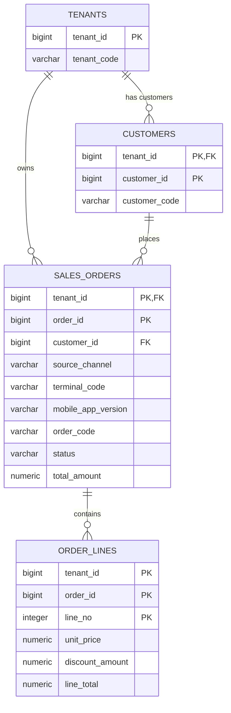
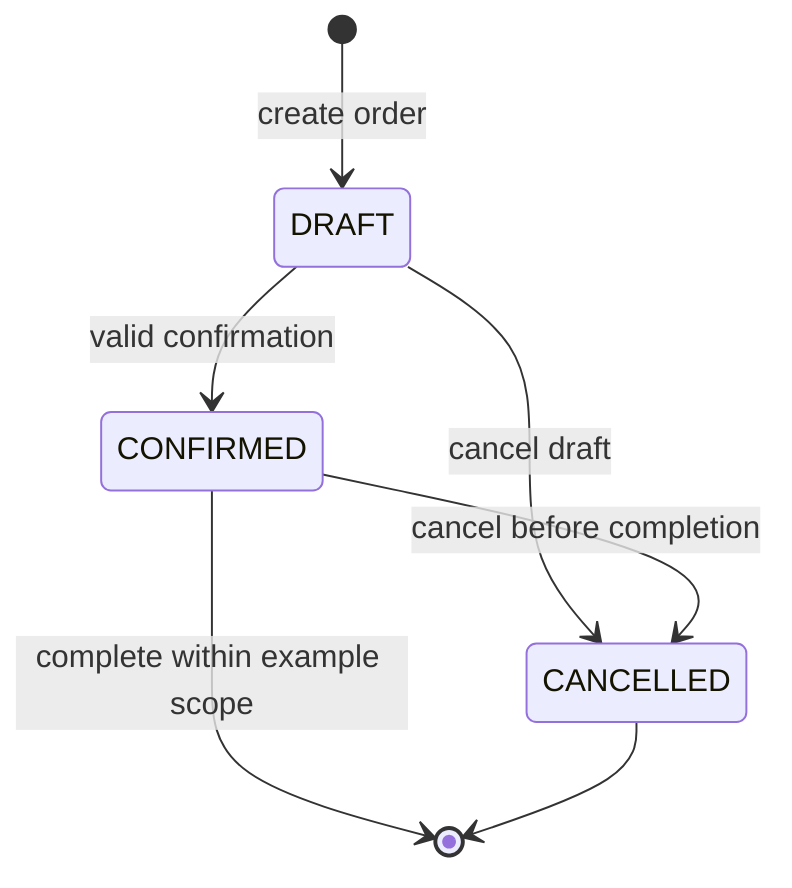
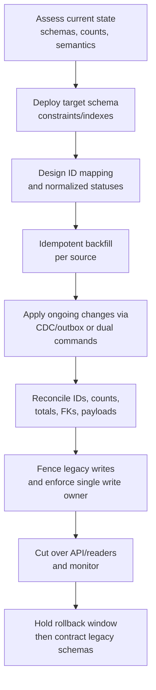

# Creating Too Many Tables or Types for Very Small Differences

A sales application accepts orders from three channels: **website**, **mobile app**, and **point-of-sale (POS)**. All three share customers, product lines, quantities, unit prices, discounts, statuses, and creation timestamps. Only a few attributes differ, such as a POS terminal code or mobile app version. The development team creates three tables—`web_orders`, `mobile_orders`, and `pos_orders`—alongside three order-line tables, three repositories, and three Java classes, then writes three near-identical sets of migrations and reports.

At first, the model looks "neatly separated by type." Six months later, adding `cancelled_at`, adjusting discount rules, or implementing reconciliation forces all three branches to change in lockstep. One branch misses a foreign key constraint, another forgets a status check, reports must `UNION ALL` multiple tables, and the application accumulates repetitive type conversions. **Small differences were turned into large structural divisions.**

This is the error of **over-modeling** (or *over-specialization*): creating too many tables, entities, subtypes, interfaces, auxiliary enums, or abstraction layers merely to express variants that have no meaningful difference in **grain, lifecycle, relationships, constraints, or business behavior**.

This lesson belongs to the **Common Pitfalls** chapter of the **DATABASE_DATA_MODELING** module. Its goal is to recognize when a difference should simply be **an attribute or classification value**, when it justifies an extension table or dedicated type, and when entities truly must split. We progress from requirements to keys, FKs, `CHECK` constraints, indexes, queries, Java models, migration plans, and verifiable test suites.

> **Core thesis:** There is no rule saying "fewer tables is always better" or "every business label gets its own table." Good design selects **the right entity boundaries** and expresses differences with the **minimum structural complexity needed to protect business invariants**.

## 1. Recognizing Symptoms: When Variety Inflates Into Multiple Models

Common warning signs include:

- `web_orders`, `mobile_orders`, and `pos_orders` share over 90% of their columns, the same customer keys, the same order lines, and the same statuses.
- Every shared field addition requires updating three DDLs, three Java entities, three mappers, three APIs, and three test suites.
- "All orders" reports must stitch multiple tables together and manually reconcile differences in column names or status meanings.
- Introducing a `KIOSK` variant forces yet another set of tables, even though it only differs by `source_channel` and a device code.
- Separate `WebOrderId`, `MobileOrderId`, and `PosOrderId` types exist, yet all are handled as the exact same business identifier with no distinct rules.
- Another table referencing "an order" cannot use a standard FK because orders live across three tables; the schema creates `web_order_id`, `mobile_order_id`, and `pos_order_id` columns with a rule that "exactly one is non-null."
- Variants share identical confirm/cancel use cases yet implement three separate state machines that gradually drift apart unintentionally.

**Not all repetition is a mistake.** Two tables sharing many column names yet carrying **different semantics, lifecycles, or constraints** may need to stay separate. Diagnose the root cause of differences before tearing down boundaries.

### 1.1. Distinguish Three Questions

| Question | Example | Typical Modeling Direction |
|---|---|---|
| **Is this the same entity?** | A Web order and a POS order are both customer sales transactions | One `SalesOrder` entity |
| **Is this an attribute of the entity?** | Whether an order came from `WEB` or `MOBILE` | A `source_channel` column with a controlled domain |
| **Is this a different lifecycle or business meaning?** | Sales orders vs. supplier purchase orders | Likely two distinct entities |

When the third answer is "different," never force both into a shared table simply because they happen to have `id`, `status`, and `created_at`.

### 1.2. Cascading Complexity

Suppose you have `N` variants and `K` cross-cutting capabilities (CRUD, confirm, cancel, reporting, auditing, migrations, exports). When each variant carries a full parallel stack, the number of touchpoints scales roughly with `N × K`. This is **not a literal cost formula**, yet illustrates how minor branching fans out across layers.

When adding a new variant:

```text
Fragmented design:
  new channel -> table + FK + repository + service + reports + migration

Consolidated design with discriminator:
  new channel -> extend controlled values + metadata + truly distinct rules
```

The goal is not simply fewer files; it is **eliminating duplicate invariants and write paths**, thereby reducing the chance that variants drift out of sync.

## 2. Start From Grain and Lifecycle, Not Type Names

**Grain** answers "what does one row represent?" In this scenario:

> One row of `sales_orders` = one sales order for **one tenant**, with one order code, one customer, one origination channel, and one shared confirm–cancel–complete lifecycle.

One row of `order_lines` = one item line belonging strictly to that order.

Website, mobile, and POS are **origination channels**. They do not create three new meanings of "order" when customers, statuses, lines, totals, and fulfillment policies are identical.

### 2.1. Verify Whether Two Variants Share the Same Grain

Ask:

1. Do a Web order and a POS order carry the same legal and business meaning of a sale?
2. Do both share the same owner, tenant scope, and customer model?
3. Do they follow the same rules for adding lines, summing totals, and completing?
4. Can an order switch channels by policy, or is channel an immutable creation metadata attribute?
5. Do both share the same history, payment, and reconciliation requirements?
6. Do differences lie purely in **extra attributes**, or in genuinely different approval steps and relationship structures?

If most differences reduce to **origination channel and minor metadata**, favor a unified model first and verify edge cases.

### 2.2. Identical Column Names Do Not Prove Identical Entities

Conversely, `purchase_orders` for buying from suppliers and `sales_orders` for selling to customers may both contain `order_id`, `status`, `total_amount`, and `created_at`. Yet their counterparties, payables vs. receivables semantics, approvals, inventory inflow/outflow, and settlement rules differ fundamentally.

Merging those two into a single `everything_orders` table just because columns match causes **under-modeling**. The lesson is balance: avoid both **unnecessary fragmentation** and **collapsing distinct meanings**.

### 2.3. Domain Identity Differs From Display Labels

`WEB`, `MOBILE`, and `POS` are input classification values. If the `MOBILE` channel rebrands or ships a new app version, that does not create a new Order entity. Never design table boundaries just because product owners give each channel a separate product name.

## 3. Reference Scenario: Three Order Channels

Assume a multi-tenant SaaS platform where customers purchase through three channels:

| Requirement | Web | Mobile | POS |
|---|---|---|---|
| One order belongs to one tenant and one customer | Yes | Yes | Yes |
| Multiple product lines, quantity, snapshot unit price | Yes | Yes | Yes |
| `DRAFT/CONFIRMED/CANCELLED` statuses | Yes | Yes | Yes |
| Order total equals sum of lines | Yes | Yes | Yes |
| Source event ID for deduplication (if present) | Yes | Yes | Yes |
| Mobile app version | No | Yes | No |
| Cashier terminal code | No | No | Yes |
| Unified revenue reporting needed | Yes | Yes | Yes |

**Genuine differences:** Mobile captures `mobile_app_version`, while POS captures `terminal_code`. Web needs neither attribute. All three share the exact same order and order-line definition.

### 3.1. Sample Dataset

```text
Tenant 101:
  Order 9001: channel WEB,    customer 7, 2 lines,  total 230.00 USD
  Order 9002: channel MOBILE, customer 7, 1 line,   total  75.00 USD
  Order 9003: channel POS,    customer 9, 3 lines,  total 150.00 USD

Tenant 202:
  Order 9001: channel POS, customer 7, 1 line, total 40.00 USD
```

`order_id=9001` can collide across tenants. An order in tenant 101 must never reference a customer or product belonging to tenant 202. Source channel never replaces tenant isolation.

### 3.2. Invariants That Must Not Be Lost When Merging Tables

| ID | Invariant | Enforcement Layer |
|---|---|---|
| I01 | Order, customer, and lines belong to the same tenant | Composite FK including `tenant_id` |
| I02 | `order_code` is unique within a tenant | `UNIQUE(tenant_id, order_code)` |
| I03 | Every order has one valid `source_channel` | `NOT NULL` + `CHECK` or lookup FK |
| I04 | `terminal_code` is exclusive to and required for POS (in this example) | Conditional `CHECK` |
| I05 | `mobile_app_version` is exclusive to and required for MOBILE | Conditional `CHECK` |
| I06 | Lines have positive quantity and valid price/discount | `CHECK` / generated column |
| I07 | No duplicate ingestion of the same source event in scope | Unique source key + payload comparison |
| I08 | No line edits after order confirmation | Transaction / state policy |
| I09 | `total_amount` matches sum of `line_total` | Write protocol + reconciliation |
| I10 | No cross-tenant reads or writes | Auth, DB privileges, RLS where appropriate |

Consolidating tables **must never weaken constraints**. A schema with fewer tables that dumps everything into an unvalidated `payload_json` column is not necessarily better than the fragmented design.

## 4. Fragmented Design: Why It Fails Long-Term

An **intentionally flawed** example:

```sql
-- ANTI-PATTERN ILLUSTRATION: three nearly identical entity tables.
CREATE TABLE web_orders_bad (
    tenant_id BIGINT NOT NULL,
    order_id BIGINT NOT NULL,
    customer_id BIGINT NOT NULL,
    status VARCHAR(20) NOT NULL,
    total_amount NUMERIC(19, 2) NOT NULL,
    created_at TIMESTAMPTZ NOT NULL,
    PRIMARY KEY (tenant_id, order_id)
);

CREATE TABLE mobile_orders_bad (
    tenant_id BIGINT NOT NULL,
    order_id BIGINT NOT NULL,
    customer_id BIGINT NOT NULL,
    status VARCHAR(20) NOT NULL,
    total_amount NUMERIC(19, 2) NOT NULL,
    mobile_app_version VARCHAR(40),
    created_at TIMESTAMPTZ NOT NULL,
    PRIMARY KEY (tenant_id, order_id)
);

CREATE TABLE pos_orders_bad (
    tenant_id BIGINT NOT NULL,
    order_id BIGINT NOT NULL,
    customer_id BIGINT NOT NULL,
    status VARCHAR(20) NOT NULL,
    total_amount NUMERIC(19, 2) NOT NULL,
    terminal_code VARCHAR(50),
    created_at TIMESTAMPTZ NOT NULL,
    PRIMARY KEY (tenant_id, order_id)
);
```

Note that these are three **independent** tables. `order_id=9001` can appear in both Web and POS for the same tenant because no table-wide uniqueness spans all three. If the business requires a **shared order ID namespace**, this design needs an external global ID allocator or a shared parent table. Nor can `payment_events` declare a standard single foreign key pointing to "whichever of the three tables holds the order."

### 4.1. Relationship Explosion

Once you create `web_order_lines`, `mobile_order_lines`, and `pos_order_lines`, line calculation logic duplicates three times. Adding `payment_events` yields:

```text
payment_events
  -> web_order_id?
  -> mobile_order_id?
  -> pos_order_id?
```

Three nullable FKs governed by "exactly one FK is non-null" **propagates fragmentation** into every downstream table. It requires awkward `CHECK`s counting non-null columns, complicates queries, and forces schema changes everywhere when a fourth channel arrives.

### 4.2. Reports Forced to Reassemble What Was Split

```sql
-- UNION forced when company-wide revenue lives across three tables.
SELECT tenant_id, 'WEB' AS source_channel, total_amount, created_at
FROM web_orders_bad
UNION ALL
SELECT tenant_id, 'MOBILE', total_amount, created_at
FROM mobile_orders_bad
UNION ALL
SELECT tenant_id, 'POS', total_amount, created_at
FROM pos_orders_bad;
```

`UNION ALL` is not inherently bad. Yet when reporting and core behaviors consistently treat **all orders** as one entity, repeating `UNION ALL` in every API and report signals that physical tables were split by label instead of domain boundary.

### 4.3. "One Table per Repository" Creeps Into "One Domain per Channel"

A discount validation bug fix made in Web gets forgotten in Mobile. A migration adding `cancelled_at` runs on only two of the three tables. A batch export omits POS. The root defect is not `UNION ALL`, but **multiple sources of truth for the same invariant**.

That said, if channels later diverge into genuinely different settlement contracts or isolated infrastructure, separate models can become justified. Base that decision on the criteria below rather than a reflex against any shared columns.

## 5. Recommended Design: One Order, One Discriminator

Instead of splitting tables per channel, keep one `sales_orders` table with `source_channel` and small channel-specific attributes. Order–customer and order–line relationships are **defined once**.



All orders share **the same grain and keys**, differing only in the channel attribute and metadata relevant when a specific channel applies.

### 5.1. When a Discriminator Is Enough

A `source_channel` column usually suffices when:

- Core business states and commands are identical.
- Most 1–N relationships, FKs, and reports span all channels.
- Differences consist of a few well-typed attributes with clear validation rules.
- Adding a similar channel should not require replacing table layouts.
- Performance differences can be handled via indexes, partitions, or read models if needed, **without creating separate entity tables**.

### 5.2. Classification Does Not Mean Subtype

`source_channel = 'MOBILE'` simply states the order originated from the mobile app. It does not automatically warrant a Java subclass overriding every method; when behavior is shared, an enum or lookup table plus input validation at the adapter layer is enough.

### 5.3. Do Not Confuse a Changing Attribute With a New Entity

If an order starts on Web and finishes payment at POS, define whether `source_channel` means **origination channel** (immutable) or **current servicing channel** (mutable). You may need `created_channel` and channel-transition events rather than spawning a "second POS order" and fragmenting identity.

## 6. Shared PostgreSQL Schema Protecting Differences With Constraints

The example below creates four core tables. All monetary values use USD with two decimal places, and `source_channel` uses a controlled value set.

```sql
CREATE TABLE tenants (
    tenant_id BIGINT PRIMARY KEY,
    tenant_code VARCHAR(80) NOT NULL UNIQUE
);

CREATE TABLE customers (
    tenant_id BIGINT NOT NULL REFERENCES tenants(tenant_id),
    customer_id BIGINT NOT NULL,
    customer_code VARCHAR(64) NOT NULL,
    display_name VARCHAR(200) NOT NULL,
    PRIMARY KEY (tenant_id, customer_id),
    CONSTRAINT uq_customer_code_per_tenant
        UNIQUE (tenant_id, customer_code)
);

CREATE TABLE sales_orders (
    tenant_id BIGINT NOT NULL REFERENCES tenants(tenant_id),
    order_id BIGINT NOT NULL,
    order_code VARCHAR(64) NOT NULL,
    customer_id BIGINT NOT NULL,
    source_channel VARCHAR(10) NOT NULL
        CHECK (source_channel IN ('WEB', 'MOBILE', 'POS')),
    terminal_code VARCHAR(50),
    mobile_app_version VARCHAR(40),
    source_event_id VARCHAR(120),
    status VARCHAR(20) NOT NULL
        CHECK (status IN ('DRAFT', 'CONFIRMED', 'CANCELLED')),
    total_amount NUMERIC(19, 2) NOT NULL DEFAULT 0
        CHECK (total_amount >= 0),
    version BIGINT NOT NULL DEFAULT 0 CHECK (version >= 0),
    created_at TIMESTAMPTZ NOT NULL DEFAULT CURRENT_TIMESTAMP,
    PRIMARY KEY (tenant_id, order_id),
    CONSTRAINT uq_order_code_per_tenant
        UNIQUE (tenant_id, order_code),
    CONSTRAINT fk_order_customer_same_tenant
        FOREIGN KEY (tenant_id, customer_id)
        REFERENCES customers(tenant_id, customer_id),
    CONSTRAINT ck_terminal_only_for_pos
        CHECK (
            (source_channel = 'POS' AND terminal_code IS NOT NULL)
            OR
            (source_channel <> 'POS' AND terminal_code IS NULL)
        ),
    CONSTRAINT ck_app_version_only_for_mobile
        CHECK (
            (source_channel = 'MOBILE'
                 AND mobile_app_version IS NOT NULL)
            OR
            (source_channel <> 'MOBILE'
                 AND mobile_app_version IS NULL)
        )
);

CREATE UNIQUE INDEX uq_order_source_event
ON sales_orders(tenant_id, source_channel, source_event_id)
WHERE source_event_id IS NOT NULL;

CREATE TABLE order_lines (
    tenant_id BIGINT NOT NULL,
    order_id BIGINT NOT NULL,
    line_no INTEGER NOT NULL CHECK (line_no > 0),
    sku VARCHAR(80) NOT NULL,
    quantity INTEGER NOT NULL CHECK (quantity > 0),
    unit_price NUMERIC(19, 2) NOT NULL CHECK (unit_price >= 0),
    discount_amount NUMERIC(19, 2) NOT NULL DEFAULT 0
        CHECK (discount_amount >= 0),
    line_total NUMERIC(19, 2)
        GENERATED ALWAYS AS (
            quantity * unit_price - discount_amount
        ) STORED,
    PRIMARY KEY (tenant_id, order_id, line_no),
    CONSTRAINT fk_line_order_same_tenant
        FOREIGN KEY (tenant_id, order_id)
        REFERENCES sales_orders(tenant_id, order_id),
    CONSTRAINT ck_line_discount_cap
        CHECK (discount_amount <= quantity * unit_price)
);

CREATE INDEX idx_orders_tenant_time
ON sales_orders(tenant_id, created_at DESC, order_id DESC);

CREATE INDEX idx_orders_tenant_channel_time
ON sales_orders(
    tenant_id, source_channel, created_at DESC, order_id DESC
);
```

### 6.1. What Do These Constraints Enforce?

| Constraint | Meaning |
|---|---|
| `PRIMARY KEY(tenant_id, order_id)` | Each order ID is unique within a tenant; IDs may repeat across tenants |
| `UNIQUE(tenant_id, order_code)` | Order codes cannot collide within the same tenant |
| `FOREIGN KEY(tenant_id, customer_id)` | An order cannot reference a customer in another tenant |
| `source_channel IN (...)` | Unapproved channel values cannot be inserted |
| `ck_terminal_only_for_pos` | POS requires terminal code; other channels forbid it |
| `ck_app_version_only_for_mobile` | MOBILE requires app version; other channels forbid it |
| `uq_order_source_event` | Non-null source events cannot duplicate within tenant and channel |
| `fk_line_order_same_tenant` | Order lines always belong to the matching tenant and order |
| `ck_line_discount_cap` | Discount never exceeds line gross value |
| Generated `line_total` | Database maintains single-row calculation automatically |

Two nullable columns are **not a flaw on their own**: they apply only to specific channels, and `CHECK` constraints explicitly state when they are required or forbidden. If hundreds of optional columns and cross-checks accumulate, a single wide table loses clarity; Section 9 explains when to adopt extension tables.

### 6.2. What This DDL Does Not Guarantee

- `total_amount` equals `SUM(order_lines.line_total)`: a multi-row invariant requiring transactional write protocols/triggers and reconciliation.
- Preventing line edits once an order is `CONFIRMED`: must be guarded by write paths, DB triggers, or restricted privileges.
- Which user may read which tenant/order: requires authentication, authorization, and optionally RLS.
- Resending the same source event ID with **different content**: uniqueness rejects the duplicate row without diagnosing payload conflicts; explicit idempotency handling is required.
- Does `source_event_id` scope strictly by tenant/channel or also by upstream system? This example assumes one normalized ID namespace per channel; if multiple systems emit IDs within one channel, add `source_system` or provider name to the key.

**A schema with fewer tables still needs strict invariants.** Reducing table count is never an excuse to relax data validation.

### 6.3. Why Are IDs Not Auto-Generated?

The snippet omits generators on `order_id` and `customer_id`, assuming a service allocates IDs safely within tenant scope. You can replace them with global surrogates like UUIDs or identity columns while keeping tenant-scoped composite unique/foreign keys for relationship boundaries. Either way, test that concurrent requests never collide on keys.

### 6.4. Partial Unique Indexes and `NULL` Semantics

`source_event_id` can be `NULL` for internally created orders lacking an upstream message ID. A partial unique index enforces uniqueness only when a source ID exists. It **does not** require every order to have a source event; if all POS orders must carry one, add a dedicated `CHECK` or policy.

In PostgreSQL, a standard unique constraint also permits multiple `NULL`s by default, yet a partial index makes the "unique only when present" intent explicit. Never misuse `ON CONFLICT`: when handling duplicates against a partial unique index, the conflict target predicate must match the index condition, or catch the unique violation and verify the payload explicitly.

## 7. Running Sample Data and Counterexamples

Assume empty tables:

```sql
INSERT INTO tenants(tenant_id, tenant_code)
VALUES (101, 'SHOP_A'), (202, 'SHOP_B');

INSERT INTO customers(
    tenant_id, customer_id, customer_code, display_name
)
VALUES
    (101, 7, 'C-001', 'Customer A'),
    (101, 9, 'C-009', 'Customer B'),
    (202, 7, 'C-001', 'Tenant 202 Customer');

INSERT INTO sales_orders(
    tenant_id, order_id, order_code,
    customer_id, source_channel,
    terminal_code, mobile_app_version,
    status, total_amount
)
VALUES
    (101, 9001, 'O-1', 7, 'WEB', NULL, NULL, 'DRAFT', 0),
    (101, 9002, 'O-2', 7, 'MOBILE', NULL, '3.2.0', 'DRAFT', 0),
    (101, 9003, 'O-3', 9, 'POS', 'T-12', NULL, 'DRAFT', 0),
    (202, 9001, 'O-1', 7, 'POS', 'T-55', NULL, 'DRAFT', 0);
```

Two tenants reusing `order_id=9001` and `order_code='O-1'` is valid. **That proves** scoped uniqueness works properly; querying by `order_id=9001` without tenant context would be ambiguous.

### 7.1. Operations That Must Be Rejected

```sql
-- Invalid: POS missing terminal.
INSERT INTO sales_orders(
    tenant_id, order_id, order_code, customer_id,
    source_channel, status
)
VALUES (101, 9004, 'O-4', 7, 'POS', 'DRAFT');
-- Expected: rejected by ck_terminal_only_for_pos.

-- Invalid: WEB carrying MOBILE-only metadata.
INSERT INTO sales_orders(
    tenant_id, order_id, order_code, customer_id,
    source_channel, mobile_app_version, status
)
VALUES (101, 9005, 'O-5', 7, 'WEB', '3.2.0', 'DRAFT');
-- Expected: rejected by ck_app_version_only_for_mobile.

-- Invalid: customer 99 exists only in another tenant (if seeded).
-- With the seed above, customer 99 does not exist in tenant 101.
INSERT INTO sales_orders(
    tenant_id, order_id, order_code, customer_id,
    source_channel, status
)
VALUES (101, 9006, 'O-6', 99, 'WEB', 'DRAFT');
-- Expected: rejected by fk_order_customer_same_tenant.
```

In PostgreSQL, a failing statement aborts the current transaction until rollback or savepoint release; execute **negative tests** individually or via a rolling-back test harness instead of chaining them in one transaction and misreading cascading errors.

### 7.2. When a New Channel Appears

Suppose a `KIOSK` channel arrives with the same order semantics plus `kiosk_id` instead of a POS terminal. Do not immediately create `kiosk_orders`. Review first:

- Does KIOSK share the same states and relationships?
- Is `kiosk_id` a small attribute best handled via a constrained column, source metadata table, or reference entity?
- Will the number of channel variants keep growing rapidly?
- Do schema versioning and historical data handling impose constraints?

If adding one value to `CHECK(source_channel)` suffices, the migration is bounded and clean. If KIOSK brings dozens of dedicated attributes and a distinct approval workflow, consider extension tables rather than stuffing the shared table with dozens of `NULL`s.

## 8. Unified Queries and Channel-Level Reporting

A "latest 50 orders for a tenant" screen queries one table:

```sql
SELECT order_id, order_code, source_channel,
       status, total_amount, created_at
FROM sales_orders
WHERE tenant_id = :tenant_id
ORDER BY created_at DESC, order_id DESC
LIMIT 50;
```

An "order value by channel" dashboard:

```sql
SELECT source_channel,
       COUNT(*) AS order_count,
       SUM(total_amount) AS total_value
FROM sales_orders
WHERE tenant_id = :tenant_id
  AND status = 'CONFIRMED'
  AND created_at >= :from_instant
  AND created_at < :to_instant
GROUP BY source_channel
ORDER BY source_channel;
```

This measures **the value of orders currently CONFIRMED within that creation window**, not automatically recognized accounting revenue or collected cash. If orders cancel after confirmation or receive refunds, dedicated metrics and event records are required. A unified table simplifies querying, **without replacing metric definitions**.

### 8.1. When Is `UNION ALL` Actually Needed?

`UNION ALL` fits when sources or types are genuinely independent, or during **migrations from legacy split tables**. When three channels share the same grain, repeating `UNION ALL` in every report is unnecessary friction. Never replace `UNION ALL` with `UNION` (deduplicating) to "fix" duplicate rows: two distinct orders can share identical displayed columns, and `UNION` silently drops one.

### 8.2. Avoid Accidental Row Multiplication on Joins

```sql
SELECT o.order_id, o.source_channel,
       COUNT(l.line_no) AS line_count
FROM sales_orders AS o
LEFT JOIN order_lines AS l
  ON l.tenant_id = o.tenant_id
 AND l.order_id = o.order_id
WHERE o.tenant_id = :tenant_id
GROUP BY o.order_id, o.source_channel;
```

This query illustrates line counts within a tenant and respects grain. Yet joining additional independent child tables such as payments and audits multiplies intermediate rows. Aggregate each child separately or use `EXISTS`/subqueries instead of joining everything and summing order-level measures repeatedly.

### 8.3. Identical Metric Names Must Share Identical Formulas

Before unifying reports, confirm that the three legacy tables actually defined `total_amount` identically. If Web stored net-of-discount while POS stored tax-inclusive totals, never concatenate them as "total revenue." Standardize the definition first, or expose distinctly named measures with auditable conversion logic.

## 9. Extension Tables When Channel Attributes Grow While the Core Entity Stays Shared

Suppose POS begins tracking shift codes, cashiers, hardware terminals, counters, handover sessions, and connectivity status; Mobile tracks campaign attribution, OS version, build number, device platform, and offline sync state. The core order stays identical while source-specific columns expand rapidly.

A balanced structure:

```text
sales_orders (tenant_id, order_id, source_channel, ...)
    |
    +-- pos_order_context (tenant_id, order_id, terminal_id, cashier_id, ...)
    |
    +-- mobile_order_context (tenant_id, order_id, app_version, platform, ...)
```

**Extension tables do not replace the base table.** Orders, lines, payments, and core reports still reference `sales_orders`. Context tables hold only source-specific attributes with distinct types or lifecycles.

### 9.1. Extension Table DDL Without Breaking Boundaries

Standalone illustration of the modified pattern: assume `sales_orders` was redesigned around `source_channel` without the inline metadata columns from Section 6.

```sql
-- A composite UNIQUE supports channel-constrained FKs.
ALTER TABLE sales_orders
ADD CONSTRAINT uq_order_channel
UNIQUE (tenant_id, order_id, source_channel);

CREATE TABLE pos_order_context (
    tenant_id BIGINT NOT NULL,
    order_id BIGINT NOT NULL,
    source_channel VARCHAR(10) NOT NULL DEFAULT 'POS'
        CHECK (source_channel = 'POS'),
    terminal_code VARCHAR(50) NOT NULL,
    cashier_id BIGINT,
    shift_code VARCHAR(40),
    PRIMARY KEY (tenant_id, order_id),
    FOREIGN KEY (tenant_id, order_id, source_channel)
        REFERENCES sales_orders(
            tenant_id, order_id, source_channel
        )
);

CREATE TABLE mobile_order_context (
    tenant_id BIGINT NOT NULL,
    order_id BIGINT NOT NULL,
    source_channel VARCHAR(10) NOT NULL DEFAULT 'MOBILE'
        CHECK (source_channel = 'MOBILE'),
    app_version VARCHAR(40) NOT NULL,
    device_platform VARCHAR(30),
    PRIMARY KEY (tenant_id, order_id),
    FOREIGN KEY (tenant_id, order_id, source_channel)
        REFERENCES sales_orders(
            tenant_id, order_id, source_channel
        )
);
```

**Important note:** this DDL shows an **alternative evolved design**—you cannot simply execute `CREATE TABLE` directly atop Section 6's schema and expect a finished model. Section 6 still has `CHECK` constraints requiring inline POS/MOBILE columns on `sales_orders`, so migrating to context tables requires ordered steps: populate context rows, update/drop old `CHECK`s, and drop obsolete inline columns. Never skip that transition plan.

The composite FK including the discriminator ensures a POS context cannot attach to a MOBILE order. However, it **does not enforce** that every POS order has a matching context row: child-to-parent FKs only prevent orphan children. The rule "every POS order must have a context" must be enforced inside the **creation/confirmation transaction**, a trigger, or a suitable schema mechanism—and tested.

### 9.2. When Are Extension Tables Warranted?

- Many channel-specific attributes exist that would remain NULL for all other channels.
- Context data has a vastly different read frequency than the core order.
- Sensitive attributes require separate permissions or retention.
- Source metadata has its own history or multiplicity (e.g., multiple device sync events per order).
- You want to add source traits with minimal churn to the core order table.

If there are only **one or two small columns** with no separate lifecycle, extension tables add unnecessary joins and transactional overhead.

### 9.3. Avoid the "One Subtype = One Core Table" Trap

Even with dedicated context tables, there remains **one** order ID, **one** order status, **one** order–customer relationship, and **one** set of order lines. Never duplicate `total_amount`, `status`, or `created_at` into every context table, creating competing sources of truth.

## 10. Wide Table, EAV, or JSON: Which Trade-Off Fits?

"Avoiding unnecessary tables" never means dumping 300 nullable columns into one table or adopting an unvalidated `attribute_name` / `attribute_value` pair.

| Option | Good Fit For | Poor Fit For |
|---|---|---|
| Typed columns + `CHECK` | Small differences, stable channel set | Hundreds of fast-changing source-specific fields |
| Source context tables | Substantial attribute groups, clear relationships/lifecycles | Variants differing by a single simple field |
| JSON/JSONB metadata | Rare, customizable attributes without strict FKs | Core IDs, money, statuses, security-sensitive relations |
| EAV | Open attribute sets with strict metadata/schema registry | OLTP models needing strong types, units, and frequent joins |
| Separate full table per variant | Major entity, lifecycle, retention, or permission divergence | Differing only by channel label or one optional field |

### 10.1. JSONB: Flexible, Yet Not "Free"

```sql
-- Alternative design illustration for low-criticality metadata:
ALTER TABLE sales_orders
ADD COLUMN source_metadata JSONB NOT NULL DEFAULT '{}'::jsonb;
```

Sample row:

```json
{
  "sourceChannel": "MOBILE",
  "appVersion": "3.2.0",
  "campaign": "spring-sale"
}
```

Since `source_channel` is already a canonical column, do not repeat it inside JSON; the snippet above illustrates how duplicating `sourceChannel` inside JSON risks drifting out of sync with the column. A clean design omits redundant keys and stores only extensible metadata such as:

```json
{"appVersion":"3.2.0","campaign":"spring-sale"}
```

If `appVersion` is mandatory for Mobile, enforce it on the write path and/or via a JSON-aware SQL constraint:

```sql
-- Minimal validation illustration when using JSON metadata:
ALTER TABLE sales_orders
ADD CONSTRAINT ck_mobile_metadata
CHECK (
    source_channel <> 'MOBILE'
    OR (
        source_metadata ? 'appVersion'
        AND jsonb_typeof(source_metadata -> 'appVersion') = 'string'
    )
);
```

**Note:** this is an alternative strategy; switching from a `mobile_app_version` column to JSON requires updating the old `CHECK`s from Section 6. `JSONB` reduces DDL migrations for new metadata fields, yet weakens static typing and referential integrity unless paired with validation, schema versioning, and tests. Never bury money, tenant IDs, or FKs inside JSON out of convenience.

### 10.2. EAV Easily Devolves Into "Strings for Everything"

```text
order_attributes:
  order_id | name         | value
  9001     | amount       | "120.00"
  9001     | created_at   | "yesterday"
  9001     | confirmed    | "sometimes"
```

Without a strict attribute registry governing names, types, units, constraints, and parsers, data becomes painful to query and validate. EAV can serve dynamic catalog-attribute systems with rigorous metadata management, yet **never** serves as a default replacement for standard relational tables.

### 10.3. Avoid the Universal "Entity" Table

A single `entities(id, type, parent_id, payload)` table for customers, orders, payments, inventory, and invoices destroys foreign keys, state integrity, query efficiency, and per-resource access control. That sits at the opposite extreme of **under-modeling**. Always **place boundaries around invariants**.

## 11. Too Many Java Types: Separating Behavior From Metadata

The same mistake appears in Java when each `source_channel` spawns its own entity class or heavy hierarchy:

```java
// Anti-pattern when behavior and lifecycle are completely identical:
class WebOrder { /* common fields */ }
class MobileOrder { /* common fields + appVersion */ }
class PosOrder { /* common fields + terminalCode */ }

class WebOrderRepository { /* duplicated CRUD */ }
class MobileOrderRepository { /* duplicated CRUD */ }
class PosOrderRepository { /* duplicated CRUD */ }
```

Consequences:

- Three classes accumulate three diverging versions of validation and status rules.
- Services handling "any order" litter code with `if`/`switch` branches or casts.
- ORM mappings, queries, audits, and serialization require extra coordination.
- Every new channel proliferates classes despite identical behavior.

### 11.1. Use One Core Type and Proper Enums

```java
public enum OrderChannel {
    WEB, MOBILE, POS
}

public record OrderSourceInfo(
    OrderChannel channel,
    String terminalCode,
    String mobileAppVersion
) {}

public record OrderDraft(
    long customerId,
    OrderSourceInfo source,
    java.util.List<OrderDraftLine> lines
) {}

public record OrderDraftLine(
    String sku,
    int quantity
) {}
```

These are **illustrative DTO/command types**, not full entities or production-ready validated code. `tenant_id` and write permissions must come from the **server-side authenticated context**, never trusting client-supplied fields blindly. Unit prices must also be resolved from an authoritative pricing source and snapshotted per business rules.

A shared `SalesOrder` domain entity can hold `OrderChannel`, order lines, the state machine, and shared behaviors. Channel-specific validation in adapters or ingest services handles genuine input differences without duplicating three domain aggregates.

### 11.2. Avoid "Enums as Over-Engineering" Too

A concise, well-named, versioned enum beats a class hierarchy built solely to hold labels. Yet never choose a hardcoded enum for a catalog where users dynamically add thousands of types in the database; when entries need metadata, admin workflows, and independent lifecycles, a **lookup table** fits better.

| Type Representation | When to Use | Watch Out For |
|---|---|---|
| Java `enum` + DB `CHECK` | Small, rarely changing set managed by application code | Keeping code versions and DB migrations in sync |
| Lookup table `order_channels` | Named types with status/metadata managed as data | FKs, active/inactive states, and seed migrations |
| PostgreSQL enum type | Narrow set enforced natively by DB | Altering values requires explicit migration steps |
| Class hierarchy | Subtypes carry substantially different behavior/invariants | Mapping overhead, polymorphic queries, subtype maintenance |

Having three channels never obligates creating `WebOrderType`, `MobileOrderType`, and `PosOrderType` interfaces if they introduce no meaningful contract.

### 11.3. Use Strategy Only for Truly Distinct Behavior

Some differences exist solely in **input verification**:

```text
WEB    -> verify customer session and cart
MOBILE -> verify supported app token/build
POS    -> verify terminal/counter and cashier shift
              |
              v
        CreateOrderCommand
              |
              v
        Shared Order domain
```

You can use channel-specific adapters or strategies to authenticate and normalize input, then dispatch into **the same order-creation use case**. When refund policies or confirmation mechanics genuinely differ, a business strategy earns its keep. A Strategy should never simply invoke the same method three times under different class names.

### 11.4. Use the Type System to Guard Invariants, Not as Decoration

A `Money` type carrying currency and decimal scale prevents adding USD to VND—far more valuable than `WebMoney`, `MobileMoney`, and `PosMoney` differing only by sales channel. Similarly, a `ConfirmedOrder` typestate whose API disallows line edits can add value if used consistently; yet never generate every combination like `ConfirmedWebOrder`, `DraftMobileOrder`, and `CancelledPosOrder` when status and a verified state machine suffice.

## 12. ORM Inheritance Is Not an Automatic Reason to Split Tables

In Java/JPA, three relational inheritance mapping strategies are commonly cited:

| Strategy | Storage Layout | Pros | Risk When Variants Are Tiny |
|---|---|---|---|
| **SINGLE_TABLE** | One table with discriminator and optional subtype columns | Simple polymorphic queries, fewer joins | Nullable columns, subtype constraints need care |
| **JOINED** | Base table + subtype tables linked by PK/FK | Separates subtype columns, fewer NULLs on base | Extra tables/joins for minor differences |
| **TABLE_PER_CLASS** | Separate table per concrete class | Physical separation of types | Polymorphic queries require unions; duplicated fields/invariants |

### 12.1. A Discriminator Does Not Require Java Inheritance

Having a `source_channel` column does not mean the app **must** define `WebOrder extends SalesOrder`. A single `SalesOrder` entity or record holding `OrderChannel` suffices when behavior does not diverge significantly.

If using JPA:

```java
// Simplified illustration: shared entity, no @Inheritance needed.
@Entity
@Table(name = "sales_orders")
class SalesOrder {
    @EmbeddedId
    private OrderKey id;

    @Enumerated(EnumType.STRING)
    @Column(name = "source_channel", nullable = false)
    private OrderChannel sourceChannel;

    @Version
    private long version;

    // Other shared attributes and behaviors...
}
```

This is an illustrative skeleton, **not a standalone compilable class**; `OrderKey`, imports, constructors, and full mappings depend on the project. Composite keys require proper `@Embeddable`/`@EmbeddedId` implementation per JPA rules. `@Version` catches stale updates on the order row; it does not automatically guard direct inserts into child lines unless write commands coordinate locking/versioning.

### 12.2. Do Not Let ORM Features Drive Domain Design

Building a deep hierarchy simply because JPA offers `@Inheritance` couples the domain to persistence mechanics. First verify:

- Do the entities truly share identity and lifecycle?
- Are behavioral/invariant differences large enough to warrant polymorphism?
- Are queries across the entire base type common?
- Is a subtype row mandatory, and how will the DB enforce it?
- Are extra joins/unions or nullable columns acceptable?

Only then choose the mapping strategy. Never treat Java inheritance as a mechanical rule generating one table per subclass.

### 12.3. Composition Can Be Clearer Than Inheritance

`SalesOrder` acts as the shared aggregate while `PosSourceContext` or `MobileSourceContext` sits as a composed data component. This preserves a single order lifecycle without dragging an inheritance hierarchy through every service, API, and warehouse schema.

However, if a subtype possesses substantial independent behavior and a stable contract, either inheritance or composition with distinct implementations can work. Focus on **real behavioral divergence**, not slogans like "inheritance is bad" or "composition is always best."

## 13. Lifecycle and Transactions: What Must Have Only One Canonical Path?

Assume all channels obey the same rules:



A shared model centralizes **one state machine**. Yet merging tables is trustworthy only when every channel **actually follows** the same state transitions; if POS supports instant in-store returns while Web follows a distinct shipping workflow, model those business rules explicitly instead of forcing identical transitions when conditions genuinely differ.

### 13.1. Adding Lines Inside a Transaction

Protocol:

1. Start a transaction and verify the actor's permission on the tenant/order.
2. Lock the parent order via `SELECT ... FOR UPDATE`.
3. Verify status is still `DRAFT`.
4. Insert/update/delete lines while preserving snapshot prices.
5. Recompute the total and increment version.
6. Commit both line and header changes together.

```sql
BEGIN;

SELECT status, version
FROM sales_orders
WHERE tenant_id = :tenant_id
  AND order_id = :order_id
FOR UPDATE;
-- Service verifies exactly one order exists with status = DRAFT.

-- Insert line with verified data:
INSERT INTO order_lines(
    tenant_id, order_id, line_no, sku,
    quantity, unit_price, discount_amount
)
VALUES (
    :tenant_id, :order_id, :line_no, :sku,
    :quantity, :unit_price, :discount_amount
);

UPDATE sales_orders AS o
SET total_amount = (
    SELECT COALESCE(SUM(l.line_total), 0)
    FROM order_lines AS l
    WHERE l.tenant_id = o.tenant_id
      AND l.order_id = o.order_id
),
version = version + 1
WHERE o.tenant_id = :tenant_id
  AND o.order_id = :order_id
  AND o.status = 'DRAFT'
RETURNING version, total_amount;

COMMIT;
```

This is a **SQL flow template**: the application must inspect step results and roll back if preconditions fail. If two writers concurrently compute `line_no = MAX(line_no)+1`, both must respect the parent lock or use a safe sequence allocator; the PK prevents duplicates without guaranteeing both concurrent writes succeed.

### 13.2. Confirming an Order While Blocking Concurrent Line Edits

```text
T1 confirm: locks sales_orders(101,9001)
T2 add line: waits for lock on sales_orders(101,9001)
T1: validates lines, status DRAFT -> CONFIRMED, commits
T2: acquires lock, sees CONFIRMED -> rejects
```

When **all** write paths acquire the parent order lock, the invariant "no lines added after confirmation" is enforced by a shared protocol. Yet FKs only check parent existence, never `status = 'DRAFT'`; any service with direct `INSERT` access that bypasses the lock can break the invariant. Protecting against untrusted writers requires restricted DB privileges plus triggers, stored procedures, or equivalent database enforcement.

### 13.3. A Shared Command Does Not Erase Necessary Channel Rules

POS may need cashier shift verification before confirming; Web may require a valid shipping address. Express those rules as policies/validators invoked at the appropriate step rather than duplicating the entire confirmation transaction. Once channel-specific rules reshape multiple steps or alter data grain, it is time to re-evaluate boundaries.

## 14. Distinguish Data Structure From Access Patterns

Teams sometimes create `web_orders` and `pos_orders` merely to "make POS queries faster." Yet **different query patterns do not automatically require different domain entities**.

### 14.1. Read Models Can Be Separate While the Source of Truth Stays Shared

```text
sales_orders (single authoritative write source)
  ├── idx_orders_tenant_time
  ├── idx_orders_tenant_channel_time
  ├── channel-specific views/reports
  ├── pos_dashboard_projection
  └── sales_fact_daily (analytics)
```

A dedicated read-model table for the POS dashboard is not the same as an **independent core `pos_orders` entity**. Read models are derived data with refresh/reconciliation pipelines, whereas `sales_orders` remains the OLTP source of truth.

### 14.2. When Channel Indexes Help

```sql
EXPLAIN (ANALYZE, BUFFERS)
SELECT order_id, total_amount, created_at
FROM sales_orders
WHERE tenant_id = 101
  AND source_channel = 'POS'
ORDER BY created_at DESC, order_id DESC
LIMIT 50;
```

`idx_orders_tenant_channel_time` can accelerate this query. Yet if only 1% of requests filter by POS, a secondary index may add more write overhead than read benefit. Benchmark on representative data including small/large tenants and realistic write throughput.

### 14.3. Partitioning by Channel Is Not a Subtype Table

Physical partitioning by `source_channel`, time, or tenant can serve workload needs, provided you remember:

- Partitioning does not create a separate Order business entity.
- The parent partitioned table remains one shared logical table.
- PostgreSQL PK/UNIQUE constraints on partitioned tables carry **partition-key rules**—partitioning by channel can conflict with `PRIMARY KEY(tenant_id, order_id)` unless channel is included.
- Redesign uniqueness/FKs or pick another partition key and test thoroughly before adopting partitioned tables.

Never use partitioning to disguise needless subtype splits without strong physical evidence. Conversely, never refuse partitioning out of dogma when real data volume and workload demand it.

## 15. Security, History, and Retention: Small Differences That Are Not Small

A variant differing by only one field may still require separate storage if **security sensitivity or retention rules** change dramatically.

Examples:

- A POS order carrying `terminal_code`: minor attribute, safely kept in the shared table.
- An order in a healthcare program carrying sensitive medical records with strict access and retention laws: may demand a **separate data and authorization boundary** rather than just `channel='HEALTH'`.
- A channel subject to **data residency in another country**: physically separating databases/regions may be operationally mandatory even when the domain model remains Order.
- A channel storing confidential attachments needing separate encryption keys, audit logs, and retention: a dedicated context table or isolated store is justified.

**A small difference in column count does not mean a small difference in business risk.** Never choose models solely by counting what percentage of columns match.

### 15.1. Tenant Scope Is Always an Invariant Across Channels

`source_channel` can never substitute for `tenant_id`. Filtering `WHERE source_channel = 'WEB'` provides zero security isolation, since Web holds orders for every tenant. Every read and write must authenticate the caller, authorize tenant and resource access, and layer DB privileges/RLS where appropriate.

### 15.2. Preserve History at Transaction Time

Never update `unit_price` on a confirmed line when the catalog price changes. Never rewrite historical `MOBILE` to `POS` when a customer later picks up or pays at a counter if `source_channel` means **origination channel**. If you need to track channel handoffs, record channel-transition events or history rows instead of creating duplicate orders in another table.

### 15.3. Do Not Abuse `ON DELETE CASCADE`

Canceling an order does not mean deleting all lines, payments, and audit trails. Soft-delete vs. hard-delete, retention, restoration, and anonymization follow **business lifecycles**; merging three channels never dictates deletion policy automatically.

## 16. Migration Plan From Fragmented Legacy Tables to a Unified Model

Suppose production currently runs `web_orders_bad`, `mobile_orders_bad`, `pos_orders_bad`, and corresponding line tables. Consolidating into `sales_orders` requires a **verified data migration**, not just renaming classes or copying a handful of rows.

### 16.1. Resolving ID Collisions

Example:

```text
Legacy sources:
  tenant=101, table=web_orders_bad, order_id=9001
  tenant=101, table=pos_orders_bad, order_id=9001

New target:
  tenant=101, sales_orders.order_id = 9001   (cannot hold both)
```

These two rows are not the same order. If the target keeps PK `(tenant_id, order_id)`, you must **assign a new ID to at least one of them** and remap every child FK in lines, payments, and audits. Never paper over this with `INSERT ... ON CONFLICT DO NOTHING`, which silently drops a real order.

A migration mapping table:

```sql
-- Used during migration or retained as a legacy reference
-- while integrated systems still look up old table IDs.
CREATE TABLE order_legacy_map (
    tenant_id BIGINT NOT NULL,
    source_channel VARCHAR(10) NOT NULL
        CHECK (source_channel IN ('WEB', 'MOBILE', 'POS')),
    legacy_order_id BIGINT NOT NULL,
    new_order_id BIGINT NOT NULL,
    PRIMARY KEY (
        tenant_id, source_channel, legacy_order_id
    ),
    UNIQUE (tenant_id, new_order_id),
    FOREIGN KEY (tenant_id, new_order_id)
        REFERENCES sales_orders(tenant_id, order_id)
);
```

If the mapping table holds an FK to the target table, populate it **after** target order rows exist, or prepare the mapping in staging before writing the canonical table. ID allocation must be concurrency-safe and deterministic across retries. In some environments, the mapping also needs `source_system` when legacy IDs collide even within one channel across different systems.

### 16.2. Normalize Fields Before Migrating

The three legacy tables may differ semantically:

| Field | Legacy Web | Legacy Mobile | Legacy POS | Conversion Rule |
|---|---|---|---|---|
| `status` | `OPEN/CLOSED` | `DRAFT/PAID` | `SALE/VOID` | Create an owner-approved mapping table |
| `price` | Pre-tax | Post-discount | Fee-inclusive | Never combine `total_amount` until definitions align |
| `order_id` | Web sequence | Mobile sequence | POS sequence | Map into one unified identifier space |
| `created_at` | UTC | Device local time | Store local time | Normalize source instant and timezone |
| `customer_id` | Nullable for guests | Required | Nullable | Decide guest-customer representation or optional FK |

**Never blindly map `SALE` to `CONFIRMED` just because they sound similar** when one implies completed payment/fulfillment and the other does not. If a legacy source violates target constraints (e.g., POS allows walk-in guests while `customer_id` is `NOT NULL`), revise the requirements/DDL or adopt an explicit valid data strategy—never invent dummy customers arbitrarily.

### 16.3. Expand–Migrate–Cutover–Contract Workflow



**Expand:** deploy the unified tables alongside code capable of reading both sources during transition without breaking legacy contracts.

**Map:** allocate `new_order_id`, persist stable mappings, validate child line counts within tenant, and flag corrupt legacy orders that cannot convert automatically.

**Backfill:** copy orders first, then child lines, payments, and audits using the mapping—never leave children pointing to unmapped legacy IDs. Quarantine unique conflicts or out-of-domain values for investigation.

**Catch-up:** production writes continue during backfill, so use CDC, outboxes, or idempotent sync mechanisms. Never run a one-shot `INSERT ... SELECT` and flip traffic while live writes are occurring.

**Validate:** reconcile counts, line counts, monetary totals by tenant/channel/status, FKs, and source-level hashes. Matching totals alone do not prove every row is right, since opposing errors can cancel out.

**Cutover:** fence legacy write paths once the target catches up; switch writers and readers with monitoring. Maintain a controlled rollback plan—once the target accepts new writes, you cannot simply revert traffic to legacy tables lacking those writes.

**Contract:** drop legacy tables only after the rollback window closes, integrations stop using old IDs, and retention policies allow removal.

### 16.4. Reconciling Counts per Source

Inventory query on the legacy schema:

```sql
SELECT tenant_id, 'WEB' AS source_channel,
       COUNT(*) AS order_count
FROM web_orders_bad
GROUP BY tenant_id
UNION ALL
SELECT tenant_id, 'MOBILE', COUNT(*)
FROM mobile_orders_bad
GROUP BY tenant_id
UNION ALL
SELECT tenant_id, 'POS', COUNT(*)
FROM pos_orders_bad
GROUP BY tenant_id;
```

Compare against target:

```sql
SELECT tenant_id, source_channel,
       COUNT(*) AS order_count
FROM sales_orders
GROUP BY tenant_id, source_channel;
```

Both must match **for the agreed migration scope** (e.g., active only, or including historical/errored orders). Also verify key mappings and child rows; matching counts alone miss cases where one order was dropped and another duplicated.

### 16.5. Changing How APIs Identify Orders

If legacy URLs exposed `/web-orders/9001` or `/pos-orders/9001`, moving to `/orders/{id}` requires mapping and compatibility handling. When old IDs collide across channels, `9001` alone cannot resolve the new ID without channel and tenant context. Inspect public APIs, webhook references, exports, and audit logs whenever identifiers change.

## 17. When You **Should** Keep Separate Tables or Types

This lesson **does not** advise deleting every subtype. Some boundaries look similar on the surface yet remain essential:

### 17.1. Different Business Lifecycles

`sales_orders` and `purchase_orders` both have lines, prices, counterparties, and statuses, yet one sells to customers while the other buys from suppliers; receivables vs. payables, inventory outbound vs. inbound, taxes, internal controls, and approval workflows differ fundamentally.

**Keeping them separate** is far clearer than one `generic_orders` table packed with `buyer_or_supplier` columns and contradictory constraints.

### 17.2. Different Child Lifecycles and Cardinalities

A physical product carries per-unit serial numbers, inventory balances, and warehouse lots; a subscription carries renewal cycles, seat counts, and billing schedules. Even though the UI calls both "products," operational workflows need distinct detailed entities. You can keep a shared catalog for common attributes alongside separate domain tables for inventory and subscriptions instead of cramming everything into `product_attributes`.

### 17.3. Large Divergence in Required Fields and Constraints

If subtype A requires 20 fields and subtype B requires 25 completely different fields, one table with 45 nullable columns and dozens of complex `CHECK`s is harder to maintain than joined-subtype tables. In that case, a shared base table + subtype tables, or separate aggregates, makes sense.

### 17.4. Different Permissions, Retention, and Sensitivity

A record type demanding strict access controls, dedicated encryption keys, distinct retention rules, or regional residency may need its own schema, database, or storage engine even if several column names match general records.

### 17.5. Proven Performance and Volume Differences

An exceptionally large tenant may require its own shard; high-frequency sensor telemetry at 100,000 rows/sec needs a different storage layout than a small transactional table. Still, distinguish **physical partitioning/sharding for performance** from **inventing a new business entity definition**.

### 17.6. Team and Product Independence

Two independent bounded contexts owning distinct data, release cadences, consistency models, and change triggers may choose separate databases even when column names overlap. Conversely, two Java classes written by two teams that mutate the same aggregate are not a reason to split tables automatically—clarify ownership and contracts instead.

**Quick decision table:**

| Question | If the Answer Is "Yes" |
|---|---|
| Differs only by a few labels or minor metadata? | Prefer discriminator/lookup + validation |
| Same identity and core state machine? | Prefer one shared aggregate/base table |
| Many distinct fields yet shared identity/lifecycle? | Consider subtype context tables |
| Completely different lifecycle, owner, or invariants? | Consider separate entity/table/domain |
| Differs only in reporting or read load? | Try indexes/read models/partitions before splitting entities |
| Needs regional isolation or resource controls? | Separate physical placement while keeping entity semantics |

## 18. A Weighted Evaluation Framework for Boundaries

Never count matching columns and jump to conclusions. In design reviews, assess these dimensions qualitatively:

| Criterion | Favors One Shared Table | Favors Separate Table / Domain |
|---|---|---|
| **Identity** | Shared ID and uniqueness scope | Independent IDs with distinct meanings |
| **Grain** | Each row represents the same event/object type | Each row represents a different entity type |
| **Lifecycle** | Same states and transitions | Substantially different state machines |
| **Relationships** | Same parent/child/FK graph | Different cardinalities and dependencies |
| **Constraints** | Most rules are identical | Many divergent mandatory rules |
| **Queries** | Most queries span all variants together | Almost always queried independently |
| **Retention / security** | Same policies | Legal or sensitivity isolation required |
| **Volume / performance** | Indexes/partitions suffice | Write load or latency demands physical separation |
| **Migration** | Usually evolve together | Independent versioning, owners, and releases |

### 18.1. Do Not Compute Mechanical Scores

Even when 8 out of 9 criteria match, a single **mandatory security boundary** or **transactional contract** can justify keeping storage or aggregates separate. Criteria guide discussion; critical invariants are never voted down by an average score.

### 18.2. Document Trade-Offs in an ADR

```text
ADR-042: Consolidate Web/Mobile/POS into sales_orders
Context: Shared grain, customer, lines, totals, and state machine.
Decision: source_channel column + CHECK-validated metadata.
Alternatives:
  1. Three separate orders tables
  2. Parent order + subtype context tables
  3. JSONB source_metadata
Reason: Current divergence is only two small fields.
Validation:
  - Tenant-scoped FK/UNIQUE
  - Query all orders without UNION
  - Negative checks for terminal/mobile_app_version
  - Concurrent confirm vs. add-line tests
Revisit when:
  - Channels diverge in constraints or lifecycles
  - Performance, security, or residency demands splitting
Owner: Sales domain team
```

Such an ADR tells future engineers **which triggers require revisiting the decision**, avoiding both premature splitting and permanent lock-in to the initial schema.

## 19. Common Myths About "Fewer Tables" and "More Types"

**Myth 1 — "Every business label needs its own table."** `WEB`/`POS` labels can simply be values of an attribute. Tables should reflect grain and lifecycle.

**Myth 2 — "If you have Java subclasses, you must have subclass tables."** Object models and relational schemas do not map one-to-one; choose based on behavior and queries.

**Myth 3 — "Two tables sharing 80% of columns must be merged."** The remaining 20% may represent a critical security or transactional boundary.

**Myth 4 — "Any table with NULL columns is bad design."** Nullable fields are valid when scoped strictly to specific variants with proper validation.

**Myth 5 — "Just move all differences into JSON to keep it simple."** JSON lacks native FKs, monetary types, strict constraints, and tailored indexing by default.

**Myth 6 — "EAV eliminates migrations."** It shifts migration cost into validation, queries, schema registries, and data quality enforcement.

**Myth 7 — "With 10 channels, create 10 state machines for readability."** When behavior is identical, duplication causes drift and subtle bugs.

**Myth 8 — "Fast POS reporting requires storing POS in a separate table."** Indexes, materialized read models, or partitions often suffice.

**Myth 9 — "Splitting tables automatically improves security."** DB privileges and application authorization remain mandatory.

**Myth 10 — "Merging tables prevents per-type rules."** Conditional `CHECK`s, lookups, context tables, and domain policies enforce differences cleanly.

**Myth 11 — "An FK on a context table forces every POS order to have a context row."** Child→parent FKs only block orphan children; requiring a parent to have a child needs a different mechanism.

**Myth 12 — "A unique source ID makes all retries safe."** Same ID with a conflicting payload must be detected, never silently ignored.

**Myth 13 — "`UNION` automatically deduplicates orders across split tables."** `UNION` can drop distinct orders that happen to share projected columns; deduplicate by business key.

**Myth 14 — "Once merged, tables can never be split again."** You can evolve with context tables, partitions, read models, or controlled migrations whenever evidence justifies splitting.

**Myth 15 — "Splitting tables by channel balances load evenly."** One channel may drive 99% of traffic; physical separation must follow real workload metrics.

**Myth 16 — "After merging tables, channels no longer need separate tests."** Conditional rules and channel ingestion paths still require negative tests.

**Myth 17 — "Totals named the same across three channels mean the same thing."** Verify taxes, discounts, fees, currencies, and recognition timing first.

**Myth 18 — "Just change the entity/repository; migration will sort itself out."** You must handle ID collisions, child FKs, legacy states, concurrent backfill writes, and rollback safety.

## 20. Testing a Compact Design Without Weakening Data Integrity

### 20.1. Three-Channel Test Matrix

| Scenario | Expected Outcome | Mechanism |
|---|---|---|
| WEB order with no source metadata | ALLOW | `CHECK` requires specific fields only when applicable |
| MOBILE order with `mobile_app_version` | ALLOW | Channel-matched `CHECK` |
| POS order with `terminal_code` | ALLOW | Channel-matched `CHECK` |
| POS order missing terminal | DENY | `ck_terminal_only_for_pos` |
| WEB order carrying terminal | DENY | `ck_terminal_only_for_pos` |
| MOBILE order missing app version | DENY | `ck_app_version_only_for_mobile` |
| POS order carrying app version | DENY | `ck_app_version_only_for_mobile` |
| `source_channel = 'FAX'` | DENY | Domain `CHECK` |
| Tenant 101 order pointing to tenant 202 customer | DENY | Composite FK |
| Two tenants sharing order ID and code | ALLOW | Scoped PK/UNIQUE |
| Duplicate `order_code` within one tenant | DENY | Scoped UNIQUE |
| Two orders with same source event ID in same tenant/channel | DENY | Partial unique index |
| Same source event ID in different tenants | ALLOW per source scope assumption | Tenant-scoped unique |
| Line with `quantity = 0` | DENY | `CHECK` |
| Discount exceeding line gross value | DENY | `CHECK` |
| Adding line after confirmation | DENY if all writers obey policy | Write protocol + privileges/triggers |
| Tenant A API reading tenant B order | DENY | Application authorization / RLS |

ALLOW cases represent **structural validity**; production APIs still require proper user authorization. Never treat a successful `INSERT` as proof that a user was authorized to place an order.

### 20.2. Reconciling Metadata Against the Discriminator

If records bypassed constraints via legacy imports or an engine without `CHECK` enforcement, run a detection query:

```sql
SELECT tenant_id, order_id, source_channel,
       terminal_code, mobile_app_version
FROM sales_orders
WHERE source_channel NOT IN ('WEB', 'MOBILE', 'POS')
   OR NOT (
       (source_channel = 'POS' AND terminal_code IS NOT NULL)
       OR (source_channel <> 'POS' AND terminal_code IS NULL)
   )
   OR NOT (
       (source_channel = 'MOBILE'
            AND mobile_app_version IS NOT NULL)
       OR (source_channel <> 'MOBILE'
            AND mobile_app_version IS NULL)
   );
```

Zero rows expected. This query encodes **the rules of Section 6's schema version**; if the model moves to context tables, JSON, or adds KIOSK, update the audit query to match the new semantic contract rather than leaving stale checks generating false alarms.

### 20.3. Verifying Order Totals Across Multiple Lines

```sql
SELECT o.tenant_id, o.order_id,
       o.total_amount AS stored_total,
       COALESCE(SUM(l.line_total), 0) AS calculated_total
FROM sales_orders AS o
LEFT JOIN order_lines AS l
  ON l.tenant_id = o.tenant_id
 AND l.order_id = o.order_id
GROUP BY o.tenant_id, o.order_id, o.total_amount
HAVING o.total_amount <> COALESCE(SUM(l.line_total), 0);
```

`line_total` is computed per row by the DB, whereas `sales_orders.total_amount` does not auto-update when lines change. This reconciliation query must return zero rows **after valid committed transactions** per contract. Do not run it mid-transaction and mistake an intermediate state for corruption.

### 20.4. Detecting Duplicate Source IDs With Conflicting Payloads

A source event `evt-abc` arrives repeatedly:

```text
Attempt 1: tenant=101, channel=WEB, event_id=evt-abc,
           customer=7, amount=230.00
Attempt 2: tenant=101, channel=WEB, event_id=evt-abc,
           customer=7, amount=230.00
=> Exact retry; do not create a second order.

Attempt 3: tenant=101, channel=WEB, event_id=evt-abc,
           customer=9, amount=150.00
=> Source payload conflict; never silently ignore.
```

The unique index protects the key, while the service must compare a **canonical payload or hash** and log conflicts. If the source genuinely allows updating under the same event ID (a different model), introduce versions/sequences and explicit upsert rules instead of conflating retries with corrections.

### 20.5. Concurrency Tests

Minimum test:

```text
T1: BEGIN; lock order 101/9001; prepare confirmation
T2: BEGIN; attempt to add a line to 101/9001
T1: status DRAFT -> CONFIRMED; COMMIT
T2: once lock acquired, must reject mutation; ROLLBACK
```

Run this across **all order entry channels**, not only Web. A successful consolidation runs **one consistently enforced state machine** across Web, Mobile, and POS—not one shared table where three services ignore each other's rules.

### 20.6. Verification When Migrating From Legacy Tables

Verify per tenant and channel:

1. Legacy order counts match target order counts within migration scope.
2. Each `(tenant, channel, old_order_id)` mapping resolves to exactly one new order ID.
3. Zero missing or duplicated lines, payments, or audits.
4. All tenant/order foreign keys are valid.
5. Normalized totals reconcile against approved source definitions.
6. Legacy orders with colliding IDs become two valid distinct orders in target.
7. Redirected API routes or legacy consumers resolve to the right new order.
8. Writes occurring during backfill are preserved post-cutover without loss.

These tests prove **migration accuracy**, distinct from DDL tests on an empty schema.

## 21. A Repeatable Design Review Workflow

**Step 1 — List variants.** Record type names, purpose, data sources, actors, and actual actions; never turn type names straight into tables.

**Step 2 — Define grain and identity.** Ask whether one row of each variant shares the exact same meaning, shared ID space, and owner.

**Step 3 — List shared invariants.** Which PKs, uniques, FKs, statuses, aggregates, retention, tenant rules, and permissions are identical?

**Step 4 — List *real* differences.** Never say vaguely "Type A differs from B"; specify fields, types, nullability, state transitions, and workflows.

**Step 5 — Pick the smallest structure satisfying requirements.** Discriminator/lookup → a few `CHECK`-guarded columns → context tables → separate domains/subtypes only with evidence.

**Step 6 — Choose enforcement layers.** Single-row rules via `CHECK`; references via FKs; scoped uniqueness via unique indexes; multi-row and stateful rules via transactions/triggers/services and tests.

**Step 7 — Run realistic queries.** List/detail pages, channel lookups, summary reports, child joins, exports; check for `UNION ALL`, N+1, or row multiplication.

**Step 8 — Measure workload.** Indexing, tenant skew, retention, write throughput, p95 latency. Split physically only for demonstrated needs or hard constraints.

**Step 9 — Verify security and history.** Tenant isolation, RLS/DB roles, PII, snapshot preservation, deletion/recovery, and data residency.

**Step 10 — Plan evolution.** What happens when a new variant arrives, a shared invariant changes, or a module splits? Document revisit triggers and migration paths.

**Step 11 — Write adversarial tests.** Colliding IDs across tenants, mismatched channel metadata, same source ID with differing payloads, concurrent updates, backfill, and restore.

**Step 12 — Record the decision.** Owner, choice, trade-offs, rejected alternatives, evidence, and remaining open risks.

### 21.1. Checklist Before Approving a "One Table per Type" Design

| Question | If Left Unanswered |
|---|---|
| Exactly how does each table's grain differ? | You may just be splitting by label |
| Do the tables share customers, orders, lines, and state machines? | Check if a unified aggregate fits |
| When adding one shared attribute, how many places change? | Unnecessary synchronization overhead |
| How does an external table reference "any variant"? | Likely missing a shared FK target |
| Do summary reports require repeated `UNION ALL`? | Sign of misplaced table boundaries |
| Do channel metadata fields really need separate tables? | Discriminator + `CHECK`/context may suffice |
| Are there security, retention, or residency differences? | Do not merge blindly |
| Are there workflow, approval, or transactional differences? | May need separate entities/domains |
| Does query workload prove physical separation is required? | Try indexes, read models, or partitions first |
| Do Java types exhibit genuinely different behavior? | Avoid hierarchies built only for labels |
| Does migration handle source ID collisions? | Risk of dropping rows |
| Are cross-channel metadata and cross-tenant FK tests present? | New model may be weaker than the old one |

### 21.2. A Simple Review Tool: The Difference Table

Before creating another table, fill out this table:

| Attribute / Rule | WEB | MOBILE | POS | Conclusion |
|---|---|---|---|---|
| `tenant_id`, `order_id`, `customer_id` | Same | Same | Same | Shared core |
| `order_lines` and totals | Same | Same | Same | Shared core |
| `status` and transitions | Same | Same | Same | Single state machine |
| `source_channel` | WEB | MOBILE | POS | Discriminator |
| `app_version` | No | Yes | No | Conditional attribute |
| `terminal_code` | No | No | Yes | Conditional attribute |
| Source authentication | Web session | App token | Device/shift | Dedicated adapter validation |

When the comparison looks like this, "one order + metadata" is far easier to verify than three parallel order cores. If many rows diverge sharply in lifecycle, relationships, and monetary meaning, the conclusion changes.

## 22. Extended Lesson: Classifying Input Sources Is Not Classifying Entities

Another example: a notification platform sends via `EMAIL`, `SMS`, and `PUSH`. A shared `notification_requests` entity can model the common **notification request** with created/scheduled/sent statuses, recipient, template, and audit trail.

Yet `email_delivery_attempt` carries MIME/message IDs, `sms_delivery_attempt` carries carrier/segment counts, and `push_delivery_attempt` carries device tokens/endpoints; **delivery attempts** may have distinct lifecycles and payloads. In that case:

```text
notification_requests  (one shared business request)
    |
    +-- delivery_attempts  (shared attempt rows if grain matches)
              |
              +-- email_attempt_details
              +-- sms_attempt_details
              +-- push_attempt_details
```

Or if retry mechanics, delivery receipts, and attempt structures differ sharply, keep specialized delivery tables linked to a **shared request ID**. This illustrates making decisions **at each grain**, rather than asking "since email and SMS differ, should we split the entire database?"

Similarly, forms for "home address," "work address," and "shipping address" can share the **same Address value type in different roles**, rather than creating `HomeAddress`, `WorkAddress`, and `ShippingAddress` subtypes solely for labels. Still, ownership and retention may differ, so decide which entity owns each address record and whether sharing is permitted.

## 23. Hands-On Exercise: Fixing an Over-Fragmented Design

**Context:** a course enrollment platform accepts applications from `WEB`, `MOBILE`, `KIOSK`, and `PARTNER_API`. Each application tracks applicant, course, submission timestamp, status `DRAFT/SUBMITTED/APPROVED/REJECTED`, and review history. Mobile records `app_version`, Kiosk records `device_code`, and Partner API records `partner_reference`. Web carries no extra metadata.

Previously, the team created:

```text
web_applications
mobile_applications
kiosk_applications
partner_applications

web_application_reviews
mobile_application_reviews
kiosk_application_reviews
partner_application_reviews
```

Every application table has nearly identical columns. A report on "applications approved this month" must `UNION ALL` four tables and normalize status names. The approval service maintains four repositories and risks overlooking one source.

### 23.1. Exercise Tasks

1. State the grain of **application**, **review event**, and **applicant**. Do all three share the same grain?
2. Separate shared invariants from channel-specific metadata. What justifies treating all four sources as one application entity?
3. Propose a unified `applications` table with `source_channel`, PK, FK, and uniqueness scoped by tenant/school.
4. Use `CHECK` constraints so `app_version` appears only for MOBILE, `device_code` only for KIOSK, and `partner_reference` only for PARTNER_API—or justify a context table if warranted.
5. Design `application_reviews` so an application supports multiple review cycles without losing history when status changes.
6. Explain why `review_count` need not equal the count of applications with status APPROVED.
7. Write a reporting query for APPROVED counts by source and approval date; specify the timestamp used and historical assumptions.
8. If Partner API retries the same `external_id`, design an idempotency key that prevents collisions across multiple partners.
9. Describe one scenario where Partner API applications **require a distinct workflow** yet can still share the same application ID.
10. When should `partner_application_context` be extracted into its own table?
11. Propose a valid reason to **keep** `scholarship_applications` as a separate table if its lifecycle, approvals, and data permissions diverge sharply.
12. Plan a legacy data migration when Web and Kiosk both hold `application_id=100` in the same tenant.
13. List negative tests for missing metadata, cross-tenant FKs, duplicate source events, and concurrency.
14. Is a Java sealed hierarchy required for the four application types? Answer based on behavior, not just type names.
15. Design a paginated query across all applications that avoids N+1 loads and preserves tenant isolation.

### 23.2. Reference SQL Model

This is a **standalone schema** for the exercise, illustrating only the core tables:

```sql
CREATE TABLE applicants (
    tenant_id BIGINT NOT NULL,
    applicant_id BIGINT NOT NULL,
    display_name VARCHAR(200) NOT NULL,
    PRIMARY KEY (tenant_id, applicant_id)
);

CREATE TABLE applications (
    tenant_id BIGINT NOT NULL,
    application_id BIGINT NOT NULL,
    applicant_id BIGINT NOT NULL,
    course_code VARCHAR(80) NOT NULL,
    source_channel VARCHAR(20) NOT NULL
        CHECK (
            source_channel IN (
                'WEB', 'MOBILE', 'KIOSK', 'PARTNER_API'
            )
        ),
    app_version VARCHAR(40),
    device_code VARCHAR(80),
    partner_id VARCHAR(80),
    partner_reference VARCHAR(100),
    status VARCHAR(20) NOT NULL
        CHECK (
            status IN (
                'DRAFT', 'SUBMITTED', 'APPROVED', 'REJECTED'
            )
        ),
    submitted_at TIMESTAMPTZ,
    PRIMARY KEY (tenant_id, application_id),
    FOREIGN KEY (tenant_id, applicant_id)
        REFERENCES applicants(tenant_id, applicant_id),
    CHECK (
        (source_channel = 'MOBILE' AND app_version IS NOT NULL)
        OR (source_channel <> 'MOBILE' AND app_version IS NULL)
    ),
    CHECK (
        (source_channel = 'KIOSK' AND device_code IS NOT NULL)
        OR (source_channel <> 'KIOSK' AND device_code IS NULL)
    ),
    CHECK (
        (source_channel = 'PARTNER_API'
            AND partner_id IS NOT NULL
            AND partner_reference IS NOT NULL)
        OR (source_channel <> 'PARTNER_API'
            AND partner_id IS NULL
            AND partner_reference IS NULL)
    )
);

CREATE UNIQUE INDEX uq_partner_application_reference
ON applications(tenant_id, partner_id, partner_reference)
WHERE source_channel = 'PARTNER_API';

CREATE TABLE application_reviews (
    tenant_id BIGINT NOT NULL,
    application_id BIGINT NOT NULL,
    review_no INTEGER NOT NULL CHECK (review_no > 0),
    decision VARCHAR(20) NOT NULL
        CHECK (decision IN ('APPROVED', 'REJECTED')),
    decided_at TIMESTAMPTZ NOT NULL,
    PRIMARY KEY (tenant_id, application_id, review_no),
    FOREIGN KEY (tenant_id, application_id)
        REFERENCES applications(tenant_id, application_id)
);
```

This is a minimal schema: it omits `tenants`, `courses`, `partners`, reviewer roles, transition rules, versioning, and synchronization between review history and `applications.status`. Production code must add appropriate constraints and transactions. `partner_id`/`partner_reference` scope by tenant and partner, so uniqueness includes `partner_id`, **not** just reference.

### 23.3. Key Solution Guidance

- All four channels share **one application grain** and state machine; minor source differences suit a discriminator and conditional metadata.
- `application_reviews` has a grain of "one review decision" with a PK keyed by application + review number—**never** split into four review tables when the review lifecycle is shared.
- The count of currently APPROVED applications differs from the count of **APPROVED review events**. An application might be approved, reopened, and approved again if policy allows; keep history and clear metric definitions.
- For "approved this month," filter on `decided_at` from review events in the business timezone, not `submitted_at`. If counting only the final approval, specify which revision wins rather than summing every review blindly.
- Partner APIs require keying `(tenant_id, partner_id, partner_reference)` and comparing payloads on retry. Another partner using the same reference string is not the same application.
- If Partner API requires extra source verification, authorization documents, or out-of-band updates, add an adapter/policy or context table. Split the application domain itself only if invariants and lifecycles diverge.
- When legacy IDs collide, map `(tenant, source, legacy_id) → new_application_id`, backfill reviews using the mapping, and reconcile before cutover.

### 23.4. Counterexample Verification

Seed Web Application 100 and Kiosk Application 100 (same tenant) in the legacy schema; upon migrating to `applications`, both must become two valid applications with distinct new IDs. Inserting a Partner API application without `partner_id` must be rejected. Inserting a tenant 101 application referencing an Applicant from tenant 202 must fail the FK check. Two partner webhooks sharing a key yet carrying different payloads must be flagged as a conflict rather than treated as an idempotent retry.

Finally, verify a paginated query for the latest 50 applications of a tenant and a source summary query, proving neither **requires four repositories or `UNION ALL` across four application tables**.

## 24. Key Takeaways

**Creating too many tables or types for very small differences** multiplies schema changes, validation, mappers, tests, transactions, and reporting complexity while still modeling **the same entity and lifecycle**. When variants differ only by channel/source and a few attributes, prefer **one core table with a discriminator/lookup and clear constraints**, adding context tables or governed metadata only if divergence grows.

Yet never force every workflow into one universal table just to minimize table count: when **grain, identity, state machines, relationships, security, retention, or ownership** differ materially, separating tables or domains is the right call. **Decisions rest on invariants to enforce and questions to answer, not on the percentage of matching columns.**

A reliable design traces cleanly from **requirements → grain → PK/FK/UNIQUE/CHECK → transactions → queries → tests → migration and operations**. When consolidating fragmented legacy tables, explicitly resolve ID collisions, child FKs, metric definitions, live backfill writes, and rollback safety. The goal is not merely a smaller schema, but **a single clear source of truth with less duplication and verifiable proof of correctness**.
