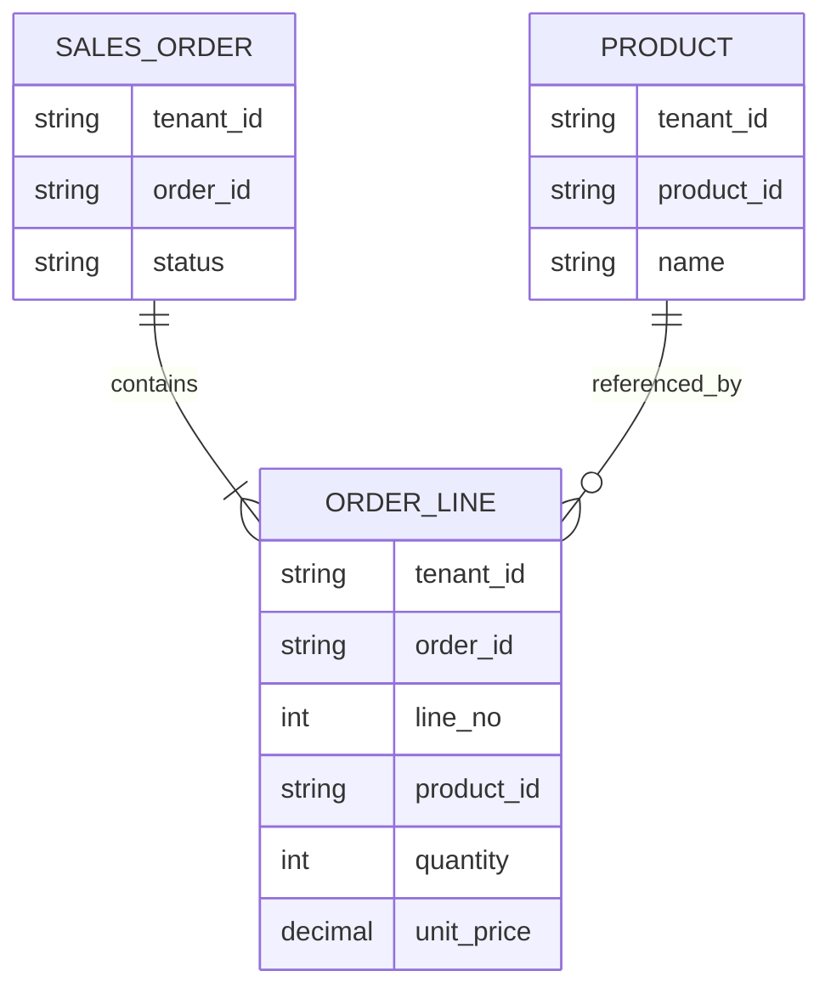
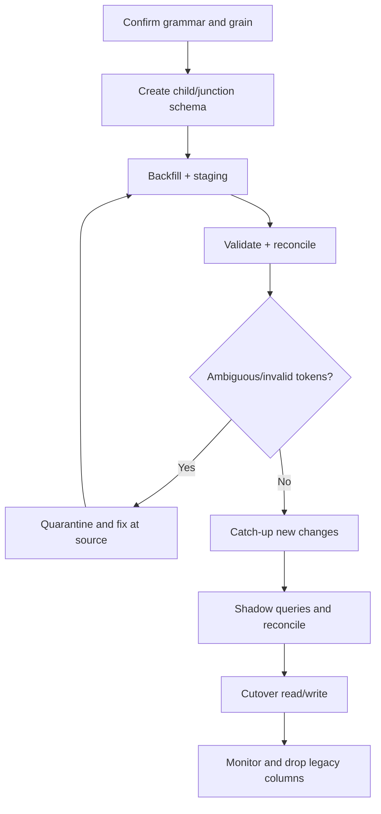

# Comma-Separated Lists and Repeating Columns Like item1, item2

## 1. Why Can a Single Comma Turn Into a Data Design Problem?

In an order management application, a developer wants to quickly store a list of products in a single column:

```text
order_id = O-101
items    = "P01,P02,P03"
```

In another system, the orders table is created using this pattern:

```text
order_id | item1 | item2 | item3
---------+-------+-------+------
O-101    | P01   | P02   | P03
O-102    | P02   | NULL  | NULL
```

Both approaches look convenient when there are only a few products. However, when the business asks to find "every order containing P02," attach a quantity and unit price to each product, support 30 items, or prevent nonexistent product codes, these choices quickly reveal their limitations.

These are two **common signs of stuffing a collection of values into a single attribute or a repeating group of columns**:

- **Delimited lists:** `item_ids = 'P01,P02,P03'`; sometimes using semicolons, pipes, or arbitrary characters.
- **Repeating column groups:** `item1`, `item2`, `item3`, ...; multiple columns sharing the same business role and differing only by an ordinal number.

They usually appear when **grain**, **cardinality**, and **data boundaries** have not been clearly defined. The solution is not simply "always split into a new table." You must ask whether the elements have **their own identity, attributes, constraints, and lifecycle**.

This lesson belongs to the **Common Pitfalls** chapter of the **DATABASE_DATA_MODELING** module: turning business requirements into clear data models—from entities, relationships, keys, indexes, and constraints to physical schemas—and comparing relational, document, graph, and analytical models to build structures that are easy to evolve and verify.

**Learning outcomes:** after this lesson, you will be able to identify inappropriate repeating structures, explain how they relate to 1NF, choose child or junction tables matching the right grain, design keys and uniqueness constraints, migrate legacy data safely, and recognize when ARRAY/JSON or a comma-containing string is completely reasonable.

## 2. Recognizing Ambiguous Representations

### 2.1. One Column Containing Multiple Business-Meaningful Elements

Examples:

```text
customers.favorite_categories = "BOOK,COURSE,SOFTWARE"
classes.instructor_ids        = "I-07,I-08"
orders.product_ids            = "P01,P02,P03"
courses.prerequisites         = "C101,C205"
```

If each element needs searching, joining, foreign key validation, independent addition/removal, or its own attributes, a concatenated string like this is hiding a relationship.

### 2.2. Multiple Columns With the Same Base Name and Different Suffixes

Examples:

```text
contact_phone1, contact_phone2, contact_phone3
item1, item2, item3, item4
skill_1, skill_2, skill_3
reviewer_1, reviewer_2
```

With columns like `item1`–`item4`, the immediate question is: **why can there only be four elements?** Is the number 4 an approved business rule, or merely how many columns the original author created?

### 2.3. One Column Containing an Ad-Hoc Internal Structure

```text
order_details = "P01:2:120000|P02:1:80000"
```

Inside a single string, three fields already appear per element: product code, quantity, and price. To read it, programs must know a custom grammar. If a code ever contains a delimiter, lacks a price, or changes escaping rules, the data can be misinterpreted.

### 2.4. Signals That Are Not Enough to Conclude a Design Error

**A comma by itself is not proof of a flawed design.** For example:

- `full_address = '12 Nguyen Hue, District 1, HCMC'` may be **a single intact display string**.
- `description = 'Read, write, and discuss'` is **a prose sentence**.
- `color_rgb = '255,128,0'` may be a published data format—though depending on usage, three separate numeric fields might be more useful.
- A standard **CSV** export file with comma-separated fields is a **data interchange format**, which does not automatically mean a database column stores a multi-element list.

What must be verified is **the semantics and business operations on the elements**, not just scanning a schema for comma characters.

## 3. Relation to 1NF: What Does "Atomic Value" Mean?

### 3.1. A Practical Interpretation

In relational database design, **First Normal Form (1NF)** is often invoked to remind designers that each cell in a relation should represent a single value from a defined domain, rather than stuffing repeating groups into columns and forcing queries to parse that repeating structure.

For example, `orders.product_ids = 'P01,P02,P03'` causes friction when each product code is an entity with its own key and requires individual referencing.

A helpful interpretation is:

> If the business must treat each element as an independent record or relationship, model those elements at their own grain instead of using a delimited string or numbered columns.

### 3.2. Do Not Oversimplify 1NF to "A Cell Must Never Contain a Comma"

The concept of an **atomic value** depends on **the value domain and operational interface**. A postal address stored as text with commas can be a single complete value for a feature that only prints mailing labels. Conversely, an `items` column that must be split on every filter or aggregation exposes multiple relational elements, regardless of whether they are separated by commas, a JSON string, or another character.

Modern DBMSs also support `ARRAY`, `JSON`, document structures, and composite types. They can be appropriate for a specific workload. Choosing them should be evaluated against **query shapes, constraints, updates, concurrency, and lifecycle**, not merely by the slogan "1NF forbids all arrays."

### 3.3. Semantic Comparison Table

| Value | Does the business operate on individual components? | Direction to consider |
| --- | --- | --- |
| `"P01,P02,P03"` as order product codes | Yes: each item has quantity, price, FK | `order_lines` table |
| `"I1,I2"` as instructors assigned to a class | Yes: assignment, role, effective dates | `instructor_assignments` table |
| `"12 A, Ward B, City C"` solely as a shipping label string | Not in current workflows | Can be a text snapshot |
| `"255,128,0"` as a color treated as a value object | Depends on calculations/search | Structured type or 3 fields |
| `["draft","reviewed"]` as finite internal tags | Yes, but only read/written together inside a document | Array/document may work if requirements are met |
| CSV file imported from a partner | Has a parser and canonical column format | Parse/validate, then write to target schema |

**The deciding factor is the meaning of each element.** A child table is not "another encoding" for a string; it makes explicit the entities, relationships, and constraints that were previously hidden.

## 4. Two Questions to Answer Before Changing the Schema: Grain and Cardinality

### 4.1. Grain: What Does One Row Represent?

Consider orders:

- `Order`: **one purchase order** created by a tenant.
- `OrderLine`: **one line item** within an order, carrying quantity and price at confirmation.
- `Product`: **one product** in the catalog, with a business identifier and independent lifecycle.

If all product codes are placed inside `orders.product_ids`, the table tries to hold both the **Order** grain and the **OrderLine** grain in a single row.

Similarly:

- `ClassOffering`: one scheduled offering of a course.
- `InstructorAssignment`: one assignment of an instructor to an offering over an effective interval.
- `Instructor`: one instructor profile.

Not every multi-element relationship is a "list of IDs"; the relationship itself can carry **role, order, quantity, timestamps, and status**.

### 4.2. Cardinality: How Many Elements Are Valid?

Suppose an order has:

```text
Order 1 -- 1..n OrderLine
Product 1 -- 0..n OrderLine
```

Under a hypothetical contract, a **placed** order must have at least one line. Yet a **draft** may have 0 lines. The minimum condition changes across the **lifecycle**.

A class offering has 0..n instructors while DRAFT, but must have at least one when PUBLISHED. You cannot resolve this difference merely by adding an `instructor2` column.

### 4.3. Are Duplicates Allowed and Does Order Matter?

An order might record:

```text
Line 1: P01, qty=2, price=100000
Line 2: P02, qty=1, price=50000
Line 3: P01, qty=1, price=90000
```

Two lines for P01 may be valid due to different pricing tiers, discounts, or delivery targets. Storing only the set `{P01,P02}` loses the information on line 3.

You need to decide:

- Is the list a deduplicated **set** or a **multiset** allowing duplicates?
- Does ordering carry presentation or business meaning?
- Can two lines with the same SKU be merged, and under what conditions?
- Does each element have its own identity/version?
- Can **a single element** be updated or deleted without rewriting the entire list?

A child table usually needs `line_no` or `line_id` if ordering or line identity matters.

## 5. Consequences of Delimited Strings in Relational Databases

### 5.1. Approximate Matching Causes False Positives

Given:

```text
P01,P011,P101
```

the query:

```sql
SELECT *
FROM legacy_orders
WHERE item_ids LIKE '%P01%';
```

matches `P01`, `P011`, and `P101`. Substring matching **is not membership testing over a set of product codes**.

Special token-boundary rules can be added, but when codes or escaping get complex, that logic becomes an ad-hoc parser inside queries—hard to verify and hard to optimize.

### 5.2. No Foreign Key Per Element

If `item_ids = 'P01,P02,P99'` and `P99` does not exist in the catalog, a foreign key on the `item_ids` string cannot validate the three individual codes. The database sees only **one text value**.

Consequences:

- Cannot prevent references to nonexistent product codes.
- When renaming or deleting a Product, it is difficult to locate and update every embedded code.
- Easy to introduce duplicate codes or inconsistent whitespace, such as `'P01, P02,P02'`.
- Codes with identical names across two tenants can collide if namespacing is missing.

### 5.3. Updates Lose Per-Element Atomicity

Two processes both read `item_ids='P01'`:

```text
Writer A wants to add P02 -> "P01,P02"
Writer B wants to add P03 -> "P01,P03"
```

If both overwrite the whole column without concurrency control, the second write can erase the first write's update (*lost update*).

A child-row relationship allows writing, deleting, or locking per element; it **does not automatically solve all concurrency issues**, but the structure makes update scope explicit and enables targeted constraints.

### 5.4. Hidden Duplicate and Ordering Semantics

```text
P01,P02
P02,P01
P01,P02,P01
P01, P02
```

Do these represent the same product set or four different cases? If the business treats order as significant, they differ. If not, ordering must be canonicalized and duplicates handled before comparison. Storing plain text offers no default answer.

### 5.5. Indexes and Query Statistics Are Hard to Leverage

A standard B-tree index on the entire string does not mean "an index per delimited code." A `LIKE '%P01%'` predicate cannot use a typical B-tree index as a point lookup.

DBMSs have specialized features for full-text, trigrams, or array membership, but those are **different indexing mechanisms**—they do not turn an ad-hoc formatted string into a relationship with FKs and Product-level access paths.

### 5.6. Reporting and Aggregations Easily Miscount

An order containing three codes in one column is still **one Order row**, not three OrderLine rows. `COUNT(*)` on the Orders table does not return the number of line items. When a parser encounters repeated elements, without a defined grain, counting by SKU differs from counting by line.

A string list becomes even harder to manage when each item needs `quantity`, `unit_price`, `discount`, `tax_rate`, or `fulfillment_status`.

## 6. Consequences of Numbered Column Groups

### 6.1. Artificial Limits

If you design:

```text
items(item1, item2, item3, item4)
```

what happens when a fifth item is needed? Adding `item5` requires a schema migration plus updates to APIs, DTOs, validation, SQL, and reports. When the number of elements is **business-unbounded**, a fixed column count is just an accidental technical cap.

### 6.2. Adding Fields Per Item Multiplies Column Count

Suppose each item has 4 attributes:

```text
item1_id, item1_quantity, item1_price, item1_discount
item2_id, item2_quantity, item2_price, item2_discount
item3_id, item3_quantity, item3_price, item3_discount
```

With 20 items, there are 80 columns. Every check such as "non-negative price," "product_id exists," or "valid discount" must be duplicated across every group. If just the 17th group misses the same update logic, data drifts.

### 6.3. NULLs and Positional Gaps

If `item1=P01`, `item2=NULL`, `item3=P03`, is that valid? Should item3 shift up into item2? After deleting item1, do all columns shift automatically? Without strict rules, ordering and positions become unstable.

A child table with `line_no` represents position explicitly, and reordering is a designed operation rather than depending on column names.

### 6.4. Repetitive Queries and Broken Aggregations

For example, finding orders containing P01:

```sql
SELECT order_id
FROM legacy_orders
WHERE item1 = 'P01'
   OR item2 = 'P01'
   OR item3 = 'P01';
```

When `item4` is added, every query like this must be modified. Queries summing across items grow even longer and easily omit a column. `UNION ALL` or unpivoting can help read legacy data, but that is a **migration/reconciliation** measure, not proof that the long-term model is sound.

### 6.5. Repeating-Looking Columns May Actually Be Distinct Roles

Do not jump to conclusions from a numeric suffix alone. For example:

```text
primary_reviewer_id
secondary_reviewer_id
```

may be two **fixed roles with distinct semantics**, not a repeating group. Likewise, `billing_address` and `shipping_address` are two role-based address types, not arbitrary `address1`, `address2` slots.

Ask: **is the fixed number of positions dictated by a business rule, or merely by an initial schema shortcut?** If positions carry stable business roles, separate columns or value objects can be appropriate.

## 7. Choosing a Child Table vs. a Junction Table Based on the Relationship

### 7.1. One-to-Many: Order and OrderLine



The `order_lines` table holds the attributes specific to a single line. One line references one Order and one Product within scope, while a Product can appear across many lines.

**Note:** the `|{` notation in the diagram indicates that an Order typically has at least one line in a given business stage. A draft may have 0 lines; the "at least one" constraint upon submission must be enforced by the appropriate workflow/transaction, not solely by a child-to-parent FK.

### 7.2. Many-to-Many: Learner and Skill

A learner has many skills, and a skill belongs to many learners:

```text
learner_skills(
  tenant_id,
  learner_id,
  skill_id,
  level,
  verified_at,
  source
)
```

A junction table does not just hold two FKs: it can store **proficiency level, verification timestamp, and verification source**.

The uniqueness rule can be `(tenant_id, learner_id, skill_id)` if each pair has only one current state. If assessment history is required, use a "skill assessment" grain with its own ID or version timestamp.

### 7.3. Lines With Quantities Cannot Always Be Collapsed Into a Set

A code list:

```text
"P01,P01,P02"
```

does not clearly tell whether P01 appears twice because of **quantity 2** or because there are **two independent lines**. If the business requires quantity, store it as a numeric attribute in `order_lines`. However, if price or promotion differs between the two additions of P01, you may need to keep two separate lines.

**Do not blindly enforce UNIQUE(tenant_id, order_id, product_id)** unless the business requires each Product to appear at most once per Order.

## 8. Invariants to Establish Before Writing DDL

| Invariant | Verification Question | Candidate Protection |
| --- | --- | --- |
| Every OrderLine belongs to an Order | Can an OrderLine exist independently? | FK to Order |
| Every Product code must exist | Can a Product be discontinued? | FK + discontinuation policy |
| Tenant-scoped keys | Can two tenants share code P01? | Composite PK/FK |
| Positive quantity | Are qty=0 or negative returns allowed? | CHECK by transaction type |
| Valid unit price | Can confirmed price change if catalog changes? | Snapshot unit price + rule |
| Unique line number per order | Is line order/ID preserved? | PK/UNIQUE |
| How many lines can an Order have? | DRAFT 0..n, CONFIRMED 1..n? | Submit command + transaction |
| Duplicate SKUs allowed? | Can multiple lines share a Product? | Unique only when proven |
| Deleting Product affects old lines? | Must order history be preserved? | FK policy + snapshot |
| Concurrent list edits | Do two simultaneous item adds lose updates? | Transaction/locking/version |
| Command retries | Can retries create two unintended lines? | Idempotency and business rules |
| Reporting | Total amount by Order or by line? | Grain and reconciliation by exact unit |

For each rule, record the **decision authority** (business owner, API contract, or operational policy), **evidence**, and **enforcement layer**. If the answer is "unknown," creating five columns `item1`–`item5` does not resolve that uncertainty.

## 9. Replacement Relational Model: Order, OrderLine, and Product

From the established grain, a sound relational design for the order example is:

```sql
CREATE TABLE dm_products (
    tenant_id text NOT NULL,
    product_id text NOT NULL,
    product_name text NOT NULL,
    is_active boolean NOT NULL DEFAULT true,
    PRIMARY KEY (tenant_id, product_id)
);

CREATE TABLE dm_sales_orders (
    tenant_id text NOT NULL,
    order_id text NOT NULL,
    status text NOT NULL DEFAULT 'DRAFT',
    currency_code char(3) NOT NULL,
    created_at timestamptz NOT NULL DEFAULT now(),
    version bigint NOT NULL DEFAULT 1,
    PRIMARY KEY (tenant_id, order_id),
    CHECK (status IN ('DRAFT', 'CONFIRMED', 'CANCELLED')),
    CHECK (version > 0)
);

CREATE TABLE dm_order_lines (
    tenant_id text NOT NULL,
    order_id text NOT NULL,
    line_no integer NOT NULL,
    product_id text NOT NULL,
    quantity integer NOT NULL,
    unit_price_minor bigint NOT NULL,
    product_name_at_order text NOT NULL,
    PRIMARY KEY (tenant_id, order_id, line_no),
    FOREIGN KEY (tenant_id, order_id)
      REFERENCES dm_sales_orders(tenant_id, order_id),
    FOREIGN KEY (tenant_id, product_id)
      REFERENCES dm_products(tenant_id, product_id),
    CHECK (line_no > 0),
    CHECK (quantity > 0),
    CHECK (unit_price_minor >= 0)
);

CREATE INDEX dm_order_lines_by_product
ON dm_order_lines(tenant_id, product_id, order_id);
```

**Clear grain:** each row of `dm_order_lines` is one line belonging to an order. `line_no` carries ordering within the order; `product_id` references Product; `quantity` and `unit_price_minor` describe the **line item**, not an attribute of the whole Order.

### 9.1. Sample Data With Valid Repeated Products

```sql
INSERT INTO dm_products(tenant_id, product_id, product_name)
VALUES
    ('ORG-A','P01','SQL Course'),
    ('ORG-A','P02','Java Course'),
    ('ORG-B','P01','Different product with same code');

INSERT INTO dm_sales_orders
    (tenant_id, order_id, status, currency_code)
VALUES ('ORG-A','O-101','DRAFT','VND');

INSERT INTO dm_order_lines (
    tenant_id, order_id, line_no,
    product_id, quantity, unit_price_minor, product_name_at_order
) VALUES
    ('ORG-A','O-101',1,'P01',2,120000,'SQL Course'),
    ('ORG-A','O-101',2,'P02',1, 80000,'Java Course'),
    ('ORG-A','O-101',3,'P01',1,100000,'SQL Course');
```

In this example, P01 appears twice at different prices. **Do not blindly add UNIQUE(tenant_id,order_id,product_id)** if the business allows multiple lines with the same product. Both tenants share the code P01, while composite FKs preserve isolation.

### 9.2. Historical Data and Source of Truth

- `product_name_at_order` is a snapshot of the name at confirmation, not the current catalog name.
- `unit_price_minor` is the transaction unit price and must not auto-sync when catalog prices change.
- `dm_products.product_name` and `is_active` belong to the catalog lifecycle.
- Deleting a referenced Product requires a retention/referencing policy, not arbitrary CASCADE.

This is **intentional duplication to preserve transactional meaning**, distinct from using a CSV string as the source of truth.

### 9.3. Constraints Do Not Protect Every Invariant

DDL alone does not enforce "a CONFIRMED Order must have at least one line," finalized totals, taxes/discounts, order edit permissions, refund handling, or concurrent commands. Those rules require transactions, domain validation, and dedicated tests.

## 10. Querying After Normalization: Right Elements, Right Grain

### 10.1. Finding Orders With Exact Code P01

```sql
SELECT o.tenant_id, o.order_id
FROM dm_sales_orders AS o
WHERE o.tenant_id = :authorized_tenant_id
  AND EXISTS (
      SELECT 1
      FROM dm_order_lines AS l
      WHERE l.tenant_id = o.tenant_id
        AND l.order_id = o.order_id
        AND l.product_id = :product_id
  );
```

Comparing `l.product_id = :product_id` matches **the exact full code**, avoiding false positives on P011/P101 like `LIKE '%P01%'`. `EXISTS` prevents returning an Order multiple times if P01 appears on two lines.

### 10.2. Calculating Line Values and Order Totals

```sql
SELECT
    l.tenant_id, l.order_id,
    SUM(l.quantity::bigint * l.unit_price_minor) AS total_minor
FROM dm_order_lines AS l
WHERE l.tenant_id = :authorized_tenant_id
  AND l.order_id = :order_id
GROUP BY l.tenant_id, l.order_id;
```

The sample data yields a total of:

```text
2 * 120000 + 1 * 80000 + 1 * 100000 = 420000
```

This example omits taxes/promotions; you must establish currency, rounding, and overflow-prevention rules. If an Order has no lines, the query returns zero rows—different from "returning a total of 0." Both outcomes must be interpreted according to business state.

### 10.3. Counting Orders Differs From Counting Lines and Quantities

| Question | Unit Counted | Query Target |
| --- | --- | --- |
| How many Orders contain P01? | Once per Order | `EXISTS` / `COUNT(DISTINCT order_id)` within tenant |
| How many OrderLines contain P01? | Once per line | `COUNT(*)` on filtered `dm_order_lines` |
| How many units of P01 were sold? | Item quantity | `SUM(quantity)` on valid lines |
| How many distinct Products in an Order? | Distinct product codes | `COUNT(DISTINCT product_id)` |

A string `'P01,P01,P02'` cannot clarify these four metrics. A child table solves this through grain, not through writing a more complex parser.

### 10.4. Beware of Joining Two One-to-Many Tables

If an Order has three OrderLines and two PaymentAttempts, joining both and summing OrderLine values doubles every line. You must **aggregate child tables to the Order grain before joining**, or only join the source actually needed. Reaching blindly for `DISTINCT` can hide valid repeated data.

### 10.5. Indexes Must Match the Workload

The PK `(tenant_id, order_id, line_no)` supports reading lines for an order; the index `(tenant_id, product_id, order_id)` supports finding orders containing a product within a tenant. Use `EXPLAIN (ANALYZE, BUFFERS)` on representative data to verify; indexes also carry write and maintenance overhead.

## 11. Migrating Delimited Strings: Confirm the Grammar First

Suppose legacy data looks like:

```text
O-1: "P01,P02,P03"
O-2: "P01, P02"
O-3: "P01,,P03"
O-4: NULL
O-5: "P,02"
```

Before migrating, confirm:

1. Is the comma strictly a delimiter, or can it appear inside a code?
2. Are quoting/escaping rules defined?
3. Should whitespace be trimmed? Are codes case-sensitive?
4. Is an empty token an error or missing data?
5. Does an ID repeated twice mean two lines, quantity=2, or a data-entry error?
6. Does `NULL` mean an empty list or unknown?
7. Where do quantity, price, and confirmation timestamp come from?

**You cannot reliably recover O-5 if the source lacks a grammar distinguishing code `P,02` from two tokens.** Obtain the upstream source or route it to reconciliation rather than splitting and assuming it is right.

### 11.1. True CSV Files Differ From Arbitrary Text Columns

A CSV file uses quoting:

```csv
order_id,item_id,quantity
O-101,P01,2
O-102,"P,02",1
O-103,"P""SPECIAL",3
```

`"P,02"` is **a single field containing a comma**, while `"P""SPECIAL"` contains a literal quotation mark inside the value. CSV data may also contain newlines inside quoted fields.

**`String.split(",")` or `string_to_array(value, ',')` is not a full CSV parser.** Use a parser supporting the exact grammar, escaping, and encoding, then validate before writing to the new schema.

### 11.2. When Is `string_to_array` Acceptable?

Only when the source contract **guarantees** tokens contain no delimiters, no quotes, no escapes, and clear whitespace rules can you use:

```sql
SELECT
    btrim(token) AS product_id,
    ordinal_position
FROM unnest(string_to_array('P01,P02,P03', ','))
     WITH ORDINALITY AS x(token, ordinal_position);
```

This is a parser for a **verified simple format**, not a general-purpose CSV parser. Catch empty tokens and invalid IDs. `ordinal_position` preserves ordering if position is part of the grain.

### 11.3. Never Fabricate Missing Data

If legacy data only stored Product IDs without quantities or confirmed prices, **do not pull current catalog prices to "reconstruct" history**. Look for source invoices, upstream orders, event/audit logs, or reliable historical pricing data. When unavailable, document the limitation and follow an approved policy; never silently insert fake default prices or quantities.

### 11.4. Parsing and Staging Pipeline

```text
for each legacy order:
    obtain tenant, order identity, raw field
    parse using the documented source grammar

    for each token and original position:
        validate token and namespace
        distinguish duplicate versus valid repeated line
        preserve position, raw source and provenance
        quarantine ambiguous/invalid data
        stage normalized row with migration version

    reconcile row counts, identifiers and totals
    only then load authoritative target tables
```

You can store `migration_batch_id`, `source_position`, `raw_hash`, and processing status in staging tables for idempotent retries. These do not need to be production OrderLine columns.

## 12. Migrating From item1/item2/item3: Positional Unpivoting

### 12.1. Converting Each Column Into a Row

Suppose a legacy table has `tenant_id, order_id, item1, item2, item3`. PostgreSQL:

```sql
SELECT
    o.tenant_id, o.order_id,
    v.line_no, v.product_id
FROM legacy_orders AS o
CROSS JOIN LATERAL (
    VALUES
        (1, o.item1),
        (2, o.item2),
        (3, o.item3)
) AS v(line_no, product_id)
WHERE v.product_id IS NOT NULL
ORDER BY o.tenant_id, o.order_id, v.line_no;
```

If `item2=NULL` and `item3='P03'`, the output has `line_no=3`; whether to preserve that or renumber contiguously is a business decision. Whitespace-only strings differ from NULL and require separate validation.

### 12.2. Multiple Attributes at the Same Position Must Travel Together

With `item1_id, item1_qty, item1_price`, ...:

```sql
SELECT
    o.tenant_id, o.order_id,
    v.line_no, v.product_id, v.quantity, v.unit_price_minor
FROM legacy_orders AS o
CROSS JOIN LATERAL (
    VALUES
        (1, o.item1_id, o.item1_qty, o.item1_price),
        (2, o.item2_id, o.item2_qty, o.item2_price),
        (3, o.item3_id, o.item3_qty, o.item3_price)
) AS v(line_no, product_id, quantity, unit_price_minor)
WHERE v.product_id IS NOT NULL;
```

Check groups where product is NULL while quantity/price are non-NULL, negative prices, non-positive quantities, and duplicate policies. **Never split Product ID and quantity into two uncoordinated streams and re-join by recomputed position**, or you will assign prices to the wrong items.

### 12.3. Key Reconciliation Rules

- Does the total valid token count match the staging row count?
- Are all ambiguous/empty/invalid tokens reported?
- Are legacy positions preserved?
- Were any lines lost because item2 was empty while item3 had a value?
- Do Product IDs match the right tenant/source namespace?
- Do monetary totals and quantities match verified source records?

A migration that only compares Order counts before and after **does not prove that items were preserved**.

## 13. Expand–Migrate–Verify–Cutover–Contract



### 13.1. Expand and Migrate

Create the child table with appropriate FKs, unique constraints, and indexes. Backfill in batches using checkpoints and a staging key such as `(tenant_id, source_order_id, source_position, migration_version)` so reruns do not insert duplicates.

### 13.2. Handling Concurrent Writes During Migration

If users keep editing Orders during backfill, newly copied rows can become stale. You need an authoritative write source, CDC/outbox, synchronous transactions, or an approved write-lock window. Never assume dual-writes between old and new tables are automatically atomic.

### 13.3. Verify and Cutover

Reconcile per Order: item count, codes, positions, quantities, prices, totals, tenant, and status. Run new queries alongside legacy paths up to a meaningful checkpoint and classify discrepancies by parser, source data, or semantics.

Switch full read/write traffic only with evidence. Maintain a safe rollback plan and do not drop legacy columns or backups until acceptance is complete. Rollback must not revert to the old model in a way that truncates elements exceeding column limits.

## 14. When ARRAY or JSON Is a Reasonable Choice

Not every group of values requires a child table. Cases involving a **small value collection sharing the parent record's lifecycle and always read/written as a unit** can suit ARRAY or JSON.

### 14.1. PostgreSQL ARRAY for Small UI Preferences

```sql
CREATE TABLE user_view_settings (
    tenant_id text NOT NULL,
    user_id text NOT NULL,
    visible_sections text[] NOT NULL DEFAULT ARRAY[]::text[],
    PRIMARY KEY (tenant_id, user_id)
);

CREATE INDEX user_view_settings_sections_gin
ON user_view_settings USING gin(visible_sections);
```

Example finding users with the COURSES section enabled:

```sql
SELECT user_id
FROM user_view_settings
WHERE tenant_id = :authorized_tenant_id
  AND visible_sections @> ARRAY['COURSES']::text[];
```

This fits when the element set is small, needs no per-element FK or independent lifecycle, and is mostly read/written as a whole setting. **ARRAY does not automatically create an FK per section code**, does not forbid duplicate elements, and requires proper update/concurrency logic.

### 14.2. JSON/Document for a Small Aggregate

```json
{
  "formId": "F-100",
  "answers": [
    {"questionId": "Q-1", "text": "Very good"},
    {"questionId": "Q-2", "score": 4}
  ]
}
```

If a form has bounded size, its answers share one lifecycle, and it is typically persisted as a whole form, a document model can fit. You still need to check schema version, data types, duplicate `questionId`s, array bounds, access control, concurrency, and indexes if querying individual answers.

**Converting `"P01,P02"` into a JSON array does not automatically solve FKs, identity, or per-Product history.**

### 14.3. Decision Matrix

| Condition | Child/junction table | ARRAY/JSON inside parent |
| --- | --- | --- |
| Elements have identity, FKs, separate permissions | Usually fits | Requires custom enforcement |
| Frequent cross-parent queries by element | Clear relational indexes | Specialized indexes possible, DB-dependent |
| Each element has price, quantity, status, validity | Very well suited | Often more complex |
| Small set, shared lifecycle, read/written as a unit | Can be used | Can be simpler |
| Unbounded growth | Easier to partition, query, maintain | Risk of document/row bloat |
| Transactional reporting at item grain | Easy to define | Requires flattening/unwinding at the right grain |

The choice must be based on **query shapes, cardinality, storage engine, and benchmarks**, not a blanket claim that relational or JSON is always better.

## 15. Which Comma-Containing Strings Are Still Valid Data?

### 15.1. An Intact Piece of Text

```text
address_label = "123 Main Street, Floor 2, HCMC"
description   = "Learn to read, write, and practice"
```

If only displayed or printed intact, this can be **a single text value**. If filtering by province/city is required, do not split the address string ad hoc; add structured address fields per contract.

### 15.2. Display/Export Strings Derived From Structured Data

```sql
SELECT
    l.tenant_id, l.order_id,
    string_agg(
        l.product_name_at_order,
        ', ' ORDER BY l.line_no
    ) AS display_items
FROM dm_order_lines AS l
GROUP BY l.tenant_id, l.order_id;
```

This is a **human-readable output format**, not a source to parse Product IDs back out of. If product names contain commas, the display string may still work for presentation while no longer being reversible.

### 15.3. Fixed Roles Are Not Repeating Groups

The two attributes `primary_contact` and `emergency_contact` have **distinct roles** and a business-bounded count, so separate structures can make sense. Conversely, `contact1`–`contact5` express neither roles, effective dates, nor the actual allowed count.

## 16. Advanced Constraints Still Requiring Verification After Splitting

### 16.1. Ordering, Duplicates, and Identity

- `line_no` determines order, not the database's default SELECT order.
- A duplicate Product across two lines may be valid; duplicates caused by retrying a command are a separate issue.
- `product_id`, `order_line_id/line_no`, `request_id`, and `event_id` have distinct responsibilities.
- Reordering requires a transaction and a plan for temporary unique conflicts; never run bulk UPDATEs without considering collisions.

### 16.2. Concurrency and Totals

If two users add lines concurrently, the application must protect the Order aggregate's version, allocate collision-free `line_no` values, and enforce related invariants inside the same transaction. Example statement:

```sql
UPDATE dm_sales_orders
SET version = version + 1
WHERE tenant_id = :tenant_id
  AND order_id = :order_id
  AND status = 'DRAFT'
  AND version = :expected_version
RETURNING version;
```

Only when exactly one row is returned should the command proceed under the rules. Extracting a child table does not automatically provide optimistic concurrency or idempotency.

### 16.3. Relationships With Independent Lifecycles

An instructor assignment needs more than a list of IDs:

```text
instructor_assignments(
  tenant_id,
  offering_id,
  instructor_id,
  role,
  valid_from,
  valid_to,
  assigned_by
)
```

Storing `instructor_ids='I1,I2'` hides who holds the PRIMARY role, when it takes effect, and who approved it. Forbidding overlapping PRIMARY assignments requires temporal overlap constraints or transactional checks, not just FKs.

### 16.4. Optionality and Tenant Scope

- An empty item list may be valid on a DRAFT Order yet invalid on CONFIRMED.
- `NULL` may mean "unknown" rather than "zero items"; define the data contract.
- `product_id='P01'` in tenant A and tenant B are not implicitly the same Product.
- Composite FKs protect references, while APIs still require explicit authorization.

## 17. Data Quality Checks Before and After Migration

### 17.1. Minimum Profiling Metrics

Before migrating, generate a **baseline inventory report**:

| Metric | Why It Matters |
| --- | --- |
| Order count by tenant/status | Verify full parent coverage |
| Parsed token count per Order | Catch missing or extra items |
| Empty or unparseable token count | Distinguish source corruption from valid empty lists |
| Tokens failing Product lookup in namespace | Catch orphan or cross-tenant codes |
| Repeated Products within a single Order | Decide whether to preserve separate lines or merge |
| Positional gaps in itemN columns | Check ordering and blank slots |
| Slots with mismatched quantity/price vs. ID | Detect shifted positional attributes |
| Verified monetary total per Order | Catch price/quantity drift during migration |
| Quarantined row count | Never drop records silently |
| Reconciliation runtime and batch retries | Assess resumability and recovery |

These metrics track **source semantics**, not just byte counts between two tables.

### 17.2. Checking for Duplicate Child Sequence Numbers

```sql
SELECT tenant_id, order_id, line_no, COUNT(*) AS copies
FROM dm_order_lines
GROUP BY tenant_id, order_id, line_no
HAVING COUNT(*) > 1;
```

With the PRIMARY KEY enforced, this returns 0 rows; it remains essential on staging tables or target engines without enforced keys.

### 17.3. Checking for Cross-Tenant Product References

```sql
SELECT
    l.tenant_id, l.order_id, l.line_no, l.product_id
FROM dm_order_lines AS l
LEFT JOIN dm_products AS p
  ON p.tenant_id = l.tenant_id
 AND p.product_id = l.product_id
WHERE p.product_id IS NULL;
```

With composite FKs active, this returns zero rows. On staging data, it surfaces invalid upstream references.

**Never JOIN on `product_id` alone**, as P01 in two tenants can be two unrelated entities.

### 17.4. Checking for Gaps in line_no

When business rules require contiguous `1..N` numbering (not every system does), positive unique line numbers can be checked via:

```sql
SELECT
    tenant_id, order_id,
    COUNT(*) AS line_count,
    MIN(line_no) AS first_line,
    MAX(line_no) AS last_line
FROM dm_order_lines
GROUP BY tenant_id, order_id
HAVING MIN(line_no) <> 1
    OR MAX(line_no) <> COUNT(*);
```

If gaps are **allowed** to preserve deleted-line history or legacy slots, this query is not an error check—it simply flags orders deviating from contiguous numbering.

### 17.5. Reconcile Truth, Do Not "Fudge Totals to Match"

Suppose legacy sums to 1,000,000 while migration yields 950,000. Never insert a synthetic `ADJUSTMENT=50000` line just to make totals agree before finding the root cause. Trace backward:

- Which token was skipped?
- Was a Product code invalid?
- Which source supplied quantity and price?
- Were returns or order-level discounts stored outside item slots?
- Were there duplicate orders or retries?

"Equal grand totals" can still mask **two opposing errors canceling each other out**. Verify at the OrderLine grain whenever source detail exists.

## 18. Comparing Relational, Document, Graph, and Analytical Models

### 18.1. Relational: Strong FKs, Uniqueness, and Set Queries

In relational OLTP, an OrderLine table is clear when:

- Product existence must be verified.
- Items carry quantity, price, attributes, and independent lifecycles.
- Cross-Order queries filter or group by item.
- Concurrency and transactions operate on aggregates.
- Duplicate products vs. duplicate lines must remain distinct.

Adding a table is **the proper cost of modeling the true relationship**, not a design flaw merely because it introduces a JOIN.

### 18.2. Document: Embed When Aggregate Boundaries Fit

An Order document:

```json
{
  "tenantId": "ORG-A",
  "orderId": "O-101",
  "status": "DRAFT",
  "lines": [
    {"lineId": "L-1", "productId": "P01", "quantity": 2, "priceMinor": 120000},
    {"lineId": "L-2", "productId": "P02", "quantity": 1, "priceMinor": 80000}
  ]
}
```

is sound when:

- Each Order is mostly read and written as a single unit.
- Array size is bounded by policy.
- Lines need no independent lifecycle outside the aggregate.
- The engine supports atomic document updates alongside needed validation and indexes.

Unlike a CSV string, this is a **typed, structured array** preserving per-line attributes. Still avoid embedding unbounded lists or ignoring Product identity/tenant scope. If cross-order queries by Product dominate, evaluate secondary indexes or separate read models.

### 18.3. Graph: Relationships With Attributes Become Edges or Nodes

For example, course prerequisites:

```text
(Course C101)-[:REQUIRES]->(Course C205)
(Course C101)-[:REQUIRES]->(Course C310)
```

`REQUIRES` edges can carry `requirement_type`, `min_grade`, or `valid_from`. Storing `prerequisites='C205,C310'` makes those attributes and cycle checks ("is there a dependency cycle?") hard to maintain.

Graph models shine when multi-hop traversals dominate, yet still require tenant isolation, direction validation, cycle detection, and node authorization. **Moving from CSV to a graph does not automatically guarantee acyclicity.**

### 18.4. Analytics: Choose the Fact Grain Explicitly

In a warehouse:

```text
fact_order_line:
  tenant_id
  order_id
  line_id
  product_sk
  order_date_sk
  quantity
  line_revenue_minor
```

Each fact row represents **one transaction line**, ideal for Product-level analysis. Since one Order has multiple lines, `COUNT(*)` measures lines, not orders; to count orders, compute distinct order identities within scope or query an Order-grain fact.

Even when an upstream pipeline exports CSV files to load a warehouse, **CSV is just the transport format**—never dump a `"P01,P02"` text cell into a fact table as "order products" without a clear grain.

### 18.5. No Single Storage Model Wins Every Workload

| Requirement | Candidate |
| --- | --- |
| OrderLine with FK, price, quantity | Relational child table |
| Draft form with small answer array | Schema-validated JSON/document |
| Multi-hop prerequisite traversal | Junction table or graph |
| Small UI tag list | ARRAY / value collection |
| Revenue aggregation by Product | OrderLine-grain fact |
| Display string of item names | Projection / `string_agg` from structured source |

Choose by **query shapes, cardinality, constraints, lifecycles, and data growth**.

## 19. Case Study: Course Prerequisites and Class Instructors

### 19.1. Legacy Model

An online learning platform has:

```text
courses(
  tenant_id,
  course_id,
  name,
  prerequisite_ids     -- "C101,C102"
)

offerings(
  tenant_id,
  offering_id,
  course_id,
  instructor1_id,
  instructor2_id
)
```

New requirements:

- A course can have 0..n prerequisite courses.
- Prerequisites can be required or recommended, with a minimum grade and effective period.
- A course must not list itself as a prerequisite.
- Cycles like `A → B → C → A` must be forbidden.
- A class offering can have multiple instructors in PRIMARY or ASSISTANT roles.
- DRAFT offerings need no instructors; PUBLISHED offerings require at least one valid PRIMARY instructor.
- Course and instructor IDs are unique only within a tenant.
- Need a report on "learners blocked due to missing prerequisites."

### 19.2. Candidate Model

```text
courses(
  tenant_id, course_id, name, status
  PK(tenant_id, course_id)
)

course_prerequisites(
  tenant_id,
  course_id,
  prerequisite_course_id,
  requirement_type,
  min_grade,
  valid_from,
  valid_to,
  ...
)

instructor_assignments(
  tenant_id,
  offering_id,
  instructor_id,
  role,
  valid_from,
  valid_to,
  ...
)
```

**One `course_prerequisites` row represents one "course X requires course Y" rule** within the defined scope/interval. If rules are versioned over time, the identity must include effective dates or a `prerequisite_rule_id`, not just the two Course IDs.

### 19.3. Illustrative DDL for Current Prerequisites Without History

```sql
CREATE TABLE cs_courses (
    tenant_id text NOT NULL,
    course_id text NOT NULL,
    name text NOT NULL,
    PRIMARY KEY (tenant_id, course_id)
);

CREATE TABLE cs_course_prerequisites (
    tenant_id text NOT NULL,
    course_id text NOT NULL,
    prerequisite_course_id text NOT NULL,
    requirement_type text NOT NULL,
    min_grade numeric(5,2),
    PRIMARY KEY (tenant_id, course_id, prerequisite_course_id),
    FOREIGN KEY (tenant_id, course_id)
        REFERENCES cs_courses(tenant_id, course_id),
    FOREIGN KEY (tenant_id, prerequisite_course_id)
        REFERENCES cs_courses(tenant_id, course_id),
    CHECK (course_id <> prerequisite_course_id),
    CHECK (requirement_type IN ('REQUIRED', 'RECOMMENDED')),
    CHECK (min_grade IS NULL OR (min_grade >= 0 AND min_grade <= 100))
);
```

This blocks direct self-references and cross-tenant FKs. **It does not block cycles of length greater than 1.** Prerequisite update commands must run cycle detection under appropriate concurrency controls; test `C101→C205→C310→C101`.

If `valid_from/valid_to` are added later, design temporal uniqueness and overlap rules rather than keeping the same PK mechanically.

### 19.4. Assignments With Lifecycles

```text
instructor_assignments:
  tenant_id, offering_id, instructor_id, role,
  valid_from, valid_to, assigned_by
```

The rule "PUBLISHED must have a PRIMARY" spans **multiple rows and offering status**; a simple FK from Assignment to Offering does not guarantee at least one Assignment exists.

Enforce it during publish and when removing the last assignment inside coordinated transactions. If only one PRIMARY may be active at a time, enforce non-overlapping intervals with exclusion constraints or transactional checks and tests.

### 19.5. Reporting Queries Must Not Miscount Rows

If a course has three prerequisites and 100 learners, joining course × prerequisites × learner enrollments directly produces up to 300 rows. **`COUNT(*)` does not count blocked learners.**

Clarify:

1. Has a learner completed every required prerequisite?
2. Which prerequisite rules are active at the evaluation timestamp?
3. Does the report count learners, courses, or missing learner–prerequisite pairs?
4. Can one course have multiple offerings generating multiple valid enrollments?
5. Which tenant and access permissions scope the result?

Use `EXISTS/NOT EXISTS`, CTEs, or grain-safe aggregations instead of `COUNT(*)` over a fanned-out join.

### 19.6. Value of Extracting Proper Relationships

Replacing CSV and repeating columns with relationship rows lets the system:

- Add prerequisite types without adding `prerequisite4`.
- Validate target keys exist in the right tenant.
- Attach `requirement_type`, `min_grade`, and validity windows.
- Detect cycles across relationships.
- Govern and audit individual rules.
- Reconcile actual relationship counts against legacy sources.

The goal is not "more tables," but **the right relational unit and business behavior**.

## 20. Performance: Proper Normalization Does Not Mean Slow Queries

### 20.1. Fair Comparison

Suppose there are 2 million Orders averaging 5 lines each. Two designs:

- **Legacy:** 2 million Order rows holding `items_csv` or `item1..item8`.
- **Normalized:** 2 million Order rows and ~10 million OrderLine rows indexed by Order and Product.

You cannot assume normalized is slower due to row count, or CSV is faster due to fewer rows. Measure **actual queries**:

| Query | What to Observe |
| --- | --- |
| Fetch single Order detail | Rows read, index lookup, payload size |
| Find Orders containing Product P01 | Exact match, index usage, false positives |
| Update one line's quantity | Lock contention, write amplification |
| Sum revenue by Product | Parse/unnest cost vs. grain-safe aggregation |
| Retire/delete a Product | FK checks and historical preservation |
| Add a 9th line item | Does Legacy require a schema migration? |
| Concurrent writes to same Order | Lost updates, version conflicts, retries |
| Re-run migration batch | Idempotency, row discrepancies |

### 20.2. Common Queries Drive Indexes

If most requests fetch an Order's full details, PK/index `(tenant_id,order_id,line_no)` makes reading lines fast. If product lookups across orders dominate, add `(tenant_id,product_id,order_id)`.

For JSON arrays, measure GIN or specialized index performance and document rewrite overhead at large sizes. Never assume JSON queries always full-scan, nor assume they offer relational FK guarantees.

### 20.3. Caching and Read Projections Still Apply

Read paths may still serve an Order card JSON containing its line list:

```json
{
  "orderId": "O-101",
  "items": [
    {"productId": "P01", "quantity": 2},
    {"productId": "P02", "quantity": 1}
  ]
}
```

Build that response or a materialized read projection from the source tables and cache by ID/version. **Projections do not have to mirror the normalized write model**—just manage freshness, tenant permissions, and write invalidation.

### 20.4. Benchmarks Need Realistic Skewed Data

Some orders have 1 line, a few have 1,000 lines; one Product appears in 40% of Orders; one tenant generates far more traffic than others. Benchmarking only uniform 3-item Orders hides column-limit pain, hot-key skew, and array/document bloat.

## 21. Negative Tests and Acceptance Reconciliation

| Scenario | Expected Outcome |
| --- | --- |
| Search P01 when P011/P101 exist | Returns only P01 |
| An Order with 30 items | Schema needs no `item30` column |
| Product P01 in two tenants | Never merged or cross-referenced across tenants |
| Same item appears twice at two prices | Preserves two lines if domain allows |
| Client retries the same add-line command | No duplicate side effect |
| Empty item token in legacy CSV | Flagged and quarantined |
| Properly quoted code containing a comma | Parsed as a single item |
| Code containing a comma without grammar | Flagged as ambiguous, not guessed |
| item2 empty while item3 has data | item3 is not dropped |
| item1_id has invalid qty/price | Validation rejects or logs error |
| Nonexistent Product | Rejected by FK or validation |
| Zero or negative quantity | Rejected per example policy |
| Product renamed after confirmation | OrderLine snapshot keeps original name |
| Two writers edit the same Order concurrently | No lost updates per transaction policy |
| OrderLine joined with PaymentAttempt | Revenue is not multiplied by fan-out |
| DRAFT Order with zero items | Allowed if domain permits |
| CONFIRMED Order with zero items | Blocked if policy requires lines |
| Re-running the same migration batch | Inserts zero duplicate lines |
| Stale read projection | Never used for critical write decisions |
| Legacy record missing historical price | Never backfilled with live catalog price |

### 21.1. Property-Based Testing Ideas

```text
For each Order O:
  each OrderLine L belongs to exactly one O by scoped key
  every L has quantity > 0
  every L has unit_price_minor >= 0
  no two L share (tenant_id, order_id, line_no)

For each Product P:
  references across tenants are never merged by product_id alone

For each migration source row S:
  all parsed tokens are either:
    validated and represented in target,
    or explicitly quarantined with reason
  no silent token loss

For each submitted Order:
  a confirmed order has the required lines and valid total
  according to the chosen domain policy
```

A test cannot prove business correctness if the policy itself is vague. For instance, whether two lines may share a Product is an **approved business decision**, not something inferred from column names.

### 21.2. Bidirectional Reconciliation

Post-migration, verify **legacy → normalized** (every legacy element is accounted for) and **normalized → legacy** (no extra rows invented outside source records or accepted commands). Matching row counts in one direction alone do not prove equivalence, especially with duplicates or ambiguous tokens.

## 22. Common Accompanying Mistakes and Fixes

**"Adding `item4` is enough for the future."**  
If item counts are business-unbounded, this merely delays the next migration.

**"CSV avoids JOINs so it is always faster."**  
Searching and aggregating items requires parsing, invites bugs, and defeats indexes; benchmark actual queries.

**"Any comma in text violates 1NF."**  
Addresses, prose, and domain-atomic strings with commas are valid; the problem is independently managed relational elements.

**"Converting to a JSON array means it is normalized."**  
JSON adds structure yet does not automatically provide FKs, uniqueness, element identity, or per-item permissions.

**"Just use `LIKE '%P01%'`."**  
Matches P011/P101 and fails true token membership.

**"Just call `split(',')` during migration."**  
Breaks on CSV quoting/escaping or codes containing commas; confirm the source grammar first.

**"`UNIQUE(order_id, product_id)` is always right."**  
Fails if a Product can appear on two lines with different prices or shipments; verify grain first.

**"`NULL` and empty strings both mean zero items."**  
Could mean missing data or ingestion errors; classify by source state.

**"If Order totals match, there is no need to check items."**  
Opposing errors can cancel out; reconcile item identity, quantities, and unit prices.

**"Extracting a child table makes concurrency safe automatically."**  
Transactions, idempotency, versioning, and sequence protection are still mandatory.

**"FKs only need `product_id` because IDs are global."**  
Verify real scope; multi-tenant systems must guard against cross-namespace references.

**"Display strings can be parsed back into canonical data."**  
`string_agg` for display can lose escaping, ordering, or identity; keep canonical data relational.

**"All many-to-many relationships are deduplicated sets."**  
Check temporal versions, repeated assessments/enrollments, and relationship attributes.

**"Few repeating columns means normalized; many repeating columns means broken."**  
Column count is never the sole criterion; evaluate roles, cardinality, queries, and lifecycles.

## 23. Hands-On Exercises

### Exercise A — CSV Shopping Cart

A system stores `cart.items='P01,P02,P02'`. Requirements: find carts containing P02, increment P02 quantity, apply a voucher to one line, and block discontinued items.

**Task:** state the grain, keys, proposed tables, constraints, and duplicate P02 handling. Why is `LIKE '%P02%'` insufficient?

*Hint:* if a cart allows only one line per Product, its business uniqueness differs from a cart allowing multiple lines for the same Product with different options.

### Exercise B — Numbered Contact Fields

A customer table has `phone1`, `phone2`, `phone3`. Later, a customer has 10 numbers, each with type WORK/HOME, verified status, and effective dates.

**Task:** design `customer_phones`; define identity, optionality, role, uniqueness, and the rule for one active primary phone number. Is a phone number suitable as a customer business key?

### Exercise C — Product Codes Containing Delimiters

A legacy string `'P01,"P,02",P03'` is declared as CSV-quoted. Describe the parser, the resulting three tokens, and order preservation. Without metadata or grammar, can the second token be recovered reliably?

### Exercise D — Multiple Instructors

A class has `teacher1_id` and `teacher2_id`, yet new rules allow two PRIMARY instructors across non-overlapping intervals and multiple concurrent ASSISTANTs.

**Task:** propose `instructor_assignments`, keys, validity intervals, and how to block two concurrent PRIMARYs. Where should "PUBLISHED requires a PRIMARY" be enforced?

### Exercise E — Revenue Analysis

An Order has 3 OrderLines and 2 PaymentAttempts. One query joins both and sums OrderLine revenue.

**Task:** explain why totals can double and write a strategy aggregating each source to the Order grain before joining.

### Exercise F — Schema Migration Under Live Writes

CSV data is migrating into `order_lines` while the application still updates the legacy column. A batch backfills O-101 at 10:00, and a user adds P04 at 10:01.

**Task:** design catch-up/transaction/CDC, checkpoints, idempotency, and reconciliation so P04 is never lost.

### Exercise G — Choosing ARRAY, JSON, or Child Table

Consider three requirements:

1. A user's enabled UI tabs, max 8 items, saved as a unit.
2. Product lines on an invoice with prices, quantities, and refund statuses.
3. A draft survey document with 10 answers validated against a form version.

**Task:** choose the appropriate structure for each and identify what condition would force a different choice.

## 24. Decision Workflow and Final Checklist

### 24.1. Twelve-Step Workflow

1. **Spot repeating data:** CSV strings, `item1..itemN` columns, JSON arrays, or child tables.
2. **Define grain:** is each element a value, relationship, event, or independent entity?
3. **Determine cardinality:** 0..n, 1..n, real business cap vs. accidental schema cap.
4. **Define identity:** element code, line ID, source/tenant scope, ordering, duplicates allowed?
5. **List query shapes:** lookup by element, filtering, JOINs, reporting, updates.
6. **Define lifecycle:** add/remove/edit single elements, versions, permissions, timing.
7. **Pick structure:** child table, junction table, document/ARRAY, or intact text.
8. **Design constraints:** PK, FK, UNIQUE, CHECK, status-dependent requirements.
9. **Design transactions:** concurrency, idempotency, consistency, snapshots.
10. **Design migration:** grammar parser, staging, quarantine, checkpoints, backfill/catch-up.
11. **Reconcile and benchmark:** exact records, quantities, money, p95/p99, write cost.
12. **Document:** rationale, assumptions, limits, tests, and evolution plan.

### 24.2. Acceptance Checklist

- [ ] Distinguished a **comma-containing text value** from a collection of business-meaningful elements.
- [ ] Avoided assuming "1NF violation" solely from commas or ARRAY/JSON types.
- [ ] Wrote a clear one-sentence grain statement for every table, document, and relationship.
- [ ] Cardinality and maximum counts are genuinely governed by business rules.
- [ ] Verified ordering, duplicate rules, and per-element identity.
- [ ] Distinguished fixed-role columns from repeating groups.
- [ ] Avoided keeping Product IDs in CSV when items need FKs and per-item attributes.
- [ ] Evaluated `item1..itemN` columns against read/write paths and extensibility needs.
- [ ] Child/junction tables have proper keys, tenant scoping, and indexes.
- [ ] Uniqueness by Product applies only when aligned with grain; valid multi-line orders are not blocked.
- [ ] Transaction price/name snapshots do not mutate unexpectedly with catalog updates.
- [ ] Product lookup queries avoid substring matches that cause false positives.
- [ ] COUNT/SUM/JOIN metrics align on grain with zero unintended fan-out.
- [ ] Defined policies for NULL, empty tokens, commas inside codes, and quoting/escaping.
- [ ] CSV parser respects exact source grammar rather than blind `split(',')`.
- [ ] Migration keeps position, quantity, and price grouped together without cross-column misalignment.
- [ ] Unparseable data is quarantined instead of fabricating values.
- [ ] Backfill/catch-up handles concurrent writes, retries, and idempotency.
- [ ] Reconciled per Order and per line, not just total Order counts.
- [ ] For ARRAY/JSON, verified size bounds, FK needs, concurrency, and query shapes.
- [ ] For document/graph/warehouse models, verified grain and link permissions.
- [ ] Tested colliding Product codes across tenants, delimiter-containing IDs, and gapped positions.
- [ ] Benchmarked realistic queries and observed index/write overhead.
- [ ] Verified safe rollback without reverting to `item1..itemN` truncation limits.
- [ ] Justified the design with business questions and evidence, not simply "fewer tables."

**Key takeaway:** Lists like `"P01,P02"` in one column and numbered columns `item1`, `item2`, `item3` usually signal **a multi-element relationship hidden inside an unsuitable structure**. Whenever elements need independent identity, constraints, attributes, queries, or lifecycles, model child or junction tables with explicit grain and keys. When a small set belongs strictly to one aggregate, ARRAY or JSON can fit; when commas live inside intact prose or display strings, leave them unsplit. Sound decisions are proven by **query shapes, cardinality, edge cases, reconciled migrations, and business invariants**—never by normalization slogans alone.