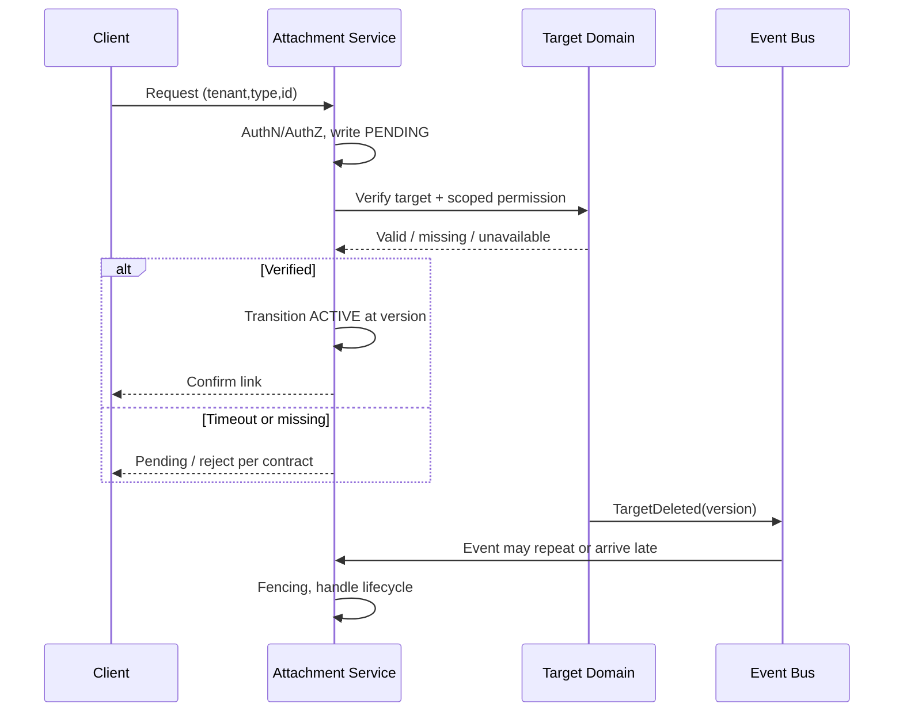
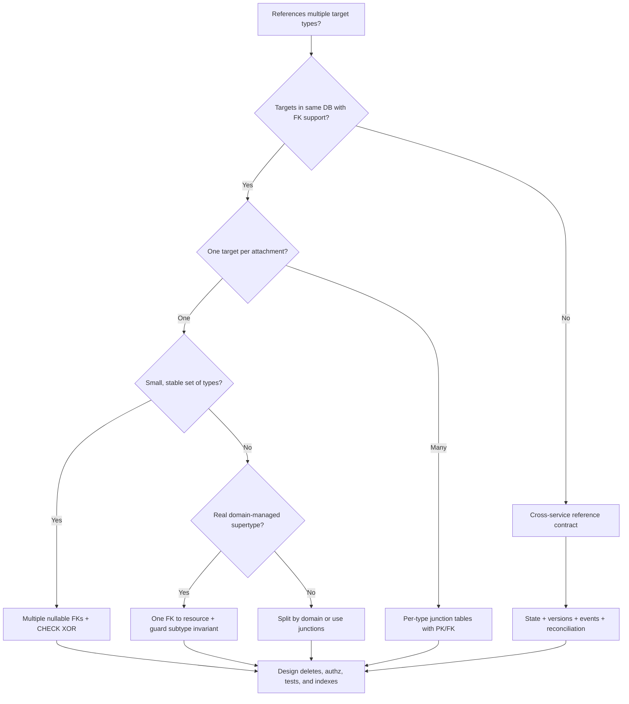

# Polymorphic Foreign Keys Without Explicit Referential Control

## Learning Objectives

After this lesson, you will be able to:

- Recognize **polymorphic foreign keys** (*polymorphic associations*) of the form `target_type + target_id` and distinguish them from genuine relational foreign keys enforced by the DBMS.
- Explain why checking only a valid `target_type` or UUID-shaped `target_id` **does not prove the target object exists**, matches the declared type, or belongs to the right tenant.
- Identify failures including **orphan references, wrong-type hits, cross-tenant leaks, non-cascading deletes, read–write races, ID collisions, and corrupted historical meaning**.
- Design three alternatives: **multiple explicit foreign keys constrained to exactly one target**, **per-target-type junction tables**, and **parent/registry entity tables with a shared reference key**.
- Recognize when a polymorphic association is an intentional choice because targets live outside the same database, and which **compensating guarantees** must be declared.
- Allocate responsibilities across **FK, UNIQUE, CHECK, triggers, transactions, events/CDC, service validation, and reconciliation** instead of assuming any single layer covers all others.
- Model **ON DELETE policies, soft deletes, retention, history, ACLs, and tenant isolation** for multi-target links.
- Plan a migration from a legacy schema to a verifiable design via backfills, orphan checks, dual-reads, cutover, and rollback.
- Write SQL queries and test suites proving zero ambiguous links, zero constraint violations, and zero row multiplication after joins.

This lesson belongs to the **DATABASE_DATA_MODELING** module, whose goal is translating business requirements into clear data models—from entities, relationships, and constraints to keys, indexes, and physical schemas—while weighing relational, document, graph, and analytical options. In the **Common Pitfalls** chapter, this case is especially dangerous because a seemingly "easy-to-extend" pattern quietly pushes all referential integrity out of the database while leaving nobody accountable for it.

> **Core rule:** whenever a row says "I point to object X," the design must explain **which namespace identifies X, who proves X exists, what prevents X from being deleted improperly, and how broken links are detected and repaired after failures**.

---

## 1. Real-World Scenario: File Attachments Across Multiple Record Types

An e-commerce platform allows three kinds of records to receive file attachments:

1. **Orders** — supporting documents uploaded by customers for an order.
2. **Return requests** — condition photos and return receipts.
3. **Support tickets** — error screenshots or conversation attachments.

Initial requirement:

```text
POST /attachments
  tenantId = shop_17
  targetType = "ORDER"
  targetId = "ord_908"
  objectKey = "obj_45"
```

The team wants a single table:

```sql
-- Risky design example: no real foreign key
-- pointing to orders / returns / support_tickets.
CREATE TABLE attachments (
    tenant_id       VARCHAR(60) NOT NULL,
    attachment_id   VARCHAR(80) NOT NULL,
    target_type     VARCHAR(30) NOT NULL,
    target_id       VARCHAR(100) NOT NULL,
    object_key      VARCHAR(200) NOT NULL,
    uploaded_at     TIMESTAMP NOT NULL,
    PRIMARY KEY (tenant_id, attachment_id),
    CHECK (target_type IN ('ORDER', 'RETURN', 'TICKET'))
);
```

At first glance, having a `PRIMARY KEY` and a `CHECK` looks sufficient. Yet **no constraint enforces that**:

- When `target_type='ORDER'`, `target_id` exists in `orders`.
- When `target_type='RETURN'`, that ID exists in `returns`.
- The attachment's `tenant_id` **matches the target's tenant**.
- When an order is deleted or hidden, attachments are retained, removed, or unlinked according to policy.
- Before serving a file, the caller holds permission to view **the specific target object**, not merely knowledge of an object key.

That gap is the pitfall of **polymorphic foreign keys without explicit referential control**.

### 1.1. What Is a Real Foreign Key?

In a relational schema, a **foreign key (FK)** is a constraint declaring **which source columns reference a candidate/unique key of one specific target table**, governed by NULL rules and update/delete actions enforced by the DBMS.

Example:

```sql
-- Relationship with a single explicit target table.
CREATE TABLE orders (
    tenant_id VARCHAR(60) NOT NULL,
    order_id  VARCHAR(100) NOT NULL,
    status    VARCHAR(30) NOT NULL,
    PRIMARY KEY (tenant_id, order_id)
);

CREATE TABLE order_documents (
    tenant_id   VARCHAR(60) NOT NULL,
    document_id VARCHAR(80) NOT NULL,
    order_id    VARCHAR(100) NOT NULL,
    object_key  VARCHAR(200) NOT NULL,
    PRIMARY KEY (tenant_id, document_id),
    FOREIGN KEY (tenant_id, order_id)
      REFERENCES orders(tenant_id, order_id)
);
```

When inserting an `order_documents` row whose `order_id` does not exist in **the same tenant**, the DBMS rejects it per constraint policy. When deleting an order, the constraint participates inside the engine rather than hoping every developer remembers to check manually.

This definition **does not** guarantee the physical file exists in object storage or that the caller may download it; those are separate concerns. It does rigorously protect the existence of the **relational target** the FK declares.

### 1.2. Why `target_type + target_id` Is Not a True Foreign Key

In the polymorphic pattern:

```text
attachments.target_type = 'ORDER'
attachments.target_id   = 'ord_908'
```

the referenced table must change **based on a value in each row**. In standard relational SQL, declaring:

```text
FOREIGN KEY (target_id)
  REFERENCES tableChosenBy(target_type)(id)
```

is not valid FK syntax. A `CHECK` on the string `'ORDER'` validates only the **type enum**, never the **target row**.

Engine-specific features, triggers, extensions, partitioning, or application mechanisms can add supplemental checks, yet they should never be described as **a full database-enforced FK** when reality is just an application convention.

### 1.3. Do Not Confuse "Polymorphic FK" With Single-Table Subtyping

A single table holding:

```text
resources(
    resource_id,
    resource_type,  -- ORDER/RETURN/TICKET
    owner_tenant_id,
    ...
)
```

paired with an FK referencing `resources(resource_id)` **is not the same flaw**: it points to **one explicit target table**. The remaining question is whether that registry is truly the authoritative parent and guarantees subtype rows exist and match types.

Similarly, an `event_type` column in an event log or `payment_method_type` in a payment table is not automatically a "polymorphic FK." The pitfall occurs when a **type/ID pair acts as a cross-table reference** without a governing integrity contract.

## 2. Five Failure Modes That Occur Even When the Schema Looks Valid

### 2.1. Orphan References

```text
attachments:
  (shop_17, att_1, ORDER, ord_908)

orders:
  -- no ord_908 in shop_17
```

The DBMS accepts the attachment because it only validates `target_type`. When the UI renders, the join finds no order. If the frontend silently skips unmatched rows, the broken reference lingers for months without alerts.

### 2.2. Wrong Object Type and ID Collisions

```text
orders:          (shop_17, id = 908)
support_tickets: (shop_17, id = 908)

attachments:
  target_type = TICKET
  target_id   = 908
```

If one code path queries `orders` solely by `target_id`, the attachment shows up on **order 908** instead of **ticket 908**. Never rely on assumptions like "IDs across tables won't collide": UUIDs or sequences are no excuse to omit type and namespace checks.

### 2.3. Wrong Tenant — Worse Than Orphan Data

```text
attachments:
  tenant_id   = shop_17
  target_type = ORDER
  target_id   = ord_5

orders:
  (shop_18, ord_5)
```

If a lookup runs `WHERE order_id='ord_5'` without `tenant_id`, the code validates shop 18's order and leaks file metadata to shop 17. That is a **data isolation and authorization breach**, not merely a data-quality bug.

**Rule:** when IDs are unique only within a tenant, link keys must preserve **tenant + type + ID**, and every query must enforce permissions independently of record existence.

### 2.4. Target Deletions or Changes Do Not Propagate to Links

When an order is deleted, a real FK blocks, cascades, or nulls per policy. A `target_type + target_id` pair knows nothing about parent deletes, so:

- Dangling attachments remain after the target is deleted.
- Physical bytes stay orphaned in object storage.
- Read models, search indexes, and caches keep surfacing the deleted target.
- If an ID is later reused, old links **silently attach to a brand-new object**.

Proper handling depends on retention: some files must stay for refund audits, while others must be purged once their purpose ends. That policy **must be designed explicitly**, not guessed with `CASCADE`.

### 2.5. Check-Then-Insert Race Conditions

Application code like:

```text
if existsOrder(tenantId, targetId):
    insertAttachment(tenantId, 'ORDER', targetId)
```

is not atomic without proper coordination between the check and insert:

```text
T1: API A sees ord_908 exists
T2: API B deletes ord_908
T3: API A inserts attachment pointing to ord_908
```

The result is an orphan despite **calling `existsOrder`**. A DBMS-enforced FK inside proper transactions and isolation prevents this race within a single database. Hand-rolled triggers or locks must **guard the target deletion side too**, not just attachment inserts.

## 3. Constraint Matrix: What Needs to Be Controlled?

Evaluate safety with a structured checklist:

| Invariant / Behavior | Verification Question | Suitable Mechanism |
| --- | --- | --- |
| **Valid type** | Does `target_type` accept only published types? | Versioned `CHECK` / enum |
| **Target exists** | Does every link match a real target row? | Direct FK, invariant-backed registry, or cross-service verification |
| **Right tenant** | Can links cross tenant boundaries? | Composite tenant + ID FK, authz, and scoped lookups |
| **Right type** | Is the target truly an ORDER, not any resource? | Typed FK or registry type + subtype invariants |
| **Unambiguous** | Does one attachment point to one or many targets? | CHECK XOR, key constraints, or explicit N–M contracts |
| **Concurrent create/delete** | Are race-induced orphans prevented? | Transactions/FKs or fenced workflows |
| **Lifecycle** | What happens to links/files when targets delete? | `RESTRICT`/`CASCADE`/redaction + policy |
| **Authorization** | Who may read/download the attachment? | Object/tenant authorization, not FKs |
| **Historical state** | Are soft-deleted targets still valid for old links? | Status/lifecycle rules and query contracts |
| **Derived copies** | Are caches, indexes, analytics, and bytes cleaned up? | Events/CDC, delete orchestration, reconciliation |
| **Observability** | Are orphans, type mismatches, and tenant leaks alerted? | Integrity jobs, metrics, runbooks |

Saying "we validate in the controller" **answers only part of the problem**. Rows also arrive via CLIs, batch jobs, CDC, workers, or restores that bypass that controller.

## 4. Choosing a Model by Ownership and Target Count

Before writing SQL, answer:

1. **How many target types exist?** Three stable types, or hundreds added frequently?
2. **Do they live in the same database?** One transactional DBMS, separate databases, or distinct services?
3. **Is an attachment single-target or reusable?** One photo on one ticket, or one file linked across multiple records?
4. **Do targets share lifecycles and permissions?** Does deleting a ticket delete the file, while Orders carry separate legal retention?
5. **How many attachments can one target hold?** What indexing and pagination are needed?
6. **Where are IDs allocated?** Per-tenant, per-type, or global; can IDs ever be reused?
7. **What consistency SLA applies?** Is a few seconds of lag on derived copies acceptable?
8. **Who owns link membership?** Attachment Service, Order Domain, or a governed Resource Registry?

Choose only after answering. There is no rule that "every polymorphic FK must be replaced the exact same way."

### 4.1. Overview of Alternatives

| Option | Pros | Limitations / Scope |
| --- | --- | --- |
| Multiple nullable FK columns + CHECK exactly one | True FKs to each target table; easy to verify | More columns; adding types requires migrations; fits small type sets |
| Separate junction table per target type | Clear FKs; cleanly models multi-target reuse | More tables; cross-table exclusivity is not automatic |
| Shared supertype / resource registry | Single FK to parent table; flexible type expansion | Must enforce registry ↔ subtype consistency |
| Separate attachment table per domain | Clear ownership and lifecycle boundaries | Duplicated schemas; global lists require unions/read models |
| Triggers checking type/ID | Preserves legacy table layout | Races, target deletes/updates, bulk loads, engine-specific, hard to audit |
| App validation + events/reconciliation | Works when targets live in other services | Not ACID/FK; eventual windows and higher operational overhead |

## 5. Option A: Multiple Explicit FKs, Exactly One Target

When there are only three stable target types and each attachment belongs to **exactly one** target, use three nullable FK columns:

```text
attachments:
  tenant_id
  attachment_id
  order_id       NULL
  return_id      NULL
  ticket_id      NULL
  object_key
```

Enforce the invariant:

\[
isNotNull(orderId)+isNotNull(returnId)+isNotNull(ticketId)=1.
\]

If all three are NULL, the attachment is unattached. If two or three are non-NULL, it points to multiple targets in violation of the contract. Counting non-NULL columns in a `CHECK` prevents both defects.

### 5.1. Illustrative DDL (PostgreSQL and Similar Relational Engines)

Assume the three target tables exist with composite PKs:

```sql
CREATE TABLE orders (
    tenant_id VARCHAR(60) NOT NULL,
    order_id  VARCHAR(100) NOT NULL,
    PRIMARY KEY (tenant_id, order_id)
);

CREATE TABLE return_requests (
    tenant_id VARCHAR(60) NOT NULL,
    return_id VARCHAR(100) NOT NULL,
    PRIMARY KEY (tenant_id, return_id)
);

CREATE TABLE support_tickets (
    tenant_id VARCHAR(60) NOT NULL,
    ticket_id VARCHAR(100) NOT NULL,
    PRIMARY KEY (tenant_id, ticket_id)
);

CREATE TABLE attachments (
    tenant_id     VARCHAR(60) NOT NULL,
    attachment_id VARCHAR(80) NOT NULL,
    order_id      VARCHAR(100),
    return_id     VARCHAR(100),
    ticket_id     VARCHAR(100),
    object_key    VARCHAR(200) NOT NULL,

    PRIMARY KEY (tenant_id, attachment_id),

    CONSTRAINT attachment_exactly_one_target CHECK (
        (CASE WHEN order_id IS NOT NULL THEN 1 ELSE 0 END)
      + (CASE WHEN return_id IS NOT NULL THEN 1 ELSE 0 END)
      + (CASE WHEN ticket_id IS NOT NULL THEN 1 ELSE 0 END) = 1
    ),

    CONSTRAINT fk_attachment_order
      FOREIGN KEY (tenant_id, order_id)
      REFERENCES orders (tenant_id, order_id)
      ON DELETE RESTRICT,

    CONSTRAINT fk_attachment_return
      FOREIGN KEY (tenant_id, return_id)
      REFERENCES return_requests (tenant_id, return_id)
      ON DELETE RESTRICT,

    CONSTRAINT fk_attachment_ticket
      FOREIGN KEY (tenant_id, ticket_id)
      REFERENCES support_tickets (tenant_id, ticket_id)
      ON DELETE RESTRICT
);
```

**Exact semantics explained:**

- `tenant_id` and `attachment_id` are NOT NULL; `order_id`, `return_id`, and `ticket_id` are nullable.
- Under PostgreSQL's default **MATCH SIMPLE** composite FK behavior, a `(tenant_id, order_id)` pair with `order_id=NULL` does not require an order row; the `CHECK` guarantees **at least one** target column is non-NULL.
- When `order_id` is non-NULL, the FK validates the exact **(tenant_id, order_id)** pair rather than a global `order_id`.
- The `CHECK` counts with `CASE` instead of boolean expressions that might evaluate to UNKNOWN under three-valued logic.
- `ON DELETE RESTRICT` is an **illustrative policy**: blocks deleting a parent while attachments still reference it. Substitute another approved business workflow if needed.
- Never apply `ON DELETE SET NULL` casually: it can set all three target columns to NULL and **violate the exactly-one CHECK**, unless an explicit unattached state exists.

A valid insert:

```sql
INSERT INTO attachments (
    tenant_id, attachment_id, order_id, object_key
) VALUES (
    'shop_17', 'att_45', 'ord_908', 'objects/doc45'
);
```

This succeeds **only if** order `(shop_17,ord_908)` exists; otherwise, the database FK rejects it.

### 5.2. Indexes and Queries by Target Type

```sql
-- PostgreSQL: partial indexes exclude rows not in this role.
CREATE INDEX idx_attachment_order
    ON attachments (tenant_id, order_id, attachment_id)
    WHERE order_id IS NOT NULL;

CREATE INDEX idx_attachment_return
    ON attachments (tenant_id, return_id, attachment_id)
    WHERE return_id IS NOT NULL;

CREATE INDEX idx_attachment_ticket
    ON attachments (tenant_id, ticket_id, attachment_id)
    WHERE ticket_id IS NOT NULL;
```

Querying files for one order:

```sql
SELECT attachment_id, object_key
FROM attachments
WHERE tenant_id = 'shop_17'
  AND order_id = 'ord_908'
ORDER BY attachment_id;
```

The planner can leverage the partial index above. **An FK does not mean the database automatically indexes the child-side FK columns** in every DBMS; verify statistics, execution plans, and workloads.

### 5.3. When Does Option A Fail to Fit?

- Target types are numerous or added frequently: every type adds a column and constraint.
- One attachment genuinely links to **multiple targets**; XOR cannot express N–M relationships.
- Target tables live in separate databases or services where direct FKs are impossible.
- Target types have incompatible permissions or retention policies: domain-owned split tables may fit better.

Do not enforce `CHECK exactly_one` if the workflow allows **in-progress uploads not yet attached to a target**. Model a clear two-stage `STAGED` → `ATTACHED` lifecycle or separate upload staging table rather than stripping constraints entirely.

## 6. Option B: Per-Entity-Type Junction Tables

If **a file is an independent entity** that can intentionally link to multiple orders or tickets, use:

```text
attachments(tenant_id, attachment_id, object_key, ...)
order_attachments(tenant_id, order_id, attachment_id)
return_attachments(tenant_id, return_id, attachment_id)
ticket_attachments(tenant_id, ticket_id, attachment_id)
```

### 6.1. Typed Junction Table DDL

```sql
CREATE TABLE stored_files (
    tenant_id     VARCHAR(60) NOT NULL,
    attachment_id VARCHAR(80) NOT NULL,
    object_key    VARCHAR(200) NOT NULL,
    PRIMARY KEY (tenant_id, attachment_id)
);

CREATE TABLE order_attachments (
    tenant_id     VARCHAR(60) NOT NULL,
    order_id      VARCHAR(100) NOT NULL,
    attachment_id VARCHAR(80) NOT NULL,

    PRIMARY KEY (tenant_id, order_id, attachment_id),

    FOREIGN KEY (tenant_id, order_id)
      REFERENCES orders(tenant_id, order_id),

    FOREIGN KEY (tenant_id, attachment_id)
      REFERENCES stored_files(tenant_id, attachment_id)
);

CREATE TABLE return_attachments (
    tenant_id     VARCHAR(60) NOT NULL,
    return_id     VARCHAR(100) NOT NULL,
    attachment_id VARCHAR(80) NOT NULL,

    PRIMARY KEY (tenant_id, return_id, attachment_id),

    FOREIGN KEY (tenant_id, return_id)
      REFERENCES return_requests(tenant_id, return_id),

    FOREIGN KEY (tenant_id, attachment_id)
      REFERENCES stored_files(tenant_id, attachment_id)
);
```

`ticket_attachments` follows the same structure. Both FKs guarantee the existence of **both file and target** within **the same tenant**. The PK blocks duplicate links in the same table. Each junction table's grain is **one file–target link**, not one file.

### 6.2. Choose 1–N vs. N–M Semantics Deliberately

If one file can attach to multiple orders, multiple rows in `order_attachments` are expected. However, if policy requires **each file to attach to at most one target system-wide**, three separate junction tables **do not enforce cross-table exclusivity**:

```text
order_attachments:  (shop_17, ord_908, att_45)
return_attachments: (shop_17, ret_12, att_45)
```

Each individual PK and FK still passes. To enforce global single-target exclusivity, either:

- Consolidate link ownership into one suitably constrained shared table; or
- Use Option A with `CHECK` XOR; or
- Implement a verified transaction/constraint spanning **all target types** (harder to maintain as new types arrive).

If the business **permits multiple links**, that is valid—just document download authorization and retention when **one of several linked targets** is deleted. Delete physical bytes only when zero valid references **and** zero retention holds remain.

### 6.3. Do Not Neglect Reverse Lookups

A complete schema must support:

- `listAttachments(orderId)`: served by PK/index on `(tenant_id, order_id)`.
- `findTargets(attachmentId)`: typically requires a **dedicated reverse index** on `(tenant_id, attachment_id)` across junction tables.
- Link cleanup when orders are deleted or reassigned.
- Authorization checks against the **specific target**, not merely `stored_files`.

Column order in PKs and indexes dictates which access path uses an index efficiently; never assume "junction table" means both directions are fast by default.

## 7. Option C: Supertype or Resource Registry With a Real FK

When multiple entity types share **a common resource lifecycle or identity** and need a single reference target, model a **supertype**:

```text
resources:
  (tenantId, resourceType, resourceId) -> lifecycle, owner, ...

orders:
  (tenantId, orderId) -> order-specific fields

return_requests:
  (tenantId, returnId) -> return-specific fields

attachments:
  (tenantId, targetType, targetId) -> resources(...)
```

Now attachments hold a **direct FK to one explicit parent table**.

### 7.1. Resource Registry DDL

```sql
CREATE TABLE resources (
    tenant_id      VARCHAR(60) NOT NULL,
    resource_type  VARCHAR(30) NOT NULL,
    resource_id    VARCHAR(100) NOT NULL,
    lifecycle      VARCHAR(24) NOT NULL,

    PRIMARY KEY (tenant_id, resource_type, resource_id),
    CHECK (resource_type IN ('ORDER', 'RETURN', 'TICKET'))
);

CREATE TABLE resource_attachments (
    tenant_id      VARCHAR(60) NOT NULL,
    attachment_id  VARCHAR(80) NOT NULL,
    resource_type  VARCHAR(30) NOT NULL,
    resource_id    VARCHAR(100) NOT NULL,
    object_key     VARCHAR(200) NOT NULL,

    PRIMARY KEY (tenant_id, attachment_id),

    CONSTRAINT fk_attachment_resource
      FOREIGN KEY (tenant_id, resource_type, resource_id)
      REFERENCES resources(
          tenant_id, resource_type, resource_id
      )
);
```

This guarantees:

- `resource_type` is recognized by the registry.
- Links point to a **real resource row** in the same tenant.
- Deleting a resource from the registry triggers the declared FK action.

Watch out for **desynchronization between the registry and subtype tables**.

### 7.2. A Registry Row Does Not Prove a Subtype Row Exists

Suppose:

```text
resources:
  (shop_17, ORDER, ord_908)

orders:
  -- no ord_908
```

`resource_attachments` passes the FK to the **registry**, while the UI querying `orders` sees nothing. The integrity gap simply moved to **registry ↔ subtype**.

Clarify **what the registry means**:

**Case 1: The registry is the authoritative source of resource existence.** Resource rows are created only through approved transactions/workflows; subtype rows hold optional details or arrive asynchronously. The FK enforces **"registered resource exists,"** without promising an immediate subtype row.

**Case 2: Subtypes are authoritative.** To guarantee "every ORDER resource has exactly one order row," enforce **registry → subtype** consistency via:

- Coordinated transactions creating and deleting resource and subtype together.
- Engine-appropriate constraints, triggers, or inheritance designs verified under concurrency.
- One canonical existence table with subtypes as pure extensions.
- Reconciliation and `PENDING/ACTIVE` states when eventual consistency is intentional.

**An FK from `orders` to `resources` only guards `orders → resources`**, never forcing every resource to have a matching order.

### 7.3. Binding Subtypes to the Exact Type

When `orders` references the registry, never join solely on `(tenant_id, resource_id)` and omit `resource_type`. Use a **constant CHECK-constrained type column** inside a composite FK:

```sql
CREATE TABLE order_details (
    tenant_id      VARCHAR(60) NOT NULL,
    order_id       VARCHAR(100) NOT NULL,
    resource_type  VARCHAR(30) NOT NULL DEFAULT 'ORDER',
    order_status   VARCHAR(30) NOT NULL,

    PRIMARY KEY (tenant_id, order_id),
    CHECK (resource_type = 'ORDER'),

    FOREIGN KEY (tenant_id, resource_type, order_id)
      REFERENCES resources(
          tenant_id, resource_type, resource_id
      )
);
```

An `order_details` row can never point to a `RETURN` resource. Yet this still does not guarantee **every ORDER resource has an `order_details` row**—enforce that separately if required.

### 7.4. Two Keying Strategies for a Registry

```text
A. PRIMARY KEY (tenantId, resourceType, resourceId)
   -> each type owns its own ID namespace.

B. PRIMARY KEY (tenantId, globalResourceId)
   -> all types share IDs allocated by the registry.
   -> resourceType is an attribute of the resource.
```

Under Strategy B, an FK on `(tenantId, globalResourceId)` proves the resource exists; if attachments also store `declaredTargetType`, enforce type agreement via a composite unique/FK or drop the redundant column. UUIDs alone do not prove type or tenant alignment.

### 7.5. Trade-Offs of a Registry

- Adds an extra write and lifecycle step on create/delete.
- Can become a shared hotspot across services.
- Demands clear ownership: who may register or delete resources?
- When entities live in remote systems, requires ID mapping, late-event handling, and reconciliation.
- Must guard against **deleted IDs being reused**.
- Requires versioning, history, retention, and access controls of its own.

**Never build a registry just to satisfy a FOREIGN KEY** without clarifying invariants between the registry and business records.

## 8. Option D: Splitting Attachments by Bounded Context

When targets carry **divergent permissions, retention, and lifecycles**, a "shared" table stops being helpful:

```text
order_documents:
  (tenantId, orderId, documentId, objectKey, documentPurpose)

return_evidence:
  (tenantId, returnId, evidenceId, objectKey, evidenceType)

support_attachments:
  (tenantId, ticketId, attachmentId, objectKey, visibility)
```

Each table holds a strict FK to **one target type** with tailored policies. Whenever a combined view is needed, build a controlled `UNION ALL` view or read model.

### 8.1. A View Unifies Reads Without Merging Ownership

```sql
CREATE VIEW all_attachment_refs AS
SELECT
    tenant_id,
    'ORDER' AS target_type,
    order_id AS target_id,
    document_id AS attachment_id,
    object_key
FROM order_documents

UNION ALL

SELECT
    tenant_id,
    'RETURN' AS target_type,
    return_id AS target_id,
    evidence_id AS attachment_id,
    object_key
FROM return_evidence;
```

This view serves **reads**; it never creates a shared write table or grants cross-domain permissions. Verify authorization per branch and whether `attachment_id` is globally unique or scoped per type. APIs must carry full namespaced identifiers.

### 8.2. When Should You Split?

- File semantics differ: invoices, return evidence, sensitive support uploads.
- Distinct domain ownership.
- Incompatible retention, events, and access rules.
- No shared transactions, and a central schema creates coupling.
- Services need to evolve independently without editing a shared enum whenever a domain is added.

The trade-off is extra tables and adapters in exchange for crystal-clear ownership and security boundaries.

## 9. Why Triggers Checking Target Existence Can Be Dangerous

A team tries to keep `target_type + target_id` and adds a trigger:

```text
BEFORE INSERT INTO attachments:
    if NEW.target_type = ORDER:
        assert exists orders[NEW.target_id]
    else if NEW.target_type = TICKET:
        assert exists tickets[NEW.target_id]
```

**Existence checks are necessary yet insufficient**:

1. **Races:** the target can be deleted after the `SELECT` and before the insert commits.
2. **Reverse direction:** target deletes and updates must also guard links.
3. **New types:** triggers, grants, and migrations must update in lockstep.
4. **Tenants:** check composite tenant keys, not just IDs.
5. **Bulk loads/restores:** privileged load paths may disable or bypass triggers.
6. **Deadlocks/throughput:** triggers acquire locks across multiple tables.
7. **ID reuse / soft deletes:** a physical row may already be lifecycle-closed.
8. **Auditability:** logic is harder to inspect, test, and evolve.

### 9.1. Locking and Isolation Must Be Verified

Preventing insert–delete races via triggers requires **row locks on the target**, delete/update triggers on every target table, sufficient transaction isolation, and concurrency tests.

```sql
-- NOT a complete integrity constraint.
SELECT 1 FROM orders
WHERE tenant_id = :tenant_id
  AND order_id = :target_id;
```

A row returned by `SELECT` is not guaranteed to still exist at commit. Even when triggers are written carefully within one DB, **explicit FKs are simpler and far easier to audit**.

### 9.2. Triggers Cannot Create Cross-Service Transactions

A trigger in the Attachment DB cannot lock or roll back a transaction in a separate Order DB. Across services, declare explicit consistency bounds, handle unreachable target services, process delete events, implement retries, run reconciliation, and enforce authorization.

Never market "calling an API to verify target existence" as equivalent to a SQL foreign key.

## 10. ORMs Navigate Objects; They Do Not Enforce DB Foreign Keys

Some ORMs offer polymorphic mapping features (for example, Hibernate's discriminator-based associations, whereas standard JPA `@ManyToOne` targets **one entity type**).

Code looks convenient:

```text
Attachment.getTarget()
    -> Order or ReturnRequest or SupportTicket
```

Yet always check:

- Which **actual FKs** exist in the DDL?
- Is `target_type` constrained by a `CHECK`?
- Where are tenant isolation and authorization enforced?
- Do batch SQL deletes or external services clean up links?
- Which places break when adding a new entity type?
- Does integrity hold when migrations or imports bypass the ORM?

**ORM mappings are object-navigation conveniences, not database integrity constraints.**

### 10.1. Business Validation Remains Necessary Even With FKs

An FK proves **a row exists**, not that:

- The ticket is still open or the order is not locked.
- The user is authorized to read or attach files.
- MIME type, size, and antivirus scans passed.
- The file bytes genuinely exist in object storage.
- Purpose and retention policies are satisfied.
- The file is not soft-deleted or attached out of workflow order.

These rules live in domain/service logic. **Without an FK, application validation is even less of a substitute for referential integrity.**

## 11. Cross-Service Links: Intentional Eventual Consistency

When Orders, Returns, and Tickets live in separate databases, direct FKs are **impossible or violate ownership**. A multi-type link can be an **intentional foreign reference**, provided its contract is explicit.

### 11.1. Link Lifecycle States

```text
attachment_reference:
  tenantId
  attachmentId
  targetType
  targetId
  targetGeneration
  targetVersionSeen
  state = PENDING_VALIDATION | ACTIVE
        | TARGET_MISSING | TARGET_DELETED | BLOCKED
  lastCheckedAt
```

- `PENDING_VALIDATION`: target existence/permission not yet confirmed.
- `ACTIVE`: confirmed under the declared consistency guarantee.
- `TARGET_MISSING`: not found after retries/grace window.
- `TARGET_DELETED`: source domain confirmed deletion/retirement.
- `BLOCKED`: requires policy/permission review; file downloads denied.

This state machine does not replace an SLA. If the business requires "attachments can commit only when the order exists at commit time," eventual validation **does not provide that guarantee**.

### 11.2. Creation and Verification Workflow



Keep clear distinctions:

- An API returning "exists" does not eliminate races if the target is deleted immediately afterward.
- `ACTIVE` means **verified as of version T**, not permanently immutable.
- Download authorization may require re-verifying against the source.
- Delete events need IDs/versions, retries, idempotency, and reconciliation.
- Lost events or offline consumers need automated repair paths.

### 11.3. Out-of-Order Events and ID Reuse

```text
v7: Target ACTIVE
v8: Target DELETED
consumer receives v8, v7, v8
```

Applying updates in arrival order lets v7 resurrect a deleted link. Prevent this with:

- Monotonic versions scoped by `(tenant, type, id, generation)`.
- Conditional writes rejecting stale/duplicate events.
- Identity epochs/generations if IDs can ever be reused.
- Periodic reconciliation with the source of truth.
- Delete/retire fences spanning replay and restore horizons.

A physically present yet **soft-deleted** row may be barred from accepting new attachments. `exists=true` is insufficient when policy depends on lifecycle state.

### 11.4. Indexes and Fan-Out

```sql
CREATE INDEX idx_attachment_target
ON attachments (tenant_id, target_type, target_id, attachment_id);
```

Even with this index, "fetch every attachment for a customer across orders, returns, and tickets" still requires querying or aggregating across multiple domains; a polymorphic index does not automatically solve cross-domain queries. Unified read models need explicit sources, versions, owners, and delete propagation.

## 12. Deletion, Reassignment, and Data Protection

Even database-enforced FKs require **deletion policies**, especially when attachments hold invoices, photos, addresses, or sensitive evidence.

### 12.1. Delete Actions Are Not Equivalent

| Action | Meaning | Caveat |
| --- | --- | --- |
| `ON DELETE RESTRICT` / `NO ACTION` | Blocks/defers parent deletion while children exist (timing depends on engine) | Requires handling links first |
| `ON DELETE CASCADE` | Deletes child rows in the same DB via FK | **Does not delete object-storage bytes**, and may wipe evidence needing retention |
| `ON DELETE SET NULL` | Sets FK columns to NULL | Can violate `CHECK` XOR or erase meaning |
| `ON DELETE SET DEFAULT` | Resets FK to a default if valid | Never point to a fake dummy parent |
| Soft delete | Parent row remains, marked closed/deleted | FK still passes; domain policy must block reads/new uploads |

### 12.2. Metadata and Bytes Live in Separate Stores

```text
Attachment metadata DB:
  tenant, attachmentId, targetRef, objectKey,
  purpose, retentionClass, lifecycle, version

Object storage:
  bytes, objectVersion, encryption metadata

Search/analytics:
  attachment summary, target reference, extracted text
```

Deleting DB metadata does not delete object-storage bytes or versions. Deleting bytes does not purge search indexes or extracted text. You need retention owners, delete orchestration, replay protection, reconciliation, and authorization checks that never treat guessable IDs as **download permission**.

### 12.3. Authorize Every Access Attempt

If an attachment moves or links across tickets, checking only `attachment_id` is insufficient. Authorization must evaluate tenant, target, purpose, and action:

```text
authorize(requester,
          action='READ_ATTACHMENT',
          tenantId, targetType, targetId, purpose)
```

When links come from an eventual read model, define explicitly when cached permissions suffice vs. when source verification is mandatory. **An existing FK never implies the caller is authorized to read the file.**

## 13. Migrating From Legacy Polymorphic Schemas to Verifiable Constraints

A production system with millions of `attachments(target_type,target_id)` rows cannot jump to new FKs with a single `ALTER TABLE` ignoring dirty historical data.

### 13.1. Confirm Contracts Before Touching Schemas

Lock down:

- Every `target_type` present in production data, including retired types.
- For each type, the **authoritative source table** and full identity key (including tenant/epoch if needed).
- Whether an attachment may belong to **one or multiple targets**.
- How links behave when targets are soft-deleted, archived, migrated across tenants, or hard-deleted.
- Whether **uploading/staged** attachments may temporarily lack a target.
- Whether unresolvable records are **quarantined, retained as evidence, or purged per policy**—never guess a lookalike target ID.
- Whether the engine's locking/transactions protect new writes immediately from cutover.

Before measuring error rates, distinguish **illegal nonexistent references** from **intentional historical references kept after target deletion**. Both produce unmatched `JOIN`s yet demand completely different handling.

### 13.2. Step 1 — Capture a Baseline and Detect Orphans

On Section 1's legacy schema, check each type via `LEFT JOIN` scoped by type **and tenant**:

```sql
-- Illustrative SQL on the legacy schema.
-- A row is an "orphan" when no target of that type
-- exists under the declared tenant and id.
SELECT
    a.tenant_id,
    a.attachment_id,
    a.target_type,
    a.target_id
FROM attachments AS a
LEFT JOIN orders AS o
  ON a.target_type = 'ORDER'
 AND o.tenant_id = a.tenant_id
 AND o.order_id = a.target_id
LEFT JOIN return_requests AS r
  ON a.target_type = 'RETURN'
 AND r.tenant_id = a.tenant_id
 AND r.return_id = a.target_id
LEFT JOIN support_tickets AS t
  ON a.target_type = 'TICKET'
 AND t.tenant_id = a.tenant_id
 AND t.ticket_id = a.target_id
WHERE a.target_type NOT IN ('ORDER', 'RETURN', 'TICKET')
   OR (a.target_type = 'ORDER' AND o.order_id IS NULL)
   OR (a.target_type = 'RETURN' AND r.return_id IS NULL)
   OR (a.target_type = 'TICKET' AND t.ticket_id IS NULL);
```

**Interpreting the output:** these are **candidate orphans at the read snapshot**, not automatic proof rows should be deleted. Check soft deletes, archives, in-flight target writes, replication lag, and historical retention contracts.

Break counts down **by tenant, type, and source version**, inspecting random samples and high-value cohorts rather than staring only at the grand total.

### 13.3. Step 2 — Choose the Target Design

Suppose **Option A** fits because there are three stable types and one target per attachment.

Target layout:

```text
attachments_v2:
  tenant_id
  attachment_id
  order_id nullable
  return_id nullable
  ticket_id nullable
  object_key
  migration_version
```

Mapping from legacy:

| Legacy | V2 | Condition |
| --- | --- | --- |
| `ORDER/ord_908` | `order_id=ord_908` | Order exists in the same tenant and is valid |
| `RETURN/ret_12` | `return_id=ret_12` | Return exists in the same tenant and is valid |
| `TICKET/tik_30` | `ticket_id=tik_30` | Ticket exists in the same tenant and is valid |
| Unrecognized type | `UNRESOLVED` in staging | Never force into a random type |
| Legitimately deleted target | Per retention/historical policy | Never invent a fake parent just to satisfy FKs |

If choosing junction tables or a resource registry, map accordingly. Never silently change semantics from "single target" to "multi-target" mid-migration without business sign-off.

### 13.4. Step 3 — Block New Bad Data

Before a long backfill begins, deploy clean write guards:

- APIs/services accept only approved enum types/roles.
- Enforce tenant and target authorization.
- Write to the target schema protected by FKs/constraints or transactions.
- Enforce idempotency for retries and incomplete uploads.
- If dual-writing during transition, establish an **authoritative source**, version tracking, and dual-write reconciliation.
- Stop legacy batch jobs, imports, and workers from inventing unregistered types.

If old and new writes hit stores without a shared transaction, **dual-writes can fail partially**. Use outboxes/CDC with lag monitoring or explicit read-repair strategies.

### 13.5. Step 4 — Checkpoint and Version-Safe Backfill

```text
snapshot/watermark = W

for each legacy attachment in stable page order:
    read key + sourceVersion
    resolve target by full namespace
    if ambiguous or missing:
        record unresolved case + reason
    else:
        write idempotent v2 mapping
    record checkpoint

consume changes after W
reconcile until projection caught up
```

Guidelines:

- Paginate by **stable keyset**, never unbounded `OFFSET` on a live mutating table.
- Never silently re-point `target_type='ORDER'` to another table just because an ID matched elsewhere.
- Handle **versions and deletion fences** if targets mutate or delete mid-backfill.
- Ensure idempotency keys prevent duplicate links on job restarts.
- Never advance checkpoints ahead of durably committed writes in an unrecoverable way.

### 13.6. Step 5 — Roll Out Constraints Deliberately

Engines like PostgreSQL allow adding constraints in a **NOT VALID** mode for existing rows, cleaning data, and then validating; check exact constraint types, lock modes, and DDL behavior for your engine version.

Evaluate:

- From **what moment** constraints enforce new writes.
- Table scan, locking, and load impact when validating large tables.
- Creating indexes before vs. after, and whether concurrent/online index builds are supported.
- Whether DDL can roll back cleanly or requires bidirectional versioned migrations.
- Whether nullable/temporary upload states conflict with `CHECK` XOR.
- Whether bulk-load jobs can bypass constraints.

Never herd broken records onto a fake "Unknown Order" parent to inflate validation percentages: that **hides corruption** and risks leaking permissions on a shared dummy target.

### 13.7. Step 6 — Cut Over and Reconcile

Before switching APIs and read models to v2:

1. Reconcile attachment counts by tenant, type, and status.
2. Verify individual `attachment_id` and `object_key` records, not just totals.
3. Prove every v2 row satisfies **exactly one** valid FK (if policy requires it).
4. Test download authorization across multiple tenants and target types.
5. Reconcile every v1 orphan/unknown with documented causes and dispositions.
6. Run concurrent target create/delete, retry, idempotency, and soft-delete tests.
7. Measure p95/p99 latency after index and policy changes.
8. Shift traffic gradually while watching mismatch and orphan metrics.
9. Retire legacy paths only after rollback windows and retention checks pass.
10. Verify backups/restores from pre-migration snapshots cannot resurrect legacy schemas unexpectedly.

**Solid proof** is reconciliation by **key, type, tenant, version, and state**—never "migration finished with zero exceptions."

## 14. Integrity Testing: Schema, Business Logic, and Concurrency

A trustworthy suite verifies both **valid paths** and **properly rejected invalid paths**.

### 14.1. Test Matrix for Multiple Explicit FKs

| Test | Input / Command | Assertion |
| --- | --- | --- |
| Valid target | Attachment pointing to order in same tenant | Insert succeeds |
| Orphan | Pointing to nonexistent order | FK rejects |
| Cross-tenant | Shop A attachment pointing to order existing only in Shop B | Composite FK rejects |
| Two targets | Same row sets both `order_id` and `ticket_id` | CHECK XOR rejects |
| Zero targets | All three nullable FKs are NULL | CHECK rejects unless separate staging exists |
| Wrong type | Order ID placed in `ticket_id` with no matching ticket | FK rejects |
| Identical IDs across types | Order and ticket share the same text ID | Only the populated FK column binds |
| Parent delete | Delete order with attachments under RESTRICT | Delete rejected by engine |
| Soft delete | Order row exists with status CLOSED | FK passes; domain validation decides |
| Download | Caller lacks permission on target | API denies despite valid FK |
| Sensitive data | Target deleted under retention purge | Metadata, bytes, and indexes cleaned per policy |
| Bulk load | Import rows with nonexistent IDs | Constraints remain enforced |
| Concurrent writes | One tx inserts attachment while another deletes target | No orphan commits under DB guarantees |
| Retry | Insert same `attachment_id` twice | PK/idempotency handles safely |
| Restore | Restore old record post-delete | Version/fences and constraints protect |

### 14.2. Registry Tests Must Cover Both Directions

For a resource registry, test:

- `resource_attachments → resources`: real, tenant-scoped FK.
- `order_details → resources`: subtype enforces matching resource type.
- **`resources → order_details`:** if policy requires every ORDER resource to have a subtype row, verify tests/constraints/workflows and SLAs.
- Whether `DELETED` resources reject new attachments.
- Attempts to mutate `resource_type` while links exist are blocked.
- Intermediate states when registry events arrive before or after subtype details.
- Transaction, ordering, and reconciliation behavior on registry + subtype deletes.

A registry provides **one shared FK target**; it never removes the duty to verify **existence of the underlying business entity**.

### 14.3. Junction-Table Tests Must Verify Cardinality

When one file can attach to multiple targets:

- Are two links to different targets allowed or forbidden?
- Duplicate `(tenant, target, attachment)` pairs are rejected by the PK.
- Deleting one target preserves bytes while another target still references the file.
- Are download permissions evaluated **per link** or on file metadata?
- Do joins across junction tables and targets multiply rows or cross tenants?

If a KPI counts **unique files**, never run `COUNT(*)` on a junction table assuming one link per file. Clarify **grain**: counting files, links, or targets with attachments.

### 14.4. Fault Injection for Application-Layer Checks

When cross-DB FKs do not exist, test:

```text
1. Target verified ACTIVE.
2. Attachment request accepted.
3. Target deleted before attachment commits.
4. Delete event emitted while consumer is offline.
5. Consumer receives delete v8 then stale update v7.
6. Cache still holds target until TTL expires.
7. Backfill worker reads snapshot from before delete.
8. Registry reuses the same ID after restart.
9. Client retries the same request with a different target.
```

Verify explicit behavior: pending/blocked/rejected links, zero unauthorized downloads, delete fences blocking stale resurrection, reconciliation catching mismatches, and named owners with SLAs for error states.

## 15. Performance: Schema Flexibility Does Not Equal Fast Queries

A `target_type + target_id` pair seems to need just one index:

```sql
CREATE INDEX idx_attachment_lookup
ON attachments (tenant_id, target_type, target_id);
```

This helps lookups **knowing full tenant, type, and ID**, yet other queries stay slow or complex:

- "All attachments for this customer" must traverse orders, returns, and tickets per ownership boundaries.
- "File counts by type" groups easily yet needs orphan/retention awareness.
- "Display a screen with 100 mixed-type targets" risks N+1 queries if ORMs call per-type repositories one by one.
- "Verify target validity" still hits each target type's table/service; the attachment index cannot prove target existence.
- "Delete parent" must find and handle links; missing reverse indexes cause full scans.

### 15.1. Comparing Access Paths

| Approach | Find Files by Target | Find Target by File | FK Verification | Coupling Level |
| --- | --- | --- | --- | --- |
| Pure Type + ID | One index when key is complete | One attachment row | None natively | Low DDL, high operational code coupling |
| Multiple FKs + XOR | Partial index per column | One row; non-NULL column names type | Enforced per target table | Grows as types are added |
| Per-type junction | Composite index by target | Reverse index by attachment | Enforced per junction | Scales with type count |
| Shared registry | One PK/index by resource | One FK to resource | At registry; subtypes need extra | Coupled to registry |
| Per-domain tables | Clean index per parent | Per domain / read model | Enforced inside each domain | Clear owner boundaries |

Measure execution plans, bytes scanned, round-trips, p95/p99, and peak load. Never optimize column or table counts at the expense of **correctness and access control**.

### 15.2. Multi-Tenancy and Partitioning

In distributed stores, if orders partition by `(tenantId, orderId)` while attachments partition by `attachmentId`, joins require cross-shard lookups. Some engines support co-located tables via matching routing keys; **matching column names never guarantee co-location automatically**.

If one huge tenant creates a hot shard, changing partition keys for scale must never break **logical FK scoping** or authorization checks.

### 15.3. Never Rely on Indexes to Fix Orphans

An index finds `target_id` fast, yet knows nothing about whether the target exists. **Indexes** optimize access paths; **FKs, constraints, and workflows** protect integrity. Adding a nice index never proves referential soundness.

## 16. Choosing a Model With a Decision Tree



This tree is a guide, not a replacement for requirements involving dynamic subtypes, multi-tenancy, immutable event logs, historical snapshots, privacy/retention, or engine-specific constraints.

### 16.1. Crucial Exception: Historical References Do Not Require Live Targets

Not every `type/id` pair is a **foreign key guaranteeing current existence**.

Example immutable audit event:

```json
{
  "eventId": "ev_905",
  "actorType": "CUSTOMER",
  "actorId": "user_42",
  "occurredAt": "2026-11-01T10:00:00Z",
  "action": "ORDER_VIEWED"
}
```

If audit logs must preserve **the actor identity at event time** even after the customer legitimately deletes their profile, a hard FK to `customers_current` **contradicts the historical contract**. Model it properly:

- `actorType/actorId` is a **historical snapshot reference** with namespace and event time, **not a live FK**.
- Define anonymization, retention, authorization, and erasure policies.
- Never use historical audit entries to infer an account still exists or may log in.
- If historical joins are needed, use retention-approved identity/version history rather than blindly joining live IDs.

**The mistake is not always "missing an FK." The mistake is having a polymorphic reference without defining whether it means a guaranteed live relationship, a historical snapshot, or an eventual external locator.**

## 17. Pre-Approval Schema Checklist

### 17.1. Semantics and Identity

- Does each attachment row represent **a file** or **a file–target link**?
- Can one file belong to multiple targets? If not, what enforces XOR?
- Do ID namespaces include tenant, entity type, and generation/epoch where needed?
- Are type names versioned with clear contracts when new types appear?
- Can targets be soft-deleted, retired, or archived while physical rows persist?
- For historical references, is it explicitly documented that live target existence is not promised?

### 17.2. Integrity and Transactions

- Does each type have a real FK to the right table? If not, why?
- Are FKs tenant-scoped composites, never bare IDs?
- Do CHECK/UNIQUE/NOT NULL align with staging/upload states?
- Does a resource registry enforce subtype invariants rather than acting as empty placeholders?
- Do triggers (if any) cover inserts, updates, deletes, concurrency, and bulk loads?
- Across services, is validation clearly distinguished from atomic guarantees?
- Do retries, event ordering, idempotency, and reconciliation have named owners?

### 17.3. Lifecycle and Operations

- Are `ON DELETE` and soft-delete rules defined per target type?
- Are object bytes, metadata, indexes, caches, and exports aligned under retention?
- Is file download authorization tied to the right target, tenant, and purpose?
- Is there an efficient reverse lookup before deleting a target?
- Are queries in place to detect orphans, wrong types, cross-tenant leaks, and stale mappings?
- Are monitoring, backfills, and restore tests verified against resurrecting deleted links?
- Can new target types be added without breaking existing constraints?

### 17.4. Performance and Physical Design

- Do access patterns supply full `tenant, type, id`?
- Are indexes defined for `listByTarget`, `findTargetsByFile`, and cleanup jobs?
- Could fetching mixed-type lists cause fan-out or N+1 queries across sources?
- Could a central table or registry become a write hotspot?
- Were latency and lock contention measured after enabling FKs and constraints?
- Do analytics queries distinguish counting **files**, **links**, and **targets** without multiplication?

## 18. Practice Exercises

### Exercise A — Detecting Orphans

Given:

```text
orders:
  (shop_17, ord_1)
  (shop_18, ord_2)

attachments:
  (shop_17, att_1, ORDER, ord_1)
  (shop_17, att_2, ORDER, ord_2)
  (shop_17, att_3, TICKET, tk_9)
```

`support_tickets` has no `tk_9`.

**Task:** identify valid vs. invalid links, distinguishing missing targets from wrong-tenant links. Write a safe join condition.

**Hint:** `att_1` is valid. `att_2` is **invalid in shop_17** even though `ord_2` exists in `shop_18`. `att_3` is an orphan. Joins must match tenant + ID + target type.

### Exercise B — Fixing a Schema With Three Stable Types

Each attachment targets exactly one ORDER, RETURN, or TICKET, all inside the same PostgreSQL database.

**Task:** pick a model with real DB FKs, write its invariants, and state the DELETE policy.

**Hint:** three tenant-scoped nullable FK columns with `CHECK` ensuring non-NULL count equals 1. `ON DELETE RESTRICT` protects links in the example, requiring an attachment/retention workflow before deleting parents.

### Exercise C — Same File Linked to Two Targets

One valid invoice PDF attaches to both an Order and that Order's Return request.

**Task:** is `CHECK` XOR appropriate? What is the right grain? If the Return is deleted, should the file bytes be deleted?

**Hint:** one file can hold multiple links; use `stored_files` plus per-type junction tables. Deleting one link must not delete bytes while other valid targets or retention obligations remain. Grain is one row per file in `stored_files` and one row per link in each junction table.

### Exercise D — Is the Registry the Source or a Copy?

The registry contains `(shop_17, ORDER, ord_1)`, yet `orders` has no `ord_1`.

**Task:** what did the `attachments → resources` FK guarantee? Is it enough to display the order?

**Hint:** it proved only that the registry row exists, not the subtype row. Decide whether the registry is authoritative on existence or orders are, then enforce the registry/subtype invariant via transactions, workflows, and reconciliation.

### Exercise E — Triggers and Races

Transaction A checks that the order exists; B deletes the order; A inserts the attachment.

**Task:** why was "SELECT exists" insufficient? Propose two fixes.

**Hint:** check-then-insert race. Use explicit DB FKs within the same DB, or concurrency-verified locking/triggers covering both inserts and deletes; across services, use states, fences, delete events, and declared eventual consistency.

### Exercise F — Polymorphic ORM

A Java team uses Hibernate to map `Attachment.target` and assumes the ORM guarantees integrity. A CSV import runs raw SQL inserting IDs with no target.

**Task:** why did corruption still occur? What must be audited?

**Hint:** ORMs handle object navigation, yet without DB FKs raw SQL imports bypass ORM checks. Audit DDL, bulk imports, DB constraints, and orphan queries; enforce rules across all write paths outside the ORM.

### Exercise G — Soft Deletes and Authorization

Ticket `tk_9` still has a database row marked `DELETED`. The attachment passes its FK; a user previously had permission to view the ticket.

**Task:** can we conclude the user may still download the file? Who decides?

**Hint:** no. The FK only confirms row presence. Domain authorization and lifecycle rules govern current access; files and copies must also obey retention.

### Exercise H — Multi-Service and Out-of-Order Events

Order Service emits:

```text
TargetChanged(v7, ACTIVE)
TargetDeleted(v8, DELETED)
consumer receives: v8, v7, v8
```

**Task:** how do you stop the link from turning active again? What if an event is lost?

**Hint:** versions/generations, conditional writes, deletion fences, idempotency, and reconciliation with the source of truth. Never treat arrival time as business order.

### Exercise I — Migrating Dirty Data

There are 1 million legacy attachments; 2% lack a target and 0.1% point to another tenant due to a past import bug.

**Task:** should you create an "Unknown Target" for all of them so the FK passes? What steps are mandatory before cutover?

**Hint:** no. Classify causes, confirm owners, quarantine bad rows, backfill with checkpoints, block new dirty writes, reconcile every key/tenant/type/version, and test authorization. Never turn suspicious rows into fake valid links.

### Exercise J — KPIs Over Junction Tables

One attachment links to two orders. A dashboard computes "number of stored files" via `COUNT(*)` on `order_attachments` and reports two.

**Task:** why does this differ from physical file count? Redefine the KPI.

**Hint:** a junction table has a grain of one link, not one file. `COUNT(*)` counts links; to count unique files, count distinct `(tenant_id, attachment_id)` in scope or query `stored_files` directly.

### Exercise K — Historical References Without Live FKs

A "customer viewed order" event must be retained per internal policy even if the customer later deletes their profile.

**Task:** is a hard FK to `customers_current` always right? How do you model this without losing meaning or retaining PII past expiration?

**Hint:** treat actor ID as a historical reference scoped by namespace/generation/event time with dedicated retention and access controls—never as a live customer relation. When resolution is needed, query retention-approved history with appropriate erasure/redaction policies.

## Summary

**Polymorphic foreign keys** of the form `(target_type, target_id)` are not wrong simply for having two columns; they become dangerous when treated **as a live foreign key** without mechanisms enforcing target existence, type alignment, tenant isolation, lifecycle propagation, and consistency. Type `CHECK`s, UUIDs, and ORM mappings **do not automatically prove** a target exists or a link is valid.

Within a single database and a small stable set of types, **multiple explicit FKs + CHECK XOR** are straightforward to verify. When a file links to multiple targets, **per-type junction tables** express the true cardinality. When the domain genuinely owns a **supertype/resource registry**, an FK to the registry works provided registry-to-subtype invariants are enforced. Across services, publish **consistency bounds, reference states, version fencing, deletion events, and reconciliation** instead of pretending global ACID exists.

A solid design answers completely: **"Can I prove the target exists in the right tenant and type? What happens if the target is deleted or transitions mid-operation? Who is authorized to read or delete the file? When a new target type is added or old data is restored, what mechanism detects and repairs broken links?"**
