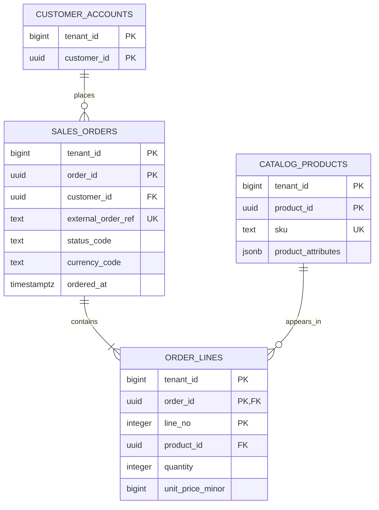
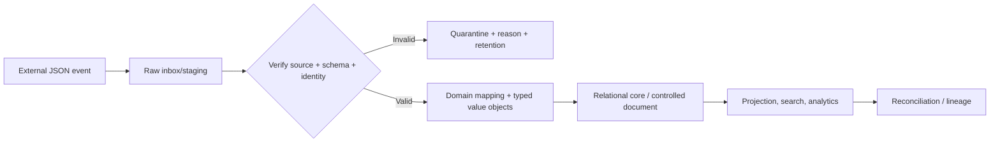

# Abusing JSON Columns to Avoid Defining Data Structure

When rushing a feature out the door, a familiar suggestion pops up: "Just dump everything into one `JSON` column; once we know what we need, we can split it later." Initially, this looks like a time-saver: adding fields requires no table migrations, partner payloads store straight in without mapping, and a Java object serializes wholesale. Yet once orders, users, monetary amounts, statuses, foreign references, and history sit buried inside one document, critical decisions around **identity, grain, types, relationships, constraints, and data lifecycles** do not vanish. They merely move out of a governed model—usually turning into scattered conventions across multiple applications.

Suppose every order lives in `orders(id, payload JSONB)`. The system still must answer: can two orders share the same external code? Can an order line have a negative quantity? Does `customerId` exist and belong to the right tenant? Is `"120000"` money or a string? Does renaming a key break legacy dashboards? Do two concurrent transactions modifying JSON overwrite each other's changes? Must a payload holding a customer address obey the same retention window as the order itself?

**The mistake is not using JSON. The mistake is using JSON to dodge defining the contracts data inherently requires.** JSON can be the right tool for varying shapes, supplemental attributes that do not govern invariants, or raw integration payloads retained briefly for audit/replay. It never replaces defining entities, keys, relational constraints, queries, and change policies.

This lesson belongs to the **Common Pitfalls** chapter of **DATABASE_DATA_MODELING**. Aligned with the module's goal, we practice translating business requirements into clear models—from entities, relationships, and constraints to normalization, keys, indexes, and physical schemas—while comparing relational, document, graph, and analytical models to choose evolvable, verifiable structures. Examples use **PostgreSQL 15+**, `JSONB` syntax, and Java 17+. Verify engine- and version-specific behavior when applying them elsewhere.

## 1. Distinguish Data Format From Data Model

JSON is a **format representing a value tree**: objects, arrays, strings, numbers, booleans, or null. A document can nest deeply and carry optional keys. None of that answers business modeling questions:

| Modeling Question | Does JSON Answer It Automatically? | What Must Be Decided |
|---|---|---|
| What does one record represent? | No | Grain: order, order line, customer, event |
| When are two records the same entity? | No | Business key, surrogate key, uniqueness scope |
| Which attributes are required and what types? | Generic JSON types only | Data contract, validation, nullable/missing rules |
| Is a reference to another object valid? | No | FK or proven integrity mechanism |
| Is a state transition from A to B allowed? | No | State machine, transactions, domain invariants |
| Who may read sensitive fields? | No | Authorization, purpose, data minimization |
| How can data be queried or aggregated? | No | Grain, indexes, units, timestamps, metrics |
| How is old data handled when schemas change? | No | Versioning, migrations, compatibility, backfills |

A `JSONB` column **can be constrained and indexed** in PostgreSQL, so claiming "JSON has no schema" is not strictly accurate either. More accurately, **the schema is no longer declared directly on SQL columns**, shifting enforcement onto validators, generated columns, expression indexes, application code, or pipelines.

### Why "It Saves Cleanly" Does Not Mean "The Model Is Right"

The database happily stores:

```json
{
  "customerId": "C-101",
  "status": "PAID",
  "total": "120000",
  "items": [
    {"sku": "P-7", "qty": "2"}
  ]
}
```

From this document alone, you do not know `total`'s currency, whether it can change post-payment, whether `items` are locked order lines or a shopping cart, whether `customerId` exists, or whether `qty` is a string or integer. Adding a JSON parsing library fixes none of those omissions.

## 2. Benchmark Problem: Define Invariants Before Choosing JSON or Tables

Consider a multi-tenant sales system with these requirements:

1. An order belongs to **one tenant** and **one real customer in that tenant**.
2. `external_order_ref` is unique within a tenant.
3. An order has multiple lines; each line has a line number, product, quantity, and **unit price locked at placement**.
4. `quantity` is a positive integer, `unit_price_minor` is non-negative, and `currency_code` obeys currency policy.
5. Order statuses belong to a controlled set with explicit transition rules.
6. Retrying an order-creation request must never create a duplicate order or deduct inventory twice.
7. Reports sum quantities and monetary amounts at the proper grain with zero join multiplication.
8. Products carry **descriptive attributes that vary by category**: color, material, packaging specs.
9. Integration payloads from partners may include unsupported fields; raw payloads may be kept only within an approved window and scope.
10. If an attribute later becomes a critical filter or business key, the model must support promoting it cleanly.

A sound choice keeps **customers, orders, order lines, products, and keys in relational tables**, while considering JSON for **supplemental product attributes** or **raw staging event payloads**.

### Separate Three Categories of Data

- **Core domain data:** participates in identity, FKs, money, statuses, and transaction rules; demands a strong model.
- **Flexible attributes:** vary across object types, carry governed semantics, and are not core keys or relationships.
- **Raw integration evidence:** payloads received externally with `source`, event ID, schema version, arrival time, and quality flags; never automatically a verified domain source.

Dumping all three into one `payload` does not make the system "more flexible" for safe evolution—it forces every reader to decode special cases everywhere.

## 3. Signs a JSON Column Is Being Abused

One or two signals do not prove JSON is wrong. When many appear together, review the data model:

- Generic columns named `data`, `extra`, or `metadata` hold `customerId`, `orderTotal`, `status`, or primary business keys.
- Nearly every query uses `payload->>'...'` to filter fixed core fields.
- Applications interpret keys inconsistently: `quantity`, `qty`, and `count` coexist with the same meaning.
- Multiple services with different owners mutate properties inside the same JSON object.
- DBAs add dozens of expression indexes to mimic fixed columns.
- Enforcing uniqueness requires scanning JSON payloads in application code.
- Joins rely on strings extracted from JSON with no explicit FK.
- BI expands `jsonb_array_elements` in every report just to count order lines.
- Records mix missing fields, `null`s, and inconsistent value types with no version number.
- Bugs surface only during production CASTs or queries rather than at ingest time.
- Every new requirement gets stuffed into nested objects purely to avoid migrations.
- JSON hides personal data untracked in retention, audit, cache, and export inventories.
- No schema registry, consumer inventory, or contract tests exist for the payload.

**Classic design smell:** application code treats `payload.customerId` as mandatory while the database and docs label the column "arbitrary metadata." That is a broken contract.

## 4. Counterexample: Cramming an Entire Order Into `JSONB`

The DDL looks deceptively tidy:

```sql
-- COUNTEREXAMPLE: for failure analysis only, not recommended.
CREATE TABLE orders_json (
    tenant_id BIGINT NOT NULL,
    order_id UUID NOT NULL,
    payload JSONB NOT NULL,

    CONSTRAINT pk_orders_json
        PRIMARY KEY (tenant_id, order_id),
    CONSTRAINT ck_payload_is_object
        CHECK (jsonb_typeof(payload) = 'object')
);
```

Both sample records pass SQL type checks:

```json
{
  "externalOrderRef": "WEB-1001",
  "customerId": "9e4d77c2-9463-4f12-80ab-ef738ce26701",
  "status": "CONFIRMED",
  "currency": "VND",
  "lines": [
    {"lineNo": 1, "productId": "P-7", "quantity": 2, "unitPriceMinor": 120000},
    {"lineNo": 2, "productId": "P-8", "quantity": 1, "unitPriceMinor": 50000}
  ]
}
```

```json
{
  "externalOrderRef": "WEB-1001",
  "customerId": "not-a-valid-id",
  "status": "SHIPPED_WRONG_VALUE",
  "currency": null,
  "lines": [
    {"lineNo": 1, "productId": "P-7", "quantity": "-5", "unitPriceMinor": "free"}
  ]
}
```

If two payloads receive different `order_id`s, the PK on `(tenant_id, order_id)` **does not** prevent duplicate `externalOrderRef`s. `CHECK(jsonb_typeof(payload)='object')` checks only that the root is an object—never child keys, types, references, or states.

### Invariants Left Unprotected

| Desired Invariant | Reality in the Counterexample |
|---|---|
| Customer exists in tenant | No FK from `payload.customerId` |
| External order ref unique per tenant | No uniqueness on business key |
| Status belongs to allowed set | Any string persists |
| Currency required and valid | May be missing or JSON null |
| Quantity is a positive integer | Can be a negative string |
| Unit price is integer minor units | Can be a string or ambiguous float |
| Line numbers unique per order | Two array objects can share `lineNo` |
| Product ID exists in the same tenant | No FK to product |
| Efficient line-level queries | Must unnest arrays and cast |
| Each field has retention and owner | Everything sits unclassified in one payload |

Data does not become valid simply because it deserializes into `Map<String,Object>`. The corrupt record causes wrong reports, broken shipments, or runtime CAST crashes.

## 5. Grain Pitfalls: One Document Does Not Mean One Entity

**Grain** answers "how many events or objects does one row/document represent?" `orders_json` has an **order grain**, yet embeds a collection of **order lines** at a different grain.

That is not always wrong—an aggregate can live as a document when contracts and workloads match. Trouble starts when:

- Order lines must be referenced, refunded, or reconciled individually.
- `lineNo` uniqueness or line identity must be enforced.
- Products require FKs or different access controls from the order.
- Two subsystems contend over editing different lines in the same document.
- Reports need product/day grain and must parse every order document.
- Editing one line forces rewriting a huge document.
- Single orders have large arrays while the UI needs line pagination or filtering.

Suppose an order has three lines and a total due of 300,000. If a report unnests three lines and sums the order-level total across each line:

\[
300\,000 + 300\,000 + 300\,000 = 900\,000.
\]

That is a **fan-out measure**. The error is not caused by JSON alone, but by **mixing an order-grain measure with line-grain rows**. Nested JSON easily obscures that grain shift.

### When to Move Lines to Their Own Table

Whenever items carry independent identities, need joins/FKs, are queried frequently, or maintain separate history, use an `order_lines` table with an explicit PK. Only keep items embedded when they are genuinely small value objects always read/written with the aggregate and carrying no independent constraints.

## 6. Relational Design for the Core With Stable Contracts

A concrete relational model enforcing those invariants:



The diagram shows the logical model: each order references a customer in the same tenant, contains lines, and lines reference products. `||--|{` expresses the expectation of **at least one line**, though the underlying PK/FK only requires *each line belongs to an order*; enforcing that `CONFIRMED` orders have at least one line belongs in the transaction/use case. Never treat ERD crow's-foot notation as an enforced DB constraint on its own.

### Illustrative PostgreSQL DDL

```sql
CREATE TABLE customer_accounts (
    tenant_id BIGINT NOT NULL,
    customer_id UUID NOT NULL,

    CONSTRAINT pk_customer_accounts
        PRIMARY KEY (tenant_id, customer_id)
);

CREATE TABLE catalog_products (
    tenant_id BIGINT NOT NULL,
    product_id UUID NOT NULL,
    sku TEXT NOT NULL,
    product_name TEXT NOT NULL,
    product_attributes JSONB NOT NULL DEFAULT '{}'::jsonb,

    CONSTRAINT pk_catalog_products
        PRIMARY KEY (tenant_id, product_id),
    CONSTRAINT uq_catalog_product_sku
        UNIQUE (tenant_id, sku),
    CONSTRAINT ck_catalog_product_sku
        CHECK (btrim(sku) <> ''),
    CONSTRAINT ck_catalog_product_name
        CHECK (btrim(product_name) <> ''),
    CONSTRAINT ck_product_attributes_object
        CHECK (jsonb_typeof(product_attributes) = 'object'),
    CONSTRAINT ck_product_attribute_color
        CHECK (
            NOT (product_attributes ? 'color')
            OR jsonb_typeof(product_attributes -> 'color') = 'string'
        )
);

CREATE TABLE sales_orders (
    tenant_id BIGINT NOT NULL,
    order_id UUID NOT NULL,
    customer_id UUID NOT NULL,
    external_order_ref TEXT NOT NULL,
    status_code TEXT NOT NULL DEFAULT 'DRAFT',
    currency_code CHAR(3) NOT NULL,
    ordered_at TIMESTAMPTZ NOT NULL DEFAULT CURRENT_TIMESTAMP,

    CONSTRAINT pk_sales_orders
        PRIMARY KEY (tenant_id, order_id),
    CONSTRAINT uq_external_order_ref
        UNIQUE (tenant_id, external_order_ref),
    CONSTRAINT fk_order_customer
        FOREIGN KEY (tenant_id, customer_id)
        REFERENCES customer_accounts (tenant_id, customer_id)
        ON DELETE RESTRICT,
    CONSTRAINT ck_order_ref_not_blank
        CHECK (btrim(external_order_ref) <> ''),
    CONSTRAINT ck_order_status
        CHECK (status_code IN (
            'DRAFT', 'CONFIRMED', 'SHIPPING',
            'COMPLETED', 'CANCELLED'
        )),
    CONSTRAINT ck_order_currency
        CHECK (currency_code ~ '^[A-Z]{3}$')
);

CREATE TABLE order_lines (
    tenant_id BIGINT NOT NULL,
    order_id UUID NOT NULL,
    line_no INTEGER NOT NULL,
    product_id UUID NOT NULL,
    quantity INTEGER NOT NULL,
    unit_price_minor BIGINT NOT NULL,

    CONSTRAINT pk_order_lines
        PRIMARY KEY (tenant_id, order_id, line_no),
    CONSTRAINT fk_line_order
        FOREIGN KEY (tenant_id, order_id)
        REFERENCES sales_orders (tenant_id, order_id)
        ON DELETE RESTRICT,
    CONSTRAINT fk_line_product
        FOREIGN KEY (tenant_id, product_id)
        REFERENCES catalog_products (tenant_id, product_id)
        ON DELETE RESTRICT,
    CONSTRAINT ck_order_line_number
        CHECK (line_no > 0),
    CONSTRAINT ck_order_line_quantity
        CHECK (quantity > 0),
    CONSTRAINT ck_order_line_price
        CHECK (unit_price_minor >= 0)
);
```

### What the Database Enforces Here

- Orders and products have explicit PK identities within **tenant scope**.
- `external_order_ref` is unique within a tenant **under the DB's text comparison rules**.
- Composite FKs prevent orders from referencing customers in other tenants and prevent lines from pointing across tenants.
- Quantity, line number, and unit price have numeric types and non-invalid bounds enforced at DB level.
- Status and currency declare basic domains; note the currency regex checks only **three uppercase letters**, not official currency codes or legal policies.
- `product_attributes` must be a JSON object, and `color` (if present) must be a string. Additional keys still need dedicated contracts/validators.

### Invariants the Database Does Not Automatically Enforce

- Is `COMPLETED → DRAFT` forbidden? `CHECK` validates allowed values, not state transitions.
- Does a `CONFIRMED` order have at least one line? Requires transactions, use-case checks, or suitable multi-table enforcement.
- Does `SUM(quantity × unit_price_minor)` match the amount due after discounts, taxes, and fees? Requires transaction rules and accounting logic.
- Should `external_order_ref` treat case differences as duplicates? Requires agreed normalization/collation.
- Is each source request processed once? Requires idempotency business keys and transactions.
- Do flexible attributes alter SKU, price, or unit of measure? If so, they likely belong in the core model.

Moving to relational tables does not solve **every** invariant automatically; it makes stable invariants visible and far easier to protect.

## 7. JSON Fits Best When Data Boundaries Are Genuinely Flexible

Categories vary in descriptive traits:

| Product Group | Typical Descriptive Attributes |
|---|---|
| Apparel | `color`, `fabric`, `careInstructions` |
| Tables | `color`, `assemblyRequired`, `finish` |
| Networking gear | `portCount`, `wirelessStandard` |
| Packaging supplies | `packageMaterial`, `recyclable` |

When these attributes only assist display or secondary filtering—without governing identity, FKs, or financial rules—`catalog_products.product_attributes JSONB` can work well:

```json
{
  "color": "blue",
  "fabric": "cotton",
  "careInstructions": "machine-wash"
}
```

The contract must still specify:

- Which keys are supported per `product_kind`?
- What data type and unit apply to each key?
- Which keys are optional, and is `null` permitted?
- Who has authority to add or edit keys?
- Does the attribute schema need versioning?
- May fields serve as public search filters?
- Do any fields carry personal or sensitive data?
- How do older consumers read renamed keys?

**Flexible attributes do not mean completely arbitrary keys.** An attribute dictionary or per-category schema governs definitions without forcing hundreds of nullable columns onto every product.

### Boundaries Never to Hide Inside `product_attributes`

Avoid stuffing into JSON by default:

- `product_id`, `tenant_id`, or SKUs referenced across tables.
- Currency codes and locked transaction prices.
- Warehouse IDs and available stock requiring atomic updates.
- Category codes joining to FK-enforced dimensions.
- Attributes defining **a distinct product variant** with its own identity, inventory, and price.

If a blue shirt in size M and size L carry separate inventory, SKUs, and prices, model them as **two variants with distinct identities** (or an equivalent variant structure), not arbitrary JSON strings.

## 8. Comparing Relational Tables, JSONB, and EAV by Practical Needs

**EAV** (*Entity–Attribute–Value*) stores each attribute as a row `(entity_id, attribute_name, value)`. It also offers flexibility without automatically solving semantics or constraints.

| Need | Typed Relational Columns | JSONB | EAV |
|---|---|---|---|
| Fixed, mandatory attributes | Clear, strong constraints | Needs path validators/constraints | Needs metadata & completeness checks |
| Links to other entities | Native FKs | Requires generated columns or app checks | Complex typed/value FKs |
| Uniqueness on business keys | Explicit PK/UNIQUE | Expression/generated index; watch nulls/types | Often needs extra structure |
| Adding optional attributes | Requires migration / nullable | Convenient | Convenient |
| Multi-field queries | B-tree + native stats | GIN / expression indexes depending on query | Repeated self-joins / pivots |
| Per-field type validation | Column type / CHECK | JSON Schema / validator / CHECK | Attribute metadata + typed values |
| Reading a full aggregate | Joins / response shaping | Single document can be convenient | Requires pivoting |
| Partial updates | Column update, row MVCC | Document update, row MVCC | Single attribute-row update |
| Reporting & BI | Clear grain and measures | Needs unnesting / mapping | Needs pivoting and normalization |
| Contract evolution | Controlled DDL migrations | Versioning & validation still needed | Metadata & versioning still needed |

**Neither JSONB, EAV, nor pure relational wins universally.** Decide based on attribute count, stability, primary queries, DB-enforced constraints, and maintainability.

A hybrid often works best: **typed columns for the stable core + JSONB for genuinely flexible extensions + schema registry/validation for supplemental attributes**.

## 9. Missing, JSON null, SQL NULL, and Empty Strings Differ

Treating every form of "no value" identically is a dangerous mistake.

```json
{}
```

```json
{"discountMinor": null}
```

```json
{"discountMinor": 0}
```

```json
{"discountMinor": ""}
```

Each can mean something distinct:

- **Missing key:** the source omitted or does not support the field; never assume 0.
- **JSON null:** the source explicitly sent null; semantics follow the contract.
- **0:** an explicit numeric zero, when defined as a number.
- **Empty string:** a zero-length string; usually not a valid number.

In PostgreSQL:

```sql
SELECT
    '{}'::jsonb ? 'discountMinor'
        AS missing_key_present,         -- false

    '{"discountMinor":null}'::jsonb ? 'discountMinor'
        AS json_null_key_present,       -- true

    '{}'::jsonb ->> 'discountMinor'
        AS missing_text_value,          -- SQL NULL

    '{"discountMinor":null}'::jsonb ->> 'discountMinor'
        AS json_null_text_value,        -- SQL NULL

    jsonb_typeof('{}'::jsonb -> 'discountMinor')
        AS missing_json_type,           -- SQL NULL

    jsonb_typeof('{"discountMinor":null}'::jsonb
        -> 'discountMinor')
        AS explicit_json_type;          -- text 'null'
```

`->>` returns text, erasing **the distinction between missing keys and JSON null**. Avoid shortcuts like:

```sql
-- COUNTEREXAMPLE: hides the difference between unknown and truly zero.
SELECT COALESCE(payload ->> 'discountMinor', '0')
FROM orders_json;
```

Treating `discount = 0` is valid only when the source **confirms zero discount**. If the field is missing due to an old client version or ingestion bug, coercing it to 0 silently produces wrong totals.

### SQL CHECK and Three-Valued Logic

PostgreSQL `CHECK` rejects rows only when the expression evaluates to **FALSE**; if it evaluates to **NULL/UNKNOWN**, the row still passes!

```sql
-- Insufficient to guarantee the field is always present:
CHECK ((payload ->> 'quantity')::integer > 0)
```

When `quantity` is absent, the expression evaluates to NULL and the `CHECK` **does not reject it**. Enforce explicit presence, type, and bounds, and validate dirty strings before casting to avoid runtime crashes.

## 10. Numbers, Money, Units, and Time Should Not "Be Left to JSON"

### 10.1. JSON Numbers Carry Incomplete Semantics

`{"amount": 100}` is a JSON number, yet leaves unanswered:

- 100 VND, 100 cents, or 100 USD?
- Locked price, list price, pre-tax subtotal, or post-tax total?
- Integer minor units?
- When summing two records, do they share currency and grain?
- Are negative values permitted for refunds?

When `unitPriceMinor` is locked transaction money, store **typed numeric columns alongside `currency_code`**. Never use `double`/binary floating point for money. Use `BIGINT` minor units with range checks, or `NUMERIC` when fractional precision requires it.

### 10.2. Numbers and Strings Are Not Equivalent

```json
{"quantity": 2}
```

```json
{"quantity": "2"}
```

One client parses both via coercion while another rejects `"2"`. A SQL query like:

```sql
SELECT (payload ->> 'quantity')::integer
FROM orders_json;
```

crashes on `"quantity": "two"` or malformed values, and returns NULL when missing. Ingress validators must **reject or quarantine bad payloads** instead of letting BI queries crash months later.

### 10.3. Timestamps and Timezones

```json
{"createdAt":"2026-11-01T08:30:00+07:00"}
```

Inside JSON, this is just a string. For filtering by true instants, business dates, retention, or partitioning, **parse it into a valid instant** and store `TIMESTAMPTZ` in the canonical model per company timezone policy.

Lexicographical comparison of timestamp strings with differing offsets does not match chronological order. Never substitute `received_at` for `event_time` when reporting requires occurrence time.

### 10.4. Units of Measure

`{"length":10}` hides whether it means cm, m, or inches. If a flexible attribute is a physical quantity, the contract should require:

```json
{"length":{"value":10,"unit":"cm"}}
```

or convert to a versioned base unit. Whenever `length` feeds shipping fees, product limits, or formal constraints, prefer typed columns and constraints over runtime unit errors.

## 11. JSON Constraints Are Possible, Yet Tally Their Cost

It is inaccurate to claim PostgreSQL cannot constrain JSONB. You can check types, key presence, and project values into indexes.

Example for a raw receipt JSON table with a fixed contract:

```sql
CREATE TABLE receipt_raw_check (
    receipt_id UUID PRIMARY KEY,
    payload JSONB NOT NULL,

    CONSTRAINT ck_receipt_payload
        CHECK (jsonb_typeof(payload) = 'object'),

    CONSTRAINT ck_receipt_currency
        CHECK (
            jsonb_typeof(payload -> 'currency')
                IS NOT DISTINCT FROM 'string'
            AND (payload ->> 'currency') ~ '^[A-Z]{3}$'
        ),

    CONSTRAINT ck_receipt_status
        CHECK (
            jsonb_typeof(payload -> 'status')
                IS NOT DISTINCT FROM 'string'
            AND payload ->> 'status' IN ('DRAFT', 'FINAL')
        )
);
```

**Good:** the database rejects missing or wrong-typed `currency` and `status` because `IS NOT DISTINCT FROM` forces `CHECK` to evaluate cleanly to FALSE.

**Still insufficient:** no PK/FK on customers or lines, no verification that currency is supported, no rejection of unexpected extra keys, and no cross-row business checks.

For complex structures, `CHECK` constraints quickly turn into sprawling path/type/CAST expressions that are painful to audit and maintain. Once a field serves as an identifier, join key, or daily filter status, the question is no longer "can we write a JSON `CHECK`?" but "**why not give this field a readable typed column?**"

### Unprotected Extraction Example

```sql
-- COUNTEREXAMPLE: write path may crash on CAST, or NULL values may slip through.
CHECK ((payload ->> 'priceMinor')::bigint >= 0)
```

If JSON holds `"priceMinor": "free"`, the cast fails. If the key is absent, the result is UNKNOWN. For core fixed fields, `price_minor BIGINT NOT NULL CHECK(price_minor>=0)` is cleaner and exact.

**Note:** pre-DB input validation does not replace DB constraints when multiple writers can bypass validators. Combine boundary validation with DB constraints at the authoritative store, each guarding the invariants it controls.

## 12. Foreign Keys: An ID Buried in JSON Has No Referential Integrity

Suppose:

```json
{
  "customerId": "9e4d77c2-9463-4f12-80ab-ef738ce26701"
}
```

On `orders_json`, the database has no declaration that `payload.customerId` must exist in `customer_accounts` for the same tenant. A query might cast during join:

```sql
-- Safe only if input has already been verified as a valid UUID.
SELECT o.order_id, c.customer_id
FROM orders_json AS o
JOIN customer_accounts AS c
  ON c.tenant_id = o.tenant_id
 AND c.customer_id = (o.payload ->> 'customerId')::uuid;
```

Hidden pitfalls:

- If `customerId` is malformed, the query **crashes**.
- If missing or null, `INNER JOIN` silently drops the order.
- If the customer was deleted or belongs to another tenant, JSON retains the dangling ID with no FK error.
- If IDs merge or change, old payloads are hard to locate and update per policy.

### Do Generated Columns Solve This?

PostgreSQL supports **stored generated columns** from eligible expressions, letting you project a stable JSON field into a column and attach an FK:

```sql
-- Standalone example to illustrate technical capability.
-- Use only when input is guaranteed to be a valid UUID.
CREATE TABLE orders_json_with_customer_fk (
    tenant_id BIGINT NOT NULL,
    order_id UUID NOT NULL,
    payload JSONB NOT NULL,

    customer_id UUID GENERATED ALWAYS AS (
        (payload ->> 'customerId')::uuid
    ) STORED,

    CONSTRAINT pk_orders_json_customer
        PRIMARY KEY (tenant_id, order_id),
    CONSTRAINT fk_json_customer
        FOREIGN KEY (tenant_id, customer_id)
        REFERENCES customer_accounts (tenant_id, customer_id)
);
```

This is a **real capability**, so never say "JSON can never have an FK." Still:

- Missing `customerId` generates `NULL`, and default FKs **accept NULL**. Add `NOT NULL` or `CHECK` if mandatory.
- Non-UUID strings crash inserts/updates on the cast.
- Updating JSON triggers generated column, FK, and index maintenance; migrations must track dependencies.
- The generated column effectively becomes a **core relational column** even though input arrived in JSON.

If the application already joins, FK-checks, and filters on customer ID, a direct `customer_id UUID NOT NULL` column is clearer and simpler.

## 13. Uniqueness: Indexes on JSON Paths Have Contract Limits

You can build a unique expression index:

```sql
-- Example on the counterexample table orders_json only.
CREATE UNIQUE INDEX uq_orders_json_external_ref
    ON orders_json (
        tenant_id,
        (payload ->> 'externalOrderRef')
    );
```

This blocks two rows in the same tenant with **the same non-NULL text `externalOrderRef`** under index collation rules. Gaps remain:

1. **Missing keys** and **JSON null** both map via `->>` to SQL NULL; default unique indexes allow multiple NULLs, so this does not force every order to carry a ref.
2. `"WEB-1"` and `"web-1"` look distinct unless the expression normalizes case per business rules.
3. A payload might pass a number instead of string; `->>` coerces to text, masking schema drift.
4. If the table partitions by date while business keys must be unique across months, local indexes omitting the partition key fail to enforce global uniqueness.
5. Renaming keys requires coordinated index and writer migrations; path indexes do not equate old and new key names.

**Define business keys as typed `NOT NULL` columns.** If special constraints force an expression index, back it with validators/constraints for presence, type, normalization, uniqueness scope, and versioned migrations.

### JSON Does Not Automatically Provide Idempotency

Retries can carry the same `clientRequestId` inside the payload. Without an enforced unique key in the right scope, concurrent requests create two distinct `order_id`s. Never rely on `SELECT payload @> ...` followed by `INSERT`—use atomic unique/idempotency records and payload conflict detection.

A sound idempotency key is `(tenant_id, source_system, request_id)` in a dedicated table alongside a request fingerprint and processing state. Order business identity and request idempotency identity are often **two distinct invariants**.

## 14. Querying JSONB: Common Operators and Compatibility Traps

Useful PostgreSQL operators:

| Syntax | Basic Meaning | Watch Out For |
|---|---|---|
| `data -> 'key'` | Extract nested JSONB value | Missing returns SQL NULL; result stays JSONB |
| `data ->> 'key'` | Extract as text | Erases distinction between missing and JSON null |
| `data #> '{a,b}'` | Extract JSONB by path | Missing path returns SQL NULL |
| `data #>> '{a,b}'` | Extract text by path | Needs type parsing for math |
| `data ? 'key'` | Top-level key exists | Does not check value type |
| `data @> '{"color":"blue"}'` | Left JSONB contains right structure | Great for structured equality/containment |
| `jsonb_array_elements(data)` | Expand array to rows | Causes fan-out; errors if input is not an array |
| `jsonb_set(data,path,new,...)` | Return new JSONB with updated path | Does not create all missing parent objects; doesn't stop full-payload lost updates |

### Valid Flexible Attribute Filter Example

```sql
SELECT
    tenant_id,
    product_id,
    sku,
    product_name
FROM catalog_products
WHERE tenant_id = 42
  AND product_attributes @> '{"color":"blue"}'::jsonb;
```

This is sound when `color` is a **contract-defined attribute**, not an ad-hoc key interpreted differently by every producer.

### Never Trust Timestamp Strings Just Because JSON Parsed

An `"eventTime"` arriving with mixed timezone offsets or numeric epoch formats requires explicit canonicalization. Never treat text comparison via `->>` as chronological instant comparison.

## 15. Choosing GIN vs. Expression B-Tree Indexes From Query Patterns

Saying "JSON cannot be indexed" is false: PostgreSQL offers **JSONB GIN indexes** and expression indexes. Still, no single index accelerates every query.

### GIN for Containment

```sql
CREATE INDEX ix_products_attributes_gin
    ON catalog_products
    USING GIN (product_attributes jsonb_path_ops);
```

`jsonb_path_ops` works especially well for containment (`@>`) and supported JSONPath operators. It **does not support operators like `?` (top-level key existence)**. If workloads require key existence and broader operators, evaluate the default `jsonb_ops` operator class—test both against real data and queries.

### Expression Index for a Frequently Queried Path

```sql
CREATE INDEX ix_product_tenant_color
    ON catalog_products (
        tenant_id,
        (product_attributes ->> 'color')
    )
    WHERE product_attributes ? 'color';
```

Matching query:

```sql
SELECT product_id, sku
FROM catalog_products
WHERE tenant_id = 42
  AND product_attributes ? 'color'
  AND product_attributes ->> 'color' = 'blue';
```

Including the key-existence predicate lets the planner prove the **partial index** applies. Without matching predicates, PostgreSQL may skip the index even when the author assumes it helps.

**Never blindly stack GIN plus dozens of B-tree expression indexes.** Measure `EXPLAIN (ANALYZE, BUFFERS)` on realistic distributions, selectivity, and write rates. Every index adds storage and write overhead.

### Statistics and Query Planning

Typed columns get rich per-column planner statistics automatically. JSONB paths often need expression statistics or indexes for accurate row estimates. A fast query across a few thousand documents proves nothing for millions of products with skewed keys.

## 16. Performance: JSONB Is Not "One Free Column"

PostgreSQL `JSONB` stores pre-parsed binary trees supporting operators and indexing, yet large documents carry real costs:

- **WAL / MVCC:** updating one property writes a new row version; large documents cause substantial I/O, TOAST churn, and write amplification.
- **Index maintenance:** expression and GIN indexes update on JSONB mutations depending on changed paths.
- **Serialization:** applications repeatedly parse, serialize, validate, and cast.
- **Queries:** filtering or sorting unindexed paths scans and extracts across many rows.
- **Memory / network:** fetching a large document just to read one small field wastes bandwidth and CPU.
- **Vacuum / bloat:** frequent mutations on large documents drive heavy MVCC vacuum load.
- **Ownership contention:** multiple consumers updating different keys in one document contend on **the same row**.

JSONB also has real strengths: primary-key reads of compact documents are fast, and whole-aggregate reads/writes can reduce joins and round-trips. Base decisions on **workloads and sizes**, not prejudice like "JSON is always slow."

### Benchmarks Must Include Adversarial Cases

Measure at least:

- P50/P95/P99 latency for business-key and JSON-path lookups.
- Array-unnesting time when building line-grain facts.
- WAL bytes and row/index updates when mutating one attribute.
- Table, TOAST, index, and backup storage footprint.
- Write contention when two writers update disjoint keys.
- Query plans after key cardinality doubles or oversized documents appear.
- Cost of purging or redacting personal data across documents and projections.

If JSON was picked solely to dodge migrations yet operations end up managing dozens of expression indexes and scattered parsing code, total system cost can **far exceed** intentional schema migrations.

## 17. JSON Updates and Concurrent Contention

Suppose you have a user preferences table:

```sql
CREATE TABLE account_preferences (
    tenant_id BIGINT NOT NULL,
    customer_id UUID NOT NULL,
    preferences JSONB NOT NULL
        DEFAULT '{"theme":"light","language":"vi"}'::jsonb,
    row_version BIGINT NOT NULL DEFAULT 0,

    CONSTRAINT pk_account_preferences
        PRIMARY KEY (tenant_id, customer_id),

    CONSTRAINT fk_preferences_customer
        FOREIGN KEY (tenant_id, customer_id)
        REFERENCES customer_accounts (tenant_id, customer_id),

    CONSTRAINT ck_preferences_object
        CHECK (jsonb_typeof(preferences) = 'object'),
    CONSTRAINT ck_preferences_version
        CHECK (row_version >= 0)
);
```

T1 reads `{"theme":"light","language":"vi"}` and sets theme to dark. Concurrently, T2 reads the old snapshot and sets language to en. If both run:

```sql
-- COUNTEREXAMPLE: app resends the whole JSON from a previously read snapshot.
UPDATE account_preferences
SET preferences = :stale_full_json
WHERE tenant_id = :tenant_id
  AND customer_id = :customer_id;
```

The second update overwrites the first's change, even though they touched **two different keys**.

### Path-Based Updates on Current State

```sql
UPDATE account_preferences
SET
    preferences = jsonb_set(
        preferences,
        '{theme}',
        '"dark"'::jsonb,
        true
    ),
    row_version = row_version + 1
WHERE tenant_id = :tenant_id
  AND customer_id = :customer_id
RETURNING row_version;
```

Under PostgreSQL `READ COMMITTED`, two transactions updating **the same row** serialize via row locks, and the second evaluates `jsonb_set` against the committed row rather than resending a stale JSON blob. Still account for cross-field invariants and ordering.

### Optimistic Locking When Updates Depend on a Snapshot

```sql
UPDATE account_preferences
SET
    preferences = jsonb_set(
        preferences, '{theme}', '"dark"'::jsonb, true
    ),
    row_version = row_version + 1
WHERE tenant_id = :tenant_id
  AND customer_id = :customer_id
  AND row_version = :expected_row_version
RETURNING row_version;
```

If 0 rows return, the version changed or the row is gone; re-read and decide whether to retry or merge. Never treat 0 rows as a silent success.

**Warning:** `jsonb_set` with a deep path **does not create all missing parent objects** even with `create_if_missing=true`; initialize valid parent structures per contract or use controlled object creation.

When multiple services write to the same JSON, ask **who owns each key**. Sharing one field blurs aggregate and transaction boundaries even without technical lost updates.

## 18. Schema Evolution: JSON Does Not Eliminate Migrations

Changing:

```json
{"shipping":{"phone":"..."}}
```

to:

```json
{"delivery":{"contactPhone":"..."}}
```

is a schema change even with zero `ALTER TABLE`. Consumers expecting the old path read missing fields, write to dead keys, or display zeros.

### Why Versions and Policies Are Necessary

Documents persist for months or years while code deploys across many versions. Answer:

- Are v1 records handled by a v2 reader adapter or backfilled?
- When renaming a key, are both written during the transition window?
- If both keys appear, which one wins?
- When is the old key retired, and which batches/consumers still depend on it?
- If a field shifts from string to number, how are parse errors handled?
- Does historical data contain enough truth for accurate conversion?
- If metrics or currencies change, do old values retain the same meaning?

You can embed metadata:

```json
{
  "schemaVersion": 2,
  "attributes": {
    "color": "blue",
    "fabric": "cotton"
  }
}
```

Yet **adding `schemaVersion` does not perform migrations automatically**. You still need schema definitions, validators, backward-compatible readers, backfills, and coverage tracking.

### Expand–Migrate–Contract for JSON

1. **Expand:** readers understand both v1 and v2; validators accept allowed versions.
2. **Writer cutover:** new writers emit v2; block old writers from dropping mandatory fields.
3. **Backfill:** upgrade v1 to v2 with verified, idempotent transformations.
4. **Reconcile:** verify counts, types, values, references, and grain-safe metrics.
5. **Contract:** remove v1 paths only after consumer inventories confirm zero dependencies.

A genuine benefit of JSON is **fewer DDLs** for flexible attribute changes; it never eliminates **contract transitions, historical data repair, or consumer coordination**.

## 19. Data Contracts and Validation Need Three Layers

When using JSONB legitimately, publish a **versioned schema** instead of leaving every service to guess.

### 19.1. Boundary Validation

Use JSON Schema or an equivalent validator:

```json
{
  "$schema": "https://json-schema.org/draft/2020-12/schema",
  "type": "object",
  "required": ["color", "fabric"],
  "additionalProperties": false,
  "properties": {
    "color": {
      "type": "string",
      "minLength": 1
    },
    "fabric": {
      "type": "string",
      "minLength": 1
    }
  }
}
```

This is an **illustrative schema for a product type requiring exactly two attributes**, not for every `product_kind`. Other types can define optional fields and extensibility rules.

Run validators on **every authoritative write path**: APIs, batch imports, admin tools, and event consumers. If raw payloads must be retained for debugging, isolate them in raw/staging storage marked invalid rather than polluting domain tables.

### 19.2. Database-Level Checks

Use typed columns, `CHECK`, uniques, FKs, and generated columns for DB-enforceable invariants. For optional JSON, `jsonb_typeof(attributes)='object'` plus checks on stable core keys may suffice.

Do not rewrite an entire complex JSON Schema as one massive unreadable SQL `CHECK`; instead ensure every critical invariant has a **strong enforcement point**.

### 19.3. Business Semantic Validation

JSON Schema can verify `quantity` is a positive integer, yet cannot verify:

- Is the product active and owned by the right tenant?
- Is the locked price valid at this point in time?
- Can two lines share the same SKU?
- Can a completed order be edited?
- Has this event already been processed?

Those belong in domain services, transactions, locks, authoritative lookups, cross-table constraints, and reconciliation.

**These three layers complement each other:** ingress validation stops dirty input early; DB constraints guard against concurrent/bypassing writers; domain logic protects cross-entity and temporal semantics.

## 20. Java: `Map<String,Object>` Is Not a Contract for Core Data

A tempting shortcut:

```java
// COUNTEREXAMPLE when this is core Order data.
public record OrderRequest(
    java.util.Map<String, Object> data
) {}
```

The controller passes `data` straight to the database while downstream services call `data.get("total")` and `data.get("customer")`. That pushes invariants to runtime:

- No compile-time visibility into required fields.
- Different consumers cast types inconsistently.
- No value objects for money, status, or identity.
- Key typos survive quietly in production.
- Field-level permissions and request validation become hard to audit.

### Typed DTOs for the Core, Controlled JSON for Governed Attributes

```java
import java.util.List;
import java.util.Map;
import java.util.UUID;

public record CreateOrderRequest(
    String externalOrderRef,
    List<CreateOrderLineRequest> lines
) {}

public record CreateOrderLineRequest(
    UUID productId,
    int quantity
) {}

public record ProductAttributesRequest(
    String productKind,
    Map<String, Object> attributes,
    int schemaVersion
) {}
```

Here:

- `tenant_id` and `customer_id` come from the **authenticated security context**, never trusted from client JSON.
- Locked prices and currencies are resolved by an authoritative service, never trusting client-supplied `unitPriceMinor`.
- `CreateOrderLineRequest` has clear structure; validate `quantity > 0` and product existence/scope.
- `ProductAttributesRequest` stays flexible yet validates against **the schema for `productKind` and `schemaVersion`**.
- `Map<String,Object>` stays confined to the governed boundary rather than leaking throughout the domain model.

A Java `record` defines shape, **not validation**. Add Bean Validation, constructor/factory invariants, tests, and strict JSON deserialization rules. If parsers ignore unknown fields, enforce and test that extra fields are **never stored, forwarded, or logged** unintentionally.

### Domain Models Should Not Mirror Raw JSON Blindly

An order needs behaviors: confirm, cancel, lock prices, guard transitions. Never expose `put("status","COMPLETED")` on a map and let any service flip states arbitrarily. Typed state models, commands, and verified invariants are **domain design**, not optional ORM flair.

## 21. Keeping Raw JSON in Integrations: Right Place, Purpose, and Lifecycle

When receiving partner webhooks, raw payloads help with:

- Verifying protocol versions and debugging failures.
- Controlled replays when parsers evolve.
- Reconciling received-but-unprocessed events.
- Auditing source, event ID, arrival time, and raw inputs.

Yet raw payloads are **not automatically trusted domain records**. Use a staged pipeline:



### Illustrative Raw Inbox SQL

```sql
CREATE TABLE integration_event_inbox (
    tenant_id BIGINT NOT NULL,
    source_system TEXT NOT NULL,
    source_event_id TEXT NOT NULL,
    schema_version INTEGER NOT NULL,
    event_time TIMESTAMPTZ,
    received_at TIMESTAMPTZ NOT NULL DEFAULT CURRENT_TIMESTAMP,
    processing_status TEXT NOT NULL DEFAULT 'RECEIVED',
    raw_payload JSONB NOT NULL,

    CONSTRAINT pk_integration_event_inbox
        PRIMARY KEY (tenant_id, source_system, source_event_id),
    CONSTRAINT ck_inbox_schema_version
        CHECK (schema_version > 0),
    CONSTRAINT ck_inbox_source_nonblank
        CHECK (btrim(source_system) <> ''
               AND btrim(source_event_id) <> ''),
    CONSTRAINT ck_inbox_status
        CHECK (processing_status IN (
            'RECEIVED', 'VALIDATED', 'REJECTED', 'APPLIED'
        ))
);
```

In this design:

- The PK protects **event identity** per tenant and source, not full business state.
- `schema_version` and `source_system` are typed columns for routing and validation.
- `event_time` may be absent in raw input, yet must be resolved if downstream reports depend on event time.
- `processing_status` separates received, validated, and applied states; transitions require transactions and idempotency.
- Add a payload fingerprint or equivalent check to detect **same event ID with differing payloads** instead of silently dropping conflicts.
- `raw_payload` may hold PII or secrets; enforce strict access controls, retention, and avoid echoing it into logs.

**Signature caveat:** PostgreSQL `JSONB` normalizes object representations (key order, whitespace, duplicate keys). If webhooks verify HMAC signatures over **original raw bytes**, verify against the **received raw bytes** before parsing—normalized `JSONB` does not reproduce signed byte streams. Store raw bytes separately only when justified, with strict permissions and TTLs.

## 22. Late Updates and Idempotency When Documents Evolve

A producer emits:

```text
Event A / sourceVersion=12 / product.attributes.color="blue"
Event B / sourceVersion=11 / product.attributes.color="red"
A arrives first, B arrives afterward
```

If a consumer blindly runs `UPDATE product_attributes = :new_json` in arrival order, the newer state (blue) regresses to red.

Embedding `"version":12` inside JSON protects nothing if writers ignore it. Use a typed `source_version BIGINT` column with conditional updates:

```sql
-- Hypothetical example of a projection table with tenant_id, product_id,
-- attributes JSONB, and source_version BIGINT.
UPDATE product_attribute_projection
SET
    attributes = :attributes_json,
    source_version = :incoming_version
WHERE tenant_id = :tenant_id
  AND product_id = :product_id
  AND source_version < :incoming_version;
```

This applies strictly to **full-state snapshots from one monotonically versioned source**. It does not handle initial inserts or same-version conflicts. For **delta events** (stock +5, stock −2), never discard a late delta merely because its version precedes the latest snapshot—use ledgers, event identities, ordering, or rebuilds.

### Concurrency + JSON Has Two Layers of Problems

1. **Row-update concurrency:** lost updates when clients resend stale full JSON.
2. **Message/event concurrency:** stale snapshots overwriting newer state, or deltas applied twice.

`jsonb_set` helps patch a single path against current DB state, yet **never solves** business ordering, payload conflicts, or integration idempotency on its own.

## 23. Analytics: Unnesting JSON Must Control Cardinality

A query on `orders_json` can unnest lines:

```sql
-- Run only after verifying payload.lines is a JSON array
-- and every element has valid numeric quantity/unitPriceMinor.
SELECT
    o.tenant_id,
    o.order_id,
    line ->> 'productId' AS product_id_text,
    (line ->> 'quantity')::INTEGER AS quantity,
    (line ->> 'unitPriceMinor')::BIGINT AS unit_price_minor
FROM orders_json AS o
CROSS JOIN LATERAL jsonb_array_elements(
    o.payload -> 'lines'
) AS line;
```

If `lines` is not an array, the query crashes. If quantity is `"free"`, the CAST crashes. If ingestion duplicated two items with the same `lineNo`, metrics multiply.

### Mixing Grains Multiplies Measures

```sql
-- COUNTEREXAMPLE: assumes payload.totalMinor is at order grain.
SELECT
    o.tenant_id,
    SUM((o.payload ->> 'totalMinor')::NUMERIC) AS total
FROM orders_json AS o
CROSS JOIN LATERAL jsonb_array_elements(
    o.payload -> 'lines'
) AS line
GROUP BY o.tenant_id;
```

Every `totalMinor` is summed **once per line**. `SUM(DISTINCT totalMinor)` is not a fix because multiple orders share identical totals. Aggregate **once per order**, or compute from properly normalized lines at matching grain and component rules.

### Separate Sources From Grain-Explicit Facts

A data mart can store:

```text
FactOrderLine
  tenant_id
  order_id
  line_no
  product_id
  quantity
  unit_price_minor
  order_business_date
  currency_code
```

For revenue by product, aggregate from the line fact. For **unique order counts**, compute `COUNT(DISTINCT order_id)` at the target grouping grain rather than summing per-product order counts as if orders never span products.

**Never let JSON shape dictate metrics accidentally.** Grain, sign conventions, currency, timezone, and snapshot rules must be locked independently of storage format.

## 24. Data Protection: JSON Is Not Exempt From Authorization or Retention

A `metadata JSONB` column often flows through `Map<String,Object>` mappers and gets logged verbatim. When it holds emails, phone numbers, addresses, tokens, ID numbers, or PII, exposure risk often exceeds well-classified typed columns.

### Purpose Confusion Example

```json
{
  "campaign": "autumn",
  "debug": {
    "recipientEmail": "example@invalid.test",
    "deliveryAddress": "Illustrative address",
    "authorizationHeader": "secret-redacted"
  }
}
```

Never permit `authorizationHeader` or out-of-purpose PII inside payloads, even under a `debug` key. Renaming a key never strips data sensitivity.

Review:

- **Key allowlists:** permit only purpose-justified fields.
- **Authorization:** who may read/edit the full JSON vs. exposed subsets?
- **Tenant scope:** tenant must live on authoritative columns/keys/permissions, never a caller-supplied JSON field.
- **Retention:** which fields must purge earlier than the parent aggregate?
- **Events/logs/caches:** which downstream copies receive full payloads and for how long?
- **Search/BI:** are unapproved fields accidentally indexed or exported?
- **Backup/restore:** are erasure policies reapplied when restoring older snapshots?

### One JSON Document With Multiple Lifecycles

If one JSON stores long-lived order status alongside a short-lived delivery address, deleting the whole document breaks accounting while retaining the whole document violates retention limits. Separating entities or fields by **lifecycle, permissions, and access boundaries** makes purging, auditing, and recovery straightforward to prove.

Pseudonymization, tokens, or encryption alone never prove data is anonymous or cleared for indefinite retention.

## 25. Migration Plan From a "Store-Everything JSON" Table to an Explicit Model

Never run one giant `ALTER TABLE` and force every reader to switch instantaneously. A safe migration uses **inventories, staging, controlled dual-reads/writes, and reconciliation**.

### Phase A — Inventory and Contract Alignment

1. Catalog every real JSON key/path, frequency, value types, missing rates, JSON nulls, and unknown keys.
2. Classify into **core, flexible, raw, PII**; assign owners and purposes.
3. Lock down grain, identities, uniqueness, currencies, units, and timezones.
4. Inventory all APIs, jobs, CDC consumers, events, search indexes, caches, and BI queries reading legacy paths.
5. Finalize target schemas, reader/writer compatibility, versioning, and rollback rules.

### Phase B — Deploy Target Structures

1. Create typed tables, PK/FK/UNIQUE/CHECK constraints, and query-driven indexes.
2. Keep `product_attributes JSONB` strictly for justified optional attributes.
3. Enforce validators and write protocols across authoritative writers.
4. Retain raw payloads in governed staging if justified; never delete reconciliation evidence prematurely.
5. Build adapters mapping JSON v1/v2 into typed domain models, routing invalid/unknown rows explicitly.

### Phase C — Backfill and Quarantine

Process source records in batches and classify:

| Case | Handling |
|---|---|
| Complete keys, valid types, valid FKs | Map and write typed parent + child rows |
| Missing required field | Quarantine; never invent defaults |
| JSON null where domain requires `NOT NULL` | Investigate upstream source and policy |
| `quantity="2"` string | Convert only under an explicit, logged migration contract |
| `quantity="two"` | Reject / quarantine |
| Duplicate external ref within tenant | Resolve business conflict explicitly; never pick randomly |
| Nonexistent product or customer | Hold in staging or remediate with owner |
| Row mutates during backfill | Version/checkpoint/CDC catch-up |
| Order lines duplicated during array parsing | Reconcile by `(tenant, order, line_no)` |
| Out-of-purpose personal data fields | Exclude from new schema; handle per privacy policy |

**Never mark a migration "complete" just because the job threw zero exceptions.** Reconcile order counts, line counts, total quantities, totals by currency, orphan FKs, and quarantined records.

### Phase D — Cutover and Contract

1. Run new readers in shadow mode over migrated data.
2. Compare API outputs, queries, BI metrics, and error cases.
3. Block legacy writers from introducing incompatible JSON shapes.
4. Shift read traffic gradually via canaries / feature flags.
5. Monitor mismatches, latency, validation errors, and replays.
6. Remove legacy paths **only after** verifying every consumer, backup, and retention dependency.

When historical data lacks detail to reconstruct a new field, mark it **unknown / not reconstructable** rather than filling in 0 or live prices to make tables look complete.

## 26. Pre-Migration Quality Inventory SQL

On the counterexample `orders_json` table, start with non-crashing inspection queries that avoid unsafe casts.

### 26.1. Finding Payloads Missing Required Structure

```sql
SELECT
    tenant_id,
    order_id,
    CASE
        WHEN jsonb_typeof(payload -> 'externalOrderRef')
             IS DISTINCT FROM 'string'
            THEN 'INVALID_EXTERNAL_REF'
        WHEN btrim(payload ->> 'externalOrderRef') = ''
            THEN 'BLANK_EXTERNAL_REF'
        WHEN jsonb_typeof(payload -> 'customerId')
             IS DISTINCT FROM 'string'
            THEN 'INVALID_CUSTOMER_ID_TYPE'
        WHEN jsonb_typeof(payload -> 'currency')
             IS DISTINCT FROM 'string'
            THEN 'INVALID_CURRENCY_TYPE'
        WHEN jsonb_typeof(payload -> 'lines')
             IS DISTINCT FROM 'array'
            THEN 'INVALID_LINES_TYPE'
        ELSE 'STRUCTURE_NEEDS_DEEP_VALIDATION'
    END AS diagnostic
FROM orders_json
WHERE jsonb_typeof(payload -> 'externalOrderRef')
          IS DISTINCT FROM 'string'
   OR btrim(payload ->> 'externalOrderRef') = ''
   OR jsonb_typeof(payload -> 'customerId')
          IS DISTINCT FROM 'string'
   OR jsonb_typeof(payload -> 'currency')
          IS DISTINCT FROM 'string'
   OR jsonb_typeof(payload -> 'lines')
          IS DISTINCT FROM 'array';
```

This catches only **selected top-level anomalies**, not proof that remaining rows are clean. It has not checked valid UUIDs, supported currencies, line items, or business invariants. Use thorough staging validators before casting; never treat `WHERE jsonb_typeof(...)` as blanket license to cast arbitrarily across queries.

### 26.2. Finding Duplicate Business Keys Inside JSON

```sql
SELECT
    tenant_id,
    payload ->> 'externalOrderRef' AS external_order_ref,
    COUNT(*) AS row_count
FROM orders_json
WHERE jsonb_typeof(payload -> 'externalOrderRef') = 'string'
GROUP BY tenant_id, payload ->> 'externalOrderRef'
HAVING COUNT(*) > 1
ORDER BY row_count DESC, tenant_id, external_order_ref;
```

If business keys require case-insensitive uniqueness, apply the **exact business canonicalization rule** instead of raw text grouping. Multiple blank keys represent a separate presence bug.

### 26.3. Profiling Top-Level Keys Currently Present

```sql
SELECT
    k.key,
    COUNT(*) AS document_count
FROM orders_json AS o
CROSS JOIN LATERAL jsonb_object_keys(o.payload) AS k(key)
GROUP BY k.key
ORDER BY document_count DESC, k.key;
```

This inventories top-level keys assuming `payload` is an object per the constraint. It does not inspect nested paths, field types, or source versions; extend profiling to all business-used paths.

### 26.4. Checking for Orphans After Normalization

```sql
SELECT
    o.tenant_id,
    o.order_id,
    o.customer_id
FROM sales_orders AS o
LEFT JOIN customer_accounts AS c
  ON c.tenant_id = o.tenant_id
 AND c.customer_id = o.customer_id
WHERE c.customer_id IS NULL;
```

With FKs enforced, this returns 0 rows; it remains vital on staging/imports before enabling FKs or in warehouses without enforced constraints.

**Never check row counts alone:** two duplicate inserts plus one dropped record preserve the exact same `COUNT(*)` while corrupting data.

## 27. When Should a JSON Key Be "Promoted" to a Column or Entity?

Flexible attributes often mature into core data. Promotion signals include:

| Signal | Candidate Choice |
|---|---|
| Key is a business identifier | Typed `NOT NULL + UNIQUE` column |
| Key references another entity | FK column or junction table |
| Key participates in transactions/money | Typed domain column/snapshot with invariants |
| Key needs frequent SLA-backed queries | Dedicated column/index; benchmark first |
| Key mutates independently with versions | Child/history table at its own grain |
| Key holds an array of identified elements | Child table with PK and FK |
| Key has different retention/permissions | Separate entity or isolated store |
| Key drives multiple grain-specific reports | Typed fact/dimension columns |
| Key becomes a status/state machine | Enum/lookup + transition contract |
| Multiple writers contend on the key | Revisit aggregate boundary, ownership, transactions |
| Key must be unique across tenant/system | Scope uniqueness properly; watch partitions/shards |
| Key stays truly optional and rarely queried | Keep in JSONB under a lightweight contract |

**Pragmatic rule:** do not promote every JSON key into a column. Promote keys the system treats as **stable structure or formal invariants**, while keeping genuinely flexible parts inside governed boundaries.

### Every Promotion Is Still a Schema Migration

Plan:

- Define authoritative source of truth before and after.
- Backfill across older schema versions.
- Define default/NULL semantics aligned with business meaning.
- Enable constraints only after historical data is clean.
- Switch readers/writers, eliminating uncoordinated dual-writes.
- Reconcile metrics and consumers.
- Decide whether to drop the key from JSON to prevent drift.

If both `product_attrs.color` and column `color` coexist temporarily, declare **one authoritative source** and strict sync rules so they never diverge.

## 28. Comparing Relational, Document, Graph, and Analytical Models

### 28.1. Relational Databases

Relational fits when PK/FK/UNIQUE/CHECK constraints, key joins, and multi-table transactions matter. JSONB can serve as **one controlled component** inside a relational design without turning the system into an ungoverned document store.

Favor typed columns for money, statuses, timestamps, IDs, and constraints; use JSONB for contracted optional attributes or raw events. Watch partitioning: a unique JSON-path expression index inside one partition does not enforce uniqueness across partitions unless the partition key is included.

### 28.2. Document Databases

Document stores fit compact aggregates mostly read/written whole, type-shaped documents, minimal cross-entity joins, and engines supporting schema validation and indexing. Yet **document-oriented never means structureless**. You still need:

- Identities and uniqueness scoped with shard keys.
- Type and schema-version validation at collection and application levels.
- Timestamps, owners, retention, and authorization.
- Atomicity across multi-document updates when invariants span aggregates.
- Intentional queries and indexes rather than indexing every field blindly.
- Clear embed-vs.-reference rules across aggregates.

When a nested field needs FKs to many entities and independent updates across services, embedding everything complicates ownership more than relational tables.

### 28.3. Graph Databases

Graphs shine when relationships and traversals are central. Yet a JSON property holding `relatedCustomerIds` never becomes typed, verified, time-bounded graph edges. To query "which customer relates to which order during which period," keyed nodes and edges with explicit validity outperform ad-hoc ID arrays.

Graphs also require engine-appropriate schema constraints, unique node identities, and policies against duplicate or late-arriving edges.

### 28.4. Analytical Warehouses

Warehouses demand clear fact grains, dimensions, and properly additive measures over time and entities. Raw JSON in a data lake helps flexible ingestion, whereas BI-facing facts require **published schemas and metric definitions**. Never parse ad-hoc JSON strings directly inside closed financial revenue reports.

In streaming architectures, raw JSON can serve as "bronze/raw"; typed, deduplicated tables form "silver/normalized"; grain-accurate BI aggregates form "gold/serving." Layer names mean something only when backed by verified sources, rules, versions, completeness, and permissions.

## 29. Test Matrix to Prevent "Invisible Schemas"

| Test Case | Expected Outcome |
|---|---|
| `payload` is an array while contract requires object | Rejected / quarantined |
| Missing `externalOrderRef` | Order creation fails |
| `externalOrderRef: null` | Not accepted as a valid key |
| Two orders with same business key in one tenant | Atomic unique constraint blocks duplicate (not just `SELECT`) |
| Two tenants use the same external ref | Allowed when uniqueness is tenant-scoped |
| `quantity: "2"` | Handled per contract, never silently coerced |
| `quantity: "two"` | Validation fails upfront; BI never hits CAST crash |
| `quantity: -1` | Rejected by invariant |
| `unitPriceMinor: "free"` | Rejected |
| `unitPriceMinor: 120000` | Parsed in agreed minor units and currency |
| Missing or invalid currency | Blocked from summing as uniform currency |
| Cross-tenant `customerId` | Rejected by FK / authorization |
| Malformed UUID `customerId` | Validation rejects before runtime query error |
| Duplicate `lineNo` within the same order | Line PK or validator rejects |
| Retried order creation request | Never creates duplicate orders or payment side effects |
| Two writers update disjoint keys in JSON | Zero lost updates; versioning/atomic patch verified |
| Stale snapshot version arrives late | Never overwrites newer state |
| Late-arriving delta event | Neither dropped if unprocessed nor applied twice |
| JSON null vs. missing vs. zero | Distinct semantics preserved |
| Key renamed from `qty` to `quantity` | Old/new readers remain compatible per policy |
| `color` is an object instead of a string | Validator/CHECK rejects |
| `product_attributes` contains non-allowlisted PII | Rejected; never stored, forwarded, or logged |
| Color filter across millions of rows | Index, plan, and latency meet SLO |
| Large, heavily updated product attributes | I/O, WAL, and lock impact measured |
| Unnesting JSON lines then summing order total | Test catches fan-out multiplication |
| Duplicate webhook event ID with different payload | Conflict flagged, never silently ignored |
| Event signature check on raw bytes | Verified prior to JSONB normalization |
| Personal-data retention purge | Cleared across JSON, caches, event copies, and restores |
| Migrating records missing a field | Quarantined / marked unknown; never fabricated |
| Reader rollback post-cutover | Legacy format supported throughout rollback window |

A test suite that checks only "does JSON parse?" proves nothing about **correctness, queryability, data protection, or version compatibility**.

## 30. Review Process Before Adding a New JSONB Column

Walk through these 12 questions:

1. **What does one row represent?** Is the grain stated explicitly?
2. **Which fields are core?** Are identities, FKs, money, statuses, quantities, or timestamps sneaking into JSON?
3. **Where does JSON truly need flexibility?** Optional attributes, raw integration payloads, or a bounded aggregate document?
4. **Is there a data contract?** Schema, types, required/optional flags, units, and versions?
5. **Who is the source of truth?** Is JSON a derived snapshot or authoritative state?
6. **Are there multiple writers?** How are lost updates, ordering, and idempotency handled?
7. **Which queries must run?** Equality, containment, ranges, sorting, grouping, and matching indexes?
8. **Which DB constraints are mandatory?** PK/FK/UNIQUE/CHECK, tenant/shard/partition scopes?
9. **What is the data sensitivity?** Purpose, access controls, retention, logs/caches/search/backups?
10. **What happens when the format changes?** Compatibility, migrations, backfills, rollbacks?
11. **Was it benchmarked on realistic workloads?** Size, query latency, write amplification, concurrency?
12. **Do adversarial tests exist?** Missing/null/type mismatches, duplicates, late events, fan-out?

If you cannot answer these, the gap is **missing data modeling**, not a missing PostgreSQL feature.

### Decision Signals

- **Choose typed columns / relational tables** when correctness relies on explicit constraints and relationships.
- **Choose governed JSONB** when shape variation is genuine and core invariants live outside it.
- **Choose raw JSON staging** to capture untrusted external payloads alongside a verification pipeline into the domain.
- **Choose a document model** when aggregates and queries truly suit document storage—never merely to avoid migrations.

## 31. Hands-On Exercise: Migrating Catalog and Orders From JSON to a Verifiable Model

An e-commerce platform has two table groups:

```text
legacy_orders(
  tenant_id,
  order_id,
  payload JSONB
)

legacy_products(
  tenant_id,
  product_id,
  data JSONB
)
```

`legacy_orders.payload` holds `externalOrderRef`, `customerId`, `status`, `currency`, `lines[]`, `orderTotal`, and `shippingAddress`. `legacy_products.data` holds `sku`, `productName`, `priceMinor`, `color`, `fabric`, `dimensions`, and occasionally `stockByWarehouse[]`. Partners keep adding unversioned fields, event retries occur, and `orderTotal` on some orders reflects only **pre-discount gross value**.

Business requirements: never oversell stock, report revenue by product and day, keep external order codes unique per tenant, lock line prices, enforce shorter retention on shipping addresses than on long-term order records, and replay partner payloads safely.

### Tasks

1. Build a **purpose-to-field matrix** covering orders, lines, products, inventory, shipping, integration inbox, and BI.
2. Define **grain** and PK/business keys for each entity; explain why `lines[]` and `stockByWarehouse[]` must not stay unstructured arrays.
3. Propose typed tables: `Customer`, `Order`, `OrderLine`, `Product`, `ProductVariant` (if needed), `StockBalance`, `StockMovement`, `DeliveryDetail`, and `IntegrationEventInbox`.
4. Identify flexible attributes suitable for `product_attributes JSONB`, with per-kind schemas and versioning.
5. Write PostgreSQL **PK/FK/UNIQUE/CHECK** constraints, especially unique `(tenant_id, external_order_ref)` and line/inventory keys.
6. Design stock reservation transactions using `UPDATE ... WHERE available_qty>=:qty RETURNING`, unique reservation IDs, and retry handling.
7. Write validators for raw JSON: required keys, nulls, numeric types, currency, schema version, and nested arrays.
8. Construct a case where **post-discount `orderTotal` cannot be reconstructed** from legacy data; explain why defaulting `discount=0` is unacceptable.
9. Write inventory queries profiling JSON paths, value types, and duplicate business keys prior to migration.
10. Design the **expand–migrate–contract** rollout, backfill, quarantine, and reconciliation plan.
11. Compare `GIN jsonb_path_ops` against an expression B-tree for filtering product color; pick based on workload.
12. Design tests for two writers mutating one JSON concurrently and two requests creating the same external ref.
13. Prove reports do not multiply measures when expanding line arrays or joining multiple shipments/payments.
14. Decouple shipping addresses from long-lived orders; define purge paths across search, caches, and backups.
15. Design an idempotent inbox handling multi-day event retries, source event IDs, and payload fingerprints.
16. Evaluate switching from PostgreSQL to a document database: which invariants still require owners and enforcement?
17. Write at least 20 **test cases** covering missing/null/type errors, FKs, uniqueness, state transitions, money, concurrency, late data, privacy, and performance.

**Passing criteria:** clearly distinguish **core contracted fields** from genuinely flexible attributes; enforce uniqueness, FKs, quantities, and money at the right layers; never use JSON to obscure aggregate boundaries, grain, permissions, or versions; migrate and reconcile legacy records without fabricating numbers.

## 32. Summary

- **JSON is a serialization format, not a substitute for data modeling.** Identity, grain, keys, relationships, invariants, freshness, and lifecycles still must be defined.
- Dumping a whole domain into `payload JSONB` forces clear rules like `NOT NULL`, `UNIQUE`, `FOREIGN KEY`, money types, quantities, and states to be rebuilt imperfectly in app code or expressions.
- **JSONB can be constrained and indexed**, yet tangled CHECK/CAST/path chains usually signal a field belongs in a typed column.
- **Missing key, JSON null, SQL NULL, zero, and empty string** mean different things; careless `COALESCE` hides missing data.
- Concepts with **distinct identities and lifecycles**—order lines, stock movements, delivery addresses—need dedicated entities and grains, not nested arrays.
- Genuinely flexible descriptive attributes fit JSONB **when paired with schema versions, validators, owners, and query/index policies**.
- **GIN, expression B-trees, and `jsonb_set`** are helpful tools, not substitutes for scoped uniqueness, transactions, idempotency, and workload benchmarks.
- Partner raw JSON belongs in a **governed inbox/staging table** before mapping/validating into the domain; never treat webhook payloads as clean canonical data.
- **Schema evolution still happens inside JSON**; renaming keys or changing types requires compatibility, backfills, and consumer inventories.
- Data protection applies equally to JSON, logs, caches, search indexes, exports, and backups; never hide PII inside `metadata` to dodge governance.
- A sound model can prove **why each field lives in JSON vs. typed columns, which constraints truly enforce invariants, and how results hold up under dirty data, concurrency, and schema evolution**.
