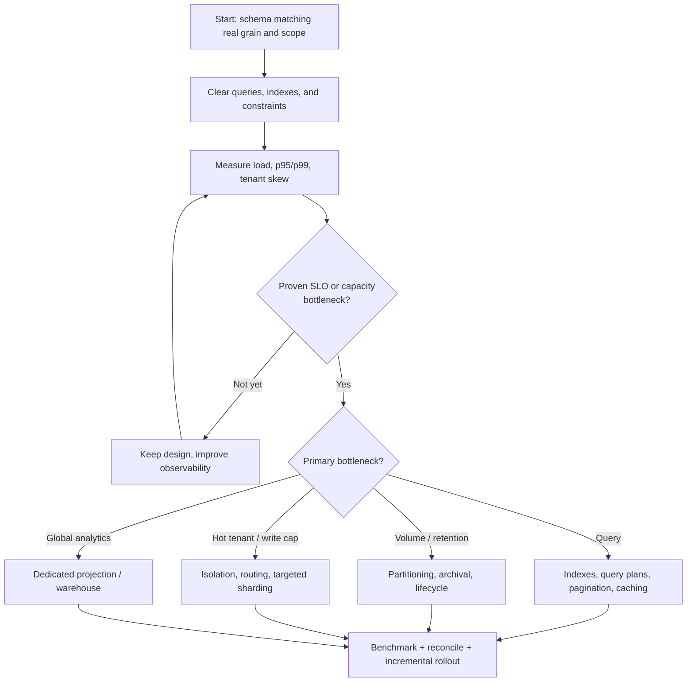

# Designing for Every Future Possibility Without Requirements or Evidence

A team is building a customer support ticket system for enterprise clients. Confirmed requirements are fairly concrete: staff belonging to an organization create tickets for customers of that organization, assign priorities, track statuses, and list recent tickets. Yet during design meetings, speculative assumptions pile up one after another:

- "Someday we might manage assets, invoices, and orders too, so let's put **all entities in one `objects` table**."
- "Each partner might want thousands of custom fields, so let's store **every attribute as name–value pairs**."
- "We might eventually serve one million organizations and billions of tickets, so let's pre-split into **64 shards**, even though today sees a few thousand tickets per day."
- "Someone might want field-level history at any point in time, so every write must go through **event sourcing**, even with no state-reconstruction requirement."
- "Later we'll definitely add multiple databases, so let's build a **universal query abstraction** supporting SQL, document, graph, and KV from day one."

The result looks wonderfully flexible **on slides**, yet every real field loses static typing, every simple query traverses multiple mapping layers, the database no longer protects business rules, and debugging becomes painful. The team paid upfront for several futures **nobody knows will ever happen**, while carrying that complexity every single day.

This is the pitfall of **speculative generality** (or *over-engineering*): expanding a model for imagined possibilities instead of evidenced requirements, invariants, or risks. It is distinct from preparing responsibly for change. This lesson sits in the **Common Pitfalls** chapter of **DATABASE_DATA_MODELING**, where the core skill is turning business requirements into clear entities, relationships, constraints, keys, indexes, and physical schemas—comparing relational, document, graph, and analytical models to choose evolvable, verifiable structures.

## 1. Frame the Problem Properly: Not "Simplest Design Always Wins"

A sound design must be **sufficient** to enforce today's critical rules and absorb changes foreseeable **with evidence**, without turning vague hypotheses into guaranteed daily costs.

| Approach | Meaning | Typical Outcome |
| --- | --- | --- |
| **Under-designed** | Skips known constraints like unique keys, tenant isolation, currency | Data corruption, security leaks, emergency rewrites |
| **Right-sized with evolution paths** | Clear model, protected invariants, risk-proportional flexibility | Readable, testable, reasonable cost |
| **Pre-built for every hypothesis** | Adds abstractions, dynamic schemas, shards, workflow engines for vague futures | Multiplies concepts to learn and maintain with zero users |

**YAGNI** (*You Aren't Gonna Need It*) advises against building features just because "we might need them." Yet never invoke YAGNI to skip **security, data integrity, privacy, idempotency, backups, legal duties, or irreversible boundaries**. Those are **present-day requirements**, even without a dedicated UI button.

The dividing line is **grounded evidence**, not **looking sophisticated**.

## 2. Classify Every Claim About the Future

When hearing an architectural proposal, ask which category it belongs to:

| Category | Example | Appropriate Response |
| --- | --- | --- |
| **Committed requirement** | Next quarter we must onboard Organization B onto the same platform | Include in scope, design, and tests |
| **Immediate invariant** | Org A's ticket must never reference Org B's customer | Enforce via constraints and authorization from day one |
| **Measured operational limit** | Listing tickets p99 breaches SLO when one tenant hits 2M rows | Profile query plans and optimize with evidence |
| **Hard-to-fix-later foundation** | Must preserve exact currency and monetary minor units | Model upfront so meaning is never lost |
| **Evidenced hypothesis** | Several pilot clients asked for custom fields; running trials | Design a bounded extension point with explicit decision thresholds |
| **Pure imagination** | Someday every ticket might become a node in a global graph | Keep out of today's schema; log hypothesis for future review |

Not every "future need" is unfounded: signed contracts, funded roadmaps, upcoming regulations, and measured incidents are real evidence. Conversely, "an engineer once worked on a billion-user system" **does not** prove today's app needs sharding.

### 2.1. Ask Five Questions Before Paying the Cost

1. **Who needs it?** Is there an identified user, domain workflow, contract, or consumer?
2. **When is it needed?** Is there a rollout milestone, expected volume, and target SLO?
3. **What is the evidence?** Traces, workloads, data profiles, prototypes, legal mandates, incidents—or pure guesswork?
4. **If we wait, what does changing later cost?** Merely adding an index, or re-keying billions of rows?
5. **If we build it upfront unnecessarily, who pays?** Everyone writing queries, on-call engineers, integrators, QA, and migrations.

An answer of "unknown" does not automatically mean "build it now just in case." It is a reason to **preserve a clean change path**, instrument metrics, and avoid locking into hard-to-remove complexity.

## 3. Start From Business Questions and Grain

For the ticketing system, confirmed use cases are:

| ID | Real Scenario | Required Data and Constraints |
| --- | --- | --- |
| U1 | Staff creates a ticket for a customer in their org | Scoped `org_id`, `customer_id`; verified caller permission |
| U2 | List most recent tickets for an org | `org_id`, `created_at`, stable pagination |
| U3 | View ticket by ID | Ticket identity and object-level authorization |
| U4 | Change priority and status | Allowed value sets, transition rules, history if required |
| U5 | Find high-priority open tickets | `status`, `priority`, defined filter query path |
| U6 | Total tickets resolved this week | Resolution timestamp and exact "resolved" definition |

The **grain** for the ticket table is **one support request created within one organization**. Customer grain is **one customer profile within one organization**. The entities needed today are concrete—not a super-entity `Object` holding everything.

Separate clearly:

- **Business key / primary key:** identifies one ticket.
- **Foreign key:** which customer and organization the ticket belongs to.
- **Attributes:** subject, priority, timestamps.
- **Invariants:** customer belongs to the same org; resolved status carries a valid timestamp.
- **Query patterns:** API listing tickets by org and time.
- **Non-functional requirements:** authorization, retention, p99 latency, concurrency, backups.

Once these statements are written, schema design becomes a **verifiable engineering problem**, not a contest over who can imagine the most entity types.

## 4. The "Universal Table" Trap: Everything Is an Object and Attribute

A tempting ultra-generic design:

```sql
-- Counterexample: illustrative EAV schema, NOT recommended
-- for core business entities with already clear requirements.
CREATE TABLE universal_object (
    org_id UUID NOT NULL,
    object_id UUID NOT NULL,
    object_type TEXT NOT NULL,
    PRIMARY KEY (org_id, object_id)
);

CREATE TABLE universal_attribute (
    org_id UUID NOT NULL,
    object_id UUID NOT NULL,
    attribute_name TEXT NOT NULL,
    value_text TEXT,
    PRIMARY KEY (org_id, object_id, attribute_name),
    FOREIGN KEY (org_id, object_id)
        REFERENCES universal_object(org_id, object_id)
);
```

A ticket gets stored as:

```text
universal_object
  (A, T-1, "ticket")

universal_attribute
  (A, T-1, "status", "OPEN")
  (A, T-1, "priority", "HIGH")
  (A, T-1, "created_at", "2030-04-01T09:00:00Z")
  (A, T-1, "customer_id", "C-17")
```

The schema **runs**, yet the database can no longer guard it cleanly:

- `value_text` does not enforce timestamps, numbers, booleans, or UUIDs per attribute.
- Queries compare `"100"` and `"20"` lexicographically rather than numerically.
- `customer_id` sits as plain text with zero FK guaranteeing a valid customer in the same `org_id`.
- There is no native `CHECK(status IN (...))` tailored to tickets.
- You cannot enforce that every ticket has `created_at` via a simple `NOT NULL` column.
- Multi-attribute filters require repeated joins/pivots, hurting readability and query planning.
- Tables mix rows of every object type; queries and audits lose domain clarity.

**EAV (Entity–Attribute–Value)** is not always wrong. It fits genuinely **user-customizable attributes** or rapidly shifting telemetry when governed by proper metadata and tooling. The mistake here is **pushing well-known, heavily queried, invariant-critical fields into dynamic storage solely to prepare for nonexistent future objects**.

### 4.1. How Quickly Queries Turn Tangled

Fetching `OPEN` and `HIGH` tickets in the universal schema:

```sql
SELECT o.object_id
FROM universal_object AS o
JOIN universal_attribute AS status_attr
  ON status_attr.org_id = o.org_id
 AND status_attr.object_id = o.object_id
 AND status_attr.attribute_name = 'status'
JOIN universal_attribute AS priority_attr
  ON priority_attr.org_id = o.org_id
 AND priority_attr.object_id = o.object_id
 AND priority_attr.attribute_name = 'priority'
WHERE o.org_id = $1
  AND o.object_type = 'ticket'
  AND status_attr.value_text = 'OPEN'
  AND priority_attr.value_text = 'HIGH';
```

Compared to:

```sql
SELECT ticket_id
FROM support_ticket
WHERE org_id = $1
  AND status = 'OPEN'
  AND priority = 'HIGH';
```

The difference is not just SQL line count: the concrete model gives **clear types, constraints, query-aligned indexes, and effortless readability**. Never pick EAV merely because running an occasional `ALTER TABLE` feels inconvenient.

## 5. Right-Sized Relational Design: Keeping Semantics in the Schema

The PostgreSQL example below is not production DDL, yet captures **confirmed requirements**: multi-tenancy, customers, tickets, priority/status, and timestamps.

```sql
CREATE TABLE organization (
    org_id UUID PRIMARY KEY,
    org_name TEXT NOT NULL
);

CREATE TABLE customer (
    org_id UUID NOT NULL REFERENCES organization(org_id),
    customer_id UUID NOT NULL,
    display_name TEXT NOT NULL,
    PRIMARY KEY (org_id, customer_id)
);

CREATE TABLE support_ticket (
    org_id UUID NOT NULL,
    ticket_id UUID NOT NULL,
    customer_id UUID NOT NULL,
    subject TEXT NOT NULL,
    priority VARCHAR(10) NOT NULL
        CHECK (priority IN ('LOW', 'NORMAL', 'HIGH')),
    status VARCHAR(16) NOT NULL
        CHECK (status IN ('OPEN', 'IN_PROGRESS', 'RESOLVED')),
    created_at TIMESTAMPTZ NOT NULL DEFAULT now(),
    resolved_at TIMESTAMPTZ,
    PRIMARY KEY (org_id, ticket_id),
    FOREIGN KEY (org_id, customer_id)
        REFERENCES customer(org_id, customer_id),
    CONSTRAINT ck_ticket_subject_not_blank
        CHECK (length(btrim(subject)) > 0),
    CONSTRAINT ck_ticket_resolved_shape CHECK (
        (
            status = 'RESOLVED'
            AND resolved_at IS NOT NULL
            AND resolved_at >= created_at
        )
        OR
        (
            status <> 'RESOLVED'
            AND resolved_at IS NULL
        )
    )
);

CREATE INDEX ix_support_ticket_recent
    ON support_ticket(org_id, created_at DESC, ticket_id DESC);

CREATE INDEX ix_support_ticket_status_priority
    ON support_ticket(
        org_id, status, priority, created_at DESC, ticket_id DESC
    );
```

### 5.1. Rationale Behind Design Choices

| Decision | Present Evidence | What It Protects |
| --- | --- | --- |
| Concrete `support_ticket` table with typed columns | U1–U6 actively use these fields | Type safety, invariants, readable queries |
| PK `(org_id, ticket_id)` | Multi-tenant SaaS; lookups scoped by org | Identity within tenant |
| Composite FK `(org_id, customer_id)` | Tickets only reference customers in the same org | Prevents cross-tenant references |
| `CHECK` on `priority`/`status` | Confirmed value sets in current workflow | Blocks garbage values and typos |
| `created_at`/`resolved_at` | Time-ordered lists and resolution KPIs | Purpose-specific timestamps |
| Indexes on org/time and org/status/priority | U2 and U5 are primary queries | Measurable access paths via `EXPLAIN` |

This remains **a design to test**, not a universal blueprint for every ticketing product. For example:

- Some products allow **reopening tickets**: enforcing `resolved_at IS NULL` when not RESOLVED works only if `resolved_at` means *current resolution time*, not *first-ever resolution time*. If full history is needed, add an event/history table or adjust column semantics.
- If internal tickets can lack customers, `customer_id NOT NULL` would be wrong—change it for **real requirements**, not because "someday maybe."
- Extra indexes add write and storage overhead; validate U2/U5 under real traffic rather than assuming both indexes earn their keep.
- FKs and `CHECK`s do not replace API authorization, role policies, or transition rules; enforce and test those explicitly.

**Right-sized design does not mean immutable schemas.** It provides a transparent baseline ready for controlled evolution once real evidence arrives.

## 6. Optimize From Access Patterns, Not Table Counts

Before declaring "this schema will crawl at a billion rows," measure real workloads or label explicit assumptions:

| Query | Filter | Pagination | Typical Cardinality | Metrics to Measure |
| --- | --- | --- | --- | --- |
| Recent tickets list | `org_id` | By `created_at, ticket_id` | One specific tenant | Rows scanned, p95/p99, buffer hits |
| Ticket by ID | `(org_id, ticket_id)` | None | One row | Lookup latency, index usage |
| Unresolved HIGH tickets | `org_id, status, priority` | By time | Active open set | Query plan, filtering, sorting |
| Weekly resolution report | `resolved_at` range | Aggregate | Multi-day rows | Scan cost, freshness |

A cursor-based pagination query:

```sql
-- First page of recent tickets list.
SELECT ticket_id, subject, status, priority, created_at
FROM support_ticket
WHERE org_id = $1
ORDER BY created_at DESC, ticket_id DESC
LIMIT 50;

-- Next page: $2 is created_at of last row on previous page,
-- $3 is ticket_id of last row on previous page.
SELECT ticket_id, subject, status, priority, created_at
FROM support_ticket
WHERE org_id = $1
  AND (created_at, ticket_id) < ($2, $3)
ORDER BY created_at DESC, ticket_id DESC
LIMIT 50;
```

With descending order and tie-breaker `(created_at, ticket_id)`, tuple comparison pages cleanly **when row ordering does not mutate mid-traversal**. Under continuous writes, concurrent inserts, edits, deletes, and snapshot boundaries still affect pagination—define API consistency expectations accordingly. **Keyset cursors are not the entire pagination contract.**

Measure with `EXPLAIN (ANALYZE, BUFFERS)` on authorized test environments with representative data (remember `ANALYZE` executes the query). Never introduce shards or separate read stores before understanding data statistics, indexes, N+1s, caching, query shapes, and actual SLOs.

## 7. JSONB: A Small Extension Point, Not a Catch-All Bucket

If pilot customers need a few per-org optional attributes, a `JSONB` column can serve temporarily for **metadata carrying no core invariants**:

```sql
ALTER TABLE support_ticket
ADD COLUMN custom_metadata JSONB NOT NULL DEFAULT '{}'::jsonb,
ADD CONSTRAINT ck_ticket_metadata_object
    CHECK (jsonb_typeof(custom_metadata) = 'object');
```

Example:

```json
{
  "source_campaign": "spring-pilot",
  "external_case_ref": "CASE-842"
}
```

A safe extension policy:

- Declare **allowlisted** fields, types, max lengths, retention, and owners per contract.
- Never place `org_id`, `customer_id`, `status`, `priority`, or authorization fields inside arbitrary metadata.
- Never let clients write unbounded payloads, PII, or secrets just because JSON accepts any key.
- Do not add a whole-JSONB GIN index before queries actually need it; indexes have costs.
- Once a field becomes **mandatory, frequently joined/filtered, or requires uniqueness/FKs**, promote it to a typed column or dedicated table.
- For metadata driving business logic, enforce explicit schema versioning and validation rather than raw unchecked JSON.

**There is no such thing as "JSONB = future-proof."** It shifts requirements from DB constraints onto application code, data-quality gates, and documentation. Turning the entire schema into one JSON column merely **hides complexity from the ERD**, without removing it.

### 7.1. When Are EAV or JSONB Actually Required?

A *form builder* letting each tenant define hundreds of versioned dynamic questions, per-form requiredness, and searches on selected dynamic fields is a completely different problem from support tickets:

- Users genuinely create fields **at runtime**.
- Fields carry explicit definitions, types, versions, and permissions.
- Dynamic filters and query contracts are formally specified.
- The system explicitly accepts index/validation overhead or uses a tailored storage engine.

There, governed metadata + typed values or versioned JSON Schemas are **justified**. Still, never import form-builder architecture into a ticketing system simply because "we might add fields later."

## 8. Six Hidden Costs of "Designing for Everything"

| Cost | Symptom | How to Spot It |
| --- | --- | --- |
| **Cognitive** | Every engineer must master object registries, mappers, and rule engines just to add one field | Onboarding time, change mistakes |
| **Correctness** | Missing FKs, types, and constraints; scattered validation | Data quality bugs, failing invariant checks |
| **Performance** | Multi-way pivots/joins, bloated dynamic indexes, query fan-out | Query plans, bytes scanned, p99 latency |
| **Operational** | Shard routing, consumers, projections, retries, painful migrations | Alerts, backlogs, incidents, restore drills |
| **Change** | Coupled to generic APIs; tweaking one contract ripples across tenants | Touchpoint count, test churn |
| **Opportunity** | Team delays real user features to build speculative platforms | Lead time vs. committed backlog |

An abstraction **earns its keep only when it removes more complexity than it introduces for evidenced or existing cases**. Never measure design quality by interface count, pattern count, or configuration knobs.

### 8.1. Total Decision Cost

Think in terms of:

\[
C_{\text{total}}
= C_{\text{build}}
+ C_{\text{operate}}
+ C_{\text{change}}
+ C_{\text{risk}}
\]

This is a **mental model**, not an accounting formula. A hyper-generic design might reduce cost in **one hypothetical future** while inflating `C_operate` and `C_change` from day one—even when that future's probability is unverified.

If a generic architecture pays off only when 50 new entity types arrive, ask whether a **committed roadmap** for 50 entities exists. When only tickets exist today, hypothetical future savings never justify guaranteed taxes on every request today.

## 9. Never Confuse "Generic" With "Easy to Change"

A generic schema does not automatically evolve smoothly. Often it **locks you in tighter**:

- `universal_attribute` becomes a shared choke point for every query; altering it impacts the entire product.
- Everything serializes into `value_text`; changing parsing rules breaks unversioned historical records.
- Generic repositories hide real SQL, making critical query tuning awkward.
- Unchecked DSL filters accumulate per-team exceptions until you accidentally maintain a second query language.
- Overstuffed "universal" keys carry so many parts that re-keying or migrating becomes harder than in concrete schemas.

**Adaptability** comes from less glamorous fundamentals:

1. Explicit grain, identity, and invariants.
2. Versioned migrations following expand–migrate–contract.
3. Bounded contexts with stable interfaces between components.
4. Code simple enough to refactor once new facts emerge.
5. Data-quality tests and workload telemetry providing evidence.
6. Handling hard-to-reverse decisions early while deferring easy-to-reverse ones.

In other words, **a concrete, well-governed design** is often far easier to evolve than a "meta-model" nobody dares touch.

## 10. Distinguishing Reversible From Hard-to-Reverse Decisions

The goal is not delaying every choice. Weigh **the cost of changing later** against **the cost of building upfront**.

| Decision | Changing Later | Pragmatic Approach |
| --- | --- | --- |
| Adding an index for a measured query | Usually additive later, accounting for lock/build cost | Measure queries first; add when SLOs demand |
| Adding a new nullable column | Straightforward via expand migrations | Do not pre-add hundreds of speculative columns |
| Renaming a field inside one service | Handle via adapters / rolling migrations | Keep contracts/versions clear |
| Publicly exposed business keys/IDs | Very hard once consumers and records accumulate | Pick stable, cleanly namespaced IDs upfront |
| Multi-tenant ownership / authorization | Hard to retrofit once tenant data mixes | Enforce from day one if multi-tenancy is current |
| Currency / unit / temporal semantics | Lost units/precision cannot be reconstructed | Store exact units, scales, and timestamps upfront |
| Physical partition / shard keys | May require backfilling or moving billions of rows | Do not pre-shard; design clean routing keys by workload |
| Splitting microservices & tx boundaries | Expensive once many consumers integrate | Base boundaries on real domain ownership, not buzzwords |
| System-wide event sourcing | Reshapes storage, replays, eventual consistency, and ops | Adopt only with clear audit/rebuild requirements |
| Data deletion and retention | Lost data is unrecoverable; over-retention risks compliance | Define policies from real requirements upfront |

Crucially, **high-impact risks may warrant upfront protection even at low probability**—such as tenant isolation or disaster recovery. There, the evidence is a threat model, contract, or severe blast radius, not raw RPS. That is fundamentally different from assuming "we'll need GraphQL + 12 databases."

## 11. "What If We Have 1 Million Tenants Later?": Evidence-Based Scaling

Suppose year-one projections are:

- 500 active tenants.
- ~2,000 tickets/day system-wide.
- 90% of requests query tickets for a single tenant.
- 2-year retention.
- Recent-list p95 SLO approved by product.

These numbers are **illustrative practice assumptions**, not real company metrics. At this scale, jumping straight to 64 shards, cross-shard transactions, and 3 database engines imposes huge unverified overhead.

### 11.1. Measurements Needed Before Scaling Out

- Current and projected rows/bytes per tenant, plus largest-tenant skew.
- Read/write QPS per endpoint, top tenants, and peak bursts.
- Query plans, index selectivity, lock contention, and p95/p99 under load.
- CPU, RAM, I/O, disk growth, WAL/replication lag, and backup/restore times.
- Requests requiring cross-tenant joins or cross-org access.
- Operational and on-call burden of extra shards/replicas.

Hashing by `org_id` spreads **different tenants**, yet **one huge hot tenant** still saturates a single shard. Nor will 64 shards fix missing indexes or N+1 loops in application code. Diagnose the real bottleneck before picking a scaling mechanism.

### 11.2. A Verifiable Growth Path



This diagram illustrates **evidence-driven decisions**, not an assumption that everything ends in sharding. A single well-indexed/partitioned RDBMS carries many systems for years, while another workload genuinely needs early scale-out. What matters is **evidence and experiments**, not "future-looking" scale numbers.

## 12. Keep Extension Points, Do Not Build Everything Now

A right-sized design still leaves helpful **extension points**:

| Area | Sensible Preparation | Over-Engineering |
| --- | --- | --- |
| IDs | UUID/business keys with clear namespaces; never use email as ID | Universal ID registry for every imagined entity |
| Schema | Disciplined migrations and versioned contracts | Runtime custom schema engine across all tables |
| Custom fields | Bounded JSONB/extension tables for active pilots | Converting every entity to EAV |
| Queries | Repositories shaped around real use cases | "Multi-engine" query DSL with no second DB |
| Authorization | Scopes + roles matching threat model and needs | Homegrown policy language for all future rules |
| Analytics | Explicit grain/time/units; emit stable-ID events | Full real-time lakehouse before any analytical query |
| Integration | ACLs/adapters at known external boundaries | 20 plugin interfaces for nonexistent partners |
| Audit | Events needed for reconciliation, security, debugging | Full event sourcing for every internal edit with no use case |

A good extension point has a **small surface area and clear expansion criteria**. For example, a `CustomerDirectory` interface with two callers and one implementation makes sense to decouple CRM dependencies; an `AbstractUniversalEntityRepository` hierarchy with a dozen stub adapters for nonexistent stores merely obscures every ticket flow.

## 13. Java 17 Example: Concrete Domain Types vs. Universal Maps

In application code, the same EAV mistake looks like:

```java
// Anti-pattern when used for all core rules:
Map<String, Object> ticket = new HashMap<>();
ticket.put("status", "OPEN");
ticket.put("priority", "HIGH");
ticket.put("customerId", "...");
// Typos, wrong types, or missing keys surface only at runtime.
```

A concrete, compile-checked, testable domain model:

```java
import java.time.Instant;
import java.util.Objects;
import java.util.UUID;

public class TicketModelDemo {
    enum Priority { LOW, NORMAL, HIGH }
    enum TicketStatus { OPEN, IN_PROGRESS, RESOLVED }

    record TicketId(UUID value) {
        TicketId {
            Objects.requireNonNull(value, "ticketId");
        }
    }

    record OrgId(UUID value) {
        OrgId {
            Objects.requireNonNull(value, "orgId");
        }
    }

    record CustomerId(UUID value) {
        CustomerId {
            Objects.requireNonNull(value, "customerId");
        }
    }

    record Ticket(
        OrgId orgId,
        TicketId id,
        CustomerId customerId,
        String subject,
        Priority priority,
        TicketStatus status,
        Instant createdAt,
        Instant resolvedAt
    ) {
        Ticket {
            Objects.requireNonNull(orgId);
            Objects.requireNonNull(id);
            Objects.requireNonNull(customerId);
            Objects.requireNonNull(priority);
            Objects.requireNonNull(status);
            Objects.requireNonNull(createdAt);
            if (subject == null || subject.isBlank()) {
                throw new IllegalArgumentException("subject is blank");
            }
            if (status == TicketStatus.RESOLVED) {
                if (resolvedAt == null
                    || resolvedAt.isBefore(createdAt)) {
                    throw new IllegalArgumentException(
                        "invalid resolvedAt"
                    );
                }
            } else if (resolvedAt != null) {
                throw new IllegalArgumentException(
                    "only resolved tickets have resolvedAt"
                );
            }
        }

        static Ticket open(
            OrgId org, TicketId id, CustomerId customer,
            String subject, Priority priority, Instant created
        ) {
            return new Ticket(
                org, id, customer, subject, priority,
                TicketStatus.OPEN, created, null
            );
        }

        Ticket resolve(Instant at) {
            if (status == TicketStatus.RESOLVED) {
                throw new IllegalStateException("already resolved");
            }
            return new Ticket(
                orgId, id, customerId, subject, priority,
                TicketStatus.RESOLVED, createdAt, at
            );
        }
    }

    public static void main(String[] args) {
        Instant openedAt = Instant.parse(
            "2030-04-01T09:00:00Z"
        );
        Ticket ticket = Ticket.open(
            new OrgId(UUID.randomUUID()),
            new TicketId(UUID.randomUUID()),
            new CustomerId(UUID.randomUUID()),
            "Unable to sign in",
            Priority.HIGH,
            openedAt
        );
        Ticket resolved = ticket.resolve(
            Instant.parse("2030-04-01T10:00:00Z")
        );
        System.out.println(resolved.status());
    }
}
```

This illustrates **today's state contract**. Once the business adds `REOPENED`, decide whether `resolvedAt` tracks "latest resolution" or "first resolution," and evolve the model explicitly—never stuff future workflows into an untyped map/string just to avoid updating an enum.

### 13.1. What This Example Does Not Enforce on Its Own

- Java records do not verify `CustomerId` belongs to `OrgId`; enforce via scoped repository lookups and DB composite FKs.
- No optimistic locking or concurrent worker coordination.
- No caller authentication, authorization, auditing, API versioning, or retention.
- Another domain might permit reopened tickets under different rules.

Naming these **explicit boundaries** is honest engineering, not an excuse to pre-build a universal workflow engine. When a genuine requirement arrives, add the needed capability and test the new invariant.

## 14. Adding New Requirements Without a "Meta-Model"

Suppose three months later a clear contract arrives: support teams want **SLA policies** on tickets, giving selected tickets due dates and overdue reports.

From the requirement:

- Needs `sla_policy_id` or an SLA snapshot at ticket creation.
- Needs `due_at` for SLA-covered tickets; others have none.
- New query: `WHERE org_id = ? AND status <> 'RESOLVED' AND due_at < now()`.
- Must define timezones, business hours, holidays, and policy edits on existing tickets.

### 14.1. Expanding for Confirmed Requirements

A clean step once the business chooses to **store computed deadlines** without multi-version policy tables yet:

```sql
ALTER TABLE support_ticket
    ADD COLUMN due_at TIMESTAMPTZ;

CREATE INDEX ix_ticket_open_due
    ON support_ticket (org_id, due_at, ticket_id)
    WHERE status <> 'RESOLVED'
      AND due_at IS NOT NULL;
```

This is **one deployment step**. Before shipping to production:

1. Clarify whether legacy tickets have SLAs; what does `NULL` mean?
2. Is any backfill/handling of old tickets approved by business owners?
3. Can older app binaries safely read and write the expanded schema?
4. Does the overdue query meet its SLO and use the partial index?
5. If SLA policies change later, must `due_at` stay historical or record `sla_policy_version`?

Do not pre-build dynamic work calendars for 180 countries if the contract covers one organization's business hours. Equally, never fake `now() + 24 hours` when the SLA specifies **business hours**—deliver **actual requirements** cleanly, even when logic takes care.

### 14.2. Expand–Migrate–Contract

A safe rollout typically follows:


Rollback safety depends on **whether new writes remain representable in the older version**. Leaving a nullable `due_at` column is usually rollback-safe; introducing a brand-new SLA state unknown to old code makes code-only rollbacks dangerous. Controlled evolution requires no universal meta-model.

## 15. One Crucial Exception: What Is Known to Be Unfixable Later?

Never apply "wait until needed" to facts that **cannot be reconstructed once lost** or boundaries protecting live invariants today.

| Area | Why Define It Early? | What Not to Overbuild Early |
| --- | --- | --- |
| **Identity keys** | Wrong business keys cause collisions and painful re-keying | Universal registry for nonexistent entity types |
| **Tenant isolation** | Mixing org data causes security breaches and messy splits | Homegrown omnipotent authorization language |
| **Currency / unit scales** | Missing currency/scale destroys monetary meaning | Supporting crypto/exotic assets nobody uses |
| **Event identity / idempotency** | Retries double transactions and metrics | Event-sourcing the entire application |
| **Time semantics** | Missing timezones/effective time breaks reports | Storing four timestamps on every table blindly |
| **Privacy / retention** | Unlawful storage or botched erasure violates rules | Custom purge orchestrator for unbuilt external stores |
| **Backup / recovery** | Lost business data may be unrecoverable | Complex multi-region active-active without matching SLO |
| **Grain / measure semantics** | Collapsing transaction lines loses detail forever | Real-time warehouse before any analytics use cases |

**Good early design** captures irrecoverable facts (`event_id`, `org_id`, currency/units, business timestamps, permission boundaries). **Premature over-design** builds giant abstractions so "someday we can swap anything without editing code." Never confuse the two.

## 16. When Should You Choose a Non-Relational Model?

DATABASE_DATA_MODELING covers relational, document, graph, and analytical engines; every choice demands **evidence from access patterns and requirements**.

| Model | **Evidenced** Reason to Choose | Wrong Reason ("Just in Case") |
| --- | --- | --- |
| **Relational** | Transactions, FKs/uniques, multi-entity consistency, SQL queries | Forcing everything relational even when core workload is deep graph traversal |
| **Document** | Versioned varying-shape aggregate documents always read/written whole | Stuffing all tables into JSON solely to avoid migrations |
| **Graph** | Multi-hop traversals and complex network links are the core product; measured | Adopting a graph DB because "everything is connected" |
| **KV / Wide-column** | High-throughput partition-key point/range lookups with fixed access patterns | Putting ordinary tickets in Cassandra despite ad-hoc filtering needs |
| **Columnar / warehouse** | Large analytical scans/aggregations with clear facts, dims, and scan budgets | Building a streaming lakehouse for a 20-row dashboard |

Never treat "keeping the domain independent of database SDKs" as a mandate to build a universal abstraction across every database engine. A repository tailored to actual use cases is boundary enough—without pretending MongoDB, Neo4j, and Cassandra share identical transaction and query semantics.

### 16.1. "Polyglot Persistence" Can Help Correctness or Multiply Risk

Running tenant-scoped ticket APIs alongside global analytics over billions of events can justify separating **operational stores** from **analytical projections**. Yet it introduces:

- Where do source of truth and write authority live?
- How do CDC/outboxes maintain consistency?
- How do late events, retries, and corrections update projections?
- Which stores must propagate deletes?
- What are the freshness SLA and cross-store reconciliation rules?

Never add a second database merely to make an architecture diagram look "complete." Require a measurable current pain point or committed near-term requirement.

## 17. Measure Trade-Offs Before Abstracting

An experiment comparing EAV vs. concrete schemas should evaluate:

| Criterion | Question to Measure | Test Dataset |
| --- | --- | --- |
| **Development lead time** | How long does adding a tested required field take? | Implement one real feature in both prototypes |
| **Data correctness** | Can wrong-typed priorities or cross-org FKs slip in? | Negative tests and constraints |
| **Query cost** | How many joins and bytes scanned to filter OPEN/HIGH per tenant? | `EXPLAIN` / benchmarks on skewed data |
| **Change cost** | How many files change when status semantics evolve? | Code/schema/test diff |
| **Operational overhead** | Extra backup, migration, monitoring, and incident burden? | Runbooks, drills, metrics |
| **True extensibility** | How is a pilot client's custom field added end-to-end? | End-to-end feature spike |
| **Ownership** | Who owns field validation and access permissions? | Contracts / ADRs and reviews |

Use test data containing **heavy hitters, missing values, duplicates, and multi-tenant collisions** rather than 100 uniform toy rows. A fast EAV prototype on 10 rows proves nothing about production queries or security.

### 17.1. Do Not Rig Benchmarks to Confirm Preferences

Define upfront:

- Representative workloads and measurement windows.
- Pass/fail thresholds: correctness, p95/p99, write latency, change effort, access boundaries.
- Environment limits and data distributions.
- Which decision follows from each outcome.

If the concrete schema hits SLOs with low development cost, never pick EAV because "it looks cleaner architecturally." Conversely, if real evidence shows user-defined fields are a core product capability, adopt a verified dynamic model deliberately.

## 18. Documenting Hypotheses: Concise ADRs With Explicit Triggers

A brief **Architecture Decision Record (ADR)** prevents both over-building and forgetting future risks:

```text
ADR-012: Defer EAV for core ticket data

Context:
- Tickets have known status, priority, customer, and createdAt.
- No contract exists for user-defined entities or fields.
- Primary API: find tickets by tenant, state, priority, and time.

Decision:
- Use typed support_ticket table with explicit FKs and CHECKs.
- Use validated custom_metadata only if a pilot requires it.

Consequences:
- Adding core fields requires reviewed migrations.
- Constraints and queries stay simple and fast.
- "Create custom entity via UI" is unsupported in this release.

Revisit when:
- Runtime custom fields become an approved product requirement;
- Concrete filter/index workloads on those fields are defined;
- Prototypes prove concrete columns/tables cannot meet needs.

Owner: ticket-domain
Evidence: use cases U1..U6, query plans, data-quality tests
```

Crucially, **triggers must be observable**. "Revisit when we scale" is useless compared to "revisit when a pilot requires filtering across at least three dynamic fields with confirmed query volume and SLAs." Specific thresholds are **internal team guidelines**, not universal technical laws.

### 18.1. An "Assumption Log" Is Cheaper Than an Abstraction Layer

| Hypothesis | Current Evidence | Next Observation | Current Decision |
| --- | --- | --- | --- |
| Users want arbitrary custom entities | No interviews or contracts yet | Pilot customer discovery | Do not build generic object store |
| Huge tenant will become a hotspot | Forecast only | Measure top-tenant QPS and row counts | Keep indexes and telemetry |
| Real-time global reporting needed | Daily dashboard exists | Confirm freshness SLA and BI queries | Keep current batch/reporting |
| Second CRM partner onboarding | In talks, no signed contract | Finalize API/schema mapping | Keep ACL at existing boundary |
| Retention policy changing | Draft internal policy | Review with authorized legal/ops owner | Model retention from policy, never guess |

Assign every hypothesis a **review date and owner**—never turn the log into a mandatory engineering backlog automatically.

## 19. Other "Future-Proofing" Traps to Recognize

| Trap | Consequence | Pragmatic Remedy |
| --- | --- | --- |
| **One table for every entity** | Loses types, constraints, and relationship clarity | Model real entities at their proper grain |
| **Every field as a string** | Breaks numeric math, timestamps, types, validation | Use explicit types and units |
| **Polymorphic `(entity_type, entity_id)` table** | No native DB FKs to multiple targets | Typed junction tables or evidenced supertype |
| **Everything in JSONB** | Invisible schemas, complex queries/indexes/privacy | JSON for bounded metadata; typed columns for core |
| **Multi-engine generic repository** | Masks diverging transaction and query semantics | Use-case ports; add adapters only when second engine exists |
| **Event-sourcing every object** | Needless replay, versioning, and outbox complexity | Start with audit/event logs where actually required |
| **Sharding before measuring** | Painful routing, fan-out, rebalancing, migrations | Fix indexes/partitions/queries at measured bottlenecks |
| **Indexing every column** | High write amplification and storage bloat | Index only measured query paths with SLOs |
| **Every enum in a runtime config table** | Transitions lose rules; inconsistent states | Enums/CHECKs + explicit workflows; config only when needed |
| **Interfaces with one implementation and no boundary** | Tangled call stacks; mocks hide real SQL | Clean modules; interfaces only at real boundaries |
| **Skipping constraints "in case rules change"** | Dirty data corrupts production today | Enforce current invariants; evolve via migrations |
| **Over-generalizing tenancy** | Confusing cross-tenant rights; cache/query leaks | Enforce concrete tenant scope and sharing contracts |
| **Adding `"ANY/UNKNOWN"` states everywhere** | Masks poor data quality or mixes N/A | Distinguish missing, unknown, and not-applicable cleanly |
| **Replicating everything to every DB** | Tangled duplicates, erasure, and reconciliation | Create read models only for real consumers |
| **Skipping exit plans because "it's universal"** | Nearly impossible to retire generic schemas later | ADRs, versions, backfill/rebuild paths |

A dead giveaway: whenever a reviewer asks **"Which real use case needs this structure?"** and the answer keeps starting with **"What if someday..."**, the design needs either hard evidence or scope trimming.

## 20. When Should You Never Cut Corners in Design?

Certain safeguards belong upfront even when **not visible in a single UI feature**:

1. **Security / tenant isolation:** FKs, read/write permissions, and scoping must block cross-org leaks in multi-tenant systems.
2. **Money and numeric accuracy:** currency, scale, rounding, and grain must be right before summing revenue.
3. **Personal data protection:** minimization, retention, erasure workflows, data maps, and backup policies per applicable rules.
4. **Identity and idempotency:** retries of events, payments, or orders must never double-execute business effects.
5. **Recoverability:** business data cannot be lost for lack of tested backups and restores.
6. **Committed contract compatibility:** APIs, event schemas, and migrations must not break live consumers.
7. **Known hard limits:** such as mandatory data residency or strict settlement cutoffs.

These rest on **direct evidence** from invariants, threat models, contracts, SLOs, or regulations. They are not "speculative future-proofing"—they are **part of the real problem from day one**.

## 21. Test Suite Proving a "Right-Sized" Model

| Test Case | What It Proves |
| --- | --- |
| Two orgs reuse the same `customer_id` | Tickets never reference customers across orgs |
| Ticket with `priority='URGENT_UNKNOWN'` | Schema/validation rejects unapproved values |
| `resolved_at` missing on `RESOLVED` ticket | Constraint blocks inconsistent states per policy |
| Two tickets share identical `created_at` | Pagination tie-breaker on `ticket_id` is deterministic |
| Listing tickets for a large tenant | Execution plan and p95/p99 meet SLO |
| Higher-than-expected `HIGH`/`OPEN` ratio | Indexes/filters still serve workload |
| Oversized JSON pilot field or embedded PII | API size/privacy validation rejects |
| Client attempts to tamper with `org_id` | Authz and DB scope block it; never trust raw UUIDs |
| Adding `due_at` column | Expand–migrate–verify leaves old app versions intact |
| Legacy tickets lacking SLAs | `NULL` classified properly rather than marked overdue |
| Two workers update one ticket concurrently | No lost updates per concurrency policy |
| Workflow updated to support reopen | Domain/DB rules and history updated coherently |
| Data corrections or retried imports | Stable grain and IDs prevent duplicate tickets/events |
| Adding a real second CRM partner | ACL/schema extends without altering core semantics |
| Customer erasure request | Propagates beyond primary table to projections/copies |
| Simulated 100× load growth | Benchmarks pinpoint real bottlenecks before sharding |

**No test proves a system supports every imaginable future.** Verification targets **today's real risks and planned evolution paths**, rather than chasing an empty "future-proof" badge.

## 22. Practice Exercises

### Exercise A — Critiquing the Universal Table

A team proposes storing `Customer`, `Ticket`, and `Invoice` inside `universal_object/universal_attribute` because they anticipate 50 entity types later. Today, only Ticket is built. List at least five rules or query paths that become hard to enforce under EAV, then write a minimal typed schema.

**Hint:** check tenant-scoped FKs, status/priority `CHECK`s, org+time indexes, resolved ticket counts, and timestamp type safety.

### Exercise B — JSONB or Concrete Column?

A pilot client wants `external_case_ref` displayed without filtering yet. Three months later, many clients want to filter by `external_case_ref` and enforce uniqueness per organization. Outline the path from bounded metadata to a typed column/table, backfill, uniqueness, and backward-compatible rollout.

**Hint:** once a field becomes an identity or key query filter, back it with proper constraints and indexes rather than an unvalidated JSON path.

### Exercise C — Shard or Index?

An app has 800 tenants, one of which holds 60% of all tickets. `GET /tickets?org_id=...&status=OPEN` has high p99 latency. The CTO suggests hash-sharding by `org_id`. Explain why the huge tenant remains a hot key, and list at least four measurements to run before choosing indexes, caching, isolation, or sub-sharding.

**Hint:** check query plans, index selectivity, top-tenant QPS, rows scanned, I/O, and traffic skew; tenant hashing never splits a single tenant's load internally.

### Exercise D — Preparing What Is Actually Hard to Fix Later

In a multi-currency sales platform, a team wants to drop `currency_code` "to simplify the schema" while building a "generic pricing engine" service for all future products. Identify which decision **must be locked down early** and which requires hard evidence.

**Hint:** dropping currency/scale destroys monetary meaning; a universal pricing engine requires concrete use cases and contracts.

### Exercise E — When Is EAV Actually Right?

A new product genuinely lets customers design custom survey forms with dynamic fields, versioned validation, and filtering on custom fields. List the criteria justifying EAV or versioned JSON Schema, performance vs. integrity trade-offs, and how to govern types, versions, security, and indexes.

**Hint:** runtime flexibility is an **explicit product requirement** here, unlike guessing future ticket fields.

### Exercise F — Evaluating Decision Costs

Compare a concrete `support_ticket` table against a universal object store. Build a relative comparison covering implementation time for U1–U6, test count, query cost, migrations, operations, and change blast radius. What evidence would flip your recommendation?

**Hint:** ground comparisons in experiments and criteria, never subjective "flexibility" scores.

### Exercise G — Evolving Without Losing Data

Status currently has three values; a confirmed requirement adds `REOPENED` along with open/close history. Propose schema/history changes, transition logic, migrations, and compatibility for older consumers that do not yet understand the new status.

**Hint:** you may need a dedicated history table or explicit events—never just add an enum value and assume every consumer handles it.

### Exercise H — Multi-Model Decisions

A team wants PostgreSQL + MongoDB + Neo4j + Cassandra in the MVP because "polyglot data modeling is best." Identify which real queries would actually warrant each engine, the costs of sync, erasure propagation, and idempotency, and how to simplify until evidence exists.

**Hint:** choose storage by measured workloads and semantics; every extra database adds another replica and operational burden.

## 23. Checklist Before Approving a "Future-Proof" Proposal

- [ ] Documented **grain, business keys, PK/FKs, relationships, and invariants** for present use cases.
- [ ] Every extensibility feature has an **owner, requirement, and evidence**—or is explicitly logged as a hypothesis.
- [ ] Workloads, p95/p99 targets, data skew, and query paths justify indexes, partitions, or sharding.
- [ ] Compared concrete schemas against EAV/JSONB/generic tables on **both data correctness and performance**.
- [ ] Never skipped types, `CHECK`s, `UNIQUE`s, FKs, or tenant scoping just to dodge future migrations.
- [ ] Avoided building generic query DSLs, plugin frameworks, or extra databases with no real consumer.
- [ ] Hard-to-reverse decisions (IDs, scopes, units, timestamps, retention) are grounded in **evidence and risk**.
- [ ] Easy-to-reverse decisions are deferred where requirements remain unconfirmed.
- [ ] Extension points stay small, carry strict validation, and never obscure domain semantics.
- [ ] Have an expand–migrate–contract plan ready when confirmed changes arrive.
- [ ] Rollback windows and compatibility with old data/consumers are verified before cutover.
- [ ] Every read model, projection, or secondary store defines source of truth, sync, replay, and deletion policies.
- [ ] Major growth-driven architectures are backed by prototypes or benchmarks.
- [ ] Operational, on-call, QA, migration, and cognitive costs are factored in—not just initial coding time.
- [ ] ADRs document **why speculative features were deferred** and **the observable triggers** to revisit them.
- [ ] Distinguished mandatory data protection from "just in case" abstractions.
- [ ] Tested negative cases for permissions, types, missing values, concurrency, and late events.
- [ ] Never labeled a design "future-proof" without **verifiable acceptance criteria**.

**Takeaway:** good data modeling is not guessing **every possible future**; it is solving **today's real rules**, preserving **irrecoverable information**, and keeping **evolution paths at controlled cost**. Whenever someone proposes a universal table, endless extension hooks, or premature sharding, ask: **"Which use case requires this, where is the evidence, and what do we actually lose by waiting?"** Choose the simplest structure that is **sufficiently right and demonstrably evolvable**, rather than paying guaranteed daily costs for unsubstantiated guesses.
