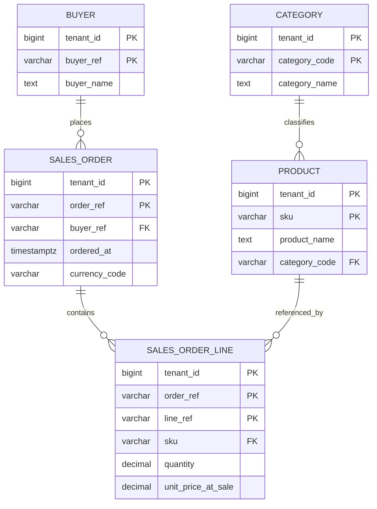
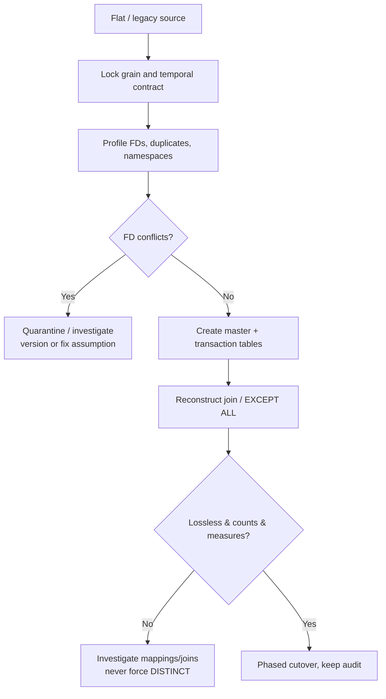

# Normalizing a Relational Model and Verifying Decomposition Options

## 1. Objectives of the integrated exercise

In the `DATABASE_DATA_MODELING` module, learners practice turning business requirements into clear data models—from entities, relationships, constraints, normalization, keys, and indexes to physical schemas. Learners also need to understand when to choose relational, document, graph, or analytical models so data can evolve and be verified cleanly. This **Integrated Exercises** topic dives into a common scenario: a flat source table that looks convenient for reporting, yet mixes order, customer, product, and sales-line data, causing update anomalies.

The task does not stop at “split tables until normalized.” We must **prove** that every decomposition option:

1. Accurately reflects the **business concepts and grain** of each relation.
2. Has **functional dependencies** and **candidate keys** derived from business rules, not guessed from a few sample rows.
3. Meets 1NF/2NF/3NF/BCNF goals under declared assumptions.
4. **Rejoins without losing or fabricating information** (*lossless-join decomposition*).
5. **Preserves dependencies** (*dependency preservation*) where possible, or documents the cost of cross-table enforcement when not possible.
6. Includes PK/FK/UNIQUE/CHECK constraints and a data test suite before locking down a physical model.
7. Does not accidentally corrupt transaction history, currencies, tenant identity, or revenue calculations when optimizing queries.

This is a standalone exercise using **PostgreSQL 16** as the illustrative SQL environment. No other lessons are required to follow the steps. The tables and numbers below are hypothetical teaching data and do not represent any specific production system.

### Expected outputs

Learners should independently produce: a glossary and grain statement, a functional dependency set \(F\), key closure calculations, a list of anomalies, at least two decomposition options, lossless and dependency-preserving proofs, an ERD, DDL, sample data, reconciliation queries, negative test cases, and a short Architecture Decision Record (ADR) explaining trade-offs.

## 2. Scenario: flat multi-tenant sales data

A system ingests sales reports from two tenants. Each source row currently contains **one order line** along with repeated order, buyer, product, and category details:

| Column | Proposed meaning | Notes |
|---|---|---|
| `tenant_id` | Tenant data boundary | Codes below are scoped within their respective tenant |
| `order_ref` | Order code within a tenant | Assumes currently one order-issuing system per tenant |
| `line_ref` | Line code within an order | Distinct lines may share the same SKU |
| `buyer_ref` | Buyer reference | Not yet equated with payer/recipient |
| `buyer_name` | Display name in the buyer directory at a sync point | **Not** automatically the locked name on past vouchers |
| `ordered_at` | Timestamp when the order was accepted per data contract | Event time, not warehouse ingestion time |
| `currency_code` | Shared currency for lines in the order | For example, VND |
| `sku` | Current sellable item code | Namespaced by tenant |
| `product_name` | Current product name at a sync point | May change later |
| `category_code` | Current category code of the product | May change over time |
| `category_name` | Current category name | Not automatically the classification at sale time |
| `quantity` | Line quantity sold | Positive number in item units |
| `unit_price_at_sale` | Unit price locked on the line | Does not depend solely on SKU |

**Mandatory assumption for the normalization problem:** the flat dataset is a *consistent snapshot* of master data at one defined sync point. Within that snapshot, each (`tenant_id`, `buyer_ref`) has one `buyer_name`, each (`tenant_id`, `sku`) has one current name and category code, and each (`tenant_id`, `category_code`) has one category name. Outside this snapshot, “current” fields may change; we will revisit temporal risks later.

**Scope limits:** example orders have no taxes, discounts, shipping fees, or refunds; all sums use VND only. One order has multiple lines, and each line is identified by (`tenant_id`, `order_ref`, `line_ref`). Consolidating codes from multiple external systems would require adding `source_system` if the “one issuing system per tenant” assumption breaks.

## 3. Sample data: four rows representing many objects

| Tenant | Order | Line | Buyer | SKU | Category | Qty | Unit price |
|---:|---|---|---|---|---|---:|---:|
| 42 | O100 | L01 | B01 – An | SKU-A – Coffee | DRINK | 2 | 50,000 |
| 42 | O100 | L02 | B01 – An | SKU-B – Biscuit | FOOD | 1 | 20,000 |
| 42 | O101 | L01 | B02 – Binh | SKU-A – Coffee | DRINK | 1 | 55,000 |
| 43 | O100 | L01 | B01 – Linh | SKU-A – Tea | DRINK | 1 | 30,000 |

In tenant 42:

- O100 has **two lines**, with total merchandise value \(2\times50\,000+1\times20\,000=120\,000\) VND.
- O101 has one line of SKU-A, yet the price at sale is **55,000**, differing from O100 despite sharing the SKU.
- Total merchandise across the three lines is **175,000 VND**.

In tenant 43, O100 and SKU-A validly exist with a different buyer and product; total merchandise is **30,000 VND**. **Never sum across tenants** or merge the two `O100` codes unless business rules allow it.

### Initial questions

1. How many rows must be updated to rename tenant 42's buyer B01 if we keep the flat table?
2. Could deleting the last line containing SKU-B accidentally erase the product name and category?
3. Can you add a brand-new SKU that has never been sold into the flat table?
4. Why does `(tenant_id, sku) -> unit_price_at_sale` **not** hold?
5. Can we separate buyer, category, and product without losing sales-line data?
6. Do two decomposition options that both remove duplication always enforce dependencies equally well?

## 4. Step 1 — Lock down grain and glossary before normal forms

**Grain of the source relation `SalesFlat`:**

> One row represents **one line of an accepted sales order**, uniquely identified by (`tenant_id`, `order_ref`, `line_ref`), with order, buyer, product, and category attributes *denormalized* as of a single sync snapshot.

| Concept | Grain or ownership | What must not be assumed |
|---|---|---|
| Order | One order in a tenant; has many lines | One order = one line |
| Order line | One line with unique `line_ref` in an order | Each SKU appears at most once/order |
| Buyer | One buyer in a tenant | Buyer is always payer/recipient |
| Product | One current item in Catalog, SKU namespaced | Every order sells at catalog price |
| Category | One current category in Catalog | Categories never change |
| Price at sale | Locked price for a **sales line** | `sku -> unit_price` |
| Currency | One order currency per example contract | All tenants and periods share one currency |

Before deriving functional dependencies, confirm **attribute sets and applicability timing**. If `buyer_name` is a voucher-time snapshot that can differ across two orders for the same buyer, then (`tenant_id`, `buyer_ref`) → `buyer_name` is **false**. In that case, store `buyer_name_at_sale` at transaction grain or use a properly timestamped dimension version, rather than normalizing on a false assumption.

## 5. Step 2 — Writing functional dependencies from business rules

Shorthand notation:

| Symbol | Attribute(s) |
|---|---|
| \(T,O,L\) | `tenant_id`, `order_ref`, `line_ref` |
| \(B,BN\) | `buyer_ref`, `buyer_name` |
| \(D,C\) | `ordered_at`, `currency_code` |
| \(S,PN\) | `sku`, `product_name` |
| \(G,GN\) | `category_code`, `category_name` |
| \(Q,P\) | `quantity`, `unit_price_at_sale` |

Relation:

\[
R(T,O,L,B,BN,D,C,S,PN,G,GN,Q,P)
\]

Functional dependencies (FDs) valid **within the stated snapshot and contract**:

\[
\begin{aligned}
TO &\rightarrow B,D,C &&\text{(an order has a buyer, timestamp, and currency)}\\
TB &\rightarrow BN &&\text{(buyer master within a tenant)}\\
TS &\rightarrow PN,G &&\text{(current product within a tenant)}\\
TG &\rightarrow GN &&\text{(current category within a tenant)}\\
TOL &\rightarrow S,Q,P &&\text{(a line has an item, quantity, and locked price)}
\end{aligned}
\]

Notes:

- `T,O` determines buyer, timestamp, and currency, but does not determine **a unique line**.
- `T,S` determines current name/category, yet **does not determine** locked unit price because the same SKU sold at different prices.
- `T,B` determines the display name in the current *snapshot*, not delivery addresses, payers, or historical names at every past moment.
- `T,G` determines category name **in the snapshot**; if categories are versioned, keys must include version or effective interval.
- Tenant-namespaced dependencies **do not imply** system-wide `S -> PN` or `O -> B`. SKU-A across tenants 42 and 43 is a concrete counterexample.

**Never infer an FD merely because four sample rows happen to satisfy it.** Here, each `buyer_ref` in a tenant happens to appear with one currency, yet there is no rule saying “every buyer uses only one currency.” Therefore do not add `TB -> C`.

### Minimal cover

To apply 3NF synthesis, split multi-attribute right-hand sides into single-attribute FDs:

```text
TO  -> B
TO  -> D
TO  -> C
TB  -> BN
TS  -> PN
TS  -> G
TG  -> GN
TOL -> S
TOL -> Q
TOL -> P
```

This is equivalent to the grouped FD set above. In this example, no left-hand-side attribute can be dropped under the declared FDs; always check closures before claiming a cover is minimal. An FD implied by others can be omitted from the minimal cover while still remaining in \(F^+\).

## 6. Step 3 — Computing closures and proving candidate keys

The closure \(X^+\) under \(F\) is the set of all attributes functionally determined by \(X\). Algorithm:

1. Initialize `closure = X`.
2. If an FD `Y -> Z` has \(Y\subseteq closure\), add `Z` to `closure`.
3. Repeat until no new attributes can be added.
4. If `closure` equals all of \(R\), \(X\) is a **superkey**; if no proper subset of \(X\) is a superkey, \(X\) is a **candidate key**.

Applying this to \(K=\{T,O,L\}\):

| Pass | Applied FD | Newly added attributes |
|---|---|---|
| 0 | Initialization | \(T,O,L\) |
| 1 | \(TO\rightarrow B,D,C\) | \(B,D,C\) |
| 2 | \(TOL\rightarrow S,Q,P\) | \(S,Q,P\) |
| 3 | \(TB\rightarrow BN\) | \(BN\) |
| 4 | \(TS\rightarrow PN,G\) | \(PN,G\) |
| 5 | \(TG\rightarrow GN\) | \(GN\) |

Thus:

\[
(TOL)^+=\{T,O,L,B,BN,D,C,S,PN,G,GN,Q,P\}=R
\]

**Minimality:** \(T\), \(O\), and \(L\) never appear on the right-hand side of any declared FD; none of the three can be derived from the remaining attributes. Hence every candidate key must contain all three \(T,O,L\), and since the triple is already a superkey, it is the **unique candidate key** under the known FDs.

Checking the three immediate subsets:

- \((TO)^+\) yields `B,D,C,BN` but misses `L` and line-level fields.
- \((TL)^+\) lacks `O` and cannot tell which order a line belongs to.
- \((OL)^+\) lacks `T`; the same order/line code can repeat in another tenant.

**Do not choose (`tenant_id`, `sku`) as the key of `SalesFlat`** simply because SKU is a product identity: one product can be sold across many orders and lines.

## 7. Step 4 — Identifying three data anomalies

| Anomaly type | How `SalesFlat` causes it | Consequence |
|---|---|---|
| **Update anomaly** | Renaming buyer B01 requires updating every row across all their orders | Missing one row leaves the same buyer with two “current” names |
| **Insertion anomaly** | A new product with no order line yet has nowhere to be stored | Cannot manage catalog independently from sales |
| **Deletion anomaly** | Deleting the last line using SKU-B can wipe out Product/Category details | Deleting transaction data erases master data |

Two additional risks:

- **Cross-tenant identity mix-up:** omitting \(T\) can merge records across tenants.
- **Unintended retroactive history corruption:** if the flat table serves as sales records, updating all `product_name` values alters product names on past orders.

**Not all data duplication is bad.** For example, `product_name_at_sale` on an order line may be intentionally snapshotted to preserve voucher records. To judge an anomaly, you must know whether a field is **current master data** or an **immutable historical value**.

## 8. Step 5 — Checking 1NF: what grain do row fields match?

A relation is generally in **First Normal Form (1NF)** when every attribute value is drawn from its defined domain, without unmodeled repeating groups lacking their own relational structure, and every row has a clear identifier.

Common mistake:

```text
order_ref | sku_list       | quantities  | prices
--------- | -------------- | ----------- | -------------
O100      | "SKU-A,SKU-B"  | "2,1"       | "50000,20000"
```

To answer “what is a line?”, you must parse parallel lists and depend on positional alignment. That easily breaks line-level constraints and makes verifying matching list lengths hard. A sound relational representation separates `Order` and `OrderLine` with independent line identities.

**Nuance:** JSON/arrays are not “strictly forbidden” in all modern designs. A document value may be treated as atomic for an aggregate's operations, yet if the domain needs filtering, FKs, statistics, and per-line updates, embedding lists into one field carries **real trade-offs**. Relational normalization is judged by semantics, query patterns, and constraint needs—not merely “commas inside strings.”

In our `SalesFlat` exercise, every field is already single-valued per the stated schema; the core problem lies not in string splitting, but in **functional dependencies** and repeated order/master data.

## 9. Step 6 — Checking 2NF: partial dependencies on a composite key

A relation is in **Second Normal Form (2NF)** when it is in 1NF and **no non-prime attribute depends on a proper subset of a candidate key**.

The key of `SalesFlat` is \(TOL\). Yet:

\[
TO\rightarrow B,D,C
\]

\(TO\) is a proper subset of \(TOL\), while `buyer_ref`, `ordered_at`, and `currency_code` are non-prime attributes. Thus `SalesFlat` **violates 2NF**.

A first decomposition step:

```text
OrderCore(T, O, B, D, C)
LineRest(T, O, L, B, BN, S, Q, P, PN, G, GN)
```

This is only an intermediate step, not the final model. `LineRest` still repeats buyer name, product, and category across lines. In practice you can proceed directly to the final set of tables rather than persisting a temporary intermediate table.

**Lossless proof for this step:** the intersection of the two relations is (`T`, `O`, `B`). Since \(TO\rightarrow B,D,C\), that intersection functionally determines all of `OrderCore`. By the FD-based binary lossless-join test, this split produces no spurious tuples when joined on shared attributes. `LineRest` temporarily keeps `B` to continue handling \(TB\rightarrow BN\); afterward `B` can be removed from the line relation because (`T`, `O`) determines it in `OrderCore`.

Never conclude “splitting into two tables is lossless because we can always JOIN them.” You must prove the intersection determines one side under \(F^+\) or use the chase test for multi-way decompositions.

## 10. Step 7 — Checking 3NF: transitive and non-key dependencies

A relation is in **Third Normal Form (3NF)** if for every non-trivial FD \(X\rightarrow A\) in \(F^+\), one of two conditions holds:

- \(X\) is a **superkey**, or
- \(A\) is a **prime attribute** (appears in at least one candidate key).

In `SalesFlat`, only \(T,O,L\) are prime attributes. Therefore the FDs:

\[
TB\rightarrow BN,\quad TS\rightarrow PN,G,\quad TG\rightarrow GN
\]

all violate 3NF in the source relation: their left-hand sides are not superkeys of `SalesFlat` and their right-hand sides are non-prime.

We split master data into relations with dedicated grains:

```text
Buyer(T, B, BN)
Category(T, G, GN)
Product(T, S, PN, G)
Order(T, O, B, D, C)
OrderLine(T, O, L, S, Q, P)
```

Expected candidate keys:

| Relation | Grain | Candidate key within assumed scope |
|---|---|---|
| `Buyer` | One current buyer in a tenant | (`T`, `B`) |
| `Category` | One current category in a tenant | (`T`, `G`) |
| `Product` | One current SKU in a tenant | (`T`, `S`) |
| `Order` | One order in a tenant | (`T`, `O`) |
| `OrderLine` | One line within an order | (`T`, `O`, `L`) |

**Questions to verify before applying:** if order business IDs are not unique within a tenant due to multiple issuing systems, add a source namespace to Order and OrderLine keys; if categories/products are versioned over time, “current” master relations are not a complete answer for history.

## 11. Step 8 — Checking BCNF for the decomposed tables

**Boyce–Codd Normal Form (BCNF)** is stricter than 3NF: for every non-trivial FD \(X\rightarrow Y\) in a relation, \(X\) must be a **superkey**.

In the five-table set from Section 10, assuming **only the stated exercise FDs hold**:

- `Buyer`: (`T`, `B`) determines `BN`, which is a key.
- `Category`: (`T`, `G`) determines `GN`, which is a key.
- `Product`: (`T`, `S`) determines `PN,G`, which is a key.
- `Order`: (`T`, `O`) determines `B,D,C`, which is a key.
- `OrderLine`: (`T`, `O`, `L`) determines `S,Q,P`, which is a key.

Because every non-trivial determinant in each relation is a superkey, this set of relations **is in BCNF under the described FDs**. If a real domain introduced another FD—for example `product_name -> sku` within a tenant (never assume this blindly)—the conclusion must be re-evaluated.

**Do not chase “BCNF at all costs.”** Some relations satisfy 3NF without satisfying BCNF; further decomposition can sacrifice **FD preservation**, requiring cross-table joins or extra coordination to enforce an important rule. We will work through a counterexample in Section 21.

## 12. Relational diagram after decomposition



This is a **logical diagram**. Foreign keys in PostgreSQL must enforce same-tenant isolation via **composite keys**, rather than linking `buyer_ref` or `sku` alone.

## 13. PostgreSQL 16 DDL for the normalized design

The example below uses composite business codes as PKs to align clearly with the FDs. In large systems, you can use stable surrogate IDs alongside `UNIQUE` constraints on natural/business keys; adding surrogates does not change grain or source deduplication rules.

```sql
CREATE TABLE buyer (
    tenant_id BIGINT NOT NULL,
    buyer_ref VARCHAR(40) NOT NULL,
    buyer_name TEXT NOT NULL,
    CONSTRAINT pk_buyer PRIMARY KEY (tenant_id, buyer_ref),
    CONSTRAINT ck_buyer_ref_nonblank
        CHECK (char_length(btrim(buyer_ref)) > 0)
);

CREATE TABLE category (
    tenant_id BIGINT NOT NULL,
    category_code VARCHAR(40) NOT NULL,
    category_name TEXT NOT NULL,
    CONSTRAINT pk_category PRIMARY KEY (tenant_id, category_code),
    CONSTRAINT ck_category_code_nonblank
        CHECK (char_length(btrim(category_code)) > 0)
);

CREATE TABLE product (
    tenant_id BIGINT NOT NULL,
    sku VARCHAR(60) NOT NULL,
    product_name TEXT NOT NULL,
    category_code VARCHAR(40) NOT NULL,
    CONSTRAINT pk_product PRIMARY KEY (tenant_id, sku),
    CONSTRAINT fk_product_category_same_tenant
        FOREIGN KEY (tenant_id, category_code)
        REFERENCES category (tenant_id, category_code),
    CONSTRAINT ck_product_sku_nonblank
        CHECK (char_length(btrim(sku)) > 0)
);

CREATE TABLE sales_order (
    tenant_id BIGINT NOT NULL,
    order_ref VARCHAR(60) NOT NULL,
    buyer_ref VARCHAR(40) NOT NULL,
    ordered_at TIMESTAMPTZ NOT NULL,
    currency_code VARCHAR(3) NOT NULL,
    CONSTRAINT pk_sales_order PRIMARY KEY (tenant_id, order_ref),
    CONSTRAINT fk_order_buyer_same_tenant
        FOREIGN KEY (tenant_id, buyer_ref)
        REFERENCES buyer (tenant_id, buyer_ref),
    CONSTRAINT ck_order_currency
        CHECK (currency_code ~ '^[A-Z]{3}$')
);

CREATE TABLE sales_order_line (
    tenant_id BIGINT NOT NULL,
    order_ref VARCHAR(60) NOT NULL,
    line_ref VARCHAR(40) NOT NULL,
    sku VARCHAR(60) NOT NULL,
    quantity NUMERIC(12,3) NOT NULL,
    unit_price_at_sale NUMERIC(14,2) NOT NULL,
    CONSTRAINT pk_sales_order_line
        PRIMARY KEY (tenant_id, order_ref, line_ref),
    CONSTRAINT fk_line_order_same_tenant
        FOREIGN KEY (tenant_id, order_ref)
        REFERENCES sales_order (tenant_id, order_ref),
    CONSTRAINT fk_line_product_same_tenant
        FOREIGN KEY (tenant_id, sku)
        REFERENCES product (tenant_id, sku),
    CONSTRAINT ck_line_positive_quantity
        CHECK (quantity > 0),
    CONSTRAINT ck_line_nonnegative_price
        CHECK (unit_price_at_sale BETWEEN 0 AND 999999999999)
);
```

**Invariants enforced by the DBMS:**

1. Each tenant has one current-state master row per buyer, category, and SKU.
2. Each order within a tenant has one header; each (`tenant_id`, `order_ref`, `line_ref`) has at most one line.
3. Composite FKs prevent tenant 42 orders from referencing tenant 43 buyers, and tenant 42 lines from referencing tenant 43 orders/products.
4. `quantity` is positive; `unit_price_at_sale` is non-negative within the bounded domain defined for the example.
5. `currency_code` matches three uppercase letters, though it does **not** automatically validate active ISO codes or exchange rates.

**Invariants not enforced by this DDL alone:**

- An order has at least one line before confirmation.
- Total captured cash equals merchandise total, because **payment captures are outside this example model** and require tax/discount/refund rules.
- A current SKU matches an external catalog name at every point in time.
- Discontinuing products while retaining vouchers: FKs currently restrict deletes; you may need inactive flags, transaction snapshots, or product history.
- Workflows modifying quantity/price post-finalization: require domain workflows and audit trails.

Never add indexes blindly before measuring workload. PK/FKs help some join paths, yet PostgreSQL **does not automatically index referencing FK columns**; if workloads heavily join buyer → orders or product → lines, evaluate tenant-prefixed secondary indexes against write overhead.

## 14. Creating a flat staging table and loading four sample rows

Run in a clean test schema where table names do not collide. The staging table simulates raw ingested data; we intentionally **omit UNIQUE constraints** so we can measure duplicates and FD conflicts before loading normalized tables.

```sql
CREATE TABLE staging_sales_flat (
    tenant_id BIGINT NOT NULL,
    order_ref VARCHAR(60) NOT NULL,
    line_ref VARCHAR(40) NOT NULL,
    buyer_ref VARCHAR(40) NOT NULL,
    buyer_name TEXT NOT NULL,
    ordered_at TIMESTAMPTZ NOT NULL,
    currency_code VARCHAR(3) NOT NULL,
    sku VARCHAR(60) NOT NULL,
    product_name TEXT NOT NULL,
    category_code VARCHAR(40) NOT NULL,
    category_name TEXT NOT NULL,
    quantity NUMERIC(12,3) NOT NULL,
    unit_price_at_sale NUMERIC(14,2) NOT NULL
);

INSERT INTO staging_sales_flat (
    tenant_id, order_ref, line_ref, buyer_ref, buyer_name,
    ordered_at, currency_code, sku, product_name,
    category_code, category_name, quantity, unit_price_at_sale
)
VALUES
    (42, 'O100', 'L01', 'B01', 'An',
     '2027-01-10 10:00:00+00', 'VND',
     'SKU-A', 'Coffee', 'DRINK', 'Beverages', 2, 50000),
    (42, 'O100', 'L02', 'B01', 'An',
     '2027-01-10 10:00:00+00', 'VND',
     'SKU-B', 'Biscuit', 'FOOD', 'Food', 1, 20000),
    (42, 'O101', 'L01', 'B02', 'Binh',
     '2027-01-12 15:30:00+00', 'VND',
     'SKU-A', 'Coffee', 'DRINK', 'Beverages', 1, 55000),
    (43, 'O100', 'L01', 'B01', 'Linh',
     '2027-01-11 08:00:00+00', 'VND',
     'SKU-A', 'Tea', 'DRINK', 'Beverages tenant 43', 1, 30000);
```

**The 2027 future timestamps are purely a test fixture**, not live production records. Never conflate tenants 42 and 43 just because `O100`/`SKU-A` collide.

## 15. Profiling source data before decomposition

**An FD is a business rule; SQL can only find counterexamples in existing data.** Finding zero violations in four rows does not prove an FD holds for all future data. Still, profiling is essential to prevent bad data from entering the normalized schema.

### 15.1. Checking grain duplicates

```sql
SELECT
    tenant_id, order_ref, line_ref,
    COUNT(*) AS copies
FROM staging_sales_flat
GROUP BY tenant_id, order_ref, line_ref
HAVING COUNT(*) > 1;
```

Expect empty output. If key duplicates appear, distinguish **identical retries**, distinct events/revisions, or under-specified source identities. Never deduplicate blindly with `DISTINCT` before verifying.

### 15.2. Checking order-level FDs

```sql
-- For each (tenant, order), all header attributes must match.
SELECT tenant_id, order_ref
FROM staging_sales_flat
GROUP BY tenant_id, order_ref
HAVING COUNT(DISTINCT (buyer_ref, ordered_at, currency_code)) > 1;
```

Expect empty output. If one `order_ref` has multiple buyers/currencies because source data genuinely changed across revisions, never mask the conflict with `MIN(...)`; model revisions or determine the current-state contract.

### 15.3. Checking buyer, product, and category FDs

```sql
SELECT 'BUYER' AS fd_kind, tenant_id, buyer_ref AS determinant
FROM staging_sales_flat
GROUP BY tenant_id, buyer_ref
HAVING COUNT(DISTINCT buyer_name) > 1

UNION ALL

SELECT 'PRODUCT', tenant_id, sku
FROM staging_sales_flat
GROUP BY tenant_id, sku
HAVING COUNT(DISTINCT (product_name, category_code)) > 1

UNION ALL

SELECT 'CATEGORY', tenant_id, category_code
FROM staging_sales_flat
GROUP BY tenant_id, category_code
HAVING COUNT(DISTINCT category_name) > 1;
```

Expect empty output in the sample snapshot. Both sides of these FDs are `NOT NULL` in staging. If real models allow `NULL`, `COUNT(DISTINCT ...)` ignores `NULL`s differently from what you might want; use null-safe logic such as `IS DISTINCT FROM` or controlled value-pair checks.

### 15.4. Per-tenant reconciliation

```sql
SELECT
    tenant_id,
    COUNT(*) AS source_lines,
    SUM(quantity * unit_price_at_sale) AS source_merchandise_amount
FROM staging_sales_flat
GROUP BY tenant_id
ORDER BY tenant_id;
```

Expected: tenant 42 has 3 lines, **175,000 VND**; tenant 43 has 1 line, **30,000 VND**. Summing like this only works because every tenant here uses VND; with real data, group by `currency_code` or convert using an explicit FX source and timestamp.

## 16. Loading normalized tables in controlled order

Once profiling finds no anomalies needing quarantine, load **parent/master tables before child tables**. A small sample batch can use one transaction; large systems need batching, checkpoints, idempotency, and coordination with active writers.

```sql
BEGIN;

INSERT INTO buyer (tenant_id, buyer_ref, buyer_name)
SELECT DISTINCT tenant_id, buyer_ref, buyer_name
FROM staging_sales_flat;

INSERT INTO category (tenant_id, category_code, category_name)
SELECT DISTINCT tenant_id, category_code, category_name
FROM staging_sales_flat;

INSERT INTO product (tenant_id, sku, product_name, category_code)
SELECT DISTINCT tenant_id, sku, product_name, category_code
FROM staging_sales_flat;

INSERT INTO sales_order (
    tenant_id, order_ref, buyer_ref, ordered_at, currency_code
)
SELECT DISTINCT
    tenant_id, order_ref, buyer_ref, ordered_at, currency_code
FROM staging_sales_flat;

INSERT INTO sales_order_line (
    tenant_id, order_ref, line_ref, sku, quantity, unit_price_at_sale
)
SELECT tenant_id, order_ref, line_ref, sku, quantity, unit_price_at_sale
FROM staging_sales_flat;

COMMIT;
```

**This script is for a one-time load into a clean schema**, not a repeatable production job:

- `SELECT DISTINCT` only collapses **completely identical** master rows. If the same `buyer_ref` has two different names, both rows pass through and the target PK fails the transaction—which is far better than silently picking one name.
- Re-running `INSERT` against existing PKs will error; idempotency requires `UPSERT`/merge with revision comparison, source ownership, and audit rules rather than blanket `ON CONFLICT DO NOTHING`.
- With concurrent writers, use consistent snapshots/transaction boundaries, staging versions, or strict snapshot+CDC so no gap opens between initial copy and subsequent changes.
- Never treat a successful `COMMIT` as proof that all FDs or semantics hold; the reconciliation checks below remain mandatory.

## 17. Proving lossless decomposition: logic first, SQL second

A decomposition \(R\to R_1,R_2\) is **lossless** under \(F\) if for every valid relation \(r\) satisfying \(F\):

\[
r=\pi_{R_1}(r)\ \bowtie\ \pi_{R_2}(r)
\]

It must neither create **spurious tuples** nor drop valid rows when taking the natural join of projections on shared attributes.

### 17.1. Criterion for binary decomposition

Let \(X=R_1\cap R_2\). A binary decomposition is lossless under \(F\) if:

\[
X\rightarrow R_1 \quad\text{or}\quad X\rightarrow R_2
\]

holds in the closure \(F^+\). When splitting `OrderCore(T,O,B,D,C)` and `LineRest(T,O,L,B,BN,S,Q,P,PN,G,GN)` in Section 9, the actual intersection is \(TOB\), **not just \(TO\)**. Because \(TO\rightarrow B,D,C\), the intersection \(TOB\) determines all of `OrderCore`, guaranteeing losslessness.

To verify the full process, decompose **step by step without losing information**:

| Step | Extracted relation | Remaining attributes after split | Which side does the intersection determine? |
|---|---|---|---|
| 1 | `OrderCore(T,O,B,D,C)` | `(T,O,L,B,BN,S,Q,P,PN,G,GN)` | \(TOB\rightarrow OrderCore\) |
| 2 | `Buyer(T,B,BN)` | `(T,O,L,B,S,Q,P,PN,G,GN)` | \(TB\rightarrow Buyer\) |
| 3 | `Product(T,S,PN,G)` | `(T,O,L,B,S,Q,P,G,GN)` | \(TSG\rightarrow Product\), since \(TS\rightarrow PN,G\) |
| 4 | `Category(T,G,GN)` | `(T,O,L,B,S,Q,P,G)` | \(TG\rightarrow Category\) |
| 5 | `ProductCategory(T,S,G)` | `(T,O,L,B,S,Q,P)` | \(TS\rightarrow ProductCategory\) |
| 6 | `OrderBuyer(T,O,B)` | `OrderLine(T,O,L,S,Q,P)` | \(TO\rightarrow OrderBuyer\) |

In steps 5 and 6, `ProductCategory(T,S,G)` and `OrderBuyer(T,O,B)` **are attribute subsets** of `Product` and `OrderCore` already retained, so those redundant projections can be dropped without losing reconstruction capability. The final result is the exact five relations from Section 10.

When each step follows valid FDs, the natural join of the five relations reconstructs the flat data. **A child table missing a master row in production is a completeness/FK or ingestion bug, not proof that FD theory failed.** An SQL `INNER JOIN` can drop rows when data is inconsistent; therefore we verify both theoretical losslessness and the loaded data.

### 17.2. Why “arbitrary splits” generate spurious tuples

Consider a small relation `R(A,B,C)`:

| A | B | C |
|---|---|---|
| a1 | b1 | c1 |
| a2 | b1 | c2 |

If split into `R1(A,B)` and `R2(B,C)`, the intersection is `B`. In those two rows, \(B\) **determines neither A nor C**. Joining yields four combinations:

```text
(a1,b1,c1) -- original
(a1,b1,c2) -- spurious tuple
(a2,b1,c1) -- spurious tuple
(a2,b1,c2) -- original
```

Two spurious tuples appear even though both R1 and R2 came strictly from a valid source relation. **Not every column-reducing split is a lossless-join decomposition.**

## 18. Practical verification via reconstruction and EXCEPT ALL

After loading data, reconstruct the original columns from the five tables and compare **both values and row multiplicities**.

```sql
WITH rebuilt AS (
    SELECT
        o.tenant_id,
        o.order_ref,
        l.line_ref,
        o.buyer_ref,
        b.buyer_name,
        o.ordered_at,
        o.currency_code,
        l.sku,
        p.product_name,
        p.category_code,
        c.category_name,
        l.quantity,
        l.unit_price_at_sale
    FROM sales_order_line AS l
    JOIN sales_order AS o
      ON o.tenant_id = l.tenant_id
     AND o.order_ref = l.order_ref
    JOIN buyer AS b
      ON b.tenant_id = o.tenant_id
     AND b.buyer_ref = o.buyer_ref
    JOIN product AS p
      ON p.tenant_id = l.tenant_id
     AND p.sku = l.sku
    JOIN category AS c
      ON c.tenant_id = p.tenant_id
     AND c.category_code = p.category_code
),
source_data AS (
    SELECT
        tenant_id, order_ref, line_ref,
        buyer_ref, buyer_name, ordered_at, currency_code,
        sku, product_name, category_code, category_name,
        quantity, unit_price_at_sale
    FROM staging_sales_flat
)
SELECT 'source_minus_rebuilt' AS discrepancy,
       COUNT(*) AS differing_rows
FROM (
    SELECT * FROM source_data
    EXCEPT ALL
    SELECT * FROM rebuilt
) AS missing

UNION ALL

SELECT 'rebuilt_minus_source',
       COUNT(*)
FROM (
    SELECT * FROM rebuilt
    EXCEPT ALL
    SELECT * FROM source_data
) AS extra;
```

Expect **0 and 0**. Notes:

- `EXCEPT ALL` preserves **row multiplicity differences**, catching duplicates. Plain `EXCEPT` discards duplicates and can hide duplicate bugs.
- Both CTEs must share the **exact same column list, order, and compatible types**; the example writes them explicitly.
- Getting 0 on four rows only proves **this specific test dataset** reconstructs cleanly; losslessness is a property of **every relation satisfying F**, proved via FD reasoning as in Section 17.
- If source state mutates while comparing across two snapshots, mismatches may reflect concurrency rather than bad decomposition. Run against a consistent snapshot or pin an ingestion version.

### Checking both row counts and monetary totals by tenant/currency

```sql
SELECT
    o.tenant_id,
    o.currency_code,
    COUNT(*) AS normalized_line_count,
    SUM(l.quantity * l.unit_price_at_sale)
        AS normalized_merchandise_amount
FROM sales_order_line AS l
JOIN sales_order AS o
  ON o.tenant_id = l.tenant_id
 AND o.order_ref = l.order_ref
GROUP BY o.tenant_id, o.currency_code
ORDER BY o.tenant_id, o.currency_code;
```

Expected: tenant 42 has 3 lines / 175,000 VND; tenant 43 has 1 line / 30,000 VND. **Never use monetary totals as a substitute for record-by-record checks:** one line +100 and another −100 would still match in total.

## 19. Dependency preservation: locally checkable or requiring joins?

A decomposition is **dependency-preserving** under \(F\) if the union of dependencies projected onto the decomposed relations implies every FD in \(F\). The benefit is that each core FD can be checked locally within one table rather than joining across tables on every write.

For our five-table decomposition:

| Original FD | Relation holding full determinant and dependent | Practical enforcement |
|---|---|---|
| \(TO\rightarrow B,D,C\) | `sales_order` | PK (`T`,`O`) |
| \(TB\rightarrow BN\) | `buyer` | PK (`T`,`B`) |
| \(TS\rightarrow PN,G\) | `product` | PK (`T`,`S`) |
| \(TG\rightarrow GN\) | `category` | PK (`T`,`G`) |
| \(TOL\rightarrow S,Q,P\) | `sales_order_line` | PK (`T`,`O`,`L`) |

Every FD lives intact inside at least one child table, so this set **preserves all stated dependencies**. Composite FKs additionally guarantee referenced values exist in the matching tenant's master/parent table.

**Distinguish two kinds of integrity:**

- **Functional dependency:** the same determinant cannot map to two different dependent values. PK/UNIQUE usually enforces this locally.
- **Referential integrity:** a foreign key value must point to an existing target row. FDs do not automatically prove FKs, and FKs do not block all temporal or state rules.

For instance, an FK from `sales_order_line.sku` to `product.sku` does not prove `unit_price_at_sale` equals current catalog price. It is a transaction-locked price at a different grain and **may legitimately differ**.

## 20. Negative testing: which data must be rejected?

Do not only test that “clean” inserts succeed. Test cases that violate invariants. Run each error block below **inside its own test transaction** and roll back after inspecting SQLSTATE; never run these against a real production database.

### 20.1. Inserting the same source line twice

```sql
BEGIN;

-- Collides on (tenant_id, order_ref, line_ref) with loaded data.
INSERT INTO sales_order_line (
    tenant_id, order_ref, line_ref, sku, quantity, unit_price_at_sale
)
VALUES (42, 'O100', 'L01', 'SKU-A', 10, 1);

-- Expected unique_violation (SQLSTATE 23505).
ROLLBACK;
```

After an error in PostgreSQL, the transaction enters an aborted state; in an interactive session, run `ROLLBACK` before testing the next case.

### 20.2. Referencing a SKU absent from the tenant

```sql
BEGIN;

INSERT INTO sales_order_line (
    tenant_id, order_ref, line_ref, sku, quantity, unit_price_at_sale
)
VALUES (42, 'O100', 'L99', 'SKU-NOT-FOUND', 1, 50000);

-- Expected foreign_key_violation (SQLSTATE 23503).
ROLLBACK;
```

To test referencing a tenant-43-only SKU from a tenant 42 line, use a SKU **existing only in tenant 43**; in our sample data `SKU-A` exists in both tenants, so using `SKU-A` would not catch cross-tenant leakage. Test design requires proper counterexample data, not just SQL syntax.

### 20.3. Invalid quantity value

```sql
BEGIN;

INSERT INTO sales_order_line (
    tenant_id, order_ref, line_ref, sku, quantity, unit_price_at_sale
)
VALUES (42, 'O100', 'L98', 'SKU-A', -2, 50000);

-- Expected check_violation (SQLSTATE 23514).
ROLLBACK;
```

These tests verify constraints work, yet **do not prove** the upstream source validated prices, the product is still sellable, or the order is in a valid state. Those require domain validation, audits, and transactions at the proper business boundaries.

## 21. Alternative case: a table in 3NF but not in BCNF

To truly compare 3NF and BCNF, consider a separate relation:

\[
R(Student,Course,Instructor)
\]

Assumed rules:

1. Each **(Student, Course)** pair has **one Instructor**.
2. Each **Instructor** teaches **only one Course**, while a Course may have multiple Instructors.
3. Each Student can take multiple Courses.

Dependency set:

\[
SC\rightarrow I,\quad I\rightarrow C
\]

### 21.1. Computing candidate keys

- \((SC)^+=\{S,C,I\}\), so \(SC\) is a candidate key.
- \((SI)^+=\{S,I,C\}\), via \(I\rightarrow C\), so \(SI\) is also a candidate key.
- \(I^+=\{I,C\}\), missing `S`; `Instructor` is **not** a superkey.

Because **every attribute S, C, and I is prime** (`S,C` are in `SC`; `S,I` are in `SI`), the FD \(I\rightarrow C\) **satisfies 3NF** even though `I` is not a superkey. Therefore `R` is in **3NF but not BCNF**.

### 21.2. BCNF decomposition and lossless proof

Splitting on the BCNF-violating FD \(I\rightarrow C\):

```text
InstructorCourse(Instructor, Course)    -- I -> C
StudentInstructor(Student, Instructor)  -- key (S,I)
```

The intersection is `Instructor`, which is a key of `InstructorCourse`. Hence the decomposition is **lossless**.

### 21.3. Which FD loses preservation?

The FD \(SC\rightarrow I\) **cannot be checked locally within either table**:

- `InstructorCourse` has no `Student`.
- `StudentInstructor` has no `Course`.

Both tables can be **individually valid**:

```text
InstructorCourse:
  I1 -> C1
  I2 -> C1

StudentInstructor:
  S1 -> I1
  S1 -> I2
```

Joining them yields:

```text
(S1, C1, I1)
(S1, C1, I2)
```

The joined result **violates \(SC\rightarrow I\)** because the same student/course has two instructors. Thus this BCNF decomposition **does not preserve all dependencies**, even though it is lossless.

**Key insight:** “lossless” means projecting a **valid original relation** and rejoining restores it; it **does not guarantee** that arbitrary valid writes to separate child tables obey original FDs that lost preservation. Those are two different properties.

### 21.4. When to choose 3NF instead of BCNF?

| Option | Advantage | Trade-off |
|---|---|---|
| **Keep R in 3NF** | Columns exist to enforce \(SC\rightarrow I\) locally; fewer joins for simple queries | \(I\rightarrow C\) can cause redundancy and anomalies in that single table |
| **Split into BCNF** | Each instructor/course mapping stored once; no repeated course in the association table | \(SC\rightarrow I\) requires cross-table checks or a controlled write protocol |
| **BCNF + extra constraint/managed projection** | Combines normalized structure with invariant enforcement | Adds transaction/trigger/materialized validation and operational complexity |

Do not follow the slogan “BCNF is always better.” Ask **which rules must be enforced at the database**, how often values actually change, and whether cross-table enforcement is acceptable.

## 22. Comparing decomposition options using four independent criteria

For the same source relation, evaluate these four questions **independently**:

| Criterion | Question | Verification tool |
|---|---|---|
| **Lossless join** | Does joining projections fabricate spurious rows or drop rows? | Intersection-is-key check for binary splits; chase; counterexample data |
| **FD preservation** | Can every original FD be derived from the union of projected FDs? | FD projections, closure of union of FDs, and inference rules |
| **Target normal form** | Does every determinant satisfy 3NF/BCNF? | Candidate keys, prime attributes, checking each FD |
| **Practical deployment** | Are FKs, uniques, workload, and migrations sound? | DDL, transaction tests, `EXPLAIN`, benchmarks, and design reviews |

Examples:

- Decomposing `SalesFlat` into five relations in Section 10 is both **lossless** and **dependency-preserving** under the assumed F, and all tables satisfy BCNF.
- Decomposing `R(S,C,I)` in Section 21 is **lossless** and satisfies BCNF, yet **does not preserve \(SC\rightarrow I\)**.
- Splitting \(R(A,B,C)\rightarrow R(A,B),R(B,C)\) arbitrarily in Section 17 can be **lossy** and produce spurious tuples.

**Having fewer or more tables is never a formal substitute for these four questions.**

## 23. 3NF synthesis and BCNF decomposition: matching the right goal

### 23.1. 3NF synthesis

Outline of the standard algorithm:

1. Compute a **minimal cover** of \(F\).
2. For each left-hand side \(X\), form a relation containing \(X\) and all attributes determined by \(X\).
3. Remove any relation whose attributes are a subset of another relation unless needed for other constraints.
4. If no resulting relation contains a candidate key of \(R\), add one relation containing a candidate key.

For `SalesFlat`, grouping the Section 5 FDs yields Buyer, Category, Product, Order, and OrderLine; `OrderLine` contains the candidate key \(TOL\). Hence this path achieves **losslessness and dependency preservation** for the declared F.

**Algorithmic caution:** use valid business FDs (never invent FDs from sample data), remove redundant FDs carefully, and inspect the resulting relation set after dropping subsets. A “plausible-looking” diagram does not replace formal verification.

### 23.2. BCNF decomposition

A standard approach picks a relation \(R_i\) with a BCNF-violating FD \(X\rightarrow Y\) and splits it into:

\[
R_{i1}=X\cup Y,\quad R_{i2}=R_i-(Y-X)
\]

Repeat until every relation is in BCNF. Splitting on violating FDs guarantees losslessness, yet **does not guarantee dependency preservation**. The order in which FDs are chosen can yield different BCNF schemas, so each choice must be evaluated.

### 23.3. What drives the choice?

If a dependency represents a **high-risk transactional invariant** that can only be enforced locally in 3NF, 3NF may be preferable. If anomalies from a BCNF-violating dependency are severe and you have a solid mechanism to enforce the remaining rule, BCNF may win. Both require SQL tests and operational evaluation.

## 24. Beyond 3NF/BCNF: multivalued dependencies and 4NF

Not all anomalies stem from FDs. Suppose a product has multiple suppliers and multiple markets, and **the two sets are independent**:

```text
ProductSupplierMarket
  P1, Supplier-A, Market-VN
  P1, Supplier-A, Market-SG
  P1, Supplier-B, Market-VN
  P1, Supplier-B, Market-SG
```

If the business rule truly states “eligible suppliers for a product do not depend on market” and “markets for a product do not depend on supplier,” we have **multivalued dependencies**:

\[
Product\twoheadrightarrow Supplier,\quad
Product\twoheadrightarrow Market
\]

The three-column relation repeats every Cartesian pair. A **4NF-style** decomposition:

```text
ProductSupplier(Product, Supplier)
ProductMarket(Product, Market)
```

fits when independence is true. Yet if Supplier-A **only** supplies P1 in VN and Supplier-B **only** in SG, the ternary relationship carries real joint semantics; splitting into two tables joins back **forbidden** supplier–market pairs.

**Lesson:** before applying MVD/4NF, confirm independence vs cross-constraints with counterexamples. Never assume every ternary relation is a Cartesian product ready to split.

## 25. Locked prices and historical data: don't normalize away transaction truth

In the final schema, `product.product_name` and `product.category_code` represent **current master info**. `sales_order_line.unit_price_at_sale` belongs to the **transaction** because the same SKU can sell at different prices. If you instead read the latest catalog price from `product` to recompute line totals:

```sql
-- SEMANTIC COUNTEREXAMPLE:
-- Never compute historical amounts from current catalog price.
-- SELECT line.quantity * product.current_price
-- FROM sales_order_line AS line
-- JOIN product ...
```

then prior-period revenue changes whenever Catalog edits a price today.

### Three options for preserving historical semantics

| Requirement | Candidate model option | Invariant to record |
|---|---|---|
| Price/name printed on vouchers must stay fixed | Snapshot `unit_price_at_sale`, `product_name_at_sale` on order line | Finalized records are not casually updated; corrections are audited |
| Product classification **at sale time** | Product/category SCD2 with valid-time or classification snapshot | Join exact version; no overlaps or missing mappings |
| Reporting by **current catalog** | Join current product or approved restated table | KPI carries a different name from historical as-booked reports |

Therefore, our example FD \(TS\rightarrow PN,G\) **holds only for the current master snapshot**, and does not prove “the same SKU always has the same name/category across all time.” When storing multi-year transactions with `product_name_at_sale`, never factor that snapshot back into the current Product table and lose historical truth.

### Valid time vs recorded (knowledge) time

A category change takes effect on Mar 01, yet the system only receives it on Mar 07. **Valid time** describes when the change applies in the business; **recorded time** describes when the system learned of it. If reports must reproduce “what we believed as of Mar 05,” you may need bitemporal modeling or audit logs. Every new temporal requirement can reshape FDs, candidate keys, and decomposition choices.

## 26. Post-normalization query tuning: can we denormalize back?

Yes, with a clear purpose and a protected source of truth.

| Read need | Supplemental solution | Risks and controls |
|---|---|---|
| Order detail page needing buyer name and line list | Properly keyed join query, read DTO, cache/projection | TTL, invalidation, fallback on stale data |
| Revenue dashboard by category/day | Order-line grain fact + versioned/snapshot dimension | Row inflation if joining N–N dimensions; wrong AS-OF |
| Catalog search by name/attributes | Search projection / JSON document | CDC/outbox, idempotency, lag, rebuilds |
| Monthly reports across billions of rows | Columnar warehouse, partitions, materialized aggregates | Query semantics, grain, total & freshness checks |
| Traversing product–supplier–region dependencies | Graph projection from source relations | Provenance and valid-time on edges; avoid false joins |

**Intentional denormalization differs from an unmodeled flat source table.** A projection may carry `buyer_name` and `product_name` for fast reads if it defines:

1. Clear **owner/source of truth** for each field.
2. Materialization and event/CDC update rules.
3. ID and grain of each projection row.
4. Acceptable latency, checkpoints/replay, and reconciliation.
5. Historical data policy: snapshot vs restated.

Never cite “multi-table joins look slow” as an excuse to drop keys and merge everything before running `EXPLAIN` on a representative workload.

### Reference query

```sql
EXPLAIN (ANALYZE, BUFFERS)
SELECT
    o.tenant_id,
    o.order_ref,
    o.ordered_at,
    b.buyer_name,
    l.line_ref,
    p.product_name,
    l.quantity,
    l.unit_price_at_sale
FROM sales_order AS o
JOIN buyer AS b
  ON b.tenant_id = o.tenant_id
 AND b.buyer_ref = o.buyer_ref
JOIN sales_order_line AS l
  ON l.tenant_id = o.tenant_id
 AND l.order_ref = o.order_ref
JOIN product AS p
  ON p.tenant_id = l.tenant_id
 AND p.sku = l.sku
WHERE o.tenant_id = 42
  AND o.order_ref = 'O100'
ORDER BY l.line_ref;
```

`EXPLAIN (ANALYZE, BUFFERS)` actually executes the query; run it in a controlled environment. On four sample rows, timings **do not predict** plans at hundreds of millions of rows. Evaluate p95, buffers, actual vs estimated rows, scans, joins, tenant skew, index footprint, write load, and critical business latency.

## 27. Legacy data migration: verify FDs before building masters

In real data, the same buyer may appear with multiple names due to typos or name changes over time. Picking an arbitrary row to populate `buyer` can erase history or corrupt master data. Recommended workflow:



Practical sequence:

1. Gather exact business keys, timestamps, versions, and tenant/source scopes.
2. Lock business-confirmed FDs; profile conflicts across the full dataset.
3. Classify violations: duplicate retries, upstream fixes, legitimate name changes over time, corrupt records.
4. Never pick `MIN`/`MAX` arbitrarily to “clean” conflicts without a source rule.
5. Load masters and facts/transactions in dependency order, with checkpoints and quarantine audits for exceptions.
6. Verify every grain with SQL, row-level `EXCEPT ALL`, and per-currency totals.
7. If the source remains active, use snapshot + CDC/outbox or proper sync; prevent gaps between bulk copy and streaming.
8. Test readers on the new schema via canary/shadow reads, measuring drift and lag.
9. Retire legacy read/write paths only after consumer contracts and rollback windows are verified.

**No theoretical decomposition can recover historical detail the source system already discarded.** A legacy row storing only an order total without lines cannot be turned into real order lines by guessing an equal split.

## 28. Integrated test suite for decomposition options

| Code | Scenario | Expected outcome |
|---|---|---|
| T01 | Two tenants both have order O100 | Never treated as one order |
| T02 | Two tenants both have SKU-A with different names | Per-tenant Product preserves both names |
| T03 | One order has two lines | Order keeps one row, line table has two |
| T04 | Same SKU sold in two orders at different prices | Transaction prices are not forced equal |
| T05 | Buyer name repeats across staging lines | Creates one buyer master per (`T`,`B`) within snapshot |
| T06 | Same buyer ref in snapshot with conflicting names | FD profiler catches it; no arbitrary pick |
| T07 | Same (`T`,`S`) with different categories in same snapshot | FD profiler catches it or temporal scope must change |
| T08 | Duplicate line key inserted | PK rejects |
| T09 | Line references non-existent order in tenant | FK rejects |
| T10 | Product references non-existent category in tenant | FK rejects |
| T11 | Line references SKU existing only in another tenant | Composite FK rejects |
| T12 | Negative or zero quantity | CHECK rejects |
| T13 | Reconstruct five tables post-decomposition | Two-way `EXCEPT ALL` = 0 |
| T14 | Two identical rows in staging source | `EXCEPT ALL`/grain check detects multiplicity |
| T15 | Split `R(A,B,C)` on non-determinant B | Join produces spurious tuples |
| T16 | Choose BCNF for \(R(S,C,I)\) | Lossless, yet loses \(SC\rightarrow I\) preservation |
| T17 | Student gets two instructors for same course in two BCNF tables | Local constraints allow it, global FD violated |
| T18 | Product–Supplier and Product–Market independent | Can decompose under MVD |
| T19 | Supplier serves only one specific market | Do not split ternary into two binaries |
| T20 | Product renamed after transaction | Historical voucher price/name kept per snapshot policy |
| T21 | Category has SCD2 versions | Lookup effective version; never join current when AS-OF required |
| T22 | Retry duplicates vs data corrections | Distinguished by event/revision rather than dropping all duplicates |
| T23 | Snapshot + CDC with overlapping updates | Newer data not overwritten by stale backfill |
| T24 | Report combining two currencies | Separate by currency or convert with explicit rate and timestamp |

### Short self-check questions

1. Is `(tenant_id, order_ref)` a key of `SalesFlat`? Why or why not?
2. In Section 5's set F, does `TS -> P` hold? Give a concrete counterexample.
3. Does `Product` need `order_ref` to protect product names?
4. Why can a missing FK row cause a real join to drop data even when the decomposition is theoretically lossless?
5. When is `EXCEPT ALL` better than `EXCEPT`?
6. Given \(SC\rightarrow I\), \(I\rightarrow C\), why is the relation in 3NF but not BCNF?
7. Why can the same decomposition be lossless yet not dependency-preserving?
8. If storing `product_name_at_sale`, should it live in current Product or transaction records? What changes the answer?

**Reference answers:** 1. No, because an order has multiple lines. 2. No, the same SKU-A sold at 50,000 and 55,000. 3. No, by `TS -> PN`; product is a per-tenant current master. 4. Losslessness assumes complete/consistent projections; missing FK rows reflect broken or incomplete physical data. 5. When detecting row multiplicity differences. 6. In `I -> C`, the determinant is not a superkey, while `C` is a prime attribute. 7. Losslessness guarantees reconstruction from valid original data; preservation means FDs remain locally enforceable. 8. If it is a voucher snapshot, keep it at transaction grain or an appropriate historical version.

## 29. Extended exercise: a multi-service booking system

**Prompt:** a service booking has multiple task items, each item can be handled by multiple technicians, a booking can receive multiple payments and partial refunds. Booking codes are unique only within a branch; a booking is confirmed on Mar 31, two items complete on different days, and one capture arrives late. Users want reports on:

- Confirmed bookings by month.
- Completed task items by day.
- Cash collected by capture date.
- Per-technician revenue under a **weighted allocation policy**, where technician shares must sum to eligible booking revenue.
- Open backlog at the end of each day and technician team assignment history.

### Independent tasks

1. Build a **glossary** for Booking, BookingItem, ServiceExecution, TechnicianAssignment, Capture, Refund, and Buyer/Payer.
2. Write one-row grain statements for entities, events, and periodic snapshots; lock namespaces (`tenant`, `branch`, `booking_ref`).
3. Propose **one flat source table** with at least 12 attributes containing anomaly-prone data.
4. Write confirmed FDs; separate snapshot-only FDs from FDs holding across time.
5. Find candidate keys via closures; never pick keys from sample rows alone.
6. Decompose to 3NF and test BCNF; prove losslessness and dependency preservation or cross-table enforcement costs.
7. Write DDL with tenant/branch composite PK/FKs, quantity/amount CHECKs, and anti-duplicate-event constraints.
8. Load at least three bookings, including multi-item, multi-capture, and a two-technician item.
9. Demonstrate how a naive join multiplies money across items, captures, and technicians. Write a grain-safe aggregation query using approved allocation weights.
10. Propose FD profiling, grain duplicate, `EXCEPT ALL`, lineage/late-data, and concurrency tests.
11. Identify where snapshots/AS-OF lookups (service price, technician team) are needed to keep historical reports stable.
12. Write a **short ADR**: choose 3NF, BCNF, or denormalized projection, detailing considered options, invariants, trade-offs, and revisit triggers.

### Suggested grading rubric

| Category | Max points | Passing criteria |
|---|---:|---|
| Glossary, boundaries, and grain | 20 | Explicit definitions, namespaces, and clear event/snapshot split |
| FDs, closures, and candidate keys | 20 | Business-grounded FDs; accurate closures; counterexamples included |
| 2NF/3NF/BCNF decomposition | 20 | No arbitrary splits; clear grasp of prime/superkeys and non-BCNF cases |
| Lossless & dependency preservation | 15 | Formal argument plus empirical verification |
| DDL, tenant isolation, and SQL tests | 15 | Grain-accurate constraints, sample data, negative tests, reconciliation |
| Migration, temporal handling, and trade-offs | 10 | Identifies history, late data, costs, and rollback |
| **Total** | **100** | |

Points are a guide. A submission scoring 100 on formatting that gets **grain or business FDs** wrong can still produce corrupt data; those fundamentals should be treated as gating requirements in real reviews.

## 30. Handoff checklist for model reviewers

- [ ] A single-sentence grain statement for **every** relation and fact/event, including tenant/source namespaces.
- [ ] Easily confused terms have owners, definitions, and counterexamples.
- [ ] All FDs used in normalization have business justification and clear temporal scope.
- [ ] Candidate keys are proved via closure and minimality, not guessed from sample data.
- [ ] Verified 1NF/2NF/3NF/BCNF strictly against definitions and the FD set.
- [ ] Included at least one counterexample for lossy splits or lost FD preservation.
- [ ] Every lossless step has an intersection-key proof or chase verification.
- [ ] Every critical FD remains locally checkable or has a cross-table enforcement plan.
- [ ] DDL PK/UNIQUE/FK/CHECK enforces tenant and grain boundaries; FKs are not confused with FDs.
- [ ] Sale-time prices, business dates, timezones, and historical master attributes are not normalized into losing meaning.
- [ ] Staging is profiled for duplicates, FD conflicts, and null/out-of-domain values before loading.
- [ ] Reconstruction verified via two-way `EXCEPT ALL`, counts, and per-currency measures.
- [ ] Data ingestion includes idempotency, transaction/checkpoint handling, and source revision/late-data policies.
- [ ] `SUM(DISTINCT amount)` is not used as a crutch for fanout; measures aggregate at proper grain.
- [ ] If using denormalized/read models, sources of truth and rebuild/reconciliation mechanisms are documented.
- [ ] Negative cases, tenant isolation, temporal, migration, and rollback tests have outcomes/owners.
- [ ] The 3NF vs BCNF choice is documented via concrete pros/cons, not slogans.

**Successful normalization does not mean creating more “pretty” tables.** It is the ability to express business facts accurately at each grain, eliminate data anomalies without losing information, and keep critical dependencies enforceable. A trustworthy decomposition progresses through **functional dependencies → keys → normal forms → lossless & preservation proofs → DDL → data/volume testing**, and only then makes intentional optimization or denormalization decisions. Following that order keeps the relational model both evolvable and defensible with evidence rather than intuition.
