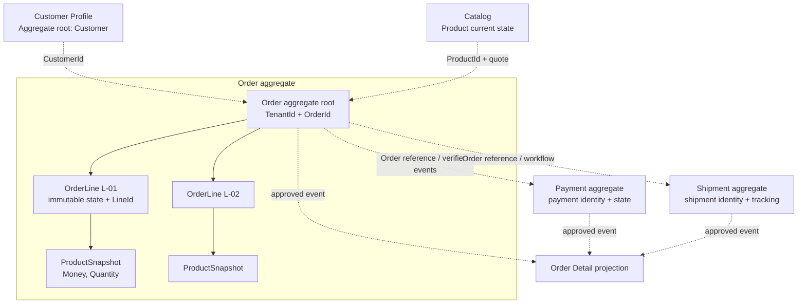
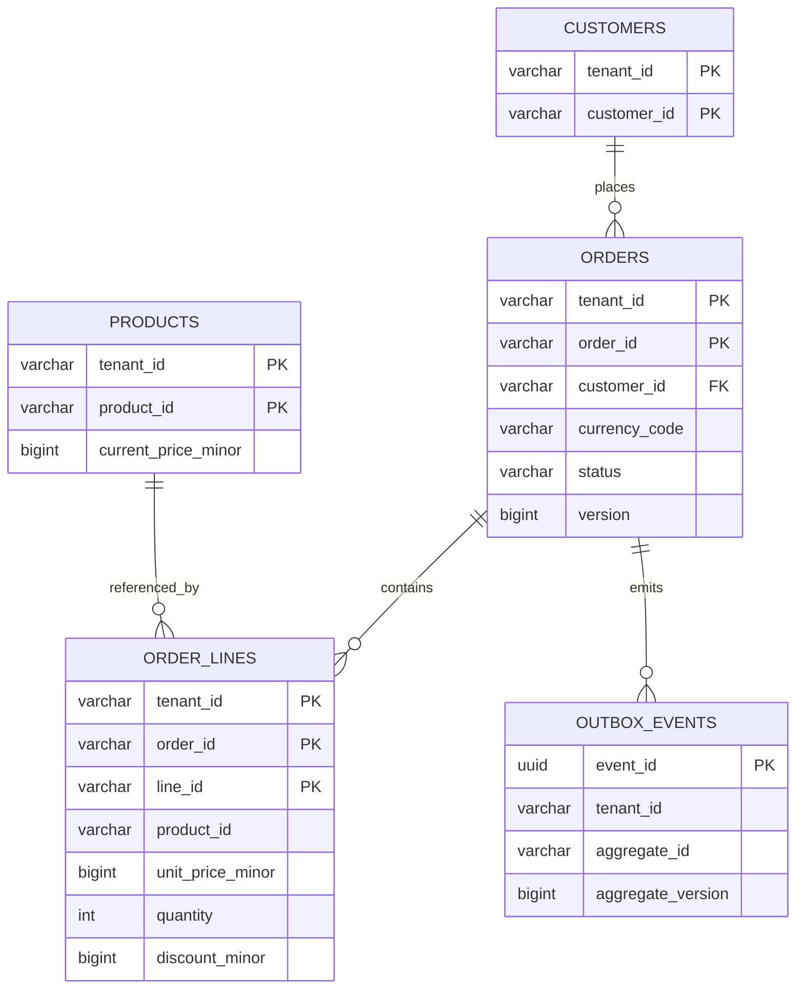
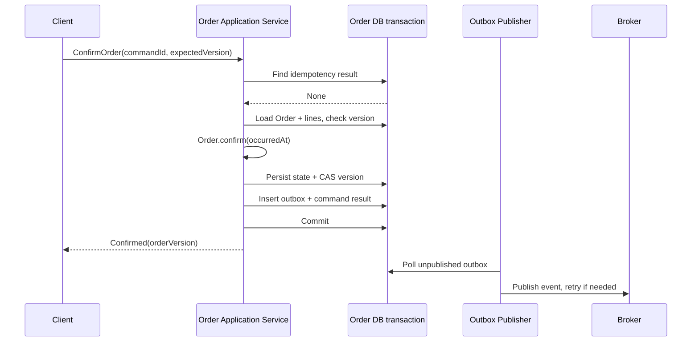
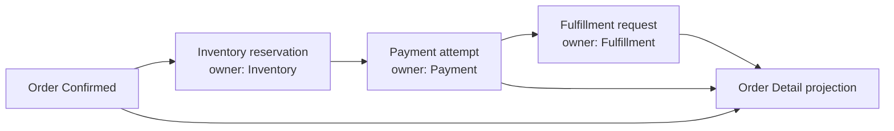

# Designing a Java Model with Value Objects and Aggregate Boundaries

A sales system development team was tasked with building an order placement feature in Java. The initial design had an `Order` class containing `customerName`, `currentProductPrice`, `paymentStatus`, `trackingCode`, and a list of all delivery histories. Any place in the application could call `order.setStatus(...)` or `order.getLines().clear()`. When new requirements emerged — multiple payments, package-by-package delivery, product price changes, two concurrent order requests — the model began to lose consistency.

This exercise asks you to redesign from **business language → entities and value objects → aggregate boundary → Java behavior → persistence and verification**. The goal is to place **the right invariants in the right place that owns the authority to mutate**, rather than merely turning database tables into Java classes with getters/setters.

This lesson belongs to the **Integrated Exercises** chapter of the **DATABASE_DATA_MODELING** course. The course trains skills in translating business requirements into clear data models, from entities, relationships, and constraints to normalization, keys, indexes, and physical schemas; while also comparing relational, document, graph, and analytical models to choose structures that fit, evolve cleanly, and are verifiable. The concepts of **value object** and **aggregate** here serve as tools to ensure that the **Java** model and the **data** model express the exact same rules.

**Completion objective:** independently propose a model capable of protecting monetary values, quantities, order states, tenant-scoped keys, and concurrent updates; explain why certain objects are kept inside the Order aggregate while Payment and Shipment are not arbitrarily embedded into Order's write source.

**Scope assumptions:** the examples use Java 21+, JUnit 5, and PostgreSQL for illustration. All IDs, monetary amounts, and dates are synthetic data. Orders use exclusively **whole-unit VND**, not yet covering taxes, shipping fees, order-level promo codes, currency exchange, complex partial fulfillment, or returns. Extensions must go through dedicated business rules rather than assuming the example solves everything.

## 1. Problem Statement: Multi-Tenant Ordering Platform

A store has multiple tenants sharing infrastructure. Within each tenant, a customer can create a draft order, add or edit order lines, and then confirm it.

**Mandatory business requirements:**

| Code | Rule | Expected Behavior |
| --- | --- | --- |
| BR-01 | Order ID only needs to be unique within a tenant | `(tenantId, orderId)` identifies an Order |
| BR-02 | Customer ID and Product ID are strongly typed references | Cannot accidentally pass a `ProductId` where `CustomerId` is expected |
| BR-03 | A new Order starts in `DRAFT` status | The order may initially have no lines |
| BR-04 | While `DRAFT`, lines can be added/removed and quantity updated | Operations are blocked once the order is confirmed |
| BR-05 | A line has `quantity > 0` and `unitPrice ≥ 0` | No order line with zero or negative quantity |
| BR-06 | `0 ≤ lineDiscount ≤ unitPrice × quantity` | Never create a line with a negative net value |
| BR-07 | Money has an explicit currency; addition/subtraction requires matching currency | Cannot add VND and USD |
| BR-08 | `CONFIRMED` requires at least one line | Calling `confirm()` on an empty DRAFT must fail |
| BR-09 | Confirmed lines cannot be silently modified | Locked price and quantity are a snapshot |
| BR-10 | Two commands writing the same version must not silently overwrite | Use optimistic concurrency/locking |
| BR-11 | Retrying the same command must not cause a second business effect | Idempotency key/result at the application boundary |
| BR-12 | Payment is managed by the Payment domain, Shipment by Fulfillment | Order does not hold every callback/tracking event |
| BR-13 | Queries for one tenant must not read/write another tenant's data | Tenant scope in API, keys, and queries |
| BR-14 | Catalog price changes do not alter confirmed order prices | `ProductSnapshot` belongs to OrderLine |
| BR-15 | External events are emitted only after source changes commit | Save outbox in the same transaction |
| BR-16 | Derived read models have clear provenance and freshness | Search/analytics must not directly mutate source state |

**Non-functional requirements of the exercise:**

- Java code has no public setters for Aggregate state.
- Value objects are **immutable** and compared **by value**.
- Aggregates do not directly call the database, HTTP, message broker, or system clock.
- Updates to Order and its lines must have an explicit **transaction and version scope**.
- Keys do not mix tenants.
- Tests verify **both valid cases and counterexamples**, including what must not happen after a command fails.
- There is a strategy for aggregate order queries **without merging all domains into one giant aggregate**.

### 1.1. Reference Sample Data

Tenant `T-01` has customer `C-01` who creates order `O-101`. The order has two lines:

| Line | Product | Quantity | Locked Unit Price | Line Discount | Net |
| --- | --- | ---: | ---: | ---: | ---: |
| `L-01` | `P-BOOK` | 2 | 100,000 VND | 10,000 VND | 190,000 VND |
| `L-02` | `P-PEN` | 1 | 30,000 VND | 0 VND | 30,000 VND |
| **Total** | | **3 units** | | **10,000 VND** | **220,000 VND** |

The pre-discount total is **230,000 VND**. The Catalog may later raise P-BOOK to 110,000 VND and P-PEN to 35,000 VND; **the locked total of O-101 remains 220,000 VND**.

Order O-101 may receive two successful payments `PAY-01 = 120,000 VND` and `PAY-02 = 100,000 VND`, and be delivered by `SHIP-01`, `SHIP-02` at different times. These numbers are used to verify both aggregate boundaries and JOIN money-multiplication bugs.

### 1.2. Required Deliverables in This Exercise

1. A glossary table and **grain/identity** for each concept.
2. A diagram showing **value objects, entities, aggregate root**, and cross-aggregate relationships.
3. Java code for the value objects `TenantId`, `OrderId`, `CustomerId`, `ProductId`, `LineId`, `Money`, `Quantity`, and `ProductSnapshot`.
4. Java `Order` aggregate with behavior, preventing consumers from arbitrarily mutating state/lines.
5. Repository contract, transaction rules, optimistic version, idempotency, and outbox.
6. SQL schema using tenant-scoped keys and local constraints.
7. A JUnit/API test suite with **positive and negative cases**.
8. Justification of relational/document/graph/analytical choices for the same domain.
9. A table of invariants **enforced by the database** vs. invariants that must live in domain/workflow.
10. A self-assessment based on the rubric at the end of the lesson.

## 2. Core Foundations: Value Object, Entity, Aggregate, and Domain Service

### 2.1. Value object

A value object is defined by its **value and intrinsic invariants**, not by a separate business identity tracked over time. Two `Money("VND", 100000)` instances are equivalent by value even if created by two different commands.

Examples:

- `Money`: currency + smallest monetary unit amount.
- `Quantity`: positive integer according to the exercise rules.
- `DeliveryWindow`: validated start/end interval.
- `ProductSnapshot`: product reference and locked price/title at purchase time.
- Typed IDs such as `OrderId` and `CustomerId`: **value objects wrapping identifiers**, even though the inner value **is used to identify an entity**.

Desired characteristics:

- **Immutable:** no setters that alter created values.
- **Self-validating:** constructor/factory never produces an instance violating invariants.
- **Equality by value:** equality determined by meaningful content.
- **No independent lifecycle:** no separate repository needed for a `Quantity(2)`.
- **Operations return new values:** `price.multiply(quantity)` returns a new Money instance.
- **Semantics explicit:** both being `String` does not mean Email, CustomerId, and ProductId are interchangeable.

In Java, `record` fits **many** value objects thanks to component-based constructor, accessors, `equals`, and `hashCode`. However, `record` only guarantees **shallow immutability**: if it holds a mutable `List` or a mutable object, **defensive copying** and proper boundary encapsulation are still required.

### 2.2. Entity

An entity preserves **continuous identity across changes**. Order O-101 remains the same Order even when its line count, status, or version changes. Order line `LineId("L-01")` remains that same line after updating its quantity in DRAFT.

Comparison:

| Object | Primary Comparison | Lifecycle |
| --- | --- | --- |
| `Money("VND", 100000)` | Currency and amount | Value, no separate identity |
| `Quantity(2)` | Quantity value | Value |
| `ProductSnapshot(P-BOOK, "Book", 100000)` | Entire snapshot content | Value at a point in time |
| `Order O-101` | `(tenantId, orderId)` | Draft → Confirmed/Cancelled |
| `OrderLine L-01` | Line ID within the right Order | Can change quantity while draft |
| `Payment PAY-01` | Payment identity managed by Payment domain | Pending → Succeeded/Failed |
| `Shipment SHIP-01` | Shipment identity | Planned → Delivered/Failed |

An `OrderLine` can be **implemented as an immutable record** while still carrying **entity semantics** if it has a stable `LineId` and changes are represented by **replacing the state of that same line ID**. **The Java `record` construct does not automatically define DDD identity.** Domain semantics determine whether something is an entity or a value object.

### 2.3. Aggregate and Aggregate Root

An aggregate is a **consistency boundary for invariants that must hold within a single change**. The aggregate root is the sole entry point for commands modifying the aggregate's internals.

In the example:

- `Order` is the root.
- `OrderLine` is managed inside Order.
- `Order.addLine`, `changeQuantity`, `removeLine`, `confirm` are the allowed behaviors.
- There is no public `order.setStatus("PAID")` or `order.lines().clear()`.
- Payment, Shipment, and Customer Profile **do not belong to the Order aggregate** merely because they hold an `orderId`.

**An aggregate does not necessarily correspond to a single database table or document.** Order and its lines can live in two tables while still being modified through **the same contract/transaction**. A document can embed lines while preserving the exact same aggregate semantics. You do not need to create a separate microservice for every aggregate.

### 2.4. Why Do We Need a Root?

If clients could modify `OrderLine` directly, they could delete the last line after the Order is confirmed, violating `CONFIRMED ⇒ at least one line`. When all changes go through the Order root, the root can check **state before and after the operation**.

Limitation: the root only protects invariants when every write path actually goes through it or is equivalently enforced by the DB/workflow. A direct SQL update script behind the domain's back can still break invariants if write permissions are uncontrolled.

### 2.5. Domain Service vs. Application Service

- **Value object:** rules for a single value, e.g., Money addition/subtraction and positive Quantity.
- **Aggregate:** rules within a single consistency boundary, e.g., Order cannot be confirmed when empty.
- **Domain service/policy:** business decisions that do not naturally belong to one entity/VO, e.g., calculating cross-warehouse reservation eligibility per policy.
- **Application service:** orchestrates authorization, loading, transactions, repositories, idempotency, outbox, and external tasks.
- **Infrastructure:** SQL, ORM mapping, broker, event publisher, cache, search.

Do not put database access or HTTP clients inside `Money` or `Order.confirm()`. Place the clock source, actor identity, and authorization verification results **at the application boundary** and pass them into the domain when needed.

## 3. Finding Aggregate Boundaries from Invariants and Lifecycles

### 3.1. Proposed Diagram



Dashed lines represent **references/contracts between aggregates**, not ownership by one root over another root's state. `Order` does not directly mutate `Payment.status` via a setter. The application/workflow verifies payment through the authoritative source and issues commands to update a projection or appropriate state according to the domain contract.

### 3.2. Boundary Decision Table

| Concept | Proposed Boundary | Rationale | What Not to Do |
| --- | --- | --- | --- |
| Order status/version | Order | Manages state and confirm command | Let any service set status |
| OrderLine | Inside Order | Confirm depends on at least 1 valid line | Allow editing lines freely via a repository |
| Money/Quantity | Value objects | Protects value validity | Use loose String/double |
| ProductSnapshot | Value object inside line | Historical price must remain stable | Use current catalog price to compute old orders |
| Current Product | Separate Catalog aggregate | Catalog price/name changes independently | Embed the live Product into Order |
| Customer profile | Separate Customer aggregate | Independent contact/consent/retention | Let Order own the current email |
| Payment transaction | Separate Payment aggregate | Has own callbacks/retries/settlement | Embed all payment events inside Order |
| Shipment | Separate Fulfillment aggregate | Multiple packages/independent statuses | Lock every OrderLine to update a shipment |
| Order Detail Read Model | Projection | One screen reading multiple sources | Treat read model as source of truth |

### 3.3. Which Invariants Must Be Atomic Inside Order?

At minimum:

\[
\text{Order.status = CONFIRMED} \Rightarrow |\text{Order.lines}| \ge 1
\]

\[
\forall \ell\in\text{Order.lines}:
\text{quantity}_{\ell}>0
\quad\land\quad
0\le \text{discount}_{\ell}
\le\text{quantity}_{\ell}\times\text{unitPrice}_{\ell}
\]

\[
\text{Order.total}=\sum_{\ell\in\text{Order.lines}}
(\text{quantity}_{\ell}\times\text{unitPrice}_{\ell}-\text{discount}_{\ell})
\]

All monetary additions in the example must be **in the same VND currency**, with non-negative results that do not overflow the chosen numeric type's range.

Invariants that **cannot be protected solely by an Order Java object**:

- Whether the payment provider actually confirmed settlement.
- Which Inventory source the stock was reserved from.
- Which Shipment was successfully delivered in Fulfillment.
- Whether the customer is authorized to purchase or the product is currently sellable at command time.
- Whether a command was durably/idempotently recorded after a network timeout.
- Whether the outbox published / broker delivered an event.

These require appropriate **source verification, transactions, workflows, events, reservations, or reconciliation**.

## 4. Choosing Java Types: Avoiding Primitive Obsession and Blocking Invalid States

### 4.1. Mistake: String and double Everywhere

```java
// COUNTEREXAMPLE — do not apply.
void addLine(
    String orderId,
    String productId,
    double unitPrice,
    int quantity,
    double discount
) {
    // Missing tenant scope, currency,
    // does not block negative quantity, has floating-point precision errors,
    // and does not know whether the order is already CONFIRMED.
}
```

It allows bugs such as swapping `orderId` and `productId`, passing `-2` for quantity, or calculating money with `double`. A loose collection of primitives makes invariants very difficult to prove.

### 4.2. Typed IDs Have Value but Do Not Replace Authorization

Within this lesson's scope, IDs are simple formatted strings. In real projects, UUID/ULID/long can be used as needed. What matters is **not confusing semantic roles**.

```java
// Ids.java — all types placed in the same package for the exercise.
// To export across packages/modules, split into separate public files.
package example.shop.order;

import java.util.Objects;

final class IdRules {
    private IdRules() {}

    static String valid(String value) {
        Objects.requireNonNull(value, "id");
        if (!value.matches("[A-Za-z0-9_-]{1,64}")) {
            throw new IllegalArgumentException("INVALID_ID");
        }
        return value;
    }
}

record TenantId(String value) {
    TenantId { value = IdRules.valid(value); }
}
record OrderId(String value) {
    OrderId { value = IdRules.valid(value); }
}
record CustomerId(String value) {
    CustomerId { value = IdRules.valid(value); }
}
record ProductId(String value) {
    ProductId { value = IdRules.valid(value); }
}
record LineId(String value) {
    LineId { value = IdRules.valid(value); }
}
record Quantity(int value) {
    Quantity {
        if (value <= 0) {
            throw new IllegalArgumentException("QUANTITY_MUST_BE_POSITIVE");
        }
    }
}
```

These package-private records exist solely to keep the exercise examples concise inside `example.shop.order`. If an application is modularized and requires public types, each `public record` must reside in its own matching Java file or use an appropriate API structure. Do not replace every ID with a single `GenericId` record just to shorten code; doing so forfeits type safety.

**Key note:** `OrderId("O-101")` does not guarantee global uniqueness; **the full Order identifier is `(TenantId, OrderId)`**. Type-safe IDs do not replace authenticating the caller's tenant, authorization checks, or tenant-scoped FKs.

### 4.3. Immutable, Currency-Consistent Money Without double

For whole-unit VND, a verifiable choice is `long minor` paired with a currency code. Operations use `Math.addExact` and `Math.multiplyExact` to **detect overflow** rather than silently wrapping numbers.

```java
// Money.java
package example.shop.order;

import java.util.Locale;
import java.util.Objects;

public record Money(String currencyCode, long minor) {
    public Money {
        Objects.requireNonNull(currencyCode, "currency");
        currencyCode = currencyCode.trim().toUpperCase(Locale.ROOT);
        if (!currencyCode.matches("[A-Z]{3}")) {
            throw new IllegalArgumentException("INVALID_CURRENCY_CODE");
        }
        if (minor < 0) {
            throw new IllegalArgumentException("NEGATIVE_MONEY");
        }
    }

    public static Money vnd(long minor) {
        return new Money("VND", minor);
    }

    public static Money zero(String currencyCode) {
        return new Money(currencyCode, 0);
    }

    public Money plus(Money other) {
        sameCurrency(other);
        return new Money(
            currencyCode,
            Math.addExact(minor, other.minor)
        );
    }

    public Money minus(Money other) {
        sameCurrency(other);
        return new Money(
            currencyCode,
            Math.subtractExact(minor, other.minor)
        );
    }

    public Money multiply(Quantity quantity) {
        Objects.requireNonNull(quantity, "quantity");
        return new Money(
            currencyCode,
            Math.multiplyExact(minor, quantity.value())
        );
    }

    private void sameCurrency(Money other) {
        Objects.requireNonNull(other, "other");
        if (!currencyCode.equals(other.currencyCode)) {
            throw new IllegalArgumentException("CURRENCY_MISMATCH");
        }
    }
}
```

Rules enforced by this type:

- `Money("VND", -1)` cannot exist.
- Cannot add VND with USD.
- `minus` does not allow a negative result.
- `multiply` requires a positive `Quantity`.
- Overflow throws `ArithmeticException` instead of producing wrong numbers.
- Record `equals/hashCode` checks equality by currency and minor.

**Limitation:** the regex `[A-Z]{3}` only validates code shape, **not whether the code is an actual ISO 4217 currency**; if needed, validate against an authoritative currency catalog/config. Multi-currency systems and taxes/discounts require explicit **scale, rounding, and exchange-rate policies**; controlled `BigDecimal` may be used instead of `long` depending on the domain. Never use `double` as the source of exact monetary calculations.

### 4.4. Why Not Store `currency` Outside Money and Pass Them Separately?

```java
// COUNTEREXAMPLE
long amount = 100000;
String currency = "VND";
// After a refactor, amount might be assigned from a USD price
// while currency remains VND.
```

When Money is a value object, monetary operations always carry their currency. This does not automatically solve exchange rates or auditing, but it prevents many invalid states right at value creation time.

### 4.5. Value Objects Can Have Multiple Fields, but Must Be Truly Immutable

```java
// ProductSnapshot.java
package example.shop.order;

import java.util.Objects;

public record ProductSnapshot(
    ProductId productId,
    String titleAtOrder,
    Money unitPrice
) {
    public ProductSnapshot {
        Objects.requireNonNull(productId, "productId");
        Objects.requireNonNull(titleAtOrder, "titleAtOrder");
        Objects.requireNonNull(unitPrice, "unitPrice");
        titleAtOrder = titleAtOrder.strip();
        if (titleAtOrder.isEmpty()) {
            throw new IllegalArgumentException("EMPTY_PRODUCT_TITLE");
        }
    }
}
```

`ProductSnapshot` holds **the title and unitPrice locked for the transaction**, not a live object reference to the current `Product` in the Catalog. If the Catalog changes its price tomorrow, old `OrderLine` entries do not change. If the business only needs product ID + price, the snapshot can omit title; retain exactly the facts needed for receipts, historical display, and retention.

**Counterexample of a record that is not deeply immutable:**

```java
// COUNTEREXAMPLE
record PriceHistory(java.util.List<Money> prices) { }
// new PriceHistory(mutableList) still shares the same List;
// caller can invoke mutableList.add(...) after creating the record.
```

If using a list inside a VO, call `List.copyOf(prices)` in the compact constructor and ensure elements are also immutable; if a defensive copy of a binary array is needed, `List.copyOf` does not replace copying the array.

## 5. OrderLine: Entity by ID, Whose State Can Be Immutable

An OrderLine has a stable `LineId` to distinguish two lines of the same product under two different pricing promotions. Changing quantity during Draft does not create a new line identity; it creates **a new state version for the same LineId**.

```java
// OrderLine.java
package example.shop.order;

import java.util.Objects;

public record OrderLine(
    LineId id,
    ProductSnapshot product,
    Quantity quantity,
    Money discount
) {
    public OrderLine {
        Objects.requireNonNull(id, "lineId");
        Objects.requireNonNull(product, "product");
        Objects.requireNonNull(quantity, "quantity");
        Objects.requireNonNull(discount, "discount");

        Money gross = product.unitPrice().multiply(quantity);
        if (!gross.currencyCode().equals(discount.currencyCode())) {
            throw new IllegalArgumentException("CURRENCY_MISMATCH");
        }
        if (discount.minor() > gross.minor()) {
            throw new IllegalArgumentException("DISCOUNT_EXCEEDS_GROSS");
        }
    }

    public Money gross() {
        return product.unitPrice().multiply(quantity);
    }

    public Money net() {
        return gross().minus(discount);
    }

    public OrderLine withQuantity(Quantity next) {
        return new OrderLine(id, product, next, discount);
    }
}
```

**Design rationale:**

- `LineId` is the identity **within the scope of the owning Order**.
- The record is used to **replace state** rather than scatter mutations.
- Only the `Order` aggregate is allowed to decide when a line's state may be replaced.
- The constructor validates quantity, currency, and discount.
- Reducing quantity can cause discount to exceed gross; `withQuantity` will **reject** it rather than silently producing a negative total.
- `gross()` and `net()` are **computed values**, not "current catalog amounts".

**Note on equality:** because `OrderLine` is implemented as a Java `record`, its default `equals()` compares **all record components**. Two versions of the same line can have equal `LineId` values but different `quantity` values, so `record.equals()` returns `false`. In this model, **entity identity must be compared by `LineId` within Order's scope**; `Map<LineId, OrderLine>` and immutable state replacement express that intent. Do not use the `OrderLine` record itself as the key of a `HashMap` that needs stable identity across changes. If you want `equals/hashCode` based on entity identity for all clients, use an entity class with explicit equality rules rather than default record equality.

In larger models, Line can be a mutable entity class with controlled constructors/access; what matters is not `record` vs. class, but **preventing callers from bypassing Order invariants**.

### 5.1. Should `OrderLine` Hold a `Product` Entity Directly?

You should not hold a long-lived reference to a mutable `Product` object just to compute totals. If the Product Service updates the price on that shared instance, confirmed order totals could change on their own, breaking transaction semantics.

Instead, when creating a line, select **the valid price at the policy-defined moment**, build a snapshot value, and store it. Quote validation rules, quote expiration times, and purchase eligibility belong to **application/domain policy** and cannot be inferred by OrderLine from ProductId alone.

## 6. Order Aggregate: Protecting Behavior Instead of Exposing Setters

Allowed methods:

- `Order.draft(...)` creates the initial aggregate.
- `addLine(OrderLine)` only when Draft.
- `changeQuantity(LineId, Quantity)` only when Draft.
- `removeLine(LineId)` only when Draft.
- `confirm(Instant)` only when Draft and having at least one line.
- `cancelDraft()` only when Draft under the simplified scope.
- `total()` computed purely from stored lines.
- `lines()` returns a read-only snapshot without exposing a mutable map.

In this exercise, `Order.status` consists only of **DRAFT, CONFIRMED, CANCELLED**. Payment status belongs to the Payment domain and its dedicated views/commands. Do not add `PAID` to Order merely because the order page needs to display Payment information.

### 6.1. State and Domain Error

```java
// OrderStatus.java
package example.shop.order;

public enum OrderStatus {
    DRAFT, CONFIRMED, CANCELLED
}
```

```java
// DomainRuleViolation.java
package example.shop.order;

public final class DomainRuleViolation extends RuntimeException {
    private final String code;

    public DomainRuleViolation(String code) {
        super(code);
        this.code = code;
    }

    public String code() {
        return code;
    }
}
```

Stable domain error codes let tests/APIs distinguish **ORDER_NOT_DRAFT**, **ORDER_HAS_NO_LINES**, **DUPLICATE_LINE**, **LINE_NOT_FOUND**. Application code can map them to appropriate responses; not every error necessarily maps to HTTP 400. For data not belonging to the caller's tenant, the API must avoid leaking entity existence through unauthorized error messages.

### 6.2. Java Source for Order

```java
// Order.java
package example.shop.order;

import java.time.Instant;
import java.util.LinkedHashMap;
import java.util.List;
import java.util.Map;
import java.util.Objects;

public final class Order {
    private final TenantId tenantId;
    private final OrderId id;
    private final CustomerId customerId;
    private final String currencyCode;
    private final Map<LineId, OrderLine> lines = new LinkedHashMap<>();

    private OrderStatus status = OrderStatus.DRAFT;
    private Instant confirmedAt;

    private Order(
        TenantId tenantId,
        OrderId id,
        CustomerId customerId,
        String currencyCode
    ) {
        this.tenantId = Objects.requireNonNull(tenantId);
        this.id = Objects.requireNonNull(id);
        this.customerId = Objects.requireNonNull(customerId);
        this.currencyCode = Money.zero(currencyCode).currencyCode();
        // Exercise scope: VND only, to avoid cross-currency policy.
        if (!"VND".equals(this.currencyCode)) {
            throw new IllegalArgumentException("ORDER_CURRENCY_NOT_SUPPORTED");
        }
    }

    public static Order draft(
        TenantId tenantId,
        OrderId id,
        CustomerId customerId
    ) {
        return new Order(tenantId, id, customerId, "VND");
    }

    public TenantId tenantId() { return tenantId; }
    public OrderId id() { return id; }
    public CustomerId customerId() { return customerId; }
    public OrderStatus status() { return status; }
    public Instant confirmedAt() { return confirmedAt; }

    public List<OrderLine> lines() {
        return List.copyOf(lines.values());
    }

    public Money total() {
        Money total = Money.zero(currencyCode);
        for (OrderLine line : lines.values()) {
            total = total.plus(line.net());
        }
        return total;
    }

    public void addLine(OrderLine line) {
        requireDraft();
        Objects.requireNonNull(line, "line");

        if (!currencyCode.equals(
            line.product().unitPrice().currencyCode()
        )) {
            throw new IllegalArgumentException("CURRENCY_MISMATCH");
        }
        if (lines.putIfAbsent(line.id(), line) != null) {
            throw new DomainRuleViolation("DUPLICATE_LINE");
        }
    }

    public void changeQuantity(LineId lineId, Quantity next) {
        requireDraft();
        Objects.requireNonNull(lineId, "lineId");
        Objects.requireNonNull(next, "next");

        OrderLine old = lines.get(lineId);
        if (old == null) {
            throw new DomainRuleViolation("LINE_NOT_FOUND");
        }
        // Build a valid replacement line first; if an exception occurs, do not mutate the map.
        OrderLine replacement = old.withQuantity(next);
        lines.put(lineId, replacement);
    }

    public void removeLine(LineId lineId) {
        requireDraft();
        Objects.requireNonNull(lineId, "lineId");
        if (lines.remove(lineId) == null) {
            throw new DomainRuleViolation("LINE_NOT_FOUND");
        }
    }

    public OrderConfirmed confirm(Instant at) {
        requireDraft();
        Objects.requireNonNull(at, "confirmedAt");
        if (lines.isEmpty()) {
            throw new DomainRuleViolation("ORDER_HAS_NO_LINES");
        }

        // Check for arithmetic overflow before changing state.
        Money amount = total();
        status = OrderStatus.CONFIRMED;
        confirmedAt = at;
        return new OrderConfirmed(tenantId, id, amount, at);
    }

    public void cancelDraft() {
        requireDraft();
        status = OrderStatus.CANCELLED;
    }

    private void requireDraft() {
        if (status != OrderStatus.DRAFT) {
            throw new DomainRuleViolation("ORDER_NOT_DRAFT");
        }
    }
}
```

The code above is **rule-focused domain logic**. It does not yet cover how JPA/JDBC rehydrates Order from the database, nor does it handle authorization, transactions, optimistic locking, outbox, or product quote verification. Those concerns belong in the application/infrastructure layers.

### 6.3. A Domain Event Is a Message About What Was Accepted in the Model

```java
// OrderConfirmed.java
package example.shop.order;

import java.time.Instant;
import java.util.Objects;

public record OrderConfirmed(
    TenantId tenantId,
    OrderId orderId,
    Money total,
    Instant occurredAt
) {
    public OrderConfirmed {
        Objects.requireNonNull(tenantId);
        Objects.requireNonNull(orderId);
        Objects.requireNonNull(total);
        Objects.requireNonNull(occurredAt);
    }
}
```

`Order.confirm(at)` **returns a domain event candidate**; it does not publish it directly. If the subsequent transaction fails while saving the Order, the event **must not be announced to the broker as if it had committed**. The application service must persist state and the outbox **within the same transaction**, after which a separate publisher dispatches it; consumers must tolerate duplicates.

### 6.4. Why Can `lines()` Return a List Without Allowing Mutation?

`List.copyOf(lines.values())` creates a snapshot that does not support additions or removals. Both the `OrderLine` elements and their embedded value objects are immutable in this design, so callers cannot change quantity through an object reference.

**Counterexample:**

```java
// COUNTEREXAMPLE
public List<OrderLine> getLines() {
    return internalMutableList; // caller can invoke .clear()
}
```

If mutable entities are used, returning `Collections.unmodifiableList` over the internal list only blocks adding/removing list elements, **not mutating the elements themselves**. Return immutable views/DTOs or strictly control exposed objects.

### 6.5. Do Not Automatically Turn Every Field into a Public Accessor

The domain API should expose only what commands and queries actually need. Do not add public `setStatus`, `setCustomerId`, or `setConfirmedAt` methods merely for ORM convenience. Persistence mappers can use a **rehydration factory**, package-private constructor, or external mapping, while still upholding invariants and preventing ordinary application code from bypassing behavior.

Long-lived stored snapshots may contain data **written under an older schema version**. When hydrating, decide explicitly: reject invalid data, migrate/repair, or read via an adapter; do not simply ignore errors and instantiate an aggregate in a state unreachable through valid APIs.

## 7. Step-by-Step Walkthrough with O-101

### 7.1. Creating a Draft Order

```java
TenantId tenant = new TenantId("T-01");
Order order = Order.draft(
    tenant,
    new OrderId("O-101"),
    new CustomerId("C-01")
);

assert order.status() == OrderStatus.DRAFT;
assert order.lines().isEmpty();
assert order.total().equals(Money.vnd(0));
```

A draft order with zero lines **is valid**. Do not put the rule "every Order must have at least one line" into the constructor if the business allows an empty Draft.

### 7.2. Adding Two Lines with Snapshot Prices

```java
order.addLine(new OrderLine(
    new LineId("L-01"),
    new ProductSnapshot(
        new ProductId("P-BOOK"),
        "Book",
        Money.vnd(100_000)
    ),
    new Quantity(2),
    Money.vnd(10_000)
));

order.addLine(new OrderLine(
    new LineId("L-02"),
    new ProductSnapshot(
        new ProductId("P-PEN"),
        "Pen",
        Money.vnd(30_000)
    ),
    new Quantity(1),
    Money.vnd(0)
));

assert order.total().equals(Money.vnd(220_000));
```

Whatever price `P-BOOK` later has in the Catalog **does not affect** this snapshot total. Calculation:

\[
(2\times100{,}000-10{,}000)
+
(1\times30{,}000-0)
=220{,}000\ \text{VND}.
\]

### 7.3. Confirming the Order

```java
import java.time.Instant;

Instant confirmedAt = Instant.parse("2026-10-01T03:00:00Z");
OrderConfirmed event = order.confirm(confirmedAt);

assert order.status() == OrderStatus.CONFIRMED;
assert order.total().equals(Money.vnd(220_000));
assert event.total().equals(Money.vnd(220_000));
```

The event is created inside the domain, but we cannot yet claim the broker received it. Only when the application service persists state and outbox **successfully** is the source transaction considered committed. `confirmedAt` uses an externally supplied `Instant` so tests remain deterministic; the domain does not call `Instant.now()`.

### 7.4. Attempting Changes After Confirmation

```java
// Expect DomainRuleViolation("ORDER_NOT_DRAFT").
order.removeLine(new LineId("L-01"));
```

Because `requireDraft()` executes before modifying the map, **Order remains CONFIRMED and keeps both lines**. Note that with real JPA/session mapping, you must ensure rollback on application errors and avoid unintended persistence of partial changes.

### 7.5. Counterexample Exposing Wrong Boundaries

If a `PaymentConsumer` receives a callback and calls:

```java
// COUNTEREXAMPLE — do not expose APIs like this.
order.setPaymentStatus("SUCCEEDED");
order.getShipments().get(0).setTrackingStatus("DELIVERED");
```

it treats Order as **the owner of Payment and Shipment** without proving a shared invariant requiring atomic transactions. When Payment/Shipment change independently, Order can become a hot aggregate; stale callbacks can overwrite newer values or fragment into unmanaged write paths.

The solution is to keep `PaymentId`, `ShipmentId` identities, and separate domain states; Order may receive **verified outcomes** via workflow, or an aggregated projection can carry source versions for display.

## 8. Self-Check: Which Invariants Should Value Objects Have?

### 8.1. Money

| Value / Operation | Expected |
| --- | --- |
| `Money.vnd(0)` | Valid |
| `Money.vnd(100000)` | Valid |
| `Money.vnd(-1)` | Rejected |
| `Money.vnd(100000).plus(Money.vnd(50000))` | 150000 VND |
| `Money.vnd(100000).minus(Money.vnd(150000))` | Rejected |
| `Money("VND",100).plus(Money("USD",100))` | Rejected |
| `Money.vnd(Long.MAX_VALUE).plus(Money.vnd(1))` | Overflow detected |
| `Money.vnd(0).multiply(Quantity(2))` | 0 VND |

For negative amounts in accounting adjustments, **do not arbitrarily relax non-negative Money** if it enforces the invariant for unit price and sale amount. You can design a **SignedMoney/Adjustment** type with its own semantics and checks, or a general Money that allows negatives while enforcing positivity where needed; the decision must be explicitly documented per business rules.

### 8.2. Quantity

- `Quantity(1)` is valid.
- `Quantity(0)`, `Quantity(-3)` are invalid.
- `quantity.value()` is a positive int; if items are sold by kilogram or fractional weight, **do not reuse this model as-is**. You need `MeasuredQuantity(value, unit)` or an equivalent type with precision, rounding, and conversion policies.

### 8.3. ProductSnapshot

- Every snapshot has a ProductId, non-empty title, and unit price.
- Two snapshots for the same product with different prices **are not equal under value equality**, because they represent two distinct locked price records.
- A snapshot price inside an order does not change when the Catalog updates.
- ProductSnapshot does not need its own repository because it has no independent lifecycle under the current contract.

## 9. JUnit 5: Verifying Invariants with Valid Cases and Counterexamples

The exercise is evaluated not just by lines of code but by **the ability to prove rules**. Below is a sample test suite; each example can be placed in a Java test suite in the same package to access the package-private ID records.

### 9.1. Testing Money, Quantity, and Equality

```java
// MoneyTest.java
package example.shop.order;

import org.junit.jupiter.api.Test;
import static org.junit.jupiter.api.Assertions.*;

class MoneyTest {
    @Test
    void sameMoneyHasValueEquality() {
        assertEquals(
            new Money("vnd", 100_000),
            Money.vnd(100_000)
        );
        assertNotEquals(
            Money.vnd(100_000),
            new Money("USD", 100_000)
        );
    }

    @Test
    void rejectsInvalidAmountsAndQuantities() {
        assertThrows(
            IllegalArgumentException.class,
            () -> Money.vnd(-1)
        );
        assertThrows(
            IllegalArgumentException.class,
            () -> new Quantity(0)
        );
        assertThrows(
            IllegalArgumentException.class,
            () -> new Quantity(-2)
        );
    }

    @Test
    void rejectsCrossCurrencyArithmetic() {
        assertThrows(
            IllegalArgumentException.class,
            () -> Money.vnd(10).plus(new Money("USD", 10))
        );
    }

    @Test
    void reportsOverflow() {
        assertThrows(
            ArithmeticException.class,
            () -> Money.vnd(Long.MAX_VALUE).plus(Money.vnd(1))
        );
    }
}
```

This test verifies **value semantics**; it does not prove real-world payment rules or currency conversion. Those belong to separate domain workflows.

### 9.2. Testing the Order Aggregate

```java
// OrderTest.java
package example.shop.order;

import java.time.Instant;
import org.junit.jupiter.api.Test;
import static org.junit.jupiter.api.Assertions.*;

class OrderTest {
    private Order draft(String orderId) {
        return Order.draft(
            new TenantId("T-01"),
            new OrderId(orderId),
            new CustomerId("C-01")
        );
    }

    private OrderLine bookLine() {
        return new OrderLine(
            new LineId("L-01"),
            new ProductSnapshot(
                new ProductId("P-BOOK"),
                "Book",
                Money.vnd(100_000)
            ),
            new Quantity(2),
            Money.vnd(10_000)
        );
    }

    @Test
    void draftCanBeEmptyButCannotBeConfirmedEmpty() {
        Order order = draft("O-EMPTY");
        assertEquals(OrderStatus.DRAFT, order.status());
        assertEquals(Money.vnd(0), order.total());

        DomainRuleViolation ex = assertThrows(
            DomainRuleViolation.class,
            () -> order.confirm(Instant.EPOCH)
        );

        assertEquals("ORDER_HAS_NO_LINES", ex.code());
        assertEquals(OrderStatus.DRAFT, order.status());
        assertNull(order.confirmedAt());
    }

    @Test
    void confirmationLocksLines() {
        Order order = draft("O-101");
        order.addLine(bookLine());
        order.addLine(new OrderLine(
            new LineId("L-02"),
            new ProductSnapshot(
                new ProductId("P-PEN"), "Pen",
                Money.vnd(30_000)
            ),
            new Quantity(1),
            Money.vnd(0)
        ));

        OrderConfirmed event =
            order.confirm(Instant.parse("2026-10-01T03:00:00Z"));

        assertEquals(OrderStatus.CONFIRMED, order.status());
        assertEquals(Money.vnd(220_000), order.total());
        assertEquals(Money.vnd(220_000), event.total());

        DomainRuleViolation ex = assertThrows(
            DomainRuleViolation.class,
            () -> order.removeLine(new LineId("L-01"))
        );
        assertEquals("ORDER_NOT_DRAFT", ex.code());
        assertEquals(2, order.lines().size());
        assertEquals(Money.vnd(220_000), order.total());
    }

    @Test
    void doesNotExposeMutableLines() {
        Order order = draft("O-101");
        order.addLine(bookLine());

        assertThrows(
            UnsupportedOperationException.class,
            () -> order.lines().clear()
        );
        assertEquals(1, order.lines().size());
    }

    @Test
    void changingQuantityCannotMakeDiscountTooLarge() {
        Order order = draft("O-101");
        order.addLine(new OrderLine(
            new LineId("L-01"),
            new ProductSnapshot(
                new ProductId("P-BOOK"), "Book",
                Money.vnd(100_000)
            ),
            new Quantity(2),
            Money.vnd(150_000)
        ));

        assertThrows(
            IllegalArgumentException.class,
            () -> order.changeQuantity(
                new LineId("L-01"),
                new Quantity(1)
            )
        );

        assertEquals(new Quantity(2),
                     order.lines().get(0).quantity());
        assertEquals(Money.vnd(50_000), order.total());
    }

    @Test
    void duplicateLineIdIsRejected() {
        Order order = draft("O-101");
        order.addLine(bookLine());

        DomainRuleViolation ex = assertThrows(
            DomainRuleViolation.class,
            () -> order.addLine(bookLine())
        );
        assertEquals("DUPLICATE_LINE", ex.code());
        assertEquals(1, order.lines().size());
    }
}
```

The test `changingQuantityCannotMakeDiscountTooLarge` is noteworthy: the original line has a gross of 200,000 and discount of 150,000, net 50,000. When reduced to Quantity 1, gross becomes 100,000, making a 150,000 discount invalid. Because `replacement` is constructed before calling `put` on the map, the aggregate **is not left half-mutated** after the exception.

### 9.3. Do Not Use Java `assert` Instead of a Test Framework

The `assert ...` statements in the walkthrough are just readable notation. Java's `assert` keyword can be disabled if the JVM is launched without assertions enabled. In real tests, use JUnit's `Assertions.assertEquals`, `assertThrows`, etc., to ensure they always execute.

### 9.4. Additional Tests Still to Write

- `removeLine` on a non-existent LineId.
- `cancelDraft` followed by trying `addLine` or `confirm`.
- Calling `confirm` twice in a row.
- Adding a line with a currency other than VND.
- Adding a line with a negative discount or discount greater than gross.
- Changing quantity and verifying the updated total.
- Two lines with the same ProductId but different LineIds allowed if business rules permit.
- Malformed IDs, nulls, and strings exceeding length limits.
- Addition/multiplication overflow.
- Domain event does not leak to the broker when the transaction rolls back.

A unit test can prove that classes enforce invariants **in memory**, but it does not replace integration tests for **locking, transactions, optimistic concurrency, and idempotency** against real storage.

## 10. Enforcement Boundary Matrix: Where Does Each Rule Live?

| Rule | Value Object | Aggregate | DB | Application / Workflow | Verification |
| --- | --- | --- | --- | --- | --- |
| Positive quantity | **Primary** | Uses it | Supporting CHECK | Input validation | Unit + DB test |
| Same-currency Money | **Primary** | Summed per currency | CHECK / column type | Rate policy if any | Unit + DQ |
| Discount ≤ gross | OrderLine constructor | **No bypass** | Supporting CHECK | Product quote policy | Unit + DB |
| Confirmed Order has lines | — | **Primary** | Trigger/procedure if needed | Tx isolation/locking | Unit + integration |
| Lines frozen once Confirmed | — | **Primary** | Guards/privileges | Controlled write paths | State tests |
| Product price snapshot | Snapshot VO | Stores line | Snapshot column | Catalog quote verification | Regression |
| Tenant-scoped ID/FK | Typed IDs | Same Order scope | Composite PK/FK | Authorization | DB + security |
| Prevent lost update | — | State invariants | **Version CAS** | Retry/conflict policy | Race test |
| Duplicate command | — | Not handled in VO | Idempotency PK | **Primary** | Retry/crash test |
| Payment settlement | — | Not owned | Payment store | **Payment owner** | Provider integration |
| Shipment lifecycle | — | Not owned | Shipment store | **Fulfillment owner** | Workflow tests |
| Outbox delivery | — | Event candidate | Outbox row in tx | Publisher/consumer | Replay tests |
| Search projection freshness | — | Not owned | Projection source version | Consumer | Lag/reconciliation |
| Personal data / retention | — | Only necessary refs | ACL/RLS/retention support | **Privacy policy** | Access/deletion tests |

This table prevents **pushing all logic into one place**. The domain does not replace database constraints; the database does not replace cross-service business workflows; value objects do not replace authorization.

## 11. Persistence Model: The Order Aggregate in Relational Storage

### 11.1. Logical Relationships



An Order can have **0 lines when DRAFT** and must have ≥1 when CONFIRMED. The relationship should be modeled structurally as 0..N and then **documented as a state-dependent rule**; an ER diagram alone cannot fully express this condition.

`Products` in the diagram represents the **Catalog** with its own lifecycle. In a database-separated system, the Order Service may store only the product snapshot with **no cross-DB foreign key to catalog**; instead, it relies on source verification workflows and controlled references. The diagram shows conceptual reference lines, not a promise that every FK can be enforced by the engine across systems.

### 11.2. Minimal PostgreSQL Schema

```sql
-- PostgreSQL — whole-unit VND example, not a complete commercial schema.
CREATE TABLE orders (
    tenant_id VARCHAR(64) NOT NULL,
    order_id VARCHAR(64) NOT NULL,
    customer_id VARCHAR(64) NOT NULL,
    status VARCHAR(24) NOT NULL,
    currency_code CHAR(3) NOT NULL DEFAULT 'VND',
    version BIGINT NOT NULL DEFAULT 0,
    confirmed_at TIMESTAMPTZ,
    PRIMARY KEY (tenant_id, order_id),
    CHECK (status IN ('DRAFT', 'CONFIRMED', 'CANCELLED')),
    CHECK (currency_code = 'VND'),
    CHECK (version >= 0),
    CHECK (
        (status = 'CONFIRMED' AND confirmed_at IS NOT NULL)
        OR
        (status IN ('DRAFT', 'CANCELLED') AND confirmed_at IS NULL)
    )
);

CREATE TABLE order_lines (
    tenant_id VARCHAR(64) NOT NULL,
    order_id VARCHAR(64) NOT NULL,
    line_id VARCHAR(64) NOT NULL,
    product_id VARCHAR(64) NOT NULL,
    product_title_snapshot TEXT NOT NULL,
    quantity INTEGER NOT NULL,
    unit_price_minor NUMERIC(20,0) NOT NULL,
    discount_minor NUMERIC(30,0) NOT NULL DEFAULT 0,
    PRIMARY KEY (tenant_id, order_id, line_id),
    FOREIGN KEY (tenant_id, order_id)
        REFERENCES orders (tenant_id, order_id),
    CHECK (quantity > 0),
    CHECK (unit_price_minor >= 0),
    CHECK (discount_minor >= 0),
    CHECK (discount_minor <= quantity * unit_price_minor)
);

CREATE INDEX order_lines_tenant_product_idx
    ON order_lines (tenant_id, product_id);
```

`status` and `confirmed_at` form a **row-local invariant**, so it can be expressed with a `CHECK` constraint. By contrast, the rule "CONFIRMED has ≥1 line" is a **cross-table invariant** that cannot be enforced by a row-level `CHECK` on `orders`. It requires service/transaction/trigger enforcement if desired, plus SQL checks to detect anomalies.

**Numeric type detail:** Java `Money.minor` uses `long`, whereas the database uses `NUMERIC(20,0)` or `NUMERIC(30,0)`. The mapper must validate when reading into Java `long`; values exceeding `Long.MAX_VALUE` **cannot be read safely** via `longValue()`, which silently truncates numbers. Use `longValueExact()`/validation or adjust precision accordingly. If using `BigDecimal`, verify exact scale.

### 11.3. Do Not Let the ORM Dictate Invariants Instead of the Domain

If JPA generates public setters and lazy collections allowing any service to add/remove OrderLines freely, the aggregate exists in name only. You can use:

- Entity mapping with appropriate constructor/field access.
- A repository adapter converting rows → domain snapshots via a **trusted rehydration method**.
- Repository persistence of domain changes **within a single transaction**.
- DB constraints as a minimum safeguard against alternate write paths.
- Pure Java unit tests + mapping integration tests.

Java `record` types for Money/Quantity may require an `AttributeConverter` or custom mapping. Avoid sacrificing **type safety** just because an ORM works more easily with primitives; equally, do not force every domain object to be persisted verbatim if an adapter is cleaner.

### 11.4. Rehydrating an Aggregate from Multiple Rows Must Check Consistency

The repository loads Order and OrderLines within the same consistent snapshot/transaction per policy. If `orders.status=CONFIRMED` has zero lines due to legacy bad data or broken imports, the adapter must not silently instantiate a "valid" aggregate and allow further updates. It must report a **data corruption / migration problem**, requiring repair or an explicit remediation workflow.

While the public domain API only exposes the `draft` factory, the persistence adapter can call a package-private rehydration factory taking persisted state/lines and **validating invariants**; never give normal clients a public `Order.confirmedWithoutLines(...)`.

## 12. Optimistic Locking: Version Is the Contract Between Domain and Storage

### 12.1. Lost Update Scenario

```text
Client A reads Order O-101 version=4 (DRAFT)
Client B also reads version=4 (DRAFT)

A updates L-01 quantity 2 -> 3
B deletes L-02

If both writers save the full snapshot without checking version,
the later write can overwrite the earlier change.
```

### 12.2. Versioned Repository Contract

```java
// Illustrative contract, suitable for the application package.
// Method names describe behavior, not a complete JDBC implementation.
record VersionedOrder(Order aggregate, long persistedVersion) { }

interface OrderRepository {
    VersionedOrder load(TenantId tenantId, OrderId orderId);
    long save(Order order, long expectedVersion);
}
```

`persistedVersion` is the **version of the persisted row/aggregate**, not an `OrderLine` index or `ProductSnapshot` version. The repository returns the new version upon successful save. This value is managed by **persistence**, not arbitrarily set by clients.

If multiple lines are updated in one command, **each command** should increment the Order aggregate version **once**, writing all affected rows in the same transaction. Any other writer modifying OrderLines must obey the same parent lock/version. If a service writes directly to `order_lines` without bumping/locking Order's version, root optimistic locking **cannot protect** against those changes.

### 12.3. CAS on the Parent Row

```sql
-- Executed inside a transaction alongside INSERT/UPDATE/DELETE on order_lines.
UPDATE orders
SET version = version + 1
WHERE tenant_id = :tenant_id
  AND order_id = :order_id
  AND version = :expected_version
RETURNING version;
```

The condition succeeds only when returning **one row**. **0 rows** can mean not found, stale version, or unauthorized (if scope was pre-filtered); the application must return the appropriate error and not commit the intended child changes. If every command performs CAS/locking on the parent before writing children, changes within the aggregate are properly serialized.

**Do not merely check version in Java and then execute an UPDATE without WHERE version** — the gap between `SELECT` and `UPDATE` creates a race. **Do not rely on transactions while assuming every isolation level prevents lost updates**; the specific database engine mechanisms and write paths must be verified.

### 12.4. ConfirmOrder and Row Locking

Confirming requires checking at least one line, Draft status, and transitioning to Confirmed. Example flow:

```text
BEGIN TRANSACTION
  1. Load Order root by tenant and order ID.
  2. Lock/CAS parent version against expected version.
  3. Read OrderLines within the same consistent transaction.
  4. Domain.confirm(at) checks status and lines.
  5. Persist Order status, confirmed_at, version.
  6. Insert outbox event in the same transaction.
  7. Persist idempotency command result if required by contract.
COMMIT; if any step fails -> ROLLBACK
```

**Critical warning:** if another transaction can insert/delete `order_lines` **without sharing the parent lock/CAS**, steps 3 and 5 can race (phantoms or mutated data). Close all unguarded write paths or use appropriate isolation/locking/DB guards. Invariants cannot be proven solely from the in-memory `Order.confirm()` method.

### 12.5. Retries Do Not Always Mean "New Command"

If a request commits but the connection drops before returning the response, the client may resend it. Now the expected version is stale, the repo reports conflict, yet the business effect **already occurred**. For retries to yield a sensible result, the application needs a **stable idempotency key** and stored outcome.

Do not put `commandId` into `Money` or create a new `Order` on every retry. This is a contract at the **application/persistence boundary**.

## 13. Idempotency and Outbox: Outside the Aggregate Scope, Yet Essential

### 13.1. Sample Command

```json
{
  "commandId": "CMD-101",
  "tenantId": "T-01",
  "orderId": "O-101",
  "expectedVersion": 4,
  "commandType": "ConfirmOrder",
  "requestedAt": "2026-10-01T03:00:00Z"
}
```

`tenantId` in the request payload must not automatically become the **authoritative tenant**; the backend must derive/verify the tenant from the authenticated context. `expectedVersion` is a concurrency precondition, not an anti-spoofing mechanism.

### 13.2. Idempotency and Outbox Tables

```sql
CREATE TABLE processed_commands (
    tenant_id VARCHAR(64) NOT NULL,
    command_id VARCHAR(80) NOT NULL,
    command_type VARCHAR(80) NOT NULL,
    request_fingerprint VARCHAR(128) NOT NULL,
    result_ref VARCHAR(128),
    processed_at TIMESTAMPTZ NOT NULL,
    PRIMARY KEY (tenant_id, command_id)
);

CREATE TABLE order_outbox (
    event_id UUID NOT NULL,
    tenant_id VARCHAR(64) NOT NULL,
    order_id VARCHAR(64) NOT NULL,
    aggregate_version BIGINT NOT NULL,
    event_type VARCHAR(80) NOT NULL,
    schema_version INTEGER NOT NULL,
    payload JSONB NOT NULL,
    occurred_at TIMESTAMPTZ NOT NULL,
    published_at TIMESTAMPTZ,
    PRIMARY KEY (event_id),
    UNIQUE (tenant_id, order_id, aggregate_version)
);
```

Assuming **one business event per Order version increment** makes `UNIQUE(tenant_id, order_id, aggregate_version)` appropriate. If a single command emits multiple distinct events for the same aggregate version, include an **event sequence/position** or equivalent key; do not let the constraint drop valid events.

`request_fingerprint` must be built from **canonicalized data covering the meaningful fields of the command**, with a clear policy when the same `commandId` arrives with a different payload. Do not log raw PII/secrets or use unkeyed hashes of predictable values while assuming anonymity.

### 13.3. Transactional Command Flow



All DB operations in the diagram must execute in **the same transaction** (when using a single source database). If event publishing succeeds but the publisher crashes before marking `published_at`, the event may be resent; consumers must still be idempotent.

### 13.4. Application Pseudocode Showing the Boundaries

```java
// Java-like PSEUDOCODE; classes Tx, CommandStore,
// OutboxRepository, ConfirmCommand, Receipt are application adapters,
// not defined inside the domain model.
Receipt confirm(ConfirmCommand cmd, AuthenticatedActor actor) {
    return tx.inTransaction(() -> {
        permissions.requireConfirmOrder(actor, cmd.tenantId());

        var previous = commandStore.find(
            cmd.tenantId(), cmd.commandId()
        );
        if (previous != null) {
            previous.requireSameRequestFingerprint(cmd);
            return previous.receipt();
        }

        VersionedOrder loaded = orderRepository.load(
            cmd.tenantId(), cmd.orderId()
        );
        if (loaded.persistedVersion() != cmd.expectedVersion()) {
            throw new VersionConflict();
        }

        OrderConfirmed candidate = loaded.aggregate()
            .confirm(clock.instant());

        long nextVersion = orderRepository.save(
            loaded.aggregate(),
            loaded.persistedVersion()
        ); // CAS + child state in same transaction.

        outbox.append(candidate, nextVersion);
        Receipt receipt = Receipt.confirmed(
            cmd.orderId(), nextVersion
        );
        commandStore.record(cmd, receipt);
        return receipt;
    });
}
```

**Do not treat pseudocode as complete production code.** To be safe when **two requests with the same commandId run concurrently**, the `processed_commands` PK is only one piece: conflict handling, transaction retries, `IN_PROGRESS/COMPLETED` state, or an equivalent strategy is needed so neither request produces side effects before command ownership is resolved. Retention duration for command results must also cover the retry contract window. Authorization, auditing, and error mapping require real-world policies.

**A domain event candidate is not yet a successful external event.** Only write it to the outbox inside the committing transaction and publish post-commit; never send directly to the broker inside `Order.confirm()`.

## 14. Boundary Between Order and Payment/Shipment

### 14.1. Why Not Add `PaymentStatus` to OrderLine?

Payment has its own ID and lifecycle:

```text
Payment PAY-01
  amount = 120000 VND
  status = SUCCEEDED
  provider_event_ids = ...
Payment PAY-02
  amount = 100000 VND
  status = SUCCEEDED
```

If an order has two payments, a single `order.paymentStatus` field cannot tell which transaction succeeded, which retried, or whether partial capture/refund occurred. The Order Detail UI may show a **derived paid amount**, while the source of truth for payment transactions remains in the Payment domain.

### 14.2. Settlement Is Evidence from an Authoritative Source

The order must not call `markPaid()` just because a client sends the string `"SUCCEEDED"`. Webhook/provider verification, signature/authenticity checks, event IDs, settlement policies, and idempotency belong to the Payment domain. The Order Service can consume a verified **PaymentCompleted** event from the owner to update **an order settlement view or business state if needed**. Aggregate boundaries follow exact rules, not field names.

### 14.3. Independent Shipments

`Shipment SHIP-01` may already be delivered while `SHIP-02` is still in transit. Two packages do not have to transition states simultaneously. Stuffing all shipment events into `Order.lines` or a scalar `order.deliveryStatus` loses per-package information.

If a single order line can be split across multiple shipments, model an entity/link `ShipmentLineAllocation` with `shippedQuantity`, rather than inferring it by joining all order lines with shipments on order ID.

### 14.4. Cross-Aggregate Workflow



The diagram illustrates **one possible workflow**; reservation/payment/fulfillment ordering depends on business rules. When a step fails, there must be compensating actions or appropriate pending/retry states. Do not rely on a single local PostgreSQL transaction to claim atomic commit across HTTP calls to three other services.

## 15. Java Project Structure and Package Boundaries

An illustrative package layout:

```text
example.shop.order/
  domain/
    Order.java
    OrderLine.java
    Money.java
    Quantity.java
    ProductSnapshot.java
    OrderStatus.java
    DomainRuleViolation.java
    ids/
      TenantId.java
      OrderId.java
      CustomerId.java
      ProductId.java
      LineId.java
  application/
    ConfirmOrderHandler.java
    AddLineHandler.java
    OrderRepository.java
    ProcessedCommandStore.java
    AuthorizationPort.java
    ClockPort.java
  infrastructure/
    JdbcOrderRepository.java
    JdbcOutboxStore.java
    BrokerOutboxPublisher.java
  api/
    OrderCommandController.java
    OrderReadController.java
  tests/
    MoneyTest.java
    OrderTest.java
    OrderRepositoryIntegrationTest.java
    ConfirmOrderRaceTest.java
```

The `Ids.java` snippets above **grouped several package-private records for concise learning**, which differs from the exact directory layout proposed here. When splitting them into package `domain.ids`, make them public records in separate files with appropriate imports. That is a **project structure** refinement that does not change domain semantics.

**Recommended dependency direction:**

```text
API -> Application -> Domain
           |
           v
      Ports/interfaces
           ^
           |
    Infrastructure adapters
```

The domain does not import JPA/Hibernate, Spring Controller, or Kafka clients just to express `Order.total()`. Use tools/frameworks when they **help implement the contract**; never let annotations dictate aggregate boundaries.

## 16. Can This Model Be Stored as a Document?

Yes. An Order document can embed locked OrderLines because they **belong to the same aggregate**.

```json
{
  "_id": "T-01:O-101",
  "tenantId": "T-01",
  "orderId": "O-101",
  "customerId": "C-01",
  "status": "CONFIRMED",
  "version": 5,
  "currencyCode": "VND",
  "confirmedAt": "2026-10-01T03:00:00Z",
  "lines": [
    {
      "lineId": "L-01",
      "product": {
        "productId": "P-BOOK",
        "titleAtOrder": "Book",
        "unitPriceMinor": 100000
      },
      "quantity": 2,
      "discountMinor": 10000
    },
    {
      "lineId": "L-02",
      "product": {
        "productId": "P-PEN",
        "titleAtOrder": "Pen",
        "unitPriceMinor": 30000
      },
      "quantity": 1,
      "discountMinor": 0
    }
  ]
}
```

In a document store, a conditional update `WHERE _id ... AND version = expected` or equivalent prevents lost updates; the operation must guard **both the line update and the version bump**. Unbounded line counts can make documents overly large/hot; assess cardinality and workload before choosing to embed.

**Do not embed every payment attempt, shipment tracking event, refund, and support note into the Order document as the primary write source** just because the UI reads them together. Use a separate `OrderDetailProjection` with source versions and a refresh policy.

### 16.1. When Is Referencing Better Than Embedding?

If a child has:

- Independent ID and lifecycle;
- Separate owner/transaction;
- Unbounded growth history;
- Independent time-based query patterns;
- Different retention/access permissions;
- High concurrent updates;

then referencing or a separate collection is usually worth considering. There is no universal rule that "one-to-many always embeds" or "one-to-many always splits".

## 17. Graph and Analytics: How Do Value/Object Boundaries Matter?

### 17.1. Graph

A graph can use vertices `Customer`, `Order`, `OrderLine`, `Payment`, `Shipment` and edges describing links. However, **a graph path** does not imply a shared transaction or shared ownership. When two users share a device, a graph path alone does not prove they are the same person.

```cypher
// Cypher illustrating tenant-scoped business relationships.
MATCH (o:Order {tenantId: $tenantId, orderId: $orderId})
OPTIONAL MATCH (o)-[:HAS_LINE]->(l:OrderLine)
RETURN o.orderId AS orderId, collect(l.lineId) AS lineIds;
```

A graph projection built from Order/Payment events may lag. When making payment or authorization decisions, consult the authoritative source and check freshness rather than treating a stale edge as final truth.

### 17.2. Analytical Fact Tables

Separate grains:

- `fact_order_line`: **one order line** eligible for recognition under policy.
- `fact_payment`: **one payment transaction/event** per contract.
- `fact_shipment`: **one shipment or shipment event**, depending on definition.
- `dim_product`: product attributes by point-in-time/version.
- `dim_customer`: analyzable customer attributes, potentially SCD Type 2.

Never join two raw fact tables solely on `order_id` and sum money. With O-101 having 2 lines and 2 payments, a JOIN produces 4 rows, inflating `SUM(line_net)` from 220,000 to **440,000 VND**. Adding 2 shipments yields 8 rows and **880,000 VND**. Aggregate each fact to a common grain before joining.

### 17.3. Why Do Value Objects Help Data Analytics?

Explicit currencies and stable price snapshots help analytical pipelines know **what is being summed**. Typed IDs and tenant scoping reduce accidental cross-entity joins. Still, Java types do not automatically travel to the warehouse: you need corresponding **data contracts, schemas, measurement units, source lineage, and validation**. A valid VO in the app serialized into two unconstrained columns can lose its guarantees downstream.

## 18. Anti-Patterns to Catch in Submissions

### 18.1. Anemic Model and Public Setters

```java
// COUNTEREXAMPLE
class Order {
    String status;
    List<OrderLine> lines;
    void setStatus(String newStatus) { status = newStatus; }
    List<OrderLine> getLines() { return lines; }
}
```

Any caller can transition `CANCELLED → CONFIRMED` or delete lines after confirmation. A service full of scattered `if` checks might guard some paths, yet struggle to ensure **every write path** follows the rules.

### 18.2. Wrong Equality for Entities

If two Orders happen to share the same customer, total, and status but have different `orderId` values, they **are not the same entity**. Never define equality for an entity cached or stored in a Set/Map using all mutable fields. Conversely, two Money objects with the same currency and minor amount are equal by value.

### 18.3. Records Holding Mutable References

A record containing `List<MutableOrderLine>` without a defensive copy looks immutable on the surface while leaving mutation paths open. You must account for **nested immutability**.

### 18.4. Database-Aware Value Objects

```java
// COUNTEREXAMPLE
class Money {
    double amount;
    String currency;
    void saveToDatabase() { /* ... */ }
}
```

Money should not own transactions, tenant permissions, or repositories. It only needs to protect and operate on **monetary values**.

### 18.5. Aggregates Calling Other Services in Constructors

If `new Order(...)` makes HTTP calls to Catalog or Payment Service, domain object instantiation becomes network-dependent, hard to test, and triggers uncommitted external side effects. The application service fetches verified inputs and supplies **snapshots/policy results** to Order.

### 18.6. Repositories for Every Value Object

You do not need a `MoneyRepository` or `QuantityRepository` when those values have no independent identity/lifecycle. Repositories typically operate on **aggregate roots**, not by granting direct mutation access to child entities outside the root.

### 18.7. Putting Payment and Shipment Inside Order Because "There Is an FK"

An FK from Payment to Order means Payment **references** an Order; it does not mean Payment shares the same consistency boundary. Examine **owner, invariants, lifecycle, and concurrent updates**.

### 18.8. Too Many Tiny Aggregates Causing Unnecessary Cross-Boundary Invariants

Conversely, splitting each OrderLine into its own aggregate root when `ConfirmOrder` must atomically lock all lines makes invariant enforcement harder. **Split for a reason, not one aggregate per class**.

### 18.9. Unit Tests Only, Never Testing Concurrency/Persistence

All domain tests can pass while two requests with the same version still overwrite each other because `UPDATE ... WHERE id=?` omits version checking. Include integration/race tests and restrict write paths that bypass the domain.

### 18.10. Treating the UI Projection as the Business Owner

Just because an OrderDetail JSON contains status, paidAmount, and shipmentCount does not mean the frontend can POST the whole document back to overwrite any field. Sources and read projections have **different write authorities**.

## 19. Mandatory Counterexample Test Matrix

| ID | Scenario | Expected Result |
| --- | --- | --- |
| X-01 | `Quantity(0)` | Rejected immediately in value object |
| X-02 | `Money.vnd(-1)` | Rejected |
| X-03 | Add VND and USD | Rejected |
| X-04 | Discount 120,000 for gross 100,000 | Line rejected |
| X-05 | Confirm empty DRAFT Order | Error `ORDER_HAS_NO_LINES`, state unchanged |
| X-06 | Add duplicate LineId | Error `DUPLICATE_LINE`, no overwrite |
| X-07 | Edit quantity after CONFIRMED | Error `ORDER_NOT_DRAFT` |
| X-08 | Client tries `order.lines().clear()` | Collection cannot be mutated |
| X-09 | Two clients write with same expected version | One succeeds; stale command rejected/safely handled |
| X-10 | Resend the same commandId | Does not produce two OrderConfirmed/outbox business effects |
| X-11 | Same OrderId in two tenants | No data/authorization mixing |
| X-12 | Payment callback delivered twice | Only one payment business effect per event ID/contract |
| X-13 | Payment changes without OrderLine update | No need to edit line snapshots |
| X-14 | Catalog changes prices | Confirmed Order total unchanged |
| X-15 | Projection receives older event | Does not overwrite newer version |
| X-16 | Analytics query joins line × payment × shipment | Fan-out detected, inflated totals never published |
| X-17 | Delete/restrict contact details | No PII leaked in Order events/read models outside policy |
| X-18 | Hydrated CONFIRMED aggregate missing lines | Flagged as invalid data, never silently treated as valid |
| X-19 | Overflow when adding Money | Explicit error, no wrap-around |
| X-20 | Two lines same product, different LineIds | Allowed when business rules require it |
| X-21 | Two consumers update two projection sections | Do not overwrite each other's summaries |
| X-22 | Outbox publisher retries | Idempotent consumer, data converges |

Do not cram all tests into one method. Good submissions separate **VO/aggregate unit tests**, **DB integration tests**, and **workflow/concurrency tests** matching each invariant type.

## 20. Independent Practice: Extending Requirements and Making Design Decisions

### Exercise A — Adding ShippingAddress Without Turning Order into Customer Profile

New requirement: the customer picks a delivery address upon confirmation. After locking, the delivery address may need to be retained for shipping support or documentary compliance per policy.

**Task:** propose an `AddressSnapshot` value object with the necessary fields and distinguish it from `Customer.currentAddress`. Explain how to minimize personal data, handle retention, and control access.

**Hint:** `AddressSnapshot` can belong to Order if it serves as **delivery evidence at lock time** and truly needs retention. `Customer.currentAddress` belongs to Customer Profile and changes independently. In high-PII-risk models, consider storing only a `contactRef` on the order and keeping details in a separately permissioned evidence store. Never assume snapshots can be stored indefinitely.

### Exercise B — Adding Vouchers and Discount Policies

Requirement: single-use voucher with expiration conditions, max discount 50,000 VND.

**Task:** distinguish `Discount`/`VoucherCode` value objects from the `VoucherRedemption` entity, and handle two Orders attempting to use the same voucher concurrently.

**Hint:** voucher amount/conditions can be VO/policy, but **single-use enforcement across multiple Orders** cannot be protected by the Order aggregate alone. It requires a Voucher/Promotion owner, reservation/claim in a transaction or workflow, idempotency, and compensation if the Order fails.

### Exercise C — Inventory Reservation

Requirement: an order requests 3 units of a product, while only 2 remain in stock.

**Task:** should `Order.confirm()` directly decrement `Inventory.stock`? Design who holds authority over reservation commands.

**Hint:** the Order domain must not directly mutate inventory tables if Inventory owns stock availability. The application/workflow verifies and reserves via the Inventory owner with idempotency, timeouts, and appropriate rollback/compensation. `Order` continues to protect its own invariants.

### Exercise D — Post-Payment Refunds

Requirement: `PAY-01` succeeded for 120,000 VND; the customer receives a 20,000 refund and later another 10,000 refund.

**Task:** is Refund a VO, a child of Order, or a separate aggregate/event? Which invariants apply?

**Hint:** `Refund` typically has its own identity, status, provider reference, and lifecycle within the Payment/Refund domain. The sum of **successful refunds** must not exceed the refundable amount per policy. Multiple refunds may exist for one payment; the payment source and transactions must guard against races, not just a single `order.refundAmount`.

### Exercise E — Risk Score

Requirement: an analytics pipeline estimates a `returnRiskScore` for customers.

**Task:** should this field live on `Order` or Customer Profile? Is it an Order value object?

**Hint:** inferred model outputs attached to a subject have provenance, model version, TTL, and a specific purpose. Do not attach it to the Order aggregate or treat predictions as ground truth merely because the order detail UI displays it. It can be a feature/read projection guarded by the analytics/policy owner.

### Exercise F — Multi-Currency

Requirement: sell products in VND and USD while reporting in VND.

**Task:** how should Money, Order.currency, and conversion policies be extended?

**Hint:** Money requires explicit currency; Order must define whether a single order permits multiple currencies. Exchange rates are time-bound facts with sources, rounding policies, and snapshots enabling reconciliation. Never add `new Money("USD",100)` to `Money.vnd(100)` or cast by stripping currency.

### Exercise G — Splitting One Line Across Multiple Shipments

Requirement: a line of 10 items ships 6 in SHIP-A and 4 in SHIP-B.

**Task:** model `ShipmentLineAllocation` or equivalent; which invariants must be protected?

**Hint:** it can be an entity/VO identified by `(shipmentId, orderLineId)` with a positive quantity. Total allocated quantity for a line must not exceed ordered quantity per rules; this must be checked inside a transaction/ledger with concurrency control in the Fulfillment/Inventory workflow.

### Exercise H — Adding a Method to Change Quantity After Confirmation

A stakeholder asks to add `order.changeQuantity(...)` for CONFIRMED orders because "customers sometimes ask for edits."

**Task:** evaluate whether to relax `requireDraft()`.

**Hint:** clarify rules for pricing, inventory reservations, payments, shipments, auditing, and receipts. Directly mutating a confirmed line snapshot breaks historical invariants; consider an `OrderAdjustment`/amendment workflow with versioning and delta amounts instead of altering past locked data.

## 21. Integrated Practice: Step-by-Step Rounds

### Round 1 — Model and Glossary

Write definitions for **Order**, **OrderLine**, **Customer**, **Product**, **Payment**, **Shipment**. For each, state:

- Business identity and tenant scope.
- Grain (what one record represents).
- When created, when changed, when terminated.
- Write command owner.
- Boundary or cross-boundary invariants.
- Which snapshots/values may be held.
- Which queries are critical.

**Deliverable:** 1 glossary table + 1 aggregate diagram + 1 page of assumptions/exceptions.

### Round 2 — Value Objects and Aggregate Behavior

Implement `Money`, `Quantity`, typed IDs, `ProductSnapshot`, `OrderLine`, and `Order`. Add no public setters. Write code for two scenarios:

1. O-101 with 2 lines, total 220,000, confirms successfully.
2. O-EMPTY with no lines, confirmation is rejected and state remains unchanged.

**Deliverable:** domain code + unit tests covering both positive and negative cases.

### Round 3 — Persistence and Concurrency

Design `orders`, `order_lines` with tenant-scoped PK/FK, workload-aligned indexes, monetary/quantity CHECKs, and optimistic versioning. Describe transactions for editing a line and confirming. Test two concurrent requests using the same expected version.

**Deliverable:** DDL + integration test + explanation of why all child writes must coordinate with the parent version.

### Round 4 — Cross-Aggregate Workflows

Place Payment and Shipment in separate boundaries. Design an event/outbox envelope with aggregate ID, tenant, version, event ID, schema version, and occurredAt. Define idempotency for payment callbacks and Order commands.

**Deliverable:** sequence diagram + error/retry cases + ownership matrix.

### Round 5 — Read Model and Analytics

Design a contract for `OrderDetailProjection` (one document/order); specify sources and individual versions for Order/Payment/Shipment. Propose `fact_order_line` and `fact_payment`. Prove how a raw JOIN can multiply monetary totals.

**Deliverable:** sample JSON document + grain-safe SQL aggregation + data quality query.

### Round 6 — Data Protection and History

Retain only necessary customer fields, separate live contact info from permitted snapshots, and exclude sensitive data from general outbox payloads. Define how updates/deletions/restrictions propagate across replicated projections.

**Deliverable:** field allowlist + retention/ownership notes + at least three negative tests.

### Round 7 — Critique and Review

Explain two non-obvious decisions:

- Why is `OrderLine` inside Order while `Payment` is not?
- Why is `Money` a value object, yet `OrderId` — also a value object wrapper — participates in entity identity?

**Deliverable:** answers grounded in invariants, lifecycles, and write authority, not merely textbook definitions.

## 22. 100-Point Grading Rubric

| Category | Points | Passing Criteria |
| --- | ---: | --- |
| Requirements discovery, glossary, grain, and identity | 12 | Correct semantics; tenant-scoped keys, clear states/snapshots |
| Value objects and immutability | 18 | Typed IDs; sound Money/Quantity; no invalid states; no mutable leaks |
| Aggregate boundaries and behavior | 20 | Order root guards lines/confirm; justified separation of Payment/Shipment |
| Java domain code and API contract | 12 | No setter bypasses; clear errors; pure, testable domain |
| Persistence, FK, transactions, concurrency | 14 | Tenant-scoped PK/FK, CHECKs, CAS/version, no parent bypass |
| Idempotency, outbox, and cross-aggregate workflows | 10 | Safe retries, post-commit events, source ownership |
| Tests and counterexamples | 8 | At least 6 positive/negative tests, post-error state verified |
| Read model, analytical grain, and data protection | 6 | Projection/source versions; no money multiplication or PII leaks |
| **Total** | **100** | |

**Scoring guide:** below 60 if DDL is merely turned into POJOs with setters; 60–79 if VOs/aggregates exist but lack transactions or cross-boundary handling; 80–89 if invariants, persistence, and tests are solid; 90–100 if **concurrency, idempotency, data lineage, privacy, and clear trade-off critiques** are also present.

The rubric is a self-assessment tool, not a replacement for actual testing. Submissions with many classes or frameworks will not score highly if boundaries and invariants are broken.

## 23. Reference Answers: Decisions That Must Be Justified

### 23.1. Why Not Use JPA `@Entity` for Every Value Object?

A VO like Money has no independent lifecycle; mapping can use embeddables, converters, or columns inside OrderLine. Creating separate tables and repositories for each Money instance is usually unnecessary and makes simple arithmetic depend on persistence. Nonetheless, the domain can use immutable records even if infrastructure uses separate DTOs/JPA entities.

### 23.2. Why Does OrderLine Have a LineId?

Two lines with the same ProductId may have different discounts, locked prices, or addition reasons. Using ProductId as the sole identity inside an order would make them indistinguishable. `LineId` allows updating/removing **the exact line** in Draft while preserving audit trails and shipment allocation mappings. If the business strictly merges identical products into one line, a different design works, but that must be an **explicit business rule**.

### 23.3. Why Doesn't Order Contain a Payment List?

Payment has provider events, retries, settlement, refunds, and its own write authority; a payment update should not require a transaction modifying order lines. Order may cache a derived `paymentSummary` if truly required for reads, provided **source ownership, staleness, and version** are explicit. If a genuine case demands Payment+Order atomicity in the same local DB, you must prove the invariant and transaction mechanism rather than relying on aggregate labels.

### 23.4. Why Must Every Line Write Interact with the Parent Version?

`Order.confirm()` needs an accurate view of current lines. If another command could delete lines in the DB without locking or checking Order's version, confirmation could succeed against a stale snapshot and persist an empty CONFIRMED order. Versioning only works when **every aggregate write path** coordinates.

### 23.5. Why Not Call `publish` Inside `confirm()`?

If the broker receives an event and the database transaction then rolls back, consumers see a confirmed order **that does not exist at the source**. An outbox inside the source transaction plus post-commit publishing shrinks this failure window; duplicates and ordering checks are still required.

### 23.6. Why Not Use `record Order(...)` and Set Every Field?

Records excel at **immutable data**, whereas an Order root has behavior, state transitions over time, line collections, and invariants. You could build an immutable aggregate where each command returns a **new Order state** if desired, while ensuring identity/versioning/transactions remain sound; a plain data-carrier record with an all-fields public constructor does not automatically make a safe aggregate.

### 23.7. Is Full DDD Mandatory for Every Table?

No. Static lookup tables, append-only event logs, or analytical facts may not need complex domain aggregates. Apply VOs and aggregates **where invariants, behavior, and consistency boundaries actually matter**. Avoid "fashion-driven class design" at the expense of clear data modeling.

## 24. Review Checklist and Common Pitfalls

| Review Question | Passing Condition |
| --- | --- |
| What is an OrderLine? | Clear LineId and parent Order |
| How is an Order identified? | `(TenantId, OrderId)`, not just a global string |
| Can Money be negative or mix currencies? | Properly blocked by constructor and operations |
| Does ProductSnapshot change when Catalog changes? | No |
| Can DRAFT have 0 lines? | Yes |
| Can CONFIRMED have 0 lines? | No |
| Are there public setters mutating status? | No |
| Is a mutable line list exposed externally? | No |
| Can child entities bypass the root during DB writes? | No, write paths coordinate locks/versions |
| Can two commands with the same version cause lost updates? | CAS/locking + race test |
| What happens on retry after a lost response? | Idempotent result, no second side effect |
| Does the domain call HTTP/DB/clock directly? | No |
| Do Payment/Shipment have separate owners? | Clear boundaries and workflows |
| Is the outbox in the same transaction as the source? | Yes |
| Are duplicate/out-of-order events handled? | Consumers apply appropriate versioning/dedup |
| Does the read model have clear freshness? | Source versions/watermarks present |
| Are KPIs vulnerable to join fan-out? | Pre-aggregated to grain before JOIN |
| Are historical prices fetched from the live catalog? | No |
| Is there a path for PII handling, retention, and deletion across copies? | Policy and copy inventory exist |
| Are negative tests and post-error states covered? | Yes |
| Do schema/domain have versioning and a migration plan? | Verifiable evolution strategy exists |

## 25. Summary

**Designing a Java model with value objects and aggregate boundaries** goes beyond turning columns into fields or creating many classes. **Value objects** represent values accurately through types and invariants: Money carries currency, Quantity is positive, and ProductSnapshot captures locked facts. **Entities** preserve identity across changes, while **aggregate roots** centralize behaviors requiring atomic protection: Order governs OrderLines and prevents Confirmed orders from being empty or silently mutated. **Payment, Shipment, Customer Profile, and Catalog** have distinct ownership, timing, and lifecycles; they should communicate via IDs, commands/events/workflows rather than being crammed into an oversized Order.

A sound model remains consistent from **Java domain code → database PK/FK/transactions/versions → events/outbox → read projections → analytics and data protection**. Tests must prove not only happy paths but also **rejected cases with zero side effects**. The core measure is not the count of records, annotations, or tables, but whether **a reader can point to where each invariant is enforced, when, by whom, and with what verification evidence**.
