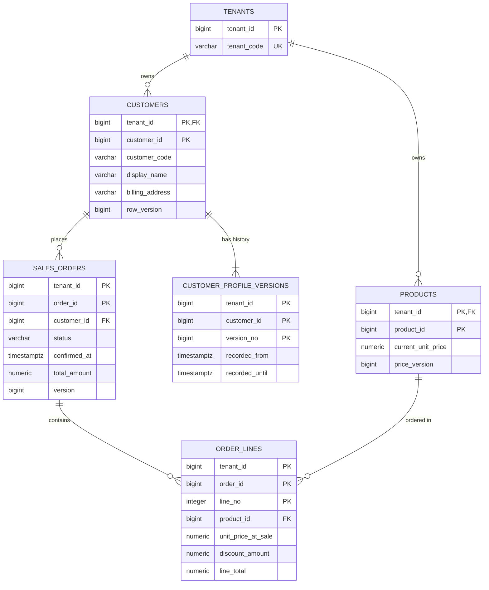
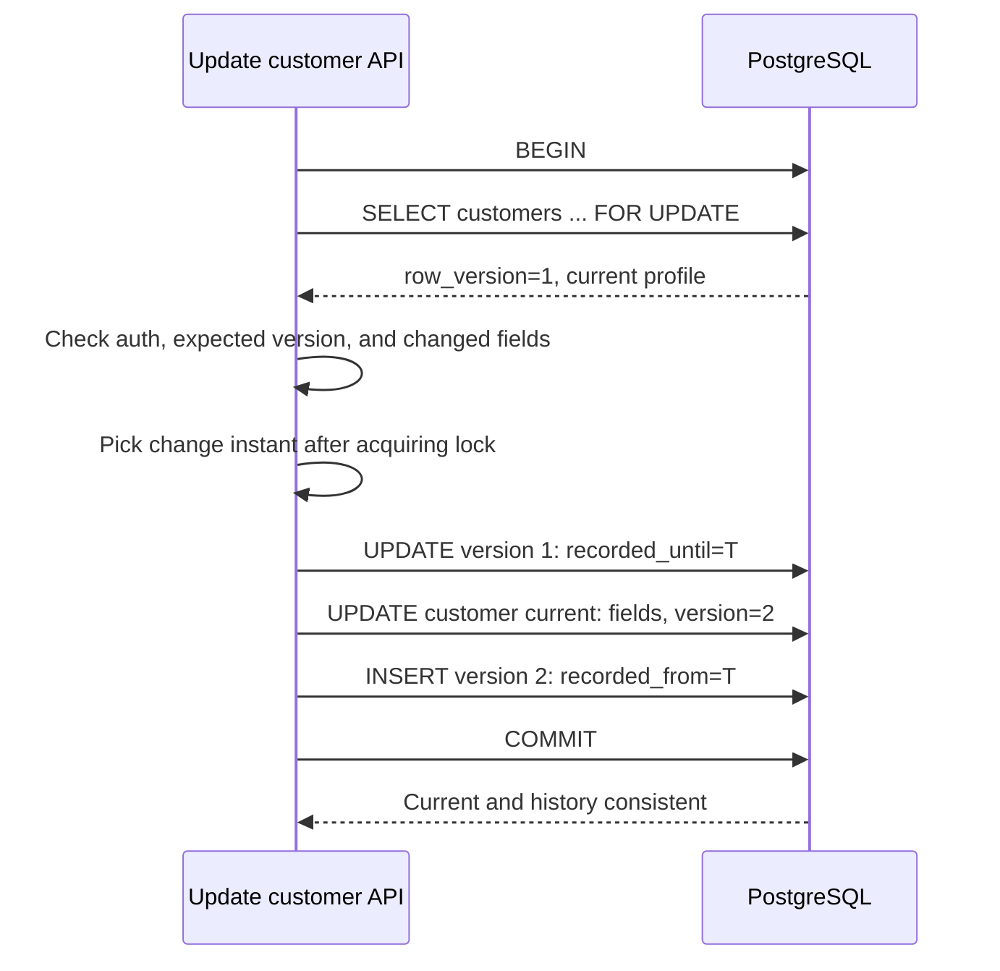

# Storing Transaction-Time Sale Prices and Customer Change History

A store lists headphones at **120.00 USD**. Customer Nguyễn An buys **2 units** with a **10.00 USD** line discount; the confirmed order totals **230.00 USD**. The next day, the store raises the list price to **135.00 USD**, and Nguyễn An updates their display name and contact address. When staff open the old order, the system must answer two distinct questions:

1. **At what price did the customer purchase, and which recipient details were used at confirmation?** The answer must stay faithful to the finalized voucher: unit price 120.00 USD, total 230.00 USD, and the address used at confirmation time.
2. **What is the customer's current information, and how has that profile changed over time?** The answer must show the new profile while still allowing lookup of past versions within retention policy.

If `order_lines` only stores `product_id` and joins `products.current_price` on every read, the old order silently turns into **260.00 USD** (2 × 135 − 10) even though no new transaction occurred. If `sales_orders` only stores `customer_id` and joins the current profile for voucher address display, the old order displays the **new address** instead of the one used. Conversely, copying the entire customer profile into every order without a canonical current profile and version history fragments customer data management.

This is an **integrated exercise** in the **DATABASE_DATA_MODELING** module: turning requirements into **entities, grains, keys, relationships, constraints, normalization, historical snapshots, time-based versions, and physical schemas**, then verifying with SQL, transactions, concurrency tests, access controls, and reporting queries. The exercise intentionally combines two distinct mechanisms:

- **Transaction snapshots** preserve facts committed at transaction time—specifically unit prices, discounts, product titles, and billing/shipping details used.
- **Versioned customer profiles** preserve the current customer profile and recorded historical versions, answering “what did the system know at point in time T?”.

> **Scope and assumptions:** Examples use PostgreSQL, a multi-tenant SaaS model, a single currency **USD**, integer unit quantities, and two decimal places; taxes, shipping fees, refunds, FX rates, and statutory accounting are omitted. Extending to those requires dedicated rules. Profile version timestamps here represent **recorded time** (when the system recorded the change), not retroactively guessed “real-world effective dates.” Personal data must obey real-world privacy and retention policies.

## 1. Learning outcomes and deliverables

After this lesson, learners should be able to:

1. Distinguish **transaction-time sale prices** from **current list prices**, preventing historical reports from drifting when the catalog updates.
2. Distinguish **voucher snapshots** from **versioned customer profiles**: two mechanisms with different questions and lifecycles.
3. Lock down the grains of tenant, customer, customer profile version, product, order, and order line.
4. Draw ERDs and choose tenant-scoped keys, same-tenant FKs, business-key uniques, monetary types, and timestamps.
5. Design customer creation and profile-update transactions that close old versions at the exact timestamp and open new ones without gaps or overlaps.
6. Design checkout to persist accepted product prices/titles and customer details **atomically**, never recomputing history from current records.
7. Write queries for **current profile**, **profile as-of time T**, **order at confirmation**, and **daily transaction values**.
8. Test concurrent writes, failed updates, late-arriving facts, cross-tenant rows, and PII access policies.
9. Know when you need **price history**, **customer SCD Type 2**, **bitemporal history**, **event sourcing**, document stores, or analytical warehouses.
10. Plan migrations from a current-state-only schema **without fabricating unrecorded history**.

**Deliverables:** logical diagram, constrained PostgreSQL DDL, transaction specs, at least four read queries, an ALLOW/DENY test matrix, reconciliation results, and a decision record detailing snapshot timing and retention assumptions.

## 2. Clarifying business requirements before writing tables

Suppose the application serves tenant 101 (Store A) and tenant 202 (Store B). Both can share codes `CUS-001` and `SKU-17` because codes are unique only **within a tenant**.

| Code | Requirement | Invariant to prove |
|---|---|---|
| R01 | A customer belongs to one tenant with a stable ID despite name/address edits | Tenant-scoped PK and FK |
| R02 | A customer code is unique only within its tenant | `UNIQUE(tenant_id, customer_code)` |
| R03 | Customer profiles are versioned by recorded time | Each version has identity and effective interval |
| R04 | Exactly one open current version exists per managed customer | Unique open version + write protocol |
| R05 | Version intervals never overlap | Exclusion constraint or equivalent |
| R06 | List prices can change without altering confirmed order lines | Snapshots on `order_lines` |
| R07 | Order total equals sum of line totals at confirmation | Transaction + recomputation + reconciliation |
| R08 | Voucher name/address stays fixed when CRM profile changes | Snapshots on `sales_orders` |
| R09 | After CONFIRMED, transaction snapshots cannot be silently edited | Permissions/transition commands/triggers |
| R10 | Two concurrent profile updates cannot lose each other's version | Row lock + version check |
| R11 | Customer/Order/Product never reference across tenants | Composite FKs |
| R12 | “As-of T” lookups have consistent time and timezone semantics | Half-open intervals, timestamps, and queries |
| R13 | Reading PII and history enforces authorization, audit, and retention | Authorization + PII protection |

### 2.1. Three questions to settle with the business

**When is price locked?** Prices may be shown when adding to a cart, yet the actual transaction confirms later. In this lesson, the service may show **tentative prices** on a draft; at confirmation, it must check active prices/promotions and obtain customer acceptance. **The price accepted and saved on the line at CONFIRMED** is transaction evidence. If prices changed, prompt the customer to re-confirm or apply an unexpired price-lock quote—never silently charge a new price.

**What is “customer info at transaction time”?** In this exercise: the display name and billing address **used at confirmation**. If a customer enters a billing address different from their default profile, the order stores what the customer chose without necessarily overwriting their profile. Hence a voucher snapshot can legitimately **differ** from the customer profile at the same instant.

**Does “customer history” mean recorded time or business effective time?** Here we track **which name/address the system recorded during each interval**. If a customer says today “this new address actually took effect last month,” the system must not rewrite recorded-time history; you may need a bitemporal model separating real-world effective time from system knowledge time.

### 2.2. Two read questions require two data sources

| Question | Primary data to read | What NOT to do |
|---|---|---|
| At what price did order 9001 sell? | `order_lines.unit_price_at_sale` | Join `products.current_price` and recompute |
| What was the product title at sale? | `order_lines.product_name_at_sale` | Display current catalog title as history |
| What address is on order 9001? | `sales_orders.billing_address_at_sale` | Join `customers.current_address` for the voucher |
| Customer's current name/address? | `customers` | Pull a snapshot from an arbitrary order |
| Which profile did the system record at T? | `customer_profile_versions` | Read only the current table |
| Who changed the profile? | Version metadata/audit | Infer from `customers.updated_at` alone |
| Catalog list price at T? | Price history / quote history **if tracked** | Treat one order's price as the list price |

## 3. Distinguishing four kinds of time in the example

Suppose:

```text
2026-11-18 08:00 UTC — System records customer profile:
                          Nguyễn An, "12 Hoa Street".
2026-11-19 09:00 UTC — Customer confirms order 9001:
                          2 units at 120.00, discount 10.00,
                          billing address "12 Hoa Street".
2026-11-20 10:00 UTC — Catalog raises price 120.00 -> 135.00.
2026-11-20 11:00 UTC — Customer changes display name and address:
                          An Nguyễn, "20 Hoa Street".
2026-11-21 08:00 UTC — Staff opens old order and current profile.
```

A correct design returns:

- Order 9001: unit price `120.00`, quantity `2`, discount `10.00`, total `230.00`, locked snapshot name/address.
- Current catalog: `135.00` (without altering line 9001).
- Current customer: `An Nguyễn`, `20 Hoa Street`.
- Customer as-of `2026-11-19 09:00 UTC`: `Nguyễn An`, `12 Hoa Street` per recorded history.
- Customer as-of `2026-11-20 12:00 UTC`: `An Nguyễn`, `20 Hoa Street`.

### 3.1. What does each timestamp record?

| Field | Meaning | Usage |
|---|---|---|
| `sales_orders.created_at` | When order/draft was created | Sorting drafts and measuring funnels |
| `sales_orders.confirmed_at` | When transaction was confirmed | Transaction date in exercise scope |
| `products.updated_at` | When catalog row was updated | Tracking edits; never alters order snapshots |
| `customers.updated_at` | When current profile change was recorded | Shows latest update timestamp |
| `customer_profile_versions.recorded_from` | When system began recording this version | As-of recorded-time queries |
| `customer_profile_versions.recorded_until` | Instant before which version ceased to be current | Upper bound of half-open interval |
| `customer_profile_versions.version_no` | Logical version sequence per customer | Lost-update prevention, auditing |

Use `TIMESTAMPTZ` for instants. Vietnam, New York, or tenant-configured business dates must be converted **at reporting time**. Never compare string dates or treat server timezone as business-date definition.

### 3.2. Half-open intervals and active state

A version has recorded-time validity:

```text
[recorded_from, recorded_until)
```

When `recorded_until IS NULL`, the interval extends into the future. At the exact transition instant `T1`, the old version is **no longer** effective (since `T < recorded_until`), and the new version starts taking effect (since `recorded_from <= T`). This prevents a boundary timestamp from matching two versions.

Never mix `recorded_from` with `valid_from` if users need to backdate real-world effective dates. Those two timestamps answer different questions.

## 4. Domain model, grains, identities, and links

### 4.1. Logical ERD



### 4.2. Grain table

| Table | One row represents | Key |
|---|---|---|
| `tenants` | One organization using the platform | `tenant_id` |
| `customers` | Current profile of one customer within a tenant | `(tenant_id, customer_id)` |
| `customer_profile_versions` | One **recorded version** of one customer | `(tenant_id, customer_id, version_no)` |
| `products` | Current catalog product within a tenant | `(tenant_id, product_id)` |
| `sales_orders` | One order in a tenant, current status and voucher snapshot | `(tenant_id, order_id)` |
| `order_lines` | One line of an order, with sale-time price/title | `(tenant_id, order_id, line_no)` |

**An order is not a version of a customer.** A customer can place multiple orders while their profile stays unchanged; an order can also use a chosen billing address differing from the profile. Hence **order snapshots** and **customer history** have separate grains and purposes.

### 4.3. Functional dependencies and normalization rationale

```text
(tenant_id, customer_id)
   -> customer_code, current_name, current_address, row_version

(tenant_id, customer_id, version_no)
   -> recorded_from, recorded_until, name_at_version, address_at_version

(tenant_id, product_id)
   -> sku, current_price, price_version

(tenant_id, order_id)
   -> customer_id, status, confirmed_at,
      customer_name_at_sale, billing_address_at_sale, total_amount

(tenant_id, order_id, line_no)
   -> product_id, quantity, unit_price_at_sale,
      discount_amount, line_total
```

Never mint a brand-new `customer_id` on every profile edit; that breaks historical order linkage. Never update historical order lines when catalog prices change; each line already holds its **transaction price**.

## 5. Choosing cleanly among snapshots, version history, and event logs

| Storage pattern | Question it answers well | Limitations |
|---|---|---|
| Only FK to current table | Reference current entity | Loses transaction-time prices/names |
| Snapshots on order/line | “What terms did this transaction lock?” | Does not track profile/catalog edits between orders |
| SCD Type 2 version table | “What value did the system record at T?” | Requires clear time semantics, change types, and update protocol |
| Append-only domain events | “Which events led to this state?” | Replay, ordering, event schemas, and corrections add complexity |
| Bitemporal model | “When was it valid in reality, and when did the system know?” | Two time axes; complex backdating/corrections |
| Data warehouse SCD2 dimension | Analytics by dimension version | ETL latency and surrogate FKs differ from OLTP |

### 5.1. Why do we need **both** order snapshots and customer history?

If you only kept customer history, staff might try looking up the profile version at `confirmed_at`. Yet customers may pick a custom billing address at checkout, or profiles may get retroactively corrected; furthermore, voucher details represent **what the transaction agreed to**, not merely the customer's CRM state at that second. Therefore **order snapshots are the authoritative source for vouchers**.

If you only kept order snapshots, the app could not see customer profile history **between purchases** or edits that created no order. Therefore **profile version history** serves customer audit and as-of queries.

### 5.2. Catalog price history is a separate problem

Suppose the store needs to explain “why did the catalog list 120 USD last week?” You cannot infer that from a single order's `order_lines.unit_price_at_sale`: transaction prices may reflect vouchers, contract pricing, or custom quotes. To query **list prices at time T**, keep a dedicated `product_price_versions` or historical price-list table with its own time semantics.

Do not lump **list price**, **quoted price**, and **locked sale price** into one `prices` table when all three obey different rules. Here, `products.current_unit_price` is the current catalog price; transaction prices live on order lines.

## 6. PostgreSQL schema: current profiles, history, and vouchers

Below is **one concrete model for this exercise**, not a complete production migration suite. IDs are supplied by the app/fixture; real systems need safe ID generation. `customer_profile_versions` stores **recorded-time** history and does not automatically handle retroactive corrections.

### 6.1. Tenants, current customers, and current products

```sql
CREATE TABLE tenants (
    tenant_id BIGINT PRIMARY KEY,
    tenant_code VARCHAR(80) NOT NULL UNIQUE
);

CREATE TABLE customers (
    tenant_id BIGINT NOT NULL REFERENCES tenants(tenant_id),
    customer_id BIGINT NOT NULL,
    customer_code VARCHAR(64) NOT NULL,
    display_name VARCHAR(200) NOT NULL,
    billing_address VARCHAR(300) NOT NULL,
    contact_email VARCHAR(254),
    row_version BIGINT NOT NULL DEFAULT 1
        CHECK (row_version >= 1),
    updated_at TIMESTAMPTZ NOT NULL,
    PRIMARY KEY (tenant_id, customer_id),
    CONSTRAINT uq_customer_code_tenant
        UNIQUE (tenant_id, customer_code)
);

CREATE TABLE products (
    tenant_id BIGINT NOT NULL REFERENCES tenants(tenant_id),
    product_id BIGINT NOT NULL,
    sku VARCHAR(80) NOT NULL,
    product_name VARCHAR(200) NOT NULL,
    current_unit_price NUMERIC(19, 2) NOT NULL
        CHECK (current_unit_price >= 0),
    price_version BIGINT NOT NULL DEFAULT 1
        CHECK (price_version >= 1),
    is_active BOOLEAN NOT NULL DEFAULT TRUE,
    updated_at TIMESTAMPTZ NOT NULL,
    PRIMARY KEY (tenant_id, product_id),
    CONSTRAINT uq_product_sku_tenant
        UNIQUE (tenant_id, sku)
);
```

`customers` holds **current values** for fast CRM operations. `row_version` increments on meaningful profile edits; non-profile technical fields do not have to bump it if specified by contract. `products.current_unit_price` is the **current** catalog price, never the historical sale price.

### 6.2. OLTP SCD Type 2 customer history

```sql
CREATE TABLE customer_profile_versions (
    tenant_id BIGINT NOT NULL,
    customer_id BIGINT NOT NULL,
    version_no BIGINT NOT NULL CHECK (version_no >= 1),
    display_name VARCHAR(200) NOT NULL,
    billing_address VARCHAR(300) NOT NULL,
    contact_email VARCHAR(254),
    recorded_from TIMESTAMPTZ NOT NULL,
    recorded_until TIMESTAMPTZ,
    changed_by VARCHAR(120) NOT NULL,
    change_reason VARCHAR(240),
    PRIMARY KEY (tenant_id, customer_id, version_no),
    CONSTRAINT fk_profile_customer_same_tenant
        FOREIGN KEY (tenant_id, customer_id)
        REFERENCES customers(tenant_id, customer_id),
    CONSTRAINT ck_profile_nonempty_interval
        CHECK (
            recorded_until IS NULL
            OR recorded_until > recorded_from
        )
);

-- At most one open version per customer.
CREATE UNIQUE INDEX uq_one_open_customer_profile
ON customer_profile_versions(tenant_id, customer_id)
WHERE recorded_until IS NULL;

-- Supports as-of lookups and history listing.
CREATE INDEX idx_customer_profile_asof
ON customer_profile_versions(
    tenant_id, customer_id, recorded_from DESC
);

-- PostgreSQL: btree_gist enables '=' for BIGINT inside GiST.
-- Requires extension privilege or pre-provisioning by DBA.
CREATE EXTENSION IF NOT EXISTS btree_gist;

ALTER TABLE customer_profile_versions
ADD CONSTRAINT ex_customer_profile_no_overlap
EXCLUDE USING gist (
    tenant_id WITH =,
    customer_id WITH =,
    tstzrange(
        recorded_from,
        COALESCE(
            recorded_until, 'infinity'::TIMESTAMPTZ
        ),
        '[)'
    ) WITH &&
);
```

**Meaning of constraints:**

- PK `(tenant_id, customer_id, version_no)` identifies versions; the same `customer_id` in another tenant is a distinct customer.
- Composite FK blocks history from pointing to another tenant's customer.
- `CHECK` rejects intervals whose end is not strictly greater than start.
- Partial unique index guarantees **at most one** open version, not **at least one**.
- GiST exclusion constraint blocks **any two overlapping intervals** for the same tenant/customer, even when both intervals are closed.

These constraints **do not automatically guarantee zero gaps** or that `customers.row_version` matches the active version. Those multi-row invariants must be enforced by write protocols, stored procedures/triggers, or equivalent controls. If `btree_gist` is unavailable or unsupported on your DB, design equivalent overlap and concurrency controls—never claim a partial unique index replaces GiST exclusion.

### 6.3. Orders and sale-price snapshots

```sql
CREATE TABLE sales_orders (
    tenant_id BIGINT NOT NULL REFERENCES tenants(tenant_id),
    order_id BIGINT NOT NULL,
    order_code VARCHAR(64) NOT NULL,
    customer_id BIGINT NOT NULL,
    status VARCHAR(16) NOT NULL
        CHECK (status IN ('DRAFT', 'CONFIRMED', 'CANCELLED')),
    customer_name_at_sale VARCHAR(200),
    billing_address_at_sale VARCHAR(300),
    customer_version_at_sale BIGINT,
    currency_code CHAR(3) NOT NULL DEFAULT 'USD'
        CHECK (currency_code = 'USD'),
    total_amount NUMERIC(19, 2) NOT NULL DEFAULT 0
        CHECK (total_amount >= 0),
    order_version BIGINT NOT NULL DEFAULT 0
        CHECK (order_version >= 0),
    created_at TIMESTAMPTZ NOT NULL DEFAULT CURRENT_TIMESTAMP,
    confirmed_at TIMESTAMPTZ,
    PRIMARY KEY (tenant_id, order_id),
    CONSTRAINT uq_order_code_tenant
        UNIQUE (tenant_id, order_code),
    CONSTRAINT fk_order_customer_same_tenant
        FOREIGN KEY (tenant_id, customer_id)
        REFERENCES customers(tenant_id, customer_id),
    CONSTRAINT fk_order_customer_version
        FOREIGN KEY (
            tenant_id, customer_id,
            customer_version_at_sale
        ) REFERENCES customer_profile_versions(
            tenant_id, customer_id, version_no
        ),
    CONSTRAINT ck_confirmed_has_snapshot
        CHECK (
            status <> 'CONFIRMED'
            OR (
                confirmed_at IS NOT NULL
                AND customer_name_at_sale IS NOT NULL
                AND billing_address_at_sale IS NOT NULL
                AND customer_version_at_sale IS NOT NULL
            )
        )
);

CREATE TABLE order_lines (
    tenant_id BIGINT NOT NULL,
    order_id BIGINT NOT NULL,
    line_no INTEGER NOT NULL CHECK (line_no > 0),
    product_id BIGINT NOT NULL,
    product_name_at_sale VARCHAR(200) NOT NULL,
    quantity INTEGER NOT NULL CHECK (quantity > 0),
    unit_price_at_sale NUMERIC(19, 2) NOT NULL
        CHECK (unit_price_at_sale >= 0),
    catalog_price_version_at_sale BIGINT NOT NULL
        CHECK (catalog_price_version_at_sale >= 1),
    discount_amount NUMERIC(19, 2) NOT NULL DEFAULT 0
        CHECK (discount_amount >= 0),
    line_total NUMERIC(19, 2) GENERATED ALWAYS AS (
        quantity * unit_price_at_sale - discount_amount
    ) STORED,
    PRIMARY KEY (tenant_id, order_id, line_no),
    CONSTRAINT fk_line_order_same_tenant
        FOREIGN KEY (tenant_id, order_id)
        REFERENCES sales_orders(tenant_id, order_id),
    CONSTRAINT fk_line_product_same_tenant
        FOREIGN KEY (tenant_id, product_id)
        REFERENCES products(tenant_id, product_id),
    CONSTRAINT ck_discount_within_gross
        CHECK (
            discount_amount
            <= quantity * unit_price_at_sale
        )
);

CREATE INDEX idx_orders_tenant_confirmed
ON sales_orders(
    tenant_id, confirmed_at DESC, order_id DESC
);

CREATE INDEX idx_orders_tenant_customer
ON sales_orders(
    tenant_id, customer_id, confirmed_at DESC
);

CREATE INDEX idx_lines_tenant_product
ON order_lines(tenant_id, product_id);
```

**Key design choices:**

1. `customer_name_at_sale` and `billing_address_at_sale` are populated **at confirmation**, never auto-updated when `customers` changes. They are nullable for DRAFT and mandatory when `status = 'CONFIRMED'`. If an already-confirmed order is later CANCELLED, services must **preserve snapshots**; the illustrative constraint does not yet distinguish “draft cancelled” from “post-confirmation cancelled.”
2. `customer_version_at_sale` references the matching tenant/customer version for traceability. Snapshot name/address **remain the voucher source** even if history undergoes corrections or anonymization later. Note that the version FK also means **history versions referenced by orders cannot be arbitrarily deleted**; deletion/anonymization workflows must align with retention obligations.
3. `catalog_price_version_at_sale` logs which catalog version applied, **without an FK** to `products.price_version` since catalog versions will keep incrementing. To enforce lineage to historical catalog prices, add a `product_price_versions` table with a matching PK or a dedicated quote ID.
4. `line_total` derives from **same-row** columns via a generated column. `sales_orders.total_amount` aggregates multiple lines, so a single-row `CHECK` cannot guard it; use transactions and reconciliation.
5. `NUMERIC(19,2)` fits assumed USD amounts. Fractional quantities, taxes, alternate units, or multi-currency require revisiting formulas, precision, currencies, and rounding policies.
6. The DDL does not stop direct SQL from editing lines post-confirm. Enforce immutability via controlled write commands, restricted DB roles, and/or triggers/stored procedures.

### 6.4. Some constraints cannot be built with a simple `CHECK`

| Invariant | Enforceable by declarative constraint? | Handling approach |
|---|---|---|
| `line_total` = quantity × price − discount | Yes, same-row generated column | DDL |
| Old order prices stay fixed when Product updates | Yes once snapshot written and locked | Write commands + privileges/triggers |
| Order total matches all lines | Not by row-level `CHECK` alone | Transaction/trigger + reconciliation |
| CONFIRMED has at least one line | Not by row-level `CHECK` alone | Transition check/trigger |
| At most one open profile version | Yes, partial unique index | DDL |
| Profile intervals never overlap | Yes in PostgreSQL via GiST exclusion | DDL + index |
| Zero gaps between profile intervals | Not by FK/unique alone | Write protocol or audit check |
| Active version = `customers.row_version` | Not by current FKs alone | Transaction/trigger |
| Billing uses the address accepted by the customer | Needs trusted source & checkout flow | Business command/audit |
| Tenant A customer cannot read Tenant B data | Not by PK/FK alone | Authorization, RLS, security tests |

**Every table must justify its existence.** This schema adds customer history because it has its own grain and query needs; do not add an `order_price_history` table just because order lines store unit prices if confirmed line prices never change.

## 7. Building two-tenant test data with fixed timestamps

For reproducible results, this exercise uses **simulated timestamps** Nov 18–20, 2026 UTC. In production, `recorded_from` and `confirmed_at` must be assigned server-authoritatively **after locks and checks** inside the transaction—never let clients backdate history arbitrarily. The `INSERT`s below form a **test fixture** assuming empty tables.

### 7.1. Seeding two tenants, customers, and catalog

```sql
BEGIN;

INSERT INTO tenants (tenant_id, tenant_code)
VALUES (101, 'SHOP_A'), (202, 'SHOP_B');

INSERT INTO customers (
    tenant_id, customer_id, customer_code,
    display_name, billing_address, contact_email,
    row_version, updated_at
)
VALUES
    (
        101, 7, 'CUS-001',
        'Nguyễn An', '12 Hoa Street', 'an@example.test',
        1, TIMESTAMPTZ '2026-11-18 08:00:00+00'
    ),
    (
        202, 7, 'CUS-001',
        'Customer B', '80 River Street', NULL,
        1, TIMESTAMPTZ '2026-11-18 08:00:00+00'
    );

INSERT INTO customer_profile_versions (
    tenant_id, customer_id, version_no,
    display_name, billing_address, contact_email,
    recorded_from, recorded_until,
    changed_by, change_reason
)
VALUES
    (
        101, 7, 1,
        'Nguyễn An', '12 Hoa Street', 'an@example.test',
        TIMESTAMPTZ '2026-11-18 08:00:00+00', NULL,
        'system:onboarding', 'Initial profile'
    ),
    (
        202, 7, 1,
        'Customer B', '80 River Street', NULL,
        TIMESTAMPTZ '2026-11-18 08:00:00+00', NULL,
        'system:onboarding', 'Initial profile'
    );

INSERT INTO products (
    tenant_id, product_id, sku, product_name,
    current_unit_price, price_version,
    is_active, updated_at
)
VALUES
    (
        101, 17, 'SKU-17', 'Headphones Model A',
        120.00, 1, TRUE,
        TIMESTAMPTZ '2026-11-18 08:00:00+00'
    ),
    (
        202, 17, 'SKU-17', 'Headphones Model B',
        40.00, 1, TRUE,
        TIMESTAMPTZ '2026-11-18 08:00:00+00'
    );

COMMIT;
```

Repeating `CUS-001`, `SKU-17`, and IDs `7`/`17` across both tenants is **valid** because keys are tenant-scoped. If FKs used `customer_id` or `product_id` without tenant, references would be ambiguous or point to the wrong entity.

### 7.2. Checking invariants after seeding

```sql
SELECT c.tenant_id, c.customer_id, c.display_name,
       c.row_version, v.version_no,
       v.recorded_from, v.recorded_until
FROM customers AS c
JOIN customer_profile_versions AS v
  ON v.tenant_id = c.tenant_id
 AND v.customer_id = c.customer_id
 AND v.recorded_until IS NULL
ORDER BY c.tenant_id, c.customer_id;
```

Expect **two** rows: tenant 101 customer 7 and tenant 202 customer 7, each with `row_version=1`, `version_no=1`, and one open history record.

### 7.3. A negative key test

```sql
-- DO NOT run in the same transaction as other negative tests.
INSERT INTO sales_orders (
    tenant_id, order_id, order_code, customer_id, status
)
VALUES (101, 9999, 'ORDER-INVALID', 999, 'DRAFT');
-- Expected: fk_order_customer_same_tenant error.
```

To convincingly test **cross-tenant referencing**, insert customer `(202, 999)` without `(101, 999)`, then run the tenant 101 order insert above. The composite FK must reject it even though customer ID 999 exists in tenant 202.

Run each expected-error test in its own transaction or savepoint-wrapped harness. PostgreSQL leaves a transaction in aborted state after any SQL error until rolled back.

## 8. Creating a new profile must open history in the same transaction

In production, never let an endpoint insert into `customers` without creating its initial history row. Both rows must be created **atomically**:

```sql
BEGIN;

-- :created_at is a server-chosen instant inside the transaction.
INSERT INTO customers (
    tenant_id, customer_id, customer_code,
    display_name, billing_address, contact_email,
    row_version, updated_at
)
VALUES (
    :tenant_id, :customer_id, :customer_code,
    :display_name, :billing_address, :contact_email,
    1, :created_at
);

INSERT INTO customer_profile_versions (
    tenant_id, customer_id, version_no,
    display_name, billing_address, contact_email,
    recorded_from, recorded_until,
    changed_by, change_reason
)
VALUES (
    :tenant_id, :customer_id, 1,
    :display_name, :billing_address, :contact_email,
    :created_at, NULL,
    :actor, 'Initial profile'
);

COMMIT;
```

**Conditions for a successful transaction:** both inserts share one connection/transaction; unique customer code is respected; actor is authorized in the tenant; values come from trusted inputs and pass domain validation. If inserting history fails, roll back the customer—never commit a current profile **without an open version**.

### 8.1. Why not create history “at end of day”?

If an app only copies current profiles to history nightly, intra-day edits vanish and as-of queries between snapshots return wrong results. End-of-day snapshots may suit specific analytical pipelines, yet **do not** satisfy “record every profile change.”

If using async outbox/CDC to maintain history, specify latency and ordering clearly. This lesson uses **same-transaction synchronous writes** so both tables match immediately at commit.

### 8.2. Validation goes beyond NOT NULL

For example, `contact_email` may be nullable, yet when provided requires syntax validation in the app; `VARCHAR(254)` does not prove a valid or verified email. `billing_address` stays a single string here for simplicity; international shipping may need structured address fields or value objects, while avoiding creating multiple customer rows just to store addresses.

Never use email as PK/customer identity: customers change emails, share inboxes, or request PII deletion/anonymization. `customer_id` is the stable key; email is merely an attribute with its own policies.

## 9. Updating customer profile: close old version, open new version

Requirement: at Nov 20, 2026 11:00 UTC, tenant 101 / customer 7 changes name from `Nguyễn An` to `An Nguyễn` and address from `12 Hoa Street` to `20 Hoa Street`. Post-commit state must be:

```text
Current customer: row_version = 2

History version 1:
  recorded_from  = 2026-11-18 08:00 UTC
  recorded_until = 2026-11-20 11:00 UTC
  name/address   = Nguyễn An / 12 Hoa Street

History version 2:
  recorded_from  = 2026-11-20 11:00 UTC
  recorded_until = NULL
  name/address   = An Nguyễn / 20 Hoa Street
```

### 9.1. Safe transaction flow for one customer



Every profile mutation path must use this protocol or an equivalent stored procedure/trigger. **Locking the customer row** serializes competing writers on the same profile. Clients also pass `expected_version` to catch stale-data edits instead of silently overwriting.

### 9.2. Illustrative SQL for version 1 → 2 transition

```sql
BEGIN;

SELECT row_version, display_name, billing_address
FROM customers
WHERE tenant_id = 101 AND customer_id = 7
FOR UPDATE;
-- Service verifies 1 row, row_version=1,
-- and principal is authorized to update tenant 101 profile.

SELECT version_no, recorded_from
FROM customer_profile_versions
WHERE tenant_id = 101
  AND customer_id = 7
  AND recorded_until IS NULL
FOR UPDATE;
-- Service verifies 1 open version, version_no=1.

-- TEST FIXTURE uses fixed instant for reproducibility.
-- Production: call clock_timestamp() AFTER LOCK ACQUIRED,
-- bind the exact same :change_time to all three statements;
-- verify :change_time > current recorded_from.
UPDATE customer_profile_versions
SET recorded_until = TIMESTAMPTZ '2026-11-20 11:00:00+00'
WHERE tenant_id = 101
  AND customer_id = 7
  AND version_no = 1
  AND recorded_until IS NULL
RETURNING version_no;
-- Expect exactly 1 row.

UPDATE customers
SET display_name = 'An Nguyễn',
    billing_address = '20 Hoa Street',
    row_version = row_version + 1,
    updated_at = TIMESTAMPTZ '2026-11-20 11:00:00+00'
WHERE tenant_id = 101
  AND customer_id = 7
  AND row_version = 1
RETURNING row_version;
-- Expect exactly 1 row, version=2.

INSERT INTO customer_profile_versions (
    tenant_id, customer_id, version_no,
    display_name, billing_address, contact_email,
    recorded_from, recorded_until,
    changed_by, change_reason
)
VALUES (
    101, 7, 2,
    'An Nguyễn', '20 Hoa Street', 'an@example.test',
    TIMESTAMPTZ '2026-11-20 11:00:00+00', NULL,
    'user:7', 'Update contact info'
);

COMMIT;
```

**This tests the version 1 → 2 scenario** and is not meant to be re-run repeatedly. Real code binds `:tenant_id`, `:customer_id`, `:expected_version`, `:change_time`, and validated fields. If any step returns the wrong row count, fails validation, or fails to insert history, **roll back the entire transaction**.

### 9.3. Why pick the timestamp after acquiring the lock?

In PostgreSQL, `transaction_timestamp()`/`CURRENT_TIMESTAMP` freezes at **transaction start**. Transaction T2 might start earlier yet wait on T1's customer lock; when T2 acquires the lock, T2's start timestamp **can be earlier than** the version T1 just committed. Using transaction-start time as `recorded_from` breaks chronological order, causing the exclusion constraint to reject or creating gaps.

For recorded-time, read `clock_timestamp()` (or a controlled system clock) after acquiring the lock, verifying it is **strictly greater** than the prior version's start. If clocks step backward or collide in precision, retry or use a **version sequence** for logical ordering—never insert an earlier timestamp into history.

Multi-node database setups must also account for clock skew and consistency guarantees; raw wall-clock timestamps alone do not establish global total order across nodes.

### 9.4. Skip creating a version when nothing changed

If a customer submits the exact same name, address, and email, opening a new version merely because `PUT` was called pollutes history. Under the lock, compare tracked fields null-safely (e.g., SQL `IS DISTINCT FROM` or typed equality in the app). If unchanged, return an idempotent response **without bumping `row_version`**.

If the business requires logging unchanged re-confirmations, write an **audit event** separately rather than minting a new profile version.

## 10. Checkout: locking prices and address in one transaction

At **2026-11-19 09:00 UTC**, before catalog prices or customer profile change, the buyer confirms:

```text
tenant=101, order=9001, customer=7
product=17, quantity=2, accepted unit price=120.00
discount_amount=10.00 (line total discount)
confirmed total=230.00 USD
billing address accepted="12 Hoa Street"
```

Here checkout confirms a new single-line order; multi-line drafts use the same parent-order locking protocol. **Never let clients dictate prices**; the app must verify an active quote or server price accepted by the buyer.

### 10.1. Pre-transaction conditions

1. Principal is authorized to create orders in tenant 101.
2. Customer `(101, 7)` exists; billing details are customer-accepted and validated.
3. Product `(101, 17)` is active, and price + `price_version` match the accepted quote or pricing policy.
4. Discount `10.00` is an eligible entitlement, not arbitrary client input.
5. `order_id` and `order_code` are unused in the tenant; HTTP retries use an **order-creation idempotency key** so retries never create two orders.
6. All tables are written in one transaction; any failure rolls back cleanly.

### 10.2. Illustrative single-line checkout SQL

```sql
BEGIN;

INSERT INTO sales_orders (
    tenant_id, order_id, order_code,
    customer_id, status, created_at
)
VALUES (
    101, 9001, 'O-9001', 7, 'DRAFT',
    TIMESTAMPTZ '2026-11-19 09:00:00+00'
);

-- Stabilize profile inside transaction when snapshotting voucher details.
SELECT row_version, display_name, billing_address
FROM customers
WHERE tenant_id = 101 AND customer_id = 7
FOR SHARE;
-- Must see version=1; tenant access already authorized.

-- Stabilize catalog price inside transaction.
SELECT price_version, product_name, current_unit_price
FROM products
WHERE tenant_id = 101
  AND product_id = 17
  AND is_active = TRUE
FOR SHARE;
-- Must see price_version=1, price=120.00
-- matching customer's accepted quote.

-- Use server-side PRODUCT data, never trust client unit price.
INSERT INTO order_lines (
    tenant_id, order_id, line_no, product_id,
    product_name_at_sale, quantity,
    unit_price_at_sale,
    catalog_price_version_at_sale,
    discount_amount
)
SELECT
    101, 9001, 1, p.product_id,
    p.product_name, 2,
    p.current_unit_price,
    p.price_version,
    10.00
FROM products AS p
WHERE p.tenant_id = 101
  AND p.product_id = 17
  AND p.is_active = TRUE
  AND p.price_version = 1
  AND p.current_unit_price = 120.00
RETURNING line_total;
-- Must insert 1 row, line_total=230.00.

-- Lock customer name/address snapshot and sum total from lines.
UPDATE sales_orders AS o
SET status = 'CONFIRMED',
    confirmed_at = TIMESTAMPTZ '2026-11-19 09:00:00+00',
    customer_name_at_sale = c.display_name,
    billing_address_at_sale = c.billing_address,
    customer_version_at_sale = c.row_version,
    total_amount = (
        SELECT COALESCE(SUM(l.line_total), 0)
        FROM order_lines AS l
        WHERE l.tenant_id = o.tenant_id
          AND l.order_id = o.order_id
    ),
    order_version = order_version + 1
FROM customers AS c
WHERE c.tenant_id = o.tenant_id
  AND c.customer_id = o.customer_id
  AND o.tenant_id = 101
  AND o.order_id = 9001
  AND o.status = 'DRAFT'
  AND EXISTS (
      SELECT 1
      FROM order_lines AS l
      WHERE l.tenant_id = o.tenant_id
        AND l.order_id = o.order_id
  )
RETURNING
    o.order_id, o.status, o.total_amount,
    o.customer_name_at_sale,
    o.billing_address_at_sale,
    o.customer_version_at_sale;
-- Expect 1 row: CONFIRMED, 230.00, Nguyễn An,
-- 12 Hoa Street, customer version 1.

COMMIT;
```

**Fixed 09:00 and 120.00 are only for the deterministic fixture.** Production binds a server-assigned `:confirmed_at` after lock/price checks, plus `:accepted_quote_version` and `:accepted_quote_price` from a tamper-proof quote; if expired or changed, return a requote prompt. An `INSERT ... SELECT` returning 0 rows because price changed **must not** be treated as success.

### 10.3. Why use `FOR SHARE` on profile and Product?

In PostgreSQL, `SELECT ... FOR SHARE` holds a row-level share lock blocking concurrent updates/deletes on that row until the transaction ends (per PostgreSQL semantics). Thus concurrent customer profile edits and product price edits wait for checkout to commit or roll back before mutating snapshotted fields.

For multi-product checkouts, acquire locks in **deterministic product ID order** to avoid deadlocks. Document a **global lock ordering** across all write paths that lock order/customer/product. `FOR SHARE` does not block unrelated changes, replace quote policies, or stop an authorized direct SQL writer from editing `order_lines` after confirmation.

### 10.4. Checks the service must enforce beyond SQL

- Verify exact **1 row** affected on critical mutations; in multi-line checkout, verify line count matches the request.
- Compute and validate discounts by business rules, not just `CHECK(discount <= gross)`.
- Verify customer authority over the billing address; if choosing a non-profile address, save the **accepted snapshot** rather than pulling `customers.billing_address`.
- Never commit `CONFIRMED` if lines are missing, quotes invalid, or totals overflow schema precision.
- Handle creation retries via idempotency before minting a new `order_id`.
- Record confirmation/cancellation audit/events in the same transaction or outbox if required.

### 10.5. Once an order is CONFIRMED

Domain rule: never mutate `unit_price_at_sale`, `quantity`, `discount_amount`, `product_name_at_sale`, or snapshot addresses via profile-update endpoints. Returns, post-sale price adjustments, or billing-address corrections require **explicit adjustment events/credit notes** under business contracts—never silent overwrites that destroy transaction evidence.

To enforce strictly when multiple services/batch jobs have DB access:

- Allow runtime roles only to invoke safe stored procedures/commands instead of raw DML on transaction tables.
- Add triggers blocking `UPDATE`/`DELETE` on finalized snapshots, except via audited, privileged correction paths.
- Use row locks/optimistic locking for every line edit and confirmation on an aggregate.
- Test concurrent `confirm` vs `add/update line` using two real transactions.

## 11. Post-transaction catalog and profile updates: what must stay invariant?

After the Nov 19 `CONFIRMED` checkout, update the catalog first:

```sql
UPDATE products
SET current_unit_price = 135.00,
    price_version = price_version + 1,
    updated_at = TIMESTAMPTZ '2026-11-20 10:00:00+00'
WHERE tenant_id = 101
  AND product_id = 17
  AND price_version = 1
RETURNING price_version, current_unit_price;
-- 1 row: version 2, price 135.00.
```

Next run Section 9's customer update transaction at 11:00 UTC. **Expected state after both updates:**

| Value | Before updates | After updates |
|---|---|---|
| Product current price | 120.00 | **135.00** |
| Product price version | 1 | **2** |
| Customer current name | Nguyễn An | **An Nguyễn** |
| Customer current address | 12 Hoa Street | **20 Hoa Street** |
| Customer row version | 1 | **2** |
| Order 9001 line unit price | 120.00 | **120.00** |
| Order 9001 total | 230.00 | **230.00** |
| Order 9001 customer name snapshot | Nguyễn An | **Nguyễn An** |
| Order 9001 billing snapshot | 12 Hoa Street | **12 Hoa Street** |
| Order 9001 customer version snapshot | 1 | **1** |

A system that only “stores FKs to current tables” fails the bottom rows of this table. A system that only copies fields onto orders without profile history cannot answer “what was the CRM profile before 11:00?” at times without an order.

### 11.1. Why not build snapshots on read?

A transaction snapshot is a **fact recorded at confirmation time**. It cannot be reliably reconstructed on read from the current catalog once old prices vanish, promos expire, or customer profiles change. Snapshotting on the **write path** is the right approach; joining current tables produces a **view of today**, not historical proof.

### 11.2. What traceability does catalog price version provide?

If a line records `catalog_price_version_at_sale=1` while Product now has `price_version=2`, we know the line came from an older version. Yet **you cannot reconstruct price version 1's amount solely from the number `1`** without a historical price table or quote record. `unit_price_at_sale=120.00` remains the primary price evidence; version is supporting lineage.

### 11.3. Draft orders differ from confirmed orders

While `DRAFT`, the app can display tentative or estimated prices. If a product price changes before confirmation, enforce policy: honor an unexpired quote, ask the customer to reconfirm, or reject checkout. After `CONFIRMED`, snapshots stay immune to catalog updates. Document this boundary in APIs and tests: a “snapshot” on an unconfirmed cart is not evidence of a completed transaction.

## 12. Querying current state, as-of history, and transaction vouchers

Queries verify the **source of truth** for each question. Even if numbers happen to look right on tiny sample data, pulling prices from the wrong table breaks historical semantics.

### 12.1. Current customer profile

```sql
SELECT tenant_id, customer_id,
       customer_code, display_name,
       billing_address, contact_email,
       row_version, updated_at
FROM customers
WHERE tenant_id = 101 AND customer_id = 7;
```

After Section 9's update, this returns `An Nguyễn`, `20 Hoa Street`, `row_version=2`. Current CRM reads should not run `ORDER BY recorded_from DESC LIMIT 1` on history for every lookup when a current table is maintained—yet keeping both in sync requires constraints/protocols ensuring current **matches** the open version.

### 12.2. Complete recorded history

```sql
SELECT version_no, display_name, billing_address,
       recorded_from, recorded_until,
       changed_by, change_reason
FROM customer_profile_versions
WHERE tenant_id = 101 AND customer_id = 7
ORDER BY version_no;
```

Expect **two** versions. Version 1 ends at `2026-11-20 11:00:00+00`; version 2 begins at that exact instant and remains open.

### 12.3. Profile lookup at an instant T

```sql
SELECT version_no, display_name, billing_address,
       contact_email, recorded_from, recorded_until
FROM customer_profile_versions
WHERE tenant_id = :tenant_id
  AND customer_id = :customer_id
  AND recorded_from <= :as_of_instant
  AND (
      recorded_until IS NULL
      OR :as_of_instant < recorded_until
  )
ORDER BY version_no DESC
LIMIT 1;
```

On the fixture:

| `:as_of_instant` | Version | Name and address |
|---|---:|---|
| `2026-11-17 12:00+00` | None | No profile recorded by the system yet |
| `2026-11-18 08:00+00` | 1 | Nguyễn An, 12 Hoa Street |
| `2026-11-19 09:00+00` | 1 | Nguyễn An, 12 Hoa Street |
| `2026-11-20 10:59:59+00` | 1 | Nguyễn An, 12 Hoa Street |
| `2026-11-20 11:00+00` | 2 | An Nguyễn, 20 Hoa Street |
| `2026-11-21 08:00+00` | 2 | An Nguyễn, 20 Hoa Street |

At **exactly** 11:00, the old version ceases to apply because `[from, until)` excludes `until`. Unique/exclusion constraints ensure an instant never matches two versions for the same customer. If a **gap** exists in data, the query returns 0 rows—treat that as a data issue to reconcile rather than silently grabbing the nearest version.

### 12.4. Reading an order voucher from locked snapshots

```sql
SELECT
    o.tenant_id, o.order_id, o.order_code,
    o.status, o.confirmed_at,
    o.customer_id,
    o.customer_name_at_sale,
    o.billing_address_at_sale,
    o.customer_version_at_sale,
    o.total_amount,
    l.line_no, l.product_id, l.product_name_at_sale,
    l.quantity, l.unit_price_at_sale,
    l.discount_amount, l.line_total
FROM sales_orders AS o
JOIN order_lines AS l
  ON l.tenant_id = o.tenant_id
 AND l.order_id = o.order_id
WHERE o.tenant_id = 101
  AND o.order_id = 9001
  AND o.status = 'CONFIRMED'
ORDER BY l.line_no;
```

Expect unit price `120.00`, `line_total` `230.00`, name `Nguyễn An`, and address `12 Hoa Street` on the voucher. **Never join `products.current_unit_price` or `customers.billing_address` to override these snapshot fields.**

If the UI also displays the current profile alongside the voucher, join separately and **label them clearly**:

```sql
SELECT
    o.order_code,
    o.customer_name_at_sale AS name_on_document,
    o.billing_address_at_sale AS address_on_document,
    c.display_name AS current_customer_name,
    c.billing_address AS current_customer_address
FROM sales_orders AS o
JOIN customers AS c
  ON c.tenant_id = o.tenant_id
 AND c.customer_id = o.customer_id
WHERE o.tenant_id = 101
  AND o.order_id = 9001;
```

After updates, `name_on_document` differs from `current_customer_name`—**that is the correct result**, not an inconsistency needing “sync.”

### 12.5. The buggy query many systems accidentally ship

```sql
-- WRONG when used to prove historical amounts:
SELECT o.order_id,
       SUM(l.quantity * p.current_unit_price - l.discount_amount)
           AS recomputed_using_today_price
FROM sales_orders AS o
JOIN order_lines AS l
  ON l.tenant_id = o.tenant_id
 AND l.order_id = o.order_id
JOIN products AS p
  ON p.tenant_id = l.tenant_id
 AND p.product_id = l.product_id
WHERE o.tenant_id = 101 AND o.order_id = 9001
GROUP BY o.order_id;
```

Once catalog rises to 135.00, this buggy query returns `260.00` instead of `230.00`. That 30.00 drift proves why transaction snapshots must drive historical totals.

### 12.6. Tenant scope is mandatory on every query

When tenants 101 and 202 both have `customer_id = 7`, a query like:

```sql
-- Missing scope:
SELECT * FROM customer_profile_versions WHERE customer_id = 7;
```

returns history from both tenants. APIs must authenticate the principal and verify tenant access before applying the selected `tenant_id`. As-of lookups, exports, searches, caches, batch jobs, and analytical replicas must enforce tenant scope too—not just `GET /customers/{id}`.

## 13. Reporting queries and easily confused metrics

### 13.1. Sales value by confirmation date

Within our USD-only scope, if the metric is **total value of orders currently CONFIRMED by confirmation date**:

```sql
SELECT
    (confirmed_at AT TIME ZONE 'Asia/Ho_Chi_Minh')::DATE
        AS business_date,
    COUNT(*) AS confirmed_order_count,
    SUM(total_amount) AS confirmed_order_value_usd
FROM sales_orders
WHERE tenant_id = :tenant_id
  AND status = 'CONFIRMED'
  AND confirmed_at >= :from_instant
  AND confirmed_at < :to_instant
GROUP BY business_date
ORDER BY business_date;
```

This is **not automatically accounting revenue or collected cash**. A confirmed order might be unpaid; a post-confirmation cancellation drops out of **current status** counts, shifting past-day figures. If you need **point-in-time confirmed value as originally booked**, use event/ledger/snapshot facts at the right grain rather than filtering live `status`.

### 13.2. Grouping by current customer vs voucher name?

Two distinct reports:

- “Monthly sales for **customer identity 7**” → group by `(tenant_id, customer_id)` using the stable ID.
- “Under **which name at sale** were vouchers issued?” → group/display `customer_name_at_sale`.

Never use `customers.display_name` as a long-term grouping key: customers rename themselves, names collide, and one customer can have multiple historical names. For historical attribute breakdowns (e.g., customer segment at confirmation time), use proper AS-OF dimension policies rather than joining the current dimension.

### 13.3. Do not treat SCD2 as a replacement for all transaction snapshots

A data warehouse may maintain `dim_customer_scd2` and link order facts to the active surrogate key at load time. Yet vouchers still require the address **accepted on that transaction**; a CRM customer version may differ from a one-off checkout address. Warehouse dimensions are not proof of sales contract terms.

### 13.4. Catalog price history helps, yet never alters order lines

Even with a price history table:

```text
Product 17:
  catalog price 120.00 valid 18/11 -> 20/11
  catalog price 135.00 valid from 20/11
```

you can look up the list price at T. Yet an order's actual 120 price may reflect contract pricing or quotes, with a 10 discount; transaction reports must still read **`unit_price_at_sale`** and **`discount_amount`** stored on the line.

### 13.5. Combining as-of profiles with order events

An as-of profile lookup at `o.confirmed_at` helps verify “which profile did the system know when the order confirmed?”, yet it does not mean that profile **must** equal the order snapshot. If the buyer picked a separate billing address, differing values can both be valid. Reconciliation should verify **source and approved selection**, not force blind equality across all snapshot fields.

## 14. Data reconciliation and verification queries

A schema can pass DDL yet still drift due to batch imports, legacy jobs, or protocol-bypassing admin scripts. Reconciliation SQL acts as **detective control** complementing constraints and transactions.

### 14.1. Current customer mismatching open history

```sql
SELECT c.tenant_id, c.customer_id,
       c.row_version, v.version_no,
       c.display_name AS current_name,
       v.display_name AS history_name,
       c.billing_address AS current_address,
       v.billing_address AS history_address
FROM customers AS c
LEFT JOIN customer_profile_versions AS v
  ON v.tenant_id = c.tenant_id
 AND v.customer_id = c.customer_id
 AND v.recorded_until IS NULL
WHERE v.version_no IS NULL
   OR c.row_version <> v.version_no
   OR c.display_name IS DISTINCT FROM v.display_name
   OR c.billing_address IS DISTINCT FROM v.billing_address
   OR c.contact_email IS DISTINCT FROM v.contact_email;
```

**Expected:** 0 rows after committed transactions. Any row returned indicates a write path mutated `customers` without maintaining history, or a broken import.

### 14.2. Gaps between recorded profile versions

```sql
WITH ordered_versions AS (
    SELECT
        tenant_id, customer_id, version_no,
        recorded_from, recorded_until,
        LEAD(recorded_from) OVER (
            PARTITION BY tenant_id, customer_id
            ORDER BY version_no
        ) AS next_from
    FROM customer_profile_versions
)
SELECT *
FROM ordered_versions
WHERE next_from IS NOT NULL
  AND (
      recorded_until IS NULL
      OR recorded_until <> next_from
  );
```

This checks **contiguous intervals ordered by `version_no`** across existing writes. GiST exclusion blocks overlaps yet **cannot block gaps**; this audit catches them. If policy allows periods with “no active profile,” specify that explicitly and adjust expectations; in this exercise profile edits must stay contiguous.

Another check verifies `version_no` increments by 1 without gaps. If audits or merges intentionally create gaps, document the rule; this example uses contiguous per-customer version numbers.

### 14.3. Multiple active versions?

```sql
SELECT tenant_id, customer_id, COUNT(*) AS active_versions
FROM customer_profile_versions
WHERE recorded_until IS NULL
GROUP BY tenant_id, customer_id
HAVING COUNT(*) > 1;
```

With the partial unique index active in PostgreSQL, this returns empty. However, it **misses** customers with **0** open versions: use Section 14.1's `LEFT JOIN` to catch those.

### 14.4. Order total mismatching line snapshots

```sql
SELECT o.tenant_id, o.order_id,
       o.status,
       o.total_amount AS stored_total,
       COALESCE(SUM(l.line_total), 0) AS calculated_total
FROM sales_orders AS o
LEFT JOIN order_lines AS l
  ON l.tenant_id = o.tenant_id
 AND l.order_id = o.order_id
GROUP BY o.tenant_id, o.order_id, o.status, o.total_amount
HAVING o.total_amount <> COALESCE(SUM(l.line_total), 0);
```

**Expected:** empty when the system guarantees totals match lines after every committed transaction, including DRAFT. If your design only enforces totals at `CONFIRMED`, scope this check to `CONFIRMED` and define DRAFT's tentative pricing separately.

### 14.5. CONFIRMED orders missing snapshots

```sql
SELECT tenant_id, order_id, status, confirmed_at,
       customer_name_at_sale, billing_address_at_sale,
       customer_version_at_sale
FROM sales_orders
WHERE status = 'CONFIRMED'
  AND (
      confirmed_at IS NULL
      OR customer_name_at_sale IS NULL
      OR billing_address_at_sale IS NULL
      OR customer_version_at_sale IS NULL
  );
```

`CHECK ck_confirmed_has_snapshot` already guards this on the example DB. Still, this query is valuable when auditing legacy data before adding constraints or after unconstrained imports.

### 14.6. Lines belong to same-tenant order and product

Composite FKs are declared; actively test inserting a tenant-202-only product into a tenant-101 order. The DB must reject it even though `product_id` is valid in tenant 202. Environments without enforced FKs can use anti-joins to detect orphans or cross-tenant leaks, though **an overnight batch scan should never replace FKs** where FKs are feasible.

### 14.7. “Immutable historical data” needs tests, not just current reads

Reading a snapshot once after a price change does not prove it was never altered. A proper test records values right after confirmation, updates Product and Customer, and compares **every field** of the order/lines against the pre-update baseline. Without an audit log or trusted baseline, current SQL alone cannot tell if someone secretly overwrote 120 earlier. Protect write paths and audit adjustments.

## 15. Concurrent transactions: two distinct invariant groups

### 15.1. Two requests editing the same customer concurrently

Suppose both T1 and T2 read customer 101/7 at `row_version=1`:

```text
T1: BEGIN; SELECT customer FOR UPDATE -> version 1
T2: BEGIN; SELECT customer FOR UPDATE -> waits for T1
T1: closes profile version 1, writes current/version 2, COMMIT
T2: acquires lock, sees version 2
T2: expected_version=1 mismatches -> conflict; ROLLBACK
```

Expect **no** version 3 created from stale data via blind retries. Clients may reload version 2 and explicitly merge fields, never silently overwrite.

### 15.2. Catalog price change concurrent with checkout

```text
T1 checkout: locks Product 17 FOR SHARE, price 120/version 1
T2 catalog: UPDATE Product 17 price 135/version 2 -> waits
T1: INSERT line snapshot 120, confirm, COMMIT
T2: UPDATE proceeds, COMMIT
=> T1 order keeps 120, current catalog is 135
```

If T2 commits before T1 acquires the lock, T1 sees price 135/version 2. When the user accepted quote version 1 at 120, **checkout must report a price change or honor an unexpired quote**—never silently charge 135 while telling the user 120 succeeded.

### 15.3. Customer profile update concurrent with checkout

```text
T1 checkout: locks Customer 7 FOR SHARE, profile version 1
T2 update: tries UPDATE Customer 7 -> waits
T1: snapshots version 1 name/address onto order, COMMIT
T2: writes profile version 2, COMMIT
=> Order links version 1, current customer is version 2
```

If T2 commits before T1 locks, T1 snapshots version 2. Either order is **valid** under the protocol as long as the order records **the exact version actually accepted** and timestamps match; never declare one transaction “guaranteed to win” without controlling lock/commit order.

### 15.4. When a history update fails mid-transaction

```text
BEGIN
  lock customer
  close version 1
  UPDATE current -> succeeds
  INSERT version 2 -> UNIQUE / EXCLUDE fails
ROLLBACK
```

After rollback, version 1 remains open and `customers` stays in its prior state. That is the value of transactions. If code commits `customers` first and inserts history in a separate transaction, crashes leave both tables out of sync.

### 15.5. Isolation levels do not replace invariant design

`READ COMMITTED` with row locks and proper constraints can suffice for single-customer/order updates when all writers follow the protocol. `SERIALIZABLE` catches extra serialization anomalies and triggers retries, yet does not create price snapshots, stop unauthorized addresses, or enforce multi-table rules ignored by application code.

A global invariant like “a customer cannot have two active orders with the same external reference” requires proper `UNIQUE`/locks, not just bumping isolation level and hoping pre-`INSERT` `SELECT` checks suffice.

## 16. Protecting customer data, tenants, and history access

Customer profiles hold names, addresses, and emails—personal data (PII). `customer_profile_versions` also retains **past values**, widening exposure. You cannot secure it merely by adding `tenant_id` and hoping every query filters properly.

### 16.1. Authorize before setting tenant context

```text
Authenticate principal
  -> verify membership / role in tenant 101
  -> authorize action:
       customer.read_current
       customer.read_history
       customer.update
       order.read
       order.export
  -> establish trusted tenant context
  -> execute scoped SQL
  -> audit sensitive access when required
```

**Reading history** may require stricter privileges than **reading current customer** because it exposes historical addresses and emails. Never infer from `order.read` that a user may browse full profile change history. Bulk exports or retrieving old voucher addresses also warrant separate authorization if required by policy.

### 16.2. PostgreSQL RLS as defense in depth

Example tenant RLS for customers, assuming the DBA creates a least-privilege `app_runtime` role (not superuser, not table owner bypassing RLS, no `BYPASSRLS`):

```sql
ALTER TABLE customers ENABLE ROW LEVEL SECURITY;
ALTER TABLE customers FORCE ROW LEVEL SECURITY;

CREATE POLICY customers_tenant_policy
ON customers
FOR ALL TO app_runtime
USING (
    tenant_id =
    NULLIF(current_setting('app.tenant_id', true), '')::BIGINT
)
WITH CHECK (
    tenant_id =
    NULLIF(current_setting('app.tenant_id', true), '')::BIGINT
);

ALTER TABLE customer_profile_versions ENABLE ROW LEVEL SECURITY;
ALTER TABLE customer_profile_versions FORCE ROW LEVEL SECURITY;

CREATE POLICY customer_history_tenant_policy
ON customer_profile_versions
FOR ALL TO app_runtime
USING (
    tenant_id =
    NULLIF(current_setting('app.tenant_id', true), '')::BIGINT
)
WITH CHECK (
    tenant_id =
    NULLIF(current_setting('app.tenant_id', true), '')::BIGINT
);
```

This illustrates **tenant isolation** only. It does not yet cover `products`, `sales_orders`, `order_lines`, or separate permissions between **history** and **current** inside the same tenant. Complete protection applies matching policies/privileges across all tables, APIs, and stores. If `app_runtime` has `SELECT` on customer history with only tenant RLS, any in-tenant query could read history; use dedicated roles, views, or object-level policies.

Inside a transaction:

```sql
BEGIN;
SELECT set_config('app.tenant_id', '101', true);
SELECT customer_id, display_name
FROM customers
ORDER BY customer_id;
COMMIT;
```

The server sets `'101'` only after authenticating the principal and checking tenant membership. `set_config(..., true)` scopes to the transaction; connection pools must set it cleanly per transaction after `BEGIN` so one request's tenant never leaks to the next.

**Custom GUCs are not tamper-proof authorization** if an attacker can execute arbitrary SQL under the same runtime role. Use parameterized queries, prevent SQL injection, restrict DB privileges, and model threats. RLS complements—never replaces—application authorization and same-tenant FKs.

### 16.3. Retention policies belong in version design

A tough question: “A customer requests deletion of personal data, yet the business must retain transaction vouchers under statutory/contractual obligations.” Separate:

- **Current customer profile:** can be deleted/anonymized when no valid purpose remains.
- **Customer profile history:** holds PII across multiple timestamps and may need tighter retention limits or anonymization—never assume infinite retention.
- **Order voucher snapshots:** may have a distinct legal/accounting retention basis; verify against applicable policy rather than assuming everything stays forever.
- **Logs, caches, search indexes, warehouses, backups, object storage:** may hold copies; deleting one row in `customers` does not end data lifecycle.

A naive “hard-delete `customers` on request” will hit FK errors from orders/history. That signals the need for a **designed deletion/anonymization workflow**, not removing all FKs. If a history version referenced by `customer_version_at_sale` must be scrubbed, decide upfront whether to retain anonymized records, detach allowed links, or adjust lineage models.

### 16.4. Change audits with data minimization

`customer_profile_versions.changed_by` and `change_reason` aid traceability yet **cannot guarantee tamper-proof audits** if DB users can edit/delete history rows. Strict requirements need separated DB privileges, append-only audit stores or tamper-evident event logs, monitoring, and retention rules.

Never place passwords, tokens, card numbers, sensitive document payloads, or redundant full profile dumps inside `change_reason` or logs. The more history you store, the clearer your answers must be on who can view it, why, for how long, and how it is protected.

## 17. Keys, indexes, and workload performance

### 17.1. Core query patterns

| Query | Key predicates | Useful index/constraint |
|---|---|---|
| Current customer | `tenant_id, customer_id` | PK on `customers` |
| Customer as-of | `tenant_id, customer_id, recorded_from/recorded_until` | PK/version index and GiST for no-overlap |
| Orders by confirmation date | `tenant_id, confirmed_at` | `idx_orders_tenant_confirmed` |
| Orders by customer | `tenant_id, customer_id, confirmed_at` | `idx_orders_tenant_customer` |
| Order details | `tenant_id, order_id` | Order PK and prefix of lines PK |
| Sold products audit | `tenant_id, product_id` | `idx_lines_tenant_product` |

Do not index every timestamp column in both directions assuming automatic speedups. Indexes add write, WAL, storage, and maintenance costs; test query plans against representative data.

### 17.2. Query plan for as-of lookup

```sql
EXPLAIN (ANALYZE, BUFFERS)
SELECT version_no, display_name
FROM customer_profile_versions
WHERE tenant_id = 101
  AND customer_id = 7
  AND recorded_from
      <= TIMESTAMPTZ '2026-11-19 09:00:00+00'
  AND (
      recorded_until IS NULL
      OR recorded_until
          > TIMESTAMPTZ '2026-11-19 09:00:00+00'
  )
ORDER BY version_no DESC
LIMIT 1;
```

With only two versions for a customer, a sequential scan is completely reasonable—not proof of a broken index. With thousands of versions per customer across millions of customers, measure rows read, buffers, lock waits, and latency; adjust query shapes/indexes if needed. GiST exclusion primarily guards against overlaps, and is not automatically the fastest index for every as-of lookup.

### 17.3. Intentional denormalization carries its own risks

Maintaining current `customers` alongside `customer_profile_versions` and `sales_orders.total_amount` alongside `order_lines.line_total` is **intentional derived/replicated state**. Each copy improves reads or protects vouchers while introducing invariants to maintain:

- Current customer must match the open version.
- Order total must equal line sum post-commit.
- Order snapshots must stay unchanged when catalog/current profile updates.

Neither dogmatic “zero duplicated columns” normalization nor blind “copy everything for fast reads” is right; weigh trade-offs using **business questions and transactional evidence**.

### 17.4. History can grow quickly

If a customer edits their address daily for years, `customer_profile_versions` grows fast; changing one minor field still copies all tracked profile columns per version. That is the nature of SCD2 and often worthwhile when as-of queries need full profile snapshots.

If you must track fine-grained field edits over time, consider **change events / field-level audits** plus periodic snapshots, trading off more complex replay, ordering, schema versioning, and corrections. Never switch to EAV just to avoid history tables if doing so sacrifices data types and integrity.

## 18. Late-arriving data and historical corrections: when one time axis is not enough

Suppose on Nov 21 a customer says: “My new address actually took effect on Nov 15; I'm only reporting it today.” Two distinct facts exist:

1. **Recorded time:** the system was informed and recorded it on Nov 21.
2. **Business valid time:** the customer states the address took effect in reality on Nov 15.

Our exercise model stores **only the first axis**. Editing the new version's `recorded_from` back to Nov 15 falsely claims the system knew it on Nov 15, corrupting audits and overlapping prior history.

### 18.1. Bitemporal needs two axes

A bitemporal table might store:

```text
customer_profile_bitemporal:
  tenant_id, customer_id, data...
  valid_from, valid_until        // When valid in the business domain?
  recorded_from, recorded_until  // When recorded by the system?
```

Query:

```text
As business-valid at T1, as known by system at T2
```

Verify **both axes** and rules for corrections/retractions rather than simply adding two columns. Without clear retroactive requirements, single-axis recorded-time versioning is far simpler to operate and verify.

### 18.2. Backdated customer updates must not rewrite old vouchers

Even if on Nov 21 the customer says their address changed on Nov 15, the Nov 19 voucher using `12 Hoa Street` reflects **the address actually used at confirmation**. Overwriting order 9001's snapshot with today's claim alters historical evidence.

Fixing a genuine voucher mistake must go through an explicit **correction workflow** with reason, approval, and audit—never as a side effect of updating a customer profile.

### 18.3. Is event sourcing necessary?

An event stream (`CustomerCreated`, `CustomerAddressChanged`, `CustomerNameChanged`) can rebuild current profiles, yet introduces:

- Event schema versioning and replay logic.
- Ordering, deduplication, idempotency, and correction events.
- Snapshots/projections for fast reads.
- PII/retention handling inside immutable logs.

When the requirement is simply “know names and addresses as recorded,” synchronous-transaction SCD2 tables are usually simpler. Event sourcing earns its keep when the domain genuinely needs event history and replayability—not because “every change ought to be an event.”

## 19. Migrating from a current-state-only schema

This is the easiest place to make fatal mistakes when adding history to a live system. Suppose the legacy schema has only:

```text
customers(customer_id, name, address, updated_at)
products(product_id, current_price)
orders(order_id, customer_id, created_at)
order_lines(order_id, product_id, quantity)
```

If today's catalog price is 135.00 while an order a month ago sold at 120.00, **you cannot recover the true sale price from the current table alone**. Likewise, if the customer's current name is An Nguyễn, you cannot be sure they used Nguyễn An when an old order confirmed.

### 19.1. Never fabricate history from current state

Wrong:

```sql
-- SEMANTICALLY WRONG: never use as real historical price data.
UPDATE legacy_order_lines AS l
SET unit_price_at_sale = p.current_unit_price
FROM products AS p
WHERE p.product_id = l.product_id;
```

This fills the column for migration, yet **injects today's price into every historical order**. Data becomes `NOT NULL`-complete while business-wise corrupt.

### 19.2. Classifying historical recovery sources

| Source | Recoverable facts | Trust checks needed |
|---|---|---|
| Issued invoices/vouchers | Price, discount, name, address on voucher | Reconcile IDs, document versions, authority, integrity |
| Payment receipts | Captured amounts | May differ from order total due to refunds/fees/partial captures |
| Quote/order event logs | Offered/accepted price at time T | Check event schema, signatures, source IDs |
| CDC/audit logs | Incremental profile/catalog edits | Verify retention completeness and ordering |
| Old backups | Point-in-time snapshots | Proves state only at backup timestamp |
| Today's current tables | Current state | **Does not** prove past prices/names/addresses |

If no authoritative historical source exists, preserve **`UNKNOWN`/`UNVERIFIED`** states or retain the legacy representation with notes—never invent guessed numbers just to pass `NOT NULL`.

### 19.3. Expand–backfill–validate–contract

A safe migration path:

1. **Inventory:** inspect legacy schema, duplicates, missing FKs, existing vouchers, tenant scopes, and accuracy of current values.
2. **Expand:** create history tables and **initially nullable** snapshot columns (or staging tables to separate unknowns); keep legacy code running safely.
3. **Initial baseline:** open customer version 1 at **the timestamp history tracking begins**. Never set `recorded_from` back to the ancient customer creation date unless you have proof the profile stayed identical the entire time.
4. **Deploy new writers:** all customer edits update current + history in one transaction; all new checkouts capture price/name/address snapshots at confirmation.
5. **Trusted backfill:** populate historical order prices/vouchers from invoices, quote logs, or verified sources in idempotent batches.
6. **Validate:** verify counts, sums, snapshot lineage, row versions, open history, gaps/overlaps, source IDs, and unknown flags.
7. **Contract:** tighten `NOT NULL`/`CHECK` or retire legacy code only once data and all writers comply; if valid unknown records remain, keep explicit handling for them.
8. **Restore/rollback:** test backups, code rollbacks, handling of post-cutover writes, and never delete legacy sources prematurely.

**Design note:** Section 6's DDL is the **target state for fully known data**, not a script you can force onto legacy records lacking historical prices. During transition, never insert fake prices to satisfy schema constraints.

### 19.4. Seeding customer history from today's baseline

If the legacy system only holds current profiles, initialize:

```text
Customer 7:
  version=1
  recorded_from = timestamp when history tracking launched
  recorded_until = NULL
  profile = current values observed at migration
  source = BASELINE_CURRENT
```

From that point on, each edit opens a new version. As-of queries **before the baseline** have no answer in the new history table; return **unknown/no data** rather than pretending version 1 held across all prior history.

### 19.5. Reconciliation scoped by tenant and source

Count orders/lines per tenant, confirmation date, and status; compare totals against vouchers **using identical definitions**. Matching grand totals do not prove every line is right: two errors can cancel out. Check source order keys, child keys, and hashes of snapshot fields at fine grain; isolate unrecoverable legacy records into a dedicated list.

### 19.6. Planning rollback when new transactions already committed

If the new service has written snapshots/history and old APIs do not understand new columns, maintain compatibility or bound rollback scope. If new records arrived in the target schema during cutover, you cannot simply flip traffic back to the old schema and drop those writes. Rollback plans must cover **reverse data sync** or coordinated write-authority handoffs.

## 20. Java/ORM models: commands and aggregates must not break history

Java apps may use JPA or JDBC, yet **must never let the ORM automatically “merge current objects” across history and snapshot tables**. Separate business commands cleanly:

| Command | Data mutated | Data that must NOT auto-change |
|---|---|---|
| `CreateCustomer` | Customer current + history version 1 | Past order snapshots |
| `UpdateCustomerProfile` | Customer current + close/open one history version | Order prices, order billing snapshots |
| `UpdateCatalogPrice` | Product current + price version | `unit_price_at_sale` on finalized orders |
| `ConfirmOrder` | Order snapshot + line snapshots + status/total | Customer current if user picked a custom billing address |
| `GetOrderReceipt` | Read-only; reads snapshots | Never substitutes current price for sale price |
| `GetCustomerHistory` | Read-only; reads tenant/time-scoped versions | Never infers unrecorded real-world effective dates |

### 20.1. Never share one DTO between current profile and receipt

One way to separate them in the API:

```java
public record CustomerProfileView(
    long customerId,
    String customerCode,
    String displayName,
    String billingAddress,
    long rowVersion
) {}

public record CustomerProfileVersionView(
    long customerId,
    long versionNo,
    String displayName,
    String billingAddress,
    java.time.Instant recordedFrom,
    java.time.Instant recordedUntil
) {}

public record OrderReceiptLine(
    long productId,
    String productNameAtSale,
    int quantity,
    java.math.BigDecimal unitPriceAtSale,
    java.math.BigDecimal discountAmount,
    java.math.BigDecimal lineTotal
) {}
```

These are **illustrative DTOs**, not persistence classes, omitting currency, auth, validation, or mapper constructors. What matters is **naming fields with explicit temporal meaning**; avoid vague names like `price` that tempt code into grabbing `current_price`.

### 20.2. Profile-update service requires one real transaction

Pseudocode:

```java
@Transactional
public CustomerProfileView updateProfile(
    TenantContext tenant,
    long customerId,
    long expectedVersion,
    UpdateProfileCommand command
) {
    authorize(tenant, "customer.update", customerId);

    var current = customerRepo.findForUpdate(
        tenant.tenantId(), customerId
    );

    if (current.version() != expectedVersion) {
        throw new OptimisticConflictException();
    }
    validate(command);

    if (sameTrackedFields(current, command)) {
        return toView(current);
    }

    var t = databaseClock.nowAfterLock();
    historyRepo.closeCurrentVersion(
        tenant.tenantId(), customerId, expectedVersion, t
    );
    current.applyProfile(command);
    current.increaseVersion();
    currentRepo.updateWithExpectedVersion(
        current, expectedVersion, t
    );
    historyRepo.insertNewVersion(
        current, expectedVersion + 1, t, tenant.actor()
    );
    return toView(current);
}
```

Repository/exception names are **design pseudocode**. Real implementations must ensure:

- `@Transactional` runs **one** DB transaction/connection across all three writes.
- `findForUpdate` acquires an actual row lock, not a plain read.
- Close/update calls check affected row counts; zero rows or mismatches trigger rollback.
- Timestamp comes from DB/server after locking, checking monotonic increase.
- Unique/exclusion/serialization errors are classified and retried **with bounded limits** where safe.
- Never call `entityManager.merge` on a stale detached customer and let `row_version` drift from history.
- Background workers/bulk SQL must follow the same protocol or be guarded by DB triggers/permissions.

### 20.3. JPA `@Version` and profile history are two separate concepts

JPA's `@Version` detects lost updates on the **current entity**. It **does not automatically record** customer profile history. Versioned history requires inserting a history record whenever tracked fields change, inside the same transaction.

Likewise, updating `products.current_unit_price` with `@Version` or `price_version` does not keep confirmed order prices fixed if the order mapper still calls `Product.getCurrentUnitPrice()` when rendering receipts. Snapshot rules must live **in the data model and read paths**.

### 20.4. APIs can expose optimistic concurrency

Example:

```http
PATCH /tenants/101/customers/7
If-Match: "profile-v1"
Content-Type: application/json

{
  "displayName": "An Nguyễn",
  "billingAddress": "20 Hoa Street"
}
```

The server maps the strong ETag validator to `row_version=1`, checks permissions, and updates safely. If `row_version` is already 2, return a conflict per API contract (e.g., `412 Precondition Failed` for `If-Match`) instead of overwriting silently. Client-supplied headers or tenant IDs never replace membership verification.

## 21. Integrated exercise: design, implement, and verify

### 21.1. Prompt

A multi-tenant retail SaaS serves two tenants:

```text
Tenant 101 = SHOP_A
  Customer 7, customer_code CUS-001
  18/11 08:00 UTC: Nguyễn An, "12 Hoa Street"
  Product 17, SKU-17, current price 120.00 USD

Tenant 202 = SHOP_B
  Customer 7, customer_code CUS-001
  Product 17, SKU-17, current price 40.00 USD

19/11 09:00 UTC:
  Customer 7 in tenant 101 buys 2 units of product 17;
  line discount 10.00 USD; confirms Order 9001.

20/11 10:00 UTC:
  Product 17 in tenant 101 rises to 135.00 USD.

20/11 11:00 UTC:
  Customer 7 in tenant 101 changes name to An Nguyễn
  and address to "20 Hoa Street".
```

The system must preserve **transaction vouchers** exactly as confirmed, while managing current customer profiles and recorded-time history; tenant 202 users must never read tenant 101 data. Two profile-update requests and one checkout request may run concurrently.

### 21.2. Tasks to complete

1. Define **grain** and candidate keys for Customer, CustomerProfileVersion, Product, Order, and OrderLine.
2. List at least **12 invariants**, mapping each to DB constraints, transactions, or authorization.
3. Draw an ERD and explain why both `customer_profile_versions` and `sales_orders` preserve historical data **without duplicating purpose**.
4. Write DDL with tenant-scoped PK/UNIQUE/FK, monetary types, versions, history intervals, and price snapshots.
5. Explain what `CHECK`, partial unique, and exclusion constraints enforce, and **which invariants remain** unenforced by DDL alone.
6. Seed the initial customer and version 1 **in one transaction**.
7. Implement checkout persisting accepted unit price, product title, discount, and billing address, and computing total.
8. Simulate catalog update 120 → 135 and verify order 9001 **stays unchanged**.
9. Simulate customer update version 1 → 2, verify history has no overlaps/gaps, and order snapshot stays on version 1.
10. Write queries for current customer and as-of customer before/after 11:00 UTC, including **the exact boundary instant**.
11. Write the order voucher query and contrast it against the buggy query reading current catalog prices.
12. Write reconciliation SQL checking current vs history, totals vs lines, orders missing snapshots, and history gaps.
13. Test two concurrent customer updates with `expected_version=1`; only one succeeds while the other conflicts.
14. Test product price update concurrent with checkout; the order must lock **the accepted price** or fail/requote.
15. Separate permissions `customer.read_current`, `customer.read_history`, `order.read`, and `order.export`.
16. Design a PII retention/anonymization policy across current customer, history, and order snapshots without inventing a universal legal claim.
17. If migrating from a legacy schema lacking historical prices, state which data **cannot be reliably recovered** and how `UNKNOWN` should be represented.
18. Explain when to add price history, bitemporal profiles, or audit event streams instead of stretching SCD2 endlessly.

### 21.3. Mandatory arithmetic checks

```text
quantity                  = 2
unit_price_at_sale        = 120.00
gross                     = 2 × 120.00 = 240.00
discount_amount           = 10.00
line_total                = 230.00
order_total               = 230.00

current_catalog_price     = 135.00
WRONG_recompute_with_now  = 2 × 135.00 − 10.00 = 260.00
drift_if_wrong            = +30.00
```

Any solution returning `260.00` for the old order after the catalog price hike is **semantically wrong on transaction-price storage**.

### 21.4. The “never do this” exercise

A developer writes:

```sql
UPDATE order_lines
SET unit_price_at_sale = (
    SELECT p.current_unit_price
    FROM products AS p
    WHERE p.tenant_id = order_lines.tenant_id
      AND p.product_id = order_lines.product_id
);
```

This overwrites snapshots across all order lines, including finalized orders, and silently updates DRAFT lines without asking users. Explain:

- Why is this not a valid “data sync”?
- Which permissions block runtime roles from executing such commands?
- If it accidentally ran in production, where could old snapshots be recovered from?
- If no old price evidence survives, how must data state be marked?

A strong answer **does not** merely say “don't run this”—it explains prevention, detection, and recovery.

## 22. Solution guide and design rationales

### 22.1. Grain and keys

**Customer** is at the grain of one managed customer within a tenant; PK `(tenant_id, customer_id)`, unique `(tenant_id, customer_code)`. **CustomerProfileVersion** is one recorded profile image starting at a timestamp; PK `(tenant_id, customer_id, version_no)`. **Product** has tenant/product PK; current catalog price is a product attribute. **Order** has tenant/order PK plus voucher snapshots. **OrderLine** has tenant/order/lineNo PK plus transaction-time prices.

If a customer places two orders with no profile edits between them, we have **one profile version and two order snapshots**. That is right because those two entities record two different business events.

### 22.2. Snapshot price is transaction truth

Upon confirming order 9001, the system persists:

```text
order_lines.unit_price_at_sale  = 120.00
order_lines.discount_amount     = 10.00
order_lines.line_total          = 230.00
sales_orders.total_amount       = 230.00
```

After the catalog price hike, voucher reads read **only** these snapshot columns. Because catalog updates only `UPDATE products`, order lines stay untouched; catalog transactions trigger no cascade or event rewriting orders.

### 22.3. Current customer and version history

Initially current has `row_version=1` and one open history version 1. On profile edit, the transaction:

1. Locks customer, checking `expected_version=1`.
2. Reads a post-lock timestamp strictly greater than the prior version's start.
3. Closes version 1 with `recorded_until=T`.
4. Updates current customer, bumping `row_version=2`.
5. Inserts version 2 from `T` to `NULL`.
6. Commits atomically.

Post-commit, as-of before `T` returns version 1; at `T` returns version 2. `customers` and history version 2 must agree on name, address, and email.

### 22.4. Order snapshots can validly differ from historical profiles

If a buyer selects a distinct billing address at checkout, `sales_orders.billing_address_at_sale` records the confirmed value while `customer_profile_versions` keeps the CRM address. **Never force** both columns equal on all transactions. Optionally record provenance (`billing_address_source` = `PROFILE` vs `CHECKOUT_OVERRIDE`) and audit customer approval if required.

### 22.5. Transactions and constraints protect different layers

- PK/FK/UNIQUE protect identity and tenant boundaries.
- `CHECK` and generated columns protect same-row types and arithmetic.
- Partial unique and exclusion constraints protect active version uniqueness and non-overlapping history.
- Row locks + version checks protect concurrent profile edits.
- Checkout transactions + quote verification protect price/name/address at confirmation.
- Authorization/RLS protect read/write access to data and history.
- Reconciliation detects rogue write paths or legacy anomalies.

No single item in this list can replace all the others.

### 22.6. Explaining “price at time T”

Always ask “which price?” first:

- **Catalog list price at T:** needs a price history table if users ask what the catalog listed at T.
- **Price locked on an order at T:** read from order line snapshots.
- **Pre-checkout quoted price:** needs quotes/versions and expirations if price locks apply.
- **Amount paid by customer:** needs payment/ledger records and refunds; never infer straight from catalog or order lines.

These four questions all mention “price” yet differ in grain and source of truth.

## 23. Pass/fail test matrix

| Code | Action / scenario | Expected outcome |
|---|---|---|
| T01 | Create customer with history version 1 | Both current and history commit |
| T02 | Failure inserting initial history | No orphaned current customer after rollback |
| T03 | Same `customer_code` in tenants 101 and 202 | Valid |
| T04 | Duplicate `customer_code` within tenant 101 | Unique rejects |
| T05 | Tenant 101 order references tenant-202-only customer | FK rejects |
| T06 | Tenant 101 order line references tenant-202-only product | FK rejects |
| T07 | Checkout price 120, qty 2, discount 10 | Order total = 230 |
| T08 | Catalog price rises to 135 | Old order prices/totals **unchanged** |
| T09 | Customer changes name/address, version 1→2 | Current at version 2, history has 2 intervals |
| T10 | As-of before update timestamp | Version 1 |
| T11 | As-of exact update timestamp | Version 2 |
| T12 | As-of before customer creation | No recorded version |
| T13 | Attempt creating two open current history rows | Partial unique rejects |
| T14 | Attempt inserting overlapping history intervals | Exclusion constraint rejects |
| T15 | History gap caused by rogue writer | Gap audit query detects it |
| T16 | Two updates with `expected_version=1` | One succeeds; second gets conflict |
| T17 | Checkout expects quote 120 after catalog rose to 135 | Never silently sells at 135; fails/requotes or honors valid quote |
| T18 | Client submits tampered unit price 0.01 | Server ignores untrusted client price |
| T19 | Runtime tries `UPDATE` on line post-confirm | Blocked by policy/trigger/privileges |
| T20 | Tenant 202 user reads tenant 101 customer history | DENY |
| T21 | User with only `customer.read_current` calls history endpoint | DENY |
| T22 | Order query joins current catalog price | Negative test demonstrates wrong 260 total |
| T23 | Customer as-of query with half-open intervals | Never returns two versions at boundary |
| T24 | Migration with current state only, no old prices | Never backfills historical prices with today's price |
| T25 | Restoring shared backup for one tenant | Does not overwrite or copy into another tenant |

### 23.1. Concurrency tests must use at least two real transactions

Sequential unit tests cannot prove race safety. Run two connections or independent transactions controlling lock/commit interleavings:

```text
Scenario A: T1 update locks customer -> T2 update waits -> T1 commits.
Scenario B: T1 checkout locks product -> T2 price update waits.
Scenario C: T1 checkout locks customer -> T2 profile update waits.
Scenario D: T1 confirm order -> T2 add line waits/rejects.
```

Inspect **committed** outcomes, versions, totals, and snapshots—not just which request returned HTTP 200. On deadlocks or serialization failures, services must retry safely without duplicating orders or profile versions.

### 23.2. Property-based invariants

When generating random sequences of valid actions, verify after every commit:

```text
For each customer:
  exactly one open profile version;
  current row_version == open version_no;
  current fields == open history fields;
  prior intervals do not overlap;
  adjacent recorded intervals are continuous.

For each confirmed order:
  snapshot fields exist;
  total_amount == sum(line_total);
  line_total == qty * accepted_price - discount;
  confirmed snapshots do not change when Product/Customer updates.

For each tenant:
  every FK connection stays within tenant;
  unauthorized principal sees no data.
```

When a property test finds a failing sequence, shrink it to a minimal reproducible counterexample—such as “T1 updates customer + T2 updates customer with stale expected version” or “checkout locks price quote during Product update.”

### 23.3. Backup and restore testing

When tenants 101 and 202 share tables, physical backups contain both tenants. To restore only tenant 101's customer 7 or order 9001, restore into an isolated staging DB, extract tenant-scoped rows and dependencies, and merge carefully—never restore over production and wipe tenant 202's newer changes.

The same applies to history and snapshots: restoring current `customers` without matching versions desynchronizes them. Backup/restore plans must treat linked datasets as consistent units.

## 24. Common mistakes and how to detect them

**Mistake 1 — Storing only `product_id` on order lines.** When catalog prices change, historical reports recomputed via `current_unit_price` break. Store `unit_price_at_sale` and lock prices at checkout.

**Mistake 2 — Backfilling old order prices with today's price.** Populates the column while corrupting history. Recover from authoritative invoices/quotes/audits, or record `UNKNOWN`.

**Mistake 3 — Trusting client-submitted locked prices.** Attackers can send `0.01`. Validate prices from server catalog, contracts, or active server-issued quotes.

**Mistake 4 — Storing price without discount or currency.** Unit price 120 × qty 2 cannot explain total 230 without discount 10. Keep formulas and currencies explicit.

**Mistake 5 — Using `FLOAT`/`DOUBLE` for reconcilable money.** Binary floating-point rounding causes discrepancies; use decimal/`NUMERIC` and clear rounding rules.

**Mistake 6 — Storing customer snapshots on orders with no profile history.** Cannot tell how often a customer changed names or what profile existed between purchases.

**Mistake 7 — Storing customer history with no voucher snapshots.** Checkout-accepted addresses can differ from CRM profiles; backdated edits would also diverge as-of lookups from original vouchers.

**Mistake 8 — Using email or name as customer key.** Customers change emails/names and share names; use a stable surrogate/business identity.

**Mistake 9 — Updating `customers` while forgetting to close/open history.** Current and history drift; enforce via transactions, stored procedures, or triggers.

**Mistake 10 — Inserting a new history version without closing the old one.** Leaves two open versions or overlaps; guard with partial unique + exclusion constraints and write protocols.

**Mistake 11 — Using transaction-start `CURRENT_TIMESTAMP` after waiting on locks.** Recorded time can predate a prior committed version; sample time after acquiring locks and verify monotonicity.

**Mistake 12 — Overwriting `recorded_from` with real-world effective dates.** Backdating `recorded_from` falsifies audit trails; use bitemporal modeling when both axes are needed.

**Mistake 13 — Thinking partial unique prevents history gaps.** It only caps open rows at one. Use reconciliation and consistent write protocols to keep intervals contiguous.

**Mistake 14 — Thinking GiST exclusion guarantees everything about current state.** It prevents overlaps, not missing versions or mismatched `customers.row_version`.

**Mistake 15 — Allowing edits to `order_lines.unit_price_at_sale` after confirm.** Destroys transaction truth. Lock down write paths, privileges, audits, and adjustment workflows.

**Mistake 16 — Defining FKs on `customer_id` alone.** With tenant-local IDs, a tenant 101 order could point to a tenant 202 customer; use tenant-prefixed composite keys.

**Mistake 17 — Querying history with `WHERE customer_id = ?`.** Missing tenant scope leaks cross-tenant data; verify tenant context server-side.

**Mistake 18 — Using tenant-only RLS and assuming anyone in the tenant may read PII history.** `read_history` may require tighter privileges than `read_current`; apply object/column permissions.

**Mistake 19 — Deleting a customer row to erase PII without checking references.** FKs, history, snapshots, backups, and retention laws demand a structured anonymization/deletion workflow, not blind cascades.

**Mistake 20 — Treating `confirmed_at` and `created_at` as identical.** A cart created yesterday may confirm today; daily reports must use the timestamp matching the metric definition.

**Mistake 21 — Inferring historical catalog list prices from random orders.** Order prices reflect discounts/quotes, not necessarily general catalog prices.

**Mistake 22 — Using `ON CONFLICT DO NOTHING` on checkout without checking payload.** Retries with the same key but different payloads must conflict, never silently return success for the wrong payload.

**Mistake 23 — Testing concurrency with two sequential calls.** Sequential calls hide lock waits, stale versions, and retries. Use two independent transactions and vary commit orders.

**Mistake 24 — Backfilling history baselines starting at customer creation date when only today's profile is known.** That fabricates history; baseline `recorded_from` should state **from when reliable tracking began**.

**Mistake 25 — Failing to separate voucher-retention data from erasable PII.** A single blanket retention policy rarely fits all tables; classify by source, legal obligation, and TTL.

## 25. Checklist and grading criteria

### 25.1. Model decision checklist

| Question | Passes when |
|---|---|
| Does “price” distinguish catalog, quote, and sale price? | Each has a distinct name, source, timestamp, and rule |
| Is `OrderLine` grain locked down? | One line per order/tenant with snapshot price |
| Are current customer and customer history separated? | Two grains, two distinct read questions |
| Is customer identity stable? | Name/email edits never alter customer ID |
| Are FKs tenant-scoped? | Zero cross-tenant references possible |
| Is history valid-time or recorded-time? | One explicitly declared, or intentional bitemporal |
| Do version intervals define boundaries? | Half-open `[from, until)` tested right at transition time |
| Are current/history written in one transaction? | No half-committed updates |
| Are concurrent version updates handled? | Lock + expected version + rollback/conflict |
| What happens if prices change before confirm? | Requote or unexpired quote; never silently apply new price |
| Do order snapshots survive catalog/profile updates? | Negative tests verify zero mutation |
| Do order totals define formulas and currency? | Decimal, discount, SUM, and reconciliation |
| Do RLS/authorization guard history separately? | Zero PII leaks across tenants or roles |
| How are legacy records missing old prices handled? | Marked `UNKNOWN`, traced to sources, never guessed |
| Are restore and migration tested? | No broken FKs or cross-tenant overwrites |

### 25.2. Suggested submission rubric

| Evaluation area | Max points | Required evidence |
|---|---:|---|
| Requirements analysis, grains, time semantics | 15 | Clear requirements/invariants; no snapshot/SCD2 confusion |
| ERD, keys, FKs, UNIQUE, CHECK | 20 | Tenant-accurate DDL verified with negative cases |
| Price-locking & snapshot checkout transaction | 15 | 120 price / 230 total stay invariant after catalog hike |
| Customer versioning transaction | 15 | Clean version close/open, conflict tests |
| Current/as-of/order/reporting queries | 10 | Accurate before, at, and after boundary instants |
| Reconciliation and concurrency | 10 | Audit SQL + two-transaction race tests |
| Security, privacy, retention | 10 | Role separation and PII lifecycle |
| Migration and trade-off discussion | 5 | No fabricated history; solid verification plan |
| **Total** | **100** | **Graded on evidence, not table count** |

A submission whose DDL compiles yet computes historical orders from current list prices **fails core criteria**, regardless of fancy diagrams or indexes. Likewise, a submission adding history without update locks that loses versions fails.

### 25.3. Short ADR template

```text
ADR: Sales snapshots + recorded-time customer history
Context:
  Product prices and customer details change after transactions.
Decision:
  1. Keep unit_price_at_sale and discount on OrderLine.
  2. Keep accepted name/address on Order upon CONFIRMED.
  3. Keep Customer current + CustomerProfileVersions [from, until).
  4. Update customer/history in one row-locked transaction.
Alternatives:
  - FKs to current tables only
  - Customer history only, no order snapshots
  - Event sourcing/bitemporal for all fields
Why:
  Two distinct historical questions; balanced complexity for current needs.
Consequences:
  Intentional managed redundancy;
  requires auditing, retention policies, and reconciliation.
Validation:
  price-change test, as-of boundary test, two-writer conflict,
  tenant-scoped FK/RLS, restore rehearsal.
Revisit when:
  Retroactive effective dates or independent as-of list prices are needed.
```

### 25.4. Final self-check questions

1. Why is `order_lines.unit_price_at_sale` not “bad denormalization” in a voucher context?
2. If a customer makes zero purchases for three years while changing addresses twice, which source tracks that history?
3. Why is storing `customer_version_at_sale` on the order **insufficient** to replace the accepted billing address snapshot?
4. Why is `UNIQUE(tenant_id, customer_id, recorded_from)` not enough to prevent overlapping version intervals?
5. Does having exactly one open version prove a customer's history has no gaps?
6. If checkout times out after committing, can a client retry create two orders? What idempotency key is needed?
7. If Product raises its price while checkout waits for a lock, which price must the app communicate?
8. If a customer backdates an address change to last week, can recorded-time alone answer both historical questions?
9. When erasing PII while retaining lawful vouchers, which tables and copies must be evaluated?
10. Starting from a legacy current-only table, why can't you safely backfill `120` onto all past order lines?

**Core answers:** Questions 1–3 distinguish grains and snapshots; 4–5 distinguish uniqueness from interval/continuity guarantees; 6–7 require idempotency, quotes, and transactions; 8 requires bitemporal modeling if both axes are genuinely needed; 9 requires end-to-end PII/retention classification; 10 demands source evidence instead of fabricating history.

## 26. Key takeaways

**Transaction-time sale prices** and **customer change history** are two separate requirements that cannot be solved merely by an `updated_at` column or FKs to current tables. **Order/OrderLine snapshots** preserve terms accepted by the buyer and system at transaction time: unit prices, discounts, product titles, and voucher names/addresses. **Current customer + customer profile versions** preserve today's profile alongside historical profile snapshots recorded across time intervals.

A trustworthy relational model declares **grains, tenant-scoped PK/FK/UNIQUEs, `NUMERIC` for money, row-level `CHECK`s, versions, and half-open intervals**. Yet invariants like order totals, post-confirm snapshot immutability, current/history alignment, and concurrent writer ordering also require **transactions, row locks / optimistic concurrency, authorization, and tests**.

When historical data is missing from current sources, admit **unknown** and seek evidence in invoices, quotes, audits, or backups—never inject today's value and label it a transaction price. When requirements expand to retroactive effective dates, multi-currency, refunds, PII rights, or analytical warehouses, add the proper models explicitly instead of blurring existing snapshot semantics.

The ultimate success bar is proving with test data and transactions that **order 9001's 120 USD price and 230 USD total are untouched by the 135 USD catalog increase**, while **customer 7 moves to profile version 2 and still resolves version 1** under recorded-time as-of queries—all strictly respecting tenant boundaries, permissions, and retention policies.
