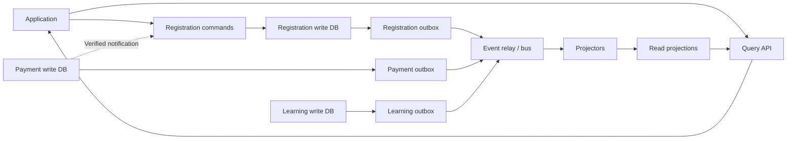
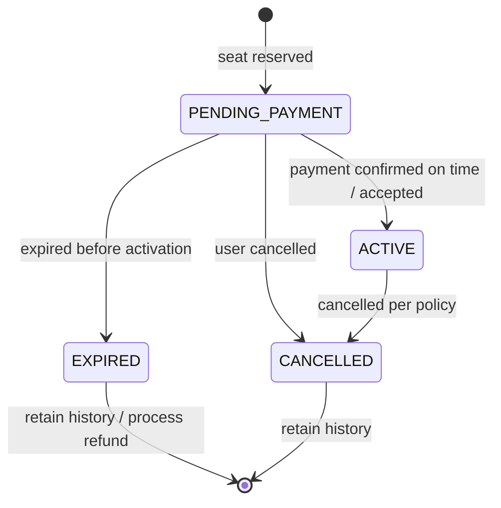
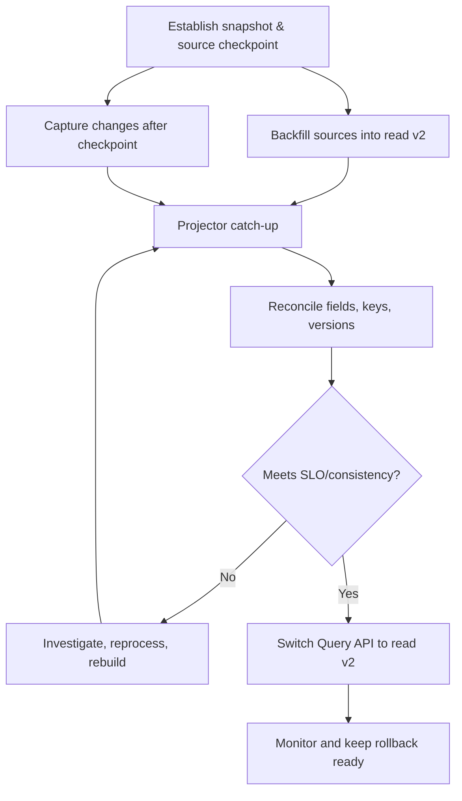

# Designing Appropriate Read Models, Events, and Exchange Contracts

## 1. Integrated Practice Problem: From Domain Model to Read Data

In a system selling courses to multiple enterprises, data does not reside in just one place. The registration unit manages seat counts and learner statuses; the payment unit confirms funds; the learning unit records progress; and the application needs **a fast-loading overview page** to display all relevant information.

If every screen directly JOINs tables across multiple systems, the application can become slow and tightly coupled to each domain's internal structure. If instead data is copied to a read store, new questions arise:

- Who is the **authoritative source** for each field?
- What **unit (grain)** does a read record represent?
- Does an event describe **a single change** or carry **the entire state**?
- If records from two systems arrive **out of order**, will that corrupt the result?
- Right after a user pays, should the screen immediately display "Paid"?
- If reading stale data, is the system allowed to allocate another seat?
- How must field names, keys, versions, and access permissions be agreed upon?
- If the entire read store is lost, from which sources can it be rebuilt?

That is the scope of **"Designing Appropriate Read Models, Events, and Exchange Contracts"**, part of the **Integrated Exercises** chapter in the **DATABASE_DATA_MODELING** module. The module aims to turn business requirements into clear data models—from entities, relationships, constraints, keys, and indexes to physical schemas—and compare relational, document, graph, and analytical models to select structures that fit, evolve cleanly, and can be verified.

This exercise is **a design scenario with a reference solution**, not a mandate forcing every system to use microservices, a message broker, or distributed CQRS.

**Expected outcomes:** learners can produce a design document covering source models, query models, event contracts, synchronization workflows, consistency policies, testing, and trade-offs; and identify which decisions stem from business constraints and which are assumptions requiring confirmation.

## 2. Problem Statement and Working Assumptions

The hypothetical platform **LearningMarket** serves multiple service-subscribing organizations (*tenants*). Each organization has its own learners, classes, and access controls.

### 2.1. Business Domains

| Domain | Data Ownership | Responsibilities |
| --- | --- | --- |
| **Catalog** | Published course templates and metadata | Name, description, content version |
| **Registration** | Offering, Enrollment, seat counts | Enrollment, cancellation/expiration, preventing overbooking |
| **Payment** | PaymentIntent, payment status | Collecting funds, gateway handling, and refund requests |
| **Learning** | Progress per Enrollment | Completed lessons and applicable total lessons |
| **Query/UI** | Derived read projections | Learner dashboard and class listings |

To keep the exercise focused on design, assume **Registration** manages both Offering and Enrollment inside **one write database**, so seat reservation and Enrollment creation commit atomically. Payment and Learning maintain their own data sources. Catalog provides course metadata; Registration stores a **course title snapshot when creating an offering** to preserve historical details on the enrollment record.

This is a deliberate **ownership** choice. If Offering and Enrollment lived in two databases that cannot share a transaction, a dedicated reservation protocol/saga would be required; you cannot keep the atomic write approach shown here unchanged.

### 2.2. User Flow

1. A learner opens the list of classes currently open for registration.
2. The learner clicks register; Registration attempts to reserve a seat.
3. The system creates an Enrollment in the `PENDING_PAYMENT` state.
4. Payment processes the payment; status can be `PENDING`, `SUCCEEDED`, or `FAILED`.
5. Upon confirming Payment succeeded, Registration receives a reliable notification to activate the Enrollment to `ACTIVE`. The two systems write in separate transactions.
6. The learner studies lessons; Learning updates progress.
7. The dashboard displays the class name, Enrollment status, payment status, and progress.
8. If payment does not complete before the deadline, the Enrollment may expire and release the seat according to policy.

### 2.3. Explicit Business Assumptions

- Learner, offering, and enrollment IDs are unique **within a tenant**, not solely by ID string alone.
- One Enrollment belongs to exactly one Offering and one Learner in the same tenant.
- For a `(tenant, learner, offering)` tuple, there is at most **one Enrollment in `PENDING_PAYMENT` or `ACTIVE`**.
- After an Enrollment is `CANCELLED`/`EXPIRED`, the learner may re-enroll under a **new ID**, if the Offering still has seats and policy permits.
- One Enrollment in this exercise has exactly **one logical PaymentIntent**; gateway communication retries occur inside that PaymentIntent. If multiple replacement PaymentIntents were allowed, identity/mapping and precedence rules would be needed.
- A seat is held starting when Enrollment is `PENDING_PAYMENT`, remains held when `ACTIVE`, and is released when `EXPIRED`/`CANCELLED` via a valid transaction.
- Lesson progress rules may alter the total lesson count; Learning emits a computed state snapshot for **one Enrollment**.
- The dashboard may read delayed data within an approved bound, but **seat availability decisions and state transitions must check the authoritative write source**.
- When payment succeeds after the Enrollment is already `EXPIRED`, Registration **does not automatically reactivate** the Enrollment if no seats remain; a controlled reconciliation/refund branch is required.
- Monetary examples and arithmetic use integer minor units, not binary floating-point numbers, for adding money.

These assumptions are **part of the design**, not universal default truths for every product.

## 3. Deliverables Learners Should Produce Independently

Before reviewing the reference design in later sections, try producing this deliverable set:

1. **Ownership diagram** identifying the source system for each state and attribute.
2. **Grain/identity catalog:** what identifier each row, event, and read record carries.
3. **Command/query matrix:** what must be consistent at commit, and what may be stale.
4. **Write schema** for Registration, including keys, constraints, and concurrency.
5. **Read schemas** for the dashboard and class listings; indexes derived from query shapes.
6. **Event catalog:** event types, producer, key, payload, version, and publication scope.
7. **JSON event contracts** for at least Registration, Payment, and Learning.
8. **Projector algorithm** guarding against duplicates, reordering, missing events, and deletions.
9. **Consistency contract** for read-after-write and seat-allocation decisions.
10. **Rebuild/backfill plan** when adding a new projection or losing the read store.
11. **Positive/negative test suite** and SLOs/metrics.
12. **Decision record** comparing read tables in the same DB against a separate read store.

Treat Sections 4–24 as an **annotated reference solution**, not the single valid schema.

## 4. Entity Map: Grain, Identity, and Authoritative Source

| Entity | What One Record Represents | Proposed Identity | Source |
| --- | --- | --- | --- |
| Tenant | One isolated organization | `tenant_id` | Identity/Organization |
| Learner | One learner profile within a tenant | `(tenant_id, learner_id)` | Identity/Registration (referenced) |
| CourseTemplate | One content template | `(owner_id, course_id)` | Catalog |
| Offering | One scheduled class offering | `(tenant_id, offering_id)` | Registration |
| Enrollment | One accepted enrollment | `(tenant_id, enrollment_id)` | Registration |
| PaymentIntent | One payment intent for an Enrollment | `(tenant_id, payment_intent_id)` | Payment |
| Progress | Progress state of one Enrollment | `(tenant_id, enrollment_id)` | Learning |
| EnrollmentSnapshotEvent | One version snapshot of an Enrollment | `event_id` + `aggregate_version` | Registration |
| PaymentSnapshotEvent | One version snapshot of a PaymentIntent | `event_id` + `aggregate_version` | Payment |
| ProgressSnapshotEvent | One version snapshot of Progress | `event_id` + `aggregate_version` | Learning |
| Dashboard card | One Enrollment viewed from the dashboard | `(tenant_id, enrollment_id)` | Read projection |

**Identifiers on the bus:** a bare `aggregate_id` is insufficient if it is only unique per tenant. Consumers need both namespace/tenant and aggregate type; `event_id` is the message identity, **distinct from** the aggregate ID.

**Cross-context note:** Registration may store `payment_intent_id` as a logical reference after receiving info from Payment. Do not use direct foreign keys across two databases as though transactions were guaranteed atomic; explicit confirmation, mapping, and reconciliation contracts are required.

### 4.1. Key Invariants Enforced at the Write Source

- `0 <= reserved_seats <= capacity`.
- Reserve seats only while the Offering is open for registration.
- Never allow two `PENDING_PAYMENT`/`ACTIVE` Enrollments for the same learner and Offering.
- Each Enrollment points to a valid Learner and Offering within the same tenant.
- PaymentIntent never records duplicate capture results for the same gateway operation, enforced by Payment-owned idempotency rules.
- Expiring/cancelling an Enrollment releases its seat **at most once**.
- A late Payment success event never auto-activates an `EXPIRED` Enrollment if the write source rejects the transition.
- Progress cannot be arbitrarily incremented by clients without passing through Learning rules.

**Read models are not the source for proving these invariants.**

## 5. Command and Query Matrix: Do Not Force Every Request into One Consistency Level

| ID | Operation | Owner | Consistency Requirement |
| --- | --- | --- | --- |
| C1 | `ReserveSeatAndEnroll` | Registration | Atomic capacity + Enrollment + idempotency |
| C2 | `ActivateEnrollmentAfterPayment` | Registration | Verify source status and payment evidence |
| C3 | `ExpireEnrollment` | Registration | Atomic seat release + status change |
| C4 | `CapturePayment` | Payment | No duplicate capture, gateway handling |
| C5 | `MarkLessonComplete` | Learning | Authorized and no double-counting |
| Q1 | `GetMyEnrollmentCards` | Query service | Bounded staleness allowed |
| Q2 | `GetEnrollmentStatusImmediately` | Registration/Query | Explicit read-after-write |
| Q3 | `ListOpenOfferings` | Query projection | May be stale for display, never allocates seats |
| Q4 | `GetInstructorClassSummary` | Query/Analytics | Per published checkpoint/freshness |
| Q5 | `CanReserveLastSeat` | Registration | Checked at commit, never from dashboard |
| Q6 | `ShouldRefundLatePayment` | Payment + Registration | Cross-domain rule using authoritative sources |

A common mistake is assuming "this is a query, so it must hit the read store." Q5 and Q6 look like reads, yet when they govern money or seat allocation, **the final answer must be protected inside the authoritative command/transaction**.

### 5.1. Hypothetical SLOs for the Exercise

| Metric | Discussion Target (Not a Production SLA) |
| --- | --- |
| Dashboard Q1 p95 | Under 200 ms on representative dataset |
| Class list Q3 p95 | Under 150 ms |
| Command C1 p95 | Under 400 ms, excluding payment gateway latency |
| Projection lag p99 | Under 5 seconds under normal system operation |
| Single-tenant rebuild | Verified procedure/checkpoint; duration measured from workload |
| Authorization leakage | Zero cross-tenant records returned |
| Overbooking | Zero seats allocated beyond committed capacity |

These numbers solely guide test design. Project teams must validate real workloads, cost, acceptable lag, and incident handling before turning them into product contracts.

## 6. Data Flow Diagram and Transaction Boundaries



There are **three separate transactions**:

1. Registration commits seat reservation, Enrollment, and its outbox.
2. Payment commits payment status and its outbox.
3. Learning commits progress and its outbox.

Never draw a single transaction spanning three databases unless the system genuinely has a mechanism guaranteeing it.

**The Payment → Registration arrow** represents a verified integration—via reliable event/command handlers with idempotency and payment-evidence verification. It does **not** mean the Query API or client can flip Enrollment to `ACTIVE` by sending `paid=true`.

### 6.1. Two Flow Types to Keep Separate

- **Business flow:** payment outcome triggers `PENDING_PAYMENT → ACTIVE` in Registration; if expired, enters refund/reconciliation.
- **Read flow:** Registration, Payment, and Learning publish snapshots to projections; a few seconds of lag may be acceptable.

Never use a stale read projection to replace business-flow events or decisions.

## 7. Write Model Design for Registration (PostgreSQL)

The schema below illustrates only the Registration domain within **one write database**. Payment and Learning own separate sources; do not force FKs across system boundaries.

```sql
CREATE TABLE reg_learners (
    tenant_id text NOT NULL,
    learner_id text NOT NULL,
    display_name text NOT NULL,
    PRIMARY KEY (tenant_id, learner_id)
);

CREATE TABLE reg_offerings (
    tenant_id text NOT NULL,
    offering_id text NOT NULL,
    course_owner_id text NOT NULL,
    course_id text NOT NULL,
    course_title_at_offering text NOT NULL,
    status text NOT NULL,
    capacity integer NOT NULL,
    reserved_seats integer NOT NULL DEFAULT 0,
    version bigint NOT NULL DEFAULT 1,
    PRIMARY KEY (tenant_id, offering_id),
    CHECK (status IN ('DRAFT','OPEN','CLOSED','CANCELLED')),
    CHECK (capacity >= 0),
    CHECK (reserved_seats >= 0 AND reserved_seats <= capacity),
    CHECK (version > 0)
);

CREATE TABLE reg_enrollments (
    tenant_id text NOT NULL,
    enrollment_id text NOT NULL,
    learner_id text NOT NULL,
    offering_id text NOT NULL,
    status text NOT NULL,
    enrolled_at timestamptz NOT NULL,
    expires_at timestamptz,
    version bigint NOT NULL DEFAULT 1,
    PRIMARY KEY (tenant_id, enrollment_id),
    FOREIGN KEY (tenant_id, learner_id)
      REFERENCES reg_learners(tenant_id, learner_id),
    FOREIGN KEY (tenant_id, offering_id)
      REFERENCES reg_offerings(tenant_id, offering_id),
    CHECK (status IN (
        'PENDING_PAYMENT','ACTIVE','EXPIRED','CANCELLED'
    )),
    CHECK (version > 0),
    CHECK (
        status <> 'PENDING_PAYMENT'
        OR expires_at IS NOT NULL
    )
);

CREATE UNIQUE INDEX reg_one_open_enrollment
    ON reg_enrollments(tenant_id, learner_id, offering_id)
    WHERE status IN ('PENDING_PAYMENT', 'ACTIVE');

CREATE INDEX reg_enrollments_by_learner
    ON reg_enrollments(tenant_id, learner_id, enrolled_at DESC, enrollment_id);
```

### 7.1. What This Schema Protects

- `tenant_id + enrollment_id` provides unambiguous identity.
- Enrollment points to a valid Learner and Offering within the same tenant.
- Capacity/seat counter stays non-negative and within published bounds per row.
- At most one open Enrollment exists per learner/offering.
- `PENDING_PAYMENT` Enrollments must have an expiration timestamp.

### 7.2. What This Schema Does Not Automatically Protect

- `reserved_seats` matching the exact count of seat-holding Enrollments.
- Two concurrent commands competing for the last seat producing the right outcome.
- Valid state transitions—for example, never activating an `EXPIRED` enrollment.
- Whether funds are refunded when `PaymentCaptured` arrives late.
- Whether the Catalog ID is actually authorized/published in that tenant.
- Whether the learner is eligible to enroll or has academic holds.
- Whether all outbox events are published and read projections updated.

**Never conclude the system is safe merely because DDL executes cleanly.** These conditions require transactional services, cross-domain rules, and thorough testing.

## 8. Seat Reservation Transaction, Deduplication, and Event Emission

### 8.1. Atomic Reserve in Registration

Conceptual flow for command `ReserveSeatAndEnroll`:

```text
BEGIN TRANSACTION

1. Authenticate/authorize actor, tenant, offering, and learner.
2. Check idempotency key:
   - If the same request already COMMITTED, return prior result.
   - If currently in progress, respond per contract.
3. UPDATE reg_offerings
   SET reserved_seats = reserved_seats + 1,
       version = version + 1
   WHERE tenant_id = ...
     AND offering_id = ...
     AND status = 'OPEN'
     AND reserved_seats < capacity
   RETURNING ...
4. Exactly one row must be updated; otherwise ROLLBACK.
5. INSERT reg_enrollments in PENDING_PAYMENT.
   - UNIQUE index protects open learner/offering pairs.
6. INSERT outbox_event containing Enrollment v1 snapshot.
7. Persist idempotency outcome inside the same transaction.
COMMIT
```

Step 3 can use SQL:

```sql
UPDATE reg_offerings
SET reserved_seats = reserved_seats + 1,
    version = version + 1
WHERE tenant_id = :tenant_id
  AND offering_id = :offering_id
  AND status = 'OPEN'
  AND reserved_seats < capacity
RETURNING offering_id, reserved_seats, version;
```

**A standalone SQL statement does not complete the command.** It must share a transaction with the Enrollment and outbox inserts. If the `INSERT` hits a `UNIQUE` violation or another step fails, roll back the counter increment as well. Idempotency handling must also prevent two concurrent requests with the same key from racing; this typically requires a unique key and lock/transaction-guarded state transitions.

### 8.2. Cancellation/Expiration Seat-Release Scenario

When a `PENDING_PAYMENT` Enrollment transitions to `EXPIRED`:

- Verify `status = PENDING_PAYMENT` at commit time.
- Perform the transition at most once.
- Decrement `reserved_seats` inside the **same transaction**.
- Emit the new Enrollment snapshot version.
- If Payment actually `SUCCEEDED` yet notice arrives late, route through reconciliation/refund policy; **do not** blindly re-increment seats if the class is already full.

Running a seat-decrement `UPDATE` without verifying the transition succeeded can drive counters negative or double-release on retries. The design must tie seat release directly to the **committed state transition**.

### 8.3. Idempotency Is Not Business Uniqueness

| Key | Purpose |
| --- | --- |
| `(tenant_id, command_type, idempotency_key)` | Recognizes retries of the same intent |
| `(tenant_id, enrollment_id)` | Identity of one Enrollment |
| Partial unique on `(tenant,learner,offering)` | Blocks two simultaneous open enrollments |
| `event_id` | Identifies one event record |
| `aggregate_version` | Version order within an aggregate |

A user may send two commands with different idempotency keys targeting the same enrollment; business uniqueness constraints must still protect the invariant. A retry with the same key but a different payload must raise a **conflict**, never silently return the prior result as if the new payload were accepted.

## 9. Transactional Outbox: Synchronizing Messages with Source Commits

Common mistake:

```text
1. Write Enrollment to Registration DB -> COMMIT
2. Send message to broker
```

If step 1 succeeds and step 2 fails, the read model misses the change. If the message is sent before commit, an event may describe state that later rolls back.

**Transactional outbox** writes both domain state and outgoing messages in the **same write transaction**.

```sql
CREATE TABLE reg_outbox (
    event_id uuid PRIMARY KEY,
    tenant_id text NOT NULL,
    aggregate_type text NOT NULL,
    aggregate_id text NOT NULL,
    aggregate_version bigint NOT NULL,
    event_type text NOT NULL,
    event_schema_version integer NOT NULL,
    payload jsonb NOT NULL,
    occurred_at timestamptz NOT NULL,
    published_at timestamptz,
    CHECK (aggregate_version > 0),
    CHECK (event_schema_version > 0)
);

CREATE INDEX reg_outbox_pending_idx
ON reg_outbox(occurred_at, event_id)
WHERE published_at IS NULL;
```

One Registration command might execute:

```text
BEGIN
  update Offering
  insert Enrollment
  insert outbox EnrollmentSnapshotChanged
  insert outbox OfferingSnapshotChanged
  persist idempotency result
COMMIT
```

When two events belong to **two aggregates**, `Offering.version` and `Enrollment.version` evolve independently. Never share one transaction-wide version number to compare across distinct aggregates.

### 9.1. Outbox Alone Does Not Guarantee Exactly-Once

A relay may publish `E1` successfully and crash before marking `published_at`, re-publishing `E1` on restart. Consumers must handle duplicate events, retries, broker outages, and dead-letter/quarantine queues.

Monitor unpublished event age, queue depth, consumer progress, recovery time, and cleanup policies. **Outboxes may be pruned per retention; an outbox is not automatically a full event store capable of replaying entire history.**

CDC (*Change Data Capture*) from the transaction log is an alternative way to stream outbox/change feeds. It still requires contracts for ordering, offsets, access control, schema evolution, and recoverability.

## 10. Event Catalog: Clear Source and Purpose for Every Event

| Event type | Producer | Identity/ordering key | Consumer | Meaning |
| --- | --- | --- | --- | --- |
| `EnrollmentSnapshotChanged` | Registration | Tenant + Enrollment | Dashboard/read projector; authorized integrations | Full Enrollment state |
| `OfferingSnapshotChanged` | Registration | Tenant + Offering | Class list projector | Offering status and seat counts |
| `PaymentIntentSnapshotChanged` | Payment | Tenant + PaymentIntent | Payment projector; Registration integration | Payment status accepted by Payment |
| `ProgressSnapshotChanged` | Learning | Tenant + Enrollment | Progress projector | Aggregate progress per Enrollment |
| `EnrollmentErased` | Registration | Tenant + Enrollment | Downstream projections requiring erasure/masking | Policy-driven request to erase/mask copies |

This exercise uses **full snapshot events**, meaning each event carries enough fields from the source projection's scope to replace prior state. That is one specific contract, not how every event-driven system works.

### 10.1. Unified Envelope

```json
{
  "eventId": "3e0242a1-748e-4e0a-8b2b-9d57ae0f1840",
  "eventType": "EnrollmentSnapshotChanged",
  "eventSchemaVersion": 1,
  "producer": "Registration",
  "tenantId": "ORG-A",
  "aggregateType": "Enrollment",
  "aggregateId": "ENR-501",
  "aggregateVersion": 1,
  "occurredAt": "2026-11-20T09:00:00Z",
  "correlationId": "FLOW-20261120-101",
  "payload": {}
}
```

- `eventId` identifies the **message**, used for deduplication.
- `aggregateId + aggregateType + tenantId` identifies the source aggregate, used for routing and version comparison.
- `aggregateVersion` increases monotonically **within one aggregate**.
- `eventSchemaVersion` describes the **payload format**, not the business aggregate version.
- `correlationId` aids end-to-end tracing; it does not replace idempotency keys.
- `occurredAt` is the producer-assigned timestamp, not automatically when the projector receives it.

**A mandatory design assumption:** this exercise emits at most **one snapshot of a given type per aggregate version**. If multiple messages with different payloads shared the same version, a simple version guard would drop updates; a secondary sequence or redesigned contract would be required.

### 10.2. Do Not Publish Raw Rows or Unscoped PII

Events must restrict fields to consumer needs and permissions; never emit secrets, sensitive payment credentials, or entire learner profiles merely because serializing an internal object was convenient. Every event requires ownership, schema, retention, and versioning.

## 11. Sample JSON Contracts for the Three Sources

### 11.1. EnrollmentSnapshotChanged

```json
{
  "eventId": "dbd7c80d-e0c3-4f87-9a8a-6950c386fa51",
  "eventType": "EnrollmentSnapshotChanged",
  "eventSchemaVersion": 1,
  "producer": "Registration",
  "tenantId": "ORG-A",
  "aggregateType": "Enrollment",
  "aggregateId": "ENR-501",
  "aggregateVersion": 1,
  "occurredAt": "2026-11-20T09:00:00Z",
  "correlationId": "FLOW-20261120-101",
  "payload": {
    "enrollmentId": "ENR-501",
    "learnerId": "U-100",
    "offeringId": "CLASS-77",
    "courseTitleAtOffering": "Data Design",
    "status": "PENDING_PAYMENT",
    "enrolledAt": "2026-11-20T09:00:00Z",
    "expiresAt": "2026-11-20T09:15:00Z",
    "isErased": false
  }
}
```

Upon activation to `ACTIVE`, Registration emits snapshot v2 with the same identity and full Registration fields, now with `status=ACTIVE`. That event **does not prove Payment's read projection has caught up**, because Payment is independent.

### 11.2. PaymentIntentSnapshotChanged

```json
{
  "eventId": "80a3afbf-f352-4a40-a9b5-64268f0dbcc5",
  "eventType": "PaymentIntentSnapshotChanged",
  "eventSchemaVersion": 1,
  "producer": "Payment",
  "tenantId": "ORG-A",
  "aggregateType": "PaymentIntent",
  "aggregateId": "PAY-900",
  "aggregateVersion": 3,
  "occurredAt": "2026-11-20T09:02:00Z",
  "correlationId": "FLOW-20261120-101",
  "payload": {
    "paymentIntentId": "PAY-900",
    "enrollmentId": "ENR-501",
    "paymentStatus": "SUCCEEDED",
    "amountMinor": 350000,
    "currencyCode": "VND",
    "isErased": false
  }
}
```

**Scope constraint in this exercise:** one logical PaymentIntent per Enrollment; gateway retries are attempts within that intent. If replacing a PaymentIntent, `PAY-900`'s version cannot be compared directly against `PAY-901`'s version; a Payment-owned current-intent mapping and separate versioning would be required.

### 11.3. ProgressSnapshotChanged

```json
{
  "eventId": "3ef8e011-54e5-4754-9c02-ff27e5b1ffcb",
  "eventType": "ProgressSnapshotChanged",
  "eventSchemaVersion": 1,
  "producer": "Learning",
  "tenantId": "ORG-A",
  "aggregateType": "ProgressByEnrollment",
  "aggregateId": "ENR-501",
  "aggregateVersion": 7,
  "occurredAt": "2026-11-20T11:30:00Z",
  "correlationId": "LEARN-OP-812",
  "payload": {
    "enrollmentId": "ENR-501",
    "completedLessons": 5,
    "totalLessons": 12,
    "lastCompletedAt": "2026-11-20T11:30:00Z",
    "isErased": false
  }
}
```

Snapshot `5/12` means **replace the current value**, not add 5 to a counter. If event v7 is replayed, the projector keeps `5/12`. If v6 arrives late, it must not overwrite the newer numbers.

## 12. Exchange Contracts Must Specify Semantics and Compatibility

| Field | Rule |
| --- | --- |
| `tenantId` | Mandatory, matching producer namespace and authorization |
| `aggregateId` | Stable ID within tenant and aggregate type |
| `aggregateVersion` | Monotonically increasing integer within one aggregate |
| `eventSchemaVersion` | Payload schema version; never compared against `aggregateVersion` |
| `status` | Contract-defined enum; never guess unknown values |
| `expiresAt` | Valid timestamp whenever `PENDING_PAYMENT` |
| `amountMinor + currencyCode` | Money pair with explicit types and precision |
| `completedLessons/totalLessons` | Non-negative; completed within total per domain rules |
| `isErased` | Policy-driven erasure/masking signal, distinct from `CANCELLED` |

### 12.1. Illustrative JSON Schema for Enrollment v1 Payload

```json
{
  "$schema": "https://json-schema.org/draft/2020-12/schema",
  "type": "object",
  "required": [
    "enrollmentId", "learnerId", "offeringId",
    "courseTitleAtOffering", "status",
    "enrolledAt", "isErased"
  ],
  "properties": {
    "enrollmentId": {"type": "string", "minLength": 1},
    "learnerId": {"type": "string", "minLength": 1},
    "offeringId": {"type": "string", "minLength": 1},
    "courseTitleAtOffering": {"type": "string"},
    "status": {
      "enum": ["PENDING_PAYMENT", "ACTIVE", "EXPIRED", "CANCELLED"]
    },
    "enrolledAt": {"type": "string", "format": "date-time"},
    "expiresAt": {"type": ["string", "null"], "format": "date-time"},
    "isErased": {"type": "boolean"}
  },
  "additionalProperties": false
}
```

This schema **does not by itself verify** a trusted producer, tenant authorization, monotonic version increments, event ordering, or that `expiresAt` is non-null when `PENDING_PAYMENT`; validate those at the appropriate layers. Enforcement of `format` also depends on the specific validator and configuration.

### 12.2. Schema Evolution

- Adding an optional field can still break consumers configured to reject unknown fields.
- Renaming `learnerId` to `studentId` requires explicit versioning and upcasting/conversion.
- Changing `amountMinor` to floating-point can corrupt monetary math; define a new contract instead.
- Adding a new status enum value requires validating consumers before rollout.
- Never change the meaning of `courseTitleAtOffering` from snapshot title to live title under the same field name.
- Never replace snapshots with deltas under the same event type without updating projectors.

A typical rollout order is **consumers understand v1/v2 → producer emits v2 → monitor → retire v1 support once stored history can be read cleanly**.

### 12.3. Never Guess Missing Fields

A read model that has not yet received a Payment event **does not imply `FAILED`**; the intent may not exist yet, the projector may be lagging, or the source may have erred. Before Progress events arrive, `completedLessons` is unknown—not `0`. Query contracts should distinguish `UNKNOWN/NOT_YET_OBSERVED` from a confirmed `0`.

## 13. Designing Source-Aligned Read Models to Handle Cross-Domain Out-of-Order Events

A dashboard requires:

```text
enrollmentId, offeringId, courseTitle,
registrationStatus, paymentStatus,
completedLessons, totalLessons
```

If all mandatory columns sit in one combined row, a Payment event arriving before an Enrollment event becomes awkward to store. A lower-risk approach lets **each source update its own read table**, while the Query API JOINs on Enrollment. When workload metrics prove it necessary, a unified materialized card can be built from those controlled projections.

```sql
CREATE TABLE read_registration_cards (
    tenant_id text NOT NULL,
    enrollment_id text NOT NULL,
    learner_id text NOT NULL,
    offering_id text NOT NULL,
    course_title_at_offering text NOT NULL,
    registration_status text NOT NULL,
    enrolled_at timestamptz NOT NULL,
    expires_at timestamptz,
    registration_version bigint NOT NULL,
    projected_at timestamptz NOT NULL DEFAULT now(),
    PRIMARY KEY (tenant_id, enrollment_id),
    CHECK (registration_version > 0)
);

CREATE INDEX read_registration_by_learner
ON read_registration_cards
    (tenant_id, learner_id, enrolled_at DESC, enrollment_id DESC);

CREATE TABLE read_payment_by_enrollment (
    tenant_id text NOT NULL,
    enrollment_id text NOT NULL,
    payment_intent_id text NOT NULL,
    payment_status text NOT NULL,
    amount_minor bigint NOT NULL,
    currency_code char(3) NOT NULL,
    payment_version bigint NOT NULL,
    projected_at timestamptz NOT NULL DEFAULT now(),
    PRIMARY KEY (tenant_id, enrollment_id),
    UNIQUE (tenant_id, payment_intent_id),
    CHECK (amount_minor >= 0),
    CHECK (payment_version > 0)
);

CREATE TABLE read_progress_by_enrollment (
    tenant_id text NOT NULL,
    enrollment_id text NOT NULL,
    completed_lessons integer NOT NULL,
    total_lessons integer NOT NULL,
    progress_version bigint NOT NULL,
    projected_at timestamptz NOT NULL DEFAULT now(),
    PRIMARY KEY (tenant_id, enrollment_id),
    CHECK (completed_lessons >= 0),
    CHECK (total_lessons >= 0),
    CHECK (completed_lessons <= total_lessons),
    CHECK (progress_version > 0)
);
```

**Intentionally omit FKs from Payment/Progress read tables to the Registration read table** because events can arrive out of order. If strict FKs are required, add staging/inbox tables and apply updates in controlled sequence. These are read schemas and never replace write constraints.

### 13.1. Dashboard Query

```sql
SELECT
    r.enrollment_id, r.offering_id,
    r.course_title_at_offering,
    r.registration_status, r.enrolled_at,
    p.payment_status, p.amount_minor, p.currency_code,
    g.completed_lessons, g.total_lessons,
    r.registration_version, p.payment_version, g.progress_version
FROM read_registration_cards AS r
LEFT JOIN read_payment_by_enrollment AS p
  ON p.tenant_id = r.tenant_id
 AND p.enrollment_id = r.enrollment_id
LEFT JOIN read_progress_by_enrollment AS g
  ON g.tenant_id = r.tenant_id
 AND g.enrollment_id = r.enrollment_id
WHERE r.tenant_id = :authorized_tenant_id
  AND r.learner_id = :authorized_learner_id
ORDER BY r.enrolled_at DESC, r.enrollment_id DESC
LIMIT 20;
```

`authorized_*` parameters come from verified authentication/authorization context. If `p` or `g` is absent yet, return `NULL` (not yet observed) rather than coercing to `SUCCEEDED`/`FAILED`/`0`.

**There is no single natural global version across the three sources.** A card may hold Registration v2, Payment v3, and Progress v7; versions compare only within the same aggregate. If a decision needs an atomic snapshot across all three contexts, this query **cannot** provide it and requires a different consistency protocol.

## 14. Dedicated Read Model for Class Listings

Registration emits `OfferingSnapshotChanged` containing `OPEN`/`CLOSED` status and seat counts.

```sql
CREATE TABLE read_offering_cards (
    tenant_id text NOT NULL,
    offering_id text NOT NULL,
    course_id text NOT NULL,
    title text NOT NULL,
    registration_status text NOT NULL,
    capacity integer NOT NULL,
    reserved_seats integer NOT NULL,
    start_at timestamptz,
    offering_version bigint NOT NULL,
    projected_at timestamptz NOT NULL DEFAULT now(),
    PRIMARY KEY (tenant_id, offering_id),
    CHECK (capacity >= 0),
    CHECK (reserved_seats >= 0 AND reserved_seats <= capacity)
);

CREATE INDEX read_offering_open_lookup
ON read_offering_cards
    (tenant_id, registration_status, start_at, offering_id);
```

Query:

```sql
SELECT offering_id, title, start_at,
       capacity - reserved_seats AS displayed_available_seats,
       offering_version
FROM read_offering_cards
WHERE tenant_id = :authorized_tenant_id
  AND registration_status = 'OPEN'
ORDER BY start_at, offering_id
LIMIT 20;
```

**Displayed seat counts reflect a replica**, which may be stale. Seat-reservation commands must still verify the write DB via conditional update rather than trusting `displayed_available_seats` for final decisions.

## 15. Idempotent Projectors Using Full Snapshots and Version Guards

### 15.1. Registration Upsert

```sql
INSERT INTO read_registration_cards (
    tenant_id, enrollment_id, learner_id, offering_id,
    course_title_at_offering, registration_status,
    enrolled_at, expires_at, registration_version, projected_at
) VALUES (
    :tenant_id, :enrollment_id, :learner_id, :offering_id,
    :course_title_at_offering, :status,
    :enrolled_at, :expires_at, :aggregate_version, now()
)
ON CONFLICT (tenant_id, enrollment_id)
DO UPDATE SET
    learner_id = EXCLUDED.learner_id,
    offering_id = EXCLUDED.offering_id,
    course_title_at_offering = EXCLUDED.course_title_at_offering,
    registration_status = EXCLUDED.registration_status,
    enrolled_at = EXCLUDED.enrolled_at,
    expires_at = EXCLUDED.expires_at,
    registration_version = EXCLUDED.registration_version,
    projected_at = now()
WHERE read_registration_cards.registration_version
      < EXCLUDED.registration_version;
```

With full snapshots, receiving v3 followed by v2 works safely: v3 already contains the complete row state, so stale v2 is ignored. Duplicate v3 leaves the row untouched.

**Limitation:** this holds only when versions increment monotonically within one aggregate and payloads include every field managed by the projector. If events are deltas, skipping v2 after seeing v3 loses state.

### 15.2. Payment Upsert

```sql
INSERT INTO read_payment_by_enrollment (
    tenant_id, enrollment_id, payment_intent_id,
    payment_status, amount_minor, currency_code,
    payment_version, projected_at
) VALUES (
    :tenant_id, :enrollment_id, :payment_intent_id,
    :payment_status, :amount_minor, :currency_code,
    :aggregate_version, now()
)
ON CONFLICT (tenant_id, enrollment_id)
DO UPDATE SET
    payment_intent_id = EXCLUDED.payment_intent_id,
    payment_status = EXCLUDED.payment_status,
    amount_minor = EXCLUDED.amount_minor,
    currency_code = EXCLUDED.currency_code,
    payment_version = EXCLUDED.payment_version,
    projected_at = now()
WHERE read_payment_by_enrollment.payment_version
      < EXCLUDED.payment_version;
```

**This again relies on the one-PaymentIntent-per-Enrollment assumption.** If multiple intents exist, their version sequences cannot be compared directly; use a per-intent table paired with a versioned current-intent mapping.

### 15.3. Progress Upsert

```sql
INSERT INTO read_progress_by_enrollment (
    tenant_id, enrollment_id, completed_lessons,
    total_lessons, progress_version, projected_at
) VALUES (
    :tenant_id, :enrollment_id,
    :completed_lessons, :total_lessons, :aggregate_version, now()
)
ON CONFLICT (tenant_id, enrollment_id)
DO UPDATE SET
    completed_lessons = EXCLUDED.completed_lessons,
    total_lessons = EXCLUDED.total_lessons,
    progress_version = EXCLUDED.progress_version,
    projected_at = now()
WHERE read_progress_by_enrollment.progress_version
      < EXCLUDED.progress_version;
```

If Progress v7 = `5/12` arrives twice, the row stays `5/12`. If v6 arrives after v7, it does not overwrite. **Never add to `completedLessons`**, because the event is a snapshot, not a delta.

### 15.4. Delta Events Require a Different Strategy

With `LessonCompleted` carrying only one lesson ID, the projector must ensure complete ordered delivery or store per-lesson contribution rows/ledgers for idempotent aggregation. Detect gaps, retry/replay, or rebuild from snapshots. **Never apply naive last-version-wins to deltas when newer events omit earlier deltas' effects.**

## 16. Out-of-Order Events, Missing Data, and Deletions

### 16.1. Payment Arriving Before Registration

```text
09:02 PaymentIntentSnapshotChanged v3: SUCCEEDED
09:03 EnrollmentSnapshotChanged v1: PENDING_PAYMENT
09:04 EnrollmentSnapshotChanged v2: ACTIVE
```

Payment inserts into its own table first. The dashboard query only surfaces the card once the Registration row arrives, at which point `LEFT JOIN` automatically attaches the Payment row. Never synthesize a fake Enrollment at the write source or treat cross-topic event order as a global transaction.

### 16.2. Duplicate or Late Registration Events

```text
Enrollment v2 ACTIVE
Enrollment v2 ACTIVE (duplicate)
Enrollment v1 PENDING_PAYMENT (late)
Enrollment v3 CANCELLED
```

The version guard settles at `v3 CANCELLED`. The Payment row may still show `SUCCEEDED`; that signals a state needing refund/reconciliation—never silently overwrite Payment to `REFUNDED` inside query logic.

### 16.3. `CANCELLED` Differs from Erasure

- `CANCELLED` is a business state that may require historical retention.
- Erasure is a policy-driven request to delete or mask copies/PII.
- Physically deleting a read row without appropriate tombstone/version metadata allows stale replayed events to "resurrect" the deleted row.

One approach keeps a minimal tombstone keyed by `(tenant, enrollment, max_erased_version)` for the approved retention window, or checks authoritative erasure state before projecting. Search indexes, caches, exports, and backups must likewise follow retention policy.

### 16.4. Broker Ordering Has Limited Scope

Some brokers preserve order **within a partition** for a shared routing key; they do not automatically guarantee cross-topic or cross-service ordering between Payment and Registration. Separating read tables with per-aggregate version guards avoids relying on global event ordering.

## 17. Late-Payment Workflow: Accurate Reads Do Not Replace Business Decisions

This scenario belongs in the exercise because it exposes the boundary between **command flows** and **read-projection flows**.

### 17.1. Timeline with a Race Condition

```text
09:00 Enrollment ENR-501 is created as PENDING_PAYMENT,
      holding one seat until 09:15.

09:15 Expiration worker sees no payment evidence yet
      and commits PENDING_PAYMENT -> EXPIRED,
      releasing one seat.

09:15:01 Another learner reserves the newly released seat.

09:15:02 Payment notifies that ENR-501's transaction
         actually SUCCEEDED at the gateway.
```

If Registration blindly sets `ENR-501.status = ACTIVE` upon receiving `PaymentSucceeded` without checking state/capacity, it can **overbook** or activate an expired enrollment.

### 17.2. Proposed State Machine



This state machine is not the **entire** payment workflow. Payment has its own lifecycle—`PENDING`, `SUCCEEDED`, `FAILED`, `REFUND_PENDING`, `REFUNDED`, etc.—per policy. Both state machines need a **process policy** to coordinate.

### 17.3. Decision Table When Receiving Payment Outcomes

| Registration Status at Processing | Payment Evidence | Permitted Action |
| --- | --- | --- |
| `PENDING_PAYMENT`, within policy deadline | `SUCCEEDED` | Conditionally transition to `ACTIVE` |
| `PENDING_PAYMENT`, racing with expire command | `SUCCEEDED` | Serialization/transition picks one branch, never both |
| `EXPIRED` | `SUCCEEDED` | Do not auto-`ACTIVE`; reconcile funds and refund/re-enroll per policy |
| `CANCELLED` | `SUCCEEDED` | Do not auto-`ACTIVE`; process refund/reconciliation |
| `ACTIVE` | Duplicate `SUCCEEDED` | Idempotent no-op |
| Any | Unverified event or tenant/intent mismatch | Reject/quarantine and investigate |

"On time" must be defined explicitly: by actual gateway capture timestamp, Payment-source record time, or Registration-receipt time? Never arbitrarily check `now()` if business policy honors payments completed before the deadline whose callbacks arrive late.

A protocol may choose either **hold the seat until the PaymentIntent reaches a terminal decision**, or **close strictly at timeout and handle late successes via refund**. Both carry trade-offs; decide before coding transactions.

### 17.4. Preventing Two Workers from Mutating State Simultaneously

A Registration coordinator can:

- Lock Enrollment and Offering in a consistent order inside a transaction.
- Read current status/version and validate the transition.
- Update only when the conditional predicate matches.
- Increment/decrement `reserved_seats` at most once based on the committed transition.
- Write outbox events in the same transaction.
- Deduplicate retries via idempotency keys or source event identity.

With optimistic concurrency, a version-checked `UPDATE` detects contention; it must still pair with the seat-counter update in the same transaction.

### 17.5. Never Infer Workflows from the Dashboard

A read card may show:

```text
registrationStatus = EXPIRED
paymentStatus      = SUCCEEDED
```

Those are **two states owned by two sources**. The Query API may surface "Payment requires reconciliation," yet must never silently mutate registration or payment. An authorized domain worker must resolve the discrepancy via authoritative commands/transactions.

## 18. Query Contracts and Read-After-Write Experience

### 18.1. Three Technical Request States

- **ACCEPTED:** the request was received or queued, not necessarily committed.
- **COMMITTED:** state in the authoritative write DB has changed.
- **PROJECTED:** the read store has caught up to at least a known version.

When the reservation command commits, the response may return:

```json
{
  "enrollmentId": "ENR-501",
  "commandStatus": "COMMITTED",
  "registrationStatus": "PENDING_PAYMENT",
  "registrationVersion": 1,
  "expiresAt": "2026-11-20T09:15:00Z"
}
```

This response **does not assert** that Payment or Progress read projections exist yet.

### 18.2. Dashboard APIs Should Not Hide Freshness

Sample client DTO:

```json
{
  "enrollmentId": "ENR-501",
  "courseTitle": "Data Design",
  "registration": {
    "status": "ACTIVE",
    "sourceVersion": 2
  },
  "payment": {
    "status": "SUCCEEDED",
    "sourceVersion": 3
  },
  "progress": {
    "completedLessons": 5,
    "totalLessons": 12,
    "sourceVersion": 7
  },
  "readConsistency": "EVENTUAL"
}
```

If Payment/Progress has not arrived, keep `null` or an explicit `NOT_YET_OBSERVED` status with clear semantics. Never fabricate `SUCCEEDED`, `FAILED`, or `0` before source confirmation.

### 18.3. Read-Your-Writes Within the Same Aggregate

One pattern:

```text
GET /enrollments/ENR-501?minRegistrationVersion=2

if read_registration.version >= 2:
    return dashboard card

else:
    wait briefly within configured timeout
    or respond PROJECTION_NOT_CAUGHT_UP
    or fall back to authoritative Registration for needed fields
```

**Never wait indefinitely.** `minRegistrationVersion` applies only to Registration's Enrollment; it proves nothing about Payment or Progress. If the UI must guarantee Payment v3 is visible, supply an explicit Payment version/checkpoint requirement.

### 18.4. Display Command Return State Immediately When Appropriate

Once enrollment creation commits, the UI can display "Awaiting payment" directly from the command response. The read listing may appear moments later; the UI can indicate "List updating." This is **intentional product design**, not a write failure.

### 18.5. Queries Must Enforce Authorization

`authorized_tenant_id` and `authorized_learner_id` in SQL cannot simply be copied from URL/body parameters and trusted. APIs must authenticate callers, verify tenant/role permissions, and authorize the target resource. An instructor permitted to view a class roster does not automatically gain access to every learner's detailed Payment records.

## 19. Integration Failures: Retries, Poison Messages, and Lag

### 19.1. Failure Mode Matrix

| Failure | Impact | Required Safeguard |
| --- | --- | --- |
| Outbox relay stops | Projections miss messages | Alert on backlog / oldest unpublished event |
| Relay re-delivers event | Duplicate data if projector is not idempotent | Event ID, version guard, or processed ledger |
| Payment arrives before Registration | Missing parent read row | Separate read tables / staging |
| Registration v3 arrives before v2 | Risk of reverting to older status | Snapshot + version guard |
| Delta progress misses v6 | Corrupted lesson counter | Gap detection / replay or snapshots |
| Unsupported v2 event schema | Projector fails deserialization | Versioning / upcasters, quarantine |
| Read DB runs out of capacity | Lag, slow queries / failures | Backpressure, capacity planning, retries |
| Stale cache not invalidated | UI shows outdated version | TTL / versioned invalidation |
| Erasure event arrives before backup restore | PII persists in restored copy | Retention / restore / re-erase workflow |
| Bus retention shorter than outage | Cannot catch up from bus alone | Snapshot / rebuild from sources and checkpoints |
| Grant revoked while read cache is stale | Unauthorized access if trusting cache alone | Authoritative permission check at source when needed |

### 19.2. What Should an Inbox/Checkpoint Record?

If a consumer deduplicates via a tracking table:

```sql
CREATE TABLE read_processed_events (
    consumer_name text NOT NULL,
    event_id uuid NOT NULL,
    processed_at timestamptz NOT NULL DEFAULT now(),
    PRIMARY KEY (consumer_name, event_id)
);
```

Insert the processed record **in the same transaction as the read projection update**. If you record `processed` while the read update fails and still commit, the event gets falsely marked complete. When a projector purely upserts a snapshot row by unique key + version guard, a separate ledger may be unnecessary for that row itself, yet **remains essential** for side effects or audit requirements.

### 19.3. Poison Messages Must Have a Resolution Path

An event failing deserialization or violating invariants must never be silently dropped. Steps:

1. Classify transient failures (DB outage) vs. data/contract errors.
2. Retry transient failures with bounded backoff.
3. Quarantine/DLQ invalid messages with reason codes and minimal metadata.
4. Alert when DLQ count or age crosses thresholds.
5. Fix producer/consumer or source data, then reprocess under control.
6. Reconcile versions/gaps to identify affected read records.

Never dump full sensitive payloads into unrestricted monitoring logs.

### 19.4. SLOs and Observability

Track:

- Command p95/p99 latency, conflicts, and idempotent retries.
- Outbox pending count and oldest unpublished age.
- Consumer offset lag, retry rate, and DLQ depth.
- Projection lag in time and version gaps.
- Rate of read rows missing Payment/Progress counterparts.
- Count of cards with Registration `EXPIRED` and Payment `SUCCEEDED` awaiting reconciliation.
- Query p95/p99, index scans, and cache hit/miss ratios.
- Unauthorized tenant access attempts or failed erasure propagations.
- Rebuild throughput and recovery duration.

Never judge health solely by **mean latency**. A single critical enrollment can get stuck while overall p95 stays green.

## 20. Rebuilding Projections and Checkpointed Schema Migrations

Mandatory question before cutover:

> If we have to wipe `read_registration_cards`, `read_payment_by_enrollment`, and `read_progress_by_enrollment` tomorrow, from where can we rebuild them **accurately**?

### 20.1. Rebuild Sources

**Option A — Snapshots from write stores**

- Registration exports current Enrollment/Offering state with `sourceVersion`.
- Payment exports current PaymentIntent state with Enrollment mapping.
- Learning exports Progress snapshots per Enrollment.
- Fits dashboards needing only **current state**, provided all required fields remain in the sources.

**Option B — Replay sufficiently retained event history**

- Requires durable event logs, adequate retention/offsets, schema versions, and ordering.
- Can reconstruct historical states if events captured complete history.
- Typical outboxes do not retain full history after cleanup.

**Option C — Snapshot + CDC/outbox from checkpoint**

- Establish a consistent snapshot and change-stream position per source.
- Backfill into the new read store.
- Replay/catch up changes occurring after the checkpoint.
- Reconcile, then switch queries.

### 20.2. Why Must Checkpoints Be Anchored Carefully?

If a Registration scan begins at 10:00 and finishes at 10:30, yet event consumption only starts at 10:30, updates committed between 10:00 and 10:30 may **be lost**.

Sample workflow:



**Each write store maintains its own checkpoint.** Never add Payment's offset to Registration's offset and pretend it forms a global snapshot. Coordinated cross-context views require explicit business/protocol coordination to confirm a shared observation point.

### 20.3. Shadow Reads and Reconciliation

During cutover:

- Run legacy queries and read v2 over matching sample sets.
- Compare results only where semantics, scope, and freshness align.
- Compare identities/keys, statuses, amounts, lesson counts, tenants, visibility, and source versions.
- Separate expected lag differences from mapping bugs or missing data.
- Never approve a dataset merely because `COUNT(*)` matches on both sides.

If backfill reads source tables concurrently with erasures/revocations, projector v2 must receive erasure state at a high enough version so old rows do not **resurrect** post-cutover.

### 20.4. Rollback and Access Downgrades

Rollback is not merely flipping a feature flag. Verify whether the old query path still respects tenant scope, current permissions, and erasures. Never roll back to an old read store whose permissions were revoked or whose security policies drifted out of sync. When safe rollback is impossible, temporarily degrade read functionality rather than exposing unauthorized data.

## 21. Protecting Data and Cross-Domain Exchange Permissions

### 21.1. Tenant Scope Follows Every Key, Event, Index, and Query

In LearningMarket, two tenants can both use `enrollmentId='ENR-501'` if IDs are issued per tenant. Therefore:

- Write PKs/FKs include `tenant_id`.
- Event envelopes carry producer-verified `tenantId`.
- Read PKs use `(tenant_id, enrollment_id)`.
- JOINs between Payment/Progress and Registration match **both tenant and enrollment ID**.
- Cache keys include authorization scope—at least tenant when data is tenant-scoped.
- Query APIs verify caller permissions on learner/enrollment rather than trusting URL IDs.
- Rebuilds/backfills never copy tenant B's data into tenant A due to colliding IDs.

A strong security test deliberately creates `ORG-A/ENR-501` and `ORG-B/ENR-501` with different states. If querying A returns B's fields, the design fails even if SQL executes cleanly.

### 21.2. Protecting Sensitive Fields

Dashboard reads may need `paymentStatus` and `amountMinor`, while an instructor viewing a class list does not necessarily get access to individual transactions. Never share one superuser service account and one giant read DTO across every role.

Consider:

- **Data minimization:** Payment events omit card numbers, gateway tokens, or unnecessary payment details.
- **Role-based access:** learner APIs return only the learner's own records; instructors see only fields needed for instruction.
- **Broker access:** restrict topic/consumer credentials per need rather than granting bus-wide access.
- **Payload protection:** transmit/store messages securely and keep sensitive data out of logs.
- **Cache isolation:** never serve learner A's cached response to B or to a lower-privileged role.
- **Retention:** outboxes, brokers, DLQs, search indexes, logs, and backups need aligned retention and deletion policies.
- **Erasure:** old events must never resurrect erased personal records.

### 21.3. A Valid Link Does Not Automatically Grant Access to All Data

Catalog may publish a shared CourseTemplate, yet ORG-A and ORG-B using the same template **does not** allow ORG-A to read ORG-B's Payment or Progress data. Shared course definitions and private enrollment relationships must be modeled independently.

In particular, linking learner identities across email addresses or external IDs does not merge profiles into one cross-tenant identity; explicit source namespaces, verification rules, and authorization are required.

### 21.4. Check Permissions at Read Time or Sync via Projections?

Revoked sharing permissions may lag behind the read store. If business rules require **immediate** revocation, the API must verify the authoritative permission source or enforce equivalent freshness bounds at access time. Never rely solely on an eventual-consistent permission column for sensitive resources.

## 22. Integration Test Suite: Test Hard Cases, Not Just the Happy Path

### 22.1. Baseline Test Data

```text
Tenant ORG-A:
  learner U-100
  offering CLASS-77: capacity 1, reserved_seats 0
  course title: "Data Design"

Tenant ORG-B:
  learner U-100  (same local ID, different person)
  offering CLASS-77 (same local ID, different class)

Events for ORG-A/ENR-501:
  Registration v1 PENDING_PAYMENT
  Payment PAY-900 v1 PENDING
  Payment PAY-900 v3 SUCCEEDED
  Registration v2 ACTIVE
  Progress v6 4/12
  Progress v7 5/12
```

Identical IDs across tenants are **intentional**, designed to expose missing scope keys in joins, caches, or projectors.

### 22.2. Acceptance Test Matrix

| Test | Data / Action | Expected Outcome |
| --- | --- | --- |
| T1: Capacity | Two learners race for the last seat concurrently | One command succeeds; no overbooking |
| T2: Business uniqueness | Two requests with different idempotency keys for same learner/offering | Never two simultaneous open Enrollments |
| T3: Retry | Resend identical command with same key/payload | Returns prior outcome; never increments `reserved_seats` twice |
| T4: Conflicting retry | Same idempotency key with different payload | Reports conflict; does not apply new command |
| T5: Source rollback | `INSERT` Enrollment fails after counter increment | Counter and outbox roll back together |
| T6: Outbox duplicate | Relay delivers same `eventId` twice | Read row neither duplicated nor overwritten backward |
| T7: Out-of-order Registration | v3 arrives before v2 | Full snapshot v3 wins; v2 does not overwrite |
| T8: Payment first | Payment v3 arrives before Enrollment v1 | Payment read row preserved; dashboard JOIN succeeds once Registration arrives |
| T9: Progress duplicate | v7 `5/12` received twice | Result stays `5/12` |
| T10: Delta missing | Only `LessonCompleted` v8 observed without v7 | Never silently assumes all deltas applied |
| T11: Late payment | Payment `SUCCEEDED` after `EXPIRED` | Does not wrongly activate `EXPIRED`; enters refund/reconciliation |
| T12: Read-after-write | Command returns Registration v2 while read still holds v1 | API/UX handles `minVersion` or surfaces lag transparently |
| T13: Tenant collision | ORG-A and B share IDs | No cross-tenant mixing of Registration/Payment/Progress |
| T14: Unauthorized query | User A requests B's enrollment | Returns no B data |
| T15: Schema v2 | Producer adds new enum/field | Compatibility test fails cleanly or upcaster handles it |
| T16: Poison event | Payload has invalid types or missing fields | Quarantined/alerted; no corrupt read row written |
| T17: Erasure | Erase then replay stale event | Does not resurrect personal data |
| T18: Recovery | Read store wiped, rebuilt + caught up | Reconciles accurately against sources at checkpoint |
| T19: Lag | Simulated 30s relay pause | SLO alerts and UX contract behave as designed |
| T20: Instructor query | Instructor views class roster | No unauthorized Payment fields exposed |

**Negative tests** are central to this exercise: deliberately inject bad cases and prove the system rejects or interprets them safely.

### 22.3. Out-of-Order Version Test

Deliver Registration snapshots in this order:

```text
v2 ACTIVE
v1 PENDING_PAYMENT
v2 ACTIVE (duplicate)
v3 CANCELLED
v1 PENDING_PAYMENT (late)
```

Expected final state in `read_registration_cards`:

```text
registration_status = CANCELLED
registration_version = 3
```

This relies on **full snapshots**. Do not treat this test as proof if producers emit delta events like `SeatReserved` and `SeatReleased`.

### 22.4. Reconciling Incomplete Read States

Query to spot Payment read rows lacking a Registration read row:

```sql
SELECT
    p.tenant_id, p.enrollment_id,
    p.payment_intent_id, p.projected_at
FROM read_payment_by_enrollment AS p
LEFT JOIN read_registration_cards AS r
  ON r.tenant_id = p.tenant_id
 AND r.enrollment_id = p.enrollment_id
WHERE r.enrollment_id IS NULL;
```

**Never assume every returned row is an error:** Payment can legitimately arrive before Registration. Inspect row age, event lag, and whether the source exists. Only past an agreed threshold/checkpoint does a lingering orphan signal a mapping bug or dropped event.

Reconciliation must also compare *expected source state* at corresponding versions rather than mere row counts; identical counts across two tables can mask mismatched IDs.

### 22.5. Contract Tests

For every event type, verify:

1. Envelope includes `tenantId`, `aggregateId`, `aggregateVersion`, and schema version.
2. Missing or mistyped required JSON fields are rejected.
3. Unsupported enum values are never silently coerced into success states.
4. Every authoritative event uses the right namespace and grain.
5. v1 consumers can parse archived v1 samples after upgrades.
6. v2 consumers handle new fields according to an explicit policy.
7. Monetary math uses `amountMinor + currencyCode`, never unchecked floats.
8. Erasure/tombstone contracts carry sufficient info to block stale resurrection.
9. Uncontracted PII is excluded from events.
10. Replaying the same event causes no extra side effects.

### 22.6. Concurrency Tests Require Real Contention

Running two reservation commands **sequentially** and seeing both succeed proves nothing. Tests must force concurrent read/write overlap and verify committed enrollments, `reserved_seats`, and outbox rows afterward. When using connection pools or async handlers, verify tenant context never leaks across requests.

## 23. Architectural Trade-Offs and Evaluation Rubric

### 23.1. Comparing Practical Options

| Option | Benefits | Limitations |
| --- | --- | --- |
| **A. Query the write DB directly** | Minimal infra, straightforward consistency within one source | Hard to aggregate independent contexts; read load can impact writes |
| **B. Synchronous read tables in same DB** | Tailored read shape, commits atomically with writes | Practical only within one transaction boundary; increases write amplification |
| **C. Outbox + SQL read projections** | Decoupled query shapes, read scaling, versioned & rebuildable | Eventual consistency, retries, ordering, operational overhead |
| **D. Outbox + document/search index** | Great for nested cards and full-text search | Limited FKs/transactions, permission checks, eventual staleness |
| **E. Analytical data mart** | Ideal for long-term aggregations / BI | Metric definitions, cutoffs, ingestion lag; never for seat allocation |

Never jump to C/D/E when A/B already meets requirements. **Solutions are graded on justified choices**, not service or database count.

### 23.2. Suggested Rubric (100 Points)

| Competency Area | Max Points | Required Evidence |
| --- | ---: | --- |
| Grain, identity, ownership | 15 | Separates Offering/Enrollment/Payment/Progress; tenant-scoped keys |
| Write model & invariants | 15 | Capacity, uniqueness, transactions, idempotency |
| Query model & indexes | 15 | Query shapes, read tables, scoping, freshness |
| Event contracts | 15 | Event catalog, envelope, schema versioning, snapshot semantics |
| Projector correctness | 15 | Duplicates, out-of-order, delta gaps, tombstones |
| Consistency & workflow | 10 | Read-your-writes, late payment, never allocating seats from read side |
| Rebuild, migration & observability | 10 | Checkpoints, replay, reconciliation, lag metrics |
| Trade-offs & security | 5 | Ownership, tenant ACLs, right-sized architecture |

Points serve as guidelines only. A polished design that permits **overbooking, double-charging, or cross-tenant data leaks** fails core safety criteria regardless of formal score.

### 23.3. Benchmarking Method

Generate test data with skewed tenant sizes and representative Offering, Enrollment, and PaymentIntent counts under realistic read/write mixes. Measure:

- Command latency p50/p95/p99 and conflict/retry rates.
- Dashboard/class-list p50/p95/p99 alongside query plans and index usage.
- Projection lag over time and version gaps.
- Outbox backlog, duplicates, DLQ volume, and recovery times.
- Memory, storage, and index write amplification.
- Rebuild speed for one tenant and the entire store.
- Mismatches/missing sources at checkpoints.
- Operational cost, replica security, and contract maintenance overhead.

Never benchmark solely by timing one `SELECT` while write traffic is idle and the broker is healthy.

### 23.4. Extension Exercises

**Extension A — Multiple PaymentIntents per Enrollment.** Redesign grain and version mapping when an older PaymentIntent fails and a newer one succeeds. Prove the projector never compares version numbers across two distinct intents.

**Extension B — Delta events for lesson progress.** Replace full snapshots with `LessonCompleted`/`CompletionRevoked`; design a ledger or contribution rows plus gap detection.

**Extension C — Document-based read model.** Build one JSON card embedding Enrollment, Payment, and Progress; explain how to handle child events arriving before the parent, partial updates without clobbering other domains' fields, and document size growth limits.

**Extension D — Tenant shard migration.** Preserve namespaces, checkpoints, routing, and accurate read queries while Registration migrates tenant data between shards.

**Extension E — Immediate permission revocation.** The dashboard includes Catalog metadata shared across tenants; design access controls so projection lag never exposes content after a grant is revoked.

**Extension F — Month-end payment reconciliation reports.** Explain why an eventual-consistent read card cannot serve directly as settlement truth; define cutoffs, refunds, late arrivals, and reconciliation against Payment.

## 24. Handoff Package and Final Checklist

### 24.1. Contents of a Complete Design Package

```text
1. Context/ownership diagram
2. Grain, business identities, and physical keys
3. Command/query matrix and invariant catalog
4. Write schema + concurrency/idempotency rules
5. Event catalog + envelope + JSON Schema/semantics
6. Read model schema + query/index examples
7. Projector retry/version/idempotency/delta-gap behavior
8. Business workflow (late payment, expiry, refund)
9. Read-after-write and freshness contract
10. Erasure, tenant authorization, and data retention plan
11. Rebuild/snapshot/checkpoint/cutover/rollback plan
12. Acceptance tests + SLOs/metrics + decision record
```

### 24.2. Acceptance Checklist

- [ ] Every write/read row and event has a clear grain without mixing Request/Enrollment/PaymentAttempt.
- [ ] Every state and attribute has an identified owner.
- [ ] IDs carry tenant namespaces and never collide when local values match.
- [ ] Registration protects capacity and Enrollments inside real transaction boundaries.
- [ ] Business uniqueness, optimistic concurrency, or proper locking is enforced.
- [ ] Idempotency keys remain distinct from business identities and event IDs.
- [ ] Every read model derives from concrete query shapes rather than blindly mirroring aggregates.
- [ ] The dashboard is never used to authorize seat allocation or refunds.
- [ ] Read tables and query indexes are designed and measured against representative workloads.
- [ ] Event payloads contain only necessary data, with producer, tenant, identity, and schema version.
- [ ] Aggregate version is kept distinct from event schema version and correlation ID.
- [ ] Contracts explicitly declare snapshot vs. delta; consumers never guess from event names.
- [ ] Producer/consumer pairs have compatibility tests and schema upgrade paths.
- [ ] Write state and outbox commit in the same transaction when using a transactional outbox.
- [ ] Relays and consumers implement retries, DLQ/quarantine, and controlled reprocessing.
- [ ] Projectors cause no unintended side effects on duplicate events.
- [ ] Projectors resolve out-of-order events accurately per contract semantics.
- [ ] Versions are never compared across two distinct aggregates or services as one timeline.
- [ ] Payment and Progress can arrive before Registration without breaking the read model.
- [ ] Unobserved Payment/Progress is never assumed to mean `FAILED` or `0`.
- [ ] Late payments after `EXPIRED` follow a defined business workflow instead of resurrecting seats.
- [ ] Command responses distinguish `ACCEPTED`, `COMMITTED`, and `PROJECTED`.
- [ ] Read-your-writes/`minVersion`, timeout/fallback, and lag SLOs are specified.
- [ ] Tenant, learner/role, and sensitive-field permissions are enforced at API/read boundaries.
- [ ] Erasure/revocation uses tombstones/invalidation so stale events cannot resurrect erased data.
- [ ] Reliable rebuild sources exist: snapshots or retained event history.
- [ ] Backfills use checkpoints/CDC and reconcile by identity, fields, and versions.
- [ ] Tests cover negative cases, concurrency, retries, out-of-order delivery, schema evolution, and tenant collisions.
- [ ] Metrics track latency, outbox lag, projection lag, mismatches, and recovery.
- [ ] Trade-offs document why same-DB tables, SQL projections, document/search indexes, or data marts were chosen.

### 24.3. Architecture Decision Template for Learners to Complete

```yaml
decisionId: DDM-READ-EVENT-CONTRACT-009
status: proposed
domain: LearningMarket
commandOwner: Registration
readRequirement:
  - learner_enrollment_cards
  - open_offering_cards
consistency:
  capacityDecision: authoritative_registration_write_transaction
  dashboard: eventual_with_version_metadata
eventDelivery: transactional_outbox_then_projection
eventSemantics: full_snapshot_per_aggregate_version
identityScope: tenant_id_plus_aggregate_type_plus_aggregate_id
replaySource: snapshot_and_change_checkpoint
tradeOffs:
  benefit: query_shapes_and_independent_read_scaling
  cost: projection_lag_retries_rebuild_and_access_control
openQuestions:
  - multiple_payment_intents_per_enrollment
  - timeout_policy_when_gateway_confirmation_is_late
  - erasure_and_reconciliation_retention
  - read_freshness_slo
```

This is a **decision document template**, not a runnable auto-configuration. Every item under `openQuestions` must be resolved or have an explicitly accepted risk owner before going to production.

**Key takeaway:** Designing **read models, events, and exchange contracts** does not mean picking a broker and copying source tables. Start from **grain and ownership**, identify **which invariants must hold at commit**, then shape read models around **query shapes**; select snapshot/delta and version semantics capable of handling **duplicates, out-of-order delivery, and missing data**. Strong contracts specify **scoped keys, data freshness, access control, schema evolution, rebuildability, and verification**. A fast read model with wrong tenants, wrong payment status, or no rebuild path remains a flawed design.
