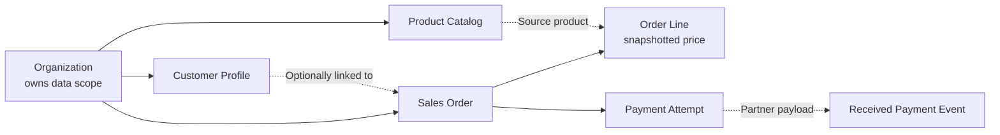
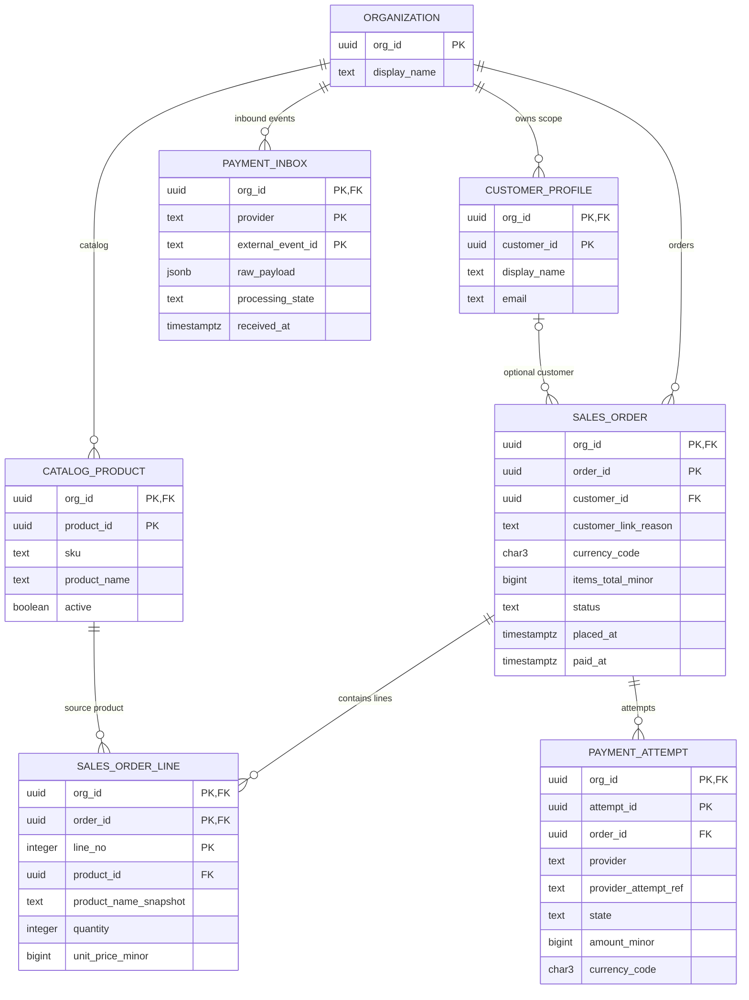

# Finalizing Diagrams, Data Dictionaries, Design Decisions, and Verification Suites

A data model is not complete simply because it has a pretty ERD or runs `CREATE TABLE` cleanly. Anyone inheriting the design must understand **what each row represents, why the keys were chosen, what attributes and statuses mean, which system owns the data, which constraints the database enforces, and which constraints live in application code**, and even more importantly: **what evidence proves the model satisfies requirements**?

This capstone exercise connects the entire design lifecycle: reading requirements → identifying **grain, entities, and relationships** → building **logical/physical models** → completing a **data dictionary** → recording **design decisions and trade-offs (ADRs)** → creating a **verification suite** → planning evolution and handoff. Learners both solve a realistic scenario and gain a **reference baseline** to compare against their own solution.

This lesson belongs to the **Integrated Exercises** chapter of the **DATABASE_DATA_MODELING** module. True to the module's goal, it asks you to turn a business problem into a verifiable data model—spanning entities, relationships, normalization, keys, indexes, and physical schemas—while explaining why a relational database fits the core transactional workflow here better than document, graph, or analytical stores.

> **Scope:** All organization names, rules, and figures below are **synthetic scenario data**. SQL uses PostgreSQL; this is not a real company's production schema. Security, retention, and payment rules are stated as **practice requirements**, not claims about any real entity's regulations or procedures.

## 1. The Destination: A Handoff-Ready Design Package

Upon completion, a learner should be able to hand a colleague **six interconnected artifacts**:

| Deliverable | Questions It Must Answer | Evidence of Completion |
| --- | --- | --- |
| **1. Requirements & Traceability Matrix** | Which rules and queries does the model solve? | Requirement ID → entity/field/constraint → test |
| **2. Conceptual, Logical, & Physical Diagrams** | Where are entities, cardinality, keys, and boundaries? | Annotated ERD, grain, PK/FK, and optionality |
| **3. Data Dictionary** | What does each field mean, in what unit, from which source? | Definitions, NULL semantics, ownership, security, timestamps, examples |
| **4. Architecture Decision Records (ADRs)** | Why choose this approach over alternatives? | Context, alternatives, consequences, review triggers |
| **5. Verification Suite** | How do you catch bad data or unauthorized access? | Unit/integration/SQL/negative/performance tests and expected outcomes |
| **6. Rollout & Evolution Plan** | Can it roll out, be monitored, and evolve safely? | Migration, compatibility, reconciliation, auth, ops, and rollback |

What matters most is **consistency across parts**. If the dictionary states an order line requires a parent order, the schema needs an FK or an evidenced enforcement mechanism. If an ADR declares keys are organization-scoped, SQL joins and tests must consistently use `org_id`. If monetary totals claim to include tax while the schema lacks a tax source, that is a **design gap**, not a documentation detail.

## 2. The Problem Statement: A Multi-Organization Sales Platform

A SaaS product allows independent businesses to manage customers, product catalogs, and orders. One user may belong to multiple businesses as staff, yet must **select and be authorized within a specific organization** before reading or writing data.

Initial version workflow:

1. Staff create a **DRAFT** order belonging to an organization, optionally attaching an existing customer profile or marking it a **guest** order.
2. Add individual **order lines** referencing a product within the same organization, quantity, unit price at order time, and a snapshot of the product name.
3. Confirm the order (**CONFIRMED**) only when it has at least one valid line and line totals are computed/reconciled.
4. Send a collection request via a payment provider; the provider emits **AUTHORIZED**, **CAPTURED**, or **DECLINED**. **AUTHORIZED does not equal collected money**.
5. In this exercise, each order has at most **one successful full capture**. An order transitions to **PAID** only after verifying capture evidence matching the order, currency, and total.
6. Paid orders may transition to **SHIPPED** per fulfillment operations; shipping details are not built out yet.
7. Orders may be canceled in policy-permitted states, but canceling after capture requires a **separate refund/reversal workflow**—never pretend a capture never happened by deleting it.
8. Authorized staff read recent orders within their organization; analytics teams need daily totals of paid orders. Formal accounting definitions of **net revenue** and **refunds** are unapproved future extensions.

Edge cases to account for: providers can deliver duplicate or late webhooks; catalog product names and list prices change over time; customers may request personal data erasure; identical external IDs may appear across two organizations.

### 2.1. Expected Data Volume and Load

Numbers used strictly for test sizing:

| Assumption | Scenario Value | What Needs Verification |
| --- | --- | --- |
| Active organizations | 30 | Independent IDs and access isolation |
| Daily new orders | 30,000 orders/day | Transaction throughput and growth |
| Largest organization | 35% of new orders | Skew, caching, and hotspots |
| Primary query | 100 most recent orders per org | Index, deterministic sort, p95/p99 |
| Lines per order | Typically 1–8 lines, possibly more | Grain, monetary totals, and FKs |
| Payment webhooks | At-least-once, up to 24h late | Inbox, deduplication, out-of-order handling |
| Reporting need | Daily, not strictly real-time | Grain, metrics, freshness |

Do not jump to 64 shards or a graph database based purely on growth numbers. **Measure** query costs and real bottlenecks before introducing distribution.

## 3. Decomposing Requirements into Testable Conditions

Assign requirement IDs for downstream traceability:

| ID | Testable Statement | Responsible Mechanism |
| --- | --- | --- |
| **R01** | Every customer/product/order belongs to exactly one `org_id` | PK/FK and org authorization |
| **R02** | An order never references another org's customer or product | Composite FK; negative tests |
| **R03** | Each order line is uniquely identified by `(org_id, order_id, line_no)` | PK, grain |
| **R04** | Order lines store product name and price at order time | Snapshots; data dictionary |
| **R05** | Positive quantities; non-negative money in one order currency | CHECK + currency policy |
| **R06** | Confirm only orders with ≥1 line and exact total match | Domain transaction + reconciliation |
| **R07** | Order/attempt status codes belong to supported sets | CHECK + versioned workflow |
| **R08** | `AUTHORIZED` never transitions an order to `PAID` | Domain transition test |
| **R09** | At most one successful capture per order in v1 | Partial unique index + idempotency |
| **R10** | Duplicate webhooks never create duplicate captures or side effects | Unique inbox + idempotent handler |
| **R11** | Order listings filter by org and paginate accurately | Query/index/API authorization |
| **R12** | Never label "gross placed order value" as "collected net revenue" | Metric definition |
| **R13** | Policy-compliant process exists to erase/unlink customer PII | Nullable reason, downstream lineage |
| **R14** | Rollout path and compatibility tests precede breaking migrations | ADR + migration plan + tests |

**Key distinction:** `CHECK(status IN (...))` protects the **allowed value set**; it **cannot enforce** the transition path `DRAFT → CONFIRMED → PAID`. R06, R08, R10, and much of R13 require application code, transactions, or verified integration workflows beyond DDL.

## 4. Activity 1 — Sketching the Conceptual Model Before Touching SQL

Answer these questions first:

- How does an **Order** differ from a **PaymentAttempt**? Is an authorization collected cash?
- Can one customer belong to multiple organizations? Can identifiers repeat across organizations?
- Does renaming a catalog product retroactively rename historical order lines?
- Can an order have **0 lines** while `DRAFT`? What about when `CONFIRMED`?
- How should a payment webhook arriving before its order mapping is ready be handled?

### 4.1. Reference Conceptual Diagram



Dashed lines represent **business links or integration-level references**, not yet asserting physical foreign keys. The conceptual model must clearly establish that "order," "order line," "payment attempt," and "partner event" are **distinct entities**.

### 4.2. Grain and Keys: Upfront Reference Table

| Entity | Grain | Identifying Key | Can Arrive Multiple Times? |
| --- | --- | --- | --- |
| Organization | One organization | `org_id` | Not under that key |
| Customer | One customer profile in one org | `(org_id, customer_id)` | Not under PK |
| Product | One product in an org's catalog | `(org_id, product_id)` | Not under PK |
| SalesOrder | One order in an org | `(org_id, order_id)` | Not under PK |
| OrderLine | One line of one order | `(org_id, order_id, line_no)` | Not under PK |
| PaymentAttempt | One tracked payment attempt | `(org_id, attempt_id)` | Each attempt unique; state may evolve |
| PaymentInbox | One source webhook identified by partner contract | `(org_id, provider, external_event_id)` | **May be redelivered** without creating new rows |

The grain of `PaymentInbox` is **one unique received and identified source event**, while delivery/retry counts can be tracked separately. If a source provider allows event ID reuse within a narrower namespace, the inbox key must include that namespace—never assume every provider issues globally unique IDs.

## 5. Activity 2 — Completing Logical and Physical ERDs

### 5.1. Cardinality Decisions

| Relationship | Child Side | Parent Side | Additional Constraints |
| --- | --- | --- | --- |
| Organization → Customer | Each customer belongs to 1 org | One org has 0..n customers | No cross-scope mixing |
| Organization → Product | Each product belongs to 1 org | One org has 0..n products | SKU unique only within org |
| Organization → Order | Each order belongs to 1 org | One org has 0..n orders | Caller must hold org permission |
| Customer → Order | Order has 0 or 1 customer | Customer has 0..n orders | `NULL` carries **reason** `GUEST`/`ERASED` |
| Order → OrderLine | Each line belongs to 1 order | Order has **structurally** 0..n lines | **CONFIRMED requires ≥1**, domain-enforced |
| Product → OrderLine | Each line references 1 product | Product has 0..n lines | Snapshotted name/price isolated from catalog edits |
| Order → PaymentAttempt | Each attempt belongs to 1 order | Order has 0..n attempts | At most 1 captured in v1 |

Avoid marking `1..n` for **all** orders if the database permits creating empty `DRAFT`s. Document both layers explicitly: **physical cardinality 0..n**, **domain invariant ≥1 at confirmation**.

### 5.2. Reference Physical ERD



**Note:** This diagram presents keys and relationships; it omits some constraints and indexes shown in the SQL section. `PAYMENT_INBOX` intentionally has **no direct FK to `PaymentAttempt`**, because webhooks can arrive before the attempt mapping exists. Linking via `provider_attempt_ref` happens in the application/integration layer and requires dedicated tests rather than pretending an enforced FK exists.

**Self-study task:** Label every composite key and distinguish FK-backed relationships from application-resolved references. Explain why repeating `org_id` in `OrderLine`/`PaymentAttempt` is a deliberate tenant-boundary safeguard rather than "redundant data to normalize away."

## 6. Activity 3 — Reference PostgreSQL Schema

The DDL below is **one valid design satisfying the scenario**, not the sole possible solution. It expresses invariants enforceable by the database; cross-row or workflow-dependent invariants are enforced in application code and verified via the SQL checks later.

### 6.1. Organizations, Customers, and Catalog

```sql
CREATE TABLE organization (
    org_id UUID PRIMARY KEY,
    display_name TEXT NOT NULL
        CHECK (length(btrim(display_name)) > 0)
);

CREATE TABLE customer_profile (
    org_id UUID NOT NULL
        REFERENCES organization(org_id),
    customer_id UUID NOT NULL,
    display_name TEXT NOT NULL
        CHECK (length(btrim(display_name)) > 0),
    email TEXT,
    PRIMARY KEY (org_id, customer_id)
);

CREATE TABLE catalog_product (
    org_id UUID NOT NULL
        REFERENCES organization(org_id),
    product_id UUID NOT NULL,
    sku TEXT NOT NULL
        CHECK (length(btrim(sku)) > 0),
    product_name TEXT NOT NULL
        CHECK (length(btrim(product_name)) > 0),
    active BOOLEAN NOT NULL DEFAULT TRUE,
    PRIMARY KEY (org_id, product_id),
    UNIQUE (org_id, sku)
);
```

This section uses system-assigned `customer_id`/`product_id` scoped to each organization. `email` is not a natural business key: emails change, get shared, or get erased under privacy policies. `sku` is scoped unique per `org_id` in this scenario; supporting multiple SKUs/aliases per real product would require modeling it explicitly rather than loosening constraints arbitrarily.

### 6.2. Orders and Order Lines

```sql
CREATE TABLE sales_order (
    org_id UUID NOT NULL
        REFERENCES organization(org_id),
    order_id UUID NOT NULL,
    customer_id UUID,
    customer_link_reason VARCHAR(12) NOT NULL,
    currency_code CHAR(3) NOT NULL
        CHECK (currency_code ~ '^[A-Z]{3}$'),
    items_total_minor BIGINT NOT NULL DEFAULT 0
        CHECK (items_total_minor >= 0),
    status VARCHAR(12) NOT NULL DEFAULT 'DRAFT'
        CHECK (status IN (
            'DRAFT', 'CONFIRMED', 'PAID',
            'SHIPPED', 'CANCELLED'
        )),
    placed_at TIMESTAMPTZ NOT NULL DEFAULT now(),
    paid_at TIMESTAMPTZ,
    PRIMARY KEY (org_id, order_id),
    FOREIGN KEY (org_id, customer_id)
        REFERENCES customer_profile(org_id, customer_id),
    CONSTRAINT ck_customer_link_reason CHECK (
        (
            customer_id IS NOT NULL
            AND customer_link_reason = 'KNOWN'
        )
        OR
        (
            customer_id IS NULL
            AND customer_link_reason IN ('GUEST', 'ERASED')
        )
    ),
    CONSTRAINT ck_paid_time CHECK (
        (
            status IN ('PAID', 'SHIPPED')
            AND paid_at IS NOT NULL
            AND paid_at >= placed_at
        )
        OR
        (
            status NOT IN ('PAID', 'SHIPPED')
            AND paid_at IS NULL
        )
    )
);

CREATE TABLE sales_order_line (
    org_id UUID NOT NULL,
    order_id UUID NOT NULL,
    line_no INTEGER NOT NULL CHECK (line_no > 0),
    product_id UUID NOT NULL,
    product_name_snapshot TEXT NOT NULL
        CHECK (length(btrim(product_name_snapshot)) > 0),
    quantity INTEGER NOT NULL CHECK (quantity > 0),
    unit_price_minor BIGINT NOT NULL
        CHECK (unit_price_minor > 0),
    PRIMARY KEY (org_id, order_id, line_no),
    FOREIGN KEY (org_id, order_id)
        REFERENCES sales_order(org_id, order_id),
    FOREIGN KEY (org_id, product_id)
        REFERENCES catalog_product(org_id, product_id)
);
```

**Correctness notes:**

- A `SALES_ORDER` may exist in `DRAFT` with 0 lines; upon transitioning to `CONFIRMED`, the application must verify **at least one line**.
- `items_total_minor` in v1 is defined **strictly as the sum of `quantity × unit_price_minor`**. Taxes, shipping fees, vouchers, and refunds are **out of scope**. Expanding business scope requires versioned definitions and schema evolution—never rebrand `items_total_minor` as net revenue.
- The order's `currency_code` governs every line; snapshotted line prices are already stored in **minor units of that currency**. Any conversion from catalog pricing must be verified **before saving**; DDL cannot infer exchange-rate sources.
- `customer_link_reason='ERASED'` documents why the customer FK was unlinked; it does **not** prove names/emails in files, logs, or payment payloads have been purged.
- `paid_at >= placed_at` is a workflow assumption in this exercise; integrating legacy data or events with unreliable clocks requires reviewing timestamp policies rather than faking data to pass `CHECK`.

### 6.3. Payment Attempts and Webhook Inbox

```sql
CREATE TABLE payment_attempt (
    org_id UUID NOT NULL,
    attempt_id UUID NOT NULL,
    order_id UUID NOT NULL,
    provider TEXT NOT NULL
        CHECK (length(btrim(provider)) > 0),
    provider_attempt_ref TEXT NOT NULL
        CHECK (length(btrim(provider_attempt_ref)) > 0),
    state VARCHAR(12) NOT NULL
        CHECK (state IN (
            'CREATED', 'AUTHORIZED', 'CAPTURED', 'DECLINED'
        )),
    amount_minor BIGINT NOT NULL CHECK (amount_minor > 0),
    currency_code CHAR(3) NOT NULL
        CHECK (currency_code ~ '^[A-Z]{3}$'),
    attempted_at TIMESTAMPTZ NOT NULL,
    state_updated_at TIMESTAMPTZ NOT NULL,
    PRIMARY KEY (org_id, attempt_id),
    FOREIGN KEY (org_id, order_id)
        REFERENCES sales_order(org_id, order_id),
    UNIQUE (org_id, provider, provider_attempt_ref)
);

-- v1 rule: at most one attempt per order in CAPTURED state
-- at any given time.
CREATE UNIQUE INDEX ux_one_capture_per_order
    ON payment_attempt (org_id, order_id)
    WHERE state = 'CAPTURED';

CREATE TABLE payment_inbox (
    org_id UUID NOT NULL
        REFERENCES organization(org_id),
    provider TEXT NOT NULL
        CHECK (length(btrim(provider)) > 0),
    external_event_id TEXT NOT NULL
        CHECK (length(btrim(external_event_id)) > 0),
    payload_sha256 CHAR(64) NOT NULL
        CHECK (payload_sha256 ~ '^[0-9a-f]{64}$'),
    raw_payload JSONB NOT NULL,
    occurred_at TIMESTAMPTZ,
    received_at TIMESTAMPTZ NOT NULL DEFAULT now(),
    processing_state VARCHAR(16) NOT NULL
        CHECK (processing_state IN (
            'RECEIVED', 'DEFERRED', 'REJECTED', 'APPLIED'
        )),
    reason_code TEXT,
    PRIMARY KEY (org_id, provider, external_event_id)
);

CREATE INDEX ix_payment_inbox_pending
    ON payment_inbox (processing_state, received_at)
    WHERE processing_state IN ('RECEIVED', 'DEFERRED');

CREATE INDEX ix_orders_recent
    ON sales_order (
        org_id, placed_at DESC, order_id DESC
    );

CREATE INDEX ix_orders_status
    ON sales_order (org_id, status, placed_at DESC, order_id DESC);

CREATE INDEX ix_lines_by_product
    ON sales_order_line (org_id, product_id);
```

**Important boundaries to state explicitly:** The partial unique index prevents **two concurrent `CAPTURED` `payment_attempt` rows on one order**, yet it does not verify captured amounts match or prevent a partner from charging twice externally. `payment_inbox` prevents duplicate event rows per namespace, yet it does not guarantee a consumer won't repeat side effects after a crash. You need coordinated transactions, idempotent handlers, and reconciliation.

No FK connects `payment_inbox` to `payment_attempt`, because **events can arrive before mappings exist**. `DEFERRED` is a legitimate state while waiting for a dependency—never a reason to synthesize unverified orders or attempts from raw partner payloads.

## 7. Evaluating Normalization and Intentional Redundancy

In the reference schema, several repeated attributes exist deliberately:

| Element | Looks Redundant? | Rationale | Control Condition |
| --- | --- | --- | --- |
| `org_id` in line/attempt | Org already known via order | Composite FK and scoped query paths enforce tenant isolation | Composite FK, queries filter full key |
| `product_name_snapshot` | `catalog_product.product_name` exists | Name at order time must remain immutable despite catalog edits | Written atomically in line creation transaction |
| `unit_price_minor` | Could look up price table | Actual transaction price can diverge from current list price | Store currency/source/price rule as needed |
| `items_total_minor` | Could `SUM` lines | Fast reads and payment cross-checks | Updated atomically by application; data-quality checks |
| `raw_payload` in inbox | Normalized state exists | Audit/reprocessing when upstream contracts evolve | Access control, PII minimization, retention |

Normalization does not mean **eliminating every duplicate value**. Controlled duplication is valid when paired with an **explicit definition, authoritative write path, constraints, and consistency tests**. Conversely, duplicate data with no clear source of truth signals muddled design.

In a relational schema, `items_total_minor` is a **derived value**. Simple `CHECK` constraints cannot sum rows across another table. Confirming an order and updating its total must execute inside one transaction with appropriate locking or optimistic versioning to prevent concurrent line edits.

## 8. Activity 4 — Entity-Level Data Dictionary

Never just write "`customer_id` is a UUID." A dictionary must teach readers the **meaning, keys, lifecycle, and safe usage** of every entity.

| Entity | Grain | Source of Truth | Functional Owner | Retention / PII Notes |
| --- | --- | --- | --- | --- |
| `organization` | One organization | Tenant management service | Platform | Org name, tenant lifecycle |
| `customer_profile` | One customer profile per org | Customer domain | Customer/CRM | Name, email; erasure rights & retention |
| `catalog_product` | One product per org | Catalog domain | Catalog | SKU/list price, deactivation |
| `sales_order` | One order belonging to an org | Order domain | Order | Transaction info, customer link |
| `sales_order_line` | One order line item | Order domain | Order | Name/price snapshots, line proof |
| `payment_attempt` | One payment attempt | Payment integration + domain verification | Payment | Provider refs and payment evidence |
| `payment_inbox` | One unique identified source event | Integration inbox | Integration | Raw payload may hold PII; dedicated retention |

**Owner** here denotes authority over *definitions and changes*; it does not force every table into a single physical service. Across separate bounded contexts, tables may reside in separate databases, in which case cross-database FKs are **no longer enforced by a single PostgreSQL instance** and must be replaced by contracts and verification. This lab uses one transactional database to demonstrate full constraint enforcement.

## 9. Attribute-Level Data Dictionary

Each dictionary entry needs at least: **field, type, nullability, definition, source/unit, example, permissions, and validation**. Never omit units or timestamp semantics on monetary or temporal columns.

### 9.1. Organization, Customer, and Product

| Table.Column | Type / Null | Definition & Example | Validation / Notes |
| --- | --- | --- | --- |
| `organization.org_id` | UUID, NOT NULL | System-assigned organization ID | PK; never trust unauthorized client IDs |
| `organization.display_name` | TEXT, NOT NULL | Display name of the organization | Non-blank; not used as PK |
| `customer_profile.org_id` | UUID, NOT NULL | Customer ownership scope | Same namespace as organization |
| `customer_profile.customer_id` | UUID, NOT NULL | Profile ID within org | Composite PK; may collide across orgs |
| `customer_profile.display_name` | TEXT, NOT NULL | Business customer display name | PII; access control & retention |
| `customer_profile.email` | TEXT, NULL | Email if lawful basis exists | PII; `NULL` does not prove erasure |
| `catalog_product.product_id` | UUID, NOT NULL | Product ID within org | Composite PK |
| `catalog_product.sku` | TEXT, NOT NULL | Org-scoped SKU | Unique `(org_id, sku)` |
| `catalog_product.product_name` | TEXT, NOT NULL | Current catalog product name | Edits never alter historical `order_line` |
| `catalog_product.active` | BOOL, NOT NULL | Whether usable for new lines | Deactivating preserves historical lines |

### 9.2. Order and OrderLine

| Table.Column | Type / Null | Definition & Example | Validation / Notes |
| --- | --- | --- | --- |
| `sales_order.org_id` | UUID, NOT NULL | Owning org scope | Preserved in all PK/FKs |
| `sales_order.order_id` | UUID, NOT NULL | Order ID within org | PK `(org_id, order_id)` |
| `sales_order.customer_id` | UUID, NULL | Customer profile if linked | Composite FK; detachable on erasure |
| `sales_order.customer_link_reason` | VARCHAR, NOT NULL | `KNOWN`, `GUEST`, or `ERASED` | CHECK enforces match with `customer_id` nullability |
| `sales_order.currency_code` | CHAR(3), NOT NULL | Currency code, e.g. `VND`, `USD` | 3 uppercase letters; validate real currency via policy |
| `sales_order.items_total_minor` | BIGINT, NOT NULL | Sum in **minor units**, equals line totals in v1 | Never treat as "net revenue" |
| `sales_order.status` | VARCHAR, NOT NULL | `DRAFT/CONFIRMED/PAID/SHIPPED/CANCELLED` | Domain workflow guards transitions |
| `sales_order.placed_at` | TIMESTAMPTZ, NOT NULL | Order recorded timestamp per exercise contract | Don't confuse event time with ingestion time |
| `sales_order.paid_at` | TIMESTAMPTZ, NULL | Timestamp when domain confirmed capture | Populated only in `PAID`/`SHIPPED` per sample policy |
| `sales_order_line.line_no` | INTEGER, NOT NULL | Positive unique line number in order | PK with org/order |
| `sales_order_line.product_id` | UUID, NOT NULL | Source product within same org | Composite FK `(org_id, product_id)` |
| `sales_order_line.product_name_snapshot` | TEXT, NOT NULL | Product name when line was created | Never updated when catalog changes |
| `sales_order_line.quantity` | INTEGER, NOT NULL | Item unit count, >0 | Define unit clearly for weighted goods |
| `sales_order_line.unit_price_minor` | BIGINT, NOT NULL | Locked unit price in order currency, >0 | Transaction-time price, not current catalog price |

### 9.3. PaymentAttempt and Inbox

| Table.Column | Type / Null | Definition & Example | Validation / Notes |
| --- | --- | --- | --- |
| `payment_attempt.attempt_id` | UUID, NOT NULL | Internal attempt ID | Composite PK with org |
| `payment_attempt.order_id` | UUID, NOT NULL | Order being paid | Org-scoped composite FK |
| `payment_attempt.provider` | TEXT, NOT NULL | Partner namespace, e.g. `PAYMENT_A` | Verified against connection config |
| `payment_attempt.provider_attempt_ref` | TEXT, NOT NULL | Partner's attempt ID | Unique per `(org, provider)` per scenario contract |
| `payment_attempt.state` | VARCHAR, NOT NULL | `CREATED/AUTHORIZED/CAPTURED/DECLINED` | Never equate `AUTHORIZED` with `PAID` |
| `payment_attempt.amount_minor` | BIGINT, NOT NULL | Attempt amount, >0 | Compare currency and order total carefully |
| `payment_attempt.currency_code` | CHAR(3), NOT NULL | Attempt currency | Must match order currency, not just numeric amount |
| `payment_attempt.attempted_at` | TIMESTAMPTZ, NOT NULL | When system recorded attempt | May differ from provider event time |
| `payment_attempt.state_updated_at` | TIMESTAMPTZ, NOT NULL | When internal state changed | Does not establish upstream event order |
| `payment_inbox.external_event_id` | TEXT, NOT NULL | Partner-issued event ID | PK includes org/provider/event; deduplication |
| `payment_inbox.payload_sha256` | CHAR(64), NOT NULL | Digest of canonical/raw bytes per contract | Detects conflicting payloads on same event ID |
| `payment_inbox.raw_payload` | JSONB, NOT NULL | Source payload for authorized audit/replay | PII risk; access controls & retention |
| `payment_inbox.occurred_at` | TIMESTAMPTZ, NULL | Upstream claimed occurrence time | Never guess timezone if omitted |
| `payment_inbox.received_at` | TIMESTAMPTZ, NOT NULL | Webhook receipt timestamp | Used for lag metrics and backoff |
| `payment_inbox.processing_state` | VARCHAR, NOT NULL | `RECEIVED/DEFERRED/REJECTED/APPLIED` | Surfaces backlog visibility |
| `payment_inbox.reason_code` | TEXT, NULL | Defer/reject reason per contract | Avoid leaking raw payloads/PII in reason strings |

This dictionary is **not yet a full production governance spec**: real projects need links to source contracts, verified owners, SLAs, sensitivity classifications, versions, and review dates. Still, it shows why a raw column listing from `information_schema` **can never substitute for business semantics**.

## 10. Activity 5 — Writing Architecture Decision Records (ADRs)

A good ADR does more than say "we use PostgreSQL." It captures **context, options considered, trade-offs, and revisit triggers**.

### ADR-001 — Structured Relational Schema Over Generic Object / EAV Tables

**Context.** We have stable core entities and queries: org, customer, product, order, line, payment attempt. Many invariants involve PKs, FKs, UNIQUE constraints, money, and transactions.

**Options.**

| Option | Strengths | Drawbacks |
| --- | --- | --- |
| PostgreSQL typed tables | Strong PK/FK/CHECK, ACID transactions, clear SQL reporting | New core fields require migrations |
| Single generic EAV table | Runtime dynamic fields | Weak FK/type enforcement, awkward queries/validation, semantic drift risk |
| Document store per order | Convenient single-aggregate reads/writes in some workloads | Cross-entity tenant/product/payment links, transactions, and indexes need separate design |
| Graph store as primary source | Excels when multi-hop traversals dominate | Current problem centers on transactions and aggregations, not core graph traversal |

**Decision.** Choose well-grained relational tables with explicit constraints. Do not build a system-wide EAV model merely for unrequested flexibility. `raw_payload JSONB` belongs strictly at the integration edge, never replacing domain entities.

**Consequences.** Straightforward correctness and scope verification; requires migration/versioning discipline, index/storage monitoring, and model updates when workflows expand.

**Review trigger.** Verified requirements for user-defined runtime fields, or measured analytics/traversal workloads exceeding relational limits.

### ADR-002 — Propagating `org_id` Across PK/FKs for Tenant Isolation

**Context.** Local IDs can collide across organizations. Order–Customer, OrderLine–Product, and Payment–Order links must never cross tenant boundaries.

**Options.** Global UUIDs with app-only checks; composite `(org_id, local_id)` keys; dedicated database per tenant.

**Decision.** Within this single multi-tenant lab database, use composite keys and composite FKs; the application still verifies caller permissions per org rather than trusting client-supplied org IDs.

**Consequences.** Every query and index carries org scope; FKs structurally block cross-tenant links. Does not replace authorization checks across APIs, search, caches, or exports—those paths still require tests.

**Review trigger.** True cross-org sharing, data residency mandates, or a tenant requiring isolated hardware based on measured load; **never** bypass boundaries by stripping `org_id` from FKs.

### ADR-003 — Snapshotting Order Lines and Persisting a Payment Inbox

**Context.** Catalog prices/names change; payment partners redeliver or delay events. Historical orders must never mutate when catalogs change, and duplicate webhooks must never record duplicate captures.

**Decision.** Order lines store `product_name_snapshot` and `unit_price_minor`. Payments track separate attempts; the inbox enforces identity/hash/state with verified provider identity; domain workflows verify capture before transitioning to `PAID`.

**Trade-off.** Snapshots demand clear write rules; inbox payloads introduce PII/retention obligations; event processing requires idempotency and out-of-order handling. All of these **must be verified by tests**, not merely documented.

**Review trigger.** Supporting partial captures/refunds, multi-currency pricing, or new providers with different semantics requires versioned contract, schema, and test updates.

### ADR-004 — No Premature Sharding Before Evidence

Assumed workload does not justify horizontal sharding. Measure `EXPLAIN`, indexes, QPS/p99, tenant skew, and backup/restore times first. Once a verified bottleneck appears, evaluate partitioning, tenant isolation, or read projections tailored to actual queries. Accept potential future migration effort in exchange for avoiding premature multi-shard routing complexity.

**Self-study task:** Pick one ADR and add **approver, version, date, test evidence, and rejected alternatives**. Naming a technology alone does not communicate trade-offs to future maintainers.

## 11. Activity 6 — Queries and Indexes Aligned to Access Patterns

### 11.1. Listing Orders by Organization with Keyset Pagination

```sql
-- $1 = org_id verified by backend authorization
SELECT
    order_id,
    status,
    items_total_minor,
    currency_code,
    placed_at
FROM sales_order
WHERE org_id = $1
ORDER BY placed_at DESC, order_id DESC
LIMIT 100;

-- Next page: $2 = last placed_at from previous page,
-- $3 = last order_id from previous page.
SELECT
    order_id,
    status,
    items_total_minor,
    currency_code,
    placed_at
FROM sales_order
WHERE org_id = $1
  AND (placed_at, order_id) < ($2, $3)
ORDER BY placed_at DESC, order_id DESC
LIMIT 100;
```

`ix_orders_recent(org_id, placed_at DESC, order_id DESC)` is a fitting candidate index. However, if orders are modified, deleted, or newly placed mid-pagination, results can shift; the API should document snapshot/consistency semantics rather than promising "never skips or repeats rows" without snapshot or cursor guarantees.

### 11.2. Fetching Lines for One Order

```sql
SELECT
    l.line_no,
    l.product_id,
    l.product_name_snapshot,
    l.quantity,
    l.unit_price_minor
FROM sales_order_line AS l
WHERE l.org_id = $1
  AND l.order_id = $2
ORDER BY l.line_no;
```

The composite PK serves this lookup directly. Do not create standalone indexes on every column out of habit; inspect real execution plans.

### 11.3. A Well-Defined Reporting Metric

**Example: "value of orders currently marked `PAID` or `SHIPPED` by placement date"** — this is an operational metric, **not net revenue and not settled cash**:

```sql
SELECT
    date_trunc(
        'day',
        placed_at AT TIME ZONE 'UTC'
    )::date AS order_day_utc,
    currency_code,
    SUM(items_total_minor::numeric) AS order_value_minor
FROM sales_order
WHERE org_id = $1
  AND status IN ('PAID', 'SHIPPED')
  AND placed_at >= $2
  AND placed_at < $3
GROUP BY 1, currency_code
ORDER BY 1, currency_code;
```

Explicit definition:

- **Source grain:** one `sales_order`; never join `payment_attempt` or `sales_order_line` directly when summing, avoiding row multiplication.
- **Filter:** **current** status is `PAID` or `SHIPPED`; a canceled order drops out even if it was once `PAID`.
- **Time axis:** placement date in UTC—**not** capture date or accounting recognition date.
- **Units:** minor currency units grouped by `currency_code`; never sum USD and VND without explicit FX rules.
- **Limitations:** refunds, partial captures, status histories, and formal accounting figures are **not modeled yet**, so never label this KPI "recognized net revenue."

If the business needs **daily captured cash flow**, build that metric from a **payment capture event/ledger** with dedicated time semantics rather than silently repurposing current order status.

## 12. Activity 7 — Layered Verification Matrix

| Layer | Objective | Example Evidence |
| --- | --- | --- |
| **Schema unit/negative** | DB rejects invalid keys/types/constraints | Cross-org FK insert, `quantity = 0`, duplicate SKU |
| **Domain unit** | State transitions obey rules | Empty `DRAFT` cannot confirm; `AUTHORIZED` does not yield `PAID` |
| **Application integration** | Transactions, idempotency, mappings hold | Retried webhook creates no second capture |
| **Data quality SQL** | Detect logical drift even after successful writes | Line-sum mismatch, `PAID` order lacking capture |
| **Authorization/security** | Unauthorized actors stay blocked | User B guesses A's ID; exports/caches never leak |
| **Performance** | Queries meet SLOs under representative load | `EXPLAIN (ANALYZE, BUFFERS)`, p95/p99 latency |
| **Evolution/compatibility** | New schema doesn't break older apps during rollout | A0/S1, A1/S1, backfill/rollback drills |
| **Recovery/privacy** | Restores and erasure adhere to policy | Replay does not resurrect erased customer profiles |

**At a minimum, the verification suite must include expected-failure negative tests.** A suite testing only valid `INSERT`s proves nothing about FK, permission, or invariant enforcement.

## 13. SQL Constraint Testing: Setting Up an Isolated Fixture

Create a tiny dataset with deterministic UUIDs so expected behavior is crystal clear. Run in an **isolated test database** after applying Section 6 DDL; never run directly on production.

```sql
BEGIN;

INSERT INTO organization (org_id, display_name)
VALUES
    ('10000000-0000-4000-8000-000000000001', 'Org A'),
    ('10000000-0000-4000-8000-000000000002', 'Org B');

INSERT INTO customer_profile (
    org_id, customer_id, display_name, email
)
VALUES (
    '10000000-0000-4000-8000-000000000001',
    '20000000-0000-4000-8000-000000000017',
    'Customer A', 'a@example.test'
);

INSERT INTO catalog_product (
    org_id, product_id, sku, product_name, active
)
VALUES (
    '10000000-0000-4000-8000-000000000001',
    '30000000-0000-4000-8000-000000000001',
    'SKU-01', 'Sample Product', TRUE
);

INSERT INTO sales_order (
    org_id, order_id, customer_id, customer_link_reason,
    currency_code, items_total_minor, status, placed_at
)
VALUES (
    '10000000-0000-4000-8000-000000000001',
    '40000000-0000-4000-8000-000000000001',
    '20000000-0000-4000-8000-000000000017',
    'KNOWN', 'VND', 200000, 'DRAFT',
    '2030-04-01T09:00:00+00'
);

INSERT INTO sales_order_line (
    org_id, order_id, line_no, product_id,
    product_name_snapshot, quantity, unit_price_minor
)
VALUES (
    '10000000-0000-4000-8000-000000000001',
    '40000000-0000-4000-8000-000000000001',
    1,
    '30000000-0000-4000-8000-000000000001',
    'Sample Product', 2, 100000
);

-- Subsequent verification queries run inside this transaction.
-- ROLLBACK at the end to leave no fixture rows behind.
```

In this fixture, the order line yields `2 × 100000 = 200000` VND; order status is `DRAFT`. Do not infer from matching totals that the order is already confirmed or paid.

### 13.1. Negative Tests via Exception-Handling PL/pgSQL

Running a failing `INSERT` inside a plain SQL transaction marks the PostgreSQL transaction **aborted**, forcing subsequent statements to roll back unless savepoints are used. The `DO` block below catches expected exceptions cleanly so testing continues:

```sql
DO $$
BEGIN
    -- Org B's order attempts to reference a customer belonging only to Org A.
    BEGIN
        INSERT INTO sales_order (
            org_id, order_id, customer_id, customer_link_reason,
            currency_code, items_total_minor, status, placed_at
        )
        VALUES (
            '10000000-0000-4000-8000-000000000002',
            '40000000-0000-4000-8000-000000000002',
            '20000000-0000-4000-8000-000000000017',
            'KNOWN', 'VND', 0, 'DRAFT',
            '2030-04-01T09:05:00+00'
        );
        RAISE EXCEPTION 'TEST FAILED: cross-org FK accepted';
    EXCEPTION
        WHEN foreign_key_violation THEN
            RAISE NOTICE 'PASS: cross-org FK rejected';
    END;

    -- Quantity 0 violates CHECK constraint.
    BEGIN
        INSERT INTO sales_order_line (
            org_id, order_id, line_no, product_id,
            product_name_snapshot, quantity, unit_price_minor
        )
        VALUES (
            '10000000-0000-4000-8000-000000000001',
            '40000000-0000-4000-8000-000000000001',
            2,
            '30000000-0000-4000-8000-000000000001',
            'Sample Product', 0, 100000
        );
        RAISE EXCEPTION 'TEST FAILED: quantity 0 accepted';
    EXCEPTION
        WHEN check_violation THEN
            RAISE NOTICE 'PASS: invalid quantity rejected';
    END;
END;
$$;
```

If a test fails with a **different** error than expected, it does not count as `PASS`. Tests must run in an isolated environment with deterministic schema and fixtures; **never alter tests or weaken FK/CHECK constraints to hide failures**.

## 14. Data Quality Verification Queries

The queries below are **reconciliation/quality checks**, not live database constraints. On the sample fixture, several intentionally return zero rows because no order has been confirmed or paid yet.

### 14.1. Confirmed Orders Without Lines

```sql
SELECT o.org_id, o.order_id, o.status
FROM sales_order AS o
WHERE o.status IN ('CONFIRMED', 'PAID', 'SHIPPED')
  AND NOT EXISTS (
      SELECT 1
      FROM sales_order_line AS l
      WHERE l.org_id = o.org_id
        AND l.order_id = o.order_id
  );
```

**Expected:** 0 rows. Any row returned indicates invariant R06 was breached even though order–line FKs remain intact.

### 14.2. Order Total Mismatch vs. Lines

```sql
WITH line_total AS (
    SELECT
        org_id,
        order_id,
        SUM(
            quantity::numeric * unit_price_minor::numeric
        ) AS computed_minor
    FROM sales_order_line
    GROUP BY org_id, order_id
)
SELECT
    o.org_id, o.order_id,
    o.items_total_minor AS stored_minor,
    COALESCE(t.computed_minor, 0) AS expected_minor
FROM sales_order AS o
LEFT JOIN line_total AS t
  ON t.org_id = o.org_id
 AND t.order_id = o.order_id
WHERE o.status IN ('CONFIRMED', 'PAID', 'SHIPPED')
  AND o.items_total_minor::numeric
      IS DISTINCT FROM COALESCE(t.computed_minor, 0);
```

**Expected:** 0 rows for line-locked statuses. A `DRAFT` order may still be mid-edit, so differences on `DRAFT` rows do not signify corruption.

Multiplication casts to `numeric` to avoid `BIGINT` overflow on extreme values. When storing totals back into `BIGINT`, the application must enforce allowed bounds.

### 14.3. PAID/SHIPPED Orders Missing a Full Capture

```sql
SELECT
    o.org_id, o.order_id,
    o.items_total_minor,
    COUNT(p.attempt_id) AS captured_count,
    COALESCE(SUM(p.amount_minor::numeric), 0)
        AS captured_minor
FROM sales_order AS o
LEFT JOIN payment_attempt AS p
  ON p.org_id = o.org_id
 AND p.order_id = o.order_id
 AND p.state = 'CAPTURED'
 AND p.currency_code = o.currency_code
WHERE o.status IN ('PAID', 'SHIPPED')
GROUP BY o.org_id, o.order_id, o.items_total_minor
HAVING COUNT(p.attempt_id) <> 1
    OR COALESCE(SUM(p.amount_minor::numeric), 0)
       <> o.items_total_minor::numeric;
```

**Expected:** 0 rows. Add a check for **captured payments with mismatched currencies** or a dedicated FX policy if real integrations support multi-currency. In the v1 schema, the query above counts only currency-matching captures; a wrong-currency capture leaves the matching count at 0, surfacing the `PAID`/`SHIPPED` order anyway. If an order sits at `CONFIRMED` despite a `CAPTURED` attempt, that represents an in-flight transition or a stuck state needing SLA handling.

### 14.4. Unprocessed or Conflicting Source Events

```sql
SELECT
    org_id,
    provider,
    processing_state,
    reason_code,
    COUNT(*) AS event_count,
    MIN(received_at) AS oldest_received_at
FROM payment_inbox
WHERE processing_state IN (
    'RECEIVED', 'DEFERRED', 'REJECTED'
)
GROUP BY org_id, provider, processing_state, reason_code
ORDER BY oldest_received_at;
```

**Expected:** Not necessarily 0 rows. These states occur naturally during asynchronous processing, yet require **backlog age SLAs**, alerting, and retry/quarantine mechanics. Zero rows here also does not prove partner webhooks weren't lost **before ever reaching the inbox**.

After executing the verification queries against the Section 13 fixture, close the transaction so **no test fixture data persists**:

```sql
ROLLBACK;
```

If you want to re-run quality checks after rolling back, recreate the fixture inside a fresh transaction. Never run `ROLLBACK` inside a transaction holding work you intend to keep; all examples assume an isolated test database.

## 15. Testing Workflows and Idempotency

No single `CHECK` constraint verifies an entire business workflow. Write explicit *Given–When–Then* tests:

| ID | Given | When | Then |
| --- | --- | --- | --- |
| **T01** | `DRAFT` order with zero lines | Confirm | Rejected; status unchanged |
| **T02** | Order with lines, stale stored total | Confirm | Rejected or recalculated/reconciled atomically per policy |
| **T03** | Payment attempt in `AUTHORIZED` | Webhook received | Order never transitions to `PAID` |
| **T04** | Capture matches order/currency/amount | Handler verifies | Order transitions `CONFIRMED → PAID` once |
| **T05** | Duplicate `CAPTURED` webhook with same event ID | Processed repeatedly | Single inbox entry; no duplicate side effects |
| **T06** | Same event ID but different payload hash | Processed | Conflict/quarantine flagged; never silently overwritten |
| **T07** | `CAPTURED` arrives before attempt mapping exists | Processed | `DEFERRED`; never synthesizes an unverified order |
| **T08** | Already-`PAID` order | Second `CAPTURED` attempt inserted | Blocked by v1 unique index; handler reconciles |
| **T09** | Catalog product renamed after order line created | Read historical order | Snapshotted line name remains unchanged |
| **T10** | User B belongs only to Org B, knows Order A's ID | Calls API | Cannot view or mutate Org A's data |
| **T11** | Org A staff loses org membership | Calls API again | Access denied immediately per policy |
| **T12** | Order marked `PAID` with no captured attempt | Data-quality job runs | Flagged for remediation |

**Implementation tip:** Payment handlers should update **inbox state, attempt state, and order state** within one transaction when residing in the same database. If publishing to a broker, pair an outbox with idempotent consumers—"commit DB then fire message" is not atomic. Verify webhook signatures over raw bytes before trusting IDs/mappings, and derive `org_id` from verified bindings rather than arbitrary payload fields.

### 15.1. A Concurrency Test Case

Two workers receive the same `CAPTURED` event simultaneously:

```text
Worker 1: observes inbox RECEIVED
Worker 2: observes inbox RECEIVED
Worker 1: updates attempt, order, inbox
Worker 2: attempts to re-apply the same order/event
```

A bare `SELECT` followed by `UPDATE` is **insufficient** without row locking, compare-and-set, or suitable isolation/transactions. Use row locks, conditional version updates, unique constraints, and idempotent handlers—and explicitly test the chosen strategy under concurrency. Passing evidence means **exactly one business outcome** and zero half-applied states if a worker crashes mid-step.

## 16. Traceability Verification Matrix: Requirements to Tests

This table prevents the "pretty diagram, missing tests" failure mode:

| Requirement | Implementation Artifact | Verification |
| --- | --- | --- |
| R01–R02 tenant scope | Composite PK/FK, authorization | SQL negative FK, API T10/T11 |
| R03 line identity | `PRIMARY KEY(org_id,order_id,line_no)` | Duplicate line insert rejected |
| R04 snapshot history | `product_name_snapshot`, `unit_price_minor` | T09; catalog edits leave lines untouched |
| R05 numbers/currency | Quantity/price CHECKs, currency policy | Invalid inserts, conversion tests |
| R06 confirm invariant | Domain transaction | T01/T02, Section 14.1/14.2 SQL |
| R07 status vocabulary | CHECK + state machine | Unknown enum insert rejected, transition tests |
| R08 authorized vs. paid | Domain logic | T03 |
| R09 single capture | Partial unique index | T08 |
| R10 duplicate webhooks | Inbox PK/hash, handler | T05/T06/T07 |
| R11 listing performance | Scoped index and keyset query | API test + EXPLAIN/benchmark |
| R12 metric semantics | Section 11.3 KPI definition | Currency/time golden fixtures |
| R13 customer erasure | Nullable reason, erasure workflow | Scoped deletion, downstream/replay drill |
| R14 schema evolution | Migration/compatibility matrix | Rolling deployment/rollback drill |

If a requirement lacks verification evidence, mark it **NOT_VERIFIED**—never treat "code handles it" as proof without executed tests or an explicitly verified enforcement point.

## 17. Reviewing Access Controls and Organization Scoping

Composite FKs protect integrity **at write time**, but never replace authorization **on reads or API calls**. Verify at least:

- Which principals hold `order:read`, `order:write`, `payment:reconcile`, `customer:erase`?
- In **which org** was each role granted, and is membership still active?
- Do cache keys, background jobs, exports, and search indexes all include `org_id`?
- How does a multi-org staff member switch context, and can they spoof an `org_id`?
- How much PII may the payment service access? Should inbox/raw payloads be redacted?

### 17.1. PostgreSQL RLS Is Defense-in-Depth, Not Authentication

Example **order-table-only illustrative policy**, assuming a non-privileged `app_runtime` role and a trusted backend verifying membership:

```sql
ALTER TABLE sales_order ENABLE ROW LEVEL SECURITY;
ALTER TABLE sales_order FORCE ROW LEVEL SECURITY;

CREATE POLICY order_org_select
ON sales_order
FOR SELECT TO app_runtime
USING (
    org_id = NULLIF(
        current_setting('app.org_id', true), ''
    )::uuid
);

CREATE POLICY order_org_insert
ON sales_order
FOR INSERT TO app_runtime
WITH CHECK (
    org_id = NULLIF(
        current_setting('app.org_id', true), ''
    )::uuid
);
```

Mandatory caveats:

1. This alone is **incomplete**: `UPDATE`/`DELETE` and all other tables need action-specific policies and `GRANT`s—enabling `SELECT`/`INSERT` on one table never secures a multi-tenant system.
2. `app.org_id` is a custom setting, **not cryptographic authentication**. Any session able to run arbitrary SQL as `app_runtime` could reset it and spoof scope.
3. The backend must verify principal/membership, execute `SET LOCAL` inside the transaction for an authorized org, and verify connection pooling resets state properly.
4. PostgreSQL superusers and roles with `BYPASSRLS` ignore RLS; `FORCE` does not override those privileges.
5. Viewing one order vs. **bulk exporting orders** may require distinct permissions beyond a single `SELECT` policy.

### 17.2. Minimum Authorization Test Suite

Create two orgs sharing the same local `order_id` if permitted; User A belongs only to Org A, User B only to Org B. Exercise detail, list, export, edit, cancel, and webhook lookup endpoints. Verify zero Org A data leaks to User B via **response bodies, status/error messages, caches, counts, logs, or file downloads**. Test both unprivileged runtime connections and elevated batch paths.

## 18. Data Erasure and Historical Records

A customer may request deletion of personal profile data while transaction orders/records must partially remain under valid retention policies. This lesson avoids dictating universal legal mandates: learners must document the **verification, classification, and approval workflow**.

With the reference schema, once authorized, a transaction **can** unlink the customer from retainable orders before deleting the profile:

```sql
BEGIN;

UPDATE sales_order
SET customer_id = NULL,
    customer_link_reason = 'ERASED'
WHERE org_id = $1
  AND customer_id = $2;

DELETE FROM customer_profile
WHERE org_id = $1
  AND customer_id = $2;

COMMIT;
```

This SQL alone **is insufficient to claim personal data has been erased**. Check emails/names in other tables, raw webhooks, logs, caches, search indexes, exports, warehouses, files, and backups. `ERASED` merely records why the FK was nulled in this table—it does not prove remaining data is truly anonymized.

A solid verification plan requires:

1. Verifying the data subject's identity and org scope.
2. Inventorying all storage locations, lawful retention bases, and exceptions.
3. Emitting deletion events / downstream reconciliations and checking ACKs meaning **applied**, not merely received.
4. Guards/markers preventing old event replays or backfills from resurrecting deleted profiles.
5. Testing backup restores followed by **re-applying erasure requests before re-enabling read access**.
6. Avoiding storing permanent PII inside audit/tombstone logs just "so we can re-delete later."

These belong to **core data design quality**, not optional afterthoughts added post-launch.

## 19. Performance Testing and Physical Design Choices

For the recent-orders listing query, collect:

| Metric | Why It Matters |
| --- | --- |
| Orders per tenant, top tenant share, growth rate | Captures cardinality and skew rather than bare row counts |
| Read/write QPS per endpoint | Establishes real load profile |
| p50/p95/p99 latency | Tracks user tail latency |
| Rows/bytes scanned, index execution plan | Confirms index effectiveness |
| Lock waits, CPU, I/O, WAL/replica lag | Separates slow queries from infrastructure saturation |
| Backup/restore durations and retention | Measures operational overhead |
| Per-tenant cost and cross-tenant query rates | Evaluates isolation or partitioning needs |

Example query to inspect index behavior in an **authorized test environment with representative data**:

```sql
EXPLAIN (ANALYZE, BUFFERS)
SELECT
    order_id, status, items_total_minor, placed_at
FROM sales_order
WHERE org_id = '10000000-0000-4000-8000-000000000001'
ORDER BY placed_at DESC, order_id DESC
LIMIT 100;
```

`EXPLAIN ANALYZE` **actually executes the query**, so avoid running heavy tests blindly in production. A benchmark over a few dozen fixture rows never proves 30,000 orders/day scalability or justifies sharding. Generate **skewed tenant** test distributions with concurrent reads/writes and evaluate against agreed SLOs.

### 19.1. Comparing Storage Models

| Model | Where It Shines | Why Not Default for Primary OLTP Here? |
| --- | --- | --- |
| **RDBMS** | Orders, lines, payments with PK/FK/transactions | Best fit for this transactional source; still monitor load/partitioning |
| **Document** | Versioned webhook payloads or self-contained aggregate reads | Doesn't naturally enforce cross-entity FKs or replace semantic mapping |
| **Graph** | Multi-hop relationship traversal across users/orgs/products when central | Scenario lacks core multi-hop traversal requirements |
| **KV / Wide-column** | High-throughput key-based read models with fixed access paths | Flexible filtering and ACID transitions require redesign |
| **Columnar / Warehouse** | Large aggregations, facts/dimensions, daily BI reporting | Cannot replace OLTP databases enforcing live workflow invariants |

Never stack multiple storage engines just to draw a "comprehensive" diagram. Whenever maintaining a real analytics projection, define source of truth, deduplication, freshness, replay, authorization, and erasure across both stores.

## 20. Verifying Time, Monetary, and Fact Modeling

A schema can have spotless PKs and FKs yet produce broken reports. Document explicitly:

| Concept | Interpretation Here | Common Mistake |
| --- | --- | --- |
| `placed_at` | When the order was recorded | Substituting it for capture timestamp |
| `paid_at` | When domain confirmed payment capture | Defaulting to webhook `received_at` |
| `payment_inbox.occurred_at` | Provider-reported event timestamp | Confusing with local receipt timestamp |
| `items_total_minor` | Sum of lines in currency minor units | Mixing currencies or calling it net revenue |
| `payment_attempt.amount_minor` | Amount for a specific attempt | Summing `AUTHORIZED`/`DECLINED` into collected cash |
| `order_line.unit_price_minor` | Snapshotted unit price | Joining current catalog prices and rewriting history |
| `order_id` | One order | Joining multiple attempts × lines and multiplying order totals |

### 20.1. A Classic Join Fan-Out Bug

Suppose order O has **2 lines** and **3 payment attempts**. Query:

```sql
-- WRONG when counting or summing per order:
SELECT o.order_id, SUM(o.items_total_minor)
FROM sales_order AS o
JOIN sales_order_line AS l
  ON l.org_id = o.org_id
 AND l.order_id = o.order_id
JOIN payment_attempt AS p
  ON p.org_id = o.org_id
 AND p.order_id = o.order_id
GROUP BY o.order_id;
```

One order expands into **2 × 3 = 6** rows after joining, inflating `SUM(order_total)` sixfold. Fix: identify the **target grain**, aggregate directly from `sales_order`, or pre-aggregate lines/payments by `(org_id, order_id)` before joining. `SUM(DISTINCT amount)` is not a valid general fix because distinct orders can share identical amounts.

### 20.2. Adding a Data Warehouse Layer

In a separate analytical schema, one can define:

- `fact_sales_order`: grain of one order or one well-defined state transition.
- `fact_payment_capture`: grain of one capture transaction with stable source ID.
- `dim_customer_scd2`: grain of one customer attribute version across effective date ranges when history is needed.

Every fact table requires an explicit **additive / semi-additive / non-additive** policy. Conversion rates, for instance, must compute **sum(numerator) / sum(denominator)** over matching eligible cohorts rather than summing or taking unweighted averages of pre-aggregated ratios.

## 21. Model Evolution: When Requirements Change

Months later, the product needs:

- **Line-level discounts** and taxes.
- **Partial refunds**.
- **Multiple currencies** and FX rules.
- **Multiple shipments** per order.

You cannot simply "add a couple enum values" and leave the old model untouched. These changes alter **grains, invariants, monetary math, and reports**.

| New Requirement | Areas Requiring Review |
| --- | --- |
| Discounts & tax | Component fields, total formulas, rounding rules, reconciliation tests |
| Refunds | Payment ledger, capture vs. refund distinction, order statuses |
| Multi-currency | Currency/amount/FX version tracking, cross-currency summation guards |
| Multiple shipments | Separate `shipment` and `shipment_line` tables with proper grain and FKs |
| Editable customer profiles | SCD/history or order-level attribute snapshots |

### 21.1. Expand–Migrate–Contract

Reference pipeline:


**Code rollback does not equal data rollback.** Once the new release records refunds or discounts that old schemas cannot represent, reverting application code corrupts money and state. Maintain an A0/A1 compatibility matrix covering new schema/data, deciding ahead whether to roll forward or repair—never rely blindly on `down.sql`.

## 22. Guided Practice: Producing Your Own Handoff Package

If submitting this as an assignment, **you do not have to copy the reference schema identically**. Alternative designs are welcome provided equivalent evidence and verification accompany them.

### Task A — Extract Measurable Requirements

Never leave vague statements like "secure multi-tenant system." Write at least **10 testable rules** formatted as:

```text
Rxx:
  Given <known state or input>
  When  <user or process action>
  Then  <observable outcome and invariant>
  Evidence: <test/log/query/constraint proving it>
```

Example: "Given staff belonging only to Org B, When requesting an order ID belonging only to Org A, Then the system returns neither data nor inference clues about Order A; Evidence: negative API test + DB policy."

### Task B — Two Diagrams, No Blurred Assumptions

Draw:

1. A conceptual diagram using business terminology and logical links.
2. A physical ERD showing grain, PK/FK, nullability, cardinality, and clear separation between **real FKs** and **logical references**.

Annotate at least **three rules not inferable from DDL alone**, such as "`CONFIRMED` order needs ≥1 line," "`AUTHORIZED` is not `PAID`," and "erasure is more than `DELETE` on one table."

### Task C — Data Dictionary and Ownership

For **every key field**, specify: type/nullability/PK/FK, business meaning, example, unit, source of truth, owner, access/PII, retention, and validation. Monetary, temporal, status, and tenant-scope fields **must never lack explicit semantics**.

### Task D — Two Complete ADRs

Pick at least two consequential decisions:

- Org-scoped composite keys vs. global UUIDs with app-only checks.
- Snapshotting product details inside order lines vs. joining live catalog rows.
- Relational OLTP tables vs. generic EAV/document stores for core transactions.
- Persistent inbox/idempotency vs. stateless webhook handlers.
- Deferring partitioning/sharding until load benchmarks prove a bottleneck.

Each ADR must contain **context, options, decision, consequences, owner, test evidence, and revisit trigger**.

### Task E — Verification Suite

Submit at least:

- 3 DB structural/constraint tests (including **expected rejections**).
- 3 business workflow/state transition tests.
- 2 multi-tenant/authorization tests.
- 2 duplicate/late/conflicting webhook tests.
- 2 data-quality SQL queries with expected outcomes.
- 1 query benchmark specifying **SLO, sample dataset, and measurement limits**.
- 1 migration/rollback or data-erasure/replay test.

One test may satisfy multiple categories while still proving each requirement; never mark "test written" as "test passed" without run evidence.

### Task F — Evolution Plan

Assume **refunds** or **discounts** arrive post-launch. Detail old vs. new schema/app versions, backfill scope, reconciliation sources, rollback window, and safeguards preventing historical report distortion. Never declare completion merely because `ALTER TABLE` succeeded.

## 23. Suggested Submission Repository Layout

An **illustrative structure** to organize deliverables (no need to actually create these files inside the lesson):

```text
design-review/
  01-requirements.md       # use cases, invariants, traceability
  02-conceptual.mmd        # terms and logical relations
  03-physical.mmd          # PK/FK, optionality
  04-schema.sql            # DDL, indexes, constraints
  05-data-dictionary.md    # grain, fields, ownership, time, money
  06-decisions.md          # ADR with options and evidence
  07-validation.sql        # quality queries and expected outcomes
  08-test-matrix.md        # negative, integration, security, perf
  09-migration-plan.md     # expand, migrate, verify, contract
  10-review-report.md      # results, blockers, unresolved risks
```

Every section needs **versions and cross-references**. For instance, R02 ties together the ERD composite FK, DDL `FOREIGN KEY(org_id,customer_id)`, and negative tests. Relying on a static ERD image detached from its source makes post-migration maintenance fragile.

## 24. Grading Rubric and Non-Negotiable Red Flags

Suggested 100-point rubric:

| Category | Points | Criteria |
| --- | ---: | --- |
| Requirements, grain, & traceability | 15 | Clear rules linking requirements to schemas/tests |
| Logical / physical ERDs | 20 | Accurate PK/FK, cardinality, optionality, namespaces |
| Data dictionary & semantics | 20 | Time, money, statuses, nullability, source/owner, PII |
| ADRs & trade-off reasoning | 15 | Options, evidence, consequences, review triggers |
| Verification suite | 20 | Positive/negative, cross-tenant, idempotency, SQL, perf |
| Evolution & communication | 10 | Rollout, rollback, review notes, unverified gaps |
| **Total** | **100** | Linked evidence, not just prose claims |

Beyond points, these defects are **red-flag blockers requiring fixes before approval**:

1. Possible **policy-violating cross-organization** data access or references.
2. Treating `AUTHORIZED` as collected money or duplicating captures on retries.
3. Missing currency/unit distinctions; summing across currencies arbitrarily.
4. Uncontrolled PII storage or equating erasure with "deleted from the main table."
5. Unresolved contradictions across ERD, dictionary, and SQL.
6. Missing negative tests or fabricating unexecuted test passes.

A high-scoring design is not over-engineered for every hypothetical future. It is **properly scoped, explicit about assumptions, and safely evolvable**—that is the engineering skill under evaluation.

## 25. Structuring the Design Review Walkthrough

Presenters should progress **from business problem to hard evidence**:

1. State the grain and top 3–5 risks.
2. Walk the conceptual model, explaining why entities stay distinct.
3. Highlight PK/FKs, uniqueness, nullability, and where each invariant is enforced.
4. Open the dictionary for one **monetary**, one **temporal**, one **status**, and one **PII** field—explaining semantics invisible on the ERD.
5. Present ADRs with rejected alternatives and revisit triggers.
6. Demonstrate or cite evidence for negative tests, data-quality checks, and query plans—clearly separating unexecuted tests.
7. Outline migration/rollback windows and potential data-loss hazards.
8. Close with **open risks**, named owners, and target resolution dates rather than claiming perfection.

### 25.1. Useful Review Critique Questions

- Is each table's grain an event, a transaction line, a snapshot, or current state?
- Who mints each ID, over what namespace is it unique, and can it ever be reused?
- What does the DB guarantee, what does the app enforce, and what remains **unchecked**?
- If a webhook arrives twice or out of order, can totals ever corrupt?
- If a catalog product changes price, what do historical orders retain?
- When staff switch orgs or customers request erasure, how do scopes and downstream stores update?
- Was each index added for an actual query or "just in case"?
- Do older binaries reading migrated rows still preserve exact business meaning?
- When a dashboard reports "revenue," which exact **grain and status set** is it summing?

## 26. Self-Check: Could Someone Outside the Design Team Take Over?

Before submitting, ask an engineer **who wasn't in the design meetings** to complete three tasks:

- **Write the right queries:** List an org's 100 newest orders and sum `PAID`/`SHIPPED` order values by UTC date without join fan-out.
- **Write one negative test:** Try creating an OrderLine in Org A referencing a Product in Org B; verify rejection by composite FK.
- **Explain one decision:** Why snapshot prices on OrderLine instead of joining catalog, and why is `AUTHORIZED` never `PAID`?

If they struggle despite a clean ERD, your package lacks explicit definitions, annotations, or traceability links from decisions to tests.

## 27. Completion Checklist

- [ ] Documented **scenario scope and assumptions** without presenting assumptions as production facts.
- [ ] Assigned requirement IDs mapped via matrix to **schema/constraints/tests**.
- [ ] Every entity has explicit **grain**, business definition, owner, and source of truth.
- [ ] Produced conceptual diagram and physical ERD clearly separating real FKs from logical links.
- [ ] Scoped every PK/UNIQUE/FK explicitly, especially **`org_id`**.
- [ ] Distinguished cardinality **permitted by DB** from **domain-enforced invariants**.
- [ ] Snapshotted line names/prices; tested catalog changes leaving historical orders untouched.
- [ ] Qualified all money with **currency and unit**, preventing cross-currency sums and join fan-out.
- [ ] Separated `AUTHORIZED`, `CAPTURED`, and `PAID` definitions with transition tests.
- [ ] Designed source-scoped webhook deduplication, payload conflict detection, and out-of-order handling without claiming end-to-end exactly-once delivery.
- [ ] Documented types/nullability/units/timestamps/PII/source/owner in the dictionary for key fields.
- [ ] Included rejected alternatives, trade-offs, evidence, owners, and revisit triggers in ADRs.
- [ ] Provided data-quality SQL detecting invariants beyond FK/CHECK enforcement.
- [ ] Built both **allow** and **reject** tests, including tenant isolation.
- [ ] Evaluated query plans/benchmarks on representative data rather than extrapolating tiny fixtures.
- [ ] Explicitly listed **unverified areas** and responsible owners.
- [ ] Addressed copies, logs, replays, and backups in the data erasure workflow.
- [ ] Defined expand–migrate–verify–contract rollout stages and rollback windows.
- [ ] Versioned artifacts alongside migrations/contracts so diagrams stay reproducible.
- [ ] Distinguished **PASS**, **FAIL**, **NOT_RUN**, **NOT_APPLICABLE**, and **BLOCKED** in review reports rather than marking everything done.

**Key takeaway:** A handoff-ready data design connects **business meaning → entities & grain → keys & constraints → queries & storage → trade-off decisions → test evidence**. Diagrams show *structure*, dictionaries capture *meaning*, ADRs explain *why*, and verification proves *whether the model actually keeps its promises*. Only when all four trace cleanly back to requirements and owners does a model gain a safe foundation to evolve.
