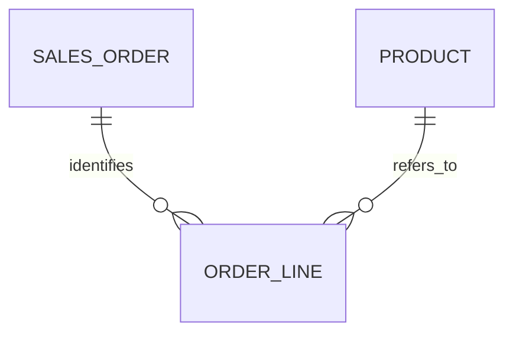
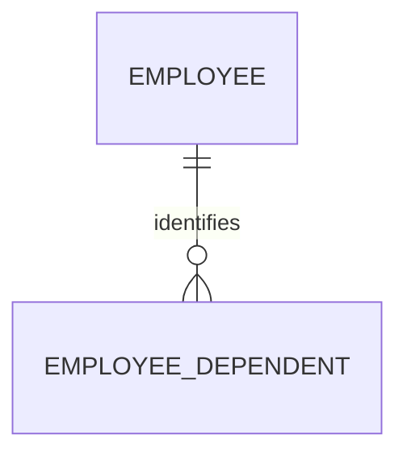

# Strong Entities, Weak Entities, and Dependence on an Owner Entity

When modeling data, not every object has an independent identity. An order can be identified by its own order ID, whereas an order line item usually only makes sense within the scope of the order containing it. Similarly, dependent information may be identified by an employee ID combined with a dependent sequence number, because a dependent's name is not sufficient to uniquely identify them.

This distinction leads to two important concepts: a **strong entity** can be identified by its own key; a **weak entity** must rely on the key of an owner entity combined with its own partial key to form a full identifier. Understanding this relationship properly helps in choosing keys, designing relationships, protecting referential integrity, and determining how to handle data lifecycles.

Within the scope of **DATABASE_DATA_MODELING**, this lesson uses the Order–Order Line and Employee–Dependent examples to explain how to identify, model, and implement both entity types.

## Learning Objectives

After this lesson, you will be able to:

- Distinguish strong entities from weak entities based on identification capability.
- Identify the owner entity, identifying relationship, partial key, and full key of a weak entity.
- Distinguish identification dependence from existence dependence.
- Transform an ER model containing weak entities into a relational schema with composite primary keys and foreign keys.
- Evaluate when to use a surrogate key, when to keep a composite key, and how to choose data deletion policies.

## 1. What Are Strong Entities and Weak Entities?

### 1.1. Strong Entity

A strong entity is an entity type that can be identified by a key of its own, without needing to combine another entity's key to form its identity. That key can be a natural key, a business key, or a system-generated surrogate key.

For example:

- `CUSTOMER` is identified by `customer_id`.
- `PRODUCT` is identified by `product_id` or a SKU code with a unique and stable rule.
- `SALES_ORDER` is identified by `order_id`.

A strong entity can still reference other entities. An order must belong to a customer, yet `order_id` is still sufficient to identify the order without appending `customer_id`. Having a foreign key does not make an entity a weak entity.

### 1.2. Weak Entity

A weak entity is an entity type that has no independent full key in the business model. To identify a specific instance, it must combine:

1. The key of the **owner entity**.
2. A **partial key (discriminator)** of the weak entity, which only distinguishes instances within the same owner.

For example, `ORDER_LINE` can be identified by `(order_id, line_no)`. `line_no` can be 1, 2, 3 within each order; line 1 of order A is different from line 1 of order B. `line_no` alone is not enough to identify a line item across the entire system.

Similarly, `EMPLOYEE_DEPENDENT` can be identified by `(employee_id, dependent_no)`. The dependent sequence number only has meaning within a single employee's record.

### 1.3. Comparison Table

| Criterion | Strong Entity | Weak Entity |
|---|---|---|
| Identification capability | Has its own key sufficient for identification | Needs owner key combined with partial key |
| Key scope | Usually unique across the entity set | Partial key is only unique within the owner's scope |
| Relationship with owner | May or may not have referencing relationships | Mandatory identifying relationship with the owner |
| Identifying relationship participation | Not a prerequisite for forming identity | Total participation; no weak instance exists without a valid owner |
| Examples | Customer, product, order | Order line, employee dependent |
| Common relational key | Dedicated key such as `order_id` | Composite key such as `(order_id, line_no)` |

**Key point:** strong/weak entity refers to how identification works in the model. It is not simply "a table with/without a primary key," nor is it a classification based on the number of attributes or the object's importance.

## 2. Owner Entity and Identifying Relationship

An owner entity is an entity whose key participates in the full identifier of a weak entity. The relationship between the two entity types is called an **identifying relationship**.

In this relationship:

- Every instance of the weak entity must belong to exactly one owner under the model being considered.
- One owner may own zero, one, or many weak instances depending on business rules.
- The weak entity has total participation in the identifying relationship: without an owner, the weak instance cannot be identified.
- The owner key forms part of the weak entity's full key.

Order–Order Line example:



In the diagram, one order can have many order lines. Each order line belongs to exactly one order. An order line also references a product; product is a strong entity and is not the identifying owner of the order line in this example.

The relationship to `PRODUCT` does not replace the identifying relationship with `SALES_ORDER`. An order line can be identified by the order and line number, while `product_id` indicates which product that line sells. If a product is added twice to the same order with two different prices or notes, the two order lines can still be two separate instances.

### 2.1. Multiplicity and Total Participation

When reading an ER diagram, interpret the relationship from both sides:

- Owner side: an order may have no order lines yet while still a draft, or it may have many order lines.
- Weak entity side: each order line must be attached to exactly one order.

In the example, the diagram allows an order to have no order lines because a draft order can exist before the customer adds products. The rule "a confirmed order must have at least one order line" is a state-dependent invariant; ER relationships and foreign keys alone do not fully express this condition.

### 2.2. Partial Key

A partial key distinguishes weak instances within the same owner, but is not sufficient for global identification.

| Owner | Partial Key | Full Key of Weak Entity |
|---|---|---|
| `SALES_ORDER.order_id = 5001` | `line_no = 1` | `(5001, 1)` |
| `SALES_ORDER.order_id = 5001` | `line_no = 2` | `(5001, 2)` |
| `SALES_ORDER.order_id = 5002` | `line_no = 1` | `(5002, 1)` |

The value `line_no = 1` appears in multiple orders without collision because the full identifier also contains `order_id`. When designing a partial key, its uniqueness scope must be clearly defined. If `line_no` is used as a sequence number within each order, a table-wide unique constraint must not be imposed on that column alone.

## 3. Identification Dependence and Existence Dependence

These two concepts often go together, yet they are not synonymous.

- **Identification dependence:** the child entity's identity must combine the owner's identity with a partial key. This is the defining characteristic of a weak entity in traditional ER modeling.
- **Existence dependence:** an object is not allowed to exist if another object no longer exists or does not yet exist under business rules.

A weak entity is usually existence-dependent on its owner. However, an object can be existence-dependent while still having its own identifier. For example, a payment has a global `payment_id` yet must reference an order. If the order is deleted, the payment may have to be retained for accounting requirements. The payment depends on the order in terms of business relationships, yet is not a weak entity in the identification sense if `payment_id` by itself identifies the payment.

Conversely, a surrogate key added to a weak entity's table does not automatically eliminate business dependence on the owner. Distinguish conceptual identification conventions from physical storage implementation. If the model still requires each order line to be identified within the scope of an order, the unique constraint `(order_id, line_no)` and the mandatory foreign key must still be maintained even if the table adds `order_line_id`.

## 4. Example 1: Order and Order Line

### 4.1. Requirements Analysis

Suppose the business has the following rules:

1. An order is created with its own order ID.
2. Each order line is numbered within the scope of the order.
3. An order line belongs to exactly one order and references exactly one product.
4. Quantity must be greater than 0; unit price is non-negative.
5. The price at the time of purchase is stored so order history does not change when product prices are updated.
6. A draft order may have no order lines; an order can only be confirmed when it has at least one valid line.

Classification:

- `SALES_ORDER` is a strong entity because `order_id` identifies it independently.
- `ORDER_LINE` is a weak entity in a model that uses order-scoped line numbers.
- `line_no` is the partial key.
- `order_id` is both the owner key and part of the order line's full key.
- `product_id` is a reference to the strong entity `PRODUCT`, not a required component to distinguish two lines in this example.

### 4.2. Relational Model

| Relation | Primary Key | Foreign Keys | Notes |
|---|---|---|---|
| `SALES_ORDER` | `order_id` | — | Strong entity |
| `PRODUCT` | `product_id` | — | Strong entity |
| `ORDER_LINE` | `(order_id, line_no)` | `order_id` → `SALES_ORDER`; `product_id` → `PRODUCT` | Weak entity; `line_no` is the partial key |

### 4.3. Illustrative PostgreSQL DDL

```sql
CREATE TABLE sales_order (
    order_id BIGINT GENERATED BY DEFAULT AS IDENTITY PRIMARY KEY,
    status   VARCHAR(20) NOT NULL
             CHECK (status IN ('DRAFT', 'PENDING', 'CONFIRMED', 'CANCELLED'))
);

CREATE TABLE product (
    product_id BIGINT GENERATED BY DEFAULT AS IDENTITY PRIMARY KEY,
    sku        VARCHAR(64) NOT NULL UNIQUE,
    name       VARCHAR(200) NOT NULL
);

CREATE TABLE order_line (
    order_id   BIGINT NOT NULL,
    line_no    INTEGER NOT NULL CHECK (line_no > 0),
    product_id BIGINT NOT NULL REFERENCES product(product_id),
    quantity   INTEGER NOT NULL CHECK (quantity > 0),
    unit_price NUMERIC(14, 2) NOT NULL CHECK (unit_price >= 0),
    PRIMARY KEY (order_id, line_no),
    CONSTRAINT order_line_owner_fk
        FOREIGN KEY (order_id)
        REFERENCES sales_order(order_id)
        ON DELETE CASCADE
);
```

In this DDL:

- `sales_order.order_id` is the independent primary key of the strong entity.
- The composite primary key `(order_id, line_no)` guarantees line numbers do not collide within the same order.
- `order_id NOT NULL` together with the foreign key guarantees each order line has a valid owner.
- `product_id` references the product, while `unit_price` stores the locked-in transaction price.
- `ON DELETE CASCADE` is a lifecycle policy chosen for this example: when an order is deleted, dependent order lines are deleted along with it. In real systems, `RESTRICT`, soft delete, or historical archiving may be required instead of hard deletion.

### 4.4. What DDL Alone Does Not Guarantee

Foreign keys ensure there are no orphaned order lines, but they do not force every order to have at least one line. A row-level `CHECK` constraint also cannot normally inspect the total count of child rows belonging to an order. The rule "a confirmed order must have order lines" must be enforced at the confirmation workflow, transaction, or appropriate DBMS mechanism level.

For example, at the application layer, the confirmation operation needs to validate order lines and update status within the same transaction to prevent a race condition where data changes between validation and confirmation. If multiple applications or jobs can confirm orders, a shared consistency boundary is needed.

## 5. Example 2: Employee and Dependent

An HR system needs to store dependent information for employee benefits. A dependent's name is not a good key: multiple people can share the same name, names can change, and an employee can have multiple people with the same family relationship.

A suitable model:

- `EMPLOYEE` is a strong entity, having `employee_id`.
- `EMPLOYEE_DEPENDENT` is a weak entity, identified by `(employee_id, dependent_no)`.
- `dependent_no` is unique only within a single employee's record.
- Each dependent must belong to exactly one employee according to data rules.



Illustrative DDL:

```sql
CREATE TABLE employee (
    employee_id BIGINT GENERATED BY DEFAULT AS IDENTITY PRIMARY KEY,
    full_name   VARCHAR(200) NOT NULL
);

CREATE TABLE employee_dependent (
    employee_id  BIGINT NOT NULL,
    dependent_no SMALLINT NOT NULL CHECK (dependent_no > 0),
    full_name    VARCHAR(200) NOT NULL,
    relationship VARCHAR(30) NOT NULL,
    birth_date   DATE,
    PRIMARY KEY (employee_id, dependent_no),
    FOREIGN KEY (employee_id)
        REFERENCES employee(employee_id)
        ON DELETE RESTRICT
);
```

Here `ON DELETE RESTRICT` is chosen because HR and benefits records may need to be retained under retention policies. If an employee leaves the company, the system typically updates status or archives the record rather than deleting all dependents. Deletion policies must be based on business requirements, auditing, and data retention regulations.

`(employee_id, full_name)` should not be used as a key if names can change or collide within the same record. The sequence number `dependent_no` is a technical identifier within the owner's scope; name is a descriptive attribute.

## 6. When to Use a Composite Key vs. a Surrogate Key?

For weak entities, a composite key of the owner key and partial key directly expresses the identification rule. However, some systems want every order line to have a global ID for referencing from logs, APIs, or other services.

### 6.1. Using a Composite Key

```sql
PRIMARY KEY (order_id, line_no)
```

Appropriate when:

- The line number only has meaning within the order.
- The order line does not need an independent identifier outside the owner's scope.
- Other relations can reference it using this key pair.
- Moving an order line to another order is considered an identity change or is disallowed.

The advantage is that the model clearly expresses the identification scope and avoids adding an extra ID solely to create a key. The disadvantage is that every table referencing the order line must carry both key columns; when the owner key is wide, composite keys can increase index and foreign key size.

### 6.2. Adding a Surrogate Key While Keeping the Owner Constraint

If a global ID is needed, you can design:

```sql
CREATE TABLE order_line (
    order_line_id BIGINT GENERATED BY DEFAULT AS IDENTITY PRIMARY KEY,
    order_id      BIGINT NOT NULL REFERENCES sales_order(order_id),
    line_no       INTEGER NOT NULL CHECK (line_no > 0),
    product_id    BIGINT NOT NULL REFERENCES product(product_id),
    quantity      INTEGER NOT NULL CHECK (quantity > 0),
    UNIQUE (order_id, line_no)
);
```

In this design:

- `order_line_id` is a surrogate key, convenient for global referencing.
- `UNIQUE (order_id, line_no)` still preserves the rule of unique line numbers within an order.
- `order_id NOT NULL` still mandates that the order line has an owner.
- If order lines cannot move between orders, the application needs to guard that rule; changing `order_id` should not be treated as a normal update.

Under strict ER definitions, once an entity has its own key sufficient for global identification, it is no longer a weak entity in terms of identification. Nonetheless, it can still be existence-dependent on its owner from a business perspective. Therefore, documentation should clarify whether "weak entity" is used in the conceptual modeling sense or to describe a table with lifecycle dependence.

### 6.3. Questions for Choosing a Key

| Question | If the Answer Is "Yes" | Direction to Consider |
|---|---|---|
| Does the object's identifier only make sense within the owner's scope? | Yes | Composite key (owner key + partial key) accurately expresses the scope |
| Does the object need to be widely referenced across multiple systems? | Yes | Consider a global surrogate key while keeping a unique constraint scoped to the owner |
| Can the object change owners while keeping the same identity? | Yes | Composite key may be unsuitable; needs an independent ID and clear owner-transfer rules |
| Must the object be stored independently after the owner is deleted? | Yes | Re-evaluate weak classification, retention policies, and data ownership |
| Can the partial key change due to business rules? | Yes | Consider a surrogate key to stabilize references while retaining required business constraints |

## 7. Distinguishing Weak Entities from Associative Entities

An associative entity is used to represent a many-to-many relationship or to add attributes to a relationship. For example, `ENROLLMENT` connects `STUDENT` and `COURSE`, and can hold `enrolled_at`, `grade`, and `status`.

An associative entity can use a composite key `(student_id, course_id)`. In that case, enrollment's identity depends on both ends of the relationship and can be modeled as a weak entity in ER terms. Yet not every associative entity is a weak entity: if each enrollment attempt is a separate transaction, an independent `enrollment_id` may be needed to distinguish multiple enrollments in the same course.

| Criterion | Weak Entity | Associative Entity |
|---|---|---|
| Primary purpose | Represents an object whose identity depends on an owner | Represents a relationship or turns a relationship into an entity with attributes |
| Number of owners | Usually one identifying owner | Usually connects two or more entities |
| Key | Owner key + partial key | Can be a composite key from relationship ends or a surrogate key |
| Examples | Order line in an order; employee dependent | Course enrollment; project team membership |

Classify based on identity rules and business meaning, not merely on whether a table has two foreign keys.

## 8. Weak Entities Across Other Storage Models

The idea of owner dependence does not only appear in relational models.

- **Document database:** if order lines are only accessed in the context of an order, `items` can be embedded as an array inside the `Order` document. The document boundary reflects the aggregate and lets you read the order and its lines in a single fetch. Consider document size limits, concurrent updates, and independent line-item query needs.
- **Separate documents:** if order lines need independent querying, documents can be stored with `orderId` and `lineNo`; uniqueness of this pair must be enforced and lifecycle handled alongside the owner.
- **Graph database:** `ORDER` and `ORDER_LINE` can be represented as nodes connected by a `CONTAINS` relationship. The ownership edge expresses dependence, but constraints or application logic are needed to ensure no order line node lacks an owner.
- **Analytical model:** order lines often become the grain of a sales fact table. `order_id` and `line_no` can both participate in the business key or degenerate dimension; the design must preserve the exact grain and avoid double-counting metrics when joining dimensions.

Storage models may change, yet the identity questions remain: within what scope is the object identified, who owns its lifecycle, and what happens when the owner changes or is deleted?

## 9. Lifecycle Policies and Referential Integrity

When a weak entity depends on an owner, deleting or archiving the owner must be considered together with its child instances.

| Policy | Behavior | When to Consider |
|---|---|---|
| `ON DELETE CASCADE` | Deleting the owner deletes referencing weak records | Child data only has meaning with the owner and may be deleted alongside it |
| `ON DELETE RESTRICT` / `NO ACTION` | Blocks owner deletion while child records exist | Need to preserve data or force child cleanup workflow first |
| Soft delete | Marks owner or child as inactive | Need history, auditing, or recovery |
| Archive / retention workflow | Moves data to archival storage per policy | Data must be kept long-term or has legal/business requirements |

Do not choose cascade simply because the child entity is weak. An order line may need to be kept in order history; a dependent may reside in HR records subject to retention. Foreign keys and deletion policies must reflect actual lifecycles and data retention obligations.

Beyond deletion, consider these scenarios:

- Is the owner key allowed to change? If it changes, are all child keys and references updated consistently?
- Can a partial key be reused after a child is deleted?
- Is change history needed for the child or owner?
- Can multiple concurrent transactions insert the same `line_no` into one order? Primary keys / unique constraints must serve as the final guard against duplicates.
- Can order confirmation run concurrently with order line deletion? Appropriate transactions and isolation levels or locking are required.

## 10. Common Design Mistakes

| Mistake | Consequence | Resolution |
|---|---|---|
| Using `line_no` as a table-wide primary key | Line 1 across different orders collides as duplicates | Use composite key `(order_id, line_no)` or a surrogate ID with a unique constraint |
| Using a dependent's name as a key | Duplicate or changed names break references | Use owner key + stable partial key or surrogate ID |
| Omitting `NOT NULL` on the owner key | Orphaned child rows can be created, violating identifying relationship | Mandate owner key and create foreign key |
| Assuming a foreign key alone is enough | Fails to enforce minimum child count or valid state rules | Protect cross-row invariants in transactions/workflows or suitable mechanisms |
| Cascade deleting owner without checking history | Loss of audit or transactional data required for retention | Choose restrict, soft delete, or archive per policy |
| Adding a surrogate key and dropping owner-scoped uniqueness | Allows two lines with the same sequence number in one order | Retain `UNIQUE(owner_id, partial_key)` if business rules require it |
| Mistaking every table with an FK for a weak entity | Misclassifies model and lifecycle | Check dedicated key, identification scope, and existence dependence |

## 11. Process for Identifying and Designing Weak Entities

1. **Find objects that need management:** does the object have its own attributes, states, or history? If it is just a simple attribute of the owner, a separate entity may not be needed.
2. **Find the owner:** who does the object belong to in the business domain? Is there a single owner or dependence on multiple entities?
3. **Determine identification scope:** does the object have its own global ID or is it only distinguished within the owner's scope?
4. **Choose the partial key:** which attribute distinguishes children within the same owner, and is it stable?
5. **Model the identifying relationship:** define multiplicity, total participation, and mandatory owner rules.
6. **Map to schema:** create a composite primary key or surrogate key with a unique constraint, foreign key, and appropriate nullability.
7. **Define lifecycle:** choose cascade, restrict, soft delete, or archive based on business and retention requirements.
8. **Test:** test child without owner, duplicate partial key within the same owner, identical partial key across different owners, owner deletion, owner change, and concurrent operations.

## 12. Verification Checklist

- [ ] Every strong entity has a candidate key sufficient for independent identification.
- [ ] Every weak entity has a clearly identified owner.
- [ ] The partial key is unique only within the described owner scope.
- [ ] The full key of the weak entity is clearly defined in the model.
- [ ] Every child is required to reference a valid owner.
- [ ] Multiplicity on both the owner side and child side accurately reflects business rules.
- [ ] Identification dependence is distinguished from existence dependence.
- [ ] Primary keys, foreign keys, `NOT NULL`, and `UNIQUE` are mapped accurately.
- [ ] Deletion, retention, and owner-change policies match the data lifecycle.
- [ ] Cross-row or state-dependent invariants are enforced in appropriate transactions/workflows.
- [ ] Tests cover duplicate partial keys, orphaned children, owner deletion, and concurrent updates.

## Summary

A strong entity has its own key sufficient for identification. A weak entity needs the owner's key combined with a partial key to form its full identity; each weak instance participates totally in the identifying relationship with its owner. Identification dependence differs from existence dependence: an object may be required to belong to an owner while still having its own global ID.

In the relational model, the direct representation is typically a composite primary key of the owner key and partial key, alongside a mandatory foreign key. If a surrogate key is used, business constraints such as uniqueness within owner scope and lifecycle dependence must be preserved. Deletion policies must be grounded in domain semantics and retention requirements, not automatically inferred from the "weak entity" label.

## Key Terms to Remember

| Term | Meaning |
|---|---|
| Strong Entity | An entity with its own key sufficient for identification |
| Weak Entity | An entity requiring an owner key and partial key for full identification |
| Owner Entity | The owning entity whose key participates in identifying a weak entity |
| Identifying Relationship | The identifying link between an owner and a weak entity |
| Partial Key | A partial key distinguishing children within a single owner's scope |
| Composite Primary Key | A primary key made of multiple attributes, e.g., `(order_id, line_no)` |
| Identification Dependence | Dependence of identity on the owner's key |
| Existence Dependence | Dependence of lifecycle; a child cannot exist without an owner under business rules |
| Surrogate Key | A system-assigned replacement key carrying no direct business meaning |
| Referential Integrity | Consistency between a foreign key and the referenced key |
