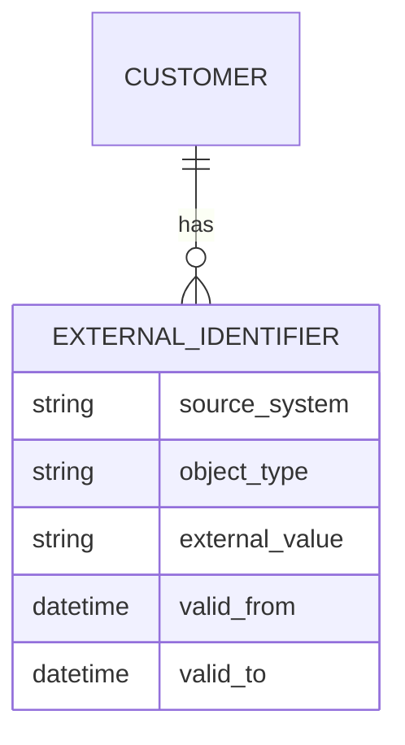
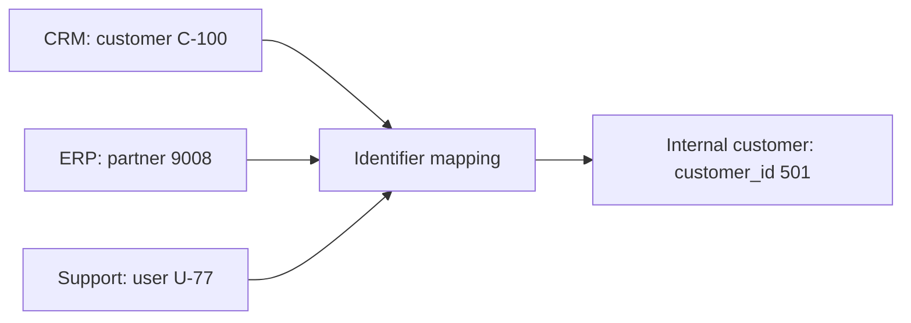
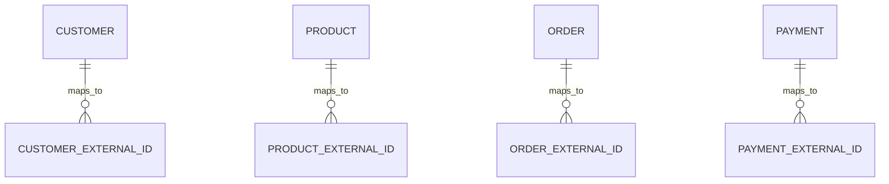
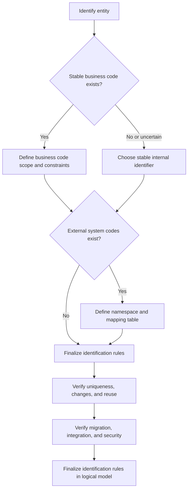

# Internal Identifiers, Business Codes, and External System Identifiers

A data system must be able to distinguish every object throughout its lifecycle. Customers can change names, products can change sales codes, orders can sync across multiple systems, and an organization can merge two duplicate profiles. If the chosen identifier is unsuitable, these normal business changes easily break links, create duplicate records, or render historical data untraceable.

When designing a data model, distinguish three frequently conflated concepts: **internal identifiers** managed by the system to stably identify an entity; **business codes** meaningful to users or processes; and **external system identifiers** issued by another application or partner. All three can coexist on one entity while serving different purposes.

This lesson explains how to select, manage, and link identifier types; how to define uniqueness scope; how to handle changes, duplicates, and data migration; and highlights the rules to verify before moving to keys and physical schemas.

## 1. Identifiers and Keys in Data Modeling

### 1.1. What Is an Identifier?

An identifier is information or a collection of information used to distinguish one individual instance from other instances within a defined scope. An identifier answers the question: "Which object is this?"

For example:

- A customer is identified by a system-assigned customer ID.
- An order is identified by an order number within a store's scope.
- A payment transaction is identified by the payment provider's transaction ID.
- A product may have an internal SKU, a barcode, and a supplier's product code.

An identifier does not have to be a single value. A pair of values such as `(tenant_id, customer_number)` can together form a unique identifier in a multi-organization system. An entity can also have multiple alternate identifiers, such as an internal ID and a business code.

### 1.2. Distinguishing Identifiers, Keys, and Attributes

These terms are related yet distinct:

| Concept | Meaning | Example |
|---|---|---|
| Identifier | Way of recognizing an individual instance in business or system terms | Customer ID, order code |
| Candidate key | Minimal set of attributes capable of uniquely identifying a row in a relational model | `customer_id`, or `email` if truly unique and mandatory |
| Primary key | Candidate key selected as the main identifier of a table | `customer_id` |
| Alternate key | Valid candidate key not chosen as the primary key | Unique business customer code |
| Foreign key | Attribute referencing a uniquely guaranteed key in another relation | `order.customer_id` referencing customer |
| Descriptive attribute | Provides information about the object without uniquely identifying it | Display name, address |

In conceptual modeling, we speak of identifiers and identification rules. In logical relational modeling, we define candidate keys, primary keys, alternate keys, and foreign keys. During physical implementation, keys are mapped to concrete structures of the database management system.

Do not call every code a primary key. A code may carry business meaning yet be unstable, non-unique globally, or mutable. Conversely, an internal key does not need to carry human-readable meaning.

### 1.3. Properties of a Good Identifier

When evaluating an identifier, consider:

- **Uniqueness:** two distinct instances within the defined scope cannot share the same identifier.
- **Stability:** the identifier does not change when name, address, or descriptive attributes change.
- **Durability:** the identifier remains referenceable throughout the required data and history retention period.
- **Non-reusability:** a code assigned to one object is not reissued to another object if doing so could confuse history.
- **Availability:** the identifier can be generated, transmitted, and stored across systems that need it.
- **Clear scope:** knowing whether the code is unique within a table, an organization, a supplier, or system-wide.
- **Validatability:** having rules to validate code format and detect duplicates.

Not every identifier needs to be short, readable, or predictable. Those requirements depend on usage and can conflict with security or scalability.

## 2. Internal Identifiers

An internal identifier is a code issued by the owning system or data domain to identify an entity. This code is typically used in data linking, cross-table or cross-service references, and record lifecycle handling.

For example:

```text
customer_id = 7f6b1f5e-8a4b-4a9d-9f2d-7b6c8a1d1234
order_id    = 901284
product_id  = 4c0f2f2e-6c8d-4d6a-a4a8-1a2b3c4d5e6f
```

The values above illustrate format only. An internal ID does not need to embed customer name, product category, or creation date if those components are not part of the identification contract.

### 2.1. Surrogate Identifiers

A surrogate identifier is a system-generated code carrying no direct business meaning. Examples: auto-incrementing numbers, UUIDs, or a sufficiently large random code.

Common advantages:

- Minimally impacted when business codes or personal details change.
- Can be compact and stable for cross-table references.
- Decouples internal linking structure from departmental or partner coding rules.
- Useful when an entity carries multiple external IDs or business codes.

Points to consider:

- Additional unique constraints are needed on business codes if they must be unique.
- Internal IDs do not automatically solve business-level duplicate records.
- Some ID formats can leak creation order or scale if exposed publicly.
- ID generation must be coordinated in multi-service or multi-writer environments.

### 2.2. Ways to Generate Internal Identifiers

| Generation Method | Characteristics | When to Consider |
|---|---|---|
| Auto-incrementing integer | Readable, compact, convenient for integer keys | Centralized systems or with a reliable sequence issuer |
| UUID | Needs no central sequence issuer; carries no business meaning | Distributed systems, integrations, or multi-writer ID generation |
| ULID / time-component identifier | Roughly time-sortable and reduces sequencer dependence | When approximate time ordering is useful; understand timestamp leakage traits |
| Domain-specific random code | Allows controlling length and format | When confirmed communication or formatting requirements exist |

No single ID generation approach is optimal for every system. Consider:

- Must IDs be generated while disconnected from a central server?
- Do multiple regions or services write data concurrently?
- Will the ID appear in URLs, invoices, or partner communications?
- Is there a requirement not to expose record counts or creation sequence?
- Do storage engines and tooling handle the chosen ID type well?
- Is chronological sorting or write distribution across partitions needed?

### 2.3. Auto-Incrementing Numbers

Auto-incrementing numbers are typically issued by a DBMS sequence or identity column. For example:

```sql
CREATE TABLE customer (
    customer_id BIGINT GENERATED ALWAYS AS IDENTITY PRIMARY KEY,
    display_name VARCHAR(200) NOT NULL
);
```

Advantages include small key size, easy referencing, and efficiency in many indexes. However, auto-incrementing numbers do not guarantee gapless sequences. Transaction rollbacks, pre-allocation, or concurrent operations can leave skipped numbers. Therefore, never use ID values to count exact customer totals or assume numbers are contiguous.

If multiple independent systems create records simultaneously, a conflict-avoidance mechanism is needed. Options include per-region sequences, a shared ID issuer, or a distributed identifier type. Which option to pick depends on architecture and availability requirements.

### 2.4. UUIDs and Distributed Identifiers

A UUID is a 128-bit identifier following a standard format. For example, UUID v4 is typically randomly generated; other UUID versions include time components or namespaces.

Advantages:

- Very low collision probability when generated independently and properly.
- Can be generated across many services or clients without centralized sequential allocation.
- Cannot easily guess the next record ID like sequential keys.

Points to consider:

- Larger size than integer keys.
- Random values can increase index fragmentation in certain DBMSs and storage layouts.
- Agree on representation, letter-case normalization if stored as strings, and API serialization.
- A UUID is not an access secret; permissions must still be verified when a user supplies an ID.

If UUIDs are namespace-generated, agree on the namespace and input data so the same object yields the same ID. If random UUIDs are used, re-creating the same entity produces a different ID, requiring reconciliation processes to prevent duplicate records.

### 2.5. Should Internal Identifiers Be Exposed Publicly?

Internal IDs can appear in APIs or URLs if the system contract permits. However:

- Do not treat hard-to-guess IDs as an authorization mechanism.
- Never allow users to access a record merely because they know its ID.
- Check permissions by owner, organization, or access scope.
- Consider a separate public identifier if internal structure must be hidden or API contracts stabilized.
- Avoid embedding personal data or sensitive details inside identifiers.

A URL containing a UUID can still be shared or leaked. Access control must be enforced independently of how IDs are generated.

## 3. Business Codes

A business identifier (business code) is a code meaningful in organizational operations or to users. Examples:

- Customer code `CUS-2026-00421`.
- Order number `SO-HCM-2026-001284`.
- SKU `TSHIRT-BLK-M`.
- Invoice numbers following accounting regulations.
- Contract numbers or dossier codes.

Business codes are often printed on documents and used in support communication, search, or reconciliation. They may serve as a unique identifier within a scope, yet should never be assumed permanently immutable.

### 3.1. Meaningful Business Codes and Consequences

A code may embed:

- A prefix indicating object type.
- Branch or organization code.
- Year or issuance period.
- Sequence number.
- Check digit/character.
- Business-defined classification code.

For example, `SO-HCM-2026-001284` might represent a sales order at the HCM branch in 2026. This structure helps operators read and classify quickly. Yet if the order is transferred to another branch, the organization changes region codes, or the system moves to global numbering, the embedded components may stop reflecting reality.

A business code should be treated as an owned contract. Document:

- Who issues the code and at which business step?
- Within what scope is the code unique?
- Can the code change? If changed, how is the old code handled?
- Can issued codes be reused?
- Are there legal or audit requirements for gapless sequencing?
- What formatting, length, and valid character rules apply?
- Which systems are authorized to read or generate the code?

### 3.2. Structured Codes vs. Opaque Identifiers

Structured codes help users read partial information. Opaque identifiers exist solely for identification.

| Criterion | Structured Code | Opaque Identifier |
|---|---|---|
| Readability for operators | Usually better | May be lower |
| Dependence on organizational rules | Higher | Lower |
| Impact during org restructuring | May require handling | Usually minimal impact |
| Information leakage via code | May reveal region, date, or object type | Usually carries less semantic info |
| Suitability as internal key | Must evaluate stability | Usually more suitable |

A common choice is using a stable internal ID for links while maintaining a separate business code for users. Not every system must do this; if a business code is genuinely stable, unique, and tightly governed, it can be a valid candidate key. The key requirement is proving those properties hold.

### 3.3. Changing Business Codes and Code History

If a code can change, decide whether the system will:

- Update the current code and record the old code in history.
- Keep the old code as an alias for search.
- Prohibit changes after issuance.
- Create a new code and link it to the prior record.

For instance, a product's SKU may change during catalog restructuring. Old orders must still trace back to the exact product and SKU at purchase time if business rules require it. You may need to snapshot the SKU on order lines and maintain product code history.

Never overwrite an old code without evaluating documents, integrated systems, reports, and users referencing that code.

## 4. External System Identifiers

An external identifier is a code issued by another system, vendor, or organization. Examples:

- Customer ID in a CRM.
- Supplier's product code.
- Customer ID in a payment platform.
- Carrier tracking / waybill number.
- Record ID in a legacy ERP system.

An external code can be unique within the issuing system while not unique across the enterprise's entire ecosystem. Two vendors can both use `12345` for two different objects. Therefore, the code value must usually be paired with issuing-source metadata.

### 4.1. Defining the Namespace of External Codes

An external identifier typically needs at least:

- Issuing system or vendor.
- Object type represented by the code.
- Code value.
- Uniqueness scope of the code within the source system.
- Status and effective period if the code has a lifecycle.

Example:

| Issuer | Object Type | External Code | Internal Object |
|---|---|---|---|
| CRM-A | Customer | `C-100` | Internal customer 501 |
| ERP-B | Customer | `C-100` | Internal customer 501 |
| Payment-X | Payer profile | `C-100` | Payment profile 88 |

Repeating `C-100` does not mean it refers to the same object. A namespace consisting of issuer and object type is required, plus tenant or partner account if the source does not guarantee global uniqueness.

### 4.2. External Identifier Mapping Tables

When one internal entity holds multiple codes from multiple sources, you can model an external-identifier mapping entity. Example at the logical relational level:



In the logical model, attributes may include:

| Attribute | Purpose |
|---|---|
| `external_identifier_id` | Internal identifier of the mapping record |
| `customer_id` | Reference to internal customer |
| `source_system` | Code issuer, e.g., CRM-A |
| `object_type` | Object type in the source |
| `external_value` | External code value |
| `source_tenant` | Source organization/account scope if needed |
| `valid_from`, `valid_to` | Effective period of the code if history is required |
| `status` | Mapping status, e.g., active, retired, disputed |

The unique constraint can be `(source_system, object_type, source_tenant, external_value)` if source rules guarantee it. If the same code can be reused after expiration, add time intervals or a history mechanism to identify the right record at reference time.

Avoid placing a single shared `external_id` column across every table if an object can receive IDs from multiple sources or one source issues multiple ID types. A dedicated structure prevents confusion and scales integration cleanly.

### 4.3. One-to-One, One-to-Many, and Many-to-One Mappings

The relationship between external IDs and internal entities must be verified:

- **One external ID → one internal entity:** common when the source issues unique codes.
- **Many external IDs → one internal entity:** one customer appears across CRM, ERP, and support systems under different IDs.
- **One external ID → many internal entities:** can occur if the source code is not unique across tenant, object type, or time scope. Add namespace fields or clarify source rules.
- **One internal entity → many external IDs in the same source:** can occur when the source creates duplicate profiles, has old and new IDs, or is mid-merge. Requires status and history policies.

Do not assume a one-to-one relationship just because the initial sync shows no duplicates. Inspect integration contracts, historical data, and how the source handles merges, splits, or reassignments.

## 5. Uniqueness Scope and Code Validation Rules

A code is only meaningfully unique when its scope is explicitly defined. Common scopes include:

- System-wide.
- One organization or tenant.
- One branch.
- One object type.
- One source system.
- One fiscal period or time interval.
- A multi-component combination.

For instance, order number `1001` may be unique within each branch yet not company-wide. In that case, the business identifier can be `(branch_code, order_number)` or a globally issued code.

### 5.1. Simple Keys and Composite Keys

A simple key consists of one attribute. A composite key consists of multiple attributes. Examples:

```sql
-- Product code unique within each organization
UNIQUE (tenant_id, sku)

-- External code unique within each source and object type
UNIQUE (source_system, object_type, external_value)
```

Composite keys accurately express uniqueness scope, yet require weighing length and referencing from other tables. A single internal identifier can simplify relationships while keeping the composite key as a unique constraint for the business code.

### 5.2. Normalizing and Comparing Codes

Uniqueness rules must define how values are normalized before comparison:

- Is comparison case-sensitive or case-insensitive?
- Is leading/trailing whitespace trimmed?
- Are hyphens or separators significant?
- Which Unicode normalization form applies?
- Are leading zeros preserved?
- Are codes sensitive to Vietnamese diacritics?
- Are multiple equivalent spellings permitted?

For example, `ab-001`, `AB-001`, and `AB001` might be treated as the same code in one workflow, though not always. Never strip characters or change case automatically if the contract with an external source requires preserving the raw string.

A safe approach is storing the raw value received from the source alongside a normalized value for matching, when permitted by business rules. Normalization rules must be agreed upon and tested against edge cases.

### 5.3. Non-Reusable Codes

If an issued code can be reissued to a new object, old documents, external links, and logs can mistakenly point to the new object. For codes carrying historical meaning, non-reusability rules or binding codes to effective time intervals are usually required.

For example, a terminated contract number may require long-term retention. Never reissue the same contract number to another contract if systems or legal regulations require unique traceability.

## 6. Natural Identifiers and Surrogate Identifiers

A natural identifier is a value inherent in the business domain or used by the organization for identification, such as a contract number, SKU, or employee code. A surrogate identifier is a system-generated code carrying no direct business meaning.

### 6.1. Comparison

| Criterion | Natural Identifier | Surrogate Identifier |
|---|---|---|
| Business meaning | Yes | Not necessarily |
| Mutability | May change per processes or policies | Typically designed to stay stable |
| Uniqueness scope | Usually has a specific business scope | Can be issued uniquely within the system |
| Ease of user communication | Usually convenient | May be hard to read |
| Dependence on source systems | Can be high | Lower if self-managed by the system |
| Information leakage risk | May reveal type, region, or date | Depends on ID generation method |

### 6.2. When to Use a Natural Identifier?

A natural identifier fits when:

- It is governed by the organization as an official code.
- Uniqueness and scope are confirmed.
- The code remains stable over the entire required reference timeframe.
- Code change workflows are controlled and audited.
- Integrated systems require this code as a shared contract.

For example, ISO country codes can be a suitable identifier in a country catalog tied to a specified standard version. Conversely, personal emails should generally not be a customer's primary key because they can change, be shared, or be reassigned.

### 6.3. When to Use a Surrogate Identifier?

A surrogate identifier is typically suitable when:

- Business codes can change.
- One entity has multiple codes from different sources.
- Business codes are not globally unique.
- Business codes have complex rules or depend on organizational structure.
- Internal relationships must be decoupled from integration system changes.

In many relational models, a practical choice is using a surrogate key as the primary key while keeping the natural code as an alternate key with a unique constraint. This does not eliminate managing the business code; it separates the linking role from the communication-identification role.

### 6.4. Avoid Using Personal Data as Keys

Emails, phone numbers, government IDs, or personal names are usually poor internal identifiers because they:

- Can change or be reassigned.
- Can collide or be shared.
- Contain sensitive data.
- Have varying formatting and normalization rules across countries.
- May be deleted or anonymized under data protection policies.

If the business needs lookup by email or phone number, use them as searchable attributes and apply appropriate scoped constraints. Do not default to making them primary keys.

## 7. Identifiers in Multi-Organization and Multi-Source Systems

In a multi-tenant system, codes can be unique within each organization while colliding across organizations. Decide whether internal identifiers are system-wide unique or combined with tenant.

Example:

| Tenant | SKU | Is Collision Valid? |
|---|---|---|
| Shop-A | `TSHIRT-01` | Yes |
| Shop-B | `TSHIRT-01` | Yes, if SKU is unique only per tenant |

If queries are always scoped by tenant, the business key can be `(tenant_id, sku)`. However, if products are shared across multiple tenants or require global codes, different rules apply. Avoid choosing keys based solely on current assumptions without confirming data ownership boundaries.

### 7.1. Source Codes in Integrations

When synchronizing data, store the linkage between internal IDs and source IDs:



This mapping enables the system to keep recognizing the same customer when data arrives from multiple sources, and helps send updates back to the right source system.

### 7.2. Preventing Duplicates During Synchronization

An integration workflow must define:

- Which key is used to look up an existing object?
- If the source code is not found, is a new entity created?
- If multiple internal objects match, how is that resolved?
- If two concurrent events arrive to create the same object, how are duplicates prevented?
- If the source changes an ID, can we verify it is still the same object?
- If a source object is deleted or deactivated, how is internal data handled?

Matching by similar name or email is merely a candidate matching hint—insufficient for automatically merging critical data without explicit rules and controls.

## 8. Lifecycle and Identifier Changes

Identifiers must be evaluated across the entire data lifecycle, not just at record creation time.

### 8.1. Creation

When creating an entity, determine:

- Who or which service has authority to issue the ID?
- Is the ID issued before or after business confirmation?
- Can it be generated offline?
- If a transaction fails, is the allocated ID reused?
- How do we prevent two concurrent requests from generating the same business code?

For example, an order number may be assigned when an order moves from draft to confirmed status. If order numbers carry legal sequencing requirements, use a dedicated numbering and error-handling mechanism; never infer contiguity from a standard identity column.

### 8.2. Code Changes

If a business code changes, decide:

- Does the internal ID stay unchanged? Usually yes, if it remains the same entity.
- Can the old code still be looked up?
- Is the effective timestamp of the new code recorded?
- How are integrated systems notified of the change?
- Do historical documents display the code as of event time or the current code?

### 8.3. Merging Duplicate Records

When two profiles are confirmed to be the same customer, the system can merge them. Retain:

- Which ID becomes the canonical ID after the merge?
- Does the old ID become an alias or redirected ID?
- Which external codes belong to the canonical profile?
- How are orders, transactions, and relationships migrated or linked?
- Are the actor, timestamp, and reason for the merge recorded?
- Is rollback capability needed if merged erroneously?

Never physically delete a duplicate record before checking all references and audit requirements. An alias or mapping table mapping old IDs to canonical IDs may be necessary.

### 8.4. Splitting One Record into Multiple Entities

A customer profile may be discovered to have mistakenly combined two people or two organizations. When splitting, reallocate relationships based on evidence and record decision history. Not every order or transaction can be automatically assigned to one side.

This is why data provenance, external IDs, and change history must be retained rather than storing only a single current ID value.

### 8.5. Deletion and Retention

When an entity is deleted, its identifier may still appear in logs, documents, or external systems. Distinguish:

- Logical deletion or deactivation.
- Anonymization of personal data.
- Physical deletion per retention policy.
- Retaining a minimal stub record to preserve references and auditing.

Never reuse a deleted ID if doing so could make historical references point to a different object.

## 9. Identifiers and Data Migration

When migrating data from a legacy system to a new system, source IDs usually must be retained for reconciliation and traceability. You do not necessarily have to use old IDs as new internal IDs.

A migration workflow can:

1. Read source IDs and identify legacy system namespaces.
2. Check for duplicates, missing codes, and malformed values.
3. Generate new internal IDs for target entities.
4. Store the mapping `(source_system, source_id) → internal_id`.
5. Migrate relationships using the mapping table.
6. Reconcile record counts and references post-import.
7. Save error reports and resolve unmappable records.

Example:

| Legacy Source | Source ID | New Internal ID | Mapping Status |
|---|---|---|---|
| Legacy-CRM | `C-100` | `501` | Mapped |
| Legacy-CRM | `C-101` | `502` | Mapped |
| Legacy-CRM | `C-102` | — | Needs duplicate resolution |

Keeping a mapping table enables querying back to legacy data, troubleshooting incidents, and comparing results across systems. Discarding source IDs after import makes investigating discrepancies very difficult.

## 10. Identifier Design Example for a Sales System

Suppose a store manages customers, products, orders, and payment transactions. Identifier types can be organized as follows:

| Entity | Internal ID | Business Code | External Identifier |
|---|---|---|---|
| Customer | `customer_id` | `customer_code` | CRM customer ID, ERP partner ID |
| Product | `product_id` | SKU | Supplier product code, catalog code |
| Order | `order_id` | `order_number` | Sales channel or marketplace order ID |
| Payment | `payment_id` | Internal transaction code if needed | Provider transaction ID |

### 10.1. Proposed Rules to Confirm

- `customer_id`, `product_id`, `order_id`, and `payment_id` are stable within the internal system.
- `customer_code` is unique within the entire store or defined tenant scope.
- SKU is unique within a catalog or tenant, following agreed case-sensitivity rules.
- Payment provider transaction IDs are unique within the provider and corresponding merchant account namespace.
- Marketplace order IDs are stored alongside sales channel source and tenant, never used directly as internal IDs.
- Old codes remain searchable if they have already appeared on documents or integrations.

### 10.2. Identifier Relationship Diagram



At the logical level, either a shared `external_identifier` mapping table with an object-type discriminator or separate domain-specific tables can be used. The choice depends on foreign-key enforcement, query patterns, and lifecycle needs. The conceptual diagram only needs to show that each entity can carry multiple external codes distinguished by source.

### 10.3. Webhook Redelivery Scenario

Suppose a payment provider sends a success notification twice with the same transaction ID `TX-9001`. The system must recognize this as the same transaction and avoid recording payment collection twice. Required rules:

- Define the namespace of the transaction ID, such as provider and merchant account.
- Enforce a unique constraint on the source identifier combination.
- Process repeated notifications idempotently.
- Store processing state and receipt timestamps for investigation.
- Never treat two identical webhooks as two independent transactions merely because they arrive at different times.

This is an identification requirement combined with transaction and integration requirements. Adding an `external_id` column alone without defining namespace and uniqueness constraints is insufficient.

## 11. Design and Verification Rules

Before finalizing identifiers, review these question groups.

### 11.1. Business Rules

- Which individual instance does the identifier represent?
- Can the same instance have multiple codes?
- Can the code be changed or reused?
- Is the code globally unique or scoped?
- Must the code be displayed to users or partners?
- Are there legal requirements on code structure or sequencing?

### 11.2. Technical Rules

- Where and by which component is the ID generated?
- Can multiple services generate IDs concurrently?
- Must the system create records offline?
- Is the ID passed through APIs, events, and logs?
- Do target storage engines support the chosen ID type well?
- Can uniqueness constraints be enforced where data is written?

### 11.3. Integration Rules

- What namespace do external codes belong to?
- Can the source system change or reuse codes?
- Can one source code represent multiple internal entities?
- How are duplicate, delayed, or out-of-order events handled?
- Does the mapping approach support merges, splits, and data migration?

### 11.4. Security and Privacy Rules

- Does the code leak personal information, geographic region, or data scale?
- Can another object's ID be guessed?
- Does the API enforce per-record authorization?
- Does the code contain sensitive info or authentication secrets?
- Upon deletion or anonymization, how are related codes handled?

Do not use document numbers, emails, or phone numbers as internal IDs merely because they appear unique. Evaluate mutability, usage scope, privacy, and retention policies.

## 12. Common Mistakes

| Mistake | Consequence | Resolution |
|---|---|---|
| Using email as primary key | Email changes break references; emails can be shared or reassigned | Use a stable ID; keep email as an attribute with appropriate constraints |
| Using business codes as internal IDs without checking stability | Changing code rules affects all relationships | Separate internal ID from business code when needed |
| Assuming external IDs are globally unique | Collisions across vendors or tenants | Use source namespace, object type, and scope |
| Storing only a single `external_id` | Cannot support multiple sources or multiple codes | Use an external-identifier mapping structure |
| Reusing issued codes | Historical references may point to the wrong object | Enforce non-reusability or manage effective time windows |
| Deleting old codes when changing codes | Cannot look up old documents and historical data | Keep aliases or code history per policy |
| Believing UUIDs protect access | Exposed IDs still permit unauthorized access without permission checks | Enforce authorization independently of ID unpredictability |
| Assuming gapless sequential IDs | Reports and workflows break when gaps occur | Never use technical IDs as counts or legal document numbers |
| Dropping mapping tables after migration | Loss of traceability and source reconciliation | Retain source IDs and internal IDs throughout migration |

## 13. Pre-Finalization Identifier Checklist

- [ ] Every entity has clear identification rules.
- [ ] Uniqueness scope of each code is defined.
- [ ] Internal IDs, business codes, and external IDs are clearly distinguished.
- [ ] Which codes are stable and which can change are identified.
- [ ] Whether codes can be reused after deactivation is determined.
- [ ] Code normalization and comparison rules are documented.
- [ ] Namespaces for external codes are defined.
- [ ] How many codes an entity can hold per source is determined.
- [ ] Handling for duplicate records, merges, and splits is defined.
- [ ] History retention and ID mapping during data migration are defined.
- [ ] Concurrent and multi-service ID generation capabilities are evaluated.
- [ ] Public ID exposure and access control checks are evaluated.
- [ ] Identifiers are linked to business questions and integration rules.



Good identifiers help an entity preserve its identity across business changes, integrations, and data migrations. When internal IDs, business codes, and external codes are clearly separated, teams can protect stable data relationships, trace provenance, and evolve coding rules without losing traceability. From these rules, logical design will determine the appropriate candidate keys, primary keys, alternate keys, foreign keys, and unique constraints.
