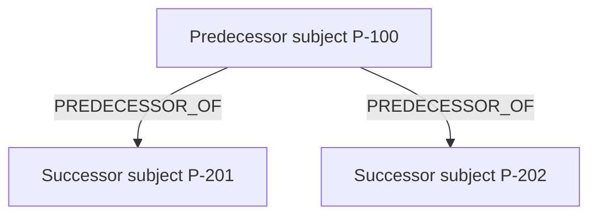

# Stability When Renaming, Merging, or Splitting Subjects

A subject in a system can change its name, update identifying details, be discovered as a duplicate of another profile, or undergo a business merger or split. These changes raise a crucial question: **which identifiers must remain stable, and when must the system create new identifiers?**

If a name, email, or mutable attribute is used as the primary key, a single profile update can force the system to rewrite countless foreign keys. If two duplicate profiles are merged by deleting old traces, the system can corrupt transaction and audit history. If one profile is split into two subjects by copying all data to both, reports can double-count and business relationships get misassigned.

Within the scope of **DATABASE_DATA_MODELING**, this lesson clarifies the distinction between attribute changes and identity changes; between merging duplicate records and merging real-world subjects; and between splitting an erroneously combined record and splitting an organization. Examples focus on key design, history storage, lineage management, and preserving references.

## Learning Objectives

After this lesson, you will be able to:

- Explain why internal identifying keys should stay stable when names and descriptive attributes change.
- Distinguish surrogate keys from natural identifiers, aliases, and identifying attributes.
- Distinguish merging duplicate records of the same subject from merging independent subjects.
- Distinguish splitting an erroneously combined record from splitting a business subject.
- Design mappings, history, and lineage relationships to trace merge or split decisions.
- Determine how to handle foreign keys, historical data, and consumer systems when identifiers change.

## 1. Subjects, Records, and Identifiers

Before designing how to handle renames, merges, or splits, separate three concepts that are often used interchangeably.

- **Subject / Entity:** the real-world business object the system must track, such as a person, enterprise, customer, or product.
- **Record:** a data representation of the subject inside a system or data source. One subject may appear across multiple records due to duplicate entry or synchronization from multiple systems.
- **Identifier:** a value used to reference a subject or record within a defined scope. An identifier can be an internal ID, an external system code, or a business code.

One subject can hold multiple valid identifiers across different scopes. For instance, a company has an internal `party_id`, a tax ID, a customer code in the sales system, and a partner code in the accounting system. These codes do not necessarily share the same lifecycle or uniqueness scope.

### 1.1. Identity Differs from Descriptive Attributes

Name, address, phone number, email, title, and status typically describe a subject. They can change while the subject remains the exact same object. The internal ID should represent system-managed identity rather than encoding a mutable attribute into the primary key.

| Value | Typical Role | Suitable as Internal Primary Key? |
|---|---|---|
| System-issued UUID `party_id` | Stable internal identifier | Yes, if the system manages the ID lifecycle clearly |
| Personal name or company name | Descriptive attribute; former names/aliases can be stored | No, because it can collide or change |
| Email or phone number | Contact channel; can change or be reassigned | Usually no |
| Tax ID or registration number | External identifier within a specific legal/geographic scope | Can be an alternate key if scope, uniqueness, and lifecycle are confirmed; still requires managing issuer and history |
| Partner's customer code | Identifier within the partner's system | Should not be used as a global primary key without controlling namespace and partner rules |

A natural identifier is safe only when it is genuinely unique within a defined scope, stable over time, and governed by a suitable non-reusability policy. Even when those conditions hold, a system may still choose a surrogate key to reduce dependence on external source rules.

### 1.2. Surrogate Keys and Natural Identifiers

- **Surrogate key:** a system-generated ID carrying no direct business meaning, such as a UUID or auto-incrementing number.
- **Natural identifier:** a meaningful code or one issued by business/external authorities, such as a tax ID, registration number, or SKU.
- **Candidate key:** a minimal set of attributes capable of uniquely identifying an instance within a defined scope and timeframe.
- **Alias:** an alternate name or code used to search or reference a subject, though not necessarily the current canonical identifier.

In many systems, a suitable design uses `party_id` as the internal primary key while storing natural codes in a separate identifier table alongside namespace, issuer, and effective period. As a result, external code changes do not force primary key changes, and the system can retain multiple codes for the same subject.

## 2. Renaming or Changing Identifying Attributes

Renaming is usually an **attribute change on the same subject**, not creating a new subject. For example, a customer updates their display name or an enterprise changes its legal name while maintaining subject continuity under authoritative records.

Suppose:

- Before April 1, the company is named "An Bình Trading".
- From April 1, the name changes to "An Bình Commerce".
- The internal ID remains `party_id = P-1042`.

Orders, contracts, and payments already referencing `P-1042` continue pointing to the same subject. There is no need to update all foreign keys merely because the display name changed.

### 2.1. Storing Current Name and Name History

If only the current name is needed, update the attribute on the subject record. If historical traceability is required, store name versions with effective dates and verification sources.

| party_id | Name | Name Type | Valid From | Valid To |
|---|---|---|---|---|
| P-1042 | An Bình Trading | LEGAL | 2022-06-01 | 2026-03-31 |
| P-1042 | An Bình Commerce | LEGAL | 2026-04-01 | — |
| P-1042 | An Bình | DISPLAY | 2024-01-01 | — |

A subject can have multiple name types simultaneously: legal name, trade name, display name, abbreviated name, or former name. Therefore, do not store all name types in a single field if the application must distinguish their meanings.

### 2.2. Business Effective Time vs. System Recorded Time

When accurate history is required, distinguish:

- **Valid time:** the time interval during which information is true in the business world.
- **Transaction/recorded time:** the point in time when the system learned about or recorded that information.

For example, a name change takes effect on April 1, yet the system only receives the paperwork on April 5. These two timestamps differ. Storing only `updated_at` prevents the system from accurately answering "what name was effective on April 3?" or "when did we learn about the name change?".

Not every application needs a bitemporal model. Choose the level of history based on auditing, reporting, business requirements, and retroactive data correction needs.

### 2.3. When External Identifiers Change

A subject may be issued a new code or an old code may expire—for example, a customer code in a partner system changing after the partner upgrades. In that case:

1. Keep the internal ID unchanged if the subject remains the same object.
2. Close the effective period of the old code.
3. Record the new code with the exact namespace/issuer.
4. Store the source, receipt timestamp, and evidence of the change.
5. Check for conflicts: is the new code currently assigned to another subject in the same scope?

If an external code is revoked and reissued to another subject, the system must never infer that two records are the same person merely because the code strings match. Identifier scope and timeframe are part of its meaning.

## 3. Merging Two Duplicate Records of the Same Subject

A duplicate-record merge occurs when multiple records actually describe **the same subject**. For example, a customer is created twice via website registration and an in-store visit:

- Record `P-1042`: name "An Bình Commerce", email `contact@anbinh.example`.
- Record `P-2098`: name "An Binh Trading", identical tax ID and identical verified address.

Once sufficient evidence is gathered, the data team confirms both records represent the same enterprise. The system must choose one canonical ID and store the relationship from the duplicate ID to the canonical ID.

### 3.1. Choosing the Canonical Record

Selecting the canonical ID must follow an explainable policy, such as:

- Prefer the ID already published to external systems or carrying the most references.
- Prefer the record created by an authoritative source.
- Prefer the record with complete history and verified data.
- When conflicts exist, require an authorized reviewer to arbitrate rather than auto-selecting by name or creation time.

Never select the canonical record solely by lowest ID or newest record if doing so discards authoritative data.

### 3.2. Merge Workflow

A controlled workflow typically includes:

1. **Candidate detection:** use trusted identifiers, contact attributes, and matching rules to surface potential duplicate profiles.
2. **Same-subject verification:** inspect sources, timestamps, namespaces, conflicting fields, and evidence. Matching names or addresses alone are insufficient for automatic conclusions.
3. **Canonical ID selection:** record explicit rationale and approving person/method.
4. **Data migration planning:** determine which attributes are kept, merged, saved as aliases, or require conflict resolution.
5. **Recording the mapping:** mark the duplicate ID as merged and point it to the canonical ID; retain timestamp, reason, and decision source.
6. **Handling dependent relationships:** update or map foreign keys, links, access rights, subscriptions, and derived data per policy.
7. **Notification and synchronization:** emit events or publish updated mappings to consumer systems that need to know.
8. **Post-merge verification:** confirm no broken references remain, no duplicate relationships were created, and all queries looking up the old ID still resolve properly.

### 3.3. Never Delete Traces of the Old ID

Suppose `P-1042` is chosen as the canonical ID and `P-2098` is the duplicate record. You can store:

| retired_party_id | canonical_party_id | merged_at | reason |
|---|---|---|---|
| P-2098 | P-1042 | 2026-04-10T09:30Z | MATCHED_TAX_ID_AND_VERIFIED_ADDRESS |

ID `P-2098` is no longer used to create new transactions, yet must be retained to:

- Resolve old links or previously emitted messages.
- Trace import provenance and decision history.
- Explain why historical data carries a code different from the current canonical code.
- Support gradual synchronization of systems not yet updated.

The system can migrate foreign keys to the canonical ID in a controlled migration, or keep original references and provide an ID resolution mechanism. The choice depends on audit requirements, data volume, downtime tolerance, and historical semantics. Either way, the mapping must be persisted durably.

### 3.4. Merging Records Is Not Merging Two Real Subjects

This is a critical distinction. If two profiles are duplicate records of the same company, merging can produce one canonical identity. However, if two independent companies merge to form a new legal entity, they remain distinct subjects in history.

In a real merger:

- Both predecessor subjects retain their own IDs so contracts, liabilities, invoices, and ownership history are not rewritten.
- The successor subject receives a new ID if the business defines it as a new subject.
- The system records `PREDECESSOR_OF`/`SUCCESSOR_OF` relationships, effective date, and supporting basis.
- Transactions after the effective date reference the successor subject; older transactions continue referencing the subject at occurrence time.

If only a rename or restructuring occurs while the legal subject continues uninterrupted, keeping the old ID may be appropriate. Determining continuity must rely on authoritative domain records and rules; never infer it solely from a name or organizational chart change.

## 4. Splitting an Erroneously Merged Record vs. Splitting a Subject

Like merging, the word "split" can describe two very different scenarios.

### 4.1. Splitting an Erroneously Merged Record (Record Split)

One record may accidentally contain data for two different people—for example, two customer profiles merged due to matching names and a shared family phone number. Upon verification, the system discovers there are actually two distinct subjects.

In that case, you must:

1. Keep the old ID as a historical trace, marking it no longer usable as a canonical record.
2. Create separate IDs for each verified subject, unless one of them already holds a trusted ID.
3. Allocate attributes, identifiers, transactions, and relationships based on source evidence.
4. Record mappings from the old ID to the multiple new IDs with reason and timestamp.
5. Flag unattributable data for manual review; never automatically duplicate it onto both subjects.
6. Audit reports, access permissions, and consumers that previously used the old ID.

Unlike a merge, a split cannot always be solved by a simple ID substitution. One old ID may map to multiple new IDs, and individual historical transactions may need separate classification.

### 4.2. Splitting a Business Subject (Entity Split)

For example, an organization splits into two independent units, or an enterprise spins off operations into two successor subjects. This is a real change in the business domain, not a data-error correction.

A common model retains the predecessor subject with its old ID, creates new IDs for the successor subjects, and records lineage relationships. Historical data before the effective date remains with the predecessor. From the effective date onward, new transactions belong to the respective successor subjects.

Do not copy all orders, liabilities, contracts, or historical metrics onto both new subjects. Business-approved allocation rules are needed: by asset, contract, operating unit, effective date, or another specific criterion.

### 4.3. Lineage Relationship Example



This diagram represents one old subject splitting into two new subjects. It is not the case of two duplicate records converging onto one canonical ID.

## 5. Designing Data to Preserve Identifier Stability

A general data model can separate subjects, names, external identifiers, and lineage relationships into dedicated structures. The PostgreSQL example below illustrates the principle only; ID types and uniqueness policies must be adapted to your domain.

### 5.1. Subject Table

```sql
CREATE TABLE party (
    party_id UUID PRIMARY KEY,
    party_type VARCHAR(20) NOT NULL
        CHECK (party_type IN ('PERSON', 'ORGANIZATION')),
    lifecycle_status VARCHAR(20) NOT NULL
        CHECK (lifecycle_status IN ('ACTIVE', 'RETIRED', 'INACTIVE')),
    created_at TIMESTAMPTZ NOT NULL DEFAULT now()
);
```

`party_id` is the stable internal key. This table does not use name, email, or tax ID as primary key. `lifecycle_status` describes record management status; if legal status, transaction status, and sync status must be distinguished, model them separately.

### 5.2. Storing Time-Versioned Names and Identifiers

```sql
CREATE TABLE party_name (
    party_id UUID NOT NULL REFERENCES party(party_id),
    name_type VARCHAR(20) NOT NULL,
    name_value VARCHAR(300) NOT NULL,
    valid_from DATE NOT NULL,
    valid_to DATE,
    recorded_at TIMESTAMPTZ NOT NULL DEFAULT now(),
    source VARCHAR(100),
    PRIMARY KEY (party_id, name_type, valid_from),
    CHECK (valid_to IS NULL OR valid_to >= valid_from)
);

CREATE TABLE party_identifier (
    party_id UUID NOT NULL REFERENCES party(party_id),
    issuer VARCHAR(100) NOT NULL,
    identifier_type VARCHAR(40) NOT NULL,
    identifier_value VARCHAR(200) NOT NULL,
    valid_from DATE NOT NULL,
    valid_to DATE,
    recorded_at TIMESTAMPTZ NOT NULL DEFAULT now(),
    PRIMARY KEY (party_id, issuer, identifier_type, identifier_value, valid_from),
    CHECK (valid_to IS NULL OR valid_to >= valid_from)
);

CREATE UNIQUE INDEX party_identifier_current_uq
    ON party_identifier (issuer, identifier_type, identifier_value)
    WHERE valid_to IS NULL;
```

In this example:

- `issuer` identifies the code-issuing authority, preventing confusion between identical codes from different sources.
- `identifier_type` distinguishes code types, such as `TAX_ID`, `REGISTRATION_NO`, or `PARTNER_CUSTOMER_ID`.
- `valid_from` and `valid_to` represent the effective interval of the name or identifier.
- The filtered unique index prevents the same currently active code from being assigned to two subjects within the same namespace.

The index above merely illustrates a policy where a code cannot be used concurrently by two subjects. Some code types can be shared, reused, or unique only locally; adjust the unique key to match exact issuer rules. If overlapping effective intervals must be prevented, add appropriate checks such as PostgreSQL range exclusion constraints or locked transactional logic.

### 5.3. Storing Duplicate Merge Resolutions

```sql
CREATE TABLE party_merge_resolution (
    retired_party_id UUID PRIMARY KEY REFERENCES party(party_id),
    canonical_party_id UUID NOT NULL REFERENCES party(party_id),
    merged_at TIMESTAMPTZ NOT NULL,
    reason TEXT NOT NULL,
    decision_reference VARCHAR(200),
    CHECK (retired_party_id <> canonical_party_id)
);
```

This table stores a one-way mapping from an ID retired due to duplication to the canonical ID. The merge workflow must ensure the target is an active canonical record, creates no cycles, and avoids hard-to-resolve mapping chains. Mappings can be updated so all legacy IDs point directly to the final canonical ID.

### 5.4. Storing Predecessor–Successor Relationships

```sql
CREATE TABLE party_lineage (
    predecessor_party_id UUID NOT NULL REFERENCES party(party_id),
    successor_party_id UUID NOT NULL REFERENCES party(party_id),
    effective_at TIMESTAMPTZ NOT NULL,
    recorded_at TIMESTAMPTZ NOT NULL DEFAULT now(),
    reason TEXT NOT NULL,
    PRIMARY KEY (predecessor_party_id, successor_party_id),
    CHECK (predecessor_party_id <> successor_party_id)
);
```

Each row represents a `PREDECESSOR_OF` relationship from `predecessor_party_id` to `successor_party_id`; the reverse direction is derived on query. Check for cycles if business rules require lineage to be a directed acyclic graph.

### 5.5. Storing Mappings When a Record Is Split

```sql
CREATE TABLE party_split_resolution (
    source_party_id UUID NOT NULL REFERENCES party(party_id),
    resolved_party_id UUID NOT NULL REFERENCES party(party_id),
    split_at TIMESTAMPTZ NOT NULL,
    reason TEXT NOT NULL,
    decision_reference VARCHAR(200),
    PRIMARY KEY (source_party_id, resolved_party_id),
    CHECK (source_party_id <> resolved_party_id)
);
```

One `source_party_id` can have multiple `resolved_party_id` rows, because an erroneously merged record can hold data from several subjects. This table captures the origin of the split decision; allocating individual transactions or child relationships still requires detailed mappings per data object and corresponding evidence.

## 6. Handling Foreign Keys and Historical Data

This is the most error-prone part of changing identifiers. Before updating IDs, ask what the referencing data means: does it intend to point to the **current canonical subject**, or record the **subject that participated in the event at that time**?

### 6.1. Merging Duplicate Records

For two records of the same subject, two strategies exist:

- **Migrate foreign keys to the canonical ID:** appropriate when references simply link to the same current profile and switching does not break historical meaning. Requires a controlled migration, updating related tables, and verifying before/after row counts.
- **Keep original foreign keys and resolve via mapping:** appropriate when source lineage, logs, emitted events, or audit trails must remain intact. Business queries can join through the resolution table to aggregate by canonical ID.

Never delete an old ID while leaving foreign keys pointing to a nonexistent ID. Also avoid bulk-updating every table without first classifying historical, snapshot, and derived data.

### 6.2. Real Subject Mergers or Splits

When subjects genuinely differ before and after an organizational event, history must preserve the exact object at occurrence time. For example, last year's invoice from Company A remains an invoice of Company A even if operations later transfer to Company C. Never rewrite all legacy `party_id` values to the successor company's ID merely to make current reports look simpler.

If reports must aggregate history under the new organizational structure, use lineage relationships or effective-dated allocation tables. Separate report presentation from rewriting the identity of original events.

### 6.3. Do Not Duplicate Data on Split

Suppose an old record contains 100 transactions, yet investigation shows 60 belong to subject A and 40 belong to subject B. The right fix is allocating 60/40 based on evidence, not copying 100 transactions to both. If 5 transactions have unclear ownership, keep them in an unclassified state and build a follow-up resolution workflow.

## 7. Entity Resolution: Determining When Two Records Share a Subject

Merging and splitting are safe only when identity decisions are well founded. The process of finding and determining which records belong to the same subject is commonly called **entity resolution** or record linkage.

### 7.1. Matching Signals

Signals carry varying levels of confidence:

- Identifiers issued by an authoritative source within the right namespace and effective period.
- Normalized names, aliases, and historical names.
- Address, date of birth, phone number, email, or contact details.
- Relationships with other subjects, accounts, contracts, or data sources.
- Record creation timestamp and source.

Do not assign equal weight to every matching field. Common names or shared phone numbers produce many false matches. Even a seemingly strong identifier requires verifying issuer, expiration, and reissuance possibilities.

### 7.2. Decision Workflow

Matching outcomes can be grouped into three buckets:

| Outcome | Action |
|---|---|
| Strong evidence, no conflicts | Eligible for automatic merge if data policy permits and auditing is enabled |
| Signs of duplication with conflicts | Route to a queue for authorized human verification |
| Weak evidence or major differences | Keep separate; do not auto-merge |

Automation thresholds must be evaluated against real data, false-positive/false-negative rates, and domain risk. In customer, financial, HR, or healthcare data, erroneous merges can cause severe harm; automation levels must match that impact.

### 7.3. Recording Decisions and Reversibility

Every merge/split decision should record:

- Source IDs and target IDs.
- Operation type: duplicate merge, record split, legal successor, organizational split, or another defined category.
- Evidence, source, rationale, and confidence score.
- Approving person or workflow.
- Business effective timestamp and system recorded timestamp.
- Derived tables, relationships, consumers, and indexes updated.
- Completion status, errors, and recovery details.

Not every operation can be rolled back by reversing a single `UPDATE` statement. If events have already been emitted, notifications sent, or new transactions created under the canonical identity, compensating workflows and corrective events are needed. Therefore, persist sufficient pre-change data and build pre-commit verification checks.

## 8. Commonly Confused Scenarios

| Scenario | Same Subject Before and After? | Usually Appropriate Identifier Handling |
|---|---|---|
| Individual changes full name | Yes, if business identity continues | Keep ID; store new name and former-name history |
| Company renames while legal entity continues | Usually yes, confirm per domain records | Keep ID; update name history and related codes |
| Customer email changes | Yes | Keep ID; close old email if needed and assign new email |
| Two profiles describe one customer | Yes, two duplicate records | Choose canonical ID, save merge mapping, and handle references |
| Two independent companies merge into a successor | No; predecessor subjects differ from successor | Keep predecessor IDs, create/record successor ID and lineage |
| One record mistakenly holds two people's info | Actually two distinct subjects | Create or identify two IDs, allocate data with evidence, and save split history |
| One enterprise splits operations into two independent units | Successor subjects differ from predecessor in business model | Keep predecessor ID, create successor IDs and lineage relationships |
| Partner code is revoked and reissued to another customer | Cannot conclude same subject from identical code | Store issuer and effective period; do not reuse historical mappings |

## 9. Safe Implementation Process

When renaming, merging, or splitting subjects in a live system, follow this sequence:

1. **Identify the change type:** attribute-only change, external code change, duplicate-record merge, real subject merger, bad-record split, or subject split.
2. **Verify scope and evidence:** establish authoritative source, effective timestamp, involved IDs, and conflicting data.
3. **Assess impact:** find tables with foreign keys, emitted events, API consumers, reports, caches, search indexes, and sync systems.
4. **Plan data changes:** pick canonical ID or successor IDs; define mappings, lineage, historical data, and child relationship handling.
5. **Dry run:** count affected records and references; detect duplicates, missing owners, cycles, or unclassifiable data.
6. **Execute in transactions or checkpointed batches:** write mappings and audit logs before or in the same transaction as changes; ensure idempotent re-runs.
7. **Synchronize consumers:** provide resolution APIs, identity-change events, or mapping files per contract; track consumer processing.
8. **Reconcile post-change:** compare counts, monetary totals, relationship counts, transaction counts, and query results under canonical identity.
9. **Close workflow:** archive decisions, evidence, reports, and completion status; retire old-ID support only after consumers clear the transition window.

### 9.1. Critical Data Checks

- No two active subjects simultaneously hold an identifier designated unique within the same namespace and effective timeframe.
- Every merge mapping points to a valid canonical ID, with no self-references and no cycles.
- No orphaned foreign keys exist post-migration.
- Split mappings can have multiple targets; each transaction is allocated at most once per rule, or flagged as undetermined.
- No historical transaction has its owner changed without an explicit business decision.
- Summary reports do not double-count by holding both legacy and canonical records simultaneously.
- Consumers handle legacy IDs, duplicate events, and late-arriving events per published policy.

## 10. Common Design Mistakes

| Mistake | Consequence | Resolution |
|---|---|---|
| Using name or email as primary key | Renames/email changes force massive reference updates | Use stable internal ID; store names and external identifiers separately |
| Treating identical names as the same subject | Erroneously merges two distinct people or businesses | Use multiple signals, check namespace/time, and enforce verification workflows |
| Deleting duplicate records after merge | Loses old ID trail, logs, and cross-system references | Keep mapping and retired status; support old ID resolution |
| Confusing legal merger with duplicate merge | Rewrites transaction history of predecessor subjects | Keep historical IDs and record predecessor/successor relationships |
| Splitting one ID into two by copying all data | Double-counts transactions, assets, liabilities, and relationships | Allocate by evidence; hold undetermined items separately until resolved |
| Storing only last-updated timestamp | Cannot reconstruct what held true at a business point in time | Store valid time and recorded time when history is required |
| Allowing arbitrary edits to identifying keys | Destroys traceability and creates inconsistent references | Enforce immutable IDs; route all resolve/merge/split actions through audited workflows |
| Failing to notify consumers | Systems continue using retired IDs or stale data | Publish mappings/events, transition windows, and sync monitoring |

## 11. Design Checklist

- [ ] Internal primary keys do not depend on name, email, or volatile attributes.
- [ ] Every external identifier has a clear namespace/issuer and uniqueness scope.
- [ ] Names, aliases, and changed codes are stored historically if required by business rules.
- [ ] Clear rules separate attribute changes from identity changes.
- [ ] Duplicate merges apply only when records genuinely describe the same real-world subject.
- [ ] Real subject mergers or splits are modeled with lineage relationships and effective timestamps.
- [ ] Merge mappings and split mappings are traceable, explainable, and reconcilable.
- [ ] Foreign keys and historical data are handled according to each table's exact semantics.
- [ ] Data allocation rules exist for splits; never copy all transactions across multiple subjects.
- [ ] Merge/split decisions carry evidence, source, approving actor/method, and audit trail.
- [ ] Plans cover consumer synchronization, legacy ID resolution, and late-arriving events.
- [ ] Checks prevent cycles, orphaned references, duplicate identifiers, and double-counted reports.

## Summary

Internal identifiers should stay stable throughout a subject's lifecycle; names, emails, and external codes are attributes or identifiers with their own scopes and lifetimes. Renaming usually requires only updating an attribute and recording history. Merging duplicate profiles requires a canonical ID plus a mapping from the old ID. Merging two independent subjects requires preserving predecessor history and recording successor relationships. Splitting an erroneously combined record requires allocating data by evidence; splitting a real subject requires creating successor IDs and effective-dated allocation rules.

Good design does more than keep foreign keys valid. It preserves the true meaning of historical transactions, makes every identity change decision explainable, and lets connected systems continue interpreting old IDs throughout transition periods.

## Key Terms to Remember

| Term | Meaning |
|---|---|
| Subject / Entity | The business subject the system must track |
| Record | A record representing a subject within a system or data source |
| Identifier | A value used to reference a subject within a defined scope |
| Surrogate Key | A system-assigned replacement key carrying no direct business meaning |
| Natural Identifier | A code originating from business or external authorities with scope and validity rules |
| Alias | An alternate name or code used to search/reference a subject |
| Canonical Record | The record chosen as the standard representative after verifying duplication |
| Duplicate-record Merge | Consolidating multiple records describing the same subject |
| Entity Resolution | The process of determining whether records belong to the same subject |
| Lineage | Origin, predecessor, and successor relationships among subjects or records |
| Valid Time | The time interval during which information is effective in business terms |
| Recorded Time | The timestamp when the system recorded the information |
