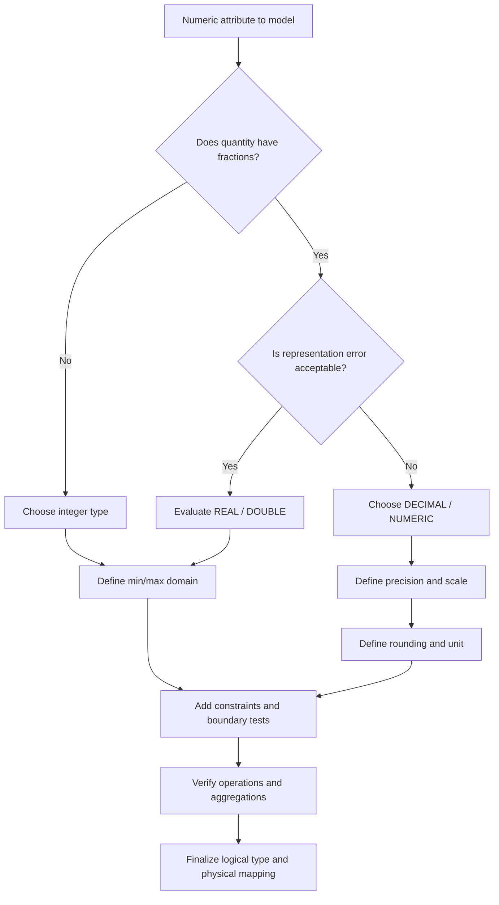

# Integers, Decimals, Precision, and Scale

Numeric attributes appear in almost every data model: product quantity, selling price, balance, tax, discount rate, weight, score, and exchange rate. Choosing a numeric type is not merely choosing a data type that can hold current values. The design team must understand what the value represents, its valid domain, how many digits must be preserved, rounding rules, and acceptable error tolerance.

Two key groups of numeric types are **integers** and **decimals**. Within decimals, you must distinguish exact decimal numbers from approximate floating-point numbers. For `DECIMAL(p, s)` or `NUMERIC(p, s)`, `p` is precision—the total number of digits allowed; `s` is scale—the number of digits in the fractional part. Understanding these two parameters properly prevents data loss, numeric overflow, and discrepancies in business calculations.

## 1. Start from the meaning of the numeric value

Before choosing a data type, identify what the numeric value describes.

| Business concept | Example | Questions to clarify |
|---|---|---|
| Count | Inventory item count, retry count | Can it be negative? Can it have fractions? Maximum limit? |
| Currency | Selling price, payment amount | Which currency? How many decimal places? Rounding rule? |
| Rate / ratio | Tax rate, discount, completion rate | Stored as `0.075` or `7.5`? Valid domain? |
| Measurement | Weight, length, volume | Which unit? Resolution? Are units converted? |
| Score or rating | Exam score, review rating | Are fractions allowed? Are out-of-range values allowed? |
| Exchange rate / factor | Currency exchange rate, calculation factor | Required precision? Source and effective timestamp? |
| Duration | Processing seconds, working minutes | What are the base unit and resolution? |

Two attributes that are both numeric may still require different types. Box count is usually an integer; goods weight may require three decimal places; payment amount usually requires exact decimal representation per currency rules; a rate may require more digits than the displayed monetary amount.

Do not pick a type just because one current example fits inside it. Determine the minimum value, maximum value, resolution, and calculations across the entire data lifecycle.

## 2. Integers

Integers represent values without a fractional part, such as `-12`, `0`, `25`, or `1000000`.

### 2.1. Signed and unsigned integers

Signed integer types can represent negative numbers, zero, and positive numbers. Unsigned types represent only non-negative numbers. In a binary representation with `n` bits:

- Two's complement signed integers typically have a range from (-2^{n-1}) to (2^{n-1}-1).
- Unsigned integers have a range from (0) to (2^n-1).

Example with 8 bits:

| Representation | Minimum value | Maximum value |
|---|---:|---:|
| Signed 8-bit | -128 | 127 |
| Unsigned 8-bit | 0 | 255 |

Support for unsigned types depends on the DBMS and language. PostgreSQL does not have built-in unsigned integer types like MySQL. Therefore, when a model must be compatible across multiple DBMSs, verify the equivalent value domain and constraints on each platform.

### 2.2. Common integer sizes

Many DBMSs provide integer types by storage size:

| Common group | Typical size | Typical signed range |
|---|---:|---:|
| Small integer / `SMALLINT` | 2 bytes | -32,768 to 32,767 |
| Integer / `INT` | 4 bytes | -2,147,483,648 to 2,147,483,647 |
| Big integer / `BIGINT` | 8 bytes | -9,223,372,036,854,775,808 to 9,223,372,036,854,775,807 |

These are common ranges for 16-, 32-, and 64-bit signed types; exact type names and compatibility should be checked against the specific DBMS. Not every product uses the same physical types or conversion rules.

### 2.3. When to use integers?

Integers are suitable for:

- Counts of indivisible business objects, such as seats or packages.
- Retry counts, attempt counts, version numbers, or step numbers.
- Numeric identifier values if managed as codes without performing business arithmetic on them.
- Monetary amounts in the smallest currency unit, if currency rules and value range permit.

Do not use an integer for a quantity with a meaningful fractional part. For example, storing weight `1.275 kg` as `1` loses information. Likewise, do not use integer types to represent phone numbers, postal codes, or product codes merely because they consist of digits: these values are codes, may have leading zeros, and are not meant for arithmetic.

### 2.4. Choosing integer size

Choose the smallest type that meets the expected value domain, while accounting for growth rate and boundary values. For example, having only a few hundred thousand orders today does not mean an `INT` column will always suffice if the system is expected to retain decades of data or serve multiple organizations.

Determine:

- Minimum possible value, including negative values if any.
- Current maximum value and forecast over the retention period.
- Growth rate of the counter or quantity.
- Whether intermediate calculations can exceed the bounds of the input type.
- Whether the DBMS promotes types automatically or raises an error on overflow.

Do not rely on an assumption that a calculation “usually won't get that large”. Check the maximum value possible under business rules and expected load.

## 3. Exact decimals and floating-point numbers

Not every type with a decimal point stores values the same way.

### 3.1. Exact decimals

`DECIMAL` or `NUMERIC` types typically represent exact decimal numbers according to the declared digit count and scale. For example, `NUMERIC(8, 2)` can represent values like `12345.67` exactly per the type's decimal rules.

This type fits values where representation error must not accumulate arbitrarily, such as money, prices, taxes, and balances. Calculations may still require rounding rules and precision limits for intermediate results; an exact type does not mean every calculation automatically matches business semantics.

### 3.2. Approximate floating-point numbers

`REAL`, `FLOAT`, or `DOUBLE PRECISION` types typically use binary floating-point representation. They can represent a very wide range of values and suit scientific computing, simulations, or measurements where small rounding errors are acceptable.

Many decimal fractions cannot be represented exactly in a finite number of binary bits. For example, `0.1` has no finite binary representation. As a result, the stored value is the closest representable number, and calculations can produce results like `0.30000000000000004` instead of exactly `0.3`.

Illustrative JavaScript example:

```javascript
console.log(0.1 + 0.2);
// May display: 0.30000000000000004
```

This behavior is not necessarily a DBMS bug. It is a property of floating-point representation. When comparing two approximate values, you typically must define an acceptable tolerance instead of using exact equality comparison.

### 3.3. Comparing the two groups

| Criterion | `DECIMAL` / `NUMERIC` | `REAL` / `FLOAT` / `DOUBLE` |
|---|---|---|
| Representation | Decimal number per declared precision | Binary floating-point number |
| Accuracy | Exact per type and scale rules | Approximate, with representation error |
| Value range | Depends on maximum DBMS precision | Typically very wide |
| Computation cost | Can be higher depending on DBMS and operations | Typically suited for high-performance scientific calculations |
| Typical use cases | Money, prices, taxes, balances | Simulations, science, sensors, and approximate statistics |

Do not choose `FLOAT` merely because it holds many digits or has a wide range. Determine whether representation error is acceptable for the business domain.

## 4. Precision and scale in DECIMAL(p, s)

The two parameters `p` and `s` are often confused. They describe two different aspects of a decimal number.

### 4.1. What is precision?

Precision (`p`) is the maximum total number of decimal digits allowed to be stored, counting both the integer part and the fractional part. For example, `NUMERIC(7, 2)` allows at most 7 digits in total, of which 2 digits are in the fractional part.

### 4.2. What is scale?

Scale (`s`) is the number of digits reserved for the fractional part. In `NUMERIC(7, 2)`, there are 5 digits for the integer part and 2 digits for the fractional part.

For a standard decimal type with precision `p` and scale `s`:

- The number of digits reserved for the integer part is `p - s`.
- The number of digits reserved for the fractional part is `s`.
- Typically `p >= s >= 0` is required; limits and negative-scale cases depend on the DBMS.

### 4.3. Examples of reading precision and scale

| Type | Integer digits | Fractional digits | Largest positive value by standard definition |
|---|---:|---:|---:|
| `DECIMAL(5, 0)` | 5 | 0 | 99.999 |
| `DECIMAL(7, 2)` | 5 | 2 | 99.999,99 |
| `DECIMAL(12, 2)` | 10 | 2 | 9.999.999.999,99 |
| `DECIMAL(5, 4)` | 1 | 4 | 9,9999 |
| `DECIMAL(9, 6)` | 3 | 6 | 999,999999 |

Note that numbers in the table use dots as thousands separators and commas as decimal separators per Vietnamese convention. In SQL, literals normally use a dot for the fractional part, such as `99999.99`.

With `DECIMAL(5, 4)`, there is only one integer digit. Thus, this type cannot store `12.3456`, even though the fractional part has only four digits. This is a common design mistake when looking only at scale and forgetting the integer part.

### 4.4. Range formula

For a standard decimal type with `p` total digits and `s` fractional digits, the number of integer digits is `p-s`. The largest representable positive value is:

\[
10^{p-s} - 10^{-s}
\]

For example, `DECIMAL(8, 2)` has 6 integer digits and 2 fractional digits. The maximum positive value is `999999.99`.

The type can allow negative values of corresponding magnitude, depending on the DBMS and business constraints. If negative values are disallowed, add a check such as `CHECK (amount >= 0)` rather than assuming the decimal type itself prevents negatives.

### 4.5. Precision and scale are not business rounding rules

Declaring `DECIMAL(10, 2)` specifies storage capability with two decimal places. It does not answer:

- Are values with more than two decimal places rounded or rejected?
- Is half-up, half-even, or another rounding rule used?
- Is rounding applied per line or only when computing the invoice total?
- Where is any remainder after division kept?
- Is the original value before rounding stored?

These questions belong to business rules and must be specified separately. Casting or rounding behavior on write can differ across DBMSs, drivers, and application languages.

## 5. How to choose precision and scale

Choose `p` and `s` from the value domain and business resolution, not out of habit.

### 5.1. Determine maximum integer part

Determine the largest value that can occur during the retention period. For money, you may need to account for total order amounts, refunds, adjustments, or aggregations across multiple transactions. For quantities, account for cumulative inventory and permitted measurement units.

For example, if the expected maximum monetary amount is 850,000,000,000.00, at least 12 integer digits are required. This value has 12 integer digits, so the type needs `p-s >= 12`.

Do not use average figures to determine the maximum domain. A system with a low average value can still receive a large transaction or aggregate across many records.

### 5.2. Determine required scale

Scale depends on business resolution:

- Product quantities counted in units usually need `s = 0`.
- Weight may need `s = 3` if the unit is kg and the business measures to the gram.
- Selling prices in a two-decimal currency may need `s = 2`, though not all currencies have the same number of minor digits.
- Percentages or exchange rates may need more digits than the final monetary amount.

Do not choose scale solely based on the digits displayed in the UI. The system may need higher precision during intermediate calculations and round only at a designated business step.

### 5.3. Add a reasonable headroom margin

Design for reasonable growth over the expected timeframe, while avoiding picking huge precision for every column without evaluating cost. Document:

- Maximum observed value.
- Maximum value under business rules.
- Expected growth rate and data retention period.
- Chosen safety margin and rationale.
- Conditions requiring review as data grows.

### 5.4. Selection examples

| Attribute | Value domain to support | Illustrative type | Rationale |
|---|---|---|---|
| Product quantity in pieces | 0 to several million | `BIGINT` or `INTEGER` depending on limit | Whole count, no fractional part |
| Weight in kg | 0 to 999,999.999 kg | `NUMERIC(12,3)` | 9 integer digits and 3 fractional digits |
| Transaction monetary value | 0 to 999,999,999,999.99 | `NUMERIC(14,2)` | 12 integer digits and 2 fractional digits |
| Tax rate stored as ratio | 0 to 1 with 0.000001 resolution | `NUMERIC(7,6)` | One integer digit and six fractional digits |
| Exchange rate | Per source contract, e.g. 10 integer and 10 fractional digits | `NUMERIC(20,10)` | Needs higher resolution than final monetary amount |

The types in the table are illustrative examples only. Value domains, scale, and rounding rules must be confirmed by the business owner.

## 6. Rounding and truncation rules

When a number has more digits than the target scale, the system must handle the excess digits. There are multiple strategies, and they are not equivalent.

### 6.1. Common handling methods

- **Half-up rounding:** for non-negative values, if the next digit is 5 or greater, increment the retained digit by one; exact midpoint cases are typically rounded away from 0. Verify exact behavior for your library or DBMS.
- **Half-even rounding:** when exactly halfway between two nearest values, choose the value whose final digit is even to reduce cumulative bias in certain aggregations.
- **Truncation:** drop excess digits without rounding.
- **Directional rounding:** always round up or always round down according to a defined rule.

Exact behavior of `ROUND`, type casting, and decimal types depends on the DBMS and language. Do not assume all system components use the same rule without checking.

### 6.2. Line-level rounding or total-level rounding?

Suppose an invoice has multiple lines, each with a post-tax amount of 10.005 in a two-decimal currency. Rounding each line first and summing can yield a different result than summing unrounded numbers and rounding once at the end.

Therefore, specify:

- Formula for line amount.
- When prices, taxes, and discounts are rounded.
- How the invoice total is calculated.
- How rounding differences are handled.
- Which values must be stored to explain results later.

No single rule fits every industry. Accounting, payments, tax, and local regulations may require different treatments.

### 6.3. Storing original and rounded values

If auditing or result reconstruction is needed, you may need to store:

- Input value received from the source.
- Original precision or measurement unit.
- Applied rule and formula version.
- Required intermediate values.
- Final rounded value and recording timestamp.

You do not necessarily need to store every intermediate value. Keep only what has business, legal, or audit value, and define retention periods.

## 7. Currency and financial values

Currency is a critical case because tiny errors can accumulate or cause reconciliation discrepancies.

### 7.1. Do not use FLOAT for monetary amounts requiring exactness

Floating-point numbers can introduce representation and cumulative errors. For monetary amounts requiring exact reconciliation, typically use exact decimal types or integers in the defined smallest unit.

Example:

```sql
CREATE TABLE invoice_line (
    invoice_line_id BIGINT GENERATED ALWAYS AS IDENTITY PRIMARY KEY,
    quantity NUMERIC(12, 3) NOT NULL CHECK (quantity > 0),
    unit_price NUMERIC(14, 2) NOT NULL CHECK (unit_price >= 0),
    discount_amount NUMERIC(14, 2) NOT NULL DEFAULT 0
        CHECK (discount_amount >= 0)
);
```

This is illustrative PostgreSQL syntax. ID generation syntax and data type details may need adjustment for your DBMS.

### 7.2. Store currency alongside monetary amount

The value `100.00` lacks sufficient meaning unless we know whether it is VND, USD, EUR, or another currency. A monetary amount should be paired with a currency code according to chosen standards and rules.

Example:

```text
amount = 1250.50
currency_code = "USD"
```

Do not add values of different currencies directly. If conversion is needed, specify the exchange rate, rate source, effective timestamp, conversion direction, and rounding rules.

### 7.3. Minor digits depend on the currency

Not every currency uses two decimal places. Some currencies are commonly represented with no minor unit in standard transactions; others have their own minor-unit rules. Therefore, do not blindly apply `DECIMAL(..., 2)` to every currency without reviewing business rules.

Multi-currency systems need a currency catalog and rules for decimal digits or minor units. Some financial domains also require higher scale for exchange rates and intermediate calculations before rounding the settlement amount.

### 7.4. Storing money as integers in minor units

Another option is storing money as an integer count of the currency's smallest unit. For example, 12.34 units of a two-decimal currency is stored as 1234 minor units.

Advantages:

- Exact representation of minor units.
- Integer addition and subtraction avoid floating-point error.
- Can simplify certain reconciliations.

Limitations:

- Must know the number of decimal digits per currency.
- Multiplication, division, and conversion still require rounding rules.
- Integer range must be large enough for maximum amounts.
- Must avoid confusing storage units with display units.

If using this approach, field names or API contracts should clearly express the unit, such as `amount_minor_units`, and always pair it with `currency_code`.

## 8. Ratios, percentages, and exchange rates

Rate attributes frequently cause bugs due to inconsistent representation conventions.

### 8.1. Choose one representation convention

A 7.5% rate can be stored in one of two ways:

- As a ratio: `0.075`.
- As a percentage: `7.5`.

Both can be valid, but never mix them within the same attribute or API contract. State the unit and convention clearly in the attribute name or data documentation.

Example:

```text
tax_rate_ratio = 0.075
tax_rate_percent = 7.5
```

### 8.2. Define valid domains

Tax rates or discount rates may be bounded from 0 to 1 if stored as ratios. However, not every rate shares this domain: growth rates can be negative, leverage ratios can exceed 1, and completion percentages can have custom definitions.

Therefore, define valid domains from semantics rather than applying `CHECK (rate BETWEEN 0 AND 1)` to every column named `rate`.

### 8.3. Exchange rates and intermediate precision

Exchange rates usually require more decimal places than displayed monetary amounts. For instance, currency conversion may use an exchange rate with 10 decimal places, while the final amount is rounded to the receiving currency's minor unit.

Also store the rate source and timestamp if transactions must be reconstructed. Do not store only a rate number without knowing which transaction it applied to or where it came from.

## 9. Measurements, quantities, and units

A measurement attribute only has full meaning when the unit is known. `12.5` could be kilograms, meters, liters, hours, or degrees Celsius.

### 9.1. Choose scale from measurement resolution

If goods are weighed to the gram, you can store kilograms with three decimal places. If the scale is only accurate to 0.1 kg, storing six decimal places does not make the data more accurate.

Determine:

- Standard unit in the system.
- Resolution of the measuring device or process.
- Acceptable measurement error.
- Unit conversion rules.
- Whether the original unit from the source must be stored.

### 9.2. Units and conversions

If a product can be received in cartons yet issued in pieces, define the conversion factor and effective timestamp. Do not merely store `quantity = 10` without knowing whether it is 10 cartons or 10 pieces.

In some domains, conversion factors vary by product or batch. In that case, model unit rules separately and store the information applied at transaction time.

### 9.3. Integer quantities vs. fractional quantities

Counting pieces typically uses integers. Weighing, measuring volume, or allocating time may require decimals. Do not use integer for every `quantity` field if the business allows splitting; conversely, do not use decimal for counts when fractions are meaningless and invalid data should be prevented.

## 10. Numeric operations and intermediate precision

The input data types alone do not dictate the type and precision of an expression's result. Each DBMS has its own rules for addition, multiplication, division, casting, and aggregation.

### 10.1. Addition and multiplication

When adding many monetary amounts, the total may need more integer digits than any individual line. When multiplying quantity by unit price, the intermediate result may need greater scale than the unit price.

Example:

```text
quantity  = 12.500
unit_price = 19.99
line_value = 12.500 × 19.99 = 249.875
```

If final currency only has two decimal places, specify which rule handles `249.875` and at which step. Do not round prematurely if the business requires preserving intermediate precision.

### 10.2. Division

Division often produces repeating decimals or more digits than input scale. For example, `1 / 3` has no finite decimal representation. The system must specify result precision/scale, rounding method, and where the value is stored.

Additionally, integer division may truncate the fractional part depending on language or DBMS. Check operand types and apply appropriate conversion when a decimal result is needed.

### 10.3. Aggregation and overflow

A column may suffice for each individual transaction yet overflow when summing millions of transactions. When using `SUM`, `AVG`, or multiplication, check the function's return type and result range.

For example, monthly total revenue can exceed the maximum value of a single invoice. Do not assume the result type always matches the source column type. Check DBMS documentation and test with near-limit values.

### 10.4. Comparing approximate numbers

For floating-point numbers, exact equality comparison may be inappropriate. Instead of:

```text
measured_value == expected_value
```

you may need a tolerance comparison:

```text
abs(measured_value - expected_value) <= tolerance
```

The `tolerance` value must be based on measurement accuracy or scientific requirements. Do not pick an arbitrary epsilon for all quantities.

## 11. Data constraints for numeric attributes

Numeric types define the representation domain; constraints define the valid business domain. Both must work together.

### 11.1. NOT NULL and DEFAULT

`NOT NULL` requires the attribute to have a value. `DEFAULT` supplies a value when an insert statement omits it, according to DBMS rules.

Do not use `DEFAULT 0` to hide missing data if zero means something different from “unknown”. For example, a balance of 0 differs from an unreconciled balance. Distinguish `NULL`, `0`, and default values.

### 11.2. CHECK constraints

`CHECK` constraints enforce value rules inside the database.

```sql
CREATE TABLE inventory_balance (
    product_id BIGINT NOT NULL,
    available_quantity NUMERIC(14, 3) NOT NULL,
    reserved_quantity NUMERIC(14, 3) NOT NULL,
    CHECK (available_quantity >= 0),
    CHECK (reserved_quantity >= 0)
);
```

This is only a simple example. If available quantity is computed as physical stock minus reserved quantity, explicitly define base data and concurrent update rules. A row-level `CHECK` does not by itself guarantee the correctness of total inventory across multiple records.

### 11.3. UNIQUE and valid domains

A numeric attribute may need a uniqueness constraint if it acts as an identifier. For example, a line sequence number may be unique within an order, so the actual constraint would be unique on `(order_id, line_number)`, not globally on `line_number`.

Other valid domain rules:

- Tax rate is non-negative and does not exceed business limits.
- Rating score lies within the allowed range.
- Order quantity is greater than 0.
- Allocation ratios must satisfy a rule summing to 1 or 100% within a group.

Some rules involving multiple rows or entities cannot be enforced via simple `CHECK` constraints alone. Transactions, triggers, conditional unique constraints, or controlled business logic may be required.

## 12. Differences across database management systems

Types such as `INTEGER`, `BIGINT`, `DECIMAL`, `NUMERIC`, `REAL`, and `DOUBLE PRECISION` are widespread, yet implementation details can differ:

- Maximum precision limits for decimal.
- Signed or unsigned integer types.
- How expression precision/scale is inferred.
- Behavior when writing a value exceeding scale.
- How `ROUND` handles exact midpoint cases.
- Return data types of `SUM` and `AVG`.
- Implicit conversions between integer, decimal, and floating point.
- Storage layout and actual physical size of decimal.

For example, PostgreSQL supports `NUMERIC` with configurable precision within implementation limits; MySQL has its own maximum precision rules and unsigned types; SQL Server has `DECIMAL(p, s)` with its own precision limits. Do not infer behavior solely from matching type names.

Before implementation, check the official documentation of your target DBMS and write tests for boundary cases: maximum, minimum, excess scale, rounding, division, aggregation, and type casting.

## 13. Example numeric attribute design for an online store

Suppose a system manages products, order lines, inventory, and payments. The table below illustrates how to specify attributes before choosing physical types.

| Attribute | Meaning | Proposed logical type | Constraints / rules |
|---|---|---|---|
| `ordered_quantity` | Quantity ordered in line | Decimal scale 3 if sold fractionally; integer if sold by piece only | Greater than 0 |
| `unit_price` | Unit price at purchase time | Exact decimal | Non-negative; paired with currency |
| `discount_rate` | Discount rate | Exact decimal, stored as ratio | Domain per promotion policy |
| `tax_rate` | Applicable tax rate | Exact decimal | Tied to tax rules and effective date |
| `line_total` | Line amount | Exact decimal or recorded value | Computed per formula and rounding rule |
| `stock_quantity` | Stock quantity | Integer or decimal depending on unit | Non-negative if business disallows negative stock |
| `exchange_rate` | Rate used for conversion | High-scale exact decimal | Record source and timestamp of rate |
| `rating` | Review rating | Integer or decimal per scale | Within published scale |

### 13.1. Illustrative SQL schema

```sql
CREATE TABLE order_line_amount (
    order_line_id BIGINT GENERATED ALWAYS AS IDENTITY PRIMARY KEY,
    quantity NUMERIC(12, 3) NOT NULL CHECK (quantity > 0),
    unit_price NUMERIC(14, 2) NOT NULL CHECK (unit_price >= 0),
    discount_rate NUMERIC(7, 6) NOT NULL DEFAULT 0
        CHECK (discount_rate >= 0 AND discount_rate <= 1),
    tax_rate NUMERIC(7, 6) NOT NULL DEFAULT 0
        CHECK (tax_rate >= 0 AND tax_rate <= 1),
    currency_code CHAR(3) NOT NULL
);
```

This is illustrative PostgreSQL syntax and not a complete production design. It assumes rates are stored as ratios from 0 to 1, money has two decimal places, and quantity has three decimal places. These assumptions must be confirmed against currencies, sales units, and tax rules.

### 13.2. Questions to confirm before finalizing

- Are any products sold by weight or volume?
- In what unit is unit price entered?
- Are there currencies that do not use two decimal places?
- Can discount rates exceed 100% or be negative in adjustment scenarios?
- Is tax computed on pre-discount or post-discount prices?
- Round per line or on the invoice total?
- Must the exchange rate value and rules at payment time be stored?
- Can inventory go negative due to backorders?
- Can total quantity or revenue exceed the type limits of individual lines?

If answers change, numeric types or constraints may have to change as well. Therefore, do not treat the illustrative SQL schema as final prior to business sign-off.

## 14. Changing precision and scale during evolution

Numeric types may need adjustment as the business expands. Changing precision and scale must be evaluated as a data change, not merely editing a number in DDL.

### 14.1. Increasing precision

Increasing precision while keeping scale unchanged usually expands the integer range. For example, moving from `NUMERIC(10, 2)` to `NUMERIC(14, 2)` allows larger values. Even so, check:

- Does the DBMS support an in-place change?
- Do indexes, views, functions, APIs, or reports depend on the old type?
- Do applications and drivers handle larger numbers?
- Is data serialized accurately through JSON or application languages?

### 14.2. Increasing scale

Increasing scale preserves more fractional digits, yet can affect representation, comparisons, constraints, and API contracts. If you need to increase scale while preserving the integer range, you usually must increase precision accordingly.

For example, `NUMERIC(10, 2)` has 8 integer digits. To move to 4 fractional digits while keeping 8 integer digits, the new type needs at least `NUMERIC(12, 4)`.

### 14.3. Decreasing scale

Decreasing scale risks losing information or requiring rounding. Before doing so:

1. Profile existing values that have more fractional digits than the target scale.
2. Define rounding or data rejection rules.
3. Assess impact on totals, reports, and reconciliation.
4. Back up and test conversion on representative data.
5. Reconcile record counts and differences before/after.
6. Have a rollback plan if results fail verification.

Do not silently truncate fractional digits just to make a migration succeed.

## 15. Common mistakes

| Mistake | Consequence | Fix |
|---|---|---|
| Using FLOAT for money | Representation error and reconciliation drift | Use exact decimal or integer minor units |
| Looking only at scale and forgetting precision | Insufficient integer digits, causing write errors | Account for both maximum range and fractional digits |
| Using overly small decimals | Growing values exceed limits | Forecast value domain over retention period |
| Using huge decimals for every column | Wastes resources and hides lack of analysis | Choose precision/scale per business requirements |
| Confusing 7.5% with 0.075 | Mis-calculates tax or discount by orders of magnitude | Document rate convention and units clearly |
| Inconsistent rounding across layers | Line sums differ from invoice total | Define one verifiable rounding rule |
| Using integer for numeric codes | Loses leading zeros and turns codes into arithmetic values | Use character types for non-arithmetic codes |
| Assuming NULL equals 0 | Loses distinction between unknown and zero | Define semantics for NULL, 0, and DEFAULT |
| Not checking aggregate return types | Overflow when summing or multiplying | Check return types and intermediate value domains |
| Decreasing scale without checking data | Loss of historical precision | Analyze and test migrations before applying |

## 16. Checklist for choosing numeric types

- [ ] Business meaning and unit of the attribute identified.
- [ ] Minimum, maximum, and whether negatives are allowed specified.
- [ ] Determined whether the attribute is a count, money, ratio, or measurement.
- [ ] Decided whether exact representation is needed or approximate error is acceptable.
- [ ] If using decimal, precision and scale derived from actual value domains.
- [ ] Integer digit count verified as `p - s`.
- [ ] Resolution and rounding rules defined.
- [ ] Accompanying currency, measurement unit, or ratio convention specified.
- [ ] NULL, 0, and default values distinguished.
- [ ] Domain constraints and uniqueness checks added where needed.
- [ ] Multiplication, division, aggregation, and overflow risks checked.
- [ ] Differences across DBMS, drivers, and application languages verified.
- [ ] Migration strategy defined for future precision or scale changes.
- [ ] Boundary values and real rounding scenarios tested.



Choosing the right numeric type starts with business semantics, value domain, and required resolution. Integers fit counting quantities; exact decimals fit values needing reconciliation; floating-point numbers fit approximate calculations with controlled error. When precision, scale, units, and rounding rules are clearly defined, the data model avoids overflows, loss of accuracy, and cross-system discrepancies.
