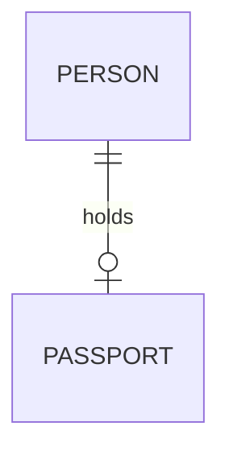
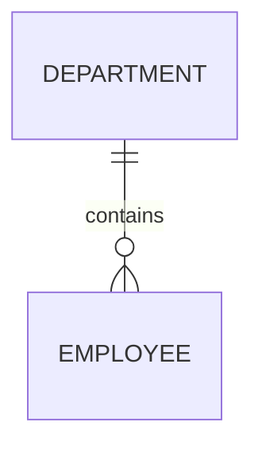

# Minimum, Maximum Cardinality, and Optionality at Each Relationship End

In data modeling, simply stating "one-to-many" or "many-to-many" is rarely enough. A designer must also determine how many times each object can or must participate in a relationship. Can a customer exist without orders, or must they have at least one? Can an order belong to a walk-in guest, or must it always be linked to a customer profile? Can a department exist before any employees are assigned to it? These questions are captured by **minimum cardinality, maximum cardinality, and optionality at each end of a relationship**.

This is a critical step when translating business requirements into an unambiguous data model. Recording a relationship without specifying participation limits can allow cases the business rejects or block cases that are completely valid. Defining these limits accurately also guides the team when designing foreign keys, junction tables, unique constraints, and data validation mechanisms at the logical and physical layers.

After this lesson, learners will be able to:

- Explain minimum cardinality, maximum cardinality, and optionality for one end of a relationship.
- Read and write `(min,max)` notation for each side of a relationship.
- Distinguish one-to-one, one-to-many, and many-to-many relationships based on maximum limits at both ends.
- Distinguish mandatory participation from optional participation based on minimum limits.
- Identify limits by lifecycle, status, time, and business conditions.
- Validate cardinality using valid examples, invalid examples, and questions for business owners.
- Understand how conceptual limits map to logical/physical constraints and which limits cannot be enforced by foreign keys alone.

## 1. What does relationship cardinality describe?

A relationship connects concrete instances of two concepts. For example, `Customer places Order`. Cardinality specifies how many instances on one side can or must be linked to instances on the other side.

Read the relationship from both sides:

- For **one customer**, how many orders can or must exist?
- For **one order**, how many customers can or must it belong to?

These two questions are independent. A relationship may allow a customer to have no orders yet while still requiring every order to belong to exactly one customer. If walk-in guests are supported, the order side may allow no attached customer profile. You cannot infer the limit at one end solely from the limit at the other end.

### 1.1. Minimum cardinality

Minimum cardinality indicates the minimum number of times an instance must participate in the relationship within the scope and timeframe under consideration.

- `0`: participation is not required. An object can exist without any link.
- `1`: at least one link is mandatory.
- `2` or greater: the business requires a higher minimum number of links, if such a rule exists.

For example, a new customer may not have placed any orders yet, so the minimum number of orders for a customer is `0`. Conversely, an order line item cannot exist without belonging to an order, so the minimum number of orders an order line item must reference is `1`.

### 1.2. Maximum cardinality

Maximum cardinality indicates the maximum number of times an instance can participate in the relationship.

- `1`: at most one link.
- `N` or `*`: many links; the business model places no specific fixed upper bound at that relationship end.
- A finite number such as `3`, `5`, or `10`: a specific upper limit if required by business rules.

For example, each order in a retail scenario can belong to at most one customer. A customer can place many orders. Maximum limits apply per instance, not to the total number of records across the entire system.

### 1.3. Optionality

In relational modeling, a relationship end is **optional** when its minimum cardinality is `0`. That end is **mandatory** when its minimum cardinality is `1` or greater.

| Min | Interpretation | Participation |
|---:|---|---|
| 0 | May have no link yet | Optional (partial participation) |
| 1 | Must have at least one link | Mandatory (total participation) |
| 2 or more | Must have at least the specified number of links | Mandatory with a specific minimum threshold |

Optionality is about whether participation in the relationship is required. It is not synonymous with an attribute value being missing or unknown. For instance, a customer with no orders yet represents the absence of a link; a customer who has an order whose order code is unknown is a different data issue.

## 2. `(min,max)` notation at each relationship end

A clear notation uses a `(min,max)` pair for each end. For example:

```text
CUSTOMER (0,N) -------- (1,1) ORDER
```

Interpretation:

- Each customer can have from `0` to many orders.
- Each order must belong to exactly `1` customer.

If the business allows walk-in guests:

```text
CUSTOMER (0,N) -------- (0,1) ORDER
```

Interpretation:

- A customer may have no orders yet or may have many orders.
- An order may not be linked to a customer profile or may be linked to at most one customer profile.

It is essential to make clear which perspective each pair represents. Different documentation conventions or diagramming tools place the notation near the entity or near the opposite end of the line. Always accompany diagrams with natural-language statements to avoid reading them backward.

### 2.1. Reading each end with two questions

For a relationship between `A` and `B`, ask:

1. "What are the minimum and maximum number of `B` instances that one `A` can/must link to?"
2. "What are the minimum and maximum number of `A` instances that one `B` can/must link to?"

Do not read a single pair of numbers as a limit for the entire relationship. Each pair describes the link count seen from one object type.

Example with `Department` and `Employee`:

| Perspective | Min | Max | Meaning |
|---|---:|---:|---|
| How many employees does one department have? | 0 | N | A newly created department may have no employees yet; later it can have many. |
| How many departments does one employee belong to at the same time? | 1 | 1 | Every active employee must belong to exactly one department. |

If the organization allows employees to be in a pending-assignment status, the employee side's limit might be `(0,1)` during that phase. This is a sign to clarify when the rule applies rather than forcing a single rule across every stage.

### 2.2. Four common combinations

| Min–max | Common name | Interpretation |
|---|---|---|
| `(0,1)` | Zero or one | May not participate; if participating, at most once. |
| `(1,1)` | Exactly one | Must participate precisely once. |
| `(0,N)` | Zero or many | May not participate or may participate many times. |
| `(1,N)` | One or many | Must participate at least once, possibly many times. |

These four pairs are not four separate relationship types. They are limits at one end of a relationship. A complete relationship must specify a limit pair for both sides.

## 3. Distinguishing minimum and maximum cardinality

The two limits answer different questions:

- Min answers: "Is having no link allowed? If not, what is the minimum required?"
- Max answers: "What is the maximum number of instances of that type that can be linked?"

For example, an employee profile can be linked to at most one login account, but not every employee needs an account. The limit is `(0,1)`. If every employee must have an account, the limit is `(1,1)`. Both have a max of `1`, but their optionality differs.

Similarly, a project may have no members when first created, but before kickoff it must have at least one participant. Looking only at max `N` hides this minimum requirement. Both min and the applicable stage must be stated explicitly.

### 3.1. A max of 1 does not mean mandatory

This is a common confusion. `0..1` and `1..1` both allow at most one link. The difference lies in the min:

- `0..1`: may have no link.
- `1..1`: must have exactly one link.

For example, a customer can have a membership account but can also purchase without registering. The `Customer — Membership Account` relationship can be `(0,1)` on the customer side. If every membership account must belong to exactly one customer, the account side has `(1,1)`.

### 3.2. A min of 1 does not mean only one

`1..N` means at least one is required and many are allowed. For example, a valid issued invoice must have at least one invoice line, yet can contain many lines. Writing `(1,1)` would accidentally prohibit multi-line invoices.

### 3.3. `N` or `*` does not mean technically infinite

`N` or `*` indicates there is no fixed upper limit in the business rule being modeled. The system still has resource, capacity, performance, or operational policy limits. If the business specifies a concrete cap—such as a maximum of 30 students per class—record `max = 30` or express it as a capacity constraint instead of using `N`.

## 4. Deriving 1:1, 1:N, and N:M from min–max

The labels one-to-one, one-to-many, and many-to-many primarily describe the maximum limits at both ends. Whether participation is mandatory or optional is determined by the minimum limits. Therefore, saying only "one-to-many" leaves the relationship incomplete.

### 4.1. One-to-one relationship (1:1)

Both sides have a max of `1`. The min values can differ:

| Side A | Side B | Interpretation |
|---|---|---|
| `(0,1)` | `(1,1)` | A may not have B yet; every B must attach to exactly one A. |
| `(1,1)` | `(1,1)` | Every A and every B must participate in exactly one link. |
| `(0,1)` | `(0,1)` | Both sides can exist independently or pair up at most one-to-one. |

Example: `Person — Passport`. A person may not have a passport or may hold at most one active passport within the managed scope; each passport belongs to exactly one person. Confirm whether an expired or reissued passport creates a new record or replaces the old record.



The notation shows that each passport belongs to exactly one person, while a person can have zero or one passport within the scope of this example model. If the business keeps multiple historical passports, the relationship must be expanded with a passport record concept or validity status.

### 4.2. One-to-many relationship (1:N)

One side can link to many instances on the other side; the many side typically references at most one instance on the one side. Min values must still be determined separately.

Example: `Department — Employee`:

| Side | Min–max | Meaning |
|---|---|---|
| Department toward employee | `(0,N)` | A department may have no employees yet or have many employees. |
| Employee toward department | `(1,1)` | Each active employee belongs to exactly one department. |



If an employee can temporarily have no department, change the employee-side limit to `(0,1)` for that phase. If an employee can work in multiple departments concurrently, the relationship may become many-to-many and require an assignment concept.

### 4.3. Many-to-many relationship (N:M)

Both sides have a max of many. Min can be `0` or `1` depending on the rules.

Example: `Student — Course`. A student may not be enrolled in any courses yet or may enroll in many courses; a course may have no students yet or have many participants.


If the business requires every open course to have at least one student, the min on the course side may be `1` once the course starts. However, a course in draft status may have no students yet. When an N:M relationship carries its own attributes such as enrollment date, status, grade, or outcome, consider introducing an `Enrollment` associative concept.

### 4.4. Summary table of patterns

| Type by max | Side A limit | Side B limit | Example |
|---|---|---|---|
| 1:1 | `(0,1)` | `(1,1)` | A person may have a passport; a passport belongs to exactly one person. |
| 1:N | `(0,N)` | `(1,1)` | A department has many employees; an employee belongs to one department. |
| N:M | `(0,N)` | `(0,N)` | A student takes many courses; a course has many students. |

This table only illustrates common combinations. When designing, record the exact min–max for each end based on business rules rather than picking a template by name.

## 5. Optionality at each relationship end

### 5.1. Asymmetric optionality

The two ends of the same relationship can have different optionality. For example, a customer may not have any orders yet, while every order created by a registered customer must belong to exactly one customer. The customer side is `(0,N)` and the order side is `(1,1)`.

In retail sales with walk-in guests, the order side may be `(0,1)`. That does not mean the order is missing data due to an error; it reflects a valid business case. Conversely, if the organization requires every order to have an identified buyer entity, the min on the order side is `1`.

### 5.2. Optional at both ends

A relationship can be optional on both sides. For example, an employee may not be assigned to a project yet, and a newly created project may have no members yet. When the project is ready for kickoff, a rule may require at least one member.

Do not force a relationship to be mandatory just because the workflow eventually expects a link. Distinguish creation-time conditions, pre-activation conditions, and lifecycle-wide conditions.

### 5.3. Mandatory at both ends

A relationship can be mandatory on both sides if every instance of A must link to at least one B and every instance of B must link to at least one A. Hypothetical example: every assignment record must have exactly one employee and exactly one project; `Assignment` itself cannot exist independently without both.

Note that this does not mean every employee must have at least one assignment or every project must have at least one assignment. When the model includes an intermediate concept like `Assignment`, distinguish the relationships between `Assignment` and the two endpoints from the overall relationship between `Employee` and `Project`.

### 5.4. Conditional or stage-based mandatory participation

A relationship can be optional in one stage and mandatory in another.

Examples:

- A class created in `DRAFT` status may not have an instructor yet.
- Before transitioning to `READY`, the class must have at least one instructor.
- After the class begins, it must always have a primary responsible instructor.

A static min–max pair cannot fully express every time-dependent condition. Document state-transition rules and validation checkpoints alongside it. If you need to manage multiple stages or assignment history, an associative concept with effective dates may be required.

## 6. Distinguishing relationship participation from attribute values

Relationship optionality is not the same as attribute optionality.

For example, an employee may not be assigned to a project yet. That does not necessarily mean the `project_id` attribute is missing due to incomplete data; the employee may simply have no active project relationship. Furthermore, if an employee can join multiple projects, a single `project_id` column on Employee cannot even represent the relationship properly.

Key distinctions:

| Concept | Meaning | Example |
|---|---|---|
| Optional relationship | The object may not participate in a link | A customer has not placed any orders yet. |
| Optional attribute | The object exists, and a value may be absent or not applicable | A customer has not provided a secondary phone number. |
| Unknown reference | The business requires a link, but the target object has not been identified yet | An order requires a customer, but the customer code has not synced yet. |
| Invalid relationship | Data violates a rule | An order references a nonexistent customer. |

Do not use `NULL` to mask all of these cases indiscriminately. Before deciding whether a column should be nullable, determine whether the case represents a genuinely optional relationship, unknown data, or invalid data.

## 7. Cardinality in relationships with an associative concept

Many-to-many relationships often carry their own information. Turning the relationship into an intermediate concept makes the model much more precise.

For example, `Student` participates in `Class` through `Enrollment`:

```mermaid
erDiagram
    STUDENT ||--o{ ENROLLMENT : submits
    CLASS ||--o{ ENROLLMENT : receives
```

Interpretation:

- A student can have `0..N` enrollments.
- Each enrollment must belong to exactly `1` student.
- A class can have `0..N` enrollments.
- Each enrollment must apply to exactly `1` class.

If a student may have only one active enrollment for a given class, that is a conditional uniqueness rule on the `Student–Class` pair, not just a simple min–max rule. If a student cancels and re-enrolls, clarify whether a new enrollment record is created or the old record is reopened.

### 7.1. Limits of an associative entity

An associative entity such as `Enrollment` can have its own attributes: submission time, status, enrollment channel, confirmation time, and outcome. It also has its own lifecycle. Review:

- Can an enrollment exist before identifying the student or the class?
- Can a single enrollment apply to multiple classes?
- Can one student have multiple enrollments for the same class at different times?
- When a class is canceled, how do enrollment statuses transition?
- Can completed enrollments be deleted, or must history be retained?

Typically, each enrollment record must attach to exactly one student and exactly one class. However, there may be a draft status or incomplete request; specify the exact point at which the relationship becomes mandatory.

### 7.2. Cardinality of ternary or n-ary relationships

Some business processes depend simultaneously on three concepts. For example, `Employee` uses `Equipment` on `Project`. Each usage instance is identified by the combination of employee, equipment, and project. You cannot always decompose this into three binary relationships while preserving the exact meaning, because the three-way combination may carry its own data.

For an n-ary relationship, determine the limits for each role within the context of the other roles. For example:

- For a given `(Employee, Project)` pair, there may be multiple equipment usages.
- For a given `(Equipment, Project)` pair, there may be multiple employees using it.
- For a given `(Employee, Equipment)` pair, there may be multiple projects involved.

These limits must be described via business statements or a combination constraint table. Do not mechanically apply binary min–max notation to an n-ary relationship without defining the context clearly.

## 8. Determining min–max from business requirements

### 8.1. Ask about the minimum case

For each side, ask:

- Can an object exist without linking to any object on the other side?
- When newly created, can it have no links yet?
- Before transitioning to the next state, what is the minimum number of links required?
- Is there any valid case where the link count is 0?

If 0 is valid, min can be `0` within that scope and stage. If every valid case must have at least one link, min is `1` or higher.

### 8.2. Ask about the maximum case

- Can an object link to multiple objects on the other side?
- Is there a concrete business cap?
- Does that limit apply by time, status, role, or organizational scope?
- Can an object link to the same target object multiple times at different points in time?

For example, an employee can work on many projects over their career, but at most two projects concurrently. That is a time-dependent limit, not simply a max of `2` across all history.

### 8.3. Validate with examples and counterexamples

Do not stop at asking "can a customer have many orders?" Present concrete scenarios:

- Is a customer who just created an account and has not bought anything valid?
- Is a walk-in guest order valid?
- Can a single order be under two buyers' names?
- Can a single customer have thousands of orders?

For each answer, classify whether it is a universal rule, a permitted exception, or a prohibited case. Record the confirmation source and applicability conditions.

### 8.4. Cardinality tracking table

| Relationship | One A links to B | One B links to A | Condition/stage |
|---|---|---|---|
| Customer–Order | `(0,N)` | `(0,1)` if walk-in guests allowed; `(1,1)` if profile required | When the order is confirmed |
| Course–Class Offering | `(0,N)` | `(1,1)` | Every class offering belongs to one course |
| Student–Enrollment | `(0,N)` | `(1,1)` | A valid enrollment must have one student |
| Class–Enrollment | `(0,N)` | `(1,1)` | A valid enrollment must apply to one class |
| Department–Employee | `(0,N)` | `(1,1)` or `(0,1)` | Depends on assignment status |

## 9. Validating cardinality with scenarios

### 9.1. Example: Department and Employee

Suppose an organization has departments and employees. A department may be newly formed and have no employees yet. An active employee must belong to one department at any given time.

| Object under review | Linked count | Result |
|---|---:|---|
| New department | 0 employees | Valid if departments without staff are allowed. |
| Active department | N employees | Valid. |
| Active employee | 1 department | Valid. |
| Active employee | 0 departments | Violation if rules require continuous assignment. |
| Active employee | 2 departments simultaneously | Violation if limited to exactly one department; valid if concurrent appointments are allowed and modeled. |

If employees can transfer departments, capture relationship history. If concurrent appointments are permitted, model effective periods and roles rather than merely overwriting a single `department_id` value.

### 9.2. Example: Customer and Order

Suppose the system allows walk-in guests to place orders.

| Object under review | Link count | Result |
|---|---:|---|
| Customer with no purchases | 0 orders | Valid. |
| Repeat customer | N orders | Valid. |
| Registered customer order | 1 customer | Valid. |
| Walk-in guest order | 0 customers | Valid if buyer contact details are recorded under another rule. |
| Order attached to two customer profiles | 2 customers | Invalid if each order has only one buyer entity. |

If an order has different people as the buyer, recipient, and payer, do not collapse all of them into a single "order belongs to customer" relationship. Identify distinct roles—`Buyer`, `Recipient`, `Payer`—and define separate cardinalities for each relationship.

### 9.3. Example: Class and Enrollment

A class is created before enrollment opens. In draft status, the class may have no students. Once enrollment opens, confirmed students can range from `0` up to capacity. When the class is about to start, the center may require at least one student or cancel the class if enrollment is insufficient.

This reveals two distinct limits:

- Maximum enrollment may be bounded by capacity.
- Minimum enrollment may only be checked when deciding whether to open or start the class.

Do not specify a min of `1` for every status if draft classes are allowed to have zero students. Explicitly state the timing and state-transition rules.

## 10. Translating conceptual cardinality to logical and physical models

Conceptual cardinality is a business rule. During implementation, each relationship type is typically represented with different structures. Understanding how they correspond prevents mistakenly thinking that a single physical constraint guarantees the entire min–max specification.

### 10.1. One-to-many relationships

Typically, a foreign key is placed on the many side referencing the one side. For example, `employee.department_id` references `department.id`.

- If every employee must belong to a department, the referencing column must usually be non-null and the foreign key must be valid.
- If an employee can temporarily have no department, the reference can be nullable in permitted states.
- A department can have `0..N` employees; the foreign key on employee allows a department to have zero employee rows.

### 10.2. One-to-one relationships

Typically, one side holds a foreign key with a unique constraint to limit each target object to being referenced at most once. If the referencing side must have a target object, the reference must also be non-null and valid.

A unique constraint only enforces the max on one side of the relationship. To enforce the min on the opposite side, you may need synchronized creation flows, triggers, deferred checks, or application-layer business rules depending on the DBMS and design.

### 10.3. Many-to-many relationships

Typically, the relationship is represented by a junction table holding references to both sides. The key pair can be constrained as unique if duplicate relationships are disallowed within that scope. If the same pair can link multiple times over time, add a link identifier or include a timestamp/relationship type in the uniqueness rule.

### 10.4. Why isn't a foreign key enough for every min?

A foreign key typically checks that a reference, if present, points to a valid record. It does not by itself guarantee that every department has at least one employee or that every ready class has at least one instructor. Minimum constraints on the parent side generally require checking across the set of child records, conditioned on status and timing.

Therefore, before choosing an implementation approach, document:

- Which constraints can use `NOT NULL`, `FOREIGN KEY`, or `UNIQUE`.
- Which constraints require counting related records.
- Which constraints depend on status or time.
- Which constraints require concurrency control so two transactions do not exceed a limit simultaneously.
- Which constraints require business workflows or approvals.

Do not clutter conceptual diagrams with SQL details, but keep business rules clear enough that logical/physical designers can implement and verify them.

## 11. Common mistakes

| Mistake | Consequence | Fix |
|---|---|---|
| Writing only 1:N without min | Unclear which side can exist without participating. | Specify `(min,max)` for both sides. |
| Thinking max = 1 means mandatory | Turns a `0..1` relationship into `1..1`. | Check min and max separately. |
| Reading cardinality from only one side | Misunderstands the count at the other end. | Ask two independent questions for each end. |
| Treating `N` as technically infinite | Ignores business or resource limits. | Check whether a finite policy threshold exists. |
| Treating optionality as missing data | Confuses a valid zero-link case with a data error. | Distinguish non-participation, unknown values, and invalid data. |
| Applying one min–max to every status | Fails to reflect lifecycle rules. | Document conditions and validation timing. |
| Using one reference column for an N:M relationship | Cannot represent multiple links. | Consider an associative concept or many-to-many structure. |
| Ignoring distinct roles of the same person | Merges buyer, recipient, and payer. | Name relationships by business role. |
| Assuming a foreign key enforces every limit | Misses parent-side minimums or status-based limits. | Evaluate each constraint and its enforcement mechanism separately. |

## 12. Relationship specification sheet and review checklist

For each relationship, document:

| Element | Content |
|---|---|
| Relationship name | Verb or phrase accurately describing the business meaning. |
| Side A concept | Name and role of object A. |
| Side A min–max | Minimum/maximum number of B for one A. |
| Side B concept | Name and role of object B. |
| Side B min–max | Minimum/maximum number of A for one B. |
| Applicability conditions | Status, time, object subtype, or scope. |
| Related rules | Uniqueness conditions, quantity caps, permissions, and exceptions. |
| Valid examples | Scenarios demonstrating the limits. |
| Invalid examples | Scenarios violating the limits. |
| Confirmation source | Requirements, sample data, business owner. |

Specification template:

```text
Relationship name:
Business description:
Side A:
  Minimum B linked to one A:
  Maximum B linked to one A:
Side B:
  Minimum A linked to one B:
  Maximum A linked to one B:
Optionality on Side A:
Optionality on Side B:
Condition/status/time of applicability:
Exception rules:
Valid examples:
Violating examples:
Evidence source:
Confirmed by:
```

Pre-sign-off checklist:

- [ ] Every relationship has a clear name and business description.
- [ ] The relationship has been read from both sides.
- [ ] Min and max are determined separately for each end.
- [ ] Whether a count of 0 is valid has been confirmed.
- [ ] Whether the maximum limit is 1, many, or a finite number has been confirmed.
- [ ] `0..1` is distinguished from `1..1`, and `0..N` from `1..N`.
- [ ] Valid, invalid, and boundary cases have been checked.
- [ ] Status- and time-based conditions are explicitly stated.
- [ ] Roles of participating parties are clearly separated.
- [ ] N:M relationships with their own attributes/history have been evaluated as associative concepts.
- [ ] Min constraints are not mistakenly assumed to be enforced by foreign keys alone.
- [ ] Every limit has supporting evidence or confirmation from a business owner.

## 13. Practice exercise

A hospital manages doctors, patients, clinical departments, and appointments. A doctor belongs to one primary department but may support other departments on a schedule. A patient may have never visited or may have many visits. Every appointment must be linked to one patient and one doctor. A doctor may have no appointments on a given day. An appointment can be created before the patient confirms it, and can later be confirmed, rescheduled, or canceled.

Complete the following tasks:

1. Identify the main concepts and relationships in the scenario.
2. Write min–max for both sides of Doctor–Department, Patient–Appointment, and Doctor–Appointment.
3. Distinguish the primary department relationship from the scheduled department support relationship.
4. Determine the min–max of relationships in draft appointment status versus confirmed appointment status.
5. Write at least five valid scenarios and five scenarios that violate cardinality limits.
6. Explain why a draft appointment might not yet be confirmed by the patient while a valid appointment still must have a patient and a doctor under the final rule.
7. Propose how to represent the relationships in a logical model and list which constraints must be verified beyond foreign keys.
8. Build a cardinality table and list questions that need hospital confirmation.

**Self-assessment criteria:** every relationship has min–max on both sides; optionality is not confused with bad data; status-dependent limits are clearly stated; primary and supporting department roles are not merged; rules can be verified with concrete examples.

## Conclusion

Minimum cardinality indicates whether an object is required to participate in a relationship and how many links it must have at minimum. Maximum cardinality caps the number of links an object can hold. Optionality corresponds to a min of 0, whereas mandatory participation has a min of 1 or higher. By specifying `(min,max)` for each end, reading relationships in both directions, and confirming lifecycle-based conditions, a model accurately captures business rules and provides a solid foundation for designing keys, foreign keys, and physical constraints.
