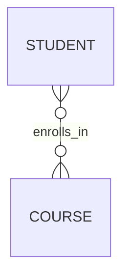
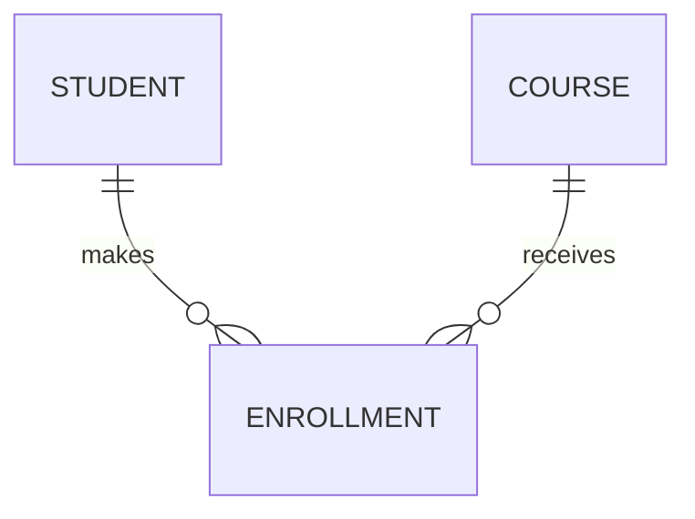
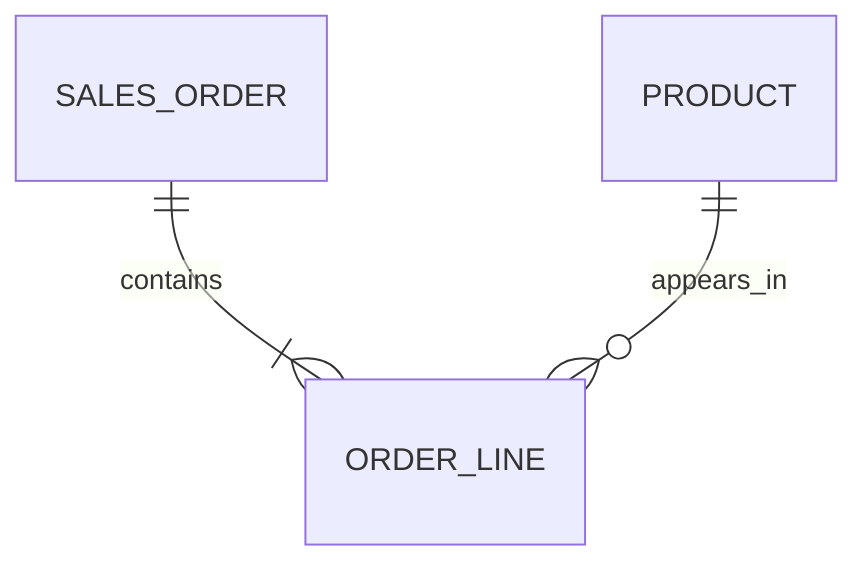
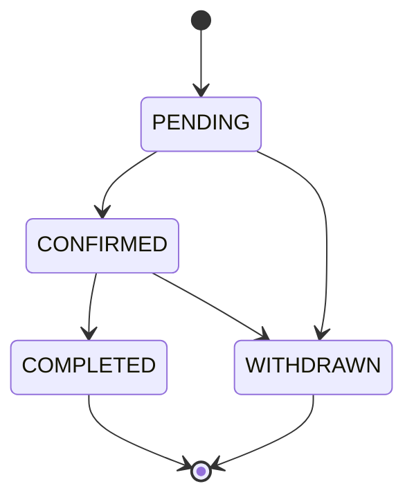
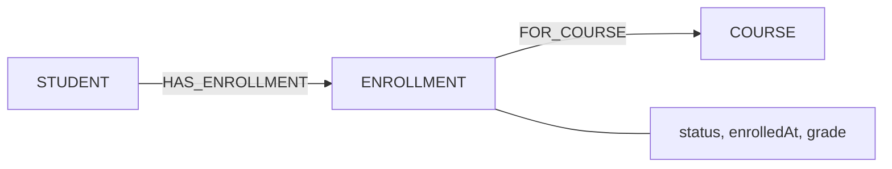

# Associative Entities When a Relationship Has Its Own Attributes or Lifecycle

In business domains, two entity types can connect through a many-to-many relationship. A student can enroll in many courses, and a course can have many enrolled students. Simply storing a list of course codes on the student record or a list of student codes on the course record makes it difficult to manage each enrollment instance, its status, enrollment date, grade, and change history.

When the link itself needs to be managed as an object, we model it as an **associative entity**. This entity connects the participating entities and carries the relationship's own attributes, identifier, or lifecycle. It enables the model to accurately express the business event and provides a clear place to enforce constraints on the association.

Within the scope of **DATABASE_DATA_MODELING**, this lesson focuses on how to recognize associative entities, convert many-to-many relationships into logical and physical structures, choose keys, handle multiple occurrences, manage state and history, and distinguish an associative entity from a purely technical join table.

## Learning Objectives

After this lesson, you will be able to:

- Recognize when a relationship should be modeled as an associative entity.
- Distinguish attributes of participating entities from attributes of the relationship itself.
- Convert a many-to-many relationship into an associative entity and two one-to-many relationships.
- Choose a composite key or surrogate key based on identity and multiplicity of occurrences.
- Design appropriate unique constraints, foreign keys, statuses, effective periods, and delete policies.
- Distinguish a simple join table, an associative entity, a weak entity, and an event entity.

## 1. When does a relationship become an associative entity?

A many-to-many (M:N) relationship describes how many instances of entity type A can connect to many instances of entity type B. Examples:

- A student enrolls in many courses; a course has many students.
- An order contains many products; a product can appear in many orders.
- An employee works on many projects; each project has many employees.

If the relationship only needs to capture the mere existence of a link, a join table with two foreign keys may suffice. However, when the business needs to answer additional questions about the link itself, it begins to carry independent meaning.

For example, with course enrollment:

- On what date did the student enroll?
- Is the enrollment pending approval, confirmed, completed, or withdrawn?
- What grade did the student receive in that enrollment?
- Can the student re-enroll in the same course in another term or retake it multiple times?
- Who approved the enrollment, and when?

These questions do not belong solely to Student or Course. They belong to **one instance of a Student enrolling in a Course**. Therefore, `ENROLLMENT` is an associative entity.

### 1.1. Signs to look for

Consider creating an associative entity when one or more of these signs appear:

- The relationship has its own attributes, such as quantity, agreed price, role, grade, or start date.
- The relationship has its own status and state transitions.
- The relationship has a lifecycle: created, confirmed, suspended, completed, canceled, or archived.
- Multiple link occurrences can arise between the same two entities over time.
- The relationship needs to be referenced by another entity or workflow.
- Auditing is required for creator, approver, timestamps, and change history.

Not every foreign key requires a new business entity. If a relationship is purely a technical linking structure with no independent attributes, lifecycle, or external references, a simple join table may be enough.

### 1.2. Where do relationship attributes belong?

Suppose a student enrolls in a course with an enrollment date, status, and final grade.

| Attribute | Belongs to | Reason |
|---|---|---|
| `student_id` | Enrollment link | Identifies the student participating in this enrollment |
| `course_id` | Enrollment link | Identifies the enrolled course |
| `enrolled_at` | Enrollment | Timestamp of this enrollment |
| `status` | Enrollment | Status of this enrollment relationship |
| `grade` | Enrollment | Student's outcome in that specific course enrollment |
| `student_name` | Student | Descriptive info about the student, not an enrollment attribute |
| `course_title` | Course | Descriptive info about the course, not an enrollment attribute |

Placing `grade` in `STUDENT` would allow a student to have only a single grade across all courses. Placing `grade` in `COURSE` would force all students to share one grade. Placing these attributes on `ENROLLMENT` preserves the true semantics of the data.

## 2. Modeling an M:N relationship as an associative entity

### 2.1. Before conversion

Initial conceptual model:



The M:N relationship states that a student can enroll in many courses and a course can have many students. However, the diagram has no clear place to store the status, enrollment date, and grade of each enrollment.

### 2.2. After conversion

Introduce the `ENROLLMENT` entity in the middle:



The M:N relationship is converted into two 1:N relationships:

- A student can have many enrollment records; each enrollment record belongs to exactly one student.
- A course can have many enrollment records; each enrollment record references exactly one course.

An associative entity is a data object with its own keys, attributes, and rules. It does not erase the original M:N meaning; it represents each concrete participation so the system can manage it.

### 2.3. Logical schema

| Relation | Key attributes | Role |
|---|---|---|
| `STUDENT` | `student_id`, `full_name` | Student entity |
| `COURSE` | `course_id`, `course_code`, `title` | Course entity |
| `ENROLLMENT` | `enrollment_id`, `student_id`, `course_id`, `enrolled_at`, `status`, `grade` | Associative entity storing each enrollment instance |

Each row in `ENROLLMENT` represents one enrollment of a student in a course. If business rules allow only one enrollment per student–course pair across the entire system, `(student_id, course_id)` can serve as the key. If students can re-enroll by term or retake the course multiple times, that pair alone is no longer sufficient for identification.

## 3. Identification: composite key or surrogate key?

An associative entity needs a way to identify each instance. Two approaches are commonly used.

### 3.1. Composite key from participating entities

If a student–course pair can appear at most once, you can use:

```sql
PRIMARY KEY (student_id, course_id)
```

Advantages:

- Directly expresses that the link's identity comes from both relationship ends.
- Eliminates adding an extra ID solely to identify the join row.
- Simultaneously prevents duplicate enrollment in the same course.

Limitations:

- If the same pair has multiple enrollments across terms or retakes, this key no longer fits.
- Other tables referencing Enrollment must carry both key columns.
- If a key component changes, dependent references must also be updated.

### 3.2. Surrogate key

If each enrollment is a distinct object, you can use `enrollment_id`:

The following example assumes the `student` and `course` tables already exist with their respective primary keys.

```sql
CREATE TABLE enrollment (
    enrollment_id BIGINT GENERATED BY DEFAULT AS IDENTITY PRIMARY KEY,
    student_id BIGINT NOT NULL REFERENCES student(student_id),
    course_id BIGINT NOT NULL REFERENCES course(course_id),
    enrolled_at TIMESTAMPTZ NOT NULL DEFAULT now(),
    status VARCHAR(20) NOT NULL
        CHECK (status IN ('PENDING', 'CONFIRMED', 'COMPLETED', 'WITHDRAWN')),
    grade NUMERIC(4, 2),
    CHECK (grade IS NULL OR (grade >= 0 AND grade <= 10))
);
```

A surrogate key lets other tables reference a simple single column and allows the same student to enroll in the same course multiple times. However, a surrogate key **does not automatically enforce business uniqueness rules**. If the system forbids two active enrollments for the same student and the same course section, an appropriate unique constraint is required.

### 3.3. Surrogate key combined with business unique keys

In real systems, courses are typically offered by term or section. The model can then look like:

```sql
CREATE TABLE student (
    student_id BIGINT GENERATED BY DEFAULT AS IDENTITY PRIMARY KEY,
    full_name VARCHAR(200) NOT NULL
);

CREATE TABLE course (
    course_id BIGINT GENERATED BY DEFAULT AS IDENTITY PRIMARY KEY,
    course_code VARCHAR(30) NOT NULL UNIQUE,
    title VARCHAR(200) NOT NULL
);

CREATE TABLE course_offering (
    offering_id BIGINT GENERATED BY DEFAULT AS IDENTITY PRIMARY KEY,
    course_id BIGINT NOT NULL REFERENCES course(course_id),
    term_code VARCHAR(20) NOT NULL,
    section_code VARCHAR(20) NOT NULL,
    UNIQUE (course_id, term_code, section_code)
);

CREATE TABLE enrollment (
    enrollment_id BIGINT GENERATED BY DEFAULT AS IDENTITY PRIMARY KEY,
    student_id BIGINT NOT NULL REFERENCES student(student_id),
    offering_id BIGINT NOT NULL REFERENCES course_offering(offering_id),
    attempt_no SMALLINT NOT NULL DEFAULT 1 CHECK (attempt_no > 0),
    enrolled_at TIMESTAMPTZ NOT NULL DEFAULT now(),
    status VARCHAR(20) NOT NULL
        CHECK (status IN ('PENDING', 'CONFIRMED', 'COMPLETED', 'WITHDRAWN')),
    grade NUMERIC(4, 2),
    CHECK (grade IS NULL OR (grade >= 0 AND grade <= 10)),
    UNIQUE (student_id, offering_id, attempt_no)
);
```

`attempt_no` distinguishes repeated enrollments or retakes by the same student in a course offering. If business rules allow only a single record per student–offering pair across all history, replace the three-column constraint with:

```sql
ALTER TABLE enrollment
    ADD CONSTRAINT one_enrollment_per_student_offering
    UNIQUE (student_id, offering_id);
```

If multiple withdrawn/completed attempts may be retained while only one active enrollment is allowed, PostgreSQL can use a conditional (partial) unique index:

```sql
CREATE UNIQUE INDEX one_active_enrollment_per_student_offering
    ON enrollment (student_id, offering_id)
    WHERE status IN ('PENDING', 'CONFIRMED');
```

Choose a set of constraints consistent with the enrollment policy. The key point is defining the **grain** of the associative entity: does one row represent a participating pair, an enrollment attempt, or an enrollment in a specific offering?

### 3.4. A surrogate key does not replace candidate keys

When using `enrollment_id`, you still must identify which attribute combinations must be unique. For example:

- `enrollment_id` identifies the row in the system.
- `(student_id, offering_id, attempt_no)` can serve as the business key for an enrollment attempt.
- `(student_id, offering_id)` may need to be unique for active enrollments.

A surrogate key solves technical referencing. Business unique constraints protect data semantics. Both goals coexist cleanly.

## 4. Practical example: Orders and order lines

An order contains many products; a product can appear in many orders. This association has its own attributes:

- Purchased quantity.
- Unit price at the time of purchase.
- Discount or tax applied to the line item.
- Display line number within the order.
- Fulfillment or return status of the line item.

Therefore, `ORDER_LINE` is an associative entity between `SALES_ORDER` and `PRODUCT`.



### 4.1. Schema and DDL

```sql
CREATE TABLE customer (
    customer_id BIGINT GENERATED BY DEFAULT AS IDENTITY PRIMARY KEY,
    full_name VARCHAR(200) NOT NULL
);

CREATE TABLE sales_order (
    order_id BIGINT GENERATED BY DEFAULT AS IDENTITY PRIMARY KEY,
    customer_id BIGINT NOT NULL REFERENCES customer(customer_id),
    placed_at TIMESTAMPTZ NOT NULL DEFAULT now(),
    status VARCHAR(20) NOT NULL
        CHECK (status IN ('DRAFT', 'CONFIRMED', 'SHIPPED', 'CANCELLED'))
);

CREATE TABLE product (
    product_id BIGINT GENERATED BY DEFAULT AS IDENTITY PRIMARY KEY,
    sku VARCHAR(64) NOT NULL UNIQUE,
    product_name VARCHAR(200) NOT NULL,
    current_price NUMERIC(14, 2) NOT NULL CHECK (current_price >= 0)
);

CREATE TABLE order_line (
    order_id BIGINT NOT NULL REFERENCES sales_order(order_id),
    line_no INTEGER NOT NULL CHECK (line_no > 0),
    product_id BIGINT NOT NULL REFERENCES product(product_id),
    quantity INTEGER NOT NULL CHECK (quantity > 0),
    unit_price_at_purchase NUMERIC(14, 2) NOT NULL
        CHECK (unit_price_at_purchase >= 0),
    discount_amount NUMERIC(14, 2) NOT NULL DEFAULT 0
        CHECK (discount_amount >= 0),
    PRIMARY KEY (order_id, line_no)
);

CREATE INDEX order_line_product_idx ON order_line(product_id);
```

Here, the composite key `(order_id, line_no)` identifies the line item within the order scope. Do not place `UNIQUE(order_id, product_id)` if the business allows the same product to appear on two lines with different prices, notes, or conditions.

`unit_price_at_purchase` is a snapshot of the transaction price. Never recompute historical unit prices by joining `product.current_price`, because the current price may change after the order is placed.

### 4.2. Independent lifecycle of an order line

An order line can have its own processing status: awaiting pick, packed, delivered, canceled, or returned. In that case, the system may need to manage status transition history and the acting user. That information belongs to the order line or a related status-history entity, not solely to the product or the order.

If only the current status is needed, store `status` in `ORDER_LINE`. If auditing every transition is required, create an `ORDER_LINE_STATUS_HISTORY` table with `order_line_id`, prior/new status, timestamp, actor, and reason. Do not overwrite history when the business requires traceability.

## 5. Distinguishing an associative entity from a purely technical join table

In a relational implementation, both a simple join table and an associative entity are materialized as tables. The difference lies in meaning and management.

| Criterion | Simple join table | Associative entity |
|---|---|---|
| Purpose | Represents the existence of an M:N link | Represents a relationship occurrence or object with business meaning |
| Own attributes | Usually only foreign keys | Can have dates, status, quantity, price, role, outcome |
| Lifecycle | Typically inserted/deleted with the link | Can have creation, approval, change, completion, or archival workflows |
| Identity | Usually a composite key of two FKs | Can use a composite or surrogate key; can be referenced independently |
| Rules | Mainly referential integrity and uniqueness | Adds invariants, states, and business constraints |
| Example | `USER_ROLE(user_id, role_id)` for pure permission assignment | `ENROLLMENT`, `ORDER_LINE`, `EMPLOYEE_ASSIGNMENT` |

An initial join table can evolve into an associative entity as requirements grow. For example, `USER_ROLE` may start with just two keys, then later require `assigned_at`, `assigned_by`, `expires_at`, and `approval_status`. At that point, role assignment has its own lifecycle and audit needs, and the model should reflect that.

You do not necessarily have to rename tables or add extra tables just for terminology's sake. What matters is whether the design properly captures the attributes, identity, rules, and lifecycle.

## 6. Distinguishing from weak entities and event entities

### 6.1. Associative entity vs. weak entity

A weak entity is identified by combining an owner's key with a partial key. An associative entity is created to represent a relationship between two or more entities along with attributes of that relationship.

The two concepts can overlap in some models. For example, `ORDER_LINE` can be identified by `(order_id, line_no)`, giving it identity dependency on the order. At the same time, it is an associative entity between Order and Product because it represents a product line within an order. Do not treat these two labels as always mutually exclusive; state clearly whether you are analyzing the identification aspect or the relationship role.

### 6.2. Associative entity vs. event entity

An event entity emphasizes something that happened at a specific point in time, often needing its own identifier and an immutable audit trail. An associative entity can describe a sustained relationship state, such as an employee assigned to a project over a period of time. If each assignment, extension, or role change is treated as a distinct event, the model may need `ASSIGNMENT` alongside a history table or event records.

| Question | Associative entity | Event entity |
|---|---|---|
| What is managed | Association between entities | A point-in-time occurrence with timestamp and outcome |
| Lifecycle | Can span time and change status | Usually records a fact that occurred; corrections need audit/compensation |
| Example | Employee assigned to a project | Employee transferred to a project at a specific timestamp |

In practice, a model can combine both: `ASSIGNMENT` holds the current relationship while `ASSIGNMENT_EVENT` records creation, role changes, pauses, or termination events.

## 7. Constraints and lifecycle of an associative entity

Because an associative entity carries its own business meaning, having two foreign keys is not enough. Data and business rules must also be specified.

### 7.1. Common constraints

- **NOT NULL:** every Enrollment must reference a Student and a Course/Offering.
- **FOREIGN KEY:** prevents linking to nonexistent entities.
- **UNIQUE:** prevents duplicate links within the defined scope.
- **CHECK:** validates local value domains such as positive quantity or grade within allowed bounds.
- **Temporal rules:** `valid_to` cannot precede `valid_from`; effective intervals do not overlap if business rules forbid it.
- **State rules:** transitions are permitted only between allowed states per workflow.

Not every rule can be expressed via a `CHECK` constraint. For instance, "a course offering must not exceed its capacity" requires checking the count of active enrollments and handling concurrency. Transactions, locks, or suitable concurrency controls are required so two simultaneous registration requests cannot exceed the cap.

### 7.2. States and state transitions

An Enrollment can have the following states:



This diagram is illustrative; actual rules must be confirmed with the business. Having `status` belong to a valid value set does not mean every transition is allowed. Check the current status, actor permissions, deadlines, and related preconditions before updating.

### 7.3. History and effective time

If a relationship is effective over a period of time, you can store:

- `valid_from`: when the relationship takes effect.
- `valid_to`: when it ends, nullable if still active.
- `recorded_at`: when the system recorded it.
- `ended_by` or `end_reason`: actor or reason for ending, if needed.

For example, an employee can be assigned to the same project across multiple stints. Storing only a single row `(employee_id, project_id)` and overwriting start and end dates loses earlier history. When multiple stints must be preserved, use `assignment_id` or an assignment sequence number and define non-overlap constraints according to business rules.

### 7.4. Deletion and archiving

Do not automatically delete an associative entity just because one endpoint becomes inactive. Consider:

- `ON DELETE CASCADE` when the associative data only has meaning alongside its owner and deleting them together is permitted.
- `RESTRICT`/`NO ACTION` when links must be resolved before deleting a participating entity.
- Soft delete or terminal status when history must be preserved.
- Archive/retention policies when auditing or long-term storage is required.

For example, never delete order lines of an invoiced order just because a product is discontinued. Order lines store snapshots and historical product references; deletion rules must protect source documents and reconciliation.

## 8. Associative entities across storage models

The business meaning of an association must be preserved even when the storage model changes.

| Storage model | Representation | When suitable and considerations |
|---|---|---|
| Relational | Associative table with foreign keys, attributes, keys, and constraints | Needs clear transactions, joins, and referential integrity |
| Document | Embed items inside owner document or store separate link documents with IDs to both sides | Embed when read/written with the aggregate; separate when independent querying or lifecycle is needed |
| Graph | Intermediate node like `ENROLLMENT` connecting Student and Course via edges | Useful for traversing relationship networks; link node carries its own attributes |
| Analytical | Fact/bridge table representing the grain of an enrollment or assignment | Define grain and handle temporal changes to avoid multiplying metrics |

### 8.1. Document: embed or separate?

For orders, `orderLines` are often embedded inside the `Order` document if they are primarily read and updated together with the order, have a bounded count, and depend on the aggregate's lifecycle. If line items require independent lookup, grow large in volume, or need separate concurrent updates, each line can be stored as a separate document with `orderId` and `productId`.

Embedding does not erase the associative entity concept. Each element in `orderLines` still has its own attributes, order-scoped identifier, and rules. Determine how to protect `lineNo` uniqueness and manage concurrent updates within the DBMS's capabilities.

### 8.2. Graph: link node

In a graph database, a relationship with attributes can be represented with an intermediate node:



The `ENROLLMENT` node stores the attributes and identity of each enrollment attempt. If using direct edges between Student and Course instead, check whether your graph engine supports parallel edges and edge properties cleanly.

### 8.3. Analytical: defining the grain

In a data warehouse, a fact table may have the grain "one enrollment of one student in one course offering." Dimensions typically include Student, Course Offering, Time, and Status. If a student re-enrolls, decide whether each attempt is a separate fact row or updates an existing fact. An unclear grain causes double counting or lost history.

## 9. Business queries and indexing

Associative entities are often central query hubs:

- Retrieve all courses for a student.
- List all students in a course offering.
- Find enrollments awaiting confirmation.
- Aggregate completion rates by course and term.

For the `ENROLLMENT` table, you can consider:

```sql
CREATE INDEX enrollment_student_idx
    ON enrollment (student_id, enrolled_at DESC);

CREATE INDEX enrollment_offering_status_idx
    ON enrollment (offering_id, status);
```

The first index supports looking up enrollment history by student; the second supports listing by course offering and status. Base final index selection on actual queries, selectivity, and execution plans. A foreign key does not automatically guarantee that every referencing column has an appropriate index.

## 10. Common design mistakes

| Mistake | Consequence | Remedy |
|---|---|---|
| Placing relationship attributes on an endpoint entity | One grade or value is wrongly shared across multiple links | Move attributes onto the associative entity |
| Using key `(A_id, B_id)` despite multiple link occurrences | Cannot store retakes, renewals, or multiple assignment stints | Add an occurrence identifier or distinguishing component |
| Adding a surrogate key but dropping business uniqueness | Allows invalid duplicate links | Keep candidate keys / unique constraints per business rules |
| Treating any table with two FKs as a full associative entity | Model may lack semantics, attributes, and lifecycle | Define the grain, attributes, states, and behavior of the link |
| Using `UNIQUE(A_id, B_id)` when business allows repeats | Rejects valid data | Scope uniqueness by time, term, or occurrence |
| Cascading deletes on all links when deleting an endpoint | Loses history, source documents, or audit trails | Choose restrict, soft delete, or archive per lifecycle |
| Unbounded document embedding | Document bloat, write contention, and hard queries | Define aggregate boundaries and element limits; split when needed |
| Failing to define grain in analytical warehouses | Joins multiply quantities and metrics | State the grain in plain language and verify every join |

## 11. Process for designing an associative entity

1. **Describe the relationship:** identify participating entities and cardinalities; confirm there is an M:N relationship or an association needing separate management.
2. **Identify relationship attributes:** list data meaningful only to a specific link instance, such as dates, quantities, roles, prices, or status.
3. **Define the grain:** does one row represent a current active pair, an occurrence, a term, or a specific event?
4. **Choose the identifier:** use a composite key if the relationship ends suffice to distinguish instances; use a surrogate key if independent referencing or multiple occurrences are needed.
5. **Define candidate keys:** add `UNIQUE` constraints for business uniqueness rules even when a surrogate key is present.
6. **Define the lifecycle:** states, transitions, effective periods, auditing, cancellation, and archiving.
7. **Map to schema:** create tables or storage structures with foreign keys, nullability, check constraints, indexes, and migrations.
8. **Verify concurrency:** ensure invariants like capacity limits or no duplicate active links hold under concurrent transactions.
9. **Test queries:** confirm business questions are answered accurately without losing history.

## 12. Verification checklist

- [ ] The relationship has clear business meaning and participating ends are identified.
- [ ] Relationship attributes are placed on the associative entity, not mistakenly attached to one endpoint.
- [ ] The grain of a single row is clearly stated.
- [ ] The primary key supports the expected multiplicity of link occurrences.
- [ ] Candidate keys and unique constraints protect business uniqueness rules.
- [ ] Relationship ends have accurate foreign keys and nullability.
- [ ] Value domains and state transition rules are enforced.
- [ ] History and effective periods are captured if required by the business.
- [ ] Delete, soft-delete, and archive policies align with retention requirements.
- [ ] Transactional controls handle cross-row invariants or concurrency limits.
- [ ] Indexes are grounded in representative queries and verified via execution plans.
- [ ] If using document, graph, or analytical storage, the representation preserves the exact grain and link semantics.

## Summary

An associative entity represents a relationship that carries its own attributes, identity, or lifecycle. It commonly emerges when decomposing a many-to-many relationship into two one-to-many relationships, providing the proper place for data such as enrollment date, quantity, unit price, status, and outcome. A simple join table suffices when only recording the existence of a link; once the relationship becomes a managed business object, it must be modeled and governed as an entity.

A composite key directly expresses identity from the relationship ends when each combination occurs only once. A surrogate key is appropriate when links occur multiple times or require independent referencing, while still preserving business uniqueness constraints. Good design starts from the grain, lifecycle, and rules of the association before choosing the storage structure.

## Key Terms to Remember

| Term | Meaning |
|---|---|
| Associative Entity | Entity representing a relationship between two or more entities that can carry its own attributes |
| Associative Table / Junction Table | Join table used to implement an M:N relationship in a relational model |
| Many-to-Many (M:N) | Relationship in which each side can connect to many instances on the other side |
| Composite Key | Key composed of multiple attributes, often drawn from the relationship ends |
| Surrogate Key | System-assigned key carrying no direct business meaning |
| Candidate Key | Minimal set of attributes capable of uniquely identifying an instance |
| Grain | Level of detail represented by a single row of data |
| Lifecycle | Stages and transitions an object goes through during its existence |
| Valid Time | Period during which a relationship or fact is effective in the business domain |
| Referential Integrity | Consistency between a foreign key and the referenced entity |
