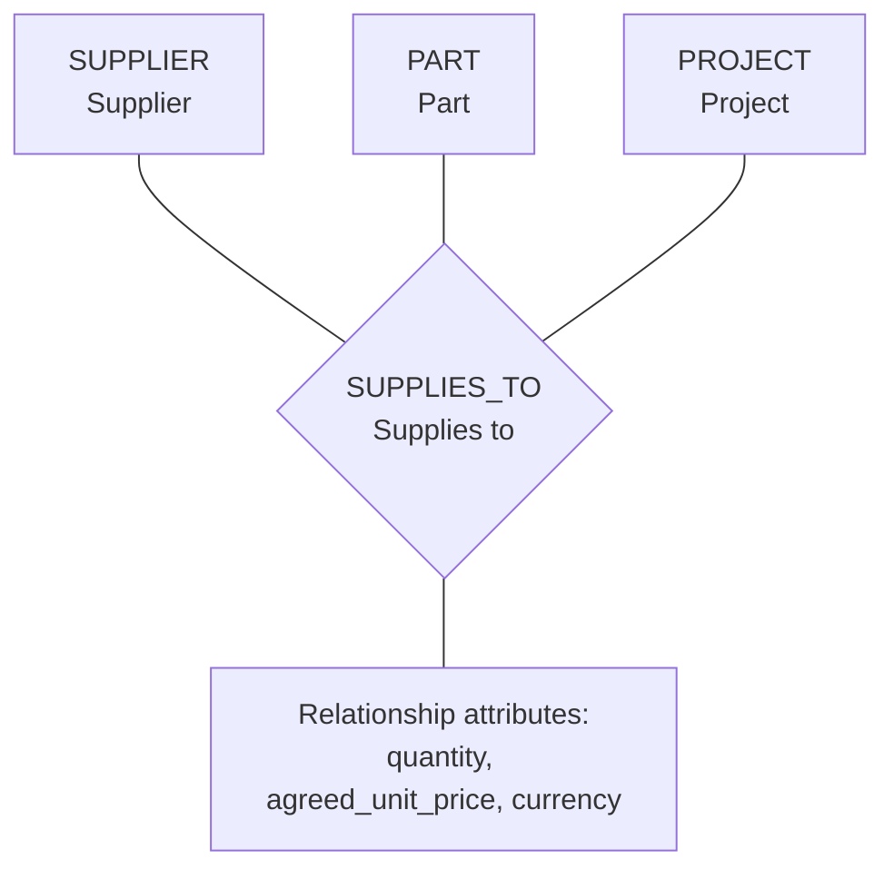

# Ternary Relationships and the Risk of Losing Semantics When Splitting into Binary Relationships

In data modeling, a business event sometimes only has meaning when **three entity types participate together**. For example, a supplier supplies a part to a specific project; a doctor prescribes a medication for a patient; or an employee uses a skill on a project. Recording only separate entity pairs may let the system know that objects are related, yet lose track of which exact triplet jointly formed an event.

That is why we must recognize **ternary relationships** and distinguish them from three binary relationships. Splitting a ternary relationship into binary relationships can discard information about the original co-occurrence. When joining those binary tables back together, the system can even generate combinations that never existed in the business domain.

Within the scope of **DATABASE_DATA_MODELING**, this lesson explains how to identify ternary relationships, read cardinalities accurately, map them to relational schemas, and demonstrate the risk of spurious tuples when decomposing without justification.

## Learning Objectives

After this lesson, you will be able to:

- Explain ternary relationships and distinguish relationship degree from cardinality.
- Identify when business semantics depend simultaneously on three entities.
- Explain why three binary projections do not automatically reconstruct the original ternary relationship.
- Recognize spurious tuples generated when joining split relations.
- Design a ternary junction table with appropriate keys, foreign keys, and constraints.
- Identify the conditions that must be verified before decomposing a ternary relationship into lower-degree relationships.

## 1. Relationship degree and ternary relationships

**Relationship degree** indicates how many entity types participate in a relationship:

- Binary relationship: two entity types participate, e.g., Customer places Order.
- Ternary relationship: three entity types participate, e.g., Supplier supplies Part to Project.
- Higher-degree (n-ary) relationship: more than three entity types participate together in one event.

Relationship degree does not describe how many records exist. A ternary relationship can still hold thousands or millions of tuples. Nor is degree synonymous with one-to-one, one-to-many, or many-to-many cardinality.

### 1.1. Example: Supplier – Part – Project

Suppose an enterprise manages supplying parts to projects. A supply event is defined by three pieces of information:

- Which supplier performs the supply.
- Which part is supplied.
- Which project receives that part.

The attributes `quantity` and `agreed_unit_price` belong to **the combination of all three entities**. One supplier can supply the same part to multiple projects at different quantities and prices. One project can receive the same part type from multiple suppliers.



The central relationship `SUPPLIES_TO` is a ternary event. You cannot treat `quantity` solely as an attribute of Supplier–Part if the quantity also depends on the receiving Project.

### 1.2. Questions to identify a ternary relationship

When reading requirements, try phrasing an event in a single sentence containing all three roles:

"Supplier **S** supplies part **P** to project **J** with quantity **Q** and unit price **V**."

Then verify:

1. If Supplier is removed, can the remaining data still identify a concrete supply event?
2. If Part is removed, do you still know which exact item was supplied?
3. If Project is removed, do you still know which project the supply event served?
4. Can quantity or price change when any one of the three components changes?

If the meaning or attributes of the event depend on all three components, the model must express a ternary relationship. This criterion matters more than whether a diagram looks cleaner with binary lines.

## 2. Why splitting into three binary relationships can lose meaning

Suppose the original ternary relation contains three tuples:

| Supplier | Part | Project |
|---|---|---|
| S1 | P1 | J1 |
| S1 | P2 | J2 |
| S2 | P1 | J2 |

Each row means a combination that actually occurred. Now, if we store only three binary relations by projecting each pair of attributes, we get:

**SUPPLIER_PART**

| Supplier | Part |
|---|---|
| S1 | P1 |
| S1 | P2 |
| S2 | P1 |

**SUPPLIER_PROJECT**

| Supplier | Project |
|---|---|
| S1 | J1 |
| S1 | J2 |
| S2 | J2 |

**PART_PROJECT**

| Part | Project |
|---|---|
| P1 | J1 |
| P2 | J2 |
| P1 | J2 |

Each binary table is accurate when viewed per pair. However, when joining all three tables on their shared attributes, they can produce extra combinations:

| Supplier | Part | Project | In original data? |
|---|---|---|---|
| S1 | P1 | J1 | Yes |
| S1 | P1 | J2 | **No** |
| S1 | P2 | J2 | Yes |
| S2 | P1 | J2 | Yes |

`(S1, P1, J2)` is a **spurious tuple**. This combination appears because:

- S1 relates to P1 in `SUPPLIER_PART`.
- S1 relates to J2 in `SUPPLIER_PROJECT`.
- P1 relates to J2 in `PART_PROJECT`.

Those three binary facts do not prove that S1 supplied P1 to J2. Splitting destroyed the fact that all three values had to co-occur in one specific event.

### 2.1. Relational projection and natural join

Given the original relation `R(Supplier, Part, Project)`, projections produce:

- `SP = πSupplier,Part(R)`
- `SJ = πSupplier,Project(R)`
- `PJ = πPart,Project(R)`

When joining the three results:

`SP ⋈ SJ ⋈ PJ`

the result can be larger than `R`. The newly appearing tuples are not facts that existed, but combinations inferred from three independent binary relations.

An SQL query illustrating that join:

```sql
SELECT
    sp.supplier_id,
    sp.part_id,
    sj.project_id
FROM supplier_part AS sp
JOIN supplier_project AS sj
    ON sj.supplier_id = sp.supplier_id
JOIN part_project AS pj
    ON pj.part_id = sp.part_id
   AND pj.project_id = sj.project_id;
```

With the data above, the query returns `(S1, P1, J2)` as well, even though that combination was absent from the original ternary relation.

A decomposition is a **lossless decomposition** if joining the decomposed relations reproduces the exact original relation—no missing tuples and no spurious tuples. Having each projected table derived from real data is not enough to guarantee a lossless decomposition.

### 2.2. The risk goes beyond record counts

Spurious tuples can cause serious business errors:

- Reports credit a supplier with delivering to a project despite no such transaction ever occurring.
- Miscomputed quantities, costs, or delivery responsibilities.
- Allowing the system to place purchase orders based on a supply relationship that was never approved.
- Producing reconciliation or audit results that fail to match source documents.

The core problem is losing **co-occurrence semantics**: three components that participated together in one event are turned into three separate pairwise assertions.

## 3. Distinguishing a ternary relationship from three independent binary relationships

Having three entity types does not automatically mandate a ternary relationship. Determine whether the business has one joint event or three independent facts.

For example, a system might manage separately:

- Which suppliers are authorized to sell which parts.
- Which suppliers hold contracts with which projects.
- Which projects need or approve using which parts.

These three relationships are three independent facts. They do not necessarily mean that the supplier actually supplied that part to that project. If the business also records actual supply events, a dedicated ternary relationship is needed.

| Model | Stored meaning | Asserts a single joint event across all three? |
|---|---|---|
| SUPPLIER_PART | Supplier is eligible to supply part | No |
| SUPPLIER_PROJECT | Supplier has a contractual relationship with project | No |
| PART_PROJECT | Project needs or permits using part | No |
| SUPPLY_EVENT(Supplier, Part, Project) | Supplier supplies part to a specific project | Yes |

Three binary relationships can coexist alongside a ternary relationship, yet they express different rules. Never use binary relationships as a substitute for a ternary event unless a business rule proves equivalence.

## 4. Cardinality in ternary relationships

When reading cardinalities of a ternary relationship, interpret each constraint relative to **the combination of the other two entities**. This is a frequent point of confusion when using one-to-many symbols on diagrams.

For example, the rule:

"For each (Part, Project) pair, at most one Supplier is assigned."

means the combination `(part_id, project_id)` determines at most one `supplier_id`. In the relational model, this can be expressed as:

`(part_id, project_id) → supplier_id`

and the constraint `UNIQUE(part_id, project_id)`.

Other examples of rules:

| Business rule | Corresponding functional dependency / constraint |
|---|---|
| Each Part–Project pair has at most one Supplier | `(part_id, project_id) → supplier_id` |
| Each Supplier–Part pair serves at most one Project | `(supplier_id, part_id) → project_id` |
| Each Supplier–Project pair supplies at most one Part | `(supplier_id, project_id) → part_id` |

If none of the three rules above apply, all three components may be needed to identify a row. The natural candidate key can then be `(supplier_id, part_id, project_id)`.

### 4.1. Cardinality is not always a global "one" or "many"

If a diagram places "one Supplier" on a branch, do not interpret it as "the entire system has only one supplier." In a ternary relationship, the meaning is typically that for each combination of the other two roles, at most one supplier participates. Write the rule out as a complete sentence and verify it with the business before turning it into keys or `UNIQUE` constraints.

### 4.2. Attributes depending on the entire triplet

Attributes such as quantity, agreed unit price, expected delivery date, or shipping terms may depend on Supplier, Part, and Project together. Never attach them to a binary relationship if their values can vary with the third entity.

For example, S1 might sell P1 to J1 at price 10, yet sell P1 to J2 at price 12. Storing price in `SUPPLIER_PART` cannot represent both prices simultaneously without adding the Project dimension.

## 5. Mapping a ternary relationship to the relational model

In the relational model, the direct representation is a junction table containing foreign keys to all three entity tables. Event attributes are placed in this table.

### 5.1. Logical schema

| Relation | Key attributes | Role |
|---|---|---|
| `SUPPLIER` | `supplier_id`, `name` | Supplier entity |
| `PART` | `part_id`, `part_name` | Part entity |
| `PROJECT` | `project_id`, `project_name` | Project entity |
| `SUPPLY_EVENT` | `supplier_id`, `part_id`, `project_id`, `quantity`, `agreed_unit_price`, `currency` | Ternary relationship and event attributes |

If there is at most one supply event per triplet within the data scope, the composite primary key can be:

`PRIMARY KEY (supplier_id, part_id, project_id)`

Three `NOT NULL` foreign keys ensure every event references all three entities. If a triplet can occur multiple times across deliveries, contracts, or timestamps, add an event identifier or an occurrence-distinguishing component.

### 5.2. Illustrative PostgreSQL DDL

```sql
CREATE TABLE supplier (
    supplier_id BIGINT GENERATED BY DEFAULT AS IDENTITY PRIMARY KEY,
    supplier_name VARCHAR(200) NOT NULL
);

CREATE TABLE part (
    part_id BIGINT GENERATED BY DEFAULT AS IDENTITY PRIMARY KEY,
    part_name VARCHAR(200) NOT NULL
);

CREATE TABLE project (
    project_id BIGINT GENERATED BY DEFAULT AS IDENTITY PRIMARY KEY,
    project_name VARCHAR(200) NOT NULL
);

CREATE TABLE supply_event (
    supplier_id BIGINT NOT NULL REFERENCES supplier(supplier_id),
    part_id BIGINT NOT NULL REFERENCES part(part_id),
    project_id BIGINT NOT NULL REFERENCES project(project_id),
    quantity NUMERIC(14, 3) NOT NULL CHECK (quantity > 0),
    agreed_unit_price NUMERIC(14, 2) NOT NULL
        CHECK (agreed_unit_price >= 0),
    currency CHAR(3) NOT NULL,
    PRIMARY KEY (supplier_id, part_id, project_id)
);
```

In this design:

- Each `supply_event` row records one Supplier–Part–Project combination.
- `quantity`, `agreed_unit_price`, and `currency` belong to the ternary event.
- The composite primary key prevents repeating the same triplet under a "one event per triplet" rule.
- Foreign keys ensure all three participating entities exist.
- `NOT NULL` expresses that all three roles are mandatory for a supply event.

If each Part–Project pair can have at most one supplier, you can add:

```sql
ALTER TABLE supply_event
    ADD CONSTRAINT one_supplier_per_part_project
    UNIQUE (part_id, project_id);
```

Only add this constraint when it is genuinely a business rule. Never infer keys or `UNIQUE` constraints solely from diagram shape.

### 5.3. When a triplet occurs multiple times

If a supplier delivers the same part to the same project across multiple shipments, a single row per triplet is insufficient. You can then separate the **supply agreement** from **supply deliveries**:

```sql
CREATE TABLE supply_agreement (
    agreement_id BIGINT GENERATED BY DEFAULT AS IDENTITY PRIMARY KEY,
    supplier_id BIGINT NOT NULL REFERENCES supplier(supplier_id),
    part_id BIGINT NOT NULL REFERENCES part(part_id),
    project_id BIGINT NOT NULL REFERENCES project(project_id),
    agreed_unit_price NUMERIC(14, 2) NOT NULL
        CHECK (agreed_unit_price >= 0),
    currency CHAR(3) NOT NULL,
    UNIQUE (supplier_id, part_id, project_id)
);

CREATE TABLE supply_delivery (
    delivery_id BIGINT GENERATED BY DEFAULT AS IDENTITY PRIMARY KEY,
    agreement_id BIGINT NOT NULL REFERENCES supply_agreement(agreement_id),
    delivered_at TIMESTAMPTZ NOT NULL,
    quantity NUMERIC(14, 3) NOT NULL CHECK (quantity > 0)
);
```

Here, the agreement remains tied to the triplet, while each delivery has its own identifier. This split clarifies two event types with distinct lifecycles; it is not decomposing the ternary relationship into three independent binary relations.

### 5.4. Indexes and queries

The composite primary key `(supplier_id, part_id, project_id)` supports queries starting with `supplier_id` and filtering further by `part_id`, but it is not automatically optimal for queries starting with `project_id`. Create indexes matching your actual workload, for example:

```sql
CREATE INDEX supply_event_project_part_idx
    ON supply_event (project_id, part_id);

CREATE INDEX supply_event_part_project_idx
    ON supply_event (part_id, project_id);
```

Do not create both indexes if queries do not use them. Every index increases storage footprint and write overhead; validate with representative queries and execution plans.

## 6. When can a ternary relationship be decomposed?

Decomposition is valid only when you can prove that the resulting relations retain enough information to reconstruct the original relation accurately, or when the business genuinely consists only of independent binary facts.

### 6.1. Valid functional dependencies exist

When decomposing a relation `R(A, B, C)` into two relations `R1(A, B)` and `R2(B, C)`, a common sufficient condition guaranteeing a lossless join under functional dependencies is `B → A` or `B → C`. In that case, the shared attribute `B` uniquely determines an entire side of the decomposition.

That condition applies to the two-schema decomposition above; do not apply it mechanically to splitting a ternary relation into three binary relations. For the three projections `(A,B)`, `(A,C)`, `(B,C)`, you must prove that the corresponding join dependency truly holds for the data domain and business rules.

### 6.2. Example with a determining constraint

Suppose business rules dictate that each `(part_id, project_id)` pair uniquely determines one supplier. Then:

`(part_id, project_id) → supplier_id`

Supplier information can be determined from the Part–Project pair. The relational model still needs to store this combination in a relation containing the required attributes, such as `SUPPLY_ASSIGNMENT(part_id, project_id, supplier_id)`, keyed by `(part_id, project_id)`. It does not mean you can arbitrarily replace it with three binary tables `SUPPLIER_PART`, `SUPPLIER_PROJECT`, and `PART_PROJECT`.

### 6.3. When binary relationships are independent facts

If the requirement only calls for recording three separate facts—supplier is approved for part, supplier holds contract with project, project accepts part—then three binary tables match the requirement. However, if later you need to know which supplier actually supplied which part to which project, you must add a ternary relationship rather than inferring it from three binary lists.

### 6.4. Process for proving a decomposition

Before splitting, do the following:

1. Write down the exact semantics of the original relation and which components each attribute depends on.
2. Identify candidate keys and functional dependencies from confirmed business rules.
3. Specify the target sub-schemas after decomposition.
4. Check whether the natural join of the sub-schemas reconstructs the original relation exactly.
5. Use counterexample datasets to test for spurious tuples.
6. Verify that business constraints remain preserved and enforceable in the decomposed schema.

If you cannot prove a lossless join, keep the ternary relationship or model the event as an associative entity holding all three foreign keys.

## 7. Additional examples

### 7.1. Employee – Skill – Project

An employee has the Java skill, an employee works on project X, and project X uses Java are three binary relationships that can each be true independently. Yet they do not prove that the employee actually used Java on project X. If you need to track proficiency or hours spent using that skill on the project, the event must include all three components:

`EMPLOYEE_USES_SKILL_ON_PROJECT(employee_id, skill_id, project_id, proficiency, hours)`.

### 7.2. Doctor – Patient – Medication

A doctor treats a patient; a doctor prescribes many medications; a patient takes many medications. Three binary relationships fail to tell which doctor prescribed which medication to which patient during a specific treatment. If dosage, timestamp, and indication must be recorded, the relationship must bind doctor, patient, and medication together; in many systems, a prescription or encounter identifier is also needed.

### 7.3. Real-world domains may require degrees higher than three

An allocation transaction might depend on Investor, Fund, Account, and Effective Date. Dropping any one dimension can assign an allocated amount to the wrong context. Never force every relationship into binary form simply because diagramming tools or ORM frameworks display binary relationships more conveniently.

## 8. Representing higher-degree relationships across storage models

A ternary relationship is a business and logical concept; each platform implements it differently.

| Storage model | How a ternary relationship is represented | Notes |
|---|---|---|
| Relational | Junction table with three foreign keys and event attributes | Primary key / unique constraints must reflect actual functional dependencies |
| Document | An event or aggregate document containing IDs of all three entities | Choose document boundaries based on access and update patterns; avoid unbounded embedding |
| Graph | Create an intermediate event/relationship node linked to three entity nodes | A standard edge only connects two nodes; an intermediate node preserves ternary semantics and event attributes |
| Analytical | Fact table whose grain is a three-way combination or single occurrence | Declare the grain upfront; avoid dimension joins that multiply fact rows |

With a graph database, you can create a `SUPPLY_EVENT` node connected via three edges: `BY_SUPPLIER`, `FOR_PART`, and `FOR_PROJECT`. Attributes like quantity and price reside on the event node. This keeps the triplet bound together in a single object with its own identity.

In a data warehouse, the fact grain must be stated as a sentence, e.g., "one row per supplier, part, project, and delivery." If the grain is a single delivery yet dimensions join on incomplete binary links, queries can multiply quantities or monetary totals.

## 9. Testing and verifying semantics

A ternary model must be verified for keys, constraints, and combination semantics.

### 9.1. Integrity tests

- Reject an event missing Supplier, Part, or Project.
- Reject foreign keys referencing nonexistent entities.
- Prevent duplicate triplets if business rules allow only one event per combination.
- Enforce functional dependencies with appropriate `UNIQUE` constraints.
- Ensure attributes like quantity and price fall within valid value domains.

### 9.2. Anti-spurious-tuple test

Using the sample dataset from Section 2:

1. Populate the original ternary relation.
2. Create the three binary projections.
3. Join the projections on their shared attributes.
4. Compare the result against the original relation.
5. Confirm that `(S1, P1, J2)` appears in the join output even though it did not exist in the source data.

This is a simple yet highly effective counterexample test when reviewing proposed relationship decompositions.

### 9.3. Business query verification

Queries must accurately answer questions at the triplet level, such as:

- Which suppliers supplied part P1 to project J2?
- What is the total quantity of part P1 delivered to project J2 by each supplier?
- What is supplier S1's agreed unit price for part P1 on project J1?

Queries must rely on the ternary event table. Do not infer answers by joining three binary relationship lists if those lists do not capture the joint event.

## 10. Common design mistakes

| Mistake | Consequence | Remedy |
|---|---|---|
| Habitually splitting a ternary relationship into three binary tables | Loses combination info and risks spurious tuples when joined | Keep the ternary junction table or prove a lossless decomposition |
| Placing event attributes on a binary relationship | Cannot represent values varying with the third entity | Place attributes on the ternary relationship or event entity |
| Assuming three valid binary tables imply a valid triplet | Individually true pairs do not prove they co-occurred | Store the joint event and check for spurious tuples |
| Interpreting cardinality globally | Creates wrong `UNIQUE` constraints or misses rules | Read cardinality relative to pairs of the other two roles and write functional dependencies |
| Using a three-column composite key despite multiple occurrences | Cannot record repeated deliveries or enrollments | Add an event ID or occurrence number; preserve uniqueness per the true rule |
| Adding a surrogate key and dropping business uniqueness | Allows duplicate combinations that should be unique | Keep `UNIQUE` on the attributes defining the event |
| Confusing a ternary relationship with three independent binary relationships | Model answers business questions incorrectly | Clarify what each relationship asserts and which attributes depend on the whole combination |

## 11. Process for designing a ternary relationship

1. **Identify the event:** write a business sentence clearly naming all three participating roles and the action between them.
2. **Check co-occurrence:** determine whether all three entities must co-occur in one event or represent three independent binary facts.
3. **Identify relationship attributes:** find attributes depending on all three components, such as quantity, price, date, or role.
4. **Determine cardinalities:** interpret each limit relative to combinations of the other two roles.
5. **Identify functional dependencies and keys:** determine whether the full triplet is the key or whether a pair determines the third component.
6. **Draw the logical model:** represent the ternary relationship clearly; never split it merely to keep only binary lines on a diagram.
7. **Map to schema:** create the event table with three foreign keys, primary/unique keys, and data constraints.
8. **Verify decomposition if needed:** prove lossless join, dependency preservation, and test with counterexamples for spurious tuples.
9. **Test queries:** verify that business queries return accurate three-way combinations.

## 12. Verification checklist

- [ ] The event is described in a sentence containing all three participating roles.
- [ ] Whether the three components co-occur in one event or form independent binary facts has been verified.
- [ ] Attributes depending on all three components are placed on the ternary relationship/event.
- [ ] Cardinalities are interpreted relative to pairs of the other two roles.
- [ ] Candidate keys and functional dependencies derive from confirmed business rules.
- [ ] The junction table has all three foreign keys and appropriate nullability.
- [ ] `UNIQUE` constraints accurately reflect the rules without imposing unverified assumptions.
- [ ] If multiple occurrences can happen for the same triplet, the model includes an occurrence identifier.
- [ ] If decomposed, a lossless join is proven and dependency preservation is verified.
- [ ] Counterexample datasets have been tested to detect spurious tuples.
- [ ] Reporting queries do not infer ternary events from non-equivalent binary relationships.

## Summary

A ternary relationship represents an event whose meaning depends simultaneously on three entity types. Three binary projections can preserve individual pairs accurately while losing information about which triplets actually occurred together. When joining binary relations, the system can generate spurious tuples and draw business conclusions that never happened.

In the relational model, the standard representation is a junction table with three foreign keys and the event's attributes. Primary keys and `UNIQUE` constraints must reflect real functional dependencies. Decompose only when a lossless join can be proven and required constraints remain preserved; otherwise, keep the ternary relationship or model it as an event entity.

## Key Terms to Remember

| Term | Meaning |
|---|---|
| Relationship Degree | Number of entity types participating in a relationship |
| Binary Relationship | Relationship between two entity types |
| Ternary Relationship | Relationship among three entity types |
| N-ary Relationship | Relationship involving more than two entity types |
| Projection | Operation selecting a subset of attributes from a relation |
| Natural Join | Join on shared attributes with identical names and semantics |
| Lossless Decomposition | Decomposition that can reconstruct the exact original relation without losing or fabricating tuples |
| Spurious Tuple | Fabricated data tuple produced when joining decomposed relations |
| Functional Dependency | Dependency relationship between sets of attributes |
| Join Dependency | Constraint stating a relation can be reconstructed from multiple projections via joins |
| Associative Entity | Entity representing a relationship that can carry its own attributes |
| Fact Grain | Level of detail represented by a single row in a fact table |
