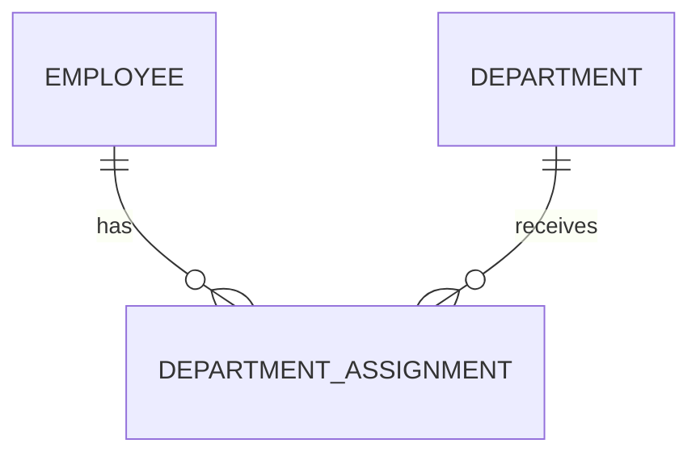

# Temporal Relationships and Validity Conditions

A relationship in a data model is not always permanently true. An employee may transfer departments, a customer may change account representatives, a product may be sold at a branch only during a certain period, and a contract has start and end dates. Storing only the current relationship makes it difficult to answer questions such as "who was in charge on that date?", "which price was in effect when the order was confirmed?", or "since when has this relationship changed?".

A **temporal relationship** describes an association between objects together with the time interval during which that association is valid. The model must distinguish when the relationship holds in the business domain, when the system learns or records the information, start/end conditions, and rules governing whether intervals may overlap or abut seamlessly.

This is an essential skill when translating business requirements into an unambiguous data model. Designers must determine the relationship's lifecycle, cardinality at each point in time, change history, validity conditions, and point-in-time query patterns. These requirements influence associative entities, keys, constraints, queries, and storage model choices.

After this lesson, learners will be able to:

- Identify relationships that are time-bound or change over time.
- Distinguish business validity time (valid time) from system recording time (transaction/system time).
- Model validity intervals using start and end timestamps.
- Define rules for overlaps, gaps, renewals, replacements, and retroactive changes.
- Verify cardinality and relationship constraints at a specific point in time.
- Write queries to retrieve current relationships or relationships valid at a past point in time.
- Select an appropriate history storage strategy and verify temporal data consistency.

## 1. Why do relationships need a temporal dimension?

### 1.1. Relationships can change while the objects continue to exist

Suppose employee An transfers from the Sales department to the Support department on July 1. An is still the same person, and both departments still exist, yet the relationship "An belongs to department" has changed.

If only `employee.department_id` is stored, once it is updated to Support, the system no longer knows that An belonged to Sales in June. When calculating payroll by unit, viewing organizational reports, or tracing approval authority on a past date, current-state data alone is insufficient.

Additional examples:

- A customer has different account representatives across periods.
- A product is distributed by Supplier A through the end of Q2 and by Supplier B starting Q3.
- A contract is valid from its signing date through its expiration date.
- An employee is assigned to a project for three months and then reassigned to another project.
- A price is effective during one period and later replaced by a new price.
- An account holds system access permissions from the grant date until revocation.

These relationships have their own history. Time is not merely an attribute describing two objects; it determines when the link itself is considered true.

### 1.2. Business questions to answer

When analyzing a relationship, ask:

- When does the relationship take effect?
- When does it end? Can it have no end date?
- Does the effective date match the date recorded in the system?
- Can a relationship be created with a future effective date?
- Can a change be recorded retroactively with an effective date in the past?
- Can an object hold multiple relationships of the same type at the same time?
- Can validity intervals overlap, abut contiguously, or must they remain separated?
- When previously recorded information is corrected, do we need to know what the system previously believed?
- When querying history, do users want to know what was actually in effect or what the system knew at that point in time?

The last two questions typically lead to the distinction between a valid-time model and a bitemporal model.

### 1.3. Current relationships are not enough for all reporting

A report of "employees by current department" only needs currently active relationships. A report of "revenue by department as of order placement date" needs the relationship in effect on the transaction date. An audit report asking "on June 15, which department did the system record An as belonging to?" also needs to know what the system had stored as of June 15.

These are three different questions and may require three different queries. Temporal relationship design must start from business requirements, not merely from adding `start_date` and `end_date` columns.

## 2. Modeling validity intervals

### 2.1. Start and end points

A relationship valid over an interval is described by a start point (`valid_from`) and an end point (`valid_to`).

Example:

| Employee | Department | valid_from | valid_to |
|---|---|---|---|
| An | Sales | 2026-01-01 | 2026-07-01 |
| An | Support | 2026-07-01 | NULL |

The relationship with Sales is valid prior to July 1; the relationship with Support is valid from July 1 onward. `NULL` in `valid_to` is used in this example to represent an open interval with no defined end date yet—meaning the relationship is still open.

Do not use `NULL` to mean both "end date not yet known" and "no end date exists." If those two meanings differ in the business domain, represent or document them separately to avoid misinterpretation.

### 2.2. Half-open interval convention `[from, to)`

A widely used convention is the half-open interval: inclusive of the start point and exclusive of the end point, denoted `[valid_from, valid_to)`.

This means:

- The relationship is effective at `valid_from`.
- The relationship is no longer effective at `valid_to`.
- If the old relationship ends at the exact instant the new one begins, the two intervals adjoin without overlapping.

Example:

```text
Sales:   [2026-01-01, 2026-07-01)
Support: [2026-07-01, infinity)
```

At exactly 00:00 on July 1 in the business time zone, the Support relationship takes effect and the Sales relationship has ended. This convention avoids counting a boundary instant in both adjacent intervals simultaneously.

Some organizations use an inclusive last effective day—for example, from January 1 through the end of June 30. When storing timestamps, the half-open convention is usually easier to handle. If business requirements use calendar dates, explicitly define whether the end date is the last included day or the first excluded day.

### 2.3. Checking whether a point in time falls inside an interval

With `[from, to)`, a point in time `t` lies inside the interval if:

```text
valid_from <= t
AND (valid_to IS NULL OR t < valid_to)
```

Before applying this condition, standardize data types and time zones. A calendar date like `2026-07-01` is not the same as an exact instant like `2026-07-01T00:00:00+07:00`. If the business cares only about dates, do not invent hour/minute precision that causes confusion.

### 2.4. Basic invariants of validity intervals

For a defined interval:

- `valid_from` must have a value.
- If `valid_to` has a value, it must be greater than `valid_from`.
- Two intervals of the same relationship must not overlap if the business requires at most one active relationship at any point in time.
- One ending interval may abut the next interval if no gap exists.
- A gap is valid only if the business permits periods with no active relationship.

For example, if every employee must belong to exactly one department throughout all working periods, a gap between two assignments is a violation. If employees can take unpaid leave or await reassignment, a gap may be valid during that period.

## 3. Distinguishing Valid Time and Transaction Time

### 3.1. Valid Time — when a fact is true in the business domain

**Valid time** indicates from when to when a fact or relationship is considered true in the real-world business domain.

For example, An's transfer decision takes effect on July 1, even though the administrator enters the information into the system on July 3. The valid time of the new relationship begins on July 1.

Valid time answers:

- Which department did An actually belong to on July 2?
- Which price applied to an order on June 15?
- Over what date range was the contract valid?
- Who was the authorized legal representative during the queried period?

### 3.2. Transaction Time — when the system knows or stores the fact

**Transaction time** (also called system time in some models) records the interval during which information is stored and treated as the system's believed version.

For example, the transfer decision takes effect on July 1 yet is only entered into the system on July 3. The system only knows the new fact starting July 3. Prior to that, system data may still show An in Sales.

Transaction time answers:

- On July 2, which department did the system record An as belonging to?
- When generating a report on July 2, did the organization already know about the transfer decision?
- Who modified the data on July 3, and what was the prior value?

### 3.3. Comparing the two time axes

| Criterion | Valid time | Transaction time |
|---|---|---|
| Meaning | When the fact holds in the business domain | When the system stores/knows that version of the fact |
| Source | Decisions, contracts, business events | Timestamp recorded by the system |
| Can start in the past? | Yes, in the case of retroactive changes | Typically starts when recorded by the system |
| Question | What was true on date X? | What did the system know on date Y? |
| Example | Transfer takes effect July 1 | Administrator enters it on July 3 |

### 3.4. Bitemporal models

When you must answer both "when was it true in the business?" and "when did the system know it?", a bitemporal model can be used. Each relationship version carries two intervals:

- Valid time interval: `valid_from`, `valid_to`.
- Transaction time interval: `system_from`, `system_to`.

Example:

| Department | Valid from | Valid to | System from | System to |
|---|---|---|---|---|
| Sales | 2026-01-01 | NULL | 2026-01-01 | 2026-07-03 |
| Sales | 2026-01-01 | 2026-07-01 | 2026-07-03 | NULL |
| Support | 2026-07-01 | NULL | 2026-07-03 | NULL |

Before July 3, the system recorded An as belonging to Sales indefinitely. On July 3, a retroactive adjustment is entered: the Sales relationship ended on July 1 and the Support relationship started that same day. The previous system version is preserved with `system_to = 2026-07-03`, while the new versions start from that point.

Not every system needs bitemporal modeling. If you only need to query current relationships and effective history, valid time may suffice. Bitemporal modeling is appropriate when auditing what the system knew at a past point in time, explaining retroactive adjustments, or reproducing previously issued reports.

## 4. Modeling temporal relationships with associative entities

When a relationship has start dates, end dates, roles, statuses, or its own history, consider modeling it as an associative entity.

Example with `Employee` and `Department`:



`DEPARTMENT_ASSIGNMENT` represents one assignment stint. It can contain:

- The assigned employee.
- The receiving department.
- Role or title within the department.
- Effective start timestamp.
- Effective end timestamp.
- Transfer status or reason.
- Approver and decision source, if needed.

An employee can have many historical assignment records. A department can have many assignment records across many employees. Temporal constraints govern how many concurrent assignments are permitted.

### 4.1. Why not simply update a current foreign key?

Storing only `employee.department_id` overwrites the prior relationship on every transfer. That works when only the current department is needed and history is unnecessary. When time-based reporting is required, retain effective intervals or assignment events.

A common design is:

- An employee table storing identity and relatively stable attributes.
- A department table storing organizational unit details.
- An assignment table storing employee–department relationships per effective interval.
- Optionally maintaining a current reference or view for fast lookup, backed by a single authoritative source and synchronization rule.

### 4.2. Temporal relationships can carry their own attributes

For example, an employee belongs to a department in the `MANAGER` role from January through June, then remains in that same department in the `SPECIALIST` role starting July. Storing only the employee–department link without time and role fails to explain responsibility history.

When attributes vary over the course of a relationship, place them on the associative entity. Do not place `role` on the employee if that role only applies within a specific department or period.

## 5. Validity conditions and interval patterns

### 5.1. Relationships with a start date and an open end date

A relationship can be open-ended. For example, an employee is currently in Support with no upcoming transfer decision yet. You can represent `valid_to = NULL` under the convention "no end date defined yet."

If using an infinity value instead of `NULL`, standardize query and display handling. Never use a sentinel date like `9999-12-31` without a documented convention, as it can be mistaken for an actual end date.

### 5.2. Future-dated relationships

A decision can be recorded today yet take effect tomorrow or next month. For instance, a new lease begins August 1; an employee transfer takes effect September 1.

In this case:

- The relationship record already exists in the system.
- Valid time starts in the future.
- The relationship is not yet considered active at the current moment.
- A `SCHEDULED` status may be needed, or queries may filter directly on the effective interval depending on requirements.

Do not confuse record creation time with the time the relationship becomes effective.

### 5.3. Gaps between relationships

Suppose an employee ends an assignment in Department A on May 1 and begins in Department B on May 10. The interval from May 1 to May 10 may be:

- Valid if the employee is on leave or awaiting reassignment.
- A violation if rules require every active employee to belong continuously to a department.
- Ambiguous if it is unclear whether end and start dates are inclusive or exclusive.

Do not automatically fill gaps by extending the prior relationship. Confirm the business meaning of periods with no active relationship.

### 5.4. Overlapping intervals

Two relationships overlap if both are effective at one or more common points in time. Overlap can be either valid or invalid.

Valid examples:

- An employee participates in two projects simultaneously.
- A customer has two authorized representatives during the same period.
- A product is sold through multiple distributors concurrently.

Potentially invalid examples:

- An employee may have only one primary department at a time, yet two primary assignments overlap.
- A product may have only one list price per channel and currency at a time, yet two list prices are simultaneously effective.
- A room can be booked for only one meeting at a time, yet two bookings overlap.

Non-overlap constraints must be scoped precisely: per employee, per role, per branch, per price type, or per resource. Never forbid all overlaps if the domain genuinely allows concurrent relationships.

## 6. Temporal constraints on relationships

### 6.1. Non-overlap

If an employee has at most one primary department at any point in time, primary assignment intervals must not overlap.

Two intervals `[a_from, a_to)` and `[b_from, b_to)` overlap when:

```text
a_from < b_to
AND b_from < a_to
```

If either interval has no end date, treat it as open to infinity when comparing. Under the half-open convention, `[01/01, 01/07)` and `[01/07, 01/10)` do not overlap.

### 6.2. Continuity (no-gap / continuous coverage)

If an employee must always have a primary department throughout employment, intervals must have neither overlaps nor gaps. This is a stronger condition.

Example:

| Interval | Department | Result |
|---|---|---|
| `[01/01, 01/04)` | A | Valid |
| `[01/04, 01/07)` | B | Contiguous, no overlap and no gap |
| `[01/08, NULL)` | C | Gap from 01/07 to 01/08 |

A non-overlap rule does not automatically guarantee continuity. When continuity is required, verify both gaps between records and the start/end boundaries of the managed period.

### 6.3. Coverage

One relationship may be required to cover the entire validity interval of another object. For instance, every active contract must have at least one authorized representative throughout the contract's effective lifespan.

This is a coverage constraint: the union of representative intervals must cover the contract's validity interval. Checking only that a representative exists on the start date is not enough; coverage must hold across the entire period.

### 6.4. Concurrency caps (limits on simultaneous relationships)

An employee can participate in many projects, yet at most two projects concurrently. This is not a cap across all history, but a cap on how many effective intervals cover the same point in time.

Similarly:

- A meeting room hosts at most one meeting at any instant.
- A customer has at most one active primary service plan.
- A product can have multiple concurrent promotions provided the combined discount does not exceed a threshold.

These conditions must be defined by point in time and scope. Counting total rows in a table is insufficient to check concurrency caps.

## 7. Querying temporal relationships

### 7.1. Querying current relationships

With an assignment table holding `valid_from` and `valid_to`, querying currently effective assignments can be written as:

```sql
SELECT
    employee_id,
    department_id,
    role,
    valid_from,
    valid_to
FROM department_assignment
WHERE valid_from <= CURRENT_TIMESTAMP
  AND (valid_to IS NULL OR CURRENT_TIMESTAMP < valid_to);
```

This query assumes `valid_from` and `valid_to` are timestamps sharing a consistent time zone convention. If using `DATE`, compare against calendar dates according to the organization's effective-date rules.

### 7.2. Querying relationships at a past point in time

```sql
SELECT
    employee_id,
    department_id,
    role
FROM department_assignment
WHERE valid_from <= :as_of_time
  AND (valid_to IS NULL OR :as_of_time < valid_to);
```

The parameter `:as_of_time` is the target instant. This query answers "which relationship was in effect in the business domain at that time?" provided the table stores valid time and full history.

### 7.3. Detecting overlapping intervals

Example SQL query to find overlapping primary assignments for the same employee:

```sql
SELECT
    a.employee_id,
    a.assignment_id AS assignment_a,
    b.assignment_id AS assignment_b
FROM department_assignment a
JOIN department_assignment b
  ON a.employee_id = b.employee_id
 AND a.assignment_id < b.assignment_id
 AND a.role = 'PRIMARY'
 AND b.role = 'PRIMARY'
 AND a.valid_from < COALESCE(b.valid_to, TIMESTAMP '9999-12-31 00:00:00')
 AND b.valid_from < COALESCE(a.valid_to, TIMESTAMP '9999-12-31 00:00:00');
```

This is an overlap-detection query for illustration, not a concurrency lock preventing overlapping inserts. The far-future date inside `COALESCE` merely illustrates handling open intervals; real DBMSs and data types may support infinity values or range types more cleanly.

### 7.4. Bitemporal queries

With a table storing `valid_from`, `valid_to`, `system_from`, and `system_to`, you can ask:

"At the time the system knew `:known_at`, which relationship was believed to be effective in the business at `:valid_at`?"

```sql
SELECT
    employee_id,
    department_id,
    role
FROM department_assignment_history
WHERE valid_from <= :valid_at
  AND (valid_to IS NULL OR :valid_at < valid_to)
  AND system_from <= :known_at
  AND (system_to IS NULL OR :known_at < system_to);
```

Queries rely on proper bitemporal version management so system versions never overlap illegally. How history is stored and how corrections are processed must remain consistent with this query pattern.

## 8. Enforcing temporal constraints in the database

### 8.1. Checking start and end bounds

Basic per-row bounds can be expressed using `CHECK`:

```sql
CREATE TABLE department_assignment (
    assignment_id BIGINT PRIMARY KEY,
    employee_id BIGINT NOT NULL,
    department_id BIGINT NOT NULL,
    role VARCHAR(20) NOT NULL,
    valid_from TIMESTAMP WITH TIME ZONE NOT NULL,
    valid_to TIMESTAMP WITH TIME ZONE NULL,
    CHECK (valid_to IS NULL OR valid_from < valid_to)
);
```

This constraint guarantees positive interval duration whenever an end timestamp is set. It does not prevent overlaps across multiple rows.

### 8.2. Checking overlaps requires multi-row mechanisms

A standard `CHECK` constraint inspects only values within a single row. It cannot prevent two different rows from having overlapping effective intervals. You may need:

- Database-native exclusion/range constraints where supported.
- Triggers or stored procedures designed to handle concurrency.
- Transactions with appropriate locking or isolation levels.
- Periodic audits and remediation workflows if external write paths bypass checks.

In PostgreSQL, after installing the `btree_gist` extension, an exclusion constraint with range types can prevent overlapping primary assignments for the same employee in current versions:

```sql
-- PostgreSQL example; the btree_gist extension must be enabled first.
CREATE EXTENSION IF NOT EXISTS btree_gist;

ALTER TABLE department_assignment
ADD CONSTRAINT no_overlapping_primary_assignment
EXCLUDE USING gist (
    employee_id WITH =,
    tstzrange(valid_from, valid_to, '[)') WITH &&
)
WHERE (role = 'PRIMARY');
```

This is a PostgreSQL-specific example. If the table also stores historical system versions or has different overlap rules by role, adjust the constraint condition accordingly. Verify feature support and syntax for your exact DBMS version.

### 8.3. Non-overlap differs from continuity

An exclusion constraint like the example above only prevents overlaps. It does not ensure intervals adjoin without gaps. To enforce continuity, check interval ordering and start/end boundaries, and apply changes within a single transaction or an authoritative workflow.

### 8.4. Validity constraints on referenced objects

An assignment may reference an existing employee and department, yet that alone may not suffice. Business rules might require:

- The employee must be actively employed throughout the entire assignment interval.
- The department must be active while receiving the assignment.
- A contract must remain valid across the entire period services are delivered.
- A representative must hold authorization throughout the signing period.

These are cross-entity temporal constraints. A foreign key only verifies that the referenced record exists—it does not verify that the two objects' effective intervals are compatible.

## 9. Retroactive changes and historical corrections

### 9.1. Changes effective in the past

A retroactive change occurs when the system receives information today that took effect at a point in the past.

For example, a transfer decision is signed on July 3 with an effective date of July 1. When entering the data, the system must:

- Close the old validity interval at July 1.
- Create the new validity interval starting July 1.
- Record the system receipt timestamp as July 3.
- Preserve prior version history if you must know what was recorded before July 3.

Never delete or overwrite history if auditing or explaining previously issued reports is required.

### 9.2. Distinguishing error corrections from new business changes

Two actions can produce the same final state while carrying different meanings:

- **Error correction:** earlier information was recorded inaccurately; preserve an audit trail of the fix and when the system learned of the error.
- **New change:** the relationship genuinely changed starting at a point in time; the prior value remained accurate for the earlier period.

For example, if an employee actually transferred on July 1 yet was mistakenly entered as July 10, that is a correction. If the employee transferred on July 10 under a new decision, that is a business change. Both yield the same current assignment yet require different histories.

### 9.3. Historical correction workflow

A controlled workflow might include:

1. Identify the record or validity interval requiring adjustment.
2. Record reason, supporting evidence, and requester.
3. Classify the change as retroactive, an error correction, or a future update.
4. Assess downstream impacts on related relationships and metrics.
5. Update valid time according to business rules.
6. Record transaction time and actor.
7. Recompute or flag dependent results for reconciliation.
8. Save the decision and validation outcome.

Not every system needs a multi-step approval flow, yet every system must define who is authorized to alter historical validity and how changes are traced.

## 10. Time zones, calendar dates, and temporal precision

Time is a frequent source of bugs in temporal relationships. A calendar date, a UTC instant, and a local time-zone instant are not interchangeable.

### 10.1. Choosing temporal types by meaning

| Business meaning | Typically suitable data type | Notes |
|---|---|---|
| Contract start date | `DATE` | No time-of-day needed if effective strictly by calendar date. |
| Assignment start instant | `TIMESTAMP WITH TIME ZONE` or equivalent | Standardize time zone and normalization. |
| Daily opening hours | `TIME` | Independent of a specific date; may need location time zone. |
| System recording timestamp | UTC timestamp or timezone-aware type | Must remain consistent across services. |

Do not store a calendar date as a UTC timestamp and arbitrarily convert time zones if the business has no time-of-day concept. Conversely, do not store high-precision event timestamps as `DATE` if intra-day ordering matters.

### 10.2. Business time zones

A system operating across multiple countries may define effective dates in the branch or site time zone. For example, a contract starting "August 1 at the Hanoi branch" may mean midnight local branch time, not midnight UTC.

Determine:

- Which time zone governs effective dates?
- Is data stored in UTC, or is the source time zone also retained?
- Do daily reports use the user's, branch's, or corporate headquarters' time zone?
- Is daylight saving time (DST) handled where applicable?

### 10.3. Precision and boundary values

Avoid using `23:59:59.999` as an end timestamp when half-open intervals can be used instead. Timestamp precision varies across DBMSs. The `[from,to)` convention eliminates guessing the smallest unit of time.

## 11. Temporal relationships across storage models

### 11.1. Relational model

Relational models typically represent temporal relationships using an associative entity containing two foreign keys and validity columns. Advantages include straightforward foreign keys, historical queries, overlap checks, and SQL reconciliation. With bitemporal columns, multiple versions of the same relationship can be preserved.

Watch out for multi-row temporal constraints, which can become complex and DBMS-dependent. Design appropriate indexes for object-and-interval queries.

### 11.2. Document model

A document can embed relationship history inside an object's document, such as an employee's list of assignments. This is convenient when reading an entire employee's history together. However, checking overlaps across employees or querying all active assignments in a department on date X may require scanning many documents or building secondary structures.

If relationship history grows unbounded or is shared across multiple entities, consider splitting out a dedicated relationship collection. Do not embed history solely because it feels owned in a narrative sense; base the decision on query, update, and ownership patterns.

### 11.3. Graph model

In graph models, a relationship can be an edge carrying `valid_from`, `valid_to`, role, and status properties. This feels natural when traversing relationships valid at a point in time or analyzing relationship networks over periods.

However, define how to prevent illegal overlapping edges and how to query historical versions. Graph databases vary in temporal constraint support; enforcement may be required in the application layer or write service.

### 11.4. Analytical model

Data warehouses typically store events and time-versioned dimension records. For example, an employee dimension can use Slowly Changing Dimension (SCD) techniques to preserve attribute or department history.

- SCD Type 1 overwrites values without keeping change history.
- SCD Type 2 creates new versions with validity intervals for historical querying.
- SCD Type 3 retains a few prior values in dedicated columns for limited history.

SCD Type 2 is a common approach for historical analysis, yet requires defining effective dates, version surrogate keys, late-arriving records, and retroactive adjustments. Analytical models frequently distinguish event date from data load date.

## 12. Comprehensive example: product price history by sales channel

### 12.1. Scenario

A product has different prices by sales channel and currency. New prices can be entered prior to their effective date. Each product, channel, and currency can have at most one active base price at a time. Staff can enter retroactive price decisions if approved.

### 12.2. Concepts and relationships

Candidate concepts:

- `Product`: the product.
- `SalesChannel`: the sales channel.
- `Currency`: the currency.
- `ProductPrice`: price for a product, channel, and currency over an effective interval.
- `PriceChangeApproval`: approval record for price changes if the workflow tracks it separately.

`ProductPrice` is an associative entity with its own attributes: price amount, valid from/to, status, decision source, and rule version. The relationship is not merely "product has price"; every price entry has its own lifecycle and scope.

### 12.3. Invariants and validity conditions

- Price must be greater than or equal to 0 per policy.
- Each price entry must link to exactly one product, channel, and currency.
- `valid_from` must be strictly less than `valid_to` when an end date is set.
- For the same product, channel, and currency, base prices must not overlap.
- Future prices must not be applied to transactions before their effective date.
- Finalized prices on past orders must not change when the price catalog is updated.
- Retroactive adjustments require a documented source and approval per policy.

### 12.4. Sample data

| Product | Channel | Currency | Price | Valid from | Valid to |
|---|---|---|---:|---|---|
| SKU-01 | WEB | VND | 100000 | 2026-01-01 | 2026-04-01 |
| SKU-01 | WEB | VND | 110000 | 2026-04-01 | 2026-07-01 |
| SKU-01 | WEB | VND | 115000 | 2026-07-01 | NULL |
| SKU-01 | STORE | VND | 105000 | 2026-01-01 | NULL |

On May 15, the WEB price is 110000; the STORE price is 105000. A WEB order placed on June 20 must still retain the finalized price of 110000 even after the new WEB price takes effect on July 1.

### 12.5. Scenarios to verify

- Entering a new price with a future effective date.
- Entering a new price that overlaps an existing price.
- Editing the end date of an old price after orders have been confirmed.
- Applying a retroactive price adjustment after revenue reports have been issued.
- An order created before a price change yet paid after the price change.
- Two staff members concurrently entering prices for the same scope.

These scenarios clarify which moment determines the price, whether price is locked at order creation or confirmation, and how transaction data is preserved.

## 13. Common mistakes

| Mistake | Consequence | Remedy |
|---|---|---|
| Storing only the current relationship | Loses history and cannot answer point-in-time queries. | Use an associative entity with validity intervals when needed. |
| Confusing valid time with data entry time | Fails to handle retroactive changes or late-arriving facts. | Record business effective time separately from system time. |
| Using inclusive end dates while querying as half-open | Causes off-by-one omissions or double counting at boundaries. | Pick and document one interval convention. |
| Overloading `NULL` with multiple meanings | Unclear whether the link is open-ended or end date is unknown. | Define `NULL` semantics explicitly or use a dedicated status. |
| Banning all overlapping intervals | Blocks valid concurrent relationships. | Scope non-overlap rules accurately by entity and role. |
| Checking non-overlap while forgetting gaps | Violates continuity requirements unnoticed. | Distinguish non-overlap from continuity/coverage. |
| Relying on foreign keys to guarantee temporal validity | Target record exists yet may be inactive during that interval. | Validate compatibility of validity intervals across entities. |
| Overwriting history during retroactive edits | Cannot reconstruct what the system knew earlier. | Consider bitemporal storage or audit history. |
| Using timestamps without clear time zones | Incorrect date boundaries and validity evaluations. | Standardize UTC, business time zones, and temporal types. |
| Checking only in the application before writing | Concurrent writes can introduce overlaps. | Enforce constraints inside transactions or database mechanisms. |

## 14. Checklist and practice exercise

### 14.1. Pre-sign-off checklist for temporal relationships

- [ ] Which relationships require history and why has been documented.
- [ ] Associative concepts and relationship-specific attributes are identified.
- [ ] Effective start and end points are clearly defined.
- [ ] An interval convention, such as `[from,to)`, is chosen and used consistently.
- [ ] Valid time is distinguished from transaction/system time.
- [ ] Whether relationships can start in the future or retroactively is defined.
- [ ] Gaps, overlaps, adjacency, and continuity rules are clarified.
- [ ] Scopes for concurrency caps are explicitly defined.
- [ ] Temporal validity compatibility of referenced objects is verified.
- [ ] Date/time types, time zones, and precision are specified.
- [ ] Appropriate current-state and as-of queries exist.
- [ ] Overlap detection and concurrent update handling are implemented.
- [ ] Requirements for retroactive adjustments and version history are defined.
- [ ] Impacts on reports, metrics, and finalized transactions have been assessed.
- [ ] Every rule has examples, evidence sources, and owner sign-off.

### 14.2. Practice exercise

A company manages employees, departments, and projects. An employee has one primary department at any point in time, yet can work on multiple projects concurrently. Transfers can be approved in advance with a future effective date. Occasionally decisions are entered late or adjusted retroactively. Reports need to know the employee's department on the date a project expense occurred and must also reproduce what the system knew as of a report's publication date.

Complete the following tasks:

1. Identify the entities and relationships requiring history.
2. Conceptually design `DepartmentAssignment` and `ProjectAssignment` with validity intervals.
3. Write the non-overlap rule for primary departments and any concurrent project cap.
4. Distinguish valid time from transaction time using a transfer decision entered three days late.
5. Construct sample datasets illustrating contiguous intervals, gaps, and overlaps; indicate which cases are valid.
6. Write a query finding the active department on a given date and a bitemporal query by business date / system-known date.
7. Describe how to apply a retroactive decision while preserving earlier system versions.
8. Identify which constraints can be enforced in the database and which require transactions or business workflows.

**Self-assessment criteria:** the model answers both current and historical relationships; effective dates are not confused with entry dates; interval conventions are consistent; overlaps and gaps follow business rules; as-of queries reproduce past results; retroactive edits never erase what the system previously knew.

## Conclusion

A temporal relationship must describe not only how two objects link together, but also the time interval during which that link is valid. Valid time tells when the fact holds in the business domain; transaction time tells when the system learned or stored that version. When a model clearly specifies validity intervals, overlap/gap rules, time-based conditions, retroactive changes, and as-of query patterns, data can explain both the present and the past. This forms the foundation for building relational models that are accurate, testable, and resilient to business change.
