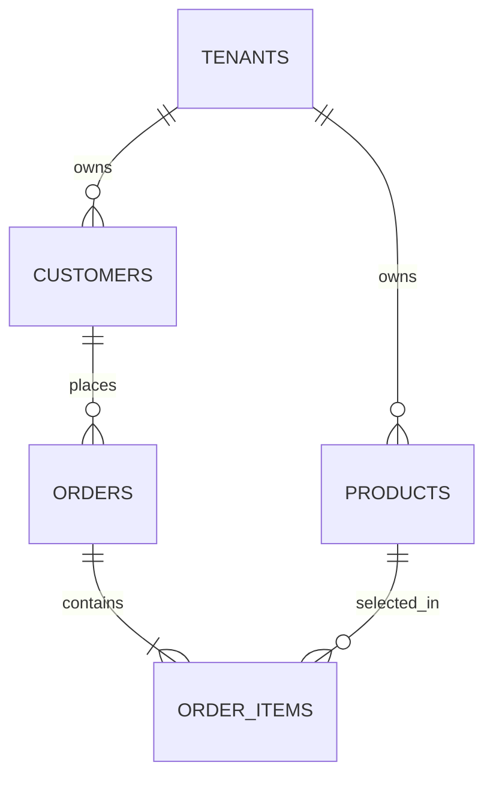

# Domain, Uniqueness, Referential, and Cross-Attribute Constraints

A good data model must express **what data is allowed to exist**, not merely describe which tables and columns are present in the system. For example, in a multi-tenant sales application (where each business is a tenant), the following statements are all business rules that need protection:

- Purchase quantity must be greater than 0; selling price and discount amount must be non-negative.
- Within the same tenant, two customers must not register the same email address when ignoring case differences.
- An order may only reference a customer belonging to that same tenant; an order line item must point to a product and an order in the same tenant.
- An order in the `CANCELLED` state must have a cancellation timestamp; an uncancelled order must not have a cancellation timestamp.
- The discount amount of a line item must not exceed quantity multiplied by unit price.

These statements are called **data invariants**: conditions that must hold true for every valid data state exposed by the system. A **constraint** is a mechanism that enables the database to reject operations that violate an invariant.

This lesson focuses on translating rules into **domain constraints, uniqueness constraints, referential integrity constraints, and cross-attribute conditions**, from the conceptual model to the physical relational schema. SQL examples use **PostgreSQL 15+**; for other DBMSs, verify syntax and enforcement behavior.

## 1. Determining the scope of each invariant

Before choosing SQL statements, you must know how many values and how many rows of data the rule involves.

| Scope | Business example | Common mechanisms |
|---|---|---|
| A single value in a column | `quantity > 0`, required `email` | Data type, `NOT NULL`, `CHECK` |
| A combination of values in a row | `discount_amount <= quantity * unit_price` | Multi-column `CHECK` |
| A value or tuple of values across multiple rows | Each tenant has only one specific SKU | `PRIMARY KEY`, `UNIQUE`, unique index |
| Between child row and parent row | `order.customer_id` must exist | `FOREIGN KEY`, including composite foreign keys |
| Across multiple rows by a condition | Two confirmed bookings must not overlap in time | Unique/exclusion constraint, transaction, or appropriate synchronization mechanism |
| Cross-row/cross-table aggregation | Order total equals the sum of discounted line items | Computed query; or transaction, trigger/materialized summary maintenance if stored redundantly |

**Design principle:** database constraints should protect conditions that can be stated precisely and must hold regardless of which application writes the data. Validation at the API, form, or service layer remains useful for friendly error reporting, but cannot replace constraints where the data is stored.

An invariant must be stated clearly enough before implementation. For instance, “email is unique” still lacks scope (system-wide or per tenant?), comparison rules (case-sensitive?), and handling of deleted accounts. Those decisions directly affect keys and indexes.

## 2. Domain constraints: rejecting invalid data at the column level

A **value domain** is the set of valid values for an attribute. Multiple complementary layers of control exist:

1. **Data types:** use `INTEGER` for quantities, `NUMERIC(p, s)` for money with fixed decimal precision, and `TIMESTAMPTZ` for a point in time with a time zone.
2. **`NOT NULL`:** requires the attribute to have a value. Empty strings must not be assumed to automatically equal `NULL`.
3. **`CHECK`:** defines a condition on values, such as `quantity > 0` or status belonging to a finite set.
4. **`DEFAULT`:** supplies a value when an insert omits the column; it does **not** automatically prevent invalid values explicitly passed by the application.

Standalone example for an item catalog:

```sql
CREATE TABLE catalog_item_example (
    item_id BIGINT GENERATED ALWAYS AS IDENTITY PRIMARY KEY,
    sku TEXT NOT NULL,
    quantity INTEGER NOT NULL DEFAULT 0,
    price NUMERIC(14, 2) NOT NULL,
    state TEXT NOT NULL DEFAULT 'DRAFT',

    CONSTRAINT ck_catalog_sku
        CHECK (sku = btrim(sku) AND char_length(sku) BETWEEN 1 AND 40),
    CONSTRAINT ck_catalog_quantity
        CHECK (quantity >= 0),
    CONSTRAINT ck_catalog_price
        CHECK (price >= 0),
    CONSTRAINT ck_catalog_state
        CHECK (state IN ('DRAFT', 'ACTIVE', 'ARCHIVED'))
);
```

`NUMERIC(14, 2)` represents exact decimal numbers to two decimal places, making it more suitable than `FLOAT` for monetary calculations. Choosing length, precision, currency unit, and rounding rules must still follow business requirements. A value of `quantity = 0` may be valid for **inventory stock** yet invalid for **purchase quantity**; do not reuse constraints while ignoring semantics.

### Important pitfall: `NULL` and three-valued logic

SQL has three logical truth values: `TRUE`, `FALSE`, and `UNKNOWN`. In PostgreSQL, a `CHECK` condition only rejects a row when the result is `FALSE`; both `TRUE` and `UNKNOWN` are accepted.

```sql
-- NOT sufficient to forbid NULL:
price NUMERIC(14, 2) CHECK (price >= 0)

-- Correct when price is required:
price NUMERIC(14, 2) NOT NULL CHECK (price >= 0)
```

If `price` is `NULL`, the expression `price >= 0` evaluates to `UNKNOWN`. Similarly, the rule `end_at > start_at` does not guarantee that either column has a value if `NOT NULL` is missing.

`CREATE DOMAIN` can be used when multiple columns share **the exact same domain semantics** in PostgreSQL. However, context-specific constraints such as “minimum order quantity of 1” should be placed on the relevant column/table.

## 3. Uniqueness constraints: identity keys and business keys

A `PRIMARY KEY` identifies a row; primary key columns must be non-`NULL` and the tuple of values must be unique. A table has only one primary key, but may have multiple candidate keys protected by `UNIQUE` or a unique index.

For example, `product_id` is a technical key, while `(tenant_id, sku)` is a business key:

```sql
CONSTRAINT pk_products PRIMARY KEY (tenant_id, product_id),
CONSTRAINT uq_products_tenant_sku UNIQUE (tenant_id, sku)
```

Two tenants may use the same code `SKU-01`; within **one** tenant, duplicates are forbidden. `UNIQUE (tenant_id, sku)` checks the **combination**, not prohibiting individual columns from appearing in multiple rows.

### Normalizing values before comparison

If business rules treat `Lan@Example.com` and `lan@example.com` as the same email, a default `UNIQUE (email)` does not enforce that rule. In PostgreSQL, you can use:

```sql
CREATE UNIQUE INDEX uq_customers_tenant_email_ci
    ON customers (tenant_id, lower(email));
```

This index assumes input has already had whitespace normalized (the example table later includes a corresponding `CHECK`). Real-world email comparison in applications should finalize Unicode/collation and normalization policies explicitly; do not assume `lower` is a perfect identity normalization across all systems.

### `UNIQUE` and `NULL`

Under PostgreSQL's default handling, `NULL` values are considered distinct in uniqueness checks. Therefore, multiple rows with `email = NULL` can coexist under `UNIQUE (email)`. Starting in PostgreSQL 15, you can choose:

```sql
-- When business rules require NULL to appear at most once as well:
CONSTRAINT uq_external_ref UNIQUE NULLS NOT DISTINCT (external_ref)
```

If an attribute must have a value, `NOT NULL` usually expresses the requirement more clearly. For multi-column unique keys, evaluate the impact of `NULL` in **each** column before choosing the syntax.

### Conditional uniqueness

For example, a display name only needs to be unique among records **not soft-deleted**:

```sql
CREATE UNIQUE INDEX uq_active_name_per_tenant
    ON some_entity (tenant_id, lower(display_name))
    WHERE deleted_at IS NULL;
```

A partial unique index expresses a condition tied to record state. This is a PostgreSQL feature; not every DBMS has the same syntax or behavior. A partial unique index cannot automatically serve as the target of a foreign key the way a standard candidate key does.

Do not rely on running a `SELECT` to check for duplicates followed by an `INSERT`: two concurrent requests can both see “does not exist yet”. A unique constraint/index is the layer that blocks conflicts at write time; the application must handle duplicate-key errors and decide whether to retry or return a message.

## 4. Referential integrity: relationships must point to existing rows

A foreign key (`FOREIGN KEY`) forces values in a child table to reference a valid primary key or unique key in the parent table. For example:

```sql
FOREIGN KEY (tenant_id, customer_id)
    REFERENCES customers (tenant_id, customer_id)
```

Including `tenant_id` on **both sides** of the foreign key ensures an order cannot be linked to a customer from another tenant, even if `customer_id` happens to be a valid value in another tenant. This turns an authorization/data-partitioning invariant into structural integrity.

A composite foreign key must reference parent columns that form a qualifying candidate key (primary or unique satisfying the DBMS's requirements). Column order in the constraint must match the declared mapping.

### Choosing behavior when updating or deleting parent rows

| Behavior | Meaning | Scenarios to consider |
|---|---|---|
| `ON DELETE RESTRICT` | Blocks deleting parent while child rows still reference it | Preserving order and financial history |
| `ON DELETE NO ACTION` | Checks reference at constraint enforcement time; can be deferred if the constraint supports `DEFERRABLE` | Transactions that reorganize data |
| `ON DELETE CASCADE` | Deletes corresponding child rows | Dependent data that does not need to exist independently |
| `ON DELETE SET NULL` | Sets child foreign key to `NULL` | Optional relationship where child column allows `NULL` |
| `ON UPDATE CASCADE` | Updates referencing key values in child when parent key changes | Mutable natural keys |

Do not default to `CASCADE` for critical data. “Orders may be deleted when a customer is deleted” is a **business decision**, not a technical default.

For composite foreign keys, `NULL` handling rules also matter: in the default `MATCH SIMPLE` mode, if even one referencing component is `NULL`, checking parent row existence may be skipped. If the relationship is mandatory, put `NOT NULL` on all referencing columns; when you want to allow **either all null or all non-null**, consider `MATCH FULL` depending on DBMS support.

**Indexes:** PostgreSQL creates indexes for primary keys and unique constraints, but does not automatically create indexes on every foreign key column in child tables. When parent rows are deleted/updated or when join queries run frequently, child-side indexes can be very important. Choose indexes based on query patterns and column order rather than adding them indiscriminately.

## 5. Cross-attribute constraints within a single row

A constraint can describe relationships among columns of **the same record**:

```sql
-- Valid time interval, if both columns are NOT NULL:
CHECK (end_at > start_at)

-- Discount does not exceed original line value:
CHECK (discount_amount >= 0
       AND discount_amount <= quantity * unit_price)

-- Cancelled status corresponds to having a cancellation timestamp:
CHECK (
    (status = 'CANCELLED' AND cancelled_at IS NOT NULL)
    OR
    (status <> 'CANCELLED' AND cancelled_at IS NULL)
)
```

The final condition is a **bidirectional** relationship (*if and only if*). If you only write `status = 'CANCELLED' OR cancelled_at IS NULL`, several invalid combinations can slip through. Therefore, build a truth table of allowed combinations before writing the `CHECK`:

| `status` | `cancelled_at` | Valid? |
|---|---|---|
| `CANCELLED` | Present | Yes |
| `CANCELLED` | `NULL` | No |
| `DRAFT` / `PLACED` | `NULL` | Yes |
| `DRAFT` / `PLACED` | Present | No |

If status and timestamp are updated in **two separate SQL statements**, one of the statements may fail because it creates an invalid intermediate state. Update them consistently in a single statement, or design transactions and constraints appropriately. In PostgreSQL, `CHECK` is not a constraint type that can be declared `DEFERRABLE`; do not count on deferring `CHECK` validation until commit.

A standard `CHECK` must not be used to query other rows or other tables to validate totals or existence conditions. This boundary is crucial when moving from “single-row” rules to “system-wide” rules.

## 6. End-to-end example: multi-tenant order schema

Clarified requirements:

- Each tenant has a unique code; customers have unique emails within a tenant, case-insensitive.
- Product code (SKU) is unique within a tenant; current price is non-negative.
- Orders reference a customer in the same tenant; order line items reference an order and a product in the same tenant.
- Orders have statuses `DRAFT`, `PLACED`, or `CANCELLED`; cancellation status and cancellation timestamp are always consistent.
- Line item quantity is positive, unit price at time of sale is non-negative, and discount is between 0 and pre-discount line amount.

The following tables illustrate a **PostgreSQL physical model**, excluding payments, shipping, or tax rules outside the scope of this lesson.

```sql
CREATE TABLE tenants (
    tenant_id BIGINT GENERATED ALWAYS AS IDENTITY,
    code TEXT NOT NULL,
    CONSTRAINT pk_tenants PRIMARY KEY (tenant_id),
    CONSTRAINT uq_tenants_code UNIQUE (code),
    CONSTRAINT ck_tenants_code
        CHECK (code = btrim(code) AND char_length(code) BETWEEN 3 AND 40)
);

CREATE TABLE customers (
    tenant_id BIGINT NOT NULL,
    customer_id BIGINT GENERATED ALWAYS AS IDENTITY,
    email TEXT NOT NULL,

    CONSTRAINT pk_customers PRIMARY KEY (tenant_id, customer_id),
    CONSTRAINT fk_customers_tenant
        FOREIGN KEY (tenant_id) REFERENCES tenants (tenant_id)
        ON DELETE RESTRICT,
    CONSTRAINT ck_customers_email
        CHECK (email = btrim(email) AND char_length(email) BETWEEN 1 AND 254)
);

-- Treat uppercase and lowercase as equivalent per the chosen rule.
CREATE UNIQUE INDEX uq_customers_tenant_email_ci
    ON customers (tenant_id, lower(email));

CREATE TABLE products (
    tenant_id BIGINT NOT NULL,
    product_id BIGINT GENERATED ALWAYS AS IDENTITY,
    sku TEXT NOT NULL,
    current_price NUMERIC(14, 2) NOT NULL,

    CONSTRAINT pk_products PRIMARY KEY (tenant_id, product_id),
    CONSTRAINT uq_products_tenant_sku UNIQUE (tenant_id, sku),
    CONSTRAINT fk_products_tenant
        FOREIGN KEY (tenant_id) REFERENCES tenants (tenant_id)
        ON DELETE RESTRICT,
    CONSTRAINT ck_products_sku
        CHECK (sku = btrim(sku) AND char_length(sku) BETWEEN 1 AND 40),
    CONSTRAINT ck_products_price CHECK (current_price >= 0)
);

CREATE TABLE orders (
    tenant_id BIGINT NOT NULL,
    order_id BIGINT GENERATED ALWAYS AS IDENTITY,
    customer_id BIGINT NOT NULL,
    status TEXT NOT NULL DEFAULT 'DRAFT',
    ordered_at TIMESTAMPTZ NOT NULL DEFAULT now(),
    cancelled_at TIMESTAMPTZ,

    CONSTRAINT pk_orders PRIMARY KEY (tenant_id, order_id),
    CONSTRAINT fk_orders_customer
        FOREIGN KEY (tenant_id, customer_id)
        REFERENCES customers (tenant_id, customer_id)
        ON DELETE RESTRICT,
    CONSTRAINT ck_orders_status
        CHECK (status IN ('DRAFT', 'PLACED', 'CANCELLED')),
    CONSTRAINT ck_orders_cancelled_state
        CHECK (
            (status = 'CANCELLED' AND cancelled_at IS NOT NULL)
            OR (status <> 'CANCELLED' AND cancelled_at IS NULL)
        ),
    CONSTRAINT ck_orders_cancelled_time
        CHECK (cancelled_at IS NULL OR cancelled_at >= ordered_at)
);

CREATE TABLE order_items (
    tenant_id BIGINT NOT NULL,
    order_id BIGINT NOT NULL,
    line_no INTEGER NOT NULL,
    product_id BIGINT NOT NULL,
    quantity INTEGER NOT NULL,
    unit_price NUMERIC(14, 2) NOT NULL,
    discount_amount NUMERIC(14, 2) NOT NULL DEFAULT 0,
    line_total NUMERIC(16, 2)
        GENERATED ALWAYS AS (quantity * unit_price - discount_amount) STORED,

    CONSTRAINT pk_order_items PRIMARY KEY (tenant_id, order_id, line_no),
    CONSTRAINT fk_order_items_order
        FOREIGN KEY (tenant_id, order_id)
        REFERENCES orders (tenant_id, order_id)
        ON DELETE RESTRICT,
    CONSTRAINT fk_order_items_product
        FOREIGN KEY (tenant_id, product_id)
        REFERENCES products (tenant_id, product_id)
        ON DELETE RESTRICT,
    CONSTRAINT ck_order_items_line_no CHECK (line_no > 0),
    CONSTRAINT ck_order_items_quantity CHECK (quantity > 0),
    CONSTRAINT ck_order_items_price CHECK (unit_price >= 0),
    CONSTRAINT ck_order_items_discount
        CHECK (discount_amount BETWEEN 0 AND quantity * unit_price)
);

-- Support joins and FK checks on directions not covered by the PK.
CREATE INDEX ix_orders_tenant_customer
    ON orders (tenant_id, customer_id);
CREATE INDEX ix_order_items_tenant_product
    ON order_items (tenant_id, product_id);
```

### Why does this model use both composite keys and technical keys?

`tenant_id` partitions data ownership scope. `customer_id`, `order_id`, and `product_id` are auto-generated technical identifiers. Even if identity values happen to be globally unique, **composite keys** and **composite foreign keys** explicitly state which relationships are permitted within a tenant. They prevent a statement with an incorrect `tenant_id` from linking data across tenants.

The email index is a business key used to reject duplicates; `customer_id` is a stable identifier for other tables to reference. For products, storing both `current_price` and the line item's `unit_price` is intentional: the price locked in at purchase time should not change whenever the catalog price is edited.

`line_total` is a **generated column** computed from values in the same row, avoiding storing a result that contradicts its components. However, `NUMERIC(16, 2)` also bounds the representable values; a real system must define maximum quantity/unit price limits and currency-specific rounding.

The foreign keys here do not by themselves guarantee “the product is still available for sale,” “the buyer is permitted to place orders,” or “inventory is sufficient.” Those are rules involving state, timing, or other calculations that require additional mechanisms.

### From business statements to DDL

| Statement | Enforcement location |
|---|---|
| “Each tenant has a unique code” | `uq_tenants_code` |
| “A tenant cannot have two duplicate customer emails ignoring case” | `uq_customers_tenant_email_ci` |
| “SKU is unique within a tenant” | `uq_products_tenant_sku` |
| “Order belongs to a customer in the same tenant” | `fk_orders_customer` |
| “Line item references both order and product in the right tenant” | `fk_order_items_order` and `fk_order_items_product` |
| “Quantity is positive, discount does not exceed pre-discount amount” | `ck_order_items_quantity` and `ck_order_items_discount` |
| “Cancellation timestamp matches status” | `ck_orders_cancelled_state`, `ck_orders_cancelled_time` |

A simple conceptual diagram for the referential structure:



The notation “order contains one or more lines” in the diagram is a **business goal**, not yet fully enforced by the SQL above: the foreign key ensures line items only point to real orders, but does not force every order to always have at least one line. If that must be enforced upon order confirmation, a state-transition workflow and additional transaction checks are required.

## 7. When a `CHECK` is not enough: cross-row invariants

### 7.1. No overlapping confirmed room bookings

Rule: the same room cannot have two `CONFIRMED` bookings with overlapping time intervals. Two consecutive `[start_at, end_at)` intervals meeting at a boundary are allowed.

A `CHECK (end_at > start_at)` only sees a single row and cannot detect two overlapping rows. In PostgreSQL, an **exclusion constraint** with GiST can be used:

```sql
CREATE EXTENSION IF NOT EXISTS btree_gist;

CREATE TABLE room_reservations (
    reservation_id BIGINT GENERATED ALWAYS AS IDENTITY PRIMARY KEY,
    room_id BIGINT NOT NULL,
    start_at TIMESTAMPTZ NOT NULL,
    end_at TIMESTAMPTZ NOT NULL,
    status TEXT NOT NULL,

    CONSTRAINT ck_reservation_interval CHECK (start_at < end_at),
    CONSTRAINT ck_reservation_status
        CHECK (status IN ('DRAFT', 'CONFIRMED', 'CANCELLED')),
    CONSTRAINT ex_confirmed_room_no_overlap
        EXCLUDE USING gist (
            room_id WITH =,
            tstzrange(start_at, end_at, '[)') WITH &&
        )
        WHERE (status = 'CONFIRMED')
);
```

This constraint expresses that no two rows with the same `room_id` may have intersecting time ranges when both are in the confirmed status. `btree_gist` provides equality operators for types like `BIGINT` inside GiST. Installing extensions requires appropriate privileges; other DBMSs may require a different model or synchronization mechanism.

### 7.2. Order total and cross-table invariants

Suppose the business requires “the order total always equals the sum of `line_total` across its line items.” A `CHECK` on the `orders` table cannot directly enforce a `SUM` over `order_items`. There are two design approaches:

- **Compute at query time** if performance and consistency requirements allow:

```sql
SELECT oi.tenant_id, oi.order_id,
       COALESCE(SUM(oi.line_total), 0) AS order_total
FROM order_items AS oi
GROUP BY oi.tenant_id, oi.order_id;
```

- **Store the aggregated total** when truly needed; in that case, line items and total must be updated in the same transaction, or use appropriate triggers/summary-maintenance mechanisms. Concurrent update behavior must be designed carefully to avoid writing stale totals.

Never replace cross-row constraints with a sequence of application checks lacking locks or proper isolation. Two transactions can both read stale state and then both write results that violate the invariant (*race condition*). For rules that cannot be expressed as standard constraints, consider transactions, row locking, `SERIALIZABLE` isolation, or an alternative data model that supports direct enforcement.

### 7.3. Constraint enforcement timing

By default, many constraints are checked immediately within the executing statement. PostgreSQL allows certain constraints such as `UNIQUE`, `FOREIGN KEY`, and `EXCLUDE` to be declared `DEFERRABLE` so they are checked at an appropriate point within the transaction. `NOT NULL` and `CHECK` have no equivalent `DEFERRABLE` mechanism. Only defer checking when the business workflow genuinely requires an intermediate state, and always ensure the final state at commit is valid.

## 8. Testing constraints with counterexamples

To verify that a model properly protects invariants, test both **allowed** data and data that **must be rejected**. For the order schema in section 6:

| Test action | Expected result | Primary constraint |
|---|---|---|
| Insert two customers in the same tenant with emails differing only by case | Reject the second insert | Unique index on `lower(email)` |
| Insert two customers in different tenants with the same email | Accept | Uniqueness scoped by `tenant_id` |
| Insert a product with `current_price = -1` | Reject | `ck_products_price` |
| Create an order pointing to a customer in another tenant | Reject | Composite foreign key `fk_orders_customer` |
| Set `status = 'CANCELLED'` with `cancelled_at IS NULL` | Reject | `ck_orders_cancelled_state` |
| Insert a line with quantity 2, unit price 100, discount 250 | Reject | `ck_order_items_discount` |
| Insert two lines in the same order with duplicate `line_no` | Reject | `pk_order_items` |
| Delete a product referenced by an order line | Reject | `fk_order_items_product` and `ON DELETE RESTRICT` |
| Create a `DRAFT` order with no line items yet | Accept under current DDL | No “order must have lines” invariant yet |

When experimenting, use transactions and `ROLLBACK` so sample data is not polluted. Negative tests generally need to run each case in its own transaction or savepoint, because in PostgreSQL a failed statement puts the current transaction into an aborted state requiring rollback or returning to a savepoint before continuing.

Beyond single-constraint tests, test **concurrency**: two sessions inserting the same email, two sessions confirming overlapping room bookings, or two processes updating the same total. These tests reveal the difference between application-level checks and database-level guarantees.

## 9. Adding constraints to a system with existing data

Never apply new DDL before checking whether existing data violates the rule. The typical process includes:

1. **Finalize the invariant:** tenant scope, value normalization, exceptions for legacy records, and `NULL` handling.
2. **Inventory existing data:** find negative records, missing keys, orphaned references, and duplicate business-key groups.
3. **Clean and normalize:** fix, merge, or classify violating cases according to auditable business decisions.
4. **Roll out constraints in phases:** consider table size, DDL locks, impact on write commands, and application deployment order.
5. **Verify post-migration:** run counterexample queries, concurrency tests, and monitor constraint violation errors.

Example checking for duplicate emails under the chosen rule before creating a unique index:

```sql
SELECT tenant_id, lower(email) AS normalized_email, COUNT(*) AS duplicate_count
FROM customers
GROUP BY tenant_id, lower(email)
HAVING COUNT(*) > 1;
```

In PostgreSQL, `CHECK` and `FOREIGN KEY` constraints can be added as `NOT VALID` and later verified with `VALIDATE CONSTRAINT`, aiding migration planning on large tables. However, `UNIQUE` has no equivalent `NOT VALID` mechanism to skip existing records; on large tables, consider `CREATE UNIQUE INDEX CONCURRENTLY` (run outside a transaction block) after resolving duplicates. Expression-based or partial unique indexes cannot be attached as `UNIQUE` constraints via `USING INDEX`, which applies to qualifying plain unique indexes. Always evaluate locking behavior and your actual DBMS version before deploying to production.

A “theoretically correct” constraint can still cause business errors if write flows have not been updated. For example, with `ck_orders_cancelled_state`, the application must update `status` and `cancelled_at` in a single consistent `UPDATE` statement.

## 10. Translating the same invariants to document, graph, and analytical models

An invariant is a technology-independent business requirement; the **level of enforcement support** varies by storage engine.

| Model | Typical expression | Enforcement notes |
|---|---|---|
| Relational database | `NOT NULL`, `CHECK`, `UNIQUE`, `FOREIGN KEY`, exclusion constraints where supported | Strong for structural and referential constraints; cross-row aggregations still require design |
| Document | Schema validation for attributes/documents, unique indexes for fields or composite keys | References to other documents are not protected by default like FKs; evaluate transactions and application mechanisms |
| Graph | Unique/property-existence constraints if supported by engine; node/edge constraints per product | Do not assume all relationships or paths are checked automatically; verify engine enforcement capabilities |
| Analytical data warehouse | Data types, load-time checks, data quality jobs, constraint metadata if available | Some systems record PK/FK only as optimizer hints without enforcing them; do not assume declarations are enforced |

Example: a document model may store all line items inside a single order document. Then the condition “discount does not exceed pre-discount amount” per element can be validated at the document level depending on engine capabilities. However, email uniqueness **across documents** still requires a unique index, and product references to another document may require transactions/separate logic.

Choose storage structures based on **access patterns, transaction boundaries, linking needs, and invariants that must be enforced**, not merely JSON shape or table count.

## 11. Design checklist

Before approving a physical schema, answer the following questions:

- Does each attribute have the right data type, unit of measurement, precision, and `NULL` policy?
- Does the uniqueness rule apply **globally, per tenant, per status, or per time interval**? Is normalization needed before comparison?
- Does every reference have a corresponding foreign key? Do composite keys include ownership-scope columns such as `tenant_id`?
- Does parent delete/update behavior match history-retention and data-ownership requirements?
- Have relationships among status, timestamps, quantities, and monetary amounts been written as explicit accept/reject conditions?
- Does the condition involve only one row, or is it actually a cross-row/cross-table invariant requiring transactions or another mechanism?
- Under two concurrent transactions, can an outcome occur where both application checks pass yet the final data is invalid?
- Is there any violating existing data, and has the rollout sequence of application–DDL–data cleanup been verified?

**Key takeaway:** start from a sufficiently precise business statement, determine the scope of the invariant, then choose the strongest protection mechanism suited to where the data lives. `CHECK` describes relationships within a single row; `UNIQUE` protects uniqueness; `FOREIGN KEY` protects links; cross-row and cross-table invariants must be identified separately so you never overestimate a single constraint.
