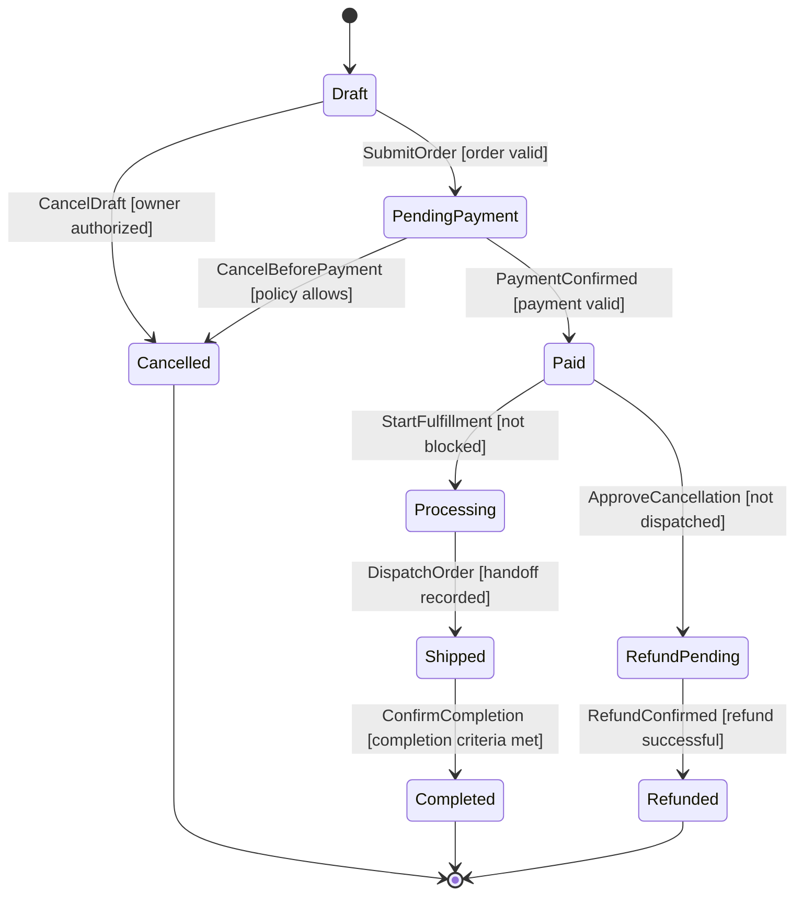

# Valid States Differ from Valid State Transitions

In data modeling, we must distinguish two questions: **whether an object is currently in a valid state**, and **whether the event that just occurred is permitted to transition the object from its current state to a new state**. A state may be valid in the model, yet not every other state can reach it directly. For example, `SHIPPED` is a valid state for an order, but that does not mean an order in `DRAFT` is allowed to jump straight to `SHIPPED`.

This distinction is critical when translating business requirements into a clear data model. State invariants describe conditions that must hold for every accepted data state. State-transition constraints describe permitted change steps, conditions that must be satisfied, actors authorized to execute them, and events that must be recorded. If you only check the status value and ignore the transition path, the system can store a seemingly valid state created through an invalid action.

After this lesson, learners will be able to:

- Distinguish state invariants from state-transition constraints.
- Specify states, events, guard conditions, and transition outcomes.
- Build lifecycle diagrams and identify permitted or prohibited transitions.
- Identify invariants over a single record, multiple records, relationships, and temporal data.
- Verify pre- and post-transition conditions within a consistent transaction.
- Understand the roles of `CHECK`, foreign keys, `UNIQUE`, transactions, concurrency locks, and event history.
- Design test cases for valid states, invalid states, and invalid transitions.

## 1. Valid states and valid state transitions

### 1.1. A state is a snapshot of the current situation

A state describes an object's condition at a point in time. For instance, an order can be in `DRAFT`, `PENDING_PAYMENT`, `PAID`, `PROCESSING`, `SHIPPED`, `COMPLETED`, or `CANCELLED`.

A state is considered valid when it belongs to the set of states permitted by the business and all conditions tied to that state hold true. For example:

- A `PAID` order must have proof of successful payment.
- A `SHIPPED` order must have handoff or shipping label details per workflow.
- A `CANCELLED` order must have a cancellation reason or cancellation event if required by the business.
- A `DRAFT` order may not yet have a shipping address or payment.

These conditions describe **the validity of the current state**. They do not state how that state was reached.

### 1.2. A state transition is a conditional action

A state transition is a change from the current state to another state when an event occurs and required conditions are met.

Examples:

- `DRAFT` → `PENDING_PAYMENT` when the order has required information and is submitted for confirmation.
- `PENDING_PAYMENT` → `PAID` when the system receives valid payment confirmation.
- `PAID` → `PROCESSING` when the order enters fulfillment.
- `PROCESSING` → `SHIPPED` when goods are handed over under complete-delivery criteria.
- `PAID` → `CANCELLED` may be prohibited if goods have already been handed over; if cancellation is permitted, a separate refund workflow may be required.

A state transition is valid only when the source state, event, guard condition, actor permission, and outcome all align with business rules.

### 1.3. Comparing the two kinds of rules

| Criterion | State invariant | State-transition constraint |
|---|---|---|
| Question | Does a record in this state satisfy the conditions? | Is transitioning from the old state to the new state permitted? |
| Scope | Values and relationships at a point in time | Relationship among prior state, event, and next state |
| Example | A `PAID` order must have a payment timestamp | Only transition to `PAID` upon valid payment confirmation |
| Check | Conditions on current data | Conditions on prior data, event, and resulting data |
| Typical bug | Saving a state missing required data | Skipping steps, repeating actions, or transitioning out of order |

The two kinds of rules complement each other. A permitted transition can still produce an invalid state if the update step fails to preserve invariants. Conversely, a state containing complete data can still be invalid if the system reached it via a prohibited transition.

## 2. Describing states with verifiable conditions

Do not merely list state names. Every state needs a business definition and conditions to determine whether a record is genuinely in that state.

### 2.1. State set and meanings

Order example:

| State | Business meaning | Data or conditions to consider |
|---|---|---|
| `DRAFT` | Order is being created, not yet submitted | May lack shipping address or payment. |
| `PENDING_PAYMENT` | Order has been submitted and awaits payment | Contains required checkout info; no successful payment confirmation yet. |
| `PAID` | Payment has been confirmed | Has a successful payment transaction associated with the order. |
| `PROCESSING` | Order is being prepared | Has required fulfillment workflow and assignment. |
| `SHIPPED` | Goods have been handed over per the organization's shipping definition | Has valid shipment/handoff information. |
| `COMPLETED` | Order workflow is finished | Required delivery/reconciliation criteria have been satisfied. |
| `CANCELLED` | Order was cancelled per rules | Has a cancellation event; remaining refund obligations or partial-shipment handling resolved per policy. |

A system may need finer-grained states such as `PARTIALLY_SHIPPED`, `REFUND_PENDING`, or `PARTIALLY_CANCELLED`. Only add a state when it represents a meaningful business situation and helps determine the next action.

### 2.2. Per-state invariants

A state invariant may apply to all records or only when an object is in a specific state.

Examples:

- Every order must have a unique identifier.
- Every order line must have a quantity greater than 0.
- When an order is `PAID`, there must be at least one confirmed collection transaction per payment policy.
- When an order is `SHIPPED`, valid handoff information must exist.
- When an order is `CANCELLED`, remaining obligations and related resolution outcomes must be determined.

Write invariants as testable statements. Saying “the order must be valid” is not specific enough; saying “a `PAID` order must have a successful collection transaction whose total meets the required amount due per policy” can be analyzed and verified.

### 2.3. A valid state does not imply a reachable state

A state may belong to the set of valid states without necessarily being reachable from the current state. For example, `COMPLETED` is a valid state, yet a `DRAFT` order cannot jump straight to `COMPLETED` without passing through confirmation, processing, and shipping.

When reviewing a model, distinguish:

- **Valid state set:** states an object may take in the domain.
- **Initial state:** the state used when an object begins its lifecycle.
- **Valid transition set:** permitted pairs of states and events.
- **Terminal states:** states that are no longer active or have no ordinary outgoing transitions.
- **Reachable states:** states reachable from the initial state through a sequence of valid transitions.

An unreachable state often signals a missing transition in the diagram, contradictory rules, or a defined state that is no longer used.

## 3. Describing state transitions by source, event, guard, and target

A transition should be specified with at least four elements:

1. **Source state:** which state the object is in prior to the action.
2. **Event:** which action or message requests the change.
3. **Guard condition:** the condition that must hold for the transition to be accepted.
4. **Target state:** the new state after a successful transition.

You can also add actors, permissions, input data, side effects, and history events.

Example:

| Source | Event | Guard | Target |
|---|---|---|---|
| `DRAFT` | `SubmitOrder` | At least one line item; required fields valid | `PENDING_PAYMENT` |
| `PENDING_PAYMENT` | `PaymentConfirmed` | Valid transaction ID; amount and currency match rules | `PAID` |
| `PAID` | `StartFulfillment` | Order not blocked; items processable | `PROCESSING` |
| `PROCESSING` | `DispatchOrder` | Goods handed over with required shipping data | `SHIPPED` |
| `SHIPPED` | `ConfirmCompletion` | Completion criteria met per policy | `COMPLETED` |
| `DRAFT` | `CancelDraft` | Requester has permission to cancel draft | `CANCELLED` |

### 3.1. An event is not a state

An event describes what happened; a state describes the condition after the event is processed. `PaymentConfirmed` is an event, whereas `PAID` is a state. An event may arrive without changing state if it is invalid, was already processed previously, or does not fit the current state.

For example, a payment gateway resends a `PaymentConfirmed` notification for an already-confirmed transaction. The system must recognize this as a duplicate notification and handle it under idempotency rules. It must not create a second collection entry simply because the same notification arrived twice.

### 3.2. Guards differ from invariants

A guard is a condition for permitting a transition. An invariant is a condition that must hold in an accepted data state.

Example:

- Guard: allow `SubmitOrder` only when the order has at least one line item.
- Invariant: every order in `PENDING_PAYMENT` must have at least one valid line item.

A guard checks before the action. An invariant checks the post-action result and every persisted state. The same condition may be used in both places when needed, but their roles differ.

### 3.3. Prohibited transitions must be explicitly documented

Do not only list allowed transitions while ignoring steps at risk of occurring due to application bugs or manual operations. Examples:

- Disallow `DRAFT` → `SHIPPED`.
- Disallow `CANCELLED` → `PAID` from a late payment notification if rules require separate transaction handling.
- Disallow `COMPLETED` → `PROCESSING` in the normal workflow.
- Disallow fully cancelling an already fully shipped order without a return/refund workflow.

Some domains permit reopening or adjusting after completion. In that case, document it as a special transition with dedicated actors, conditions, and audit trail rather than silently treating it as an ordinary transition.

## 4. State diagrams and lifecycles

State diagrams make states, events, and permitted paths visible. They also expose isolated states, transitions missing guards, or paths without termination.



The diagram above is a simplified example. An order may be partially shipped, partially cancelled, or partially refunded; when the business requires this, add states or model line items, shipments, and refund transactions with their own lifecycles. Avoid forcing an entire complex workflow into a single overall order status.

### 4.1. Checking initial and terminal states

Clarify:

- What state is the object created in?
- Can drafts or pending states exist?
- How many terminal states are there?
- Can a terminal state be reopened?
- If reopened, is it the same object or a new object linked to the old one?

For example, an expired contract may be renewed via an addendum or by creating a new contract. The two approaches carry different legal and historical meanings; do not simply flip `EXPIRED` back to `ACTIVE` if the business needs separate contract periods preserved.

### 4.2. Finding unreachable states

Starting from the initial state, trace all valid transitions. If any state cannot be reached, check:

- Is a transition missing from the diagram?
- Is a guard overly restrictive or contradictory?
- Is the state obsolete and no longer used?
- Is the transition triggered only by an undocumented external system?
- Is a special role allowed to execute it that the model hasn't captured?

Do not delete a state just to make the diagram look cleaner. Confirm with the business owner first.

## 5. Invariants at different scopes

Not every invariant fits in a single column or a single record. Some conditions involve multiple objects, multiple data rows, or time.

### 5.1. Attribute or record invariants

Examples:

- Ordered quantity must be greater than 0.
- End date must not precede start date.
- Order number must be present and unique.
- If status is `PAID`, payment timestamp must be present.

These conditions can usually be checked on a single record via value domains, `NOT NULL`, `UNIQUE`, or `CHECK` depending on the DBMS.

### 5.2. Referential and relationship invariants

Examples:

- Each order line must belong to an existing order.
- Each payment must reference a valid order or receivable entity.
- Each assignment must have a corresponding employee and project.
- An employee must not have two primary assignments overlapping in time if policy forbids it.

Foreign keys guarantee references point to existing objects. However, complex conditions such as non-overlapping time intervals or at most one active relationship may require additional constraints.

### 5.3. Aggregate invariants across multiple records

Examples:

- Total allocated quantity does not exceed available inventory.
- Confirmed students do not exceed class capacity.
- Total refunded amount does not exceed valid collected amount per policy.
- Sum of budget allocation percentages across line items does not exceed the allowed threshold.

These conditions cannot always be enforced by a simple single-row `CHECK`. They typically require checking multiple records within a consistent transaction, specialized DBMS constraints, or an appropriate concurrency-control mechanism.

### 5.4. Temporal invariants

Examples:

- A license may only be used within its validity period.
- An employee has only one primary assignment at any given point in time.
- A contract must not have two active versions concurrently if policy requires a single active version.
- A reservation is only held until a specific expiration deadline.

These invariants must specify timestamps, time zones, effective intervals, and how overlapping intervals are handled. Storing only the current state may be insufficient to verify history.

## 6. Preconditions and postconditions for state transitions

A useful way to specify transitions is by defining **preconditions** and **postconditions**.

- Precondition: what must be true before the action begins.
- Action: the requested operation or event.
- Postcondition: what must be true after the action completes successfully.

Example transitioning an order from `PENDING_PAYMENT` to `PAID`:

| Component | Condition |
|---|---|
| Precondition | Order is in `PENDING_PAYMENT`; referenced transaction belongs to order; amount and currency match; notification is authenticated. |
| Action | Process payment confirmation event. |
| Postcondition | Order is `PAID` per rules; transaction is recorded as successful; event is stored; duplicate notifications do not create new payments. |

If any condition is not satisfied, the system must reject, defer, or route to exception handling per rules. Never apply a partial update and leave data in a contradictory state.

### 6.1. Multi-step transitions and atomicity

A business action may update multiple objects. For example, confirming payment might:

1. Record the successful payment transaction.
2. Update the order status.
3. Write a history event.
4. Update receivable balance or related data.

Changes must be designed so no invalid intermediate state is exposed as a completed result. For data in the same database, a transaction guarantees all changes succeed or fail together. With external systems, rules for duplicate messages, late results, reconciliation, and compensation are required; never assume one database transaction spans every system.

### 6.2. Guards must be checked on the latest state

Suppose a class has one seat left. Two enrollment requests arrive almost simultaneously. If both read the remaining seat count before writing, both may be accepted and exceed capacity.

The “seat available” guard must be checked alongside the update operation using a mechanism ensuring consistency and proper concurrency control. Depending on design, use transactions, row locks, conditional updates, isolation levels, or reservation holds. Checking only in the UI or in an earlier read step is insufficient.

## 7. Representing and enforcing constraints in the database

The conceptual model describes business rules. Logical and physical models determine how they are enforced. No single SQL constraint type enforces every invariant and transition.

### 7.1. `NOT NULL`, `CHECK`, `UNIQUE`, and foreign keys

Illustrative SQL example:

```sql
CREATE TABLE orders (
    order_id BIGINT PRIMARY KEY,
    status VARCHAR(24) NOT NULL,
    placed_at TIMESTAMP NOT NULL,
    paid_at TIMESTAMP NULL,
    CHECK (status IN (
        'DRAFT', 'PENDING_PAYMENT', 'PAID',
        'PROCESSING', 'SHIPPED', 'COMPLETED', 'CANCELLED'
    )),
    CHECK (status <> 'PAID' OR paid_at IS NOT NULL)
);

CREATE TABLE order_lines (
    order_line_id BIGINT PRIMARY KEY,
    order_id BIGINT NOT NULL REFERENCES orders(order_id),
    quantity INTEGER NOT NULL CHECK (quantity > 0)
);
```

These constraints illustrate two kinds of checks:

- `status` must belong to the defined value domain.
- If the order is `PAID`, `paid_at` must have a value.
- Each order line must reference an existing order and have a positive quantity.

These are examples of state and referential invariants. They do not yet guarantee `DRAFT` only transitions to `PENDING_PAYMENT`, or that `PAID` only transitions from `PENDING_PAYMENT`. A direct update statement could still move an order from `DRAFT` to `PAID` undetected by the `CHECK` constraints above, provided the data conditions for the `PAID` state are met.

### 7.2. Controlling transitions with conditional updates

An illustrative approach is updating only when the source state matches:

```sql
UPDATE orders
SET status = 'PAID',
    paid_at = CURRENT_TIMESTAMP
WHERE order_id = :order_id
  AND status = 'PENDING_PAYMENT';
```

The application must inspect the affected row count. If zero rows were updated, the state already changed or the order no longer qualifies; never report success as if the transition occurred.

In practice, the status update should be in a transaction alongside recording the payment transaction and event. Partner transaction details, amount, currency, reference ID, and idempotency must be verified before accepting the transition. The example statement only illustrates the source-state predicate, not a complete payment workflow.

### 7.3. When multiple records must be checked

A `CHECK` on the orders table cannot simply check total quantities across all shipment lines or total refunds in another table. You may need:

- A transaction checking and updating related records.
- Triggers or stored procedures if that is the enforcement mechanism chosen and governed by the organization.
- DBMS-specific constraints, such as non-overlapping interval constraints where supported.
- Periodic reconciliation processes to catch drift caused by integrations or asynchronous processing.

Do not rely solely on UI checks. If multiple applications or background jobs can write the same data, critical rules must be protected where every write path complies.

### 7.4. Protecting transitions against concurrent updates

A conditional update like `WHERE status = 'PENDING_PAYMENT'` prevents two processes from both transitioning an order from the old source state if only one can update successfully. However, invariants involving multiple rows such as class capacity or total refunds also require protecting the data scope and concurrency.

Determine:

- Which object must be locked or version-checked?
- Which data scope must be read and updated atomically?
- Can two transactions both breach a limit?
- Upon conflict, does the system reject, retry, or queue?
- How do we detect that a request was already processed previously?

## 8. Transition history and auditability

If only the current `status` value is stored, the system cannot know the full path that produced it. When the business requires explainability or auditing, specify what historical data must be retained.

### 8.1. State history

A history record may include:

- Object modified.
- Prior and new states.
- Event or reason for transition.
- Person or system executing the change.
- Timestamp when the event occurred.
- Timestamp when the system recorded it.
- Outcome, reference ID, or approval information.

Example:

| Event timestamp | Prior state | Event | Next state | Actor |
|---|---|---|---|---|
| 09:00 | — | `OrderCreated` | `DRAFT` | Customer |
| 09:05 | `DRAFT` | `SubmitOrder` | `PENDING_PAYMENT` | Customer |
| 09:08 | `PENDING_PAYMENT` | `PaymentConfirmed` | `PAID` | Payment gateway |
| 09:15 | `PAID` | `StartFulfillment` | `PROCESSING` | Warehouse system |
| 14:30 | `PROCESSING` | `DispatchOrder` | `SHIPPED` | Warehouse staff |

### 8.2. Storing current state and event history

Current state can be stored on the object for fast queries while transition history is stored in a separate table or event stream. Both must remain consistent: current state reflects the latest accepted outcome; history explains the steps that occurred.

If using event sourcing, events are the primary data source from which state is reconstructed. With a standard CRUD model, history can be an audit log or state-history table. Event sourcing does not need to be applied to every system; the choice depends on traceability needs, complexity, and operational practices.

### 8.3. Late, duplicate, or out-of-order events

In integrations, events can arrive late, be redelivered, or arrive out of order. For example, a payment-success notification may arrive after an order has already been cancelled; a shipment notification may be delivered multiple times.

Specify:

- Which event ID or transaction ID identifies duplicates?
- Are late events accepted?
- If an event contradicts the current state, how does the system handle it?
- Is reconciliation with the source system required?
- Must certain events be routed to manual handling instead of automatically changing state?

Never blindly apply whichever event arrives last as the latest state. Message arrival time is not necessarily business order.

## 9. Comprehensive example: class enrollment with a capacity limit

### 9.1. Business rules

A class has a maximum capacity of 30 students. Students can submit enrollment requests, but only confirmed enrollments occupy a seat. When the class is full, subsequent requests are placed on a waitlist. If a student cancels before the deadline, the freed seat goes to the next person in priority order.

### 9.2. State invariants

- Class capacity is a positive integer.
- The number of enrollments in `CONFIRMED` does not exceed capacity.
- Each enrollment must reference exactly one student and one class.
- A `CONFIRMED` enrollment must have a confirmation timestamp.
- A `WAITLISTED` enrollment must have a waitlist position or ordering metadata per rules.
- A `CANCELLED` enrollment no longer occupies a seat.

### 9.3. State-transition constraints

| Source state | Event | Guard | Target state |
|---|---|---|---|
| `REQUESTED` | `ConfirmEnrollment` | Seat available and information valid | `CONFIRMED` |
| `REQUESTED` | `ConfirmEnrollment` | Class already at capacity | `WAITLISTED` |
| `WAITLISTED` | `PromoteFromWaitlist` | Seat open and enrollment still valid | `CONFIRMED` |
| `CONFIRMED` | `CancelEnrollment` | Cancellation request within deadline | `CANCELLED` |
| `WAITLISTED` | `CancelEnrollment` | Enrollment still on waitlist | `CANCELLED` |

### 9.4. Why are both layers of checks needed?

Suppose an enrollment has status `CONFIRMED` and a valid confirmation timestamp. It satisfies the single-record invariants. Yet if the class already has 30 other confirmed enrollments, the new record violates the capacity aggregate invariant. Thus, a single enrollment's valid state alone is insufficient to prove the entire class is valid.

Conversely, suppose the class has an open seat and the enrollment has complete data. If the enrollment is currently `CANCELLED`, the system must not automatically flip it to `CONFIRMED` just because a seat opened. A permitted transition—such as `ReopenEnrollment` or creating a new enrollment per policy—must occur.

### 9.5. Concurrency scenario

The class has one seat remaining and two students confirm almost simultaneously. If both requests read the remaining seat count and then both write `CONFIRMED`, the class can exceed capacity. The business rule must be enforced via a consistent update mechanism with concurrency control and deterministic selection of who gets confirmed first.

This example shows that aggregate invariants and state-transition constraints must be checked together. A `CHECK (status = 'CONFIRMED')` on the enrollments table alone cannot guarantee class capacity.

## 10. How to build a test suite

A good test suite must test both states and transition paths. For each state, create valid and invalid examples. For each transition, test valid conditions, invalid conditions, and invalid source states.

### 10.1. Testing state invariants

| Scenario | Expected result |
|---|---|
| `PAID` order with `paid_at` and valid transaction | Accept. |
| `PAID` order without payment timestamp | Reject. |
| Order line with quantity 0 | Reject if rule requires positive quantity. |
| Order line referencing non-existent order | Reject. |
| Class with 31 confirmed enrollments when capacity is 30 | Reject or detect violation per enforcement mechanism. |

### 10.2. Testing state transitions

| Source state | Event | Guard | Expected result |
|---|---|---|---|
| `DRAFT` | `SubmitOrder` | Order has valid data | Transition to `PENDING_PAYMENT`. |
| `DRAFT` | `DispatchOrder` | Incompatible with source state | Reject. |
| `PENDING_PAYMENT` | `PaymentConfirmed` | Valid confirmation | Transition to `PAID`. |
| `PENDING_PAYMENT` | `PaymentConfirmed` | Mismatched transaction ID or amount | Reject or route to exception handling. |
| `CANCELLED` | `PaymentConfirmed` | Late notification | Do not auto-transition to `PAID`; handle per reconciliation rules. |
| `COMPLETED` | `StartFulfillment` | Disallowed transition | Reject. |

### 10.3. Testing transition sequences

Some bugs only appear when multiple steps combine. Example:

1. Create draft order.
2. Submit for confirmation.
3. Receive successful payment.
4. Cancel order.
5. Re-receive the old payment notification.

Check whether the order transitions to a wrong state, the transaction is recorded twice, or a refund is missed. Also test mid-flight failure sequences to ensure no half-completed data remains.

### 10.4. Testing invariants after every transition

For every accepted transition, verify all related invariants before committing. Do not test guards alone. A transition can satisfy input conditions yet still corrupt totals, quantities, relationships, or states of related objects.

## 11. Common mistakes

| Mistake | Consequence | Fix |
|---|---|---|
| Checking only that status is in the allowed list | Allows jumping from any state to any other state. | Validate source state, event, and guard. |
| Assuming valid state implies valid transition | Permits out-of-order paths. | Specify the state set and transition set separately. |
| Checking guards only before updating | Data can change between check and write. | Verify against the latest state within a suitable transaction mechanism. |
| Validating only in the UI | Background jobs or other apps can bypass rules. | Enforce rules at authoritative write paths and appropriate data layers. |
| Storing only current state | Cannot explain transition history. | Store events or audit history as required. |
| Overloading one state with multiple meanings | Hard to determine next actions and valid conditions. | Define distinct states or split child lifecycles. |
| Using `CHECK` to validate cross-table totals | Constraints are not enforced as expected. | Use transactions, specialized mechanisms, and reconciliation. |
| Ignoring duplicate or late notifications | Can double-charge, double-refund, or repeat transitions. | Use event IDs, idempotency, and late-event handling rules. |
| Ignoring concurrent updates | Exceeding capacity or overwriting results. | Enforce concurrency control within the relevant data scope. |

## 12. Invariant and state-transition specification records

So the model can be implemented and tested, hand off two separate yet linked specification sets.

### 12.1. State invariant template

```text
Invariant ID:
Name:
Target object / scope:
Condition that must hold:
Applicable state(s):
Check timing:
Valid example:
Violating example:
Source of evidence:
Approver:
Expected enforcement location:
```

### 12.2. State transition template

```text
Transition ID:
Object:
Source state:
Event:
Actor / permission:
Guard / precondition:
Target state:
Postcondition:
Impact on related objects:
History event to record:
Duplicate / late handling:
Related prohibited transitions:
Source of evidence:
Approver:
```

### 12.3. State and transition matrix

| Source state | Event | Target state | Primary guard | Post-transition invariant |
|---|---|---|---|---|
| `DRAFT` | `SubmitOrder` | `PENDING_PAYMENT` | Order has at least one valid line | Pending payment data initialized properly. |
| `PENDING_PAYMENT` | `PaymentConfirmed` | `PAID` | Valid confirmation and amount | Has a successful collection transaction. |
| `PAID` | `StartFulfillment` | `PROCESSING` | Order not blocked | Has required processing details. |
| `PROCESSING` | `DispatchOrder` | `SHIPPED` | Handoff recorded | Has valid shipping information. |
| `SHIPPED` | `ConfirmCompletion` | `COMPLETED` | Completion criteria met | Order is completed per business definition. |

## 13. Pre-finalization model checklist

- [ ] Valid state set and meaning of each state are confirmed.
- [ ] Initial state and terminal states are defined.
- [ ] Every state has required invariants or data conditions.
- [ ] Permitted transitions specify source state, event, guard, and target state.
- [ ] Risky or prohibited transitions are explicitly listed.
- [ ] Guards are distinguished from post-transition invariants.
- [ ] State reachability from the initial state has been verified.
- [ ] Single-record, multi-record, relational, and temporal invariants are identified.
- [ ] Transition impacts on related objects are documented.
- [ ] Multi-step operations have explicit atomicity or compensation handling.
- [ ] Concurrent updates, duplicate events, and late events have been considered.
- [ ] Transition history captures actor, timestamp, event, and reason as required.
- [ ] Enforcement mechanisms are clearly allocated between database constraints and business logic.
- [ ] Tests cover valid states, violating states, and invalid transitions.
- [ ] Every rule has a source of evidence and a designated approver.

## 14. Practice exercise

A warranty claim management system allows customers to create claims and upload proof of purchase, and allows staff to intake claims, request additional information, approve, or reject. Once approved, a claim can move to repair, product replacement, or refund. A completed claim cannot be reprocessed through the normal flow. However, a manager may reopen a claim if an error is discovered and a reason is recorded.

Complete the following:

1. List the valid states and define the meaning of each state.
2. Write at least eight state invariants, including data, referential, and state conditions.
3. Build a transition matrix with source state, event, guard, actor, and target state.
4. Identify at least five prohibited transitions and explain the business rationale.
5. Describe the conditions for reopening a completed claim and the historical data to retain.
6. Distinguish a late partner notification from a valid reopen request.
7. Propose constraints enforceable via `CHECK`, `UNIQUE`, and foreign keys, as well as what must be handled in transactions or business logic.
8. Write a test suite covering valid states, invalid states, and out-of-order transitions.

**Self-assessment criteria:** do not confuse valid states with valid transitions; every transition has a guard; post-transition state satisfies invariants; reopening requires authorization and a reason; duplicate/late notifications do not corrupt data; history suffices to explain the entire processing lifecycle.

## Conclusion

Valid states describe conditions data must satisfy at a point in time; valid state transitions describe permitted paths from a source state through an event and guard to a target state. A reliable data model requires both layers: invariants to protect every stored state, and transition constraints to prevent out-of-order or unauthorized actions. When rules are clearly documented, consistently enforced, and tested through realistic scenarios, the system can keep data accurate throughout an object's entire lifecycle.
