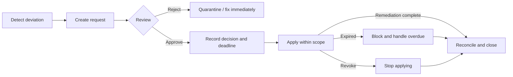

# Documenting Time-Bound Exceptions Instead of Silently Bypassing Constraints

In a data modeling project, saying “let’s just let this case slide for now” is usually a sign of an **incompletely expressed rule**. If the development team silently skips a `NOT NULL` check, disables a `FOREIGN KEY`, drops a unique index, or hardcodes an exception in application logic without an audit trail, the data becomes opaque: nobody knows which cases are permitted, who approved them, whether they are still valid, or when they must be fixed.

A verifiable approach is **documenting time-bound exceptions**: a decision to accept a defined deviation within a specific object and time scope, accompanied by compensating controls, an accountable owner, evidence, and a remediation plan to restore validity. Such an exception does not automatically grant permission to bypass all system invariants.

This lesson belongs to the **DATABASE_DATA_MODELING** module: translating business needs into clear entities, relationships, constraints, and physical schemas, while considering how to preserve the same rules across relational, document, graph, or analytical warehouse databases.

## 1. Scenario: a supplier sends products missing GTIN codes

A catalog management platform imports data from multiple suppliers. The agreed business rule is:

> **Invariant P-01:** Every product published in the official catalog must have a valid GTIN code; no two products within the same tenant may share the same GTIN under the agreed identity policy.

During a sync batch, a supplier sends 500 products, of which 12 are missing GTINs. The supplier commits to supplying them within 48 hours. Operations wants to retain those 12 records for reconciliation without halting ingestion.

There are three very different options:

| Approach | Behavior | Consequence |
|---|---|---|
| Silently skip checks | Allow writing products without GTIN into the published catalog | Invariant P-01 is no longer protected; hard to identify discrepancies |
| Reject the entire batch | Discard the whole import because some records lack data | Preserves validity but may increase operational cost |
| **Time-bound exception in a staging area** | Store the 12 records in staging; record an approval to retain them pending for at most 48 hours; do not publish until valid | Preserves records for remediation while still protecting the official catalog |

Suppose standard policy requires pending records missing GTINs to be resolved or evicted from the queue within **2 hours**. The 48-hour case is an exception to the **pending retention SLA**, not an exception to the **publication requirement**. Stating precisely which rule is relaxed is the most important modeling decision.

If the business genuinely requires **publishing products that do not yet have a GTIN**, the design team must redefine the states, access permissions, and consequences of “conditional publication,” and evaluate whether P-01 needs to change into a different invariant. You cannot simply note “exception approved” and expect `NOT NULL` to magically allow violating data.

## 2. Distinguishing invariants, policies, and exceptions

Before creating an exception table, classify the rule proposed for relaxation.

| Rule category | Example | Handling direction |
|---|---|---|
| **Hard structural invariants** | Non-duplicate primary keys; order foreign keys must point to the right tenant | Keep enforcement intact; use staging/remediation if input is not yet compliant |
| **State-dependent validity conditions** | Rows in `PUBLISHED` state must have a GTIN | Model `PENDING`, `VALIDATED`, `PUBLISHED` states; constrain state-transition conditions |
| **Threshold-based operational policies** | Imported records missing GTIN must be resolved within 2 hours | Can allow a dedicated processing deadline with approval and monitoring |
| **Data quality rules** | Missing supplier code rate in a batch must stay below 1% | Record deviation and batch acceptance criteria; do not model this as FK/UNIQUE |
| **Versioned rules** | From the effective date of a new regulation, an extra field is mandatory | Record `rule_version` and effective timestamp; distinguish schema evolution from individual exceptions |

A permanent policy change should not be disguised as a continually renewed exception. Conversely, a single case with a concrete remediation deadline does not necessarily require removing data constraints across the entire system.

**Foundational question:** “What are we allowing, for which objects, during which time window, and what must still never happen?”

## 3. What must an exception record capture?

A vague note like “temporarily bypassed per business request” is not enough for others to reconstruct the decision. An exception record should contain at least the following fields.

| Group | Minimum attributes | Meaning |
|---|---|---|
| Rule | `rule_code`, `rule_version`, original invariant description | Clearly identifies which rule is affected at approval time |
| Scope | `tenant_id`, entity type, record/batch key, affected attributes | Bounds the exact dataset covered |
| Permitted deviation | Temporarily accepted values or situations; actions still forbidden | Prevents the exception from bleeding into other rules |
| Rationale & evidence | Cause description, request/ticket, document reference | Enables tracing the decision and verifying source data |
| Decision authority | Requester, approver, approval timestamp | Establishes accountability; supports separation of duties |
| Time window | `valid_from`, `valid_until`, timezone and boundary convention | Prevents exceptions from becoming indefinite |
| Compensating controls | Quarantine method, alerts, API restrictions, extra checks | Reduces risk while the exception is active |
| Remediation | Owner, deadline, closure criteria, expiry fallback | Defines what “done” looks like |
| Lifecycle audit trail | Issued, used, modified, renewed, revoked, closed; actor and timestamp | Supports auditing and root-cause analysis |

Rule codes should remain **stable across versions** (for example, `GTIN_REQUIRED_TO_PUBLISH`). If rule interpretation changes, increment `rule_version` or link to the specific policy version rather than silently editing old definitions. With many exception types, a `rule_catalog` table can manage codes, versions, severity levels, and approval workflows.

### Example approved exception record

The following example is illustrative data, not system lesson metadata:

```yaml
exception_id: EX-2048
rule_code: STAGING_MISSING_GTIN_SLA
rule_version: 2
scope:
  tenant_id: 42
  import_batch_id: 778
  import_item_ids: [901, 902, 903]
allowed_deviation: "Retain three records missing GTIN in staging for up to 48 hours"
explicitly_forbidden: "Publish records into catalog_products without a GTIN"
reason: "Supplier has not yet returned GTIN lookup results"
evidence_ref: "DQ-148"
requested_by: "import-operator"
approved_by: "catalog-data-owner"
approved_at: "2026-11-22T04:00:00Z"
valid_from: "2026-11-22T04:00:00Z"
valid_until: "2026-11-24T04:00:00Z"
remediation_owner: "supplier-integration-team"
mitigation: "Quarantine in staging; do not sync to catalog API"
on_expiry: "Block downstream processing, alert, and route to remediation queue"
closure_criteria: "Valid GTIN supplied and reconciled; or records removed"
```

A single exception record for **a batch** can cover multiple objects if the scope is declared and controlled precisely. However, if individual records have different resolution times, owners, or outcomes, use a child table `exception_subjects` to track each object individually rather than stuffing an arbitrary list of IDs into a text string.

## 4. “Time-bound” is a temporal invariant, not just a date column

The validity window is usually modeled as a **half-open** interval:

\[
[\,valid\_from,\ valid\_until\,)
\]

That means it is effective from `valid_from` (inclusive at the exact start time) and expires the moment the clock reaches `valid_until`.

At time \(t\), an exception is considered effective only when all of the following hold simultaneously:

\[
\begin{aligned}
effective(E,t) ={}&
  approved(E)\\
 &{}\land valid\_from(E) \le t < valid\_until(E)\\
 &{}\land \neg revoked(E,t)\\
 &{}\land \neg resolved(E,t).
\end{aligned}
\]

This separates an **approved decision** from **authority to use it at the current moment**. A decision approved yesterday is not automatically valid today.

Important temporal invariants include:

- `valid_until > valid_from`; no zero-length or negative-duration exceptions.
- Duration does not exceed policy thresholds, such as 48 hours, unless explicitly permitted by a separate approval tier.
- No retroactive effective dates unless policy allows; start time must align with approval time.
- Early revocation or closure must invalidate the exception prior to `valid_until`.
- Renewal is **a new decision with its own reason, approver, and audit trail**; never silently overwrite `valid_until` in the old record.
- Timestamps should be stored with timezone awareness, such as PostgreSQL `TIMESTAMPTZ`, and expressed explicitly in UTC/offset when exchanged across systems.

**Do not use `CHECK (valid_until > now())` expecting the database to expire records automatically.** In PostgreSQL, `CHECK` constraints are not continuously re-evaluated as wall-clock time advances; furthermore, PostgreSQL expects check expressions on a row to remain immutable over time. Expiration is a **condition evaluated at usage time** and requires operational detection for cases still open past their deadline.

## 5. Decision lifecycle and handling responsibilities

A sound governance workflow can be illustrated as follows:



Business statuses such as `REQUESTED`, `APPROVED`, `REJECTED`, `RESOLVED`, and `REVOKED` can be stored. Yet `APPROVED` status alone does **not** mean “currently effective”; decisions must combine status with time bounds and closure/revocation markers.

Distinguish three milestones:

1. **Approval:** an authorized person accepts the deviation within the permitted scope.
2. **Activation / usage:** the application executes the action specified in the exception after checking timestamp and target object.
3. **Remediation / closure:** data now meets standards or has been quarantined/removed per closure criteria, with confirming evidence.

An exception may expire before remediation finishes. At that point, **authority to use the exception ends**, while **the work to fix the data remains**. Never automatically mark invalid data as valid simply because the deadline passed.

## 6. Relational design: separating pending data from published data

The safe approach for the GTIN example is preserving the integrity of the official catalog while letting incomplete data exist in an intentional staging zone.

Assuming tenants are identified in the surrounding system, this minimal schema focuses on three objects: **incoming items**, **exception decisions**, and **published products**.

```sql
-- PostgreSQL 15+; illustrative tables omit access control
-- and tenant/supplier tables present in a real system.
CREATE TABLE staging_supplier_items (
    tenant_id BIGINT NOT NULL,
    import_item_id BIGINT GENERATED ALWAYS AS IDENTITY,
    supplier_sku TEXT NOT NULL,
    gtin TEXT,
    imported_at TIMESTAMPTZ NOT NULL DEFAULT CURRENT_TIMESTAMP,
    review_state TEXT NOT NULL DEFAULT 'PENDING',

    CONSTRAINT pk_staging_supplier_items
        PRIMARY KEY (tenant_id, import_item_id),
    CONSTRAINT ck_supplier_sku_not_blank
        CHECK (btrim(supplier_sku) <> ''),
    CONSTRAINT ck_staging_review_state
        CHECK (review_state IN ('PENDING', 'READY', 'REJECTED')),
    CONSTRAINT ck_ready_requires_gtin
        CHECK (review_state <> 'READY'
               OR (gtin IS NOT NULL AND btrim(gtin) <> ''))
);

CREATE TABLE data_quality_exception_approvals (
    exception_id BIGINT GENERATED ALWAYS AS IDENTITY PRIMARY KEY,
    tenant_id BIGINT NOT NULL,
    import_item_id BIGINT NOT NULL,
    rule_code TEXT NOT NULL DEFAULT 'STAGING_MISSING_GTIN_SLA',
    rule_version INTEGER NOT NULL,
    allowed_action TEXT NOT NULL DEFAULT 'RETAIN_IN_STAGING',
    reason TEXT NOT NULL,
    evidence_ref TEXT NOT NULL,
    mitigation TEXT NOT NULL,
    requested_by TEXT NOT NULL,
    approved_by TEXT NOT NULL,
    remediation_owner TEXT NOT NULL,
    approved_at TIMESTAMPTZ NOT NULL,
    valid_from TIMESTAMPTZ NOT NULL,
    valid_until TIMESTAMPTZ NOT NULL,
    resolved_at TIMESTAMPTZ,
    revoked_at TIMESTAMPTZ,

    CONSTRAINT fk_exception_item
        FOREIGN KEY (tenant_id, import_item_id)
        REFERENCES staging_supplier_items (tenant_id, import_item_id)
        ON DELETE RESTRICT,
    CONSTRAINT ck_exception_rule
        CHECK (rule_code = 'STAGING_MISSING_GTIN_SLA'),
    CONSTRAINT ck_rule_version
        CHECK (rule_version > 0),
    CONSTRAINT ck_exception_action
        CHECK (allowed_action = 'RETAIN_IN_STAGING'),
    CONSTRAINT ck_exception_justification
        CHECK (btrim(reason) <> '' AND btrim(evidence_ref) <> ''
               AND btrim(mitigation) <> ''),
    CONSTRAINT ck_exception_participants
        CHECK (btrim(requested_by) <> '' AND btrim(approved_by) <> ''
               AND btrim(remediation_owner) <> ''
               AND requested_by <> approved_by),
    CONSTRAINT ck_exception_time
        CHECK (valid_from >= approved_at
               AND valid_until > valid_from
               AND valid_until <= valid_from + INTERVAL '48 hours')
);

-- Prevent two open decisions for the same object and rule.
-- An expired decision remains "open" until explicitly resolved.
CREATE UNIQUE INDEX uq_open_exception_per_item_rule
    ON data_quality_exception_approvals
       (tenant_id, import_item_id, rule_code)
    WHERE resolved_at IS NULL AND revoked_at IS NULL;

CREATE TABLE catalog_products (
    tenant_id BIGINT NOT NULL,
    product_id BIGINT GENERATED ALWAYS AS IDENTITY,
    import_item_id BIGINT NOT NULL,
    gtin TEXT NOT NULL,

    CONSTRAINT pk_catalog_products
        PRIMARY KEY (tenant_id, product_id),
    CONSTRAINT uq_catalog_gtin_per_tenant
        UNIQUE (tenant_id, gtin),
    CONSTRAINT uq_catalog_origin_per_tenant
        UNIQUE (tenant_id, import_item_id),
    CONSTRAINT fk_catalog_source
        FOREIGN KEY (tenant_id, import_item_id)
        REFERENCES staging_supplier_items (tenant_id, import_item_id)
        ON DELETE RESTRICT,
    CONSTRAINT ck_published_gtin_nonempty
        CHECK (btrim(gtin) <> '')
);
```

### What the schema above guarantees

- Staging records may lack a GTIN without corrupting the semantics of `catalog_products`.
- The published table always requires GTIN to be non-`NULL`, non-empty, and unique **within a tenant** according to the chosen comparison rules.
- A published record must originate from an import item in the right tenant via the composite foreign key.
- Exception decisions point to a specific target item, with requester, approver, remediation owner, evidence, and a maximum 48-hour horizon.
- The partial unique index prevents two concurrently open decisions for the same item/rule. The design intentionally forces handling the prior decision before issuing a new one.

### What the schema does **not** enforce on its own

`CHECK` constraints cannot inspect another row's state to ensure a staging record missing GTIN is retained past 2 hours only if an effective approval exists. Nor do they detect when the 48-hour mark passes. And the foreign key from `catalog_products` to staging only guarantees **the source row exists**—it does not guarantee `gtin` was copied accurately from the source or passed GTIN check-digit validation.

If those conditions must be enforced inside the database, design a **controlled write interface**, transactions, triggers, or appropriate supplementary constraints. For example, grant state-transition/publication permissions only to a stored procedure that performs full validation, forbidding ordinary application roles from writing directly. Check all off-band write paths (batches, scripts, other services) before claiming an invariant is enforced.

Example transfer to the catalog **illustrating only the non-empty GTIN condition**:

```sql
INSERT INTO catalog_products (tenant_id, import_item_id, gtin)
SELECT s.tenant_id, s.import_item_id, s.gtin
FROM staging_supplier_items AS s
WHERE s.tenant_id = 42
  AND s.import_item_id = 901
  AND s.review_state = 'READY'
  AND s.gtin IS NOT NULL
  AND btrim(s.gtin) <> '';
```

Add business GTIN validation, authorization, approval checks, and concurrency handling before production use. `NOT NULL` and `UNIQUE` on the target table remain the final safety net if application logic ever has a bug.

### Why not add an `ignore_validation BOOLEAN` column?

A generic boolean column cannot record who approved it, which rule was relaxed, how far it applies, when it expires, or how it closes. It also easily gets abused to bypass **all** checks on that record. Instead, model an exception decision with a key, scope, authorization, and time window, and permit only the explicitly approved action.

## 7. Using time-bound exceptions: queries and gating mechanisms

Against the approval table designed above, the following query lists exceptions **currently in effect** at query time:

```sql
SELECT
    e.exception_id, e.tenant_id, e.import_item_id,
    e.rule_code, e.valid_until, e.remediation_owner
FROM data_quality_exception_approvals AS e
WHERE e.valid_from <= CURRENT_TIMESTAMP
  AND CURRENT_TIMESTAMP < e.valid_until
  AND e.resolved_at IS NULL
  AND e.revoked_at IS NULL;
```

When exercising the “retain in staging past SLA” permission on a write operation, this query must act as a **gating condition** at the point of execution, alongside checking target object and `allowed_action`. In concurrent environments, checking and writing must be synchronized via transactions/locking or an equivalent consistency mechanism. Checking in one request and writing in another leaves room for state to change in between.

A separate overdue report finds open decisions past `valid_until`:

```sql
SELECT
    e.exception_id, e.tenant_id, e.import_item_id,
    e.valid_until, e.remediation_owner,
    CURRENT_TIMESTAMP - e.valid_until AS overdue_by
FROM data_quality_exception_approvals AS e
WHERE e.valid_until <= CURRENT_TIMESTAMP
  AND e.resolved_at IS NULL
  AND e.revoked_at IS NULL
ORDER BY e.valid_until;
```

This report must connect to concrete action: stop permitting the exception action, block downstream processing if needed, quarantine the object, alert the accountable owner, and reconcile resulting data. Reminder jobs can run periodically; **gating conditions must check expiration at the exact time of use** so the system never depends solely on job schedules.

Approving a decision with a 48-hour limit does not mean the underlying data should automatically vanish after 48 hours. The system must explicitly define data retention for traceability, case closure, and proper constraint recovery. Deleting immediately upon expiration can destroy evidence needed for reconciliation.

## 8. Preventing loopholes through data edits or renewals

The integrity of exception records must be protected just like business data itself.

**First, separate requesting from deciding.** Whoever detects a deviation may submit a request; only an authorized role may approve it. For critical rules, require the approver to differ from the requester. `CHECK (requested_by <> approved_by)` only checks that two strings differ; it does not prove real identity or access control. Pair it with proper authentication and authorization.

**Second, avoid mutating approval history.** Instead of directly updating `reason`, `approved_by`, or `valid_until` on an old decision, record new events linked to the prior decision. An `exception_events` table can be used:

```sql
CREATE TABLE exception_events (
    event_id BIGINT GENERATED ALWAYS AS IDENTITY PRIMARY KEY,
    exception_id BIGINT NOT NULL
        REFERENCES data_quality_exception_approvals (exception_id),
    event_type TEXT NOT NULL
        CHECK (event_type IN (
            'APPROVED', 'USED', 'REVIEWED',
            'REVOKED', 'REMEDIATED', 'CLOSED'
        )),
    actor_id TEXT NOT NULL,
    event_at TIMESTAMPTZ NOT NULL DEFAULT CURRENT_TIMESTAMP,
    evidence_ref TEXT,
    details TEXT NOT NULL,
    CONSTRAINT ck_event_actor CHECK (btrim(actor_id) <> '')
);
```

The DDL above **does not yet make the event table immutable**; to make the event log append-only, restrict `UPDATE`/`DELETE` privileges or use another audit-trail mechanism. Even with event logging, design transactions so updating decision state and inserting events cannot drift out of sync.

**Third, never auto-renew.** If GTIN is still missing after 48 hours, the system must flag the case as overdue. To grant another 24 hours, an accountable owner must re-evaluate the risk and issue a new decision. If the unique index blocks a new decision because the old one is still open, resolve the old decision's lifecycle properly instead of editing expiry dates to circumvent controls.

**Fourth, define explicit behavior on revocation or expiration.** The exception loses validity immediately, yet the invalid data still exists. There must be a blocked state, quarantine plan, assigned handler, and completion evidence. For data containing sensitive information, never interpret a “data exception” as permission to bypass access control or security policies.

## 9. Boundary between exceptions and schema changes

Not every request to relax a constraint should be solved by adding an exception table. Consider three cases:

### Case A: Allowing temporarily incomplete data before publication

**Appropriate solution:** model staging, quality states, exception decisions, and a mandatory publication gate. Constraints on published records stay intact.

### Case B: Two products temporarily share the same identifier

If the identifier is the unique business key of the main table, do not disable the unique index to ingest both records and “fix it later.” Conflicting records can sit in staging or a reconciliation table; only after merging or renaming should they move into the table with the unique constraint. If the business confirms both must coexist long-term, revisit the key definition: the identifier may be unique only per tenant, source, effective interval, or version rather than globally.

### Case C: A new regulation permits a permanent special case

If the requirement is a **formal rule** applying to many entities, update the conceptual model, logical model, DDL, and API contracts accordingly, then plan a migration. Never accumulate thousands of “temporary” exceptions to implement an undocumented permanent rule.

A sound model distinguishes **objects in a valid incomplete state**, **time-bounded approved deviations**, and **invalid data requiring removal**. Collapsing all three into `is_valid = false` makes reporting and handling inaccurate.

## 10. Ensuring correctness in transactions and under contention

Suppose one request checks that an exception is still valid, and another request revokes the decision immediately afterward. If the write proceeds using stale information, an action may occur after authority has already been revoked.

Options to consider based on risk level:

- Check the decision and write data within the **same transaction**, locking rows subject to concurrent updates when necessary; define clearly which point in time determines validity.
- Use a centralized write gate (stored procedure/service) and restrict direct write privileges so every path enforces the same rule.
- Keep hard constraints such as `PRIMARY KEY`, `UNIQUE`, `FOREIGN KEY`, and `NOT NULL` on official data; they avoid relying solely on reading an exception decision once.
- Record `USED` events with target references and timestamps so you know whether an exception was actually exercised or merely approved.
- Test operations right at the `valid_from` and `valid_until` boundaries, as well as two transactions granting/revoking/using closely together.

**PostgreSQL timing note:** `CURRENT_TIMESTAMP` reflects transaction start time. In a transaction spanning across the expiration boundary, it may not reflect the wall clock when the final statement runs. If the rule requires real-time evaluation at the check point, deliberately choose an appropriate time source (such as `clock_timestamp()`), define the linearization point, and standardize synchronization; never mix application clocks with database clocks haphazardly.

If the requirement is “no operation may occur past the exact expiration instant,” a once-per-minute job is insufficient as a guardrail. Enforce validity directly in the write path and design explicitly for contention around the expiration boundary.

## 11. Verifying decisions: test scenario checklist

An exception record is valuable only if verifiable through data and behavior.

| Scenario | Expected result |
|---|---|
| Missing GTIN with no exception | May be held in staging per ingestion policy; cannot be published; must be handled once past normal SLA |
| Missing GTIN, active time-bound exception matching tenant/object | Allowed **only** the approved action, e.g. retained pending in staging |
| Exception for tenant 42, operation on tenant 43 | Not applied |
| Exception for GTIN rule, operation wants to skip FK check | Not applied |
| Exception prior to `valid_from` | Not yet effective |
| Current timestamp equals `valid_until` | Expired under half-open interval semantics |
| Exception revoked before deadline | Immediately invalidated per revocation decision |
| Past deadline without fixing the record | Listed as overdue, exception action blocked, routed for handling |
| GTIN fixed, reconciled, with evidence | Exception can be closed; only then may status transition/publish per policy |
| Two open decisions for the same object/rule | Rejected by unique index per illustrative design |
| Two concurrent transactions updating authority and using exception | No behavior violating defined consistency rules occurs |

Alongside single-record tests, test **off-band paths**: batch imports, remediation scripts, third-party services, retry jobs, and admin operations. An exception enforced in the API that can be bypassed through another write channel is not truly governed.

Periodic evaluation can track metrics: open exception count, overdue exception count, median and maximum age, pre-expiry closure rate, renewal rate, recurring root-cause categories, and records processed under active exceptions. Metrics pinpoint upstream data issues and drive model improvements—they do not replace accountability for resolving individual cases.

## 12. Documenting exceptions in document, graph, and analytical systems

The concept of scoped, approved, time-bound exceptions applies outside relational databases too, though **never assume all platforms enforce them identically**.

| Storage model | How it is recorded | Key considerations |
|---|---|---|
| Relational | Exception decision table, FKs to source entities, unique index limiting duplicate open decisions, event log | `CHECK` and FKs do not automatically enforce real-time checks or cross-table rules |
| Document | Exception document with `rule_code`, scope, deadline, status, event history; schema validation on main documents | Cross-document referential constraints and multi-document transactions depend on engine/configuration |
| Graph | `Exception` node linked to `Rule`, `Entity`, `Approver`, and processing events | Relationship paths are clear for tracing, yet verify engine support for enforcing time conditions and uniqueness |
| Analytical / data warehouse | Request–approval–usage–closure events, point-in-time validity snapshots | Must join using exact event timestamps in historical analysis; a current “is active” flag skews past reports |

For example, to report the percentage of imported records missing GTINs that were **permitted to stay pending** on Nov 22, analytics must join data as of that time against validity intervals and revocation history rather than looking only at a current status column. This is why decision trails and events should be preserved instead of overwritten.

In every model, an exception record is only **evidence of a decision**. Enforcement behavior must still be wired into actual data-processing paths.

## 13. Reusable exception decision template

Before putting an exception case into production, analysts, engineers, and data owners should jointly answer:

| Question | Content to confirm |
|---|---|
| What is the original rule? | Code/version, invariant statement, purpose, boundaries that must not be relaxed |
| Why is an exception needed? | Root cause, impact if rejected, alternatives considered |
| What is permitted? | Specific action, target object set, tenant, system, and data scope |
| What is prohibited? | Actions that remain blocked, such as publishing, payouts, or cross-tenant links |
| How long is it valid? | UTC/offset, start and end timestamps, policy ceiling |
| Who is accountable? | Requester, approver, remediation owner, and closure verifier |
| How is risk controlled? | Quarantine, access scopes, alerts, transaction blocking, periodic audits |
| What are closure criteria? | Invariant restored or data removed/quarantined under control |
| What happens on expiry? | Action blocked, alerts fired, backlog handled, new decision issued if needed |
| Where is the evidence? | Ticket, import batch, verification query, events, and decision history |

A well-written decision lets another team member read the record and answer: **“Why was this row kept, is it still permitted to be processed right now, and who is responsible for making it valid?”**

## 14. Practice exercise and self-check questions

**Exercise.** An equipment rental system stipulates that each dispatched unit has at most one active contract; a legacy batch is imported missing `contract_id`. Operations asks to “temporarily drop the constraint for three days.”

Design:

1. Precise invariant statement: distinguish identity keys, active contracts, and staging states.
2. Scope of legacy imported data held pending; determine whether it may enter the official contracts table.
3. An exception record template including `rule_code`, target object, approver, time interval, compensating controls, and closure criteria.
4. A minimal table model keeping hard constraints active alongside an overdue-detection mechanism.
5. A test suite covering matching tenant, wrong tenant, before start time, expired, and two concurrent transactions.

**Review hint:** if a proposal allows dropping FKs, unique indexes, or disabling all validation without specifying scope and restoration conditions, it fails to protect the invariant. If it holds non-compliant data in staging and allows promotion only once requirements are met, official data invariants remain far easier to verify.

### Key Takeaways

- An exception must state **the permitted deviation**, not merely say “skip validation.”
- Explicitly document **the rule, target object, scope, authorization, approver, deadline, risk mitigations, and closure plan**.
- Keep hard constraints on official data. When input is not yet valid, prefer modeling staging, states, and recovery flows.
- Expiration is a condition evaluated **at usage time**; a deadline column and an alerting job alone are not enough to guarantee blocking.
- New decisions, revocations, usages, and remediations require distinct audit trails. Time-bound exceptions must drive data remediation—never become a backdoor around sound constraint design.
