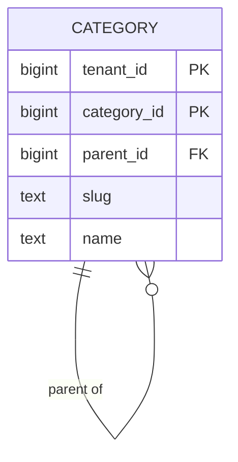

# Tree Modeling with Adjacency Lists

An e-commerce system has a product catalog "All → Electronics → Phones"; an enterprise has an org chart "Company → Engineering Division → Platform Team"; an admin app has a folder tree. Those structures can all be represented as a **hierarchical tree**: every node, except the root node, has exactly one parent node and can have multiple child nodes.

The **adjacency list** is a common pattern for storing trees in relational databases. Each node is a row; that row's `parent_id` column references the identifying key of **the parent node in the same table**. Storage is simple, adding nodes is easy, and parent–child integrity is easy to protect with a foreign key, though querying all ancestors/descendants requires recursion and moving branches must guard against cycles.

This lesson belongs to the **Inheritance and Hierarchies** chapter of the **DATABASE_DATA_MODELING** module. The goal is to translate business hierarchy requirements into verifiable entities, relationships, keys, constraints, indexes, and physical queries; and from there know when an adjacency list fits better than other tree storage strategies or document/graph models. Note: a **hierarchical tree** describes parent–child relationships between *records*; it is not synonymous with **type inheritance** (*supertype/subtype*) between *entity types*.

## 1. Identifying a True Tree in Business Requirements

Consider a tenant's product catalog:

```text
All
├── Electronics
│   ├── Phones
│   └── Computers
└── Fashion
    └── Shoes
```

We identify:

- **Node:** a category, such as "Electronics".
- **Root:** "All"; has no parent node.
- **Parent/child:** "Electronics" is the direct parent of "Phones".
- **Siblings:** "Phones" and "Computers" share the same parent.
- **Leaf:** a node with no children, e.g., "Shoes".
- **Ancestors/descendants:** "All" is an ancestor of "Phones"; "Phones" is a descendant of "All".
- **Depth:** the number of edges from the root to the node; in this example, the root has depth 0 and "Phones" has depth 2.
- **Subtree:** a node together with all of its descendants; the "Electronics" subtree has three nodes.

A structure is truly a **tree** only when each node has at most one parent, no cycles exist, and every node has a finite path leading to a single root. If there are multiple roots, we have a **forest** consisting of multiple trees. If a node is permitted to have **multiple parents**, such as a skill belonging to multiple specialty groups simultaneously, the relationship is no longer a standard tree; an edge table for a directed acyclic graph (DAG) or a graph model may be needed.

### Translating Requirements into Invariants

| Business statement | Invariant to design |
|---|---|
| Each category has an identifier | Each node has a stable primary key |
| A category belongs to at most one parent category | A single-valued `parent_id` attribute |
| A root category has no parent | `parent_id IS NULL` |
| No orphaned categories | Non-`NULL` `parent_id` must reference an existing node |
| Cannot move a group into itself or its descendants | The tree must be **acyclic** |
| Tenant A's category cannot belong to Tenant B's parent | Parent–child relationships must preserve the same `tenant_id` |
| Under the same parent, no two branches share a `slug` | Uniqueness scoped by parent and tenant |
| If a single root per tenant is required | At most one node has `parent_id IS NULL` per tenant; ensuring at least one root exists must be enforced separately |

Do not start with SQL statements and guess the rules afterward. Clearly distinguish "at most one" from "exactly one", as well as "one root per tree" from "one root for the entire tenant".

## 2. From 1–N Relationship to Adjacency List

A single table can hold both parent nodes and child nodes:

| `category_id` | `name` | `parent_id` |
|---:|---|---:|
| 10 | All | `NULL` |
| 20 | Electronics | 10 |
| 30 | Phones | 20 |
| 40 | Computers | 20 |
| 50 | Fashion | 10 |
| 60 | Shoes | 50 |

`parent_id` is a **self-referencing foreign key**. In the example above, row `category_id = 30` has `parent_id = 20`, expressing "Phones belongs directly under Electronics".

In an entity diagram:



The notation above expresses the idea that one parent can have many children. `parent_id` **is allowed to be null for root nodes**, while for other nodes it must point to a row in the same table. If each category needs a description, status, display order, or owner, those remain attributes of the node; there is no need to create separate tables for each tier like "division", "group", "type".

### Why Not Create `level_1`, `level_2`, `level_3` Columns?

A fixed-column pattern forces the structure to a known maximum number of levels, struggles to represent nodes at varying depths, and makes reparenting difficult. An adjacency list represents variable depth without schema changes when a fourth or fifth level is added.

On the other hand, a read operation to "fetch the entire path from a leaf node up to the root" cannot be completed with a single fixed parent join for arbitrary trees. A recursive query or a path-supporting mechanism is required.

## 3. PostgreSQL Relational Schema Design

The example below uses **PostgreSQL 15+**, with each category belonging to a `tenant_id`. We assume tenants are already managed elsewhere; when a `tenants` table exists, add a foreign key from `tenant_id` to that table.

```sql
CREATE TABLE catalog_categories (
    tenant_id BIGINT NOT NULL,
    category_id BIGINT GENERATED ALWAYS AS IDENTITY,
    parent_id BIGINT,
    slug TEXT NOT NULL,
    name TEXT NOT NULL,
    is_active BOOLEAN NOT NULL DEFAULT TRUE,

    CONSTRAINT pk_catalog_categories
        PRIMARY KEY (tenant_id, category_id),

    CONSTRAINT fk_catalog_categories_parent
        FOREIGN KEY (tenant_id, parent_id)
        REFERENCES catalog_categories (tenant_id, category_id)
        ON DELETE RESTRICT,

    CONSTRAINT ck_category_not_own_parent
        CHECK (parent_id IS NULL OR parent_id <> category_id),

    CONSTRAINT ck_category_slug
        CHECK (slug = btrim(slug)
               AND char_length(slug) BETWEEN 1 AND 80),

    CONSTRAINT ck_category_name
        CHECK (btrim(name) <> ''),

    CONSTRAINT uq_category_slug_per_parent
        UNIQUE NULLS NOT DISTINCT (tenant_id, parent_id, slug)
);
```

Notable design decisions:

1. **`PRIMARY KEY (tenant_id, category_id)`:** composite key indicating which tenant a category belongs to. `category_id` is auto-generated so display names are not used as identifiers; names can change.
2. **`FOREIGN KEY (tenant_id, parent_id)`:** prevents a node from taking a parent in another tenant. When `parent_id` is `NULL`, the record is a root and needs no parent row.
3. **`ON DELETE RESTRICT`:** prevents deleting a node while children still reference it. Deletion policy must be decided by the business; `CASCADE` can wipe out an entire branch if applied carelessly.
4. **`CHECK(parent_id <> category_id)`:** prevents a node from being its own direct parent. The condition includes the `parent_id IS NULL` branch to express roots clearly; **it does not yet prevent multi-node cycles**.
5. **`UNIQUE NULLS NOT DISTINCT (tenant_id, parent_id, slug)`:** within each sibling group, `slug` is unique. In PostgreSQL 15+, `NULLS NOT DISTINCT` treats two `NULL` values in the parent position as equivalent for uniqueness checks, preventing two root nodes with the same `slug` within one tenant.

If **at most one root per tenant** is required, you can add:

```sql
CREATE UNIQUE INDEX uq_one_root_per_tenant
    ON catalog_categories (tenant_id)
    WHERE parent_id IS NULL;
```

This index does not force a tenant to have at least one root node. The requirement "every tenant always has a root" also involves tenant initialization, root deletion, and admin transactions. If the business allows **multiple independent trees** in one tenant, do not add this index.

### Indexes for Reading the Tree

The unique constraint on `(tenant_id, parent_id, slug)` already creates an index with prefix `(tenant_id, parent_id)`, useful when finding direct children of a node. The primary key `(tenant_id, category_id)` serves parent lookups by key. Do not mechanically create duplicate indexes; inspect execution plans and measure real data.

If children are frequently fetched in display order, you can add `display_order` and consider an index such as `(tenant_id, parent_id, display_order)`. Display ordering is a separate business requirement and should not be inferred from identity sequence order.

## 4. Initializing a Sample Tree

After choosing a test tenant, say `tenant_id = 42`, we create the root and branches. `category_id` is generated by the DBMS; the statements below look up parents using known business criteria to avoid depending on arbitrary IDs.

```sql
-- 1. Root:
INSERT INTO catalog_categories (tenant_id, parent_id, slug, name)
VALUES (42, NULL, 'all', 'All');

-- 2. Two direct children of the root:
INSERT INTO catalog_categories (tenant_id, parent_id, slug, name)
SELECT 42, root.category_id, v.slug, v.name
FROM catalog_categories AS root
CROSS JOIN (
    VALUES ('electronics', 'Electronics'), ('fashion', 'Fashion')
) AS v(slug, name)
WHERE root.tenant_id = 42
  AND root.parent_id IS NULL
  AND root.slug = 'all';

-- 3. Two children of Electronics:
INSERT INTO catalog_categories (tenant_id, parent_id, slug, name)
SELECT 42, electronics.category_id, v.slug, v.name
FROM catalog_categories AS electronics
JOIN catalog_categories AS root
  ON root.tenant_id = electronics.tenant_id
 AND root.category_id = electronics.parent_id
CROSS JOIN (
    VALUES ('phones', 'Phones'), ('computers', 'Computers')
) AS v(slug, name)
WHERE electronics.tenant_id = 42
  AND electronics.slug = 'electronics'
  AND root.parent_id IS NULL
  AND root.slug = 'all';

-- 4. Child of Fashion:
INSERT INTO catalog_categories (tenant_id, parent_id, slug, name)
SELECT 42, fashion.category_id, 'shoes', 'Shoes'
FROM catalog_categories AS fashion
JOIN catalog_categories AS root
  ON root.tenant_id = fashion.tenant_id
 AND root.category_id = fashion.parent_id
WHERE fashion.tenant_id = 42
  AND fashion.slug = 'fashion'
  AND root.parent_id IS NULL
  AND root.slug = 'all';
```

In a real system, identifying the parent typically relies on a stable `category_id` sent by the client after selecting a category, rather than searching by `slug` on every write. The pattern above simply lets learners populate data without guessing identity IDs.

## 5. Querying Parent, Child, and Leaf Nodes

**Single-level** operations are straightforward:

```sql
-- Find roots of the tenant:
SELECT category_id, slug, name
FROM catalog_categories
WHERE tenant_id = 42 AND parent_id IS NULL
ORDER BY name;

-- Find direct children of the root node 'all':
SELECT child.category_id, child.slug, child.name
FROM catalog_categories AS child
JOIN catalog_categories AS parent
  ON parent.tenant_id = child.tenant_id
 AND parent.category_id = child.parent_id
WHERE parent.tenant_id = 42
  AND parent.parent_id IS NULL
  AND parent.slug = 'all'
ORDER BY child.name;

-- List leaf nodes:
SELECT c.category_id, c.slug, c.name
FROM catalog_categories AS c
WHERE c.tenant_id = 42
  AND NOT EXISTS (
      SELECT 1
      FROM catalog_categories AS child
      WHERE child.tenant_id = c.tenant_id
        AND child.parent_id = c.category_id
  )
ORDER BY c.name;
```

`NOT EXISTS` identifies leaf nodes by **the absence of child rows**, unlike relying on a stored `is_leaf` flag. If you both store `is_leaf` and allow adding/removing children, you must maintain a mechanism keeping both representations synchronized.

Querying the parent of any node requires only a self-join:

```sql
SELECT child.name AS child_name,
       parent.name AS parent_name
FROM catalog_categories AS child
LEFT JOIN catalog_categories AS parent
  ON parent.tenant_id = child.tenant_id
 AND parent.category_id = child.parent_id
WHERE child.tenant_id = 42
  AND child.slug = 'phones';
```

In the sample data, the parent name of "Phones" is "Electronics". `LEFT JOIN` preserves the root row even though it has no parent.

## 6. Querying All Descendants with a Recursive CTE

In PostgreSQL, `WITH RECURSIVE` lets you start at a node and repeat the parent–child step until no new rows are found.

A query has two parts:

- **Anchor:** selects the starting node with depth 0.
- **Recursive member:** finds nodes whose `parent_id` equals the `category_id` of the nodes just found; increments depth by 1.

Example finding **the entire "Electronics" subtree**, including the "Electronics" node itself:

```sql
WITH RECURSIVE subtree AS (
    -- Anchor:
    SELECT c.tenant_id, c.category_id, c.parent_id,
           c.slug, c.name,
           0 AS depth,
           ARRAY[c.category_id]::BIGINT[] AS id_path
    FROM catalog_categories AS c
    JOIN catalog_categories AS root
      ON root.tenant_id = c.tenant_id
     AND root.category_id = c.parent_id
    WHERE c.tenant_id = 42
      AND c.slug = 'electronics'
      AND root.parent_id IS NULL
      AND root.slug = 'all'

    UNION ALL

    -- Recursive member:
    SELECT child.tenant_id, child.category_id, child.parent_id,
           child.slug, child.name,
           tree.depth + 1,
           tree.id_path || child.category_id
    FROM catalog_categories AS child
    JOIN subtree AS tree
      ON child.tenant_id = tree.tenant_id
     AND child.parent_id = tree.category_id
    WHERE NOT (child.category_id = ANY(tree.id_path))
)
SELECT category_id, parent_id, name, depth, id_path
FROM subtree
ORDER BY id_path;
```

The expected result includes "Electronics" (`depth = 0`), "Phones", and "Computers" (`depth = 1`). The `id_path` column is an array of IDs from the starting node to the current node, both showing the traversal path and preventing infinite loops if data contains a cycle: never visit an ID already on the current path.

**Important details:**

- `UNION ALL` preserves all rows generated by the recursive query. In a valid tree, each node has only one parent, so there is a unique path to it from the starting node.
- Join conditions always include `tenant_id` so data from other tenants is never read by mistake.
- `ORDER BY id_path` displays results in a deterministic traversal order based on IDs, not name order or business display order. Do not rely on whatever arbitrary order the engine produces during recursive steps.
- A cycle-guarded query **does not fix cycles in the underlying data**. If suspicious data is detected, enforce the invariant on writes and run dedicated audits.
- On large trees, the CTE still traverses many rows. Limit scope, paginate as needed, and note that `LIMIT` on the outer query does not always eliminate traversal cost.

### Counting Descendants and Maximum Depth

You can replace the final `SELECT` of the CTE with an aggregation:

```sql
SELECT COUNT(*) - 1 AS descendant_count,
       MAX(depth) AS max_relative_depth
FROM subtree;
```

This is **the concluding fragment** of the `WITH RECURSIVE ... subtree AS (...)` query immediately above, not a standalone statement. Subtract one node because the query includes the starting node. `MAX(depth)` computes relative depth within the subtree.

## 7. Querying Ancestors and Building Breadcrumbs

To build the breadcrumb "All / Electronics / Phones", traverse **upward from child to parent**:

```sql
WITH RECURSIVE ancestors AS (
    SELECT c.tenant_id, c.category_id, c.parent_id,
           c.name, 0 AS hops_to_target,
           ARRAY[c.category_id]::BIGINT[] AS visited
    FROM catalog_categories AS c
    WHERE c.tenant_id = 42
      AND c.slug = 'phones'

    UNION ALL

    SELECT parent.tenant_id, parent.category_id, parent.parent_id,
           parent.name, child.hops_to_target + 1,
           child.visited || parent.category_id
    FROM catalog_categories AS parent
    JOIN ancestors AS child
      ON parent.tenant_id = child.tenant_id
     AND parent.category_id = child.parent_id
    WHERE NOT (parent.category_id = ANY(child.visited))
)
SELECT category_id, name, hops_to_target
FROM ancestors
ORDER BY hops_to_target DESC;
```

In the sample data, the result goes from root to leaf. In a system allowing duplicate `slug` values across branches, the condition `slug = 'phones'` **does not necessarily identify a unique row**; in a real API, pass the identified `category_id` together with `tenant_id`.

To display a breadcrumb, the application can take the ordered result and join labels with a separator. Do not store the breadcrumb string as the sole source of truth, because renaming or reparenting will make cached strings stale unless updated synchronously.

## 8. Adding Nodes, Renaming, Reparenting, and Deleting

### Adding Nodes and Renaming

Adding a node is an `INSERT` with a valid `parent_id`. If a parent does not exist, the foreign key rejects it; if two siblings under the same parent share a `slug`, the unique constraint rejects it. Renaming a category usually updates **only one row**:

```sql
UPDATE catalog_categories
SET name = 'Smartphones'
WHERE tenant_id = 42 AND category_id = 105;
```

`105` is merely a placeholder ID for illustration. In an application, use the actual ID obtained from a query or insert result.

### Reparenting a Subtree

Suppose an administrator wants to move branch `X` under a new parent `Y`. The adjacency list pattern has an advantage: structurally, only `X`'s `parent_id` needs to change, and all descendants still indirectly point to the right branch. However, **you must verify `Y` is neither `X` nor a descendant of `X`**, or a cycle will be created.

Example:

```text
A
└── B
    └── C
```

Setting `A.parent_id = C` creates the cycle `A → C → B → A`. The foreign key cannot stop it because all three IDs exist; `CHECK (parent_id <> category_id)` cannot stop it either because no node points directly to itself.

A controlled operation pattern using a PostgreSQL transaction:

```sql
BEGIN;

-- Convention: all reparenting operations in tenant 42
-- acquire the same advisory lock before checking and modifying.
SELECT pg_advisory_xact_lock(42::BIGINT);

-- Example: move node 105 under new parent 120.
WITH RECURSIVE subtree AS (
    SELECT category_id, parent_id,
           ARRAY[category_id]::BIGINT[] AS visited
    FROM catalog_categories
    WHERE tenant_id = 42 AND category_id = 105

    UNION ALL

    SELECT child.category_id, child.parent_id,
           tree.visited || child.category_id
    FROM catalog_categories AS child
    JOIN subtree AS tree
      ON child.parent_id = tree.category_id
    WHERE child.tenant_id = 42
      AND NOT (child.category_id = ANY(tree.visited))
)
UPDATE catalog_categories AS moved
SET parent_id = 120
WHERE moved.tenant_id = 42
  AND moved.category_id = 105
  AND EXISTS (
      SELECT 1 FROM catalog_categories AS new_parent
      WHERE new_parent.tenant_id = 42
        AND new_parent.category_id = 120
  )
  AND NOT EXISTS (
      SELECT 1 FROM subtree
      WHERE subtree.category_id = 120
  )
RETURNING moved.category_id, moved.parent_id;

COMMIT;
```

Here, `120` must not belong to the subtree rooted at `105`; otherwise, the `UPDATE` modifies zero rows. The application must **check the returned row count**: updating 0 rows can result from a missing node, missing parent, or the target lying inside the subtree; these must be distinguished and handled as a failed request. The unique constraint can also block reparenting if the moved node's `slug` conflicts with siblings under the target parent.

`pg_advisory_xact_lock` serializes writes only when **every write path capable of reparenting follows the exact same locking convention**. The example fits a `READ COMMITTED` transaction and acquires the lock in a separate statement prior to reading the tree. This is an illustrative strategy, not a complete production API. Systems with multiple write paths may need centralized stored procedures, authorization, appropriate row locking, or `SERIALIZABLE` transactions with retry logic. If any service bypasses the lock, it can still introduce a cycle.

**Concurrency risk:** two transactions reading the tree simultaneously before updating may each see their own move as valid, yet their combined result creates a cycle. Therefore, you cannot simply "check in application code then update later" without a synchronization strategy.

### Deleting Branches

There are two common policies:

1. **Prevent deleting a parent that still has children:** keep `ON DELETE RESTRICT`; users must move/handle children first. This reduces the risk of accidental mass deletion.
2. **Allow deleting the entire subtree:** consider `ON DELETE CASCADE` if the business accepts deleting all dependent nodes. Deleting a category may also affect products, order history, or permissions, so inspect all other foreign keys before using it.

When keeping `RESTRICT` and needing to delete multiple levels, delete leaf nodes first and then parents inside a transaction with concurrency protection. Writing a single `DELETE` over the entire set of subtree IDs and hoping `RESTRICT` sorts out the deletion order is not a reliable design. For systems requiring historical audit trails, **hiding/archiving** may fit better than physical deletion. If a node is hidden while children remain active, explicitly define whether those children should still be displayed.

## 9. Protecting the Acyclic Invariant

An adjacency list with a self-FK protects "parent exists", but does not automatically protect "all parent paths reach a root with no cycles".

Four control layers can be combined:

| Control layer | What it protects | Limitation |
|---|---|---|
| `CHECK (parent_id <> category_id)` | No direct self-pointer | Does not block cycles of 2+ nodes |
| Self-referencing FK with same tenant | Parent exists, no cross-tenant pointer | Does not detect cycles |
| Ancestor/descendant check before reparenting | Rejects new parent inside the subtree | Can race without transaction synchronization |
| Write gate/trigger/transaction with proper locking or isolation | Enforces checks right on the write path | Requires careful design for concurrency, permissions, bulk updates, and rollbacks |

If the table is only modified through a trusted stored procedure, the write gate can compute ancestors of the new parent, validate the moved node, and update within a transaction. However, row-level triggers also need to handle **concurrent updates**; a trigger that merely checks descendants without an isolation/locking strategy is insufficient to guarantee cycle freedom in all cases.

Periodic data-quality audit queries can be written to detect suspicious branches or cycles. One option in PostgreSQL 14+ is the `CYCLE` clause in recursive CTEs; another is tracking an array of visited IDs and detecting when the next ID already appears in the array. This is **post-write auditing**; it does not replace prevention.

Additional common invariants:

- **Single root:** use a partial unique index if **at most one** root/tenant is permitted; root creation/deletion workflows must ensure **existence** when mandatory.
- **Depth limit:** e.g., at most 5 levels. A simple column `CHECK` cannot compute the full ancestor path; path depth must be checked during reparenting.
- **Block moving fixed system nodes:** e.g., certain system categories are immutable; requires dedicated permissions or policies.
- **Disallow active children under a locked parent:** condition spanning state across multiple rows, requiring transactional checks or additional modeling.
- **Multiple parents:** if the requirement genuinely permits multiple parents, a single-valued `parent_id` cannot represent it adequately; change the data model.

## 10. Performance Characteristics: Tree Reads and Tree Updates

Adjacency lists are optimal for some access patterns, though not all.

| Operation | Typical cost | Notes |
|---|---|---|
| Find node by key | One primary-key lookup | Very well suited |
| Find direct children | One filtered query on `parent_id` | Good with a suitable composite index |
| Add a leaf node | One `INSERT` and FK check | Simple |
| Rename a node | One `UPDATE` | No need to update descendants |
| Move an entire branch | One `parent_id` change structurally | Must check cycles and concurrency |
| Fetch ancestors | Recursion up tree height | Cost grows with depth |
| Fetch all descendants | Recursion across subtree nodes | Cost grows with subtree size |
| Count nodes in all branches | Multiple traversal/aggregation steps | May need caching or auxiliary tables if read very frequently |

Important indexes do not eliminate recursion overhead. When a tree has millions of nodes or users frequently query all descendants, measure `EXPLAIN (ANALYZE, BUFFERS)` with representative data. Test both **deep** trees (few children, many levels) and **wide** trees (many children, few levels), as they generate different load profiles.

Do not pre-emptively store extra `depth`, `full_path`, or `descendant_count` columns just to "optimize". Those fields are derived data; when moving branches, many descendants may need updating and drift-prevention mechanisms are required. Add them only with clear measurement justification and an update/rebuild strategy.

## 11. Comparing Relational Tree Models

| Model | Storage method | Strengths | Trade-offs |
|---|---|---|---|
| **Adjacency list** | Each node has `parent_id` | Simple; easy node insertion and renaming; FK protects parent existence | Subtree/ancestor queries require recursion; cycles must be blocked |
| **Materialized path** | Stores path, e.g., `/10/20/30/` | Convenient branch lookup by path prefix | Moving branches requires updating descendant paths; synchronization needed |
| **Closure table** | `(ancestor_id, descendant_id, depth)` table storing all ancestor–descendant pairs | Fast ancestor, descendant, depth queries with appropriate joins | Auxiliary relation count grows; reparenting operations are complex |
| **Nested sets** | Each node has `left`/`right` bounds | Efficient full-branch reads via range | Inserts/deletes/moves may update many nodes |
| **Dedicated edge graph** | Edge table `(parent_id, child_id)` | Flexible for multiple parents/DAG relationships | Extra complexity if only a tree is needed; must still enforce acyclicity |

### When to Choose Adjacency List?

It is usually a strong starting option when **each node has at most one parent**, depth is moderate, inserts and reparenting need to stay simple, and the database supports recursive CTEs. If the system continuously runs ancestor/descendant analytics over very large trees, a closure table or a consistently maintained path structure may be worth considering.

Do not switch to a closure table simply because "recursive queries sound slow". Measure first: many systems have trees of a few thousand nodes and query only specific branches, where a well-indexed adjacency list performs well.

## 12. When to Use Document, Graph, or Analytical Models?

Business needs around parents, children, roots, and cycles remain the same regardless of storage technology.

**Document databases.** A subtree can be embedded inside one document when data is usually read together, size is reasonably bounded, and tree edits are infrequent. However, huge documents hit size limits, suffer from concurrent update contention, and may require moving content across documents on reparenting. An alternative is keeping each node as a document with `parentId`; this resembles an adjacency list, though referential integrity depends on the engine and application.

**Graph databases.** The node–edge model fits when path queries, diverse relationship types, and multiple parents are needed. However, having a graph database does not automatically guarantee an "acyclic" constraint; verify the specific engine's constraint and transaction capabilities.

**Analytical warehouses.** Organizational/catalog trees are often used to roll up metrics by branch: revenue of "Electronics" equals total revenue of directly or indirectly attached leaf categories. You must decide whether this uses the **current tree** or the **tree at transaction time**. If teams or categories reorganize mid-month, historical analysis using the new structure yields different figures than the old structure. For point-in-time reporting requirements, consider versioning/snapshots or effective-dated parent–child history tables rather than overwriting `parent_id` and losing history.

**Hierarchies vs. type inheritance:** a `categories` table with `parent_id` represents "Phones is a subcategory of Electronics"; an `employees` table with `employee_type` or a `PERSON`–`EMPLOYEE` relationship is a different supertype/subtype problem. Do not use an adjacency list merely because two entities are described with the words "parent" and "child".

## 13. Testing Model Correctness

A complete model must have test cases for both read and write paths.

| Test case | Expected result |
|---|---|
| Insert node with valid parent in same tenant | Succeeds |
| Insert root with `parent_id = NULL` | Succeeds, unless violating single-root policy |
| Insert node pointing to non-existent `parent_id` | Rejected by FK |
| Insert node in tenant 42 pointing to parent in tenant 43 | Rejected by composite FK |
| Set `parent_id = category_id` | Rejected by `CHECK` |
| Create cycle A → B → C → A across multiple operations | Rejected by write-path cycle prevention |
| Create two nodes with the same `slug` under the same parent | Rejected by unique constraint |
| Create two nodes with the same `slug` under different parents | Allowed |
| Query descendants of a leaf node | Returns only the starting node if query includes subtree root |
| Query ancestors of a root node | Returns only the root node if query includes starting node |
| Validly move branch to another parent | New structure is acyclic; all descendants remain in the right subtree |
| Two concurrent transactions try moving A under B and B under A | No cycle formed, per chosen lock/isolation mechanism |
| Delete parent with children under `ON DELETE RESTRICT` | Blocked |
| Display breadcrumb after reparenting | Reflects new parent path, not stale cached path |

For `WITH RECURSIVE` queries, test single-root trees, deep trees, wide trees, single-node subtrees, and intentionally corrupted cyclic data to ensure infinite loops are prevented. For depth limits or large volumes, test performance with realistic data.

## 14. Practice Exercise: Department Tree

An enterprise has departments "Company → Engineering → Platform" and "Company → Sales". Each department has its own code; department codes only need to be unique within the same parent unit. The HR team wants to move "Platform" directly under "Company", while ensuring no relationship cycles can ever be formed.

Perform the following steps:

1. Identify nodes, parents, roots, leaves, business keys, and uniqueness scope; decide whether one or multiple roots are allowed.
2. Write a `departments` schema using self-referencing `parent_id`, primary key, `NOT NULL`, FK, and appropriate unique constraints.
3. Insert sample data for the four departments.
4. Write recursive CTEs to find all descendants of "Company" and the breadcrumb of "Platform".
5. Design the operation to move "Platform" under "Company" and reject moving "Company" under "Platform".
6. Propose how to protect concurrent branch-move operations by two administrators.
7. Explain when historical hierarchy versioning is needed to report headcount by department at a point in the past.

**Acceptance criteria:** DDL protects relationships and scope, queries produce exact ancestors/descendants, the update procedure prevents multi-node cycles even under concurrent transactions, and invariants not handled by standalone FKs/`CHECK`s are clearly explained.

## 15. Summary of Design Decisions

- **One row per node, `parent_id` pointing to parent** is the core of an adjacency list.
- **Self-referencing foreign key** ensures parent existence; in multi-tenant apps, use a composite foreign key to preserve tenant scope.
- **`parent_id IS NULL`** represents a root. Multiple roots form a forest; if only one root is allowed, state and enforce that policy.
- **Recursive CTEs** handle multi-level queries; when ordered output is required, declare an explicit `ORDER BY`.
- **Acyclicity** is a critical invariant that FKs and self-check `CHECK` constraints do not guarantee. An update and transaction synchronization strategy is needed.
- **Choose the structure based on query patterns and tree evolution:** adjacency lists excel at simple updates; materialized paths, closure tables, nested sets, or graphs have strengths for other requirements.
