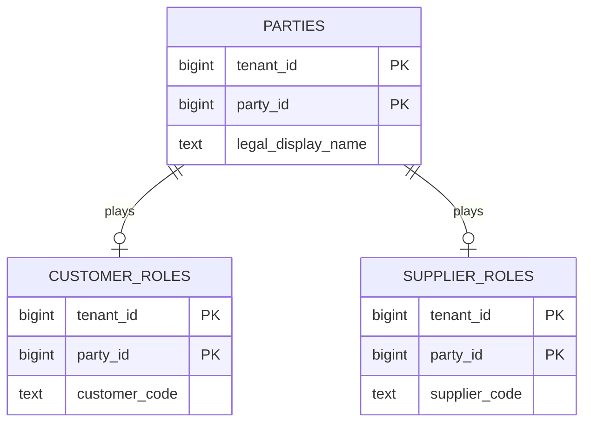
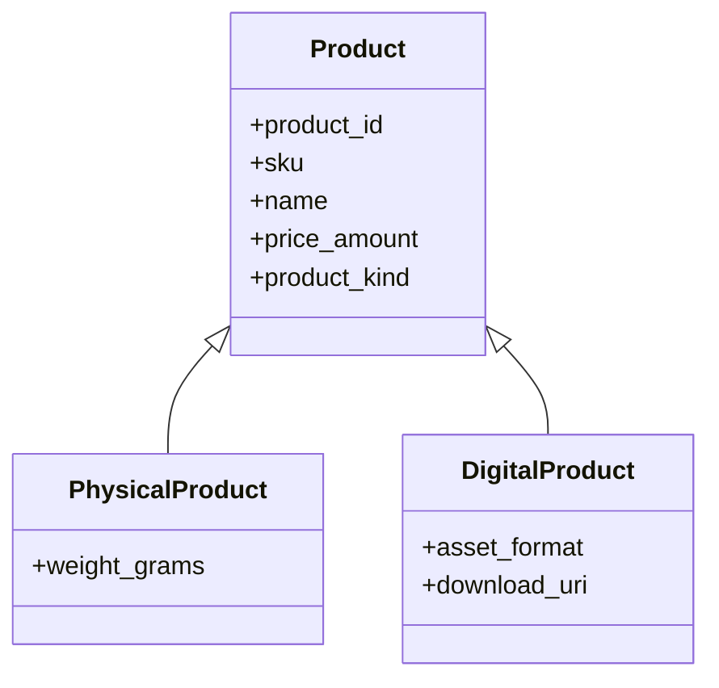

# Avoiding Inheritance Just to Reuse a Few Attributes

When designing databases, it is common to hear the argument: "`Customer` and `Supplier` both have `name`, `email`, and `phone`, so let's create a parent `Contact` table and have both inherit from it." This argument spots similarities in **column structure**, yet fails to prove the two entity types share **identity, business meaning, and invariants**.

**Inheritance** (*supertype/subtype* or *generalization/specialization*) is a **conceptual modeling** decision: every instance of a child type is also an instance of the parent type (*is-a*), shares the same identity, and obeys shared rules. Inheritance should not be introduced merely because two tables share a few fields, or to avoid writing a few lines of DDL.

This lesson belongs to the **Inheritance and Hierarchies** chapter of **DATABASE_DATA_MODELING**, aiming to turn business requirements into verifiable entities, relationships, constraints, keys, and physical schemas. It distinguishes inheritance from ownership, association, and role relationships; illustrates when to keep two independent entities, when to use a shared identity, and when a supertype/subtype model genuinely helps. Examples use PostgreSQL 15+; conceptual principles also apply to document, graph, and analytical models.

## 1. The Problem: Matching Column Names Do Not Mean the Same Entity Type

Suppose a commerce system has two objects:

| Attribute | Customer (`Customer`) | Supplier (`Supplier`) |
|---|---|---|
| Business code | `customer_code` | `supplier_code` |
| Name | `display_name` | `legal_name` |
| Contact email | `contact_email` | `contact_email` |
| Contact phone | `contact_phone` | `contact_phone` |
| Status | `ACTIVE` / `BLOCKED` | `ONBOARDING` / `APPROVED` / `SUSPENDED` |
| Specific rules | Credit limit, price tier | Sourcing approval, payment terms |
| Lifecycle | Registration, activity, termination | Evaluation, contracting, cessation of supply |

The similarity: both need a name and contact info. The difference: **why a row exists**, when rows are created/deleted, who can edit them, which constraints govern them, and which objects reference them.

Two business possibilities must be clarified:

- **Possibility A — two independent entities:** an online store customer is a buyer account; a supplier is a contract with an enterprise. Codes, lifecycles, and governance permissions are separate. There is no business-meaningful shared identity. Overlapping contact columns are insufficient reason to create a supertype.
- **Possibility B — the same legal party holds multiple roles:** one organization with a unique system identifier can both buy and supply goods. Then a `Party` entity carries the shared identity; `CustomerRole` and `SupplierRole` carry the relationships/roles. The reason is **shared principal identity**, not a trick for reusing columns.

You cannot pick A or B from a column diagram alone. You must ask the business owner **whether a customer and a supplier can be the exact same party**, who adjudicates that identity, and how transactions, permissions, and history would change if two profiles were merged.

### Type Inheritance Differs from Data Hierarchies

A category tree `Electronics → Phones → Android` describes **parent-node–child-node** relationships among records. `Android` is a category sitting under `Phones`, not necessarily a special *table type* inheriting columns from a `Phones` table. Conversely, `PhysicalProduct` and `DigitalProduct` can be two **product types** sharing the `Product` identity. Do not confuse data hierarchy relationships (`parent_id`) with type inheritance (`supertype/subtype`).

## 2. Distinguishing Five Commonly Confused Relationships

| Relationship | Diagnostic question | Example | Common representation |
|---|---|---|---|
| **Is-a** (*is a kind of*) | Must every child object also be a parent object, with the same identity? | Physical product is a kind of product | Supertype/subtype, discriminator, 1–1 keyed relation |
| **Has-a** (*has/owns*) | Does object A have a component or asset B? | Customer has shipping addresses | 1–N/1–1 FK, dependent table, embedded document |
| **Plays-a-role** (*acts in capacity*) | Can one principal hold one or more roles changing over time? | Company is both a customer and a supplier | Identity entity + role/association table |
| **References** (*links to*) | Does A need to link to B without sharing identity? | Order references customer | Foreign key, association relationship |
| **Shares-a-value-shape** (*same value structure*) | Do two places share a data structure without sharing a lifecycle? | Address consisting of street, city, country | Value object, domain, data type, validation convention |

A warning sign: if the parent table's name is merely an abstract term like `HasNameAndEmail`, `Contactable`, `BaseRecord`, or `CommonFields` and **no business requirement** ever mentions objects of that parent type, the model is very likely optimizing for column reuse as its primary goal.

A valid parent type usually has **independent identity and business meaning**: you can say "this product has ID P100", query all products, attach price or selling status at the product level, and state rules applying to every product kind. If nobody needs the parent type to exist as a business concept, question adding it.

## 3. Five Tests Before Choosing Inheritance

### 3.1. Test the Statement "Every X Is a Y"

Try stating: "Every `DigitalProduct` is a `Product`." This may hold true in domain language. Yet "Every `Supplier` is a `Customer`" is clearly false. "Every `Supplier` is a `Contactable`" might be technically true without carrying any identity semantics worth managing.

Do not rely solely on class names in source code. Saying `A extends B` in a programming language does not prove `A is-a B` in business data.

### 3.2. Test Stable Identity

Does a child instance use **the exact key of the parent instance**? Can you reference a `Product` without knowing whether it is physical or digital? If it switches types, is the product identity preserved? If two child types genuinely have two independent identities, the link between them may be association or ownership, not inheritance.

For example, an organization that is simultaneously a buyer and a supplier can have **one `party_id`** with two roles. Conversely, a "buyer account" and a "supplier contract" might belong to the same organization yet still be **two distinct business entities**, each with its own ID, linking to the same organization when needed.

### 3.3. Test Shared Rules and Shared Queries

A supertype is strong when it carries **commonly enforced constraints**: unique product identity, selling price, publication status, tenant ownership, creation timestamp, and references from orders. If the parent table holds only `name` and `created_at`, you are very likely adding joins and complexity just to reduce syntactic repetition.

Ask further: is there a real query or relationship for "all `Product`s", such as `order_items.product_id` pointing to every product type? Without a shared access path, the value of a supertype drops sharply.

### 3.4. Test Lifecycle Boundaries

Are a parent record and a child record created, updated, deactivated, transitioned, or deleted as **one logical object**? If the two records have different owners, permissions, and approval workflows, merging their identities can make constraints difficult to enforce.

Each child variant must be evaluated for whether it can exist when the parent does not exist. Under true inheritance, a child object **has no meaning** without its corresponding parent object.

### 3.5. Test Classification Rules

Once a supertype exists, you must answer:

- **Disjoint or overlapping?** Can an object belong to two subtypes simultaneously?
- **Total or partial?** Must every parent object belong to at least one subtype?
- **Can the type change over time?** If so, is switching types a status update or creating a new record? How is old specialized data handled?
- **Can formal relationships reference the parent?** For example, `order_items` pointing to `products` rather than forcing two separate FK types.

The answers decide whether to use one table, multiple tables, or no inheritance at all.

## 4. The Right Approach When Entities Only Share a Few Attributes

If customers and suppliers have independent identities, the system can keep **two clear tables**:

```sql
-- PostgreSQL 15+, simple example for two independent entities.
CREATE TABLE customers (
    customer_id BIGINT GENERATED ALWAYS AS IDENTITY PRIMARY KEY,
    customer_code TEXT NOT NULL UNIQUE,
    display_name TEXT NOT NULL,
    contact_email TEXT,
    status TEXT NOT NULL DEFAULT 'ACTIVE',

    CONSTRAINT ck_customer_code CHECK (btrim(customer_code) <> ''),
    CONSTRAINT ck_customer_name CHECK (btrim(display_name) <> ''),
    CONSTRAINT ck_customer_status
        CHECK (status IN ('ACTIVE', 'BLOCKED'))
);

CREATE TABLE suppliers (
    supplier_id BIGINT GENERATED ALWAYS AS IDENTITY PRIMARY KEY,
    supplier_code TEXT NOT NULL UNIQUE,
    legal_name TEXT NOT NULL,
    contact_email TEXT,
    onboarding_state TEXT NOT NULL DEFAULT 'PENDING',

    CONSTRAINT ck_supplier_code CHECK (btrim(supplier_code) <> ''),
    CONSTRAINT ck_supplier_legal_name CHECK (btrim(legal_name) <> ''),
    CONSTRAINT ck_supplier_state
        CHECK (onboarding_state IN ('PENDING', 'APPROVED', 'SUSPENDED'))
);
```

Two `contact_email` columns sharing the same data type **do not create a broken invariant**. You can standardize a "nullable contact email" definition, normalization, and validation in the application layer or via an SQL domain if the rules are genuinely identical. Do not create a supertype just to save two columns.

The advantage here is each table easily places the right constraints and permissions; suppliers have their own approval workflow while customers have their own blocking status. The trade-off is maintaining two sets of contact fields and writing `UNION ALL` queries if both groups ever need to be viewed together.

### Reuse *Values* or Rules, Do Not Default to Reusing *Identity*

There are many ways to avoid duplicating logic without creating data inheritance:

- **Shared values:** shared phone-validation libraries, string normalization, date/money types, UI form components, or API schemas for `Address`. An application-level value object can reuse structure without equating customer and supplier IDs.
- **Lookup tables:** if both tables reference the same country, currency, or timezone codes, use `countries`/`currencies` tables with proper foreign keys. That is linking to **reference data**, not inheritance.
- **Dependent entities:** if customers have multiple shipping addresses, use `customer_addresses` with a `customer_id` FK. Suppliers have warehouse addresses; use a warehouse or address table tied to `supplier_id` matching its lifecycle. Do not force both into an "every address of everything" table if FKs cannot be protected.
- **Shared definitions:** an SQL domain or migration convention can unify column value ranges. Still, sharing an SQL type does not prove two columns share the same business policy.

For instance, if two fields share the exact domain "mandatory non-blank string", PostgreSQL can use a domain for **one specific value policy**:

```sql
CREATE DOMAIN nonblank_label AS TEXT
    CHECK (VALUE IS NOT NULL AND btrim(VALUE) <> '');
```

Using a domain on a column still requires checking `NOT NULL` requirements, DBMS support, and policy-evolution flexibility; domains do not replace keys, relationships, or contextual constraints. If legal names and display names have different length, normalization, and history rules, do not bind them too tightly to one domain merely because both are "names".

### Beware of Fake Polymorphic Links

A common attempt to "reuse" a contact table is:

```sql
-- Illustrative design to review, NOT recommended DDL:
-- contact_records(owner_type, owner_id, email)
-- owner_type = 'CUSTOMER' or 'SUPPLIER'
```

The pair `(owner_type, owner_id)` is not a normal FK capable of conditionally pointing to two different parent tables. Without dedicated mechanisms, the system can store `owner_type = 'CUSTOMER'` while `owner_id` only exists in `suppliers`, or nowhere at all. For real referential integrity, consider per-type child tables, junction tables with explicit FKs, or a shared `Party` **when shared identity is meaningful**.

## 5. When Shared Identity Exists: One Principal, Multiple Roles

Now change **exactly one business assumption**: the same company can both buy products and supply products, and the system wants one principal code shared across contracts, legal profiles, access controls, and reporting.

We can design:



`Party` is the principal with stable identity. `CustomerRole` and `SupplierRole` are roles **that can coexist simultaneously**. This is not a disjoint hierarchy of "customer or supplier"; a party can be both or currently hold neither role.

```sql
CREATE TABLE parties (
    tenant_id BIGINT NOT NULL,
    party_id BIGINT GENERATED ALWAYS AS IDENTITY,
    legal_display_name TEXT NOT NULL,
    contact_email TEXT,

    CONSTRAINT pk_parties PRIMARY KEY (tenant_id, party_id),
    CONSTRAINT ck_party_name CHECK (btrim(legal_display_name) <> '')
);

CREATE TABLE customer_roles (
    tenant_id BIGINT NOT NULL,
    party_id BIGINT NOT NULL,
    customer_code TEXT NOT NULL,
    credit_limit NUMERIC(14, 2) NOT NULL DEFAULT 0,

    CONSTRAINT pk_customer_roles PRIMARY KEY (tenant_id, party_id),
    CONSTRAINT uq_customer_code UNIQUE (tenant_id, customer_code),
    CONSTRAINT fk_customer_role_party
        FOREIGN KEY (tenant_id, party_id)
        REFERENCES parties (tenant_id, party_id)
        ON DELETE RESTRICT,
    CONSTRAINT ck_customer_role_code
        CHECK (btrim(customer_code) <> ''),
    CONSTRAINT ck_credit_limit CHECK (credit_limit >= 0)
);

CREATE TABLE supplier_roles (
    tenant_id BIGINT NOT NULL,
    party_id BIGINT NOT NULL,
    supplier_code TEXT NOT NULL,
    approved_at TIMESTAMPTZ,

    CONSTRAINT pk_supplier_roles PRIMARY KEY (tenant_id, party_id),
    CONSTRAINT uq_supplier_code UNIQUE (tenant_id, supplier_code),
    CONSTRAINT fk_supplier_role_party
        FOREIGN KEY (tenant_id, party_id)
        REFERENCES parties (tenant_id, party_id)
        ON DELETE RESTRICT,
    CONSTRAINT ck_supplier_role_code
        CHECK (btrim(supplier_code) <> '')
);
```

One `(tenant_id, party_id)` can have rows in **both** role tables. The principal's name and email are stored once because they are defined as data of **the same principal**, not because an ORM tool wants class inheritance.

Such a model brings responsibility for **identity resolution**: two profiles with the same email are not necessarily one party; two organizations with the same name are not necessarily one legal entity. If merged mistakenly, every relationship through `party_id` is affected. Merge, split, permission-transfer, and identity-audit procedures must be defined.

Also distinguish **roles** from **intrinsic subtypes**. `CustomerRole` is a relationship a party can acquire or drop; `Person` and `Organization` may be two principal types with distinct attribute sets and invariants. A party model can still use real subtypes when justified, without forcing every role to become an inheritance class.

### When Should You Not Create `Party`?

If buying and selling organizations are managed by two separate systems with no reliable way to reconcile identities, `Party` can become a dumping ground forcing mismatched concepts together. Then two separate tables with a "confirmed same legal entity" link are clearer than a fake supertype. Base the decision on identity semantics, governance, and authoritative sources.

## 6. Genuine Inheritance Case: Physical Products and Digital Products

Consider a different requirement where `PhysicalProduct` and `DigitalProduct` **are both `Product`s**:

- Every product has an ID, SKU, name, price, and selling status; orders can reference a product regardless of variant.
- Physical products need weight for shipping calculations; digital products need asset format and delivery URI.
- A product belongs to **exactly one** of the two types at a time (*disjoint*).
- Creating a product in the **DRAFT** state before entering specialized data may be allowed; prior to **PUBLISHED**, the product type must be confirmed complete.

The difference between the two subtypes is **meaning and invariants**, not merely the pair of columns `weight_grams` and `download_uri`. We can define a `Product` supertype with shared identity and shared rules, alongside subtypes holding specialized data.



The diagram expresses object **types** without mandating how they map to tables. Putting them in two child tables or one single table is a physical design step.

### Class-Table Inheritance Model with Child Key = Parent Key

```sql
CREATE TABLE products (
    product_id BIGINT GENERATED ALWAYS AS IDENTITY,
    sku TEXT NOT NULL,
    product_name TEXT NOT NULL,
    price_amount NUMERIC(14, 2) NOT NULL,
    product_kind TEXT NOT NULL,

    CONSTRAINT pk_products PRIMARY KEY (product_id),
    CONSTRAINT uq_product_sku UNIQUE (sku),
    CONSTRAINT uq_product_id_kind UNIQUE (product_id, product_kind),
    CONSTRAINT ck_product_name CHECK (btrim(product_name) <> ''),
    CONSTRAINT ck_product_price CHECK (price_amount >= 0),
    CONSTRAINT ck_product_kind
        CHECK (product_kind IN ('PHYSICAL', 'DIGITAL'))
);

CREATE TABLE physical_products (
    product_id BIGINT PRIMARY KEY,
    product_kind TEXT NOT NULL DEFAULT 'PHYSICAL',
    weight_grams NUMERIC(12, 2) NOT NULL,

    CONSTRAINT ck_physical_kind
        CHECK (product_kind = 'PHYSICAL'),
    CONSTRAINT ck_physical_weight
        CHECK (weight_grams > 0),
    CONSTRAINT fk_physical_product
        FOREIGN KEY (product_id, product_kind)
        REFERENCES products (product_id, product_kind)
        ON DELETE CASCADE
);

CREATE TABLE digital_products (
    product_id BIGINT PRIMARY KEY,
    product_kind TEXT NOT NULL DEFAULT 'DIGITAL',
    asset_format TEXT NOT NULL,
    download_uri TEXT NOT NULL,

    CONSTRAINT ck_digital_kind
        CHECK (product_kind = 'DIGITAL'),
    CONSTRAINT ck_digital_format
        CHECK (btrim(asset_format) <> ''),
    CONSTRAINT ck_digital_uri
        CHECK (btrim(download_uri) <> ''),
    CONSTRAINT fk_digital_product
        FOREIGN KEY (product_id, product_kind)
        REFERENCES products (product_id, product_kind)
        ON DELETE CASCADE
);
```

These constraints carry the following semantics:

1. Primary key `products.product_id` is the shared identity; each child table uses that exact `product_id` as its primary key, allowing at most one matching variant row.
2. `(product_id, product_kind)` on the child table references the parent's matching unique key. `CHECK` locks `product_kind` in the child table; you cannot create a `physical_products` row for a parent row with `product_kind = 'DIGITAL'`.
3. With two types and a single-valued discriminator, one parent row cannot simultaneously have **two different child table rows** when all FKs are enforced. This is how disjointness is protected in the example.
4. The `products` table **can still have rows without child rows**. Foreign keys from child to parent cannot force a parent to have at least one child. The DDL expresses **classification not yet mandatory across all states** (*partial specialization regarding child record presence*), even though `product_kind` is chosen.
5. `ON DELETE CASCADE` on child tables is a choice for this example: deleting a product deletes its variant data. Check order, history, and payment relations before using physical cascades in production.

A transaction creating a physical product along with specialized data:

```sql
BEGIN;

WITH created AS (
    INSERT INTO products
        (sku, product_name, price_amount, product_kind)
    VALUES
        ('LAPTOP-01', 'Laptop 14 inch', 15990000.00, 'PHYSICAL')
    RETURNING product_id
)
INSERT INTO physical_products (product_id, weight_grams)
SELECT product_id, 1350.00
FROM created;

COMMIT;
```

In production, do not rely on the application always remembering to insert both rows if the invariant is "every published product must have a valid subtype". You can allow incomplete products in `DRAFT`, and then allow **transitioning to `PUBLISHED` only through a transactional gate** that verifies existence of the matching child row; or use carefully designed triggers/deferred constraints. A PostgreSQL `CHECK` on `products` is not allowed to query a child table to enforce that condition directly.

### Common Queries and Specialized Queries

An order containing any product needs only `product_id` and an FK to `products`; that is the payoff of a business-meaningful shared identity.

```sql
-- Common query:
SELECT product_id, sku, product_name, price_amount, product_kind
FROM products
WHERE sku = 'LAPTOP-01';

-- Query needing specialized attributes of physical products:
SELECT p.product_id, p.product_name, ph.weight_grams
FROM products AS p
JOIN physical_products AS ph
  ON ph.product_id = p.product_id
WHERE p.product_kind = 'PHYSICAL';
```

If every screen must retrieve full details of every type, a multi-table model incurs joins or multiple queries. That is a **real cost** to weigh against constraint and type-separation benefits. Meaningful inheritance can still be mapped to **a single table** when physically more appropriate.

## 7. Three Strategies for Mapping Inheritance to Tables

Supertype/subtype design belongs to the conceptual or logical model; choosing a storage strategy is a separate decision.

| Strategy | Structure | Advantages | Trade-offs |
|---|---|---|---|
| **Single-table inheritance** | One table holding all shared and specific columns; a `type` discriminator column | Simple queries across all types, no subtype joins | Specific columns may have many `NULL`s; complex `CHECK`s with many types |
| **Class-table inheritance** / joined strategy | Shared parent table and one table per subtype; child key is FK to parent key | Clearer separation of data domains and subtype constraints; convenient parent references | Joins for specialized data, multi-table create/delete, hard to enforce total specialization |
| **Concrete-table inheritance** / table-per-concrete-type | Each concrete type has an independent table including shared fields | Direct per-type queries, clear per-table constraints | Duplicated columns and rules, hard to have one FK to "all products"; `UNION ALL` for querying all |

Strategy names in frameworks/ORMs may vary, and not every strategy is supported equally by every framework. Never decide a schema solely from an ORM's class generation or annotations.

### 7.1. Single Table with Type-Based Constraints

If there are only a few stable subtypes, one table can be clear enough:

```sql
CREATE TABLE product_one_table (
    product_id BIGINT GENERATED ALWAYS AS IDENTITY PRIMARY KEY,
    sku TEXT NOT NULL UNIQUE,
    product_kind TEXT NOT NULL,
    name TEXT NOT NULL,
    price_amount NUMERIC(14, 2) NOT NULL,
    weight_grams NUMERIC(12, 2),
    asset_format TEXT,
    download_uri TEXT,

    CONSTRAINT ck_product_one_table_name CHECK (btrim(name) <> ''),
    CONSTRAINT ck_product_one_table_price CHECK (price_amount >= 0),
    CONSTRAINT ck_product_one_table_variant CHECK (
        (
            product_kind = 'PHYSICAL'
            AND weight_grams IS NOT NULL AND weight_grams > 0
            AND asset_format IS NULL AND download_uri IS NULL
        )
        OR
        (
            product_kind = 'DIGITAL'
            AND weight_grams IS NULL
            AND asset_format IS NOT NULL AND btrim(asset_format) <> ''
            AND download_uri IS NOT NULL AND btrim(download_uri) <> ''
        )
    )
);
```

This is an **alternative physical model** to class-table above; do not create both `products`/child tables and `product_one_table` as two independent sources of truth for the same products.

The `CHECK` constraint uses `IS NOT NULL` explicitly to avoid `UNKNOWN` slipping through under SQL three-valued logic. However, this table **requires subtype info immediately at row creation**; it does not support a draft state lacking specialized data like the previous example. If the business needs `DRAFT`, adapt the invariants by status and design an appropriate publishing gate rather than simply dropping `CHECK`.

A single table avoids joins yet can bloat if subtypes multiply and each carries dozens of fields. Conversely, a few intentional `NULL` fields do not automatically mean poor normalization; evaluate real values and per-type constraints.

### 7.2. Class-Table Is Only Worth Using When It Protects Something

Splitting child tables pays off when variants genuinely have many distinct attributes, relationships, and rules; when they need independent querying; or when objects sharing an ID are referenced by many workflows.

If `DigitalProduct` differs from `PhysicalProduct` by only one flag and one column without distinct rules, using three tables adds extra transactions, joins, and risk of missing subtypes. That is why mapping choices must rest on **data types, workload, and invariants**, not a goal of "one table per class".

### 7.3. Concrete-Table and the Reference Problem

If `physical_products` and `digital_products` are two independent tables with no `products` table, `order_items.product_id` cannot have **one standard FK** automatically pointing to "either of the two tables". You may need a `product_registry` table holding shared identity, type conditions, or two separate order-line types. Creating `owner_type`/`owner_id` and dropping FKs weakens referential integrity.

Concrete-table fits better when each type has an independent lifecycle and combined queries are rare, or when shared identity is not required by the business. Once again, **the meaning of identity** decides whether a supertype is needed.

## 8. Recognizing Hidden Costs of Unnecessary Inheritance

When creating a fake parent table just to reuse `name` and `email`, systems typically incur these problems:

**More relationships and writes.** Creating one customer requires inserting into `common_entities` and `customers` in the same transaction. Deletes/updates must handle both tables, decide cascade/restrict behavior, and clean up business-orphaned parent rows.

**Extra joins and tangled links.** A feature needing only customer email must now also read the parent table. Every report must understand whether the parent is a real object or merely an attribute container.

**Hard to express mandatory subtypes.** Child → parent FKs protect "no child without a parent", yet **do not protect "no parent without a child"**. If the parent table has no independent meaning, parent rows without subtypes are bugs created by the model itself.

**Incomplete type enforcement.** If child tables point to one parent without proper discriminators/constraints, one parent row can simultaneously hold multiple subtypes against business rules. Conversely, if roles are allowed to overlap, disjoint constraints break valid cases.

**Wrong deletion and security boundaries.** A parent table linking multiple entities can cause removing contact info for a supplier role to accidentally affect customer data; row-level authorization becomes hard to reason about.

**Harder schema evolution.** Changing `email` rules for customers without applying them to suppliers can turn an overly generic domain/parent table into a deployment bottleneck. Adding another subtype just because two columns matched amplifies the problem.

**Duplicated meaning or hard merges.** If two entities genuinely belong to one principal yet are carelessly separated, two addresses can drift out of sync. If they do not share an identity yet are merged, updating one side corrupts the other. Both extremes stem from failing to ask about **identity and data ownership**.

Fewer tables are not automatically better; fewer duplicated columns are not the supreme goal either. A good model expresses invariants accurately and provides stable reads/writes at reasonable cost.

## 9. Constraints to Verify If Choosing Supertype/Subtype

A design with inheritance must state clearly what is permitted and what is forbidden.

| Invariant to consider | Representation | Limitations to recognize |
|---|---|---|
| Each subtype has exactly one existing parent | Child PK is also FK to parent | Does not enforce parent → child direction |
| One parent has at most one row in each child table | PK on `product_id` in child table | Does not ensure subtypes are disjoint |
| Cannot simultaneously belong to disjoint subtypes | Discriminator on parent + composite FK to type; or suitable check mechanism | Must examine all write paths, type switches, and legacy data |
| Every parent has a subtype if policy mandates | Create/publish gate, transaction, trigger, or auxiliary constraint | Child → parent FK cannot express total specialization |
| Subtype attributes are mandatory | `NOT NULL`, `CHECK` on child table; type-conditional constraint if single table | `CHECK` only rejects `FALSE`; handle `NULL` explicitly |
| Types share one common ID | PK on parent; external FKs point to parent | Must define whether a product is valid before having a subtype |
| One principal holds multiple concurrent roles | Independent role tables with PK/FK to `Party` | Do not place an exclusive discriminator if roles overlap |
| Consistent deletion or deactivation | Cascade/restrict rules, transactions, and status | Business history may require retaining rows instead of deleting |

### Total, Partial, Disjoint, and Overlapping

Separate the two classification axes instead of using one vague word "inheritance":

| | **Disjoint** — at most one type | **Overlapping** — multiple types possible |
|---|---|---|
| **Total** — at least one type required | Every finalized product is *physical or digital*, exactly one type | A principal must hold at least one role yet may hold multiple roles |
| **Partial** — may have no type yet | Draft product before specialized data is entered | Identity-verified party not yet participating in any role |

Note that "a mandatory `product_kind` column having a value" **does not equate to** "all required subtype rows exist". Those two conditions differ in a multi-table schema. If the app permits drafts, you can keep **partial rules regarding specialized data** in `DRAFT` and require **total when `PUBLISHED`**. Invariant statements must specify status and timing.

### Sequence of Operations for Type Transitions

If a digital product is converted into physical, changing `product_kind` in the parent table without handling child tables will normally be rejected by composite FKs or leave inconsistent data. Treat it as an **explicit business command** with transactions, required-field validation, permissions, and history. In some domains, switching types is disallowed and a new product must be created; that decision belongs to the business.

## 10. Using Inheritance in ORMs and PostgreSQL Table Features

An ORM may let developers declare:

```java
// Illustrates the idea, NOT a complete mapping snippet.
class Customer extends BaseContact { /* ... */ }
class Supplier extends BaseContact { /* ... */ }
```

Yet there are three very different things:

1. **Source-code inheritance** to reuse methods, validation, or data structures.
2. **Supertype/subtype relationship in the conceptual model** to represent is-a and shared identity.
3. **Storage strategy** chosen by the ORM when mapping classes to tables.

Do not infer (2) or (3) from (1). A base class for sharing code can be marked *mapped superclass* or implemented as a value object in an ORM, depending on the framework; it is not necessarily an entity with its own table/ID. Conversely, a relational model can have a clear supertype without requiring class inheritance in application code.

PostgreSQL has `CREATE TABLE child (...) INHERITS (parent)`, yet that is **PostgreSQL's table inheritance mechanism**, not an automatic replacement for 1–1 PK/FK supertype/subtype modeling. Limitations around primary keys, unique constraints, foreign keys, indexes, and query behavior between parent/child tables must be verified for your PostgreSQL version. Do not use `INHERITS` simply because a diagram has an inheritance arrow. Similarly, **partitioning** splits data for scale/manageability and does not carry the same business semantics as subtypes.

## 11. Comparing Across Document, Graph, and Analytical Models

The question "attributes overlap, but is it the same entity?" appears in every storage paradigm:

| Technology | Common representation | Risks if merged wrongly |
|---|---|---|
| **Relational** | Separate tables, parent + child tables, single table with discriminator, role tables | Weak/missing FKs, extra joins, and hard-to-guard nullability rules |
| **Document** | Per-type documents with some similar fields; or shared document with `kind` and varying shapes | Overly polymorphic documents, complex schema validation, hard-to-control type changes |
| **Graph** | `Party` node and role edges; labels/properties for different types | One node merged from independent identities, wrong inherited permission links |
| **Analytical** | Shared dimension when identity keys align; separate or role-playing dimensions per business | Wrong grain merges, double counting, lost history, or misclassifications |

### Document: No Need for a Parent Document Just to Share a Few Fields

For example, `CustomerDocument` and `SupplierDocument` both have `contact.email`. Schema validation can reuse a sub-schema definition at the tooling layer, while actual data remains two collections or two distinct document types. Use one `"entities"` collection with `kind` only when shared identity, search, permissions, and lifecycle are genuinely needed—and design per-type validation constraints alongside it.

If an organization holds two roles sharing one legal profile, you can store `party` separately and reference/embed roles per access patterns, while weighing concurrent updates and engine referential integrity.

### Graph: Role Edges Differ from Type Inheritance

An `Organization` node has an `:IS_CUSTOMER_OF` edge to a store and a `:SUPPLIES_TO` edge to that same store. Those are **two business relationships**, not necessarily two disjoint subtypes. If a real `Person` and `Organization` classification exists, use labels and constraints per type depending on the graph database. Do not assume the engine automatically enforces all is-a invariants.

### Analytics: Watch Grain and Time

A shared `Party` dimension can be useful for reports like "same legal entity both buying and selling", but only when `party_id` keys are properly governed. In a fact table, `customer_party_id` and `supplier_party_id` can be two **role-playing references** to the same dimension, not collapsed into one column just because "both are parties".

If roles change over time, prior-period reports may need to know which role a party **held at transaction time**. An overwritten `current_role` column fails historical requirements. Consider versioned dimensions, effective-dated tables, or periodic snapshots. Reusing dimensions at the wrong grain causes double counting or misattributed metrics.

## 12. Matrix for Choosing a Model by Requirements

| Confirmed scenario | Option to evaluate first | Why |
|---|---|---|
| Two types share only a few fields, differing IDs and lifecycles | **Two independent entities** | Preserves true identity and constraints; column overlap is intentional |
| Two types share an address structure without sharing identity | **Value object / dependent structure / shared validation** | Reuses value rules without creating a fake parent |
| One principal holds multiple concurrent roles needing one system-wide ID | **Party + role tables** | Shared identity, roles can overlap |
| One entity genuinely has disjoint variants frequently queried together | **Supertype/subtype**, consider single or multiple tables | Protects shared identity and invariants |
| Variants have few columns, few specific relations, stable types | **Single table + discriminator + CHECK** | Simple queries, avoids unnecessary subtype joins |
| Variants have many specific fields/relations and specialized lifecycles | **Parent table + child tables** if sharing identity | Enforces specific domains, reduces many optional columns |
| Completely independent entity types rarely queried together | **Independent concrete tables** | No need for an unused parent identity |
| Multiple parents in a data hierarchy | **Edge table / graph** | DAG/graph problem, distinct from type inheritance |

This matrix is a starting guide. Cross-check against business rules before writing migrations or turning on ORM inheritance mappings.

## 13. Counterexample Testing to Verify Model Correctness

The design must be verified with **cases capable of exposing wrong identity decisions**:

| Scenario | Expected outcome |
|---|---|
| Independent customer and supplier share the same contact email | Do not auto-merge IDs or infer the same principal |
| One party is granted both customer and supplier roles | Succeeds if business permits overlapping |
| One party has no roles yet | Allowed or blocked **per chosen policy**, not guessed |
| A `physical_products` row uses a `product_id` of a `DIGITAL` product | Rejected by composite FK/discriminator |
| A physical product has `weight_grams <= 0` | Rejected by `CHECK` |
| A digital product lacks `download_uri` | Rejected by `NOT NULL` or `CHECK` per schema |
| A parent product row has no subtype row | Allowed under current class-table DDL; if publishing requires a subtype, add explicit gate control |
| Two child tables of different types use the same `product_id` in a disjoint design | Must not exist if discriminator and FKs are enforced |
| An order references a product not yet eligible for sale | Must be rejected by business workflow; FK only checks product existence |
| Changing `product_kind` while old subtype row still exists | Must not leave contradictory type relations; handle as an explicit business transition |
| Removing supplier role from a party that remains a customer | Must not delete party and customer data if policy preserves them |
| Merging two parties discovered to be the same identity | Must reconcile keys/relations, permissions, and history; not merely edit names |

If a test case succeeds only because the application happens to remember to insert the child table while the database cannot enforce a condition the team claims is "always true", document explicitly **which write gate, transaction, authorization, or auxiliary mechanism** protects that invariant. Separate business promises from actual DDL constraints in place.

## 14. Step-by-Step Design Workflow

### Step 1: Write the Business Story and Define Identity

Document each entity: why it exists, creation/closing events, business keys, owners, allowed editors, and referencing tables. Specifically ask "can these two profiles represent the same real-world object?" and "if yes, is the system responsible for managing a single shared ID?".

### Step 2: Classify Relationships

Label is-a, has-a, plays-role, references, or merely shared value shapes. Test the statement "every X is a Y", determine whether IDs are shared, and whether roles can appear concurrently or change independently.

### Step 3: List Invariants by Level

Group **shared** constraints (`product_id`, `sku`, `price_amount`) and **specific** constraints (`weight_grams`, `download_uri`). Specify disjoint/overlapping, total/partial, type policies, state-transition conditions, and deletion policies. Do not stop at a list of matching columns.

### Step 4: Choose Conceptual Model First, Mapping Second

Consider supertype/subtype only when a meaningful is-a relationship exists. Then pick single-table, class-table, or concrete-table based on access patterns, constraints, and data volume. Never let ORM features dictate business semantics.

### Step 5: Write Counterexamples and Check Enforcement Mechanisms

Test accidentally merging two people sharing an email, overlapping roles, mismatched discriminator subtypes, parents lacking children, and deletes/type changes. For multi-table models, specify transactional creation and state-transition operations along with conditions that one-way FKs do not cover.

### Step 6: Evaluate Cost and Evolvability

Measure table count, joins, indexes, rows written per transaction, complexity of adding new subtypes, changing type-specific policies, and historical queries. A design with a few duplicated columns that stays easy to understand with fewer joins can beat an abstract hierarchy forcing every workflow through a parent table.

## 15. Practice Exercise: Customers, Suppliers, and Partners

A platform manages the following objects:

- `BuyerAccount`: ordering account, has login email, account-locking policy.
- `SupplierContract`: supplier contract, has legal name, tax ID, effective date, and signatory.
- `DeliveryPartner`: shipping provider, has carrier code and operating region.

All three may have a contact name, email, and phone number. Some delivery partners also sign goods-supply contracts. The system needs to report costs and revenue by **the same legal entity**, without losing contract history.

Answer the following:

1. Should a `Contact` table be created as parent of all three merely due to matching fields? Identify at least three risks.
2. Propose a **legal entity identity** if needed and distinguish it from `BuyerAccount`, `SupplierContract`, and `DeliveryPartner`. Which roles can overlap? Which relationships are *has-a* or *references*?
3. Define primary keys, business keys, and foreign keys; state the policy when two profiles cannot be confirmed as the same legal entity.
4. Design a shared table/relation that genuinely serves legal-entity reporting without wrongly merging account and contract lifecycles.
5. Describe how to store roles/contracts over time for point-in-time queries in the past.
6. Write three test cases for a legal entity acting as both supplier and delivery partner, plus one test case preventing accidentally merging two legal entities sharing an email.
7. If `DigitalProduct` and `PhysicalProduct` are added to the system, choose single-table or class-table and justify via specialized constraints, order queries, join costs, and publishing conditions.

**Acceptance criteria:** inheritance choices rest on shared identity and real is-a relationships; every relationship is protected by clear FKs/constraints; overlapping roles are distinguished from disjoint subtypes; the model never depends on superficial similarity of a few column names.

## 16. Things to Remember

- **Matching columns do not imply inheritance.** Inheritance requires a meaningful *is-a* relationship, shared identity, and shared invariants.
- Distinguish **is-a**, **has-a**, **plays-role**, and **shares-a-value-shape** before designing tables.
- Two independent entities are allowed to share a few attributes. Validation, domains, or value objects can be reused without creating a fake parent table.
- When one principal holds multiple roles, a **Party + roles** model may fit; do not enforce disjointness if roles can overlap.
- Even a genuine supertype/subtype must choose a **physical mapping**: single-table, class-table, or concrete-table. Each option carries different costs and constraint limits.
- Foreign keys from child to parent **do not automatically protect** that every parent has a child. Explicitly describe total/partial and write gates when data is valid only in certain states.
- Choose structures based on **identity, invariants, lifecycle, permissions, queries, and evolvability**, rather than prioritizing eliminating all DDL repetition.
