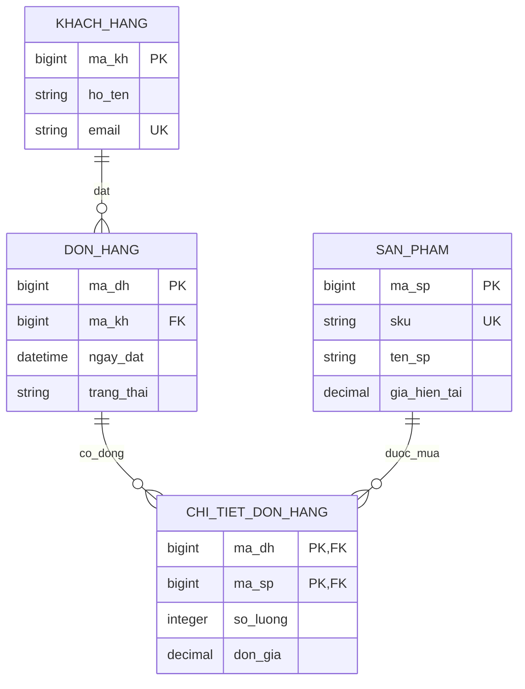

# Relations, Tuples, and Attributes in the Relational Logical Model

## Learning Objectives

The relational model provides a way to express data using **relations**, **tuples**, and **attributes**. It is the foundation for turning business requirements into a verifiable logical schema before deciding on column types, indexes, and storage layout in a specific database management system.

After this lesson, learners will be able to:

1. Distinguish a **relation schema** from a **relation state** and accurately explain relations, tuples, attributes, domains, degree, and cardinality.
2. Represent a business requirement as relations, identify keys, and describe relationships between entities through foreign keys.
3. Recognize data constraints as well as the differences between the theoretical relational model and SQL tables in practice.
4. Read and write basic selection, projection, and join operations; validate a design using sample data and anomaly scenarios.

> **Learning Context:** Within **DATABASE_DATA_MODELING**, the goal is to build the skill of translating business requirements into a clear data model—from entities, relationships, and constraints to normalization, keys, indexes, and physical schemas. This lesson focuses on the **relational logical model**; it provides the foundation for later comparing the relational model with document, graph, and analytical models.

## 1. From Business Requirements to a Logical Model

Consider a simple sales system with the following rules:

- Each customer can place multiple orders; each order belongs to exactly one customer.
- An order can contain multiple products; a product can appear in multiple orders.
- When sold, the unit price on an order line must preserve the price locked in at the time of purchase, even if the product's listed price changes.
- The purchased quantity must be a positive integer; an order must have a valid status.

Looking at an order placement screen, it is easy to picture a single record containing the customer, the order, and the list of products. However, a screen or an object in application code **does not automatically correspond to a single relation**. To express the logic clearly, it can be separated into four relations:

```text
KHACH_HANG(ma_kh, ho_ten, email)
SAN_PHAM(ma_sp, sku, ten_sp, gia_hien_tai)
DON_HANG(ma_dh, ma_kh, ngay_dat, trang_thai)
CHI_TIET_DON_HANG(ma_dh, ma_sp, so_luong, don_gia)
```

Here, `ma_kh` in `DON_HANG` references the customer; `CHI_TIET_DON_HANG` links an order to a product and stores details specific to that purchase. This representation clearly separates data describing an object from data describing an association. The next section explains the formal meaning of the notation above.

## 2. Relations, Relation Schemas, and Relation States

### 2.1. What Is a Relation Schema?

A **relation schema** defines the relation name, its set of attributes, and the domain of each attribute. It can be written as:

\[
R(A_1:D_1, A_2:D_2, \ldots, A_n:D_n)
\]

Where:

- `R` is the relation name, such as `DON_HANG`.
- `A_i` is an attribute name, such as `ma_dh` or `ngay_dat`.
- `D_i` is the valid **domain** of the corresponding attribute.
- `n` is the **degree/arity** of the relation, i.e., the number of attributes.

For example, we can describe the logic as:

```text
DON_HANG(
  ma_dh: MaDonHang,
  ma_kh: MaKhachHang,
  ngay_dat: ThoiDiem,
  trang_thai: {moi, da_thanh_toan, da_huy}
)
```

`MaDonHang`, `MaKhachHang`, and `ThoiDiem` are conceptual domains; they do not yet have to be types like `BIGINT` or `TIMESTAMPTZ`. Choosing SQL data types belongs to the step of mapping from the logical model to the implementation schema.

A **relational database schema** consists of multiple relation schemas along with the constraints among them. It is relatively stable. By contrast, the stored data changes after every insert, update, or delete operation.

### 2.2. What Is a Relation State?

A **relation state** (or *relation instance*) is the set of valid tuples at a given point in time. If `D1, D2, ..., Dn` are the domains, the commonly used mathematical notation is:

\[
r(R) \subseteq D_1 \times D_2 \times \cdots \times D_n
\]

The Cartesian product on the right-hand side contains all possible combinations of values; the relation state on the left-hand side contains only **those tuples that actually exist and satisfy the constraints**. Ordered-product notation serves mathematical representation; in logical meaning, each value is paired with its corresponding **attribute name**, so it does not depend on column display order.

For example, a state of `KHACH_HANG` might be:

| ma_kh | ho_ten | email |
| --- | --- | --- |
| 101 | Nguyễn An | an@example.com |
| 102 | Trần Bình | binh@example.com |

And a state of `DON_HANG` is:

| ma_dh | ma_kh | ngay_dat | trang_thai |
| --- | --- | --- | --- |
| 5001 | 101 | 2026-10-01 | da_thanh_toan |
| 5002 | 101 | 2026-10-02 | moi |
| 5003 | 102 | 2026-10-03 | da_huy |

`DON_HANG` has **degree 4** because it has four attributes, and in this illustrative state it has **cardinality 3** (the *cardinality* of the relation, meaning three tuples). After a new order arrives, the cardinality can become 4, while the degree remains 4 if the schema has not changed.

> **Distinguishing Two Uses of “Cardinality”:** In relational theory, cardinality is the **number of tuples** in a relation. When designing relationships between entities, the term also describes **1–1, 1–N, N–N**. Both meanings relate to counting, but they are not interchangeable.

### 2.3. A “Relation” Differs from a Business “Relationship”

In the *relational model*, `DON_HANG` is a **mathematical relation** representing a set of tuples. In the entity–relationship model, the statement “a customer **places** an order” refers to a **relationship between entities**. When mapped to the relational model, this relationship is typically represented using the foreign key attribute `DON_HANG.ma_kh`.

Therefore, a “relation” does not simply mean a “link between two tables”. Even `KHACH_HANG` standing on its own is a relation in the mathematical sense.

## 3. Tuple: An Event or Object Described by Values

A **tuple** is an element of a relation state. In the example, the tuple for order 5001 can be expressed as a mapping from attribute names to values:

```text
t = {
  ma_dh      ↦ 5001,
  ma_kh      ↦ 101,
  ngay_dat   ↦ 2026-10-01,
  trang_thai ↦ da_thanh_toan
}
```

The value `t[ma_kh] = 101` indicates which customer the order belongs to. A tuple is not merely a row of text displayed in a table: it must conform to the schema's domains and constraints. If `ma_kh = 999` while customer 999 does not exist, the tuple may have valid data types yet **violate referential integrity**.

In the set theory of the classical relational model:

- **No two tuples are completely identical** within the same relation state.
- **There is no default row order**: whether tuple 5001 appears before or after tuple 5002 does not change the relation.
- **There is no logically meaningful attribute order**: changing the display from `ma_dh, ma_kh` to `ma_kh, ma_dh` does not change the content as long as names and values remain properly paired.
- A relation **can be empty**: having zero orders is a valid state if the business rules allow it.

A tuple does not necessarily “represent a physical object”. In `CHI_TIET_DON_HANG`, a tuple represents **the occurrence of a product in an order**, along with the quantity and unit price at the time of purchase.

## 4. Attributes and Domains

### 4.1. An Attribute Expresses a Well-Defined Aspect

An **attribute** is a named component of a schema. Names should help readers understand the business meaning rather than just the technical type. For example:

| Relation | Attribute | Meaning | Illustrative Logical Domain |
| --- | --- | --- | --- |
| `KHACH_HANG` | `ma_kh` | Customer identifier | Valid customer ID |
| `KHACH_HANG` | `email` | Contact email | Email string conforming to system rules |
| `DON_HANG` | `ngay_dat` | Order timestamp | Valid point in time |
| `DON_HANG` | `trang_thai` | Order lifecycle status | `moi`, `da_thanh_toan`, `da_huy` |
| `CHI_TIET_DON_HANG` | `so_luong` | Quantity purchased | Positive integer |
| `CHI_TIET_DON_HANG` | `don_gia` | Locked-in unit price | Non-negative monetary amount |

A **domain** is not identical to an SQL data type. Both `so_luong` and login count might be stored as `INTEGER`, but one belongs to the domain of “positive integers” while the other belongs to “non-negative integers”. `ma_kh` and `ma_dh` might both be `BIGINT`, yet they must not be used interchangeably from a business perspective.

The strictness of a domain should be based on requirements: a non-empty email is one condition, whereas a validly formatted email according to standard syntax is another. A `VARCHAR(254)` constraint only limits length; by itself it does not verify that an email address can actually receive mail.

### 4.2. Atomicity Depends on How the System Uses the Data

In First Normal Form (1NF), an attribute position in a tuple is considered to hold **a single value from the declared domain**, rather than a repeating group that needs to be queried as separate elements. The example below easily causes problems:

```text
DON_HANG(ma_dh, ma_kh, san_pham = "10:2;20:1")
```

The string `"10:2;20:1"` packs multiple product–quantity pairs into a single cell. If you need to inspect individual products, reference `SAN_PHAM`, and calculate line totals, you should use separate tuples in `CHI_TIET_DON_HANG`.

Conversely, **not every string containing delimiters must be split into separate columns**. For instance, a display address can be treated as a single value if the application only stores and prints it verbatim. When the business needs to filter by province or postal code, those components must be modeled explicitly. “Atomicity” is a decision based on semantics and expected operations, not a simplistic rule that data must be a single character or a single number.

### 4.3. Derived Attributes and Historical Attributes

Suppose an order line has `so_luong = 2` and `don_gia = 115000`, making the line total `230000`. This value can be computed from the two base attributes. Also storing `thanh_tien` requires a mechanism to maintain consistency if the quantity or unit price changes.

However, `CHI_TIET_DON_HANG.don_gia` **should not** always be pulled from `SAN_PHAM.gia_hien_tai`: the current price is an attribute of the product, whereas the locked-in unit price is historical data of the sale. The two values have different semantics. This is a case of intentionally storing information that looks redundant in order to preserve the true business event.

## 5. Keys and Constraints: What Makes a State Valid?

A table with the right column names is not enough to make a good data model. You must express **which tuples are allowed to exist** and **how tuples relate to one another**.

### 5.1. Superkeys, Candidate Keys, and Primary Keys

Assume `KHACH_HANG.ma_kh` uniquely identifies a customer, and business rules guarantee that `email` is also unique and non-null:

- A **superkey** is a set of attributes that distinguishes every pair of distinct tuples in every valid state. Both `{ma_kh}` and `{ma_kh, ho_ten}` can be superkeys.
- A **candidate key** is a **minimal** superkey: removing any attribute loses uniqueness. `{ma_kh}` is a candidate key; `{ma_kh, ho_ten}` is not minimal.
- A **primary key** is a candidate key chosen as the main identifier. `ma_kh` can be chosen as the primary key, while `email` serves as another candidate key when the uniqueness rule is genuinely enforced.
- A **composite key** consists of multiple attributes. Under the rule “each product appears at most once in an order”, the pair `{ma_dh, ma_sp}` is a key of `CHI_TIET_DON_HANG`.

You should not infer keys solely from a few sample records. If no two customers currently share a name, `ho_ten` does not automatically become a key. A key must be guaranteed by **a rule holding for all valid future data**.

A natural key like `email` can change over time. A surrogate key like `ma_kh` is usually more stable for referencing; this choice does not preclude declaring `UNIQUE` on email if the system requires it.

### 5.2. Foreign Keys and Referential Integrity

A **foreign key** (FK) is an attribute or set of attributes in a child relation that references a valid key in a parent relation. The links in our example are:

```text
DON_HANG.ma_kh                    → KHACH_HANG.ma_kh
CHI_TIET_DON_HANG.ma_dh          → DON_HANG.ma_dh
CHI_TIET_DON_HANG.ma_sp          → SAN_PHAM.ma_sp
```

With `NOT NULL` foreign keys as in this example, you cannot create `DON_HANG(ma_kh = 999)` when customer 999 does not exist. At the same time, deleting customer 101 while orders 5001 and 5002 still exist requires an explicit policy: **restrict deletion**, **cascade deletion**, or an appropriate transfer rule. Choosing `ON DELETE CASCADE` indiscriminately can wipe out transactional data that must be retained for history.

A foreign key guarantees **the existence of the referenced record**, but it does not automatically enforce every business rule. For example, an FK from order lines to orders does not guarantee that “a paid order must have at least one line”. Rules involving **the existence of child records** or multiple tables usually require transaction logic, triggers, or dedicated enforcement mechanisms.

### 5.3. Types of Constraints to Distinguish

| Type | Question to Answer | Example |
| --- | --- | --- |
| Domain | What values can an attribute take? | `so_luong > 0`; `trang_thai` belongs to the status set |
| Key and uniqueness | Which attributes identify a tuple? | `ma_dh` unique; `(ma_dh, ma_sp)` unique |
| Entity integrity | Does the record have a valid identifier? | Primary key components cannot be `NULL` |
| Referential integrity | Does the FK value point to a valid tuple? | `DON_HANG.ma_kh` exists in `KHACH_HANG` |
| Cross-table / workflow | Is the state across multiple tuples consistent? | A paid order must have line items; do not pay for a canceled order |

A good logical design must state clearly where constraints are enforced. Constraints that can be declared via `PRIMARY KEY`, `FOREIGN KEY`, `UNIQUE`, and `CHECK` should be expressed in the physical schema; constraints requiring transactions or application logic must also be documented, rather than assuming “the table will just know”.

## 6. Representing 1–N and N–N Relationships

In the sales example, one customer can have many orders. The `DON_HANG` relation carries the foreign key `ma_kh` to represent the **1–N** relationship. An order can have many products and a product can appear in many orders, so the **N–N** relationship is resolved into the associative relation `CHI_TIET_DON_HANG`.



The `o{` notation indicates the possibility of **0 or more** records on the many side. The diagram allows a new order to have 0 lines while being drafted; if the business only permits confirming an order that already has products, that is a state-dependent constraint to check upon confirmation. The markers `PK`, `FK`, and `UK` in the diagram denote primary key, foreign key, and unique attribute, respectively.

Illustrative line-item data:

| ma_dh | ma_sp | so_luong | don_gia |
| --- | --- | --- | --- |
| 5001 | 10 | 2 | 115000 |
| 5001 | 20 | 1 | 45000 |
| 5002 | 20 | 3 | 45000 |

Suppose product 10 is currently listed at `120000` and product 20 is listed at `45000`. The total amount for order 5001 must still be `2 × 115000 + 1 × 45000 = 275000`, based on the transaction unit prices recorded in the two detail tuples.

**Assumption to document:** The composite key `(ma_dh, ma_sp)` is appropriate when each product has **only one line in the same order**. If the business allows the same product to appear across multiple lines with different promotions, delivery batches, or options, you must change how lines are identified—for example, adding `ma_dong` or a line sequence number within the order. Key design always depends on business rules, not personal preference in column selection.

## 7. Relational Operations and Query Results

The relational model not only describes how data is stored but also establishes the foundation for **relational algebra**: transformations that take relations as input and produce relations as output.

### 7.1. Selection

The selection operation `σ` retains tuples that satisfy a condition. For example:

\[
\sigma_{\mathrm{trang\_thai} = \text{'moi'}}(DON\_HANG)
\]

With the sample data, the result contains only the tuple for order `5002`. The near-equivalent SQL is:

```sql
SELECT ma_dh, ma_kh, ngay_dat, trang_thai
FROM don_hang
WHERE trang_thai = 'moi';
```

### 7.2. Projection

The projection operation `π` keeps only the selected attributes. For example:

\[
\pi_{\mathrm{ma\_kh}}(DON\_HANG)
\]

In relational algebra under set semantics, the result consists of two single-attribute tuples containing `101` and `102` — `101` is not repeated even though that customer has two orders. To get this set semantics in SQL, use `DISTINCT`:

```sql
SELECT DISTINCT ma_kh
FROM don_hang;
```

### 7.3. Join

Join relations based on a matching condition, such as `DON_HANG.ma_kh = KHACH_HANG.ma_kh`, to answer the question “which customer placed which order?”.

```sql
SELECT dh.ma_dh, kh.ho_ten, dh.trang_thai
FROM don_hang AS dh
JOIN khach_hang AS kh ON kh.ma_kh = dh.ma_kh
ORDER BY dh.ma_dh;
```

| ma_dh | ho_ten | trang_thai |
| --- | --- | --- |
| 5001 | Nguyễn An | da_thanh_toan |
| 5002 | Nguyễn An | moi |
| 5003 | Trần Bình | da_huy |

The `ON` condition specifies the exact referencing attributes. If you join on the wrong column or omit the join condition, the result can pair unrelated tuples and generate many incorrect rows. Moreover, a join does **not** automatically detect whether two identically named attributes share the same business meaning.

## 8. Theoretical Relational Model vs. Practical SQL Tables

An SQL DBMS implements many ideas from the relational model, yet **SQL tables are not completely identical to pure mathematical relations**:

| Aspect | Theoretical Relational Model | Common SQL Behavior |
| --- | --- | --- |
| Set vs. multiset | A relation is a set of tuples with no duplicates | Queries can return duplicate rows; `DISTINCT` removes duplicates |
| Ordering | Tuples and attributes have no logically meaningful order | Result order is only guaranteed when the query uses `ORDER BY` |
| Unknown values | The classical relational model assumes values belong to domains; no `NULL` as used in SQL | `NULL` represents missing/unknown/not-applicable values, depending on context |
| Comparisons | Based on standard two-valued logic over definite values | Comparisons with `NULL` typically yield `UNKNOWN`; `WHERE` keeps only `TRUE` |
| Keys | Candidate keys are defined by logical rules | `PRIMARY KEY`, `UNIQUE`, and `NOT NULL` express part of these rules in DDL |

For example, `SELECT ma_kh FROM don_hang` can return `101, 101, 102`: SQL defaults to **multiset** (*bag semantics*) for query results. That does not alter the fact that a logical design must clearly define which tuples are valid and how they are identified.

You must be especially careful with `NULL`:

```sql
-- Cannot find NULL using the standard equality operator:
SELECT * FROM khach_hang WHERE email = NULL;

-- The syntactically valid check in SQL is:
SELECT * FROM khach_hang WHERE email IS NULL;
```

In PostgreSQL, a regular `UNIQUE` constraint can allow multiple `NULL` values, whereas a primary key forces its components to be non-`NULL`. Exact behavior can vary across DBMSs or constraint configurations. Therefore, if the business requires email to be both mandatory and unique, you should declare **both** `NOT NULL` and `UNIQUE`.

## 9. From Logical Model to SQL Schema

Once the relations are defined, they can be translated into physical tables. The example below uses **PostgreSQL** to illustrate how domains, keys, and constraints translate into DDL; this is one implementation approach, not the sole definition of the relational model.

```sql
CREATE TABLE khach_hang (
    ma_kh BIGINT GENERATED ALWAYS AS IDENTITY PRIMARY KEY,
    ho_ten VARCHAR(120) NOT NULL,
    email VARCHAR(254) NOT NULL UNIQUE,
    CONSTRAINT ck_kh_ho_ten CHECK (btrim(ho_ten) <> '')
);

CREATE TABLE san_pham (
    ma_sp BIGINT GENERATED ALWAYS AS IDENTITY PRIMARY KEY,
    sku VARCHAR(40) NOT NULL UNIQUE,
    ten_sp VARCHAR(200) NOT NULL,
    gia_hien_tai NUMERIC(12, 2) NOT NULL,
    CONSTRAINT ck_sp_gia CHECK (gia_hien_tai >= 0)
);

CREATE TABLE don_hang (
    ma_dh BIGINT GENERATED ALWAYS AS IDENTITY PRIMARY KEY,
    ma_kh BIGINT NOT NULL REFERENCES khach_hang(ma_kh),
    ngay_dat TIMESTAMPTZ NOT NULL DEFAULT CURRENT_TIMESTAMP,
    trang_thai VARCHAR(20) NOT NULL DEFAULT 'moi',
    CONSTRAINT ck_dh_trang_thai
        CHECK (trang_thai IN ('moi', 'da_thanh_toan', 'da_huy'))
);

CREATE TABLE chi_tiet_don_hang (
    ma_dh BIGINT NOT NULL REFERENCES don_hang(ma_dh),
    ma_sp BIGINT NOT NULL REFERENCES san_pham(ma_sp),
    so_luong INTEGER NOT NULL,
    don_gia NUMERIC(12, 2) NOT NULL,
    CONSTRAINT pk_chi_tiet_don_hang PRIMARY KEY (ma_dh, ma_sp),
    CONSTRAINT ck_ct_so_luong CHECK (so_luong > 0),
    CONSTRAINT ck_ct_don_gia CHECK (don_gia >= 0)
);
```

Several noteworthy decisions:

- `GENERATED ALWAYS AS IDENTITY` produces stable identifiers; the ID numbers in the example tables are **illustrative values**, not direct `INSERT` statements into the identity column.
- `NUMERIC(12, 2)` is better suited than binary floating-point types when the business requires exact decimal monetary amounts to two decimal places; currency units and rounding rules still must be specified separately.
- `CHECK (trang_thai IN (...))` blocks statuses outside the enumerated set, but does not automatically control every **state transition** (e.g., `da_huy → da_thanh_toan`).
- The composite primary key ensures each product appears at most once per order. The FKs prevent detail lines from referencing nonexistent orders or products.
- Identity and referential constraints do not automatically equal optimal indexes for every query. Adding indexes on FK columns or search columns must be evaluated based on queries, data volume, and write overhead; in PostgreSQL, declaring an FK on a child table **does not automatically create an index on the FK column**.

### Total Amount Query and Limitations to Understand

With the sample data, to include orders that do not yet have detail lines, use `LEFT JOIN` and `COALESCE`:

```sql
SELECT
    dh.ma_dh,
    kh.ho_ten,
    COALESCE(SUM(ct.so_luong * ct.don_gia), 0) AS tong_tien
FROM don_hang AS dh
JOIN khach_hang AS kh ON kh.ma_kh = dh.ma_kh
LEFT JOIN chi_tiet_don_hang AS ct ON ct.ma_dh = dh.ma_dh
GROUP BY dh.ma_dh, kh.ho_ten
ORDER BY dh.ma_dh;
```

| ma_dh | ho_ten | tong_tien |
| --- | --- | ---: |
| 5001 | Nguyễn An | 275000 |
| 5002 | Nguyễn An | 135000 |
| 5003 | Trần Bình | 0 |

The query computes the total from actual transaction data. Order 5003 has no detail lines so its total is displayed as `0`; this `0` simply means **no monetary amount was found in the sample data**, not necessarily that it is a valid order ready for payment. If the system has discounts, taxes, shipping fees, or refunds, the total formula needs corresponding modeling. A simplistic formula should never substitute for undefined business rules.

## 10. Common Modeling Mistakes

| Error-Prone Practice | Consequence | Recommended Approach |
| --- | --- | --- |
| Packing multiple product IDs into a string `"10,20,30"` in `DON_HANG` | Difficult to enforce FKs, filter, and calculate per line | Separate into `CHI_TIET_DON_HANG` |
| Repeating customer name and email in every order without identifying historical needs | Updating information in one place leaves other places inconsistent | Store a reference key; only store historical snapshots when there is a business reason |
| Choosing `ho_ten` as a key because there are no duplicates yet | Duplicate names cause conflicts | Identify keys through enduring uniqueness rules |
| Using the product's current price to calculate past orders | Historical totals change whenever the product table is updated | Store `don_gia` on the transaction line |
| Checking FKs only in the application | Other data write paths can create orphan references | Declare FKs in the database whenever possible |
| Treating returned row order as stable by default | Displayed results shift depending on the execution plan | Use `ORDER BY` with explicit criteria |
| Confusing `UNIQUE` with `NOT NULL` | Missing values can slip past mandatory requirements | Declare all necessary constraints and verify DBMS behavior |

Splitting into more tables is not automatically better. The goal is to accurately represent events, keys, dependencies, and data modification rules. Normalization will further analyze **functional dependencies** and how to avoid anomalies during inserts, updates, or deletes; meanwhile, choosing document, graph, or analytical models depends on query patterns and schema evolution needs. Those steps all begin with a clear understanding of the entities, attributes, and constraints established here.

## 11. Practice Workflow and Self-Check Questions

When encountering a new requirement, you can proceed step by step as follows:

1. **Write business rules as verifiable statements.** For example: “Each order belongs to exactly one customer”, “An order line has a positive quantity”.
2. **Identify relations and the meaning of each tuple.** Ask: “What event does one tuple of this relation describe?”.
3. **List attributes and domains.** Distinguish required data, optional data, derived data, and historical data.
4. **Select candidate keys and the primary key.** Verify uniqueness using business rules, not just sample data.
5. **Represent relationships using FKs or associative relations.** Clarify minimum/maximum cardinalities when needed, as well as policies when deleting or updating parent records.
6. **Write out valid and invalid sample states.** Test duplicate keys, nonexistent references, out-of-domain values, updating current prices, and deleting referenced data.
7. **Cross-check with actual queries.** Practice finding a customer's orders, summing totals, listing sold products, and finding orders without lines; only then choose SQL types, indexes, and deployment optimizations.

### Exercise 1 — Degree, Cardinality, and Projection

Given `DON_HANG` with the data in Section 2:

1. What are the degree and cardinality of the relation?
2. How many tuples does a projection taking only `ma_kh` produce under set semantics?
3. If you write `SELECT ma_kh FROM don_hang` in SQL, are you guaranteed to get the exact same number of rows as the projection above?

**Answer:** (1) Degree `4`, cardinality `3`. (2) Two tuples: `101`, `102`. (3) No; a default SQL query can return three rows (`101`, `101`, `102`), so `DISTINCT` is needed to eliminate duplicates.

### Exercise 2 — Choosing a Key for Course Enrollment

A training system has `SINH_VIEN(ma_sv, ho_ten)`, `LOP_HOC(ma_lop, ten_lop)`, and each student may enroll **at most once** in a given class. Propose a relation schema for the enrollment event, stating its primary key and foreign keys.

**Reference Answer:** `DANG_KY(ma_sv, ma_lop, ngay_dang_ky, trang_thai)`, primary key `(ma_sv, ma_lop)`, with two foreign keys referencing `SINH_VIEN(ma_sv)` and `LOP_HOC(ma_lop)` respectively. If re-enrollment across multiple terms is allowed, this composite key is no longer sufficient; an enrollment ID or a timestamp/term component must be added according to a defined rule.

### Exercise 3 — Evaluating Constraints

In the order model, consider three requirements:

- A. Reject detail lines with `so_luong = -2`.
- B. Reject detail lines with `ma_sp = 999` if product 999 does not exist.
- C. Allow changing status from `moi` to `da_thanh_toan` only when there is at least one detail line.

**Reference Answer:** A can use `CHECK (so_luong > 0)`. B uses the FK `chi_tiet_don_hang.ma_sp → san_pham.ma_sp`. C requires checking a cross-table condition and state transition at update time, typically via an application transaction or an appropriate database mechanism; a standard FK or single-table `CHECK` cannot fully express this condition.

### Exercise 4 — Distinguishing Two Types of Prices

Product 10 is currently listed at `120000`; an old order line sold two units of product 10 at a unit price of `115000`. If tomorrow the list price increases to `130000`, what is the total amount of the old order line and why?

**Answer:** Still `230000` (`2 × 115000`). `gia_hien_tai` describes the product at query time; `don_gia` describes the locked-in purchase event. They are two attributes with different meanings in two different relations.

## 12. Summary of Core Concepts

| Concept | Accurate Way to Remember |
| --- | --- |
| Relation | A set of valid tuples over defined attributes; not merely a link between tables |
| Relation schema | Relation name, attributes, domains, and structural rules |
| Relation state (instance) | The set of tuples currently present at a point in time |
| Tuple | A mapping from attributes to valid values, describing an event or object |
| Attribute | A named characteristic with a well-defined business meaning |
| Domain | The set of valid values for an attribute, richer in meaning than a technical data type |
| Degree | Number of attributes in a relation |
| Cardinality | Number of tuples in a relation state |
| Candidate key | Minimal set of attributes that uniquely identifies each tuple |
| Foreign key | Referential constraint between relations |

The key takeaway to carry into the next lessons is: **a logical model must accurately describe data semantics and the states permitted to exist**. Once relations, tuples, attributes, and constraints are clear, normalization, key selection, query design, index additions, and physical schema creation will have a solid basis for verification.
