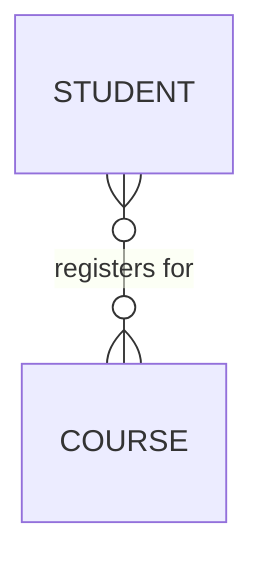
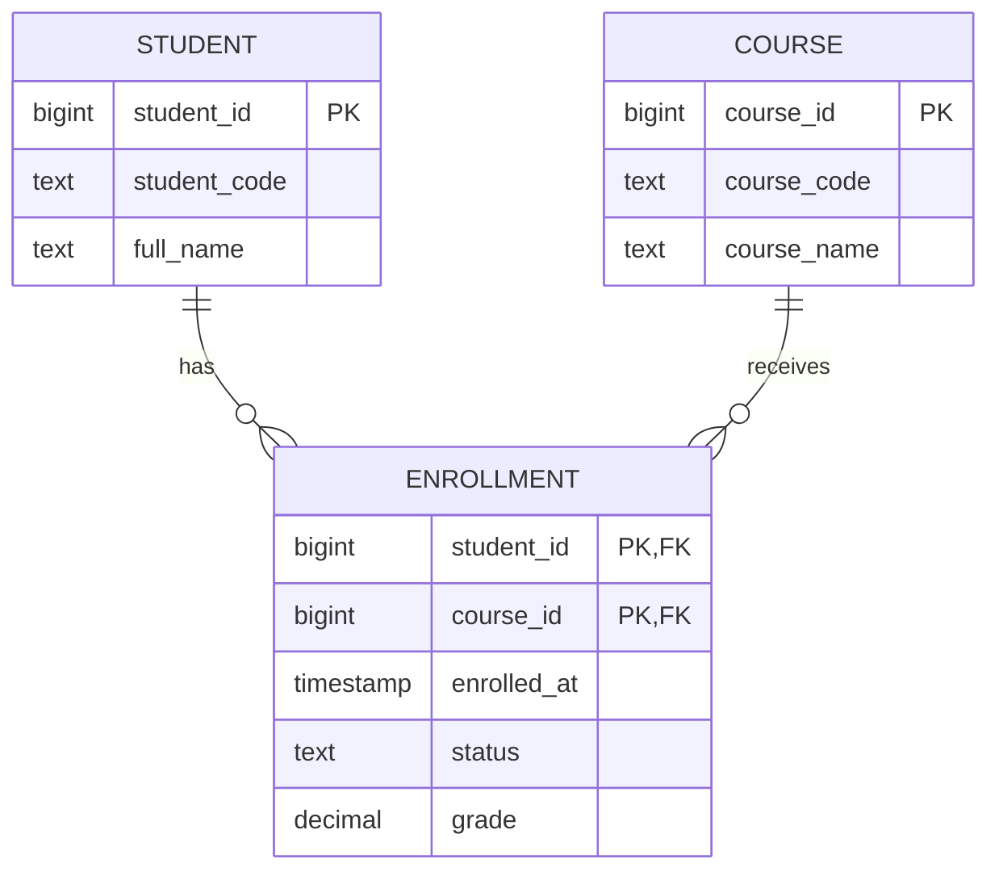

# Converting Many-to-Many Relationships into Junction Tables

In the relational data model, the requirement “a student enrolls in many courses, and a course has many students” cannot be fully expressed using **a single foreign key** placed in either table. This is a **many-to-many** (**N:M**) relationship. The standard mapping is to create a **junction table** (*associative table*, *bridge table*) that stores each pair of participating objects as one row.

A junction table is not merely a technical trick for writing SQL. It represents a specific business event: **student A enrolled in course B**, together with facts meaningful only to *that specific pair*, such as enrollment date, status, and final grade. By properly defining keys, uniqueness constraints, foreign keys, and the relationship's lifecycle, you protect data against duplicate writes, broken references, and inconsistent updates.

This lesson belongs to the **Relational Modeling** chapter of the **DATABASE_DATA_MODELING** module. The goal is to translate business statements into clear entities, relationships, and constraints, and then evaluate physical schemas, indexes, and storage strategies when moving to document, graph, or analytical systems. The DDL examples use **PostgreSQL 15+**; the modeling concepts apply broadly, though exact syntax and enforcement capabilities must be verified against the target DBMS.

## 1. Identifying an N:M Relationship from Business Requirements

Suppose a training platform has two entity types:

- **Student** (`Student`): has a student code, full name, and profile status.
- **Course** (`Course`): has a course code, name, and curriculum details.

The business owner confirms:

> A student may enroll in multiple courses. A course allows multiple students to enroll. For a given course, a student has only **one active enrollment record** in the initial model.

Sample data:

| Student | Enrolled Courses |
|---|---|
| SV001 — An | CSDL101 — Databases; JAVA101 — Java |
| SV002 — Bình | CSDL101 — Databases |

From the student side, `SV001` links to **two courses**. From the course side, `CSDL101` links to **two students**. That is the hallmark of N:M.

### Distinguishing “May Have Many” from “Must Have Many”

The notation N:M describes the **maximum cardinality** of the relationship in both directions. It does not say that every current student has at least two courses, or that every course has multiple students. A new student may not have enrolled in any course yet; a new course may not have any learners yet.

Record minimum and maximum cardinalities separately:

| Relationship Side | Statement to Confirm | Example in This System |
|---|---|---|
| From `Student` to `Course` | How many courses (min/max) does each student link to? | `0..N` |
| From `Course` to `Student` | How many students (min/max) does each course have? | `0..N` |
| One **enrollment row** | How many students and courses does it reference? | Exactly **1 student** and **1 course** |

If the business states “every open course must have at least one student”, that is a **minimum participation rule**, requiring a check when transitioning the course to open status. Foreign keys on the junction table only guarantee that each enrollment row points to valid entities; they do not automatically force a course to have enrollment rows.

### ERD Before and After Conversion

At the conceptual level, we can draw:



When moving to the relational schema, split N:M into **two 1:N relationships** via `ENROLLMENT`:



In a single-tenant example, `ENROLLMENT` can be identified by the pair `(student_id, course_id)`. For a multi-tenant environment, the example in a later section uses **`(tenant_id, student_id, course_id)`** as the primary key and two composite foreign keys to prevent cross-tenant links.

## 2. Why Not Store a “List of IDs” in a Single Column?

A hasty design might add a column `course_ids = '101,102'` in `students` or `student_ids = '[1,2]'` in `courses`.

These approaches cause several problems when relationships are business data that must be protected:

| Storage Approach | Main Problem |
|---|---|
| Comma-separated ID string | No per-ID FK; updating/deleting one link requires string parsing; searching and indexing are error-prone |
| JSON/array list in `students` | Requires custom existence checks, deduplication, and concurrent updates inside the list; hard to attach per-enrollment attributes |
| Lists in **both** `students` and `courses` | Two copies of the relationship can drift apart during inserts, deletes, or partial write failures |
| A single `course_id` in `students` | Each student can point to at most one course, unintentionally turning N:M into N:1 |
| A single `student_id` in `courses` | Each course can point to at most one student, unintentionally turning N:M into 1:N |

This **does not mean** JSON/arrays are always wrong: in a document model, embedded lists can be reasonable for small sets sharing a lifecycle with proper validation. However, if you use a relational database, join frequently, require strong referential integrity, and each link carries its own attributes, **one row in a junction table** is usually the clearest representation.

## 3. Rules for Converting N:M into Two 1:N Relationships

Basic conversion workflow:

1. **Keep both endpoint entities** with their own keys and attributes: `students` and `courses`.
2. **Create the junction table** `enrollments`. Each row records which student enrolled in which course.
3. **Place foreign keys** from the junction table to each endpoint; if multi-tenant, foreign keys must enforce the same tenant scope.
4. **Define the relationship's key**: the combination of both endpoints if each pair may appear only once, or a dedicated key with an appropriate unique constraint when individual attempts must be identified.
5. **Place attributes of the relationship itself** in the junction table: `enrolled_at`, `status`, `grade`.
6. **Confirm delete and mutation policies**: whether enrollment history is retained, whether dropping is allowed, and whether a student can retake the same course.

Central invariant of the initial model:

\[
\forall s, c:\quad
\#\{\text{Enrollment}(s,c)\}\leq 1.
\]

This means for every student–course pair, there is at most one junction row. When repeated pairs are permitted due to course retakes, this invariant must be **intentionally changed**; never drop the unique constraint without introducing a meaningful replacement key.

### Where Do Attributes Belong?

| Attribute | Appropriate Table | Reason |
|---|---|---|
| `student_code`, `full_name` | `students` | Depends on the student, not on the course |
| `course_code`, `course_name` | `courses` | Depends on the course, not on the student |
| `enrolled_at` | `enrollments` | Timestamp when **a specific student enrolled in a specific course** |
| Enrollment `status` | `enrollments` | SV001 may have completed CSDL101 while still taking JAVA101 |
| `grade` | `enrollments` | A grade is meaningful within **one course participation** |
| `course_capacity` | `courses` | Limit belonging to the course; not exceeding capacity is an aggregate invariant across multiple rows |

Placing `grade` in `students` leaves unclear which course is graded; placing it in `courses` leaves unclear which student is graded. That is the sign that the link has become an **associative entity** with genuine business attributes.

## 4. PostgreSQL Schema with Keys, FKs, UNIQUE, and CHECK

Assume the system supports multiple training organizations. Each organization is a tenant; both the student and the course must belong to the same tenant at enrollment time.

```sql
CREATE TABLE tenants (
    tenant_id BIGINT PRIMARY KEY,
    tenant_name TEXT NOT NULL
        CHECK (btrim(tenant_name) <> '')
);

CREATE TABLE students (
    tenant_id BIGINT NOT NULL,
    student_id BIGINT GENERATED ALWAYS AS IDENTITY,
    student_code TEXT NOT NULL,
    full_name TEXT NOT NULL,

    CONSTRAINT pk_students PRIMARY KEY (tenant_id, student_id),
    CONSTRAINT uq_students_code UNIQUE (tenant_id, student_code),
    CONSTRAINT fk_students_tenant FOREIGN KEY (tenant_id)
        REFERENCES tenants (tenant_id) ON DELETE RESTRICT,
    CONSTRAINT ck_student_code CHECK (btrim(student_code) <> ''),
    CONSTRAINT ck_student_name CHECK (btrim(full_name) <> '')
);

CREATE TABLE courses (
    tenant_id BIGINT NOT NULL,
    course_id BIGINT GENERATED ALWAYS AS IDENTITY,
    course_code TEXT NOT NULL,
    course_name TEXT NOT NULL,

    CONSTRAINT pk_courses PRIMARY KEY (tenant_id, course_id),
    CONSTRAINT uq_courses_code UNIQUE (tenant_id, course_code),
    CONSTRAINT fk_courses_tenant FOREIGN KEY (tenant_id)
        REFERENCES tenants (tenant_id) ON DELETE RESTRICT,
    CONSTRAINT ck_course_code CHECK (btrim(course_code) <> ''),
    CONSTRAINT ck_course_name CHECK (btrim(course_name) <> '')
);

CREATE TABLE enrollments (
    tenant_id BIGINT NOT NULL,
    student_id BIGINT NOT NULL,
    course_id BIGINT NOT NULL,
    enrolled_at TIMESTAMPTZ NOT NULL DEFAULT CURRENT_TIMESTAMP,
    status TEXT NOT NULL DEFAULT 'ENROLLED',
    grade NUMERIC(5, 2),

    CONSTRAINT pk_enrollments
        PRIMARY KEY (tenant_id, student_id, course_id),

    CONSTRAINT fk_enrollments_student
        FOREIGN KEY (tenant_id, student_id)
        REFERENCES students (tenant_id, student_id)
        ON DELETE RESTRICT,

    CONSTRAINT fk_enrollments_course
        FOREIGN KEY (tenant_id, course_id)
        REFERENCES courses (tenant_id, course_id)
        ON DELETE RESTRICT,

    CONSTRAINT ck_enrollments_status
        CHECK (status IN ('ENROLLED', 'COMPLETED', 'DROPPED')),

    CONSTRAINT ck_enrollments_grade_range
        CHECK (grade BETWEEN 0 AND 100),

    CONSTRAINT ck_enrollments_grade_by_status
        CHECK (
            (status = 'COMPLETED' AND grade IS NOT NULL)
            OR
            (status <> 'COMPLETED' AND grade IS NULL)
        )
);

-- Supports reverse lookups: from a course to its list of students.
CREATE INDEX ix_enrollments_course_student
    ON enrollments (tenant_id, course_id, student_id);
```

**Business choices made explicit in this example:**

- `status` accepts only three values. A `COMPLETED` enrollment must have a grade; in `ENROLLED` and `DROPPED` states, the grade remains `NULL`. This is a **lesson convention**, not a claim that every training platform grades this way.
- `grade BETWEEN 0 AND 100` rejects out-of-range grades when non-null. `CHECK` alone does not reject `NULL`; hence `ck_enrollments_grade_by_status` specifies when a grade may or may not be missing.
- Students and courses cannot be physically deleted while links remain due to `ON DELETE RESTRICT`. This choice preserves enrollment records for reconciliation; production systems may use archive flags or other delete policies.
- Both composite FKs carry `tenant_id` so a student from tenant 42 cannot be enrolled in a course from tenant 43. A pair of single-column FKs using only technical IDs could accidentally miss the ownership-scope invariant.
- `tenant_id`, `student_id`, and `course_id` are all `NOT NULL`. Do not use `NULL` as an “unknown endpoint” marker in an active link; if an endpoint is not yet determined, store the request in a separate staging/pending table.

### Why Does the Primary Key Have Three Columns?

At the business level, the key of an enrollment is **student + course within the same tenant**. In a multi-tenant schema:

\[
K_{\text{enrollment}} = (tenant\_id,\ student\_id,\ course\_id).
\]

`PRIMARY KEY` guarantees **no duplicate key tuples** and that all three components are non-null. A student is allowed to join two courses; a course is allowed to have two students. Only **the exact same student–course pair** is rejected on a second occurrence.

You should not place `UNIQUE(student_id)` or `UNIQUE(course_id)` on `enrollments`: doing so accidentally forces one direction into 1:1. Nor should you place `UNIQUE (tenant_id, student_id)` if a student must be able to take multiple courses.

### Why Is a Reverse-Direction Index Needed?

The primary key `(tenant_id, student_id, course_id)` creates an index that efficiently serves *finding the courses of a student*. When finding *all students of a course*, `(tenant_id, course_id)` is not a full leading prefix of the primary key index. The index `(tenant_id, course_id, student_id)` supports the second query direction as well as checks/deletes/updates on referenced courses.

PostgreSQL creates indexes for PK/UNIQUE constraints but **does not automatically create indexes for every FK on child tables**. On other systems, check their specific indexing behavior. Do not create redundant indexes without examining query plans and actual write load.

## 5. Loading Sample Data and Observing Links

The illustrative data uses tenant 42, two students, and two courses. `student_id`/`course_id` are auto-generated by PostgreSQL; use business codes when creating links so you never guess identity values.

```sql
INSERT INTO tenants (tenant_id, tenant_name)
VALUES (42, 'Training Center X');

INSERT INTO students (tenant_id, student_code, full_name)
VALUES
    (42, 'SV001', 'An'),
    (42, 'SV002', 'Bình');

INSERT INTO courses (tenant_id, course_code, course_name)
VALUES
    (42, 'CSDL101', 'Databases'),
    (42, 'JAVA101', 'Java');

INSERT INTO enrollments (tenant_id, student_id, course_id)
SELECT s.tenant_id, s.student_id, c.course_id
FROM (
    VALUES
        ('SV001', 'CSDL101'),
        ('SV001', 'JAVA101'),
        ('SV002', 'CSDL101')
) AS pair(student_code, course_code)
JOIN students AS s
  ON s.tenant_id = 42
 AND s.student_code = pair.student_code
JOIN courses AS c
  ON c.tenant_id = s.tenant_id
 AND c.course_code = pair.course_code;
```

Three pairs produce **three link rows**, without creating extra students or courses. Each `JOIN` resolves a student and a course from their known codes and stores the **technical keys** into the junction row.

The sample load above assumes all codes exist. In a real ingestion pipeline, if a code does not exist, an inner `JOIN` can **silently skip that pair** instead of raising an error; therefore, reconcile input pair counts against inserted row counts, flag rows missing keys, and use a transaction with error reporting. Never treat a zero-error `INSERT ... SELECT` as proof that every source record was imported.

## 6. Reading Data Across Both Relationship Directions

### 6.1. Courses of a Student

```sql
SELECT
    s.student_code,
    s.full_name,
    c.course_code,
    c.course_name,
    e.status,
    e.enrolled_at,
    e.grade
FROM students AS s
JOIN enrollments AS e
  ON e.tenant_id = s.tenant_id
 AND e.student_id = s.student_id
JOIN courses AS c
  ON c.tenant_id = e.tenant_id
 AND c.course_id = e.course_id
WHERE s.tenant_id = 42
  AND s.student_code = 'SV001'
ORDER BY c.course_code;
```

Expected result: `SV001` has two rows, corresponding to `CSDL101` and `JAVA101`. The row count increases because **one student has multiple links**, not because the student record is duplicated in the `students` table.

### 6.2. Students in a Course

```sql
SELECT
    c.course_code,
    c.course_name,
    s.student_code,
    s.full_name,
    e.status
FROM courses AS c
JOIN enrollments AS e
  ON e.tenant_id = c.tenant_id
 AND e.course_id = c.course_id
JOIN students AS s
  ON s.tenant_id = e.tenant_id
 AND s.student_id = e.student_id
WHERE c.tenant_id = 42
  AND c.course_code = 'CSDL101'
ORDER BY s.student_code;
```

Expected result: `SV001` and `SV002`. This is the reverse direction of the same relationship; **no student-list column is needed** in `courses`.

### 6.3. Counting Enrollments per Course

Use `LEFT JOIN` when you need to retain courses with zero enrollments:

```sql
SELECT
    c.course_code,
    c.course_name,
    COUNT(e.student_id) AS total_enrollment_records,
    COUNT(e.student_id) FILTER (WHERE e.status = 'ENROLLED')
        AS currently_enrolled
FROM courses AS c
LEFT JOIN enrollments AS e
  ON e.tenant_id = c.tenant_id
 AND e.course_id = c.course_id
WHERE c.tenant_id = 42
GROUP BY c.tenant_id, c.course_id, c.course_code, c.course_name
ORDER BY c.course_code;
```

`COUNT(e.student_id)` does not count the NULL row produced by `LEFT JOIN` when there are no links, so a course without students is counted as 0. Using `COUNT(*)` in a `LEFT JOIN` query would return 1 for a course with no enrollments if not filtered properly.

The name `total_enrollment_records` here includes `DROPPED`/`COMPLETED` links, whereas `currently_enrolled` counts only `ENROLLED`. Define “number of students in a course” precisely so one counter is not overloaded with two meanings.

### 6.4. Checking Link Existence with `EXISTS`

When the question is simply “Has student An enrolled in the SQL course?”, you do not need to multiply result rows through `JOIN` and hide it with `DISTINCT`:

```sql
SELECT
    s.student_code,
    EXISTS (
        SELECT 1
        FROM enrollments AS e
        JOIN courses AS c
          ON c.tenant_id = e.tenant_id
         AND c.course_id = e.course_id
        WHERE e.tenant_id = s.tenant_id
          AND e.student_id = s.student_id
          AND c.course_code = 'CSDL101'
    ) AS has_course
FROM students AS s
WHERE s.tenant_id = 42
  AND s.student_code = 'SV001';
```

`EXISTS` expresses an existential predicate and usually fits membership checks well. However, if `CSDL101` does not exist, a `FALSE` result does not distinguish “course does not exist” from “course exists but student is not enrolled”; the API may need to validate the course code before answering.

## 7. Safely Inserting, Canceling, and Updating Links

### 7.1. Adding an Enrollment

In a junction table, the action “enroll in a course” inserts a new row:

```sql
INSERT INTO enrollments (tenant_id, student_id, course_id)
VALUES (42, 1, 10);
```

The two IDs here are **illustrative only** and must be replaced with real existing IDs; otherwise, the FK rejects them. If the pair already exists, the PK rejects the duplicate. The application should map unique violations to “student is already enrolled in this course” or choose idempotent write semantics when appropriate.

In PostgreSQL you can use:

```sql
-- Using verified valid IDs:
INSERT INTO enrollments (tenant_id, student_id, course_id)
VALUES (42, 1, 10)
ON CONFLICT (tenant_id, student_id, course_id) DO NOTHING;
```

`DO NOTHING` merely skips duplicate key-tuple inserts; it does not prove that other business checks like capacity, schedule availability, or enrollment eligibility are satisfied. Use this statement when **a duplicate enrollment can safely be treated as a no-op success without altering prior state**. If you need to return an error or reactivate a previous enrollment, define different behavior.

### 7.2. Completing and Recording a Grade

Under the rule “only `COMPLETED` has a grade”, update **both columns in a single statement**:

```sql
UPDATE enrollments
SET status = 'COMPLETED', grade = 87.50
WHERE tenant_id = 42
  AND student_id = 1
  AND course_id = 10;
```

If you only change `status` without setting `grade`, the `CHECK` constraint rejects the invalid intermediate state. In PostgreSQL, `CHECK` constraints cannot be made `DEFERRABLE` like some FKs or UNIQUE constraints, so you cannot split updating the two columns across two statements and wait until commit to validate.

### 7.3. Dropping an Enrollment vs. Deleting the Link?

These two actions carry different meanings:

- **`DROPPED`:** keeps the enrollment row and changes its status. Provides minimal history showing the student once participated, though not a full event log if you need every status change.
- **`DELETE` from `enrollments`:** erases proof that the current relationship existed. Suitable for certain pure links that can be recreated without audit history, but usually inappropriate for educational records needing auditability.

Example status update:

```sql
UPDATE enrollments
SET status = 'DROPPED', grade = NULL
WHERE tenant_id = 42
  AND student_id = 1
  AND course_id = 10;
```

If you need to know **who dropped it and when**, add `dropped_at`, `dropped_by`, or an `enrollment_events` event table with appropriate foreign keys. Never infer the drop date from `enrolled_at`.

## 8. When the Composite Key Is No Longer Enough: Retakes and Multiple History Records

The key tuple `(tenant_id, student_id, course_id)` only holds if the system treats a student–course pair as **a single ongoing relationship**, even as status changes. If a student can enroll, drop, and **re-enroll in the same course multiple times**, clarify:

- Does each retake have its own grade and start/end dates?
- Can there be two **concurrent** enrollments in the same course?
- Does the second attempt overwrite or preserve history of the first?
- How does reporting “unique students” differ from “enrollment attempts”?

When **each attempt is its own business object**, use `attempt_id` or `attempt_no` to identify each instance. Example alternative table:

```sql
CREATE TABLE course_attempts (
    attempt_id BIGINT GENERATED ALWAYS AS IDENTITY PRIMARY KEY,
    tenant_id BIGINT NOT NULL,
    student_id BIGINT NOT NULL,
    course_id BIGINT NOT NULL,
    attempt_no INTEGER NOT NULL,
    started_at TIMESTAMPTZ NOT NULL,
    ended_at TIMESTAMPTZ,

    CONSTRAINT uq_attempt_number
        UNIQUE (tenant_id, student_id, course_id, attempt_no),

    CONSTRAINT fk_attempt_student
        FOREIGN KEY (tenant_id, student_id)
        REFERENCES students (tenant_id, student_id)
        ON DELETE RESTRICT,

    CONSTRAINT fk_attempt_course
        FOREIGN KEY (tenant_id, course_id)
        REFERENCES courses (tenant_id, course_id)
        ON DELETE RESTRICT,

    CONSTRAINT ck_attempt_positive CHECK (attempt_no > 0),
    CONSTRAINT ck_attempt_interval
        CHECK (ended_at IS NULL OR ended_at > started_at)
);

-- At most one open attempt for the same student and course.
CREATE UNIQUE INDEX uq_one_open_attempt
    ON course_attempts (tenant_id, student_id, course_id)
    WHERE ended_at IS NULL;
```

`attempt_id` lets other tables reference **a specific participation attempt**, while `UNIQUE (tenant_id, student_id, course_id, attempt_no)` prevents duplicate attempt numbers. The partial unique index only blocks **two concurrently open attempts**; it **does not automatically block two closed attempts with overlapping time intervals**. If overlapping intervals are forbidden, add database interval validation (such as an exclusion constraint in PostgreSQL where suitable) or a synchronized write path enforcing that invariant.

The `course_attempts` model is a **design variant** for retakes, not a table to maintain alongside `enrollments` storing two copies of the same relationship. If you adopt this variant as the source of truth, related tables, indexes, and reports should migrate to use attempts accordingly.

### A Surrogate Key Does Not Replace Business Uniqueness Constraints

You can define `enrollment_id BIGINT GENERATED ... PRIMARY KEY` even when each student may have at most one enrollment per course. In that case, you still need:

```sql
-- Constraint pattern for the variant using enrollment_id:
UNIQUE (tenant_id, student_id, course_id)
```

If only `enrollment_id` is unique, two rows with different IDs could still represent **the exact same link** without being rejected. Choose a technical key for referencing convenience, but keep the constraint expressing the **business key**.

## 9. Invariants Beyond a Single Link Row

Some N:M rules cannot be solved using standard PK, FK, and `CHECK` constraints alone.

| Rule | Why Is It Harder? | Solution Direction |
|---|---|---|
| An open course must have at least 1 enrollment | Requires checking **the existence of other rows** | Check upon opening status transition, appropriate transaction/trigger |
| A course has at most 30 `ENROLLED` students | Requires counting multiple rows; two requests can both see space left | Transaction locking the course row or controlled seat allocation |
| A student cannot have two courses with overlapping schedules | Must compare time intervals across multiple rows and courses | Interval constraints / synchronized checks with suitable isolation strategy |
| A student enrolls only after passing prerequisites | Depends on outcomes from other enrollments | Business gate checking prerequisites and concurrency |
| An instructor must teach at least one course per term | Minimum participation constraint, not implied by a one-way FK | Assignment/status workflow and end-of-term validation |

**Concurrency race on capacity:** a course has 29/30 seats, two transactions both run `SELECT COUNT(*)`, both see 1 seat available, and both insert an enrollment. Without synchronization, the course ends up with 31 students. The PK only prevents *the same student duplicating the course*, not two different students exceeding capacity.

One solution is to lock the `courses` row to serialize seat reservations for **the same course**, check remaining seats, and insert within one transaction, ensuring all write paths follow that protocol. High-throughput systems can use atomically maintained seat counters or a dedicated reservation mechanism. Always test with two concurrent transactions; adding `CHECK (capacity >= 0)` on the course table **is not enough** if enrollment counts are not maintained safely.

## 10. Bidirectional Indexing and Status-Filtered Queries

Junction tables often grow very large: 100,000 students × multiple courses easily yields millions of rows. Evaluate actual query patterns:

| Query | Search Axes | Suitable Index in Example |
|---|---|---|
| Courses of a student | `tenant_id, student_id` | PK prefix `(tenant_id, student_id, course_id)` |
| Students in a course | `tenant_id, course_id` | `(tenant_id, course_id, student_id)` |
| Does a student–course link exist? | All three key components | PK, single-tuple lookup |
| `ENROLLED` students in a course | `tenant_id, course_id, status` | Consider an index with `status` or a partial index if queried frequently |
| Enrollments completed in a month | Time/status, tenant-scoped | Index matching actual filter columns and data distribution |

Example specialized index **only when the workload proves it is needed**:

```sql
CREATE INDEX ix_active_enrollments_by_course
    ON enrollments (tenant_id, course_id, student_id)
    WHERE status = 'ENROLLED';
```

A partial index can be much smaller when most enrollments are already finished. However, every status change may incur extra index maintenance cost. Queries must include predicates allowing the planner to prove compatibility with the index predicate; never assume every query filtering on `status` will use it.

Verify with `EXPLAIN (ANALYZE, BUFFERS)` on realistic data; inspect rows scanned, index lookups, joins, selectivity, and lock times. **Creating more indexes is not always better**, because every `INSERT`, `UPDATE`, and `DELETE` on the junction table must maintain all associated indexes.

## 11. Self-Referencing N:M and Relationships with More Than Two Endpoints

### 11.1. N:M Between Rows of the **Same Table**

For instance, students can pair up as study partners. If the relationship is **undirected** (An partnering with Bình is equivalent to Bình partnering with An), store only one pair using a canonical ordering rule:

```sql
CREATE TABLE study_partners (
    tenant_id BIGINT NOT NULL,
    student_a_id BIGINT NOT NULL,
    student_b_id BIGINT NOT NULL,
    paired_at TIMESTAMPTZ NOT NULL DEFAULT CURRENT_TIMESTAMP,

    CONSTRAINT pk_study_partners
        PRIMARY KEY (tenant_id, student_a_id, student_b_id),

    CONSTRAINT fk_partner_a
        FOREIGN KEY (tenant_id, student_a_id)
        REFERENCES students (tenant_id, student_id),

    CONSTRAINT fk_partner_b
        FOREIGN KEY (tenant_id, student_b_id)
        REFERENCES students (tenant_id, student_id),

    CONSTRAINT ck_partner_order
        CHECK (student_a_id < student_b_id)
);
```

`student_a_id < student_b_id` prevents both self-pairing and reversed duplicate pairs. The application must normalize the pair before writing: put the smaller ID in `student_a_id`. If the relationship is **directed**, such as “student A follows B”, do not impose this canonical ordering; `(follower_id, followed_id)` has directional meaning and both directions can exist independently.

### 11.2. A Three-Endpoint Event Is Not Three Independent N:M Relationships

Suppose supplier S delivers product P to warehouse W. The true relationship is **the triple `(supplier_id, product_id, warehouse_id)`** with attributes such as purchase price and effective period. If you split it into three binary tables `Supplier–Product`, `Supplier–Warehouse`, and `Product–Warehouse`, joining them back together can fabricate **three-way combinations that were never approved**.

When all three components together define a single event, you need a ternary associative table with three FKs and a business key matching the **three-way combination**, or a dedicated transaction entity. Having three foreign keys on a table does not mean it represents “three unrelated N:M relationships”; the grain of the data must be decided at the event level.

### 11.3. Order Line Items: A Relationship with Its Own Identity

`order_items` connects `orders` with `products`, yet each line also carries quantity, locked-in unit price, discount, and line number. If an order allows a product to appear on **two lines** due to different lots, promotions, or delivery schedules, `UNIQUE(order_id, product_id)` would be wrong. You can use `PRIMARY KEY (order_id, line_no)` or `order_item_id` with an appropriate line-ordering constraint.

Never blindly stereotype “every N:M has a composite key equal to the two FKs”; ask whether each link is a **set of unique pairs** or a **repeatable event**.

## 12. Migrating a Legacy Model to a Junction Table

When a system previously stored `course_ids` in a string or list, migration must handle both **legacy data** and **new write paths**:

1. **Lock down relationship scope:** whether tenant is included, whether pairs can repeat, and whether canceled records retain history.
2. **Audit source data:** nonexistent IDs, duplicate pairs, malformed formats, cross-tenant links, and missing or conflicting statuses.
3. **Create the junction table** with keys, FKs, `NOT NULL`, `CHECK`, and query-driven indexes.
4. **Clean and backfill:** normalize IDs, deduplicate according to business decisions, and log unmappable records for remediation instead of silently dropping them.
5. **Reconcile bidirectionally:** verify valid source pair counts equal inserted row counts, check per-tenant totals, and sample relationship queries.
6. **Switch read/write paths** to the junction table, avoiding long-lived unsynchronized duplicate copies.
7. **Remove legacy structures** after verifying data and dependent access, with an appropriate rollback plan.

On very large tables, adding FKs or unique indexes can impact lock duration and performance. PostgreSQL supports `NOT VALID` for certain constraints such as FK/CHECK followed by `VALIDATE CONSTRAINT` later; unique constraints follow different mechanics and may require creating a concurrent unique index after cleaning data. Verify your PostgreSQL version and test in a production-like environment before applying to production.

If the application uses **dual write** during transition, designate which table is the source of truth, how partial write failures are handled, and how drift is detected. Keep the transition window strictly time-bounded so “temporary” never turns into an ambiguous dual-source model.

## 13. The Same N:M Relationship in Document, Graph, and Analytical Models

Choosing a junction table is how the **relational model** represents N:M. Other storage models still must answer questions about link identity and uniqueness.

| Model | Common Representation | Points to Consider |
|---|---|---|
| **Relational** | `enrollments` table with FKs to both endpoints, PK/UNIQUE for pairs | Clear constraints, bidirectional joins; requires indexes and large row counts |
| **Document** | Array of courses embedded in student, document references, or separate enrollment collection | Small co-lifecycle sets embed easily; large N:M with writes from both sides requires sync, indexing, and transaction care |
| **Graph** | `ENROLLED_IN` edge from `Student` to `Course` with properties `enrolledAt`, `status` | Direct relationship traversal; at-most-one-edge-per-pair rules and endpoint constraints depend on the engine |
| **Analytical Warehouse** | Bridge/fact table connecting student dimension and course dimension | Define grain (student–course vs. individual enrollment attempts); N:M joins can multiply metrics and double-count |

In a graph database, a property-bearing edge is a natural expression of a junction table; however, **never assume** every graph database blocks duplicate edges, cross-tenant links, or invalid status combinations the way PostgreSQL enforces PK/FK/CHECK.

In a document database, embedding a student's course list can eliminate joins on a profile view. However, when the list grows large, lookups are needed in both directions, and each link has its own grades and history, a separate `enrollments` collection with two references stays closer to an associative entity.

### The Metric Fan-Out Trap in Analytics

Suppose a student takes three courses; if a revenue table stores **one revenue row per student** and joins directly to three `enrollments` rows, that student's revenue appears **three times**. This is the *fan-out* effect when joining across N:M.

You must define metric grain and allocation rules: is revenue at the student grain, enrollment-attempt grain, or transaction grain? Using `COUNT(DISTINCT student_id)` may accurately count unique students, yet it cannot fix a multiplied `SUM(revenue)` in every scenario. You may need to pre-aggregate before joining, use a bridge table with weighting rules, or structure the fact table at the exact business grain.

If enrollments are time-bounded, historical period reports need the status/attempt history as of that point in time, not only the current state.

## 14. Tests That Reveal Schema Bugs

| Test Data / Operation | Expected Result Under Initial Model | Enforcing Constraint or Mechanism |
|---|---|---|
| SV001 enrolls in CSDL101 and JAVA101 | Succeeds, two links | PK does not make `student_id` unique alone |
| SV001 and SV002 both enroll in CSDL101 | Succeeds, two links | PK does not make `course_id` unique alone |
| SV001 enrolls in CSDL101 a second time | Rejected on standard `INSERT` | Three-column composite PK |
| Add link with nonexistent `student_id` | Rejected | FK to `students` |
| Tenant 42 student enrolls in tenant 43 course | Rejected | Both composite FKs include `tenant_id` |
| Enrollment with `grade = 120` | Rejected | Grade range `CHECK` |
| `status = COMPLETED` with `grade = NULL` | Rejected | `ck_enrollments_grade_by_status` |
| Update `status = DROPPED` while keeping grade | Rejected per example convention | `ck_enrollments_grade_by_status` |
| Delete student with existing enrollments | Rejected | FK `ON DELETE RESTRICT` |
| Course with zero students in summary query | Still shown with count 0 | `LEFT JOIN` + `COUNT(e.student_id)` |
| Two concurrent requests insert the same pair | Only one row exists | Database-enforced PK/UNIQUE |
| Two concurrent requests claim last seat of a course | Capacity not exceeded if capacity rule exists | Dedicated transaction/locking mechanism; PK alone is insufficient |
| Student retakes the same course next year | **Cannot** add another row in initial model | Must evolve model to attempt/retake records |

When testing expected-failure statements in PostgreSQL, each error places the current transaction into an aborted state requiring rollback. Use a separate transaction or savepoint per test case so an earlier intentional failure does not mask subsequent tests.

## 15. Exercise: From Business Description to Schema

A project management platform has three entities:

- `Employee`: employee code, name, company email.
- `Project`: project code, name, budget, status.
- `ProjectMembership`: which employee participates in which project, role in the project, start date, and end date.

Business requirements:

- An employee can participate in multiple projects; a project can have multiple employees.
- An employee holds **at most one active role** in the same project at a given time, yet role-change history must be preserved.
- An employee of company A must not be linked to a project of company B.
- An `ACTIVE` project must have at least one member, and active member count must not exceed the project's cap.

Perform the following:

1. Draw the conceptual N:M ERD and the relational ERD after introducing the junction table. Specify minimum and maximum cardinalities on every side.
2. List attributes of `Employee`, `Project`, and attributes **belonging specifically to membership**. Explain why `role` should not sit permanently on `Employee`.
3. Write DDL with PKs, company/tenant-scoped composite FKs, `NOT NULL`, and `CHECK` constraints for start/end dates.
4. Choose between a three-column PK, a `membership_id` key with a conditional unique index, or an effective-interval history structure. Explain the “at most one active role” constraint.
5. Write queries to find all projects of an employee, all members of a project, and projects with no members yet.
6. Design a way to prevent two concurrent requests from adding members past the project cap, distinguishing single-row constraints from multi-row count invariants.
7. Propose indexes covering both relationship directions, and how to store history to report staffing status as of a past date.
8. Compare the relational approach against document/graph options if primary workloads are deep traversal queries, fast employee profile rendering, and periodic staffing analytics.

**Acceptance Criteria:** The schema permits multiple links in both directions, prevents orphan or cross-tenant links, enforces **one active membership**, and clearly explains why standard FKs/UNIQUE alone do not enforce the project's capacity cap.

## 16. Summary of Modeling Principles

- An **N:M** relationship must not be replaced by a single FK on one endpoint table. In a relational schema, use a **junction table** and two FKs to decompose it into two **1:N** relationships.
- Each junction row expresses **one pair or one business event**. Attributes such as enrollment date, role, or grade must live at the exact grain of the link.
- Choose keys according to semantics: a composite PK when each pair exists once; a technical key plus business unique constraint or attempt number when repeatable history is needed.
- FKs protect both endpoints; **tenant-scoped composite foreign keys** protect ownership boundaries. PK/UNIQUE prevent duplicate links.
- Design indexes for **both query directions** and real record volumes, avoiding one-way optimization.
- Rules such as maximum capacity, minimum one member, or non-overlapping schedules are **multi-row invariants**, requiring synchronization and additional verification.
- When moving to document, graph, or analytical models, continue defining link identity, state, and history; pay special attention to **fan-out** that multiplies metrics when joining across N:M.
