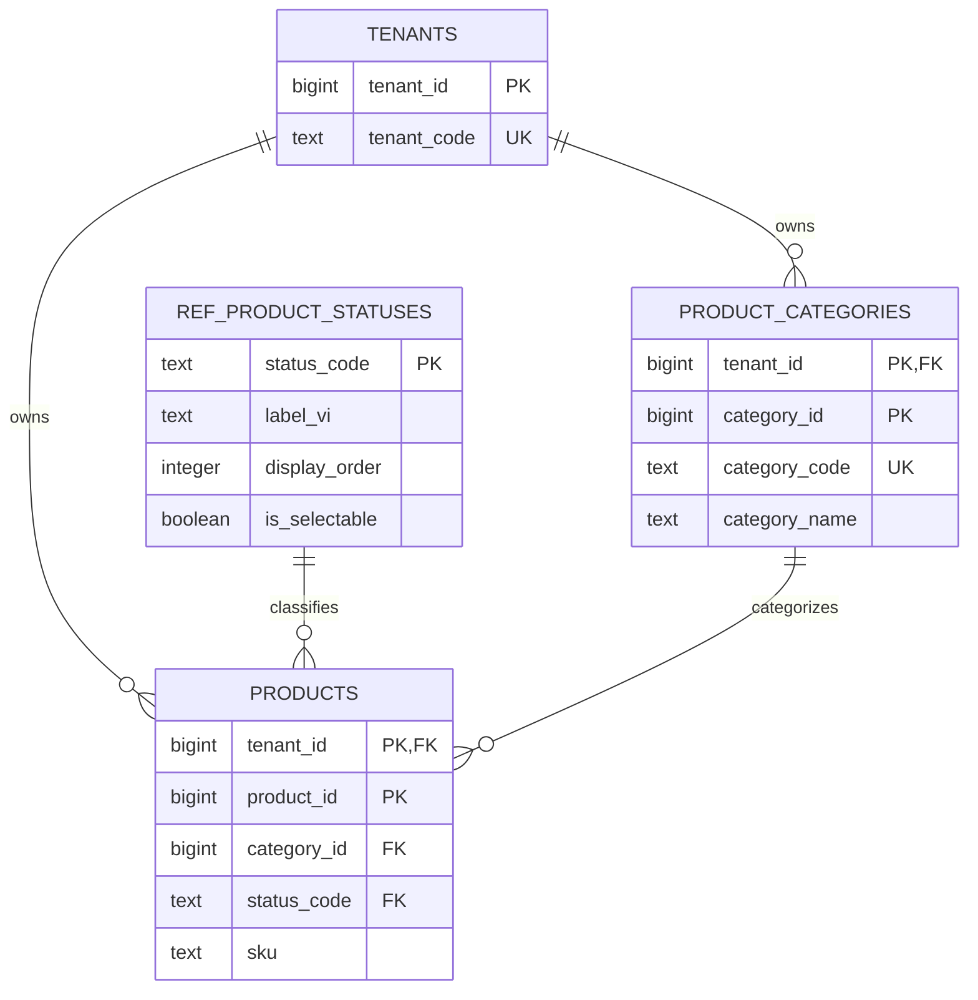

# Designing Reference Tables and Referential Constraints

When designing a sales system, fields such as **product status**, **product category**, **unit of measure**, **country**, and **shipping method** typically take values from a controlled set. If each transaction table stores arbitrary strings like `"Đang bán"`, `"đang bán"`, `"ACTIVE"`, or `"on sale"`, the system may treat the exact same status as multiple distinct values. If a developer changes a display label, millions of transaction rows might have to be updated or become difficult to aggregate.

A **reference table** (*lookup table*, *code table*) stores values recognized by the system along with their descriptive attributes. A **foreign key** (FK) from a business table to a reference table guarantees that **the referenced value exists**. This design moves domain and link rules from prose descriptions into a verifiable relational schema.

This lesson belongs to the **Relational Modeling** chapter of the **DATABASE_DATA_MODELING** module. The goal is to translate business requirements into clear tables, keys, relationships, constraints, and indexes; recognize the limits of FKs when reference data has lifecycles, access permissions, or temporal validity; and then consider corresponding representations in document, graph, and analytical models. SQL examples use **PostgreSQL 15+**; other DBMSs may differ in syntax and behavior.

## 1. What Questions Do Reference Tables Answer?

Consider two requirements for a multi-tenant store (each business is a tenant):

1. Every product has a **status** from the set `DRAFT`, `PUBLISHED`, `ARCHIVED`. Each status has a machine-readable code, a Vietnamese label, and a display order. The status set is defined system-wide.
2. Every product belongs to a **category** such as “Phone” or “Laptop”. Each tenant manages its own categories and may use the same code `PHONE` without affecting other tenants.

Both requirements involve a “selection list”, yet their lifecycles and scopes differ:

| Property | Status Reference Table | Category Reference Table |
|---|---|---|
| Who owns it? | Product/system owner | Each tenant's administrator |
| Example business key | `DRAFT`, `PUBLISHED` | `PHONE`, `LAPTOP`, **within tenant** |
| Can the label change? | Yes, without changing the code's meaning | Yes |
| Can items be added via admin UI? | Usually requires a product change workflow | Possible, depending on permissions |
| Relationship with `products` | One status is referenced by many products | One category has many products |
| When an item is no longer selectable for new entries? | Old data usually still must be readable | Historical products usually still must be queryable |

Therefore, **“reference table” is not synonymous with “a small, static table that can be deleted arbitrarily”**. Some reference tables hold rarely changing standard data, like currency codes; others hold actively managed business data, like each store's product categories.

### Distinguishing Reference Data from Business Entities

A reference table answers “which set does this value belong to and what does it mean?”; a business entity can have its own identity, owner, transactions, and lifecycle. For instance, `customer_statuses` is a reference table; `customers` are customer entities. `product_categories` can be a business reference table with a hierarchy and administrators, whereas `products` is not a reference table merely because it is often shown in a dropdown list.

Not every field with a small value set needs a new table: if `is_gift` only takes `TRUE`/`FALSE` with clear meaning, `BOOLEAN` is usually simpler than creating a `yes_no` table. The decision should consider semantics, value churn, descriptive metadata, and how many places reference it.

## 2. State Invariants Before Writing DDL

For the product example, we should agree on at least the following rules:

| Code | Invariant / Policy | Where It Can Be Enforced |
|---|---|---|
| R-01 | Every recognized status code is unique and non-empty | PK/`UNIQUE`, `NOT NULL`, `CHECK` |
| R-02 | Every product references exactly one existing status code | `NOT NULL` + FK to the status table |
| R-03 | Category code is unique **within a tenant** | `UNIQUE (tenant_id, category_code)` |
| R-04 | A product only references a category **in the same tenant** | Composite FK `(tenant_id, category_id)` |
| R-05 | Cannot physically delete reference items still referenced by products | `ON DELETE RESTRICT` or equivalent check policy |
| R-06 | Retired items cannot be assigned to new products | Write gate / transaction checking selectable status; **an FK alone is not enough** |
| R-07 | Historical transactions can still display the accurate label/meaning from the past | Version history, snapshot, or immutable label policy as needed |
| R-08 | Only authorized users can modify a tenant's categories | Application/database authorization, optionally with Row-Level Security |

These rules are not all of the same kind. R-01 through R-05 can be modeled fairly directly using constraints. R-06 depends on **the state of the reference row**; R-07 involves **time**; R-08 involves **permissions**. Adding an FK and assuming all eight rules are covered overestimates what an FK can enforce.

Before designing, also determine whether a code can **be renamed**, **be reused after deletion**, or **change meaning over time**. Those decisions govern the primary key, history tracking, and referencing data.

## 3. Natural Keys, Surrogate Keys, and Scoped Uniqueness

There are two common ways to identify reference items.

**Natural (business) key.** The code `DRAFT` is an identifier with business meaning, suitable as a primary key when the code is stable, short, strictly governed, and never reused for another meaning. Products store `status_code = 'DRAFT'` and point an FK directly to it.

**Surrogate key.** A category is identified by a stable `category_id`, while `category_code` is a business code unique within a tenant. Display labels or codes can be adjusted by policy without changing IDs stored in the products table.

| Question | Prefer Business Code as PK | Prefer Technical ID |
|---|---|---|
| Is the code guaranteed stable? | Yes, within a clear standard | Codes/names may change or come from multiple sources |
| Is the code short and easily standardized? | Usually yes | Not necessarily |
| Uniqueness scope | System-wide or with a clear composite key | May vary by tenant, version, or source |
| Referencing tables | Store meaningful code; no join needed to read the code | Store stable ID; join to read code/label |
| Risk of changing code | Changing PK can impact many FKs | Changing business code does not alter FKs |

**There is no rule that “every reference table must have an auto-increment `id`”**. However, whichever key you choose, keep the **uniqueness constraint on the business code** if the code must be unique. A surrogate key only guarantees IDs do not collide; it does not prevent two `PHONE` rows in the same tenant.

### Choosing Uniqueness Scope

`UNIQUE (category_code)` is wrong if the code `PHONE` is allowed to exist in multiple tenants. `UNIQUE (tenant_id, category_code)` accurately expresses “one code per tenant”.

Conversely, if `status_code` is a system-wide standard code, unnecessarily adding `tenant_id` can produce `PUBLISHED` rows with diverging meanings across tenants, making unified governance difficult. Whether the scope is **global**, **tenant**, **country**, **data source**, or **version** must be driven by business requirements.

Display names are rarely good keys: “Phone” can be renamed to “Mobile Phone”, translated into another language, or collide with a label in another branch. Separate the identifying `code` from `display_name` so labels can change without breaking references.

## 4. Sample Schema: System-Wide Statuses and Per-Tenant Categories

The following design uses four tables: `tenants`, `ref_product_statuses`, `product_categories`, and `products`.



### 4.1. PostgreSQL 15+ DDL

```sql
CREATE TABLE tenants (
    tenant_id BIGINT PRIMARY KEY,
    tenant_code TEXT NOT NULL,
    CONSTRAINT uq_tenants_code UNIQUE (tenant_code),
    CONSTRAINT ck_tenants_code
        CHECK (tenant_code = btrim(tenant_code)
               AND char_length(tenant_code) BETWEEN 1 AND 40)
);

-- Standard catalog shared across the entire system.
CREATE TABLE ref_product_statuses (
    status_code TEXT PRIMARY KEY,
    label_vi TEXT NOT NULL,
    display_order INTEGER NOT NULL UNIQUE,
    is_selectable BOOLEAN NOT NULL DEFAULT TRUE,

    CONSTRAINT ck_product_status_code
        CHECK (status_code ~ '^[A-Z][A-Z0-9_]*$'),
    CONSTRAINT ck_product_status_label
        CHECK (btrim(label_vi) <> ''),
    CONSTRAINT ck_product_status_order
        CHECK (display_order > 0)
);

-- Business catalog, specific to each tenant.
CREATE TABLE product_categories (
    tenant_id BIGINT NOT NULL,
    category_id BIGINT GENERATED ALWAYS AS IDENTITY,
    category_code TEXT NOT NULL,
    category_name TEXT NOT NULL,
    is_selectable BOOLEAN NOT NULL DEFAULT TRUE,

    CONSTRAINT pk_product_categories
        PRIMARY KEY (tenant_id, category_id),
    CONSTRAINT uq_category_code_per_tenant
        UNIQUE (tenant_id, category_code),
    CONSTRAINT fk_category_tenant
        FOREIGN KEY (tenant_id)
        REFERENCES tenants (tenant_id)
        ON DELETE RESTRICT,
    CONSTRAINT ck_category_code
        CHECK (category_code = btrim(category_code)
               AND char_length(category_code) BETWEEN 1 AND 60),
    CONSTRAINT ck_category_name
        CHECK (btrim(category_name) <> '')
);

-- Business table referencing both catalogs.
CREATE TABLE products (
    tenant_id BIGINT NOT NULL,
    product_id BIGINT GENERATED ALWAYS AS IDENTITY,
    sku TEXT NOT NULL,
    product_name TEXT NOT NULL,
    category_id BIGINT NOT NULL,
    status_code TEXT NOT NULL DEFAULT 'DRAFT',

    CONSTRAINT pk_products PRIMARY KEY (tenant_id, product_id),
    CONSTRAINT uq_product_sku_per_tenant
        UNIQUE (tenant_id, sku),
    CONSTRAINT fk_product_tenant
        FOREIGN KEY (tenant_id)
        REFERENCES tenants (tenant_id)
        ON DELETE RESTRICT,
    CONSTRAINT fk_product_category
        FOREIGN KEY (tenant_id, category_id)
        REFERENCES product_categories (tenant_id, category_id)
        ON UPDATE RESTRICT ON DELETE RESTRICT,
    CONSTRAINT fk_product_status
        FOREIGN KEY (status_code)
        REFERENCES ref_product_statuses (status_code)
        ON UPDATE RESTRICT ON DELETE RESTRICT,
    CONSTRAINT ck_product_sku
        CHECK (sku = btrim(sku) AND sku <> ''),
    CONSTRAINT ck_product_name
        CHECK (btrim(product_name) <> '')
);

-- Supports lookups by category and child-side FK checks.
CREATE INDEX ix_products_tenant_category
    ON products (tenant_id, category_id);
```

**FK Scope:** `(tenant_id, category_id)` in `products` references the matching `(tenant_id, category_id)` pair in `product_categories`. Because both columns in the child table are `NOT NULL`, a product in tenant 42 cannot point to a category in tenant 43. Referencing only `category_id` without corresponding tenant protection easily misses the ownership boundary.

**FK to a Global Reference Table:** `products.status_code` directly references `ref_product_statuses.status_code` because status is a shared code set, not owned by any individual tenant.

**Meaning of `is_selectable`:** this flag serves **the policy for assigning to new products or when changing classification**. It is not a `CHECK` on `products` and does not affect whether an FK finds the reference row. Existing products can continue referencing an item that is retired from new selection.

**Referencing Tenant:** both business tables also reference `tenants` so data cannot be created for nonexistent tenants. The composite FK between product and category enforces same-tenant integrity, yet **does not replace access control** per tenant.

### 4.2. Loading Reference Data and Referencing Records

```sql
INSERT INTO tenants (tenant_id, tenant_code)
VALUES (42, 'STORE-42'), (43, 'STORE-43');

INSERT INTO ref_product_statuses
    (status_code, label_vi, display_order)
VALUES
    ('DRAFT', 'Bản nháp', 10),
    ('PUBLISHED', 'Đã công bố', 20),
    ('ARCHIVED', 'Đã lưu trữ', 30);

INSERT INTO product_categories
    (tenant_id, category_code, category_name)
VALUES
    (42, 'PHONE', 'Phone'),
    (42, 'LAPTOP', 'Laptop'),
    (43, 'PHONE', 'Mobile Device');

-- Look up ID using business code; do not assume fixed identity numbers.
INSERT INTO products
    (tenant_id, sku, product_name, category_id, status_code)
SELECT 42, 'PHONE-A1', 'Sample Phone A1',
       c.category_id, 'DRAFT'
FROM product_categories AS c
WHERE c.tenant_id = 42 AND c.category_code = 'PHONE';
```

Here the code `PHONE` appears in both tenant 42 and tenant 43 without violating `UNIQUE (tenant_id, category_code)`. The status `DRAFT` has **a single shared row** in `ref_product_statuses`.

The `INSERT ... SELECT` statement above only creates a product if a matching category is found. If the code does not exist, it can insert **0 rows without error**; production ingestion flows must verify inserted row counts, report nonexistent reference codes, and use transactions. `UNIQUE` guarantees that within a tenant the code `PHONE` matches at most one category, so the lookup query will not accidentally return two rows.

### 4.3. Querying Products with Reference Labels

```sql
SELECT
    p.tenant_id,
    p.product_id,
    p.sku,
    p.product_name,
    c.category_code,
    c.category_name,
    s.status_code,
    s.label_vi AS status_label
FROM products AS p
JOIN product_categories AS c
  ON c.tenant_id = p.tenant_id
 AND c.category_id = p.category_id
JOIN ref_product_statuses AS s
  ON s.status_code = p.status_code
WHERE p.tenant_id = 42
ORDER BY p.sku;
```

Updating the name “Phone” to “Mobile Phone” modifies only **one reference row**; products still point to the same `category_id`, and queries reflect the new label. This fits **current-state screens**. If historical reports require the label as of transaction time, history or snapshots must be stored as analyzed later.

## 5. Why Normalize Reference Attributes into a Separate Table?

Suppose each product stored both `status_code` and `status_label` directly:

| `sku` | `status_code` | `status_label` |
|---|---|---|
| PHONE-A1 | DRAFT | Bản nháp |
| PHONE-B2 | DRAFT | Bản nháp |
| LAPTOP-C3 | PUBLISHED | Đã công bố |

We have the expected functional dependency:

\[
status\_code \rightarrow status\_label
\]

If the same `DRAFT` code could carry two different labels without a versioning or localization policy, the data contains redundancy and suffers from **update anomalies**: changing a label requires updating many products; incomplete updates create inconsistent values.

Extracting `(status_code, label_vi)` into `ref_product_statuses` achieves:

- A single place in the reference table recording codes, labels, ordering, and availability.
- `products` stores only the status code, avoiding repeating descriptive attributes on every product.
- FKs reject nonexistent status codes, while PK/UNIQUE reject duplicate reference codes.
- Other business tables can reference the same value set, **provided they genuinely share the same status semantics**.

This does not mean every name or label field must be normalized out. When a label is a **snapshot that must stay frozen at transaction time** (such as the item name printed on an invoice), storing a snapshot is a valid business decision, not a normalization error to eliminate. Distinguish **current reference attributes** from **locked historical facts**.

### Reference Tables vs. Value Lists in Application Code

Keeping codes in a config file or code enum helps prevent typos when coding, yet the database **has no awareness** of the valid code list unless enforced by a `CHECK`, enum type, or FK. If another script writes a misspelled string `PUBLSHED` directly and the column is plain `TEXT`, the database will happily accept that row.

The source of truth for **valid code sets** must be defined and deployed consistently across DDL, migrations, and client APIs.

## 6. Choosing Between `CHECK`, Enum Types, and Reference Tables

Not every value list warrants a reference table. The three options below fit different scopes.

| Criterion | `CHECK (value IN (...))` | DB Enum Type | Reference Table + FK |
|---|---|---|---|
| Small, nearly immutable set | Very suitable | Suitable when supported by engine | May be overkill |
| Needs labels, ordering, descriptions | No dedicated storage | Usually no dedicated storage | Has data columns |
| Admins add/remove items | Requires DDL change | Usually requires schema/type change | Managed via DML and permissions |
| Multiple tables reference same meaning | Can duplicate `CHECK` | Can share the same enum type | FKs to one shared table |
| Checking if item is still selectable | Needs logic outside `CHECK` | Needs extra logic | Has status column, though FK **does not auto-check status** |
| History/versions/multilingual | Needs extra structures | Needs extra structures | Easy to extend with auxiliary tables and keys |
| Query simplicity | No join needed for label | No join needed for label | Join needed when reading reference attributes |

**Choose `CHECK`** when the value set is very small, specific to one table, and changes only through schema deployments—for example, `payment_direction IN ('IN', 'OUT')` when there are only two directions and no metadata.

**Choose an enum type** when you want strong database typing for a stable value set within engine limits. PostgreSQL supports enums, though deleting or reordering enum values is less straightforward than managing rows in a table.

**Choose a reference table** when codes carry labels/attributes, are shared across multiple tables, have administrative owners, or need retirement, localization, or versioning. Reference tables add joins and data maintenance workflows; their benefits should be justified by real needs.

Whichever option you pick, **changing the value list must have a backward-compatibility policy for old data**. Deleting a value still used by historical transactions can destroy historical meaning or break migrations.

## 7. Delete, Retirement, and Code-Renaming Policies

A critical question is: **may an administrator delete a reference item while products still reference it?**

| FK Policy | Behavior When Reference Item Is Deleted | Assessment |
|---|---|---|
| `ON DELETE RESTRICT` | Rejects delete if referencing rows remain | Usually right for statuses/categories already in use |
| `ON DELETE NO ACTION` | Checks at constraint check time; can be deferred if FK is `DEFERRABLE` in PostgreSQL | Requires understanding transaction and check timing |
| `ON DELETE CASCADE` | Deletes referencing business rows too | Usually **dangerous** if deleting a status wipes out products/orders |
| `ON DELETE SET NULL` | Sets child FK to `NULL` | Suitable only when the link is optional and column allows `NULL` |
| `ON UPDATE CASCADE` | Updates child FKs when reference key changes | Usable if natural key genuinely needs changing; assess impact |

In our sample schema, `ON DELETE RESTRICT` and `ON UPDATE RESTRICT` keep referenced codes/IDs stable. In particular, deleting the `PUBLISHED` status must never delete thousands of published products.

### Retiring from Selection Differs from Deleting Rows

You can update:

```sql
UPDATE product_categories
SET is_selectable = FALSE
WHERE tenant_id = 42 AND category_code = 'PHONE';
```

Existing product data still references `PHONE` and remains readable as normal. That is the advantage of **soft retirement** (*retire/deactivate*) over deleting the reference item.

However, beware: **an FK only checks that `category_id` exists**, not that `is_selectable = TRUE`. If a new product is assigned the retired `PHONE` category, the FK still passes. You need a write-path business gate if the rule is “retired items cannot be assigned to new products”.

Similarly for the `PUBLISHED` status: `is_selectable = FALSE` can stop new assignments while existing `PUBLISHED` products remain valid. If retiring a status alters the meaning of old products, create an explicit transition plan; never treat `is_selectable` as a switch that erases existing relationships.

### Never Reuse Old Codes for New Meanings

If `PHONE` previously meant “telephone devices” and was later retired, reusing `PHONE` to mean “phone accessories” can cause historical data to be misinterpreted. A safe policy is **never reuse the same code for a different meaning**, even after the old row is retired from new selection. If the taxonomy must change, create new codes and a controlled mapping table.

### Editing Labels Differs from Redefining Meaning

Fixing a typo in `category_name` usually only affects UI display. Changing the **category's definition** can alter which products belong to it, reports, and access rights. When changing meaning, record versions/effective dates and audit existing references. Never use a label edit to silently alter a code's semantics.

## 8. What Mechanism Enforces “Assign Only Active Reference Items”?

Suppose the business requires:

> When creating a product or changing its category, the chosen category must have `is_selectable = TRUE`.

A naive check:

1. Application runs `SELECT is_selectable FROM product_categories`.
2. Seeing `TRUE`, a moment later it runs `INSERT/UPDATE products`.

Between those two statements, an administrator could flip `is_selectable` to `FALSE`. A request that read the old value still assigns the category, causing a **race condition**.

### Checking Inside a Synchronized Transaction

One PostgreSQL approach uses a transaction, takes a sufficiently strong read lock on the reference row, and writes only if the check succeeds:

```sql
BEGIN;

-- Example: select category 42/101.
-- If no row is returned, the application MUST abort the transaction.
SELECT category_id
FROM product_categories
WHERE tenant_id = 42
  AND category_id = 101
  AND is_selectable = TRUE
FOR SHARE;

-- Run only if the preceding SELECT returned exactly one row.
INSERT INTO products
    (tenant_id, sku, product_name, category_id, status_code)
VALUES (42, 'NEW-ITEM', 'New Product', 101, 'DRAFT');

COMMIT;
```

`101` is an illustrative ID and must be replaced with a real ID. The `FOR SHARE` lock conflicts with updates on that category row, preventing an admin from flipping the availability flag between the check and the write within **the same transaction**. Ensure all relevant write paths, including import scripts and product edits, obey this protocol; do not grant direct write privileges bypassing the check gate.

This SQL illustrates the **mechanism**, not a complete production API: the application must check returned row counts, verify caller permissions, handle timeouts/deadlocks and retries, and decide whether existing products remain unchanged or must be recategorized if a reference item's status changes after commit.

If all transactions must also assign only active status codes, apply the same principle to `ref_product_statuses`. For **valid state transitions** (e.g., permitting `DRAFT → PUBLISHED` only after product validation), an FK only verifies the target code exists; a **state machine** and update gate must protect allowed transition edges.

### Can an FK Point to an “Active-Only” Set?

A partial unique index such as `UNIQUE (...) WHERE is_selectable` cannot always serve as an FK target; in PostgreSQL, an FK target must satisfy proper primary/unique constraint rules, **not a partial unique index**. Nor can an FK point to an “active categories view” and enforce constraints like a base-table FK.

If retired categories must still serve historical data while blocking new assignments, write-time status checks and concurrency controls must be designed explicitly outside a plain FK.

## 9. Shared Reference Data, Per-Tenant Reference Data, and Authorization

A multi-tenant schema needs two distinct layers of control:

1. **Structural integrity:** a product of tenant 42 cannot reference a category of tenant 43. The composite FK `(tenant_id, category_id)` protects this.
2. **Access permissions:** users of tenant 42 cannot read or edit categories of tenant 43. An FK **does not enforce** this permission.

Permissions can be enforced at the application layer, via database roles, or via **Row-Level Security (RLS)** suited to the architecture. An `INSERT` using a valid `tenant_id` and existing `category_id` can still be unauthorized if the caller has no access to that tenant. Access control design is essential whenever reference data has multiple administrators.

### Should Global and Tenant Reference Items Live in One Table?

A model like `categories(tenant_id NULL, code, label)` where `NULL` indicates a global item looks simple, yet raises several questions:

- Do unique constraints treat `NULL` as equal or distinct?
- How does a child table's FK target either global or tenant scope cleanly?
- Can a global code and a tenant code collide? If they do, does the tenant row override the global meaning?
- How are permissions separated for editing global vs. tenant values?

In PostgreSQL, `UNIQUE` by default treats `NULL` values in different rows as distinct; a nullable `tenant_id` column can cause global code uniqueness checks to behave unexpectedly. If the business allows **per-tenant overrides of standard reference items**, design explicit precedence rules and distinguishing keys; separate global and override tables can be cleaner than an ambiguous nullable `tenant_id`.

### Hierarchical Reference Data (Parent–Child)

If categories form a tree, adding `parent_category_id` to `product_categories` creates a **self-referencing foreign key**:

```sql
ALTER TABLE product_categories
    ADD COLUMN parent_category_id BIGINT;

ALTER TABLE product_categories
    ADD CONSTRAINT fk_category_parent
        FOREIGN KEY (tenant_id, parent_category_id)
        REFERENCES product_categories (tenant_id, category_id)
        ON DELETE RESTRICT;

ALTER TABLE product_categories
    ADD CONSTRAINT ck_category_not_self_parent
        CHECK (parent_category_id IS NULL
               OR parent_category_id <> category_id);
```

This snippet is an **optional extension** to the sample schema. It guarantees that the parent exists and belongs to the same tenant, yet does not prevent multi-node cycles such as A → B → C → A. Add recursive cycle checks when changing parents, with transactions and concurrency strategy, or adopt another tree storage model if workload demands it. Never assume a category hierarchy is simple merely because it sits in a lookup table.

## 10. Multilingual Support: Stable Codes, Multiple Translated Labels

If the application displays Vietnamese and English, do not duplicate rows into `PUBLISHED_VI` and `PUBLISHED_EN`. Those two codes look like two distinct statuses when the business only has one `PUBLISHED` status.

A separate translation table clarifies the **one code – many languages** relationship:

```sql
CREATE TABLE product_status_translations (
    status_code TEXT NOT NULL,
    locale TEXT NOT NULL,
    display_label TEXT NOT NULL,
    description TEXT,

    CONSTRAINT pk_product_status_translations
        PRIMARY KEY (status_code, locale),
    CONSTRAINT fk_status_translation
        FOREIGN KEY (status_code)
        REFERENCES ref_product_statuses (status_code)
        ON DELETE RESTRICT,
    CONSTRAINT ck_translation_locale
        CHECK (locale IN ('vi', 'en')),
    CONSTRAINT ck_translation_label
        CHECK (btrim(display_label) <> '')
);

INSERT INTO product_status_translations
    (status_code, locale, display_label)
VALUES
    ('DRAFT', 'vi', 'Bản nháp'),
    ('DRAFT', 'en', 'Draft'),
    ('PUBLISHED', 'vi', 'Đã công bố'),
    ('PUBLISHED', 'en', 'Published');
```

The pair `(status_code, locale)` is the primary key, preventing a code from having two translations for the same locale. The FK ensures translations cannot reference nonexistent statuses. However, the FK **does not force every status to have all translations**; if complete `vi` and `en` coverage is required before publishing, add a completeness check or supporting workflow.

Example query preferring the English translation and falling back to the default Vietnamese label:

```sql
SELECT
    p.sku,
    p.status_code,
    COALESCE(t.display_label, s.label_vi) AS status_label
FROM products AS p
JOIN ref_product_statuses AS s
  ON s.status_code = p.status_code
LEFT JOIN product_status_translations AS t
  ON t.status_code = s.status_code
 AND t.locale = 'en'
WHERE p.tenant_id = 42;
```

`ref_product_statuses.label_vi` serves as the default label in the initial example. Once the translation table becomes the source of truth for all labels, that column can be retired through a planned migration with a controlled fallback policy. Never maintain two unsynchronized places for editing labels long-term.

## 11. Time-Effective Reference Data and Historical Data

A harder problem arises when a reference item **changes meaning or classification over time**.

For example, before Jan 1 next year `PHONE` includes both smartphones and feature phones; afterward, the business splits it into `SMARTPHONE` and `FEATURE_PHONE`. **Current-state** category reports may want products remapped, whereas **last month's** revenue report may need the grouping as of sale time.

There are three common approaches:

| Need | Approach | Consequence |
|---|---|---|
| Only current labels needed | Edit reference row, keep `category_id` | Cheap and simple; past reports also show the new label |
| Must keep printed/locked label | Store `category_name_snapshot` or `product_name_snapshot` on the transaction line | Keeps documents immutable; introduces intentional snapshot data |
| Need history of **classification structure** | Reference version/effective-date table or classification assignment history | More complex queries; guarantees “as of time T” accuracy |

You cannot simply add `valid_from` and `valid_until` onto the FK-referenced category row and overwrite them when rules change, because previous values would be lost. To reconstruct history, you must **retain old versions**, defining version keys and effective intervals.

### A Minimal Versioning Model

A supporting table can record category labels/definitions across periods:

```sql
CREATE TABLE product_category_versions (
    tenant_id BIGINT NOT NULL,
    category_id BIGINT NOT NULL,
    version_no INTEGER NOT NULL,
    category_name TEXT NOT NULL,
    definition TEXT NOT NULL,
    valid_from TIMESTAMPTZ NOT NULL,
    valid_until TIMESTAMPTZ,

    CONSTRAINT pk_category_versions
        PRIMARY KEY (tenant_id, category_id, version_no),
    CONSTRAINT fk_category_version_parent
        FOREIGN KEY (tenant_id, category_id)
        REFERENCES product_categories (tenant_id, category_id)
        ON DELETE RESTRICT,
    CONSTRAINT ck_category_version_no
        CHECK (version_no > 0),
    CONSTRAINT ck_category_version_name
        CHECK (btrim(category_name) <> ''),
    CONSTRAINT ck_category_version_interval
        CHECK (valid_until IS NULL OR valid_until > valid_from)
);
```

This table **does not yet prevent two versions with overlapping effective intervals**. To ensure a category has only one active definition at time T, add interval overlap prevention (e.g., a PostgreSQL exclusion constraint with suitable extensions/operator classes), synchronized write paths, and gap checks if continuity is required.

More importantly, **versioning the reference table** is only half the problem. If a product moves from `PHONE` to `SMARTPHONE`, `products.category_id` history must also record reassignments or capture snapshots at sale time to reconstruct old classifications. A label version table alone cannot recover link history that was overwritten on the product table.

### Difference Between “Valid Then” and “Currently Active”

A transaction from last year may validly reference a code `OLD_METHOD` that is retired today; **historically**, that reference is accurate. The system can retain the old row while forbidding new transactions from using that code. That requirement differs from simple code existence checks because validity depends on the transaction's creation or state-transition timestamp.

Clarify whether users want reports by **current definition**, **definition effective at event time**, or **definition as of an arbitrary date**. Those three choices yield different numbers and require different storage strategies.

## 12. One-to-Many Reference Link or Many-to-Many Junction Table?

In the sample schema, each product belongs to **one** current category; `products.category_id` is a 1:N FK from categories to products.

If the business changes to “a product can belong to multiple categories”, a single FK is no longer enough. Switch to a junction table:

```sql
-- Schema variant when a product can belong to multiple categories:
CREATE TABLE product_category_assignments (
    tenant_id BIGINT NOT NULL,
    product_id BIGINT NOT NULL,
    category_id BIGINT NOT NULL,
    assigned_at TIMESTAMPTZ NOT NULL DEFAULT CURRENT_TIMESTAMP,

    CONSTRAINT pk_category_assignments
        PRIMARY KEY (tenant_id, product_id, category_id),
    CONSTRAINT fk_assignment_product
        FOREIGN KEY (tenant_id, product_id)
        REFERENCES products (tenant_id, product_id)
        ON DELETE RESTRICT,
    CONSTRAINT fk_assignment_category
        FOREIGN KEY (tenant_id, category_id)
        REFERENCES product_categories (tenant_id, category_id)
        ON DELETE RESTRICT
);

CREATE INDEX ix_assignments_by_category
    ON product_category_assignments (tenant_id, category_id, product_id);
```

This is a **design variant**: if adopted, decide whether to drop `products.category_id`, keep it strictly as “primary category”, or define separate relationships so you do not end up with two conflicting classification sources. Never add a junction table while leaving the legacy `category_id` column around claiming to represent “all categories”.

Whether 1:N or N:M, foreign keys must still enforce **same-tenant scope**. The junction table needs a unique/PK constraint to avoid duplicating the same product–category pair, unless each assignment is a distinct event with its own identity/history.

## 13. Indexing Strategy and Query Organization

Constraints and indexes serve two distinct goals:

- **Data correctness:** PK/UNIQUE/FK/`CHECK` prevent invalid states.
- **Sufficient speed:** indexes and query plans keep reads/writes fast enough for the real workload.

PostgreSQL automatically creates indexes for PK/UNIQUE constraints on reference tables; for example, `(tenant_id, category_code)` speeds up looking up category codes within a tenant. PostgreSQL **does not automatically create indexes on child-table FK columns**, which is why `ix_products_tenant_category` helps when querying products by category or checking impacts when deleting/updating category keys.

An index on `products.status_code` can help when filtering millions of products by status or checking child rows on status code changes, though because status typically has low cardinality, effectiveness depends on selectivity and row counts. Never blindly assume “every FK needs an index” without checking query plans and write overhead.

### Querying Selectable Reference Items

```sql
SELECT category_id, category_code, category_name
FROM product_categories
WHERE tenant_id = 42
  AND is_selectable = TRUE
ORDER BY category_name, category_id;
```

This list works well for populating a category dropdown, yet a user can leave a form open and submit an ID that has since been retired. Thus, **dropdown filtering does not replace write-time validation**. Moreover, indexing `is_selectable` may add little benefit when most categories are selectable; measure selectivity before optimizing.

### Avoid Caches Breaking Reference Semantics

Slow-changing reference tables are frequently cached in the application. Answer:

- Where are reference items updated? Who invalidates or refreshes the cache?
- Is a short eventual-consistency window acceptable for display labels?
- For “retired from selection” rules, is a stale cache allowed to authorize writes?
- Is a version number or `updated_at` needed to detect changes?

Caching works well for **display** if slight staleness is acceptable; for blocking new assignments, the write path must rely on an authoritative data source and consistency mechanism. Never depend solely on cache TTLs expiring on time.

## 14. Migrating Existing String Columns to Foreign Keys

Legacy systems might store free-form statuses in `products.status_text`: `"Draft"`, `"DRAFT"`, `"Nháp"`, `"published"`. Before adding an FK, define mapping rules and identify records that cannot be auto-fixed.

Practical workflow:

1. **Audit:** profile existing values, `NULL`s, empty strings, typos, legacy codes, and usage counts per value.
2. **Finalize canonical codes:** decide on `DRAFT`, `PUBLISHED`, `ARCHIVED`; document owners of each code's meaning and exception handling.
3. **Create/populate the reference table:** protect uniqueness and domains on the reference table.
4. **Add the new FK column or normalize existing column:** map resolvable values; keep an exception list for data owners to resolve.
5. **Reconcile backfill:** verify row counts, per-tenant mappings, and critical sample records without silently dropping source rows.
6. **Add/validate constraints:** FK, and `NOT NULL` once data is complete; choose rollout strategies that minimize long locks on large tables.
7. **Switch write and read paths:** update APIs, import jobs, and reports; stop writing two conflicting status definitions in the same table.
8. **Monitor and clean up legacy paths:** watch FK errors, unknown codes, and cache state before dropping legacy columns/compatibility paths as planned.

A query to inspect status values before migration:

```sql
-- Example assuming products_legacy has a status_text column:
SELECT
    lower(btrim(status_text)) AS raw_normalized,
    COUNT(*) AS row_count
FROM products_legacy
GROUP BY lower(btrim(status_text))
ORDER BY row_count DESC;
```

This is an **illustrative** query for a legacy `products_legacy` table, not the table from Section 4's DDL. Normalizing with `lower/btrim` only surfaces formatting variants; it does not prove that `"done"` means the same thing as `PUBLISHED`.

In PostgreSQL, certain FKs and `CHECK` constraints can be added with `NOT VALID` and later verified with `VALIDATE CONSTRAINT` to manage rollouts on large tables. Unique constraints and `NOT NULL` have different locking requirements and must be planned separately. Never enable a constraint that turns historically valid legacy data into errors without an approved migration plan.

### Manage Reference Data via Migrations, Not Uncontrolled Manual Edits

For small standard reference sets, seed data should ship with version-controlled migrations. For example, if new application code uses `ARCHIVED`, the database must already contain that reference row **before the application writes that code**. Never let the application auto-create missing reference codes upon hitting an FK error; the error might stem from a typo or an unapproved value.

Idempotent seeds like `INSERT ... ON CONFLICT DO UPDATE` help synchronize labels, provided you explicitly specify which columns may update. **Never silently overwrite definitions or reuse codes** when live business data already references them.

## 15. Comparing Storage in Document, Graph, and Analytical Warehouses

A reference code's meaning is technology-independent, yet referential enforcement depends on the data model.

| Model | Common Representation | Constraints to Watch |
|---|---|---|
| **Relational** | Reference table with PK/UNIQUE; business table with FK | Strong existence checks; active status and temporal rules usually need extra logic |
| **Document** | Code in document plus a metadata collection; sometimes embedded label copies | Cross-document references typically lack native FKs; engine-specific validation/transactions needed |
| **Graph** | Reference node; edge from object to reference node, or code property | Easy hierarchy traversal; cardinality and permissions are not automatically enforced by a single edge |
| **Analytics/Warehouse** | Dimension code table, versioned surrogate key, and fact references | Must choose grain, version, and “value at transaction time”; FKs are sometimes metadata-only, unenforced |

**Document example:** a product has `categoryId` and an embedded `categoryName` snapshot for fast rendering. If the category name changes, the snapshot can become stale; decide whether that is intentional history or sync drift. If “`categoryId` exists” must be protected across documents, the engine may lack PostgreSQL-style FKs, requiring write/update workflows to compensate.

**Graph example:** a product has an `IN_CATEGORY` edge to a category node. If a product may have at most one primary category, you must check or enforce edge cardinality rather than assuming the graph handles it. Hierarchical reference data can use `PARENT_OF` edges, yet still needs cycle prevention if the business requires a tree.

**Warehouse example:** an order occurred when the product's category was “Phone”, whereas today that category was renamed to “Mobile Device”. Historical reports must specify whether to use the **current dimension** or the **dimension effective at transaction time**. With slowly changing dimensions (e.g., Type 2), one business code can have multiple dimension versions, and facts must link to the right version to preserve history.

## 16. Decision Matrix by Reference Data Type

| Scenario | Starting Design Direction | What to Verify |
|---|---|---|
| True/false flag, no metadata | `BOOLEAN` | Meaning of `NULL`, default value |
| Few statuses specific to one table, rarely changed | `CHECK` or DB enum | Migration path when adding/removing values |
| Standard code set shared across tables, with labels | Global reference table, FK | Code stability, owner, seed data |
| Per-tenant categories | Reference table with `tenant_id`, composite unique/FK | No cross-tenant links, authorization |
| Reference items can be retired from new selection | Selectability flag + checked write gate | FK ignores the flag; handle concurrent transactions |
| Multilingual reference data | Translation table keyed by `(code, locale)` | Missing translations, fallback, canonical label source |
| Reference data with multiple historical versions | Effective-date/version table, as-of-time T lookup rule | Overlapping intervals, snapshots, link history |
| Hierarchical reference data | Same-tenant `parent_id` or alternative tree model | Cycles, branch moves, tree read performance |
| An object belongs to multiple reference items | Junction table with bidirectional PK/FKs | Duplicate pairs, primary item, link lifecycle |

The decision point is not “is there a dropdown?” but **invariants**, **ownership**, **uniqueness scope**, **history to preserve**, and **write paths to protect**.

## 17. Tests to Confirm Constraints Actually Work

Using the `products`, `product_categories`, and `ref_product_statuses` schema from Section 4:

| Test Case | Expected Result |
|---|---|
| Insert two status rows with `status_code = 'DRAFT'` | Rejected by PK |
| Insert status with lowercase code `draft` | Rejected by `CHECK` under example policy |
| Two tenants both having `category_code = 'PHONE'` | Allowed |
| One tenant having two `PHONE` category rows | Rejected by `UNIQUE (tenant_id, category_code)` |
| Product with `status_code = 'PUBLSHED'` | Rejected by status FK |
| Tenant 42 product pointing to a `category_id` existing only in tenant 43 | Rejected by composite category FK |
| Delete category still referenced by products | Rejected by `ON DELETE RESTRICT` |
| Rename label of a category that already has products | Succeeds; IDs and FKs stay unchanged |
| Set `is_selectable = FALSE` on a referenced category | Allowed by FK; existing products remain valid |
| Attempt to assign retired category to a new product | **Allowed by FK**; must be rejected by business write gate |
| Two concurrent transactions: one retires category, one assigns it | No policy violation if write gate and locking are designed properly |
| Query English label for an untranslated code | Uses defined fallback label |
| Create two category versions with overlapping effective intervals | Illustrative version table DDL **does not block it yet**; extra constraint needed |
| Query historical report after product changed categories | Must use snapshot/link history if “as of time T” is required |

When testing SQL expected to fail, run each case in its own transaction or savepoint. In PostgreSQL, an errored statement puts the current transaction into an aborted state requiring rollback or savepoint rollback before continuing. For concurrency tests, use two real database sessions with controlled interleaving.

## 18. Practice Exercise: Payment Methods Catalog

A multi-tenant order system stores payment methods `CASH`, `BANK_TRANSFER`, and `WALLET` with these requirements:

- Payment methods have a **system-wide canonical code**, Vietnamese/English labels, and display order.
- Tenants can **enable/disable which methods are allowed** for new orders, but cannot change the meaning of canonical codes.
- Each order has exactly one payment method at checkout time.
- Past orders must still show the payment method used even after the tenant disables that method.
- After a certain date, `BANK_TRANSFER` gets a renamed label and a new confirmation policy; historical reports must accurately explain past data.

Complete the following:

1. Separate the global `payment_methods` catalog from the per-tenant configuration table. Define business keys and uniqueness scopes.
2. Draw an ERD containing `tenants`, `payment_methods`, `tenant_payment_methods`, and `orders`; indicate required FKs.
3. Write DDL so `orders` can only reference a method **configured for the right tenant** (hint: composite FK `(tenant_id, method_code)` to the config table).
4. Explain why an FK to `tenant_payment_methods` still does not protect `enabled = TRUE` at order creation time; propose a transactional write gate.
5. Choose `ON DELETE RESTRICT` vs. `CASCADE` for each link; explain the historical order retention policy.
6. Design a translation table and fallback rule when a locale lacks a label.
7. Propose how to store confirmation policy versions and required snapshots to explain orders as of a past point in time.
8. Write a test suite covering nonexistent codes, wrong tenant, duplicate methods, disabled methods, and two concurrent updating transactions.
9. Compare using `CHECK IN (...)` against a reference table under requirements involving tenant overrides and temporal validity.

**Acceptance Criteria:** Clearly distinguish **reference item existence**, **tenant authorization to use the item**, and **item validity at write time**. Each condition needs its corresponding enforcement mechanism; a single FK to a global table is not enough.

## 19. Things to Remember

- **Reference tables** store recognized code sets and descriptive metadata; **FKs** protect the existence of referenced values.
- Choose **natural key vs. technical ID** based on code stability, uniqueness scope, lifecycle, and referencing needs; always preserve business uniqueness where required.
- Global and per-tenant reference tables are **two different scoping models**. For tenant data, composite FKs prevent cross-tenant references, yet do not replace authorization.
- Use `ON DELETE RESTRICT` intentionally when old products/orders must remain intact; retiring from new selection is not the same as deleting reference rows.
- **`is_selectable` is not an FK constraint.** Blocking new assignments for retired items requires a write gate and write-time concurrency control.
- Distinguish editing **labels**, changing **codes**, changing **meanings**, changing **selectability**, and creating **historical versions**; each change has different consequences.
- Evaluate `CHECK`, enums, reference tables, translation structures, and versioning based on **invariants, queries, rate of change, and verifiability**, rather than creating lookup tables out of habit.
