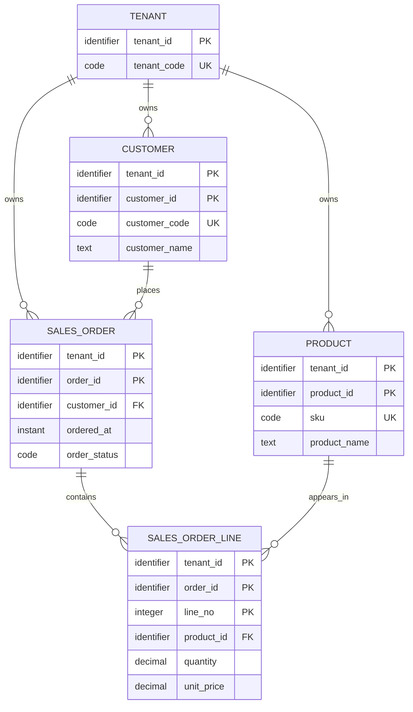
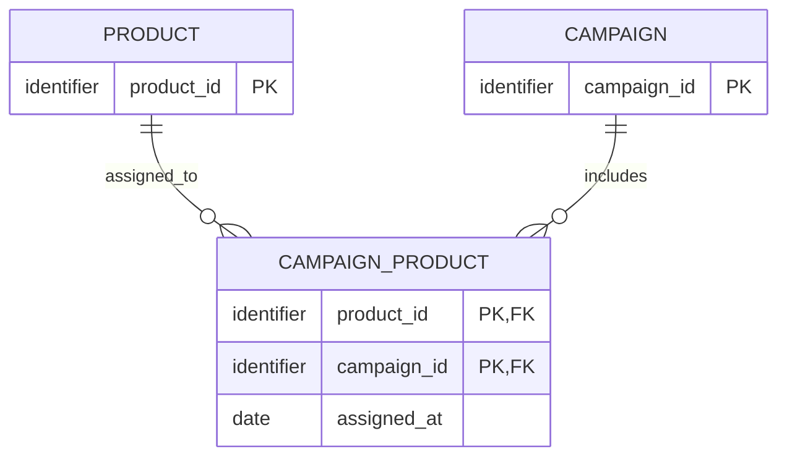

# Reading a Logical Diagram Without Tying It to a Specific DBMS

A data diagram can be drawn with clean boxes and connecting lines, yet two engineers reading the exact same diagram can still build two different databases: one allows an order without a customer, the other mandates a customer; one assumes email must be unique, the other allows family members to share an email. If you immediately turn boxes into `CREATE TABLE` statements for a specific DBMS, these differences can get buried beneath data types, indexes, and syntax.

**Reading a logical diagram** is the skill of interpreting a model through **business semantics first**, and only then verifying the keys, relationships, cardinalities, optionality, and invariants the diagram expresses. A good logical diagram should be clear enough that teams using PostgreSQL, MySQL, SQL Server, or another platform understand **the exact same set of rules**, even if their physical implementations differ.

This lesson belongs to the **Relational Modeling** chapter of the **DATABASE_DATA_MODELING** module: building the skill of translating requirements into entities, relationships, constraints, normalization, and physical schemas while comparing data representation across relational, document, graph, and analytical models. The focus here is **reading and critiquing a DBMS-agnostic logical model**, not memorizing one vendor's DDL syntax.

## 1. Distinguishing Three Layers: Conceptual, Logical, and Physical

The same business domain—“a customer places an order”—can be described at three levels of detail.

| Layer | Question to Answer | Typical Contents | What Not to Conclude Prematurely |
|---|---|---|---|
| **Conceptual** | Which things/events does the business manage and how do they relate? | `Customer`, `Order`, “customer places order”, participation counts | `BIGINT` types, storage engines, or indexes |
| **Logical** | What keys, attributes, cardinalities, and constraints does each thing have? | `Order` keys, 1:N relationships, mandatory attributes, N:M junction tables, functional dependencies | Defaulting to `SERIAL`, `IDENTITY`, collations, or specific B-tree types |
| **Physical** | What mechanisms will the chosen DBMS use to store and enforce the model? | `CREATE TABLE`, numeric types, FKs, indexes, partitions, permissions, migrations | Never alter business meaning merely because a tool offers a convenient shortcut |

For example, at the logical layer we can state:

> Each order belongs to exactly one customer within the same tenant. A customer may have zero orders or many orders.

When moving to the physical layer, one implementation uses a composite key `(tenant_id, customer_id)` and FK; another might use a global ID with a separate tenant constraint. The two designs are equivalent only if both enforce the rule **no cross-tenant links**.

**Reading Principle:** a logical schema is a **contract about data meaning and validity**. A physical schema is one or more ways of enforcing that contract. “Not tied to a DBMS” does not mean ignoring data integrity; on the contrary, you must cleanly separate **which invariants must be protected** from **the specific enforcement mechanism**.

### An ERD Is Not Always a Complete Logical Schema

An ERD (*entity–relationship diagram*) shows only what is drawn or annotated. Constraints like “each order must have at least one detail line at confirmation time”, “quantity must be positive”, or “item codes are unique within a tenant” might not be fully conveyed by a connector line. Readers should therefore inspect **the diagram, data dictionary, and business rule list together**, never assuming constraints that are absent from documentation.

## 2. Seven Questions to Ask When Looking at a Diagram

Instead of immediately asking “which data type should we use?”, ask in order:

1. **What kind of object or event does this box represent?** For instance, `SalesOrder` is a created purchase order, not an in-progress shopping cart.
2. **What does a single row/instance mean?** Is an `OrderLine` row a line item in an order, a shipment, or a unique product within the order?
3. **What key identifies the object?** Is there a technical ID, business code, candidate key, or tenant-scoped composite key?
4. **How does each connector read in both directions?** How many orders can one customer have? How many customers can one order belong to?
5. **Is the relationship mandatory?** Does it accept 0, 1, or many linked objects? Is there a status milestone where that condition changes?
6. **Which entity do the attributes depend on?** How does a product's current price differ from the locked-in price on an order line?
7. **Which invariants are not yet shown by the diagram?** No duplicate codes, no cross-tenant references, confirmed orders must have lines, transactions must not exceed limits, etc.

Any uncertain answer must be logged as an **open business question to confirm**, never silently filled in with ORM or SQL defaults.

## 3. Running Example: Reading a Multi-Tenant Order Diagram

Suppose a commerce platform manages multiple independent businesses (*tenants*). Each tenant has its own customers, product catalog, and orders.

Confirmed statements:

- Each customer belongs to exactly one tenant; each product and order also belongs to exactly one tenant.
- A customer may have placed zero orders or many orders; an order belongs to exactly one customer.
- An order can have many order lines. While in **DRAFT** status, an order may have zero lines; when **CONFIRMED**, an order must have at least one line.
- Each order line points to one product. A product may appear in zero lines or in many lines across many orders.
- A line records quantity and **the unit price at order time**; the product's current price may change later.
- One tenant's data must never reference customers or products belonging to another tenant.

### 3.1. Logical ERD to Read



This is an **illustrative logical diagram**. Words like `identifier`, `code`, `instant`, and `decimal` suggest conceptual value kinds; they are **not a commitment to valid SQL type names in any particular DBMS**. The markers `PK`, `UK`, and `FK` indicate key roles at the logical level; in the physical schema you must still specify **which column groups** compose each key or foreign key.

The diagram draws `SALES_ORDER ||--o{ SALES_ORDER_LINE` allowing **0..N** lines because draft orders can be empty. The condition **a CONFIRMED order must have at least one line** is a state-dependent rule that cannot be expressed by that connector alone. Do not change the connector to mandatory 1..N across all statuses if the business genuinely permits empty draft orders.

### 3.2. Entity and Key Dictionary

| Entity | Grain — What Is One Record? | Logical Identifying Key | Notable Attributes |
|---|---|---|---|
| `Tenant` | One independently managed organization | `tenant_id`; `tenant_code` globally unique per policy | Name, active status |
| `Customer` | One customer profile of a tenant | `(tenant_id, customer_id)`; `customer_code` unique **within tenant** | Name, contact info |
| `Product` | One product managed by a tenant | `(tenant_id, product_id)`; `(tenant_id, sku)` is a candidate key if SKUs do not repeat | Current name, sale status, current list price |
| `SalesOrder` | One order created within a tenant | `(tenant_id, order_id)` | Ordering customer, timestamp, status, currency |
| `SalesOrderLine` | One numbered line within **one order** | `(tenant_id, order_id, line_no)` | Product, quantity, locked-in unit price |

Using composite keys containing `tenant_id` is **an intentional logical design**, not a claim that every multi-tenant system must use composite PKs. If global IDs already guarantee uniqueness, you must still express **and enforce** same-tenant ownership on relationships; global ID uniqueness alone is not proof against cross-tenant links.

An order can contain two lines with the same `product_id` when lots, promotions, or shipping splits differ; hence **do not blindly apply** `UNIQUE (tenant_id, order_id, product_id)`. The `line_no` key identifies lines solely within an order. This illustrates why **grain** must be confirmed before choosing keys.

## 4. Reading Connectors: Cardinality and Optionality

In crow's-foot notation, pay attention to minimum and maximum counts at each end of a relationship:

| Symbol at One End | Meaning |
|---|---|
| `o|` | Zero or one — `0..1` |
| `||` | Exactly one — `1..1` |
| `o{` | Zero or many — `0..N` |
| `|{` | One or many — `1..N` |

Example of reading `CUSTOMER ||--o{ SALES_ORDER`:

- Standing at **one order**, looking toward `CUSTOMER`: the order belongs to **exactly one** customer.
- Standing at **one customer**, looking toward `SALES_ORDER`: the customer can have **zero or many** orders.

Do not read it backward as “a customer has only one order” merely because `||` sits next to `CUSTOMER`. The symbol at a given end describes how many objects **at that end** can relate to one object at the opposite end.

### Same Relationship, Two Independent Questions

For `PRODUCT ||--o{ SALES_ORDER_LINE`:

1. **How many products does one order line reference?** Exactly one product.
2. **On how many order lines can one product appear?** From 0 to many.

For `SALES_ORDER ||--o{ SALES_ORDER_LINE` when drafts are allowed:

1. **How many orders does one line belong to?** Exactly one order.
2. **How many lines can one order have?** From 0 to many; when confirmed, a separate rule requires at least one.

### Cardinality Alone Does Not Dictate a Specific Physical Constraint

The rule “each order has exactly one customer” typically translates into a **non-null** foreign key on `SalesOrder`. Conversely, “a confirmed order must have at least one line” **is not enforced by an FK from `SalesOrderLine` to `SalesOrder`**: the FK only checks that a child line points to an existing parent, not that the parent has children.

If a drawing tool shows `1..N` while the physical schema only has a one-way FK, document explicitly **where the rule is enforced**: confirmation transaction, trigger, or another verification mechanism.

## 5. Reading Keys Properly: PK, Candidate Keys, UK, FK

A logical diagram should express **data identification rules**, without forcing readers into auto-increment integers.

### 5.1. Candidate Keys and Primary Key

Suppose `Product` has:

- `(tenant_id, product_id)`: stable system-managed key.
- `(tenant_id, sku)`: also a candidate key if the business guarantees SKUs are non-duplicate and non-empty **within the same tenant**.

When choosing the first as the **primary key**, the second must still be protected by a uniqueness rule if it is a business invariant. An auto-increment ID does not prevent two products from sharing the same SKU.

A **primary key** is a candidate key chosen as the canonical row identifier. A **foreign key** is a value or tuple in one table referencing a primary key or supported unique key in another table. A **business key** can serve as the primary key or as a separate unique constraint, depending on its stability and mutability needs.

### 5.2. Multi-Column Foreign Keys Must Be Read as One Constraint

In our example:

\[
\mathrm{SalesOrder}(tenant\_id, customer\_id)
\to \mathrm{Customer}(tenant\_id, customer\_id)
\]

and:

\[
\mathrm{SalesOrderLine}(tenant\_id, order\_id)
\to \mathrm{SalesOrder}(tenant\_id, order\_id)
\]

\[
\mathrm{SalesOrderLine}(tenant\_id, product\_id)
\to \mathrm{Product}(tenant\_id, product\_id).
\]

Not each column is an independent FK that can point anywhere. A **composite FK** compares **the entire tuple** of columns on the child row against the key tuple on the parent row.

For example, tenant 42 has `customer_id = 7`, and tenant 43 also has `customer_id = 7`. If tenant 42's `SalesOrder` only checked `customer_id = 7` without tenant, it could point to the wrong profile. The composite FK expresses **customer in the same tenant as the order**.

### 5.3. A Candidate Key Is Valid Only When the Rule Truly Exists

Seeing no two people share an email in sample data **does not prove email is unique**. Emails can be shared in families, changed, unverified, or absent. Do not hastily add `email` to candidate keys until the business confirms uniqueness, scope, and applicability conditions.

Similarly, a display order number like `SO-2026-001` might only be unique per tenant and year. If chosen as a business key, explicitly state its scope, format, and number-reuse policy on cancellation.

## 6. Reading Attributes by Grain and Functional Dependencies

**Grain** is the exact definition of “what one row represents”. Starting from grain, we determine where each attribute belongs.

| Attribute | Right Data Level | Reason |
|---|---|---|
| `customer_name` | `Customer` | Describes the current customer profile |
| `sku`, `product_name` | `Product` | Describes the current product within the tenant |
| `ordered_at`, `order_status` | `SalesOrder` | Describes one order |
| `quantity` | `SalesOrderLine` | Quantity for one order line |
| `unit_price` | `SalesOrderLine` | Unit price **locked in** at order time, which may differ from the product's current price |
| `currency_code` | Usually `SalesOrder` if all lines share one currency | Avoids conflicting currencies per line |
| `delivery_address_snapshot` | Order/shipment or a related snapshot table per business rules | Must preserve address at purchase time even if customer profile changes |

Several functional dependencies are implied:

\[
(tenant\_id, product\_id)\rightarrow(sku, product\_name)
\]

\[
(tenant\_id, order\_id)\rightarrow(customer\_id, ordered\_at, order\_status)
\]

\[
(tenant\_id, order\_id, line\_no)\rightarrow(product\_id, quantity, unit\_price).
\]

These are logical assumptions: the same key identifies one row and determines that row's attributes. To store **multiple versions** of a product name, the new grain must include a version key or effective date—never insert two rows with the same `product_id` into the same table under the old PK.

### 6.1. Avoid Repeating Current Data That Causes Update Anomalies

If `SalesOrderLine` also stores `product_name_current` and treats it as the product's current name, every product rename requires updating many order lines; partial updates create contradictions.

However, if the order line stores `product_name_at_purchase` to preserve the name printed on the receipt, that is an **intentional historical snapshot**, not current-data duplication. The rule here is to name and document **the point in time the value reflects**.

### 6.2. Reading Normalization Without Counting Tables

In a well-normalized logical model, attributes describing **one type of object** live where that object's key determines them. For instance, currency codes and names do not need to repeat on every order line when a standard currency reference table exists; the order only needs the code and transaction amounts.

Warning signs to review:

- A column packing multiple repeating values into one row, such as `product_ids = '3,4,7'`.
- Customer name and phone copied into the order table yet treated as **current profile data**.
- `order_line` containing columns `course_1`, `course_2` or `item_1`, `item_2` instead of child rows.
- A product attribute placed in `SalesOrder` even though an order contains multiple different products.
- A junction table using a key too wide or too narrow for the event's grain.

Normalization does not forbid all redundancy. Transaction snapshots, consistently managed derived data, and analytical structures can be intentionally kept when **source-of-truth rules and update costs** are clear.

## 7. Understanding NULL, Optionality, and Missing Data States

On a diagram, “optional” can carry several meanings:

1. Value not yet known at the current time.
2. Value does not apply to this entity kind.
3. Relationship has not formed yet—for instance, a draft order without a shipping address yet.
4. Field was missed due to a source data error and needs remediation.

These four cases do not necessarily deserve the same unannotated `NULL`.

For instance, `Customer.email` may be optional if walk-in counter customers lack emails. `SalesOrder.customer_id` is mandatory if business rules require every order to link to a customer profile, even a walk-in profile. Never make `customer_id` nullable just to avoid creating a walk-in profile; explicitly model anonymous sales if the business requires them.

### NULL Affects Uniqueness and Foreign Keys

At the logical layer, “email is unique when provided” differs from “email is mandatory and unique”. When mapping to a DBMS, check `NULL` semantics in unique constraints; handling of empty/null values and conditional variants differs across engines.

With composite foreign keys, nullable components alter matching behavior depending on the FK match mode. In our example, `(tenant_id, customer_id)` on `SalesOrder` are **both mandatory**, preventing half-populated composite reference keys.

**Reading Rule:** when you see an optional column, ask “is this a valid business state or missing data needing repair?” before deciding between `NULL`, an explicit status, an auxiliary table, or a staging area.

## 8. Reading N:M and Associative Entities in Logical Diagrams

Suppose a product can belong to multiple promotional campaigns, and each campaign applies to multiple products. An N:M connector in a conceptual diagram is not yet a direct table structure in a standard relational model.

We resolve it into an associative entity:



The `CampaignProduct` table can use key `(tenant_id, campaign_id, product_id)` if a product is assigned to a campaign **at most once** within a tenant. If each assignment is an independent event with effective start–end dates, the key may need `assignment_id` or a version/attempt number, alongside uniqueness and temporal constraints per business rules.

**Key Point:** never mechanically convert every N:M into a two-FK table and declare the two FKs unique together. If the association can recur over time, *the grain of an association occurrence* determines the key.

## 9. Distinguishing Logical Constraints from Direct Enforcement Capabilities

A diagram can state **invariants** stronger than what a plain FK, unique, or check constraint can enforce.

| Business Rule | Logical Model Representation | Common Physical Mechanisms and Limits |
|---|---|---|
| Each order line belongs to one order | Mandatory FK to `SalesOrder` | `NOT NULL` + FK protects existence; must choose delete policy |
| No duplicate line #1 in the same order | Key `(tenant_id, order_id, line_no)` | Appropriate PK/UNIQUE |
| Cannot attach product from another tenant | Tenant-scoped composite FK | Must enforce composite constraint; single-column FK to global ID does not prove same tenant |
| Ordered quantity must be greater than 0 | Positive value domain | `CHECK` per DBMS capability |
| `CONFIRMED` order must have at least one line | Invariant depending on status and existence in another table | Confirmation gate, transaction, trigger, or helper mechanism; **child → parent FK is insufficient** |
| Do not exceed sellable inventory | Aggregate invariant across order lines and stock | Atomic check/reservation, transactions, and concurrency control |
| Paid orders cannot change unit price | State-transition and update-permission rule | Write gate/state machine/trigger/permissions; cannot be inferred from ERD lines |
| Monetary values must share currency when summed | Domain/currency rules for prices and totals | Logical money type + calculation rules, additional checks/design |

### Example of the “At Least One Line” Condition

At the logical level, we state:

> A confirmed order requires at least one line with positive quantity.

If creating `SalesOrder` and `SalesOrderLine` happens in two statements, there is a brief window inside the transaction where the order has no lines yet. Physical design must decide **when the invariant is enforced**: immediately at order creation, at transition to `CONFIRMED`, or at commit.

A common valid workflow allows creating an empty `DRAFT`, adding lines, and **confirming** only after verifying lines exist. If concurrent requests delete lines while confirming an order, synchronize transactions so an order that just became empty is never confirmed. Never write “because of the FK, orders always have lines”.

## 10. Read a Diagram, Then Test It with Tiny Sample Data

A logical diagram can look neat while hiding wrong keys or cardinalities. One way to verify is to construct **tiny sample data** and ask “which rows are allowed, and which must be rejected?”.

### 10.1. Test Data

Suppose:

- Tenant A has `customer_id=7` (An), `product_id=11` (Pen), `product_id=12` (Book).
- Tenant B also has `customer_id=7` (Bình) and `product_id=11` (Computer).
- Order A-100 belongs to tenant A, customer An, with two lines: `line_no=1` buying Pen, `line_no=2` buying Book.

Local ID collisions across tenants are not an error when the logical key is **the tuple of tenant and ID**.

### 10.2. Expected Matrix

| Operation | Valid? | Why |
|---|---|---|
| Create order A-101 for customer An in tenant A | Yes | Customer exists in the same tenant |
| Create order A-102 pointing to customer Bình of tenant B | No | Violates same-tenant relationship |
| Add line 3 to order A-100 for product Pen | Yes, if buying rules allow same product on multiple lines | Line key is `line_no`, not `product_id` |
| Add another line also with `line_no=2` to order A-100 | No | Duplicate line key within the same order |
| Create `DRAFT` order with no lines yet | Yes | Does not need confirmation condition yet |
| Transition an order with no lines to `CONFIRMED` | No | Violates state-dependent invariant |
| Add a line with `quantity = 0` | No | Quantity domain must be positive |
| Rename product after order is paid | Possibly yes | Order line must still retain locked-in price/name history per policy |
| Delete customer who has archived orders | Per policy, usually restricted | Relationship and historical obligations dictate delete restrictions |

If a row in this table cannot be answered due to missing policy, log an **open question**. That is the core payoff of reviewing a logical schema before writing DDL: spotting ambiguities cheaply.

## 11. Converting a Logical Diagram into a Neutral Specification

One DBMS-agnostic presentation uses a **data dictionary** paired with logical constraints instead of tying directly to vendor-specific SQL types.

Example:

```text
ENTITY Customer
  Identity: (tenant_id, customer_id)
  Candidate key: (tenant_id, customer_code)
  Attribute customer_name: required, nonblank

ENTITY Product
  Identity: (tenant_id, product_id)
  Candidate key: (tenant_id, sku)
  Attribute product_name: required, nonblank

ENTITY SalesOrder
  Identity: (tenant_id, order_id)
  Attribute customer_id: required
  Attribute ordered_at: required, instant
  Attribute order_status: required, one of {DRAFT, CONFIRMED, CANCELLED}
  Relationship (tenant_id, customer_id)
    -> Customer(tenant_id, customer_id), exactly one Customer

ENTITY SalesOrderLine
  Identity: (tenant_id, order_id, line_no)
  Relationship (tenant_id, order_id)
    -> SalesOrder(tenant_id, order_id), exactly one SalesOrder
  Relationship (tenant_id, product_id)
    -> Product(tenant_id, product_id), exactly one Product
  Attribute quantity: required, decimal > 0
  Attribute unit_price: required, money amount >= 0
  Invariant: unit_price is the agreed snapshot for this line

CROSS-ENTITY RULE
  If SalesOrder.status = CONFIRMED:
    count(SalesOrderLine where same tenant_id/order_id) >= 1
```

This specification brings multiple benefits:

- Independent of `IDENTITY`, `AUTO_INCREMENT`, `SERIAL`, or sequences.
- Expresses same-tenant scope and uniqueness bounds clearly.
- Specifies **semantic value kinds** (`instant`, money, quantity) before picking `TIMESTAMP`, `NUMERIC`, or custom structures.
- Separates cross-table invariants from simple FK relationships.
- Allows comparing two different physical designs against **the exact same test cases**.

When a diagram serves as communication among product owners, backend engineers, data engineers, and DBAs, such a logical spec reduces arguments caused by differing readings of diagram symbols.

## 12. Decisions Best Deferred to Physical Design

Some decisions can only be finalized once DBMS, data volume, availability needs, and deployment topology are known.

| Decision Item | Already Known at Logical Layer | Deferred to Physical Layer |
|---|---|---|
| `Product` identity | Has stable ID, SKU unique within tenant | Numeric ID, UUID, or other identifier; generation strategy |
| Monetary values | Currency unit and decimal precision, rounding rules | Specific `DECIMAL/NUMERIC`, precision/scale, custom types |
| Order timestamp | Absolute instant or business-local time with zone | Timestamp type, timezone standard, conversion strategy |
| Deduplication | Which key tuples must be unique | Unique index syntax, collation/case-folding, NULL handling |
| FK checks | Which links must exist, delete policies | `FOREIGN KEY` syntax, timing/deferrability, supporting indexes |
| Descendant queries | Need tree traversal over parent–child links | Recursive CTE, materialized path, closure table, specialized indexes |
| Read/write volume | Query patterns and target SLAs | Indexes, partitions, clustering, caches, replicas |
| Tenant isolation | No cross-tenant reads/writes | DB roles, Row-Level Security, API auth, database separation |
| Migrations | Must not lose data or break invariants | Deployment tooling, backfill ordering, validation, rollbacks |

**Point of Caution:** picking `BIGINT` vs. `UUID` does not change “each order belongs to one customer”, whereas **dropping tenant from the FK** can change the meaning of the relationship itself. Distinguish valid physical choices from accidentally **weakening the logical contract**.

### 12.1. Illustrative SQL Is Not the Logical Contract

A short SQL snippet can serve as a mapping step:

```sql
-- SQL illustrating the relationship structure, not a complete deployment schema.
CREATE TABLE customers (
    tenant_id BIGINT NOT NULL,
    customer_id BIGINT NOT NULL,
    customer_name VARCHAR(200) NOT NULL,
    PRIMARY KEY (tenant_id, customer_id)
);

CREATE TABLE sales_orders (
    tenant_id BIGINT NOT NULL,
    order_id BIGINT NOT NULL,
    customer_id BIGINT NOT NULL,
    PRIMARY KEY (tenant_id, order_id),
    FOREIGN KEY (tenant_id, customer_id)
        REFERENCES customers (tenant_id, customer_id)
);

CREATE TABLE sales_order_lines (
    tenant_id BIGINT NOT NULL,
    order_id BIGINT NOT NULL,
    line_no INTEGER NOT NULL,
    quantity DECIMAL(14, 3) NOT NULL,
    PRIMARY KEY (tenant_id, order_id, line_no),
    FOREIGN KEY (tenant_id, order_id)
        REFERENCES sales_orders (tenant_id, order_id),
    CHECK (quantity > 0)
);
```

This is an **illustrative fragment**, intentionally omitting `products`, `product_id`, unit prices, dates, and statuses, so it **must not be treated as a complete implementation of Section 3's diagram**. Its value is showing how a **composite FK** cleanly expresses a multi-tenant relationship in relatively portable SQL syntax.

When adopting it for a real project, complete all attributes and logical constraints, verify how your DBMS handles checks/constraints, and add appropriate indexes and migrations. The presence of SQL syntax in study material does not tie these concepts to PostgreSQL.

## 13. Traps That Lock a Logical Model to One Technology

### 13.1. Inferring Business Rules from Vendor Data Types

“This field is `VARCHAR(255)` so it must be long enough”, “this field is `FLOAT` because the DB runs fast”, or “it can be null because the ORM defaults to nullable” are all backward reasoning.

The logical model must specify: what is the maximum code length per standard? Does money allow rounding error? Does time need a timezone? Is the value mandatory once the object is published? Only then does the physical layer pick types.

In particular, **money** typically requires exact decimals or integer minor units per currency; using binary floating-point numbers without bounding error causes arithmetic and reconciliation discrepancies.

### 13.2. Assuming All DBMSs Handle NULL and Uniqueness Identically

A rule “email is unique once verified” may need to be described as **conditional uniqueness** rather than a blanket `UNIQUE(email)`. Behavior of `NULL`, collations, case sensitivity, whitespace, and partial indexes differs across DBMSs.

The logical layer should state, for example: “Within the same tenant, two verified customers cannot share the same **normalized** email; unverified customers may lack an email.” Exact enforcement is a physical decision to test.

### 13.3. Treating a Vendor Feature as the Root Design

Features like `ENUM`, DBMS-specific table inheritance, JSON columns, materialized views, or specialized indexes can all be useful. Yet never conclude that just because a technology offers a feature, the business concept must be modeled with that feature.

If the goal is a reference table where operators add values at runtime with keys, labels, permissions, and temporal validity, a closed enum type falls short. If there are just a few rarely changing statuses, a reference table may be needless complexity. Lock down semantics first, then pick the mechanism.

### 13.4. Reading Connector Lines as Default `ON DELETE CASCADE`

An ERD says a customer has many orders, yet **does not specify** whether deleting a customer deletes orders or is forbidden. Payment history, audits, and privacy policies determine deletion, hiding, anonymization, or retention rules. FK `ON DELETE` is an implementation mechanism; **lifecycle policy** must be defined first.

### 13.5. Confusing Performance with Cardinality

An N:M relationship does not automatically mean slow queries; a 1:N relationship does not automatically mean fast ones. Performance depends on real row counts, selectivity, indexes, join plans, partitioning, and returned data volume. Never add summary tables or JSON columns to “avoid joins” without representative workloads and measurements.

## 14. Reading States, Time, and History Before Choosing Tables

A static diagram usually shows only the **current state** of data. Many business processes need to know what state **existed at a past point in time**.

### 14.1. Is Status an Attribute or a Lifecycle?

An `order_status` field taking `DRAFT`, `CONFIRMED`, `CANCELLED` does not express **allowed state transitions**. For instance, `CANCELLED → CONFIRMED` may be forbidden, or cancellation may be allowed only before shipment. These constraints belong in a state machine / business rules spec, never inferred from a text column.

If every transition must be audited, consider `OrderStatusEvent`: order key, old/new status, timestamp, and actor. Then **one event row** represents one transition, distinct from **one order row** representing one order. Never mix those two grains.

### 14.2. Current Keys vs. Versioned Keys

A product can change name, price, and category. If last quarter's report must display the category **as of last quarter**, the logical model needs **classification history** or **transaction snapshots**.

Storing `product_id` on an order line only points to the current product; it does not automatically return the name, category, or price at purchase time. `unit_price` on the order line is an example of intentionally keeping a snapshot so product price updates do not rewrite the past.

When a model involves effective time:

- Determine whether **business effective time** (*valid time*) and/or **system recording time** (*transaction/system time*) matters.
- Define effective intervals, overlap rules, versioning, and “as of T” query patterns.
- Distinguish canceling current records from retaining legal/audit history.
- Never treat an `updated_at` column as full history; it only reflects the single most recent update timestamp.

## 15. Not Tied to Relational: Comparing Document, Graph, and Analytics

A sound **business logical model** can guide storage choices beyond relational tables. It does not make technologies identical, yet preserves the semantics that must be protected.

### 15.1. Document Model

In a document database, order lines can be embedded inside the `Order` document:

```json
{
  "tenantId": "T42",
  "orderId": "O100",
  "customerId": "C7",
  "status": "CONFIRMED",
  "lines": [
    {"lineNo": 1, "productId": "P11", "quantity": 2, "unitPrice": "25000.00"},
    {"lineNo": 2, "productId": "P12", "quantity": 1, "unitPrice": "100000.00"}
  ]
}
```

This layout works well when most operations read/write **the entire order with its lines** and document size stays reasonably bounded. However, it **does not eliminate logical requirements**: the order must belong to the right customer, product references must exist within the same tenant, line numbers cannot repeat within an order, quantities must be positive, and confirmed orders must have lines. Automatic enforcement depends on the engine, schema validation, transactions, and write paths.

Document storage can reduce joins for certain reads, while making cross-document references or broad transactions more complex. Never switch to documents merely because an ERD has many lines.

### 15.2. Graph Model

A graph represents `Customer`, `Order`, and `Product` as nodes, and relationships like `PLACES`, `HAS_LINE`, and `REFERS_TO` as edges. Multi-hop queries, path finding, or network relationships can become more intuitive.

Yet an existing edge **does not automatically guarantee** “order belongs to only one customer”, “no cross-tenant references”, or “order has at least one line”. Cardinality and ownership-scope constraints must be engineered according to the specific graph database's capabilities.

### 15.3. Analytical Model (Analytics)

In a data warehouse, the same domain can be organized into **facts** and **dimensions**:

- `FactOrderLine` at the **one order line** grain.
- `DimCustomer` and `DimProduct` holding analytical attributes of customers/products.
- `DimDate` or time fields supporting periodic aggregation.
- If category history is required, dimensions can be versioned.

The key rule to preserve is **grain**. If order-level revenue is stored at the order level and then joined to multiple order lines before taking `SUM`, revenue gets multiplied by line count. The relational logical schema is where you spot this *fan-out* risk before building a data mart.

### 15.4. Choosing a Storage Model Never Erases Business Requirements

| Logical Rule | Relational | Document | Graph / Analytics |
|---|---|---|---|
| Order belongs to one customer in same tenant | Composite FK/constraint | Reference + suitable validation/transactions | Edge with cardinality/scope; fact key and data tests |
| Order has many lines | `SalesOrderLine` table | Array/subdocuments or line collection | Nodes/edges or line facts |
| Line has product and locked-in unit price | Product FK + line attributes | Embedded/referenced line fields | Edge/entity properties or facts |
| Confirmed order has lines | Confirmation gate/suitable triggers | Validation and write gates | Engine-specific business constraints/validation |
| Reconstruct past transactions | Snapshots/history | Snapshots/versioned documents | Versioned nodes/edges/dimensions |

Reading logical diagrams in a DBMS-agnostic way preserves these requirements when comparing options, instead of letting the chosen technology dictate business definitions.

## 16. A Team Workflow for Reviewing Logical Diagrams

When asked to review a model before DDL exists, work through the following sequence.

### Step 1 — Read Names, Definitions, and Grain

For each entity, write one sentence: “one record is...”. An overly generic name like `Transaction` must be clarified: is it a payment instruction, an accounting entry, or a system transaction? Without defining grain, all downstream keys and relationships risk being wrong.

### Step 2 — Confirm Keys and Scope

List logical PKs, candidate keys, tenant/business-unit scope, and code-change policies. Ask: “what if the same code appears in two tenants?”, “if a product name changes, does its ID change?”.

### Step 3 — Read Every Relationship in Both Directions

For each connector, write two corresponding sentences—for example, “a customer has 0..N orders” and “an order belongs to exactly one customer”. Cross-check minimum/maximum counts with requirements, especially optional relationships and state-dependent cases.

### Step 4 — Place Attributes at the Right Grain

Check functional dependencies, misplaced repeating attributes, and current values vs. historical snapshots. Decide whether N:M needs a junction table or whether repeatable participation needs an event table.

### Step 5 — List Hidden Invariants

Write down rules for quantities, statuses, time, uniqueness, tenant scope, permissions, history, and multi-row aggregations. Separate rules enforceable by standard constraints from rules requiring transactions, write gates, or other mechanisms.

### Step 6 — Test with Counterexamples

Build a tiny dataset of a few rows: two tenants with colliding local IDs; an empty draft order; an empty confirmed order; the same product on two lines; a customer with no orders; a line with quantity 0. The model must give clear answers: “allowed or rejected, and why”.

### Step 7 — Map to Physical Design While Keeping the Logical Trace

Once semantics are agreed upon, document the mapping to the target DBMS, including constraints, data types, indexes, and invariants not directly enforced. When switching technologies or upgrading versions, **testing the logical contract** must still yield the same results.

## 17. Quick Review Checklist

| Review Question | Good Sign | Sign to Revisit |
|---|---|---|
| Is every entity defined by its grain? | “One row is one order placement” | “Table holds order info” |
| Does every key have a clear uniqueness scope? | `(tenant_id, sku)` unique within tenant | “SKU is probably unique” |
| Is each relationship read in both directions? | Clear 0..N, 1..1 statements | Looking only at arrows or FK names |
| Do mandatory links state when they apply? | “`CONFIRMED` must have lines” | “Orders always have lines” despite DRAFTs |
| Does each junction row have the right grain? | “One row per participation attempt” | Unique pair even when retakes are allowed |
| Are current values and history separated? | `unit_price_at_order` is a snapshot | Using current price to compute old revenue |
| Is tenant scope protected? | Verified composite FK or equivalent | Trusting client always sends the right tenant |
| Are mechanisms separated from rules? | Independent invariant + explicit mapping | “Framework generates this column so business works that way” |
| Are there counterexample test cases? | Allowed/rejected table exists | Only a pretty ERD picture |
| Is model scope sufficient for reporting? | Fact grain and history if needed | N:M joins without checking metric multiplication |

## 18. Practice Exercise: Reading a Library Management Diagram

A multi-branch library has:

- `LibraryBranch`: each branch has a code and address.
- `BookTitle`: a book title such as “Java Programming”, with ISBN and title.
- `BookCopy`: a specific physical copy belonging to one branch and one title; a title can have many copies.
- `Member`: readers who can borrow many book copies over time.
- `Loan`: each checkout of a specific copy, with checkout time, due date, and return time.

Requirements:

- Each book copy belongs to exactly one branch; a branch may not have any copies yet.
- Each book copy links to exactly one book title; a title can have many copies.
- A member can have many loans; a loan belongs to exactly one member and one book copy.
- A book copy **cannot have two concurrently open loans**, though it can be borrowed multiple times after being returned.
- One branch must not manage copies belonging to another branch.
- Reports must show loan status as of a past date.

Perform the following:

1. Draw the conceptual ERD and logical diagram, reading all relationships in **both directions** with cardinality and optionality.
2. Write grain definitions for `BookTitle`, `BookCopy`, and `Loan`. Explain why `Loan` is **not merely a unique junction table keyed by `(member_id, copy_id)`**.
3. Propose primary keys, business keys, and uniqueness scopes; consider whether ISBN always suffices to identify a book title, and what needs confirmation with the business.
4. Identify FKs that must enforce same-branch/tenant scope. Distinguish FKs from member authorization policies.
5. Identify rules enforceable via PK, FK, `NOT NULL`, and `CHECK`, and what extra mechanism is required for “no two concurrently open loans”.
6. Describe how to store history to answer “who was borrowing copy X on 01/10”, rather than relying only on a current `is_borrowed` flag.
7. Provide 8 test cases covering an empty branch, a multi-copy title, repeated loans over time, concurrent checkouts, returns, and wrong-branch entry.
8. Compare relational, document, and graph structures for two features: searching inventory by branch and querying the member–book-title network.

**Acceptance Criteria:** The model is described with **DBMS-agnostic semantics**, keys accurately reflect grain, optional relationships are read in the right direction, and **logical invariants** are cleanly distinguished from **physical enforcement mechanisms**.

## 19. Summary

- Read logical diagrams through **entities, grain, keys, relationships, cardinality, optionality, and invariants**, not SQL syntax or ORM annotations first.
- Every connector must be interpreted **in both directions**. FKs protect endpoint existence yet do not automatically enforce minimum participation or status rules.
- Keys have **scope**; in multi-tenant models, explicitly express same-tenant relationships.
- Attributes must live at the **right grain**. Distinguish current information from locked-in snapshots and historical data.
- A logical schema is a **verifiable contract**; a physical schema picks types, constraint mechanisms, indexes, and transactions to fulfill that contract.
- Counterexamples with a few rows of data usually expose flaws faster than debating column types or engines.
- When comparing relational, document, graph, and analytics models, keep business semantics constant first and then weigh storage layouts and execution costs.
