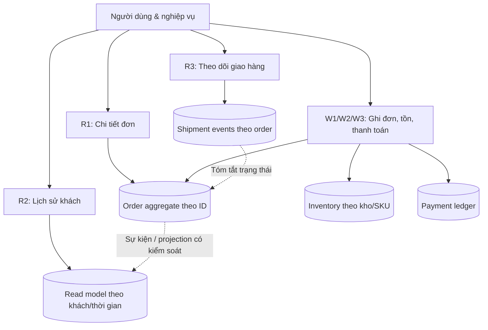
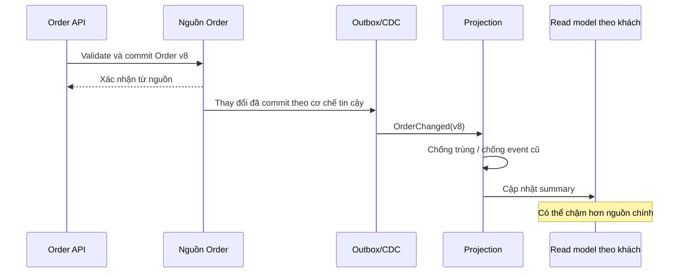
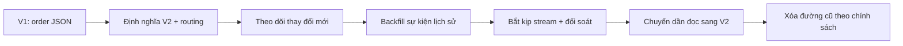

# Thiết kế theo ranh giới dữ liệu thường được đọc hoặc ghi cùng nhau

## Mục tiêu học tập

Sau bài học, bạn có thể:

- Giải thích **ranh giới dữ liệu thường được truy cập cùng nhau** (*co-access boundary*) và phân biệt **đọc cùng nhau (co-read)** với **ghi cùng nhau (co-write)**.
- Phân biệt **ranh giới aggregate nghiệp vụ**, **đơn vị lưu trữ**, **khóa phân vùng**, **phân vùng logic**, **shard vật lý** và **phạm vi giao dịch**.
- Chuyển tập yêu cầu đọc/ghi thành **ma trận mẫu truy cập** có khóa đã biết, số hàng liên quan, thứ tự, tần suất, độ trễ, tính nhất quán và bất biến.
- Đề xuất cách nhóm dữ liệu vào một value, một nhóm hàng cùng partition hoặc nhiều bảng/read model mà không phải quét rộng.
- Xác định khi nào đặt dữ liệu gần nhau giúp truy vấn và khi nào làm tăng **hotspot, tranh chấp ghi, partition quá lớn, giao dịch xuyên phân vùng** hoặc nhân bản dữ liệu.
- Thiết kế ranh giới ghi bảo vệ ràng buộc nghiệp vụ bằng thao tác nguyên tử, giao dịch phù hợp hoặc workflow có trạng thái, idempotency và đối soát.
- Đánh giá cách chọn khóa phân vùng theo **hash, range, thời gian, tenant** và tác động đến truy vấn, cân bằng tải, di trú, dữ liệu đến muộn.
- Kiểm chứng lược đồ vật lý bằng **fan-out, kích thước partition, hot-key traffic, read/write amplification, p95/p99** và tính đúng khi dữ liệu thay đổi.

Bài thuộc module **DATABASE_DATA_MODELING**: rèn kỹ năng chuyển yêu cầu nghiệp vụ thành thực thể, quan hệ, ràng buộc, chuẩn hóa, khóa, chỉ mục và lược đồ vật lý; đồng thời so sánh mô hình quan hệ, document, đồ thị và phân tích theo nhu cầu thực tế. Trong chương **Phân tán và phân vùng**, câu hỏi trung tâm không chỉ là “chia dữ liệu ra bao nhiêu máy?” mà là:

> **Những phần dữ liệu nào thường được đọc hoặc cần cập nhật như một đơn vị nghiệp vụ, và nên tổ chức chúng thế nào để truy cập đúng, đủ nhanh, dễ mở rộng và còn giữ được các ràng buộc?**

Điểm khó là **ranh giới tối ưu để đọc không nhất thiết trùng ranh giới tối ưu để ghi**. Thiết kế tốt phải thể hiện và kiểm chứng sự khác biệt này.

---

## 1. “Dữ liệu được truy cập cùng nhau” nghĩa là gì?

Một thực thể hiếm khi được dùng độc lập. Ví dụ khi khách mở một đơn hàng, giao diện thường đọc **thông tin đơn cùng các dòng hàng**. Khi nghiệp vụ giữ tồn kho, nó cần đọc/ghi **số lượng khả dụng và lượng đã giữ của một SKU tại một kho**. Khi khách xem “20 đơn gần nhất”, giao diện chỉ cần **bản tóm tắt của nhiều đơn**, không cần tất cả dòng hàng của từng đơn.

Có ba loại quan hệ quan trọng:

| Loại quan hệ | Câu hỏi | Ví dụ | Hệ quả thiết kế |
| --- | --- | --- | --- |
| **Co-read** | Những bản ghi nào thường được lấy cùng nhau trong một thao tác đọc? | Header đơn + 3 dòng hàng | Cân nhắc đặt cùng value/partition hoặc chuẩn bị read model |
| **Co-write** | Những giá trị nào thường thay đổi cùng một lệnh? | Sửa số lượng một item và cập nhật tổng tiền tạm tính | Cân nhắc giao dịch/aggregate, giới hạn tranh chấp |
| **Co-invariant** | Những giá trị nào phải cùng thỏa một ràng buộc khi commit? | Tồn kho khả dụng không âm | Cần một điểm thực thi nguyên tử hoặc cơ chế nhất quán phù hợp |
| **Co-lifecycle** | Những dữ liệu nào được tạo, giữ, xóa theo cùng chính sách? | Dòng hàng đã chốt cùng đơn | Cân nhắc cùng đơn vị lưu trữ; tách event log có TTL khác |

**Co-read** là nhu cầu hiệu năng. **Co-invariant** là nhu cầu tính đúng đắn. Chúng có thể gợi ý cùng một ranh giới dữ liệu, nhưng **không tương đương**.

Ví dụ: một trang “chi tiết đơn” cần hiển thị đơn, thanh toán và vận chuyển. Đặt cả ba vào một partition có thể giúp một số truy vấn, nhưng không tự tạo giao dịch ACID xuyên ba dịch vụ. Hệ thanh toán có thể là nguồn có thẩm quyền riêng, không nên cho dịch vụ đơn tự thay đổi trạng thái thanh toán chỉ để giảm một phép đọc.

### 1.1. Ranh giới không được quyết định bằng sơ đồ thực thể đơn thuần

Một quan hệ nghiệp vụ `Order 1—N OrderItem` là thông tin quan trọng, nhưng chưa trả lời:

- Trang chi tiết luôn đọc **mọi item** hay chỉ đọc bản tóm tắt?
- Có bao nhiêu item tối đa, kích thước item ra sao?
- Item có được cập nhật sau khi đơn đã chốt không?
- Tất cả item có chung quyền, TTL và vòng đời với header không?
- Các lệnh sửa nhiều item có cần commit nguyên tử?
- Nhiều dịch vụ có cùng sửa đơn hay không?

Nếu một đơn có 3–10 item nhỏ và thường luôn đọc cùng, lưu chung có thể hợp lý. Nếu một “đơn” đại diện một lô xuất hàng với hàng triệu dòng, việc đặt tất cả vào một JSON hoặc một partition không giới hạn sẽ gây vấn đề dù quan hệ thực thể vẫn là 1—N.

## 2. Phân biệt sáu loại ranh giới

Trong hệ dữ liệu phân tán, rất dễ đồng nhất những khái niệm có cùng chữ “nhóm”.

| Ranh giới | Nó quy định điều gì? | Không tự bảo đảm điều gì? |
| --- | --- | --- |
| **Aggregate nghiệp vụ** | Tập trạng thái và bất biến được một thành phần quản lý như một đơn vị logic | Cùng một hàng, một partition hay một giao dịch DB |
| **Document/value** | Đơn vị trả về hoặc cập nhật theo API của kho | Truy vấn nhanh mọi thuộc tính bên trong; giao dịch với key khác |
| **Hàng/record** | Một bản ghi có khóa; có thể là đơn vị atomic write theo sản phẩm | Tính nguyên tử khi ghi nhiều hàng |
| **Partition logic** | Tập hàng cùng khóa định tuyến/nhóm truy cập logic | Luôn nằm trên một máy; luôn được cập nhật nguyên tử |
| **Shard/tablet/region vật lý** | Đơn vị engine phân bổ hoặc chia để lưu và phục vụ request | Ổn định mãi; tương ứng một-một với partition logic |
| **Phạm vi giao dịch** | Những cập nhật được engine cho phép commit/rollback theo bảo đảm cụ thể | Trùng với ranh giới partition hoặc aggregate |

Một số hệ có atomic write ở cấp một document; số khác có transaction qua nhiều hàng/phân vùng; số khác chỉ bảo đảm tại một số loại thao tác. **Không suy ra khả năng giao dịch từ việc dữ liệu “đặt gần nhau”.**

Ví dụ:

```text
Aggregate "Order"                = quy tắc nghiệp vụ của một đơn
Document "order:ord_908"         = một cấu trúc bytes/JSON
Partition "(shop_17, ord_908)"   = nhóm hàng đọc theo đơn
Tablet / shard                   = cách engine đặt dữ liệu thực tế
Transaction                      = phạm vi commit được hệ quản trị hỗ trợ
```

Năm khái niệm trên có thể liên quan nhưng **không bắt buộc bằng nhau**.

### 2.1. Khóa phân vùng không phải khóa định danh nghiệp vụ

`orderId` là định danh nghiệp vụ của một đơn trong phạm vi shop. Nhưng màn hình lịch sử khách cần truy vấn theo `(shopId, customerId)`. Do đó:

- **Khóa chính theo ID:** `(shopId, orderId)` để định vị một đơn.
- **Khóa của read model lịch sử:** `(shopId, customerId, monthBucket)` để định vị nhóm đơn cùng được liệt kê.
- **Khóa của dashboard trạng thái:** `(shopId, status, dayBucket)` để định vị danh sách đơn theo trạng thái.

Một đối tượng có thể xuất hiện trong nhiều đường đọc, với **nguồn chân lý và cơ chế đồng bộ** rõ ràng.

## 3. Bài toán xuyên suốt: nền tảng đơn hàng đa shop

Giả sử dịch vụ bán hàng phải xử lý:

- Nhiều shop; mỗi shop có hàng nghìn khách, nhưng mức tải theo shop lệch nhau rất mạnh.
- Đơn có metadata và các dòng sản phẩm; đơn có thể được giữ, thanh toán, gửi và giao ở những thời điểm khác nhau.
- Dịch vụ tồn kho giữ số lượng khả dụng theo `(warehouseId, sku)`.
- Sự kiện vận chuyển được bổ sung sau khi đơn đã thanh toán.
- Khách thường xem danh sách đơn gần đây và mở chi tiết một đơn.
- Nhân viên shop xem đơn theo trạng thái và ngày.
- Báo cáo tài chính tổng hợp theo tháng và danh mục.

Một đơn minh họa:

```json
{
  "shopId": "shop_17",
  "orderId": "ord_908",
  "customerId": "user_42",
  "status": "PAID",
  "createdAt": "2026-11-22T10:30:00Z",
  "currency": "VND",
  "items": [
    {"lineId": "1", "sku": "A17", "quantity": 2, "unitPriceMinor": 95000},
    {"lineId": "2", "sku": "B03", "quantity": 1, "unitPriceMinor": 29000}
  ],
  "totalMinor": 219000
}
```

`totalMinor` ở đây là ví dụ **tổng giá trị hàng** với `2 × 95.000 + 29.000 = 219.000 VND`, chưa xét giảm giá/thuế/phí vận chuyển; mọi quy tắc tiền thật phải được nêu trong hợp đồng nghiệp vụ.

### 3.1. Ma trận truy cập: điểm xuất phát của thiết kế

| Mã | Thao tác | Thông tin đã biết | Phần dữ liệu phải truy cập | Tần suất/độ mới |
| --- | --- | --- | --- | --- |
| R1 | Mở chi tiết đơn | `shopId, orderId` | Header + items, có thể phần giao hàng mới nhất | Thường xuyên; trạng thái phải rõ mức nhất quán |
| R2 | Đơn mới nhất của khách | `shopId, customerId` | 20–50 bản tóm tắt, sort thời gian | Thường xuyên, phân trang |
| R3 | Theo dõi vận chuyển | `shopId, orderId` | Sự kiện giao hàng theo thời gian | Đọc danh sách, thường bổ sung append-only |
| R4 | Dashboard đơn PAID | `shopId, status, range` | Nhiều đơn theo thời gian | Cao trong giờ làm việc; có thể trễ vài giây |
| W1 | Tạo/chốt đơn | `shopId, orderId, items` | Header + các item được chốt | Cần bảo vệ bất biến đơn |
| W2 | Giữ tồn kho | `warehouseId, sku, qty, requestId` | Số lượng khả dụng/đã giữ | Ghi cạnh tranh; không cho âm |
| W3 | Ghi thanh toán | `paymentId, orderId` | Trạng thái giao dịch tiền | Bất biến thanh toán và idempotency riêng |
| W4 | Ghi sự kiện vận chuyển | `shopId, orderId, eventId` | Thêm event, cập nhật trạng thái suy ra | Có thể trùng/đến sai thứ tự |
| A1 | Báo cáo doanh số | Tháng, shop, danh mục | Tập rất lớn để tổng hợp | Batch/OLAP hoặc rollup |

**Câu hỏi quan trọng:** dữ liệu nào được đọc cùng nhau ở **R1**, và dữ liệu nào cần cập nhật nguyên tử trong **W2**? Nếu cố đặt toàn bộ thông tin của đơn, tồn kho, thanh toán và vận chuyển dưới `shopId` để “gần nhau”, ta có thể tạo một partition nóng, một ranh giới giao dịch sai và các nhóm dữ liệu có vòng đời độc lập.

### 3.2. Mối quan hệ giữa các đường đọc và ghi



Các mũi tên chấm chỉ **đồng bộ logic**; chúng không mặc định cung cấp giao dịch phân tán hay cập nhật tức thời. Bản thân ứng dụng phải định nghĩa nguồn có thẩm quyền và mức trễ chấp nhận cho từng đường đọc.

## 4. Thiết kế từ co-read: đặt đúng nhóm dữ liệu cạnh nhau

Một cách đơn giản là hỏi: *khi API được gọi, nó cần đọc chính xác những gì và có thể dựng khóa nào từ input?*

### 4.1. Lựa chọn A: cả đơn trong một value/document

```text
key = order:v1:shop_17:ord_908

value = {
  metadata: {...},
  items: [...],
  shippingSummary: {...}
}
```

Phù hợp khi:

- Các phần trong value thường được đọc cùng nhau.
- Kích thước tối đa có giới hạn hợp lý.
- Nhiều thay đổi liên quan nằm trong một aggregate.
- Kho hỗ trợ cập nhật/điều kiện nguyên tử ở cấp value theo đúng yêu cầu.
- Không cần truy vấn từng dòng hàng lớn từ value liên tục.

Đánh đổi:

- Nếu sửa một trường phải đọc–ghi lại cả value, tải bytes và contention có thể tăng.
- Value càng lớn càng dễ chạm giới hạn kích thước của hệ.
- Một thuộc tính `customerId` nằm trong JSON **không tự tạo index** để tìm tất cả đơn của khách.
- Một sự kiện giao hàng tăng vô hạn không nên được append mãi vào value đơn hàng mà không có giới hạn.

Một value có thể là **ranh giới đọc hiệu quả**, nhưng nếu nhiều writer độc lập cùng sửa những phần khác nhau của nó, nó cũng có thể thành **điểm tranh chấp**.

### 4.2. Lựa chọn B: nhiều hàng/item cùng khóa phân vùng

Với hệ có partition key và sort key, ta có thể nhóm các item của một đơn:

```text
PK = SHOP#shop_17#ORDER#ord_908

SK = META
  -> {customerId, status, createdAt, totalMinor}

SK = ITEM#0001
  -> {sku:A17, quantity:2, unitPriceMinor:95000}

SK = ITEM#0002
  -> {sku:B03, quantity:1, unitPriceMinor:29000}

SK = SHIPPING_SUMMARY
  -> {lastStatus:PACKED, lastChangedAt:...}
```

Nếu sản phẩm hỗ trợ **query theo partition key + điều kiện sort key**, một API mở đơn có thể đọc nhóm item của đơn. Nếu chỉ cần item, API có thể chọn prefix `ITEM#` thay vì tải tất cả dữ liệu không liên quan.

**Lưu ý:**

- Một tiền tố chuỗi không tự tạo partition/range query trong mọi kho hash key–value.
- Cùng partition **không chứng minh** tất cả item được ghi nguyên tử trong một transaction.
- Một số sản phẩm giới hạn số item/kích thước partition và loại điều kiện trên sort key.
- Quy ước `SK=ITEM#0001` phải xử lý thứ tự, tính duy nhất, delimiter và việc thêm/xóa dòng.
- Nếu event vận chuyển rất nhiều hoặc giữ 7 năm trong khi đơn chỉ giữ 3 năm, tách chúng có thể tốt hơn.

### 4.3. Lựa chọn C: bảng theo truy vấn

Trong mô hình kiểu CQL/wide-column, có thể dùng hai bảng:

```sql
-- Chi tiết một đơn, đọc theo (shop_id, order_id).
CREATE TABLE order_items_by_order (
    shop_id            text,
    order_id           text,
    line_no            int,
    sku                text,
    quantity           int,
    unit_price_minor   bigint,
    PRIMARY KEY ((shop_id, order_id), line_no)
);
```

```sql
-- Lịch sử khách theo tháng, sắp đơn mới trước.
CREATE TABLE orders_by_customer_month (
    shop_id       text,
    customer_id   text,
    month_bucket  text,
    created_at    timestamp,
    order_id      text,
    status        text,
    total_minor   bigint,
    PRIMARY KEY (
        (shop_id, customer_id, month_bucket),
        created_at,
        order_id
    )
) WITH CLUSTERING ORDER BY (
    created_at DESC,
    order_id ASC
);
```

Lấy item của một đơn:

```sql
SELECT line_no, sku, quantity, unit_price_minor
FROM order_items_by_order
WHERE shop_id = 'shop_17'
  AND order_id = 'ord_908';
```

Lấy đơn mới của khách trong một tháng:

```sql
SELECT order_id, created_at, status, total_minor
FROM orders_by_customer_month
WHERE shop_id = 'shop_17'
  AND customer_id = 'user_42'
  AND month_bucket = '202611'
LIMIT 20;
```

Ví dụ SQL/CQL dùng để minh họa **đường truy cập theo khóa**; cú pháp, khả năng partition/clustering và giao dịch khác nhau theo sản phẩm. Đây là hai read patterns khác nhau nên có hai biểu diễn.

**Quan trọng:** nếu `orders_by_customer_month` là bản tóm tắt dẫn xuất từ nguồn đơn theo ID, phải có cơ chế đồng bộ khi status/total thay đổi. Đọc nhanh hơn không miễn phí: ta trả bằng dung lượng, số ghi và trách nhiệm đối soát.

## 5. Co-read không đồng nghĩa “nhồi mọi dữ liệu liên quan vào một chỗ”

Một màn hình có thể cần nhiều nguồn, nhưng các nguồn không nhất thiết có chung vòng đời hay quyền sở hữu.

Ví dụ trang đơn hàng hiển thị:

- Thông tin đơn và dòng sản phẩm: tương đối ổn định sau khi chốt.
- Trạng thái thanh toán: do payment service xác nhận.
- Tiến trình giao hàng: event append-only theo thời gian.
- Phân tích gợi ý sản phẩm: dữ liệu dẫn xuất, có thể được cache.

Nếu đưa tất cả vào **một document cập nhật bởi nhiều dịch vụ**, dễ có:

- **Lost update:** hai writer đọc cùng version, ghi đè phần sửa của nhau.
- **Write contention:** mỗi thay đổi nhỏ phải tranh chấp cập nhật cùng key.
- **Unbounded growth:** lịch sử event lớn dần.
- **Coupling:** thay đổi schema/retention của shipment ảnh hưởng order.
- **Security leakage:** bản đọc của một API nhận thêm PII hoặc dữ liệu thanh toán không cần thiết.

Có thể chọn **API composition**: các nguồn có thẩm quyền giữ dữ liệu riêng, lớp đọc tổng hợp khi cần; hoặc tạo **read model tổng hợp** đã giảm trường và có chính sách trễ. Cả hai đều là phương án hợp lệ tùy SLA.

### 5.1. Ba mức cùng truy cập

| Mức | Cấu trúc | Lợi ích | Hạn chế |
| --- | --- | --- | --- |
| Cùng value/document | Một key đọc nguyên khối | Đơn giản với aggregate nhỏ | Value lớn, tranh chấp update |
| Cùng logical partition | Nhiều hàng/item chung partition key | Query theo nhóm, thứ tự nếu engine hỗ trợ | Giới hạn partition, không tự là transaction |
| Khác partition/hệ, có đường đọc | Nhiều bảng, lookup/index/read model | Linh hoạt vòng đời, scale và quyền sở hữu | Nhiều request hoặc đồng bộ dẫn xuất |

Quy tắc thực hành: **đặt cùng nhau chỉ phần dữ liệu thường được đọc cùng và có kích thước/vòng đời phù hợp**. Đừng chọn cùng partition chỉ vì chúng có chung một khóa ngoại nghiệp vụ.

## 6. Thiết kế từ co-write: ranh giới của bất biến nghiệp vụ

Co-write yêu cầu hỏi khác: *những thay đổi nào phải cùng đúng, và sản phẩm lưu trữ có bảo đảm gì cho chúng?*

### 6.1. Ví dụ: giữ tồn kho

Một SKU ở một kho có:

```text
Inventory aggregate:
  warehouseId = wh_3
  sku = A17
  available = 10
  reserved = 2
  version = 41
```

Một lệnh giữ thêm 3 sản phẩm cần duy trì:

\[
available \geq 0
\]

và điều kiện `available_before >= 3`. Nếu hai checkout cùng đọc `available=10` rồi ghi số mới không điều kiện, có thể mất cập nhật hoặc bán vượt tồn.

Một hướng SQL khi dùng hệ quan hệ hỗ trợ UPDATE nguyên tử và transaction:

```sql
BEGIN;

UPDATE inventory_balance
SET available_qty = available_qty - 3,
    reserved_qty  = reserved_qty + 3
WHERE warehouse_id = 'wh_3'
  AND sku = 'A17'
  AND available_qty >= 3;

-- Ứng dụng phải kiểm tra đúng 1 hàng bị ảnh hưởng.
-- Nếu 0 hàng, rollback và trả "không đủ tồn / không có SKU".
-- Việc ghi reserve_request_id/idempotency record phải được
-- thực hiện đúng ranh giới giao dịch đã chọn.

COMMIT;
```

**Đây là ví dụ ý tưởng:** nó dựa trên bảo đảm của lệnh UPDATE và transaction của DB cụ thể. Để retry checkout không giữ tồn hai lần, cần thêm **idempotency key** hoặc bản ghi đặt chỗ có khóa duy nhất, không chỉ một phép UPDATE theo số lượng. Nếu nghiệp vụ giữ nhiều SKU trong cùng yêu cầu, phải quyết định transaction đa hàng hoặc workflow có bù trừ.

### 6.2. Ranh giới ghi của đơn và tồn kho có thể khác nhau

Đơn `ord_908` chứa SKU A17 và B03 từ hai kho khác nhau. Ta không thể giả định:

```text
Partition (shopId, orderId)
  bao gồm mọi inventory balance của các kho liên quan
```

Vì tồn kho được nhiều đơn cùng chia sẻ, đặt nó dưới mỗi order ID sẽ tạo **nhiều bản sao “số lượng tồn”** dễ mâu thuẫn. Đặt mọi đơn và tồn của một shop vào một partition lại tạo hotspot và không giải quyết được nhiều kho/dịch vụ.

Một ranh giới hợp lý hơn:

- **Order aggregate:** quy tắc tạo/chốt/hủy đơn và trạng thái đơn.
- **Inventory aggregate:** số lượng của một `(warehouseId, sku)` hoặc đơn vị nghiệp vụ cần kiểm soát.
- **Payment aggregate:** giao dịch thanh toán theo định danh nguồn có thẩm quyền.
- **Workflow đặt hàng:** điều phối nhiều aggregate qua trạng thái, event và bù trừ, hoặc dùng giao dịch thực sự nếu môi trường hỗ trợ và yêu cầu cần.

**Bất biến xuyên nhiều aggregate** là quyết định kiến trúc cần phân tích, không thể giải quyết chỉ bằng việc đặt khóa phân vùng giống nhau.

### 6.3. Ba phạm vi nhất quán

| Phạm vi | Ví dụ | Cơ chế thường cân nhắc |
| --- | --- | --- |
| Một bản ghi/value | Cập nhật phiên bản của một đơn | Atomic update, CAS, optimistic locking |
| Nhiều hàng trong hệ lưu trữ có transaction | Chốt đơn và dòng đơn đồng thời | Giao dịch theo bảo đảm DB cụ thể |
| Nhiều dịch vụ/partition/hệ | Đơn + tồn kho + thanh toán | Distributed transaction khi thực sự có và phù hợp; hoặc saga/outbox, idempotency, bù trừ |

Đặt các hàng cùng partition **có thể** hỗ trợ những tối ưu hoặc một số thao tác có điều kiện tùy engine. Nhưng nó **không mặc nhiên cung cấp atomic commit cho nhiều bảng**, cũng không thay thế việc mô hình hóa trạng thái nghiệp vụ.

## 7. Khi co-read và co-write xung đột: chọn mô hình nào?

Ví dụ hai API quan trọng:

1. **Lịch sử khách:** luôn cần 20 đơn mới nhất của một khách. Partition lý tưởng theo `customerId` + thời gian.
2. **Cập nhật đơn:** cần bảo vệ invariant của một `orderId`. Ranh giới ghi lý tưởng theo `orderId`.

Nếu lấy cùng một bảng `orders_by_customer_month` làm nguồn ghi chính, một đơn có `customerId` hoặc `createdAt` đổi sẽ phải chuyển khóa, trong khi các cập nhật trạng thái vẫn cần định danh order ổn định. Màn hình khách cũng có thể bị nóng bởi các khách có nhiều đơn.

Có thể dùng:

```text
Authoritative write model:
  order_by_id(shopId, orderId) -> trạng thái có version

Read model:
  orders_by_customer_month(shopId, customerId, yyyyMM, createdAt, orderId)
     -> trường summary để hiển thị
```

Đường ghi:



Outbox có ý nghĩa khi việc ghi thay đổi nguồn và record outbox được commit cùng một giao dịch được hỗ trợ; CDC có thể đọc log đã commit. Sơ đồ **không khẳng định projection cập nhật tức thời** hoặc toàn bộ pipeline có exactly-once. Cần quy tắc version, retry, idempotency và đối soát.

### 7.1. Điều chỉnh trải nghiệm đọc sau ghi

Nếu khách vừa tạo đơn nhưng read model lịch sử chưa cập nhật, UI có thể:

- Điều hướng trực tiếp đến chi tiết theo `orderId` tại nguồn đọc có mức nhất quán phù hợp.
- Hiển thị đơn mới từ phản hồi tạo đơn trong khi danh sách đang cập nhật.
- Dùng cơ chế chờ/projection watermark nếu có và SLA cho phép.
- Chọn hệ có transaction/index đồng bộ hơn nếu nghiệp vụ bắt buộc read-your-writes.

Không kết luận đơn “chưa được tạo” chỉ vì một **bản sao dành cho đọc** chưa bắt kịp.

## 8. Các chiến lược phân vùng: gần nhau theo nghĩa nào?

Phân vùng không phải một cơ chế duy nhất; cách dữ liệu được đặt phụ thuộc hệ quản trị.

| Kiểu phân vùng | Tư duy định tuyến | Điểm mạnh | Đánh đổi |
| --- | --- | --- | --- |
| **Hash theo khóa** | Hash của partition key phân phối nhóm dữ liệu | Phân tán nhiều khóa tương đối đều nếu tải phù hợp | Không tự hỗ trợ range trên toàn bộ keyspace; một key nóng vẫn nóng |
| **Range theo khóa** | Các dải khóa có thứ tự được đặt/di chuyển theo engine | Range scan theo khóa, truy vấn thời gian hoặc prefix phù hợp | Key tăng liên tục có thể làm nóng một dải cuối |
| **Theo thời gian** | Ngày/giờ/tháng trong partition key hoặc physical partition | Giới hạn lịch sử, dễ khoanh vùng retention | Query dài phải đi qua nhiều bucket; bucket hiện tại vẫn nóng |
| **Theo tenant/thực thể** | Dữ liệu cùng tenant/order/device được nhóm | Cục bộ cho truy vấn theo tenant/thực thể | Tenant lớn hoặc một thực thể nóng gây skew |
| **Sharding bằng salt/hash phụ** | Thêm shardId để chia tải của nhóm lớn | Rải ghi đồng thời nếu phân phối thực | Đọc nhóm phải fan-out/merge; phức tạp routing |
| **Directory/lookup-based** | Bảng định tuyến chỉ ra shard đang chứa thực thể | Linh hoạt move tenant/đối tượng | Lookup, cache mapping, tính nhất quán và di trú |

**Một chuỗi key có tiền tố giống nhau không chứng minh chúng ở gần nhau.** Trong hash key–value thuần, `order:shop_17:*` có thể phân tán rộng. Với ordered key store, prefix/range scan có thể hữu ích. Với hệ partition+clustering, phải dựa trên **partition key và sort key thật**.

### 8.1. Khóa ghép và sự cục bộ

Với lược đồ:

```text
partition_key = (shopId, customerId, monthBucket)
clustering_key = (createdAt DESC, orderId ASC)
```

Các hàng cùng `(shopId, customerId, monthBucket)` là **một nhóm logic theo khách–tháng**. Trong nhóm đó, clustering key tổ chức thứ tự theo thời gian. Nhưng nếu query chỉ biết `shopId`, nó **không xác định một partition đầy đủ**.

Không nên suy ra rằng có trường `shopId` nằm đầu khóa ghép thì hệ sẽ query nhanh mọi đơn của shop; điều đó phụ thuộc loại engine và access path.

### 8.2. Colocation trong hệ quan hệ phân tán

Một số hệ SQL phân tán hỗ trợ phân vùng hai bảng theo cùng khóa và quy tắc định tuyến để **giảm dữ liệu truyền khi join**. Ví dụ:

```text
orders       partition by hash(shop_id)
order_items  partition by hash(shop_id)

join on (shop_id, order_id)
```

Nếu hai bảng được colocated theo **cùng routing function, partition map và điều kiện join**, engine có thể xử lý một phần join gần dữ liệu. Nhưng:

- Cùng tên cột phân vùng **không tự bảo đảm** hai bảng được đặt trên cùng node.
- Query join không có điều kiện trên khóa phân vùng có thể vẫn phải shuffle dữ liệu.
- Partition theo shop dễ bị lệch nếu có shop cực lớn.
- Transaction và constraint giữa các bảng cần kiểm tra phạm vi engine thực sự hỗ trợ.

Colocation là một **tối ưu đường truy vấn**, không phải ràng buộc toàn vẹn.

## 9. Thiết kế theo nhóm truy vấn: đo “đặt gần nhau” bằng chi phí

Một thiết kế chỉ được coi là có ích khi giảm chi phí của **workload thực**, không phải chỉ giảm số bảng.

Có thể đo:

- **Số partition/shard/tablet một request phải chạm** (*fan-out*).
- **Số hàng và byte engine đọc** so với số hàng/byte API thực sự trả.
- **Số round-trip** và thời gian chờ mạng/điều phối.
- **Chi phí join/shuffle** giữa các node.
- **Số ghi bổ sung** cho index/read model.
- **Mức tranh chấp** và số lần retry khi cập nhật cùng key.
- **Chi phí mở rộng và di trú** nếu phân bố tenant thay đổi.

### 9.1. Mô hình chi phí sơ bộ

Định nghĩa:

\[
\text{Read amplification}
=
\frac{\text{hàng hoặc byte phải đọc}}{\text{hàng hoặc byte hữu ích trả về}}
\]

\[
\text{Write amplification logic}
=
\frac{\text{số thao tác ghi ở nguồn và read model}}{\text{số thay đổi nghiệp vụ}}
\]

Đây là tỷ lệ **mô hình hóa ở tầng logic**; write amplification ở tầng LSM/SSD còn có nghĩa khác. Khi đo phải ghi rõ mẫu số và đơn vị.

Một API muốn 20 bản tóm tắt mà scan 5 triệu đơn có read amplification lớn. Một API lấy 1 document gồm 10.000 item nhưng chỉ hiển thị 2 item cũng có thể truyền quá nhiều byte dù số request là một.

### 9.2. Tải đỉnh quan trọng hơn giá trị trung bình

Giả sử shop lớn có **20.000 đơn/ngày** và summary trung bình **200 byte/hàng** (số để ước lượng):

\[
20\,000 \times 200 = 4\,000\,000\ \text{byte/ngày}
\]

Nếu toàn lịch sử 3 năm nằm dưới một partition theo `shopId`, chỉ tính payload summary đã khoảng:

\[
4\,000\,000 \times 365 \times 3
= 4{,}38\ \text{GB}
\]

Con số chưa tính metadata, replication, tombstone, compaction và các phiên bản. Bucket theo **ngày** đưa dữ liệu xuống khoảng 4 MB/ngày trong giả định, nhưng một đợt flash sale vẫn có thể ghi dồn vào **partition hôm nay**. Bucket giới hạn **kích thước theo thời gian**, không tự rải **tốc độ ghi đồng thời**.

Nếu có 500 request/giây cùng sửa **một** khóa inventory, tăng số partition của các shop khác không làm giảm contention trên chính inventory key đó. Phải xem atomic operation, caching cho read, phân tách workflow hoặc mô hình dữ liệu khác.

### 9.3. Bảng đánh đổi

| Thiết kế | Co-read | Co-write/invariant | Scale | Chi phí phụ |
| --- | --- | --- | --- | --- |
| Toàn bộ đơn trong một JSON | Tốt với đơn nhỏ | Có thể thuận nếu engine atomic document | Một key bị tranh chấp khi nhiều writer | Payload lớn, khó query field ngoài key |
| Header + item cùng partition | Tốt khi query theo order ID | Tùy transaction engine, không mặc định | Partition phải có giới hạn | Nhiều hàng, sort/range semantics |
| Order theo ID + list theo customer | Tốt cho hai loại đọc riêng | Nguồn order có thẩm quyền | Rải theo nhiều khóa | Projection, lag, rebuild |
| Mọi dữ liệu theo shop | Tốt cho query nhỏ của shop | Không tự tạo giao dịch xuyên mọi thực thể | Shop lớn dễ nóng | Partition quá lớn và quyền rộng |
| Event log tách khỏi aggregate | UI cần composition hoặc summary | Writer ít tranh chấp hơn | Append-only có thể phân bucket | Đồng bộ summary, retention riêng |
| Quan hệ chuẩn hóa với index | Join linh hoạt, optimizer chọn đường | Transaction/constraint nếu DB hỗ trợ | Phân vùng vật lý cần kế hoạch | Join/shuffle hoặc index overhead |

Không có hàng nào “tốt nhất” nếu chưa biết loại truy vấn, phân bố dữ liệu, giới hạn tải và mức nhất quán.

## 10. Thiết kế lịch sử: bucket để giữ nhóm dữ liệu có giới hạn

Một khách có lịch sử đơn nhiều năm. Đường đọc cần “20 đơn mới nhất” và truy vấn một khoảng thời gian.

Thay vì:

```text
partition = (shopId, customerId)
sort = (createdAt DESC, orderId)
```

có thể dùng:

```text
partition = (shopId, customerId, monthBucket)
sort = (createdAt DESC, orderId ASC)
```

Việc chia theo tháng:

- Giới hạn số hàng trong **một partition logic**.
- Vẫn phục vụ đọc nhóm đơn của khách trong một tháng.
- Cho phép lùi tháng khi chưa đủ 20 kết quả.
- Khi truy vấn nhiều năm, làm tăng số partition phải đọc.

### 10.1. Định nghĩa thời gian và bucket

Cần quy định rõ:

- Bucket theo **thời gian tạo đơn** hay thời gian thay đổi status?
- Dùng UTC hay ngày địa phương của shop?
- Khi một event đến muộn có được ghi vào bucket lịch sử không?
- Nếu timestamp được sửa, có cần chuyển hàng sang khóa mới không?
- Một đơn có thể có hai dòng cùng `createdAt` không? Dùng `orderId` phân định.

Ví dụ:

```text
monthBucket = YYYYMM(createdAtUTC)
key = (shopId, customerId, monthBucket,
       createdAt DESC, orderId ASC)
```

Nếu dùng thời gian theo shop, phải giữ **múi giờ và quy tắc lịch có hiệu lực** để hai service không tính bucket khác nhau.

### 10.2. Giả mã lấy 20 đơn mới nhất

```text
function listRecentOrders(shopId, customerId, limit, cursor):
    checkPermission(shopId, customerId)
    enforceLimitAndLookback(limit, cursor)

    result = []
    state = decodeCursorOrStartAtLatestMonth(cursor)

    while result.size < limit and state.withinLookback:
        rows, state = readNextPageFromPartition(
            shopId, customerId, state.monthBucket,
            (createdAt DESC, orderId ASC),
            state.position
        )
        result.add(rows)
        if state.currentPartitionExhausted:
            state.monthBucket = previousMonth(state.monthBucket)
            state.position = beginning

    return result, encodeCursor(state)
```

Giả mã diễn tả **đường đọc**. Triển khai thực tế cần xử lý giới hạn tài nguyên, các cursor từ engine, status của bucket cuối, dữ liệu thêm/xóa giữa các trang và thứ tự toàn phần. **Một cursor không tự tạo snapshot bất biến**.

Khi khách không có đơn trong nhiều tháng, API phải có giới hạn lookback; không được quét tất cả bucket vô hạn chỉ để tìm 20 kết quả.

### 10.3. Khi time bucket vẫn quá nóng

Nếu một khách doanh nghiệp tạo hàng chục nghìn đơn/giây, partition tháng vẫn có thể quá nóng ngay lúc đó. Có thể thêm `shardId` vào partition key:

```text
partition = (shopId, customerId, monthBucket, shardId)
shardId = stableHash(orderId) mod shardCount
```

Khi đọc top 20, phải query nhiều shard rồi **hợp nhất theo thời gian**; thay shard count đòi kế hoạch version/routing. Không thêm shard chỉ vì muốn “có nhiều partition”: phải đo bottleneck và xác định số truy vấn con chấp nhận được.

## 11. Dữ liệu cùng ghi: không tách ràng buộc rồi mong JOIN sửa lại

Một quyết định phân vùng có thể làm thay đổi nơi thực thi invariant. Xét hai ví dụ.

### 11.1. Cập nhật số dư/tồn kho có tranh chấp

Nếu `available_qty` và `reserved_qty` là hai key độc lập, một giao dịch giữ tồn cần đọc/ghi hai key. Khi đó:

- Nếu engine chỉ có atomic write **mỗi key**, cập nhật một key rồi crash có thể tạo trạng thái lệch.
- Nếu engine hỗ trợ transaction đa key theo phạm vi cần thiết, có thể bảo vệ cập nhật cùng commit.
- Nếu không có transaction phù hợp, cần thiết kế **một aggregate giá trị nhỏ** hoặc workflow/state machine không cho người dùng quan sát trạng thái sai theo hợp đồng.

Không được dùng hai phép PUT kế tiếp rồi gọi đó là “ghi cùng nhau” nếu chỉ là thao tác tuần tự không có bảo đảm atomicity.

### 11.2. Đơn và thanh toán có vòng đời riêng

Một lệnh thanh toán có thể thành công nhưng event tới dịch vụ đơn muộn. Tại thời điểm đó:

```text
Payment source: PAID
Order read model: AWAITING_PAYMENT
```

Đó có thể là trạng thái tạm thời hợp lệ nếu kiến trúc chấp nhận **eventual consistency** và có workflow hoàn tất. Không được cho phép hoàn tiền hay giao hàng dựa duy nhất trên bản sao chưa theo kịp nếu nghiệp vụ yêu cầu trạng thái hiện hành.

Cần rõ:

- Nguồn có thẩm quyền cho “đã thu tiền” là gì?
- Sự kiện có ID/phiên bản để xử lý trùng và sai thứ tự không?
- Nếu một bước thất bại, retry hoặc bù trừ ra sao?
- Khi nào workflow được coi là hoàn tất?
- Màn hình dùng trạng thái **tạm thời**, **đã xác nhận** hay **bị lỗi**?

**Partitioning giảm chi phí truy cập; transaction/workflow mới quyết định tính đúng đắn của thay đổi.**

## 12. Sự cục bộ khi join và truy vấn xuyên phân vùng

Với một hệ quan hệ phân tán, một join có thể:

1. **Cục bộ (local/co-located):** các hàng cần join đã được đặt tương ứng theo khóa định tuyến và engine hỗ trợ xử lý tại chỗ.
2. **Tra cứu rải rác:** query theo một bản ghi, rồi fetch dữ liệu liên quan ở shard khác.
3. **Shuffle/broadcast:** chuyển dữ liệu giữa node để join/tổng hợp nhiều partition.

Ví dụ:

```sql
SELECT o.order_id, i.sku, i.quantity
FROM orders AS o
JOIN order_items AS i
  ON i.shop_id = o.shop_id
 AND i.order_id = o.order_id
WHERE o.shop_id = 'shop_17'
  AND o.order_id = 'ord_908';
```

Nếu cùng định tuyến theo `(shopId, orderId)`, việc join **có thể** cục bộ trong một số engine; nếu bảng item phân theo `sku` còn order theo `orderId`, có thể cần gửi dữ liệu qua node. Nhưng **cùng giá trị khóa không chứng minh co-location vật lý**: phải xác minh partition map, engine plan và chính sách rebalance.

Nếu hệ không hỗ trợ join hoặc query theo thuộc tính ngoài khóa, cách khác là **denormalize bản đọc** hoặc thiết kế một bảng theo mẫu truy cập. Đường đọc phù hợp workload có thể đơn giản hơn một join phân tán ở giờ cao điểm.

### 12.1. Truy vấn xuyên tenant

“Doanh thu của tất cả shop trong 5 năm” thường không có khóa định tuyến cụ thể để đọc vài partition. Nó thuộc loại **phân tích trên tập lớn**, có thể cần OLAP/warehouse, materialized aggregates hoặc batch pipeline.

Không nên buộc một bảng tối ưu cho `GET(orderId)` và `listRecentOrders(customerId)` đồng thời trả hiệu quả mọi phép `GROUP BY` linh hoạt. Các mẫu truy cập khác nhau có thể cần công nghệ và mô hình khác nhau.

## 13. Đọc nhanh nhưng phải quản lý nhân bản dữ liệu

Khi tạo bảng theo customer/status để phục vụ truy vấn, một đơn được biểu diễn ở nhiều chỗ:

```text
order_by_id:
  (shopId, orderId) -> canonical order state/version

orders_by_customer_month:
  (shopId, customerId, monthBucket, createdAt, orderId)
  -> summary/status

orders_by_status_day:
  (shopId, status, dayBucket, statusChangedAt, orderId)
  -> summary
```

Vấn đề không phải “có dữ liệu lặp thì sai”. Vấn đề là **ai cập nhật bản nào và làm sao tái dựng**.

### 13.1. Chuyển status là di chuyển entry index

Nếu đơn `ord_908` từ `PAID` sang `SHIPPED`, bảng `orders_by_status_day` có status trong partition key. Khi đó cần:

1. Xác định entry status cũ bằng **đúng khóa cũ**.
2. Xóa hoặc vô hiệu entry cũ.
3. Thêm entry theo status/thời gian mới.
4. Cập nhật projection version/checkpoint theo quy tắc.
5. Retry/đối soát nếu lỗi xảy ra sau một phần thao tác.

Hai entry nằm ở **những partition khác nhau** có thể không được engine cập nhật nguyên tử. Nếu SLA chấp nhận độ trễ, cần **đo lag và sửa lệch**; nếu không, chọn cơ chế index/transaction phù hợp.

### 13.2. Sự kiện trùng và đến sai thứ tự

```text
v7: order ord_908 -> PAID
v8: order ord_908 -> SHIPPED

Delivery order:
  v8, v7, v8
```

Áp sự kiện theo thứ tự nhận có thể đưa status quay về PAID. Hợp đồng cần:

- `orderVersion` tăng theo từng đơn, có nguồn phát đáng tin.
- Consumer bỏ qua event cũ hoặc trùng bằng điều kiện phiên bản.
- Kiểm tra phiên bản và thay đổi projection có **cơ chế tránh race**, không chỉ đọc rồi ghi vô điều kiện.
- Các thao tác xóa/thêm index phải **idempotent** và retry được.
- Có **reconciliation** với nguồn chính; không dựa hoàn toàn vào event log có retention hữu hạn.

Nếu event chỉ chứa **delta**, mất một version có thể không dựng được trạng thái hiện hành; cần phát lại đủ event, lấy snapshot nguồn hoặc có cơ chế recovery.

### 13.3. Xóa và vòng đời giữa các ranh giới

Các nhóm dữ liệu được đọc cùng nhau chưa chắc có cùng TTL:

- Metadata đơn có thể phải giữ theo nghĩa vụ dài hạn.
- Dòng hàng cần tồn tại để giải trình một giao dịch.
- Event vận chuyển có retention riêng.
- Cache hoặc read model danh sách có thể giữ ngắn hơn.

Một lệnh DELETE ở nguồn không tự dọn mọi cache/index/analytics. Cần **deletion event/tombstone logic, version, đối soát và quy trình khôi phục** phù hợp. Với dữ liệu cá nhân, mọi bản sao dẫn xuất thuộc phạm vi đánh giá quyền và xóa.

## 14. Multi-region: gần dữ liệu nào, gần người dùng nào?

Ranh giới dữ liệu có thể còn liên quan tới **vị trí địa lý** khi hệ thống hoạt động ở nhiều vùng:

- Một đơn và các item thường được đọc cùng trong cùng region phục vụ khách.
- Giao dịch giữ tồn kho ở một kho/region cần một đầu mối ghi có thẩm quyền để tránh oversell.
- Dashboard quản trị toàn cầu có thể chấp nhận bản sao gần người dùng nhưng **chậm hơn nguồn**.
- Dữ liệu cá nhân có thể có ràng buộc vị trí lưu trữ; không thể di chuyển sang region khác chỉ để giảm latency mà không xem chính sách áp dụng.

### 14.1. Đặt gần nhau không xóa được độ trễ mạng

Nếu order service ở region A, inventory service ở region B và payment provider nằm ở vùng khác, đặt hàng order cùng partition không làm mất round-trip xuyên region khi checkout.

Một thiết kế thường tách:

- **Đường quyết định giao dịch:** nơi có đủ dữ liệu và bảo đảm để xác nhận bất biến.
- **Đường đọc địa phương:** replica/cache/read model có mức trễ được công bố.
- **Đường phân tích:** ETL/stream tới kho phục vụ tổng hợp, thường không đòi commit tức thời cùng đơn.

**Replication**, **sharding** và **co-location** là ba cơ chế khác nhau: replication tạo thêm bản sao; sharding chia tập dữ liệu; co-location tối ưu khoảng cách giữa dữ liệu thường được truy cập cùng nhau.

### 14.2. Khi địa điểm hoặc chủ sở hữu thay đổi

Một tenant có thể chuyển region, một shop đổi nơi lưu dữ liệu hoặc một order chuyển quyền quản lý. Cần:

1. Định danh nghiệp vụ **ổn định** không phụ thuộc tuyệt đối vào shard ID hiện tại.
2. Bảng định tuyến/routing version có thể chuyển tiếp.
3. Quy trình di chuyển có checkpoint và kiểm tra trùng/mất.
4. Hợp đồng về write authority trong lúc cutover để tránh hai nguồn cùng nhận ghi không được điều phối.
5. Đối soát quyền truy cập, TTL và dữ liệu dẫn xuất sau di trú.

Không đưa region/shard thẳng vào public business ID nếu điều đó làm đổi định danh người dùng thấy mỗi lần cân bằng tải.

## 15. Phân bố lệch và giới hạn của việc “đặt cùng nhau”

Ranh giới được chọn cho truy vấn thường gặp có thể trở thành **hot partition** khi workload lệch.

### 15.1. Một partition lớn không nhất thiết nóng

- **Lớn:** chứa nhiều byte/hàng, có thể đọc hiếm.
- **Nóng:** nhận nhiều request hoặc bytes/s tại cùng thời điểm, có thể nhỏ.
- **Hot key:** một khóa đơn bị đọc/ghi cạnh tranh.
- **Skew:** một ít tenant/key/partition chiếm tỷ trọng lớn của dữ liệu hoặc tải.

Cần đo đủ bốn vấn đề. **Hash phân phối đều các khóa khác nhau không tự chia tải của một khóa nóng.**

### 15.2. Chọn cách xử lý theo nút thắt

| Nút thắt | Biện pháp cân nhắc | Đánh đổi |
| --- | --- | --- |
| Partition lịch sử tăng quá lớn | Bucket theo thời gian, lifecycle | Đọc xuyên bucket tăng fan-out |
| Partition hiện tại ghi quá nóng | Sharding theo ID ổn định, cấu trúc ghi khác | Merge nhiều shard khi đọc |
| Một key có GET cực nhiều | Cache/read replica/request coalescing | Độ mới, invalidation, cache stampede |
| Một key bị ghi cạnh tranh | Atomic op, phân tách aggregate khi invariant cho phép | Tính đúng đắn và retry |
| Range key tăng tuần tự gây hotspot | Prefix phân tán/pre-split theo engine | Range scan thời gian phức tạp |
| Query không biết partition key | Secondary index, read model, công nghệ khác | Chi phí đồng bộ/index |
| Truy vấn phân tích xuyên nhiều nhóm | OLAP/warehouse/aggregate | Độ mới, ETL và đối soát |

Time bucketing giúp giới hạn **kích thước do thời gian**, nhưng không nhất thiết giảm **tải ghi trong bucket hiện tại**. Sharding thêm các partition đồng thời có thể giảm nóng, nhưng tăng số request đọc và độ khó phân trang.

### 15.3. Fan-out và hợp nhất khi dùng nhiều shard

Ví dụ `orders_by_status_day` của một shop lớn dùng 8 shard:

```text
partition = (shopId, status, dayBucket, shardId)
sort = (statusChangedAt DESC, orderId ASC)

shardId = stableHash(orderId) mod 8
```

Để lấy 30 đơn PAID mới nhất:

- Truy vấn những shard của bucket hiện hành.
- Đọc một số candidate từ từng shard.
- **K-way merge** theo một thứ tự toàn phần (timestamp + ID).
- Nếu chưa đủ, tiếp tục bucket cũ theo giới hạn lookback.
- Cursor phải lưu vị trí trên từng nguồn và quy tắc shard/bucket, không chỉ timestamp cuối.

Không thể tuyên bố “giảm từ một partition nóng xuống 8 shard nên query nhanh hơn 8 lần”. Ghi và đọc chịu những chi phí khác nhau, đặc biệt khi có một shard chậm hoặc nhiều bucket rỗng.

## 16. Sự nhất quán khi các phần dữ liệu không được đặt chung

Nếu một màn hình cần ba nguồn khác nhau, có ba kiểu nhất quán thường được quan tâm:

| Nhu cầu | Ví dụ | Cách tiếp cận |
| --- | --- | --- |
| **Nhất quán tức thời của lệnh** | Không bán vượt tồn, trạng thái thanh toán hợp lệ | Kiểm tra tại nguồn giao dịch/atomic state |
| **Nhất quán đọc theo phiên/đọc sau ghi** | Khách vừa tạo đơn phải thấy đơn | Đọc nguồn, phiên bản mục tiêu hoặc UI tạm |
| **Nhất quán cuối cùng cho danh sách** | Dashboard cập nhật đơn theo status trễ vài giây | Read model dẫn xuất, đo lag, retry/reconcile |

Nếu nguồn A trả order version 9 và bản sao B chỉ có shipment summary version 7, giao diện có thể hiển thị dữ liệu “không cùng thời điểm”. Đôi khi điều này chấp nhận được; đôi khi cần **snapshot/as-of**, version watermark hoặc truy vấn lại. Phải định nghĩa theo nghiệp vụ, không tự suy ra mọi phép đọc có snapshot chung.

### 16.1. Ranh giới cập nhật là nơi bảo vệ quyền sở hữu

Các service khác nhau không nên tự sửa trực tiếp bản ghi nguồn của nhau chỉ vì dùng chung partition key. Cần:

- Chủ sở hữu cho từng aggregate và sự kiện.
- API/command kiểm tra version/quyền.
- Đường thay đổi có thể audit và replay.
- Phân biệt authoritative write với projection.
- Không cấp quyền cập nhật quá rộng khi muốn tối ưu co-location.

**Đặt gần nhau là một lựa chọn vật lý; quyền sửa dữ liệu là một lựa chọn kiến trúc và bảo mật.**

## 17. Phân quyền theo tenant và ranh giới dữ liệu

Partition key thường chứa `tenantId` hoặc `shopId` để nhóm dữ liệu. Nhưng điều này **không tự trở thành một cơ chế kiểm soát truy cập**.

Một API kiểu:

```text
GET /shops/shop_17/orders/ord_908
```

phải:

1. Xác thực người dùng/dịch vụ.
2. Xác định các shop họ được phép truy cập từ nguồn đáng tin.
3. Kiểm tra `shop_17` thuộc phạm vi đó.
4. Xây query bằng khóa đầy đủ.
5. Chỉ trả các trường được phép xem.

Nếu dùng shared partition nhiều tenant để tối ưu dashboard, phải kiểm tra nguy cơ quét/chỉ mục trả chéo tenant. Không đưa email, token, số điện thoại nguyên dạng vào key nếu chúng có thể đi vào log hoặc metric.

Dữ liệu “cùng được đọc” trong một API nội bộ chưa chắc nên được trả nguyên khối cho **mọi đối tượng gọi API**. Quyền truy cập ở cấp trường/thực thể vẫn có thể đòi tách read model hoặc che bớt dữ liệu.

## 18. Thay đổi ranh giới sau khi hệ thống hoạt động

Ban đầu dữ liệu có thể đủ nhỏ để lưu một order JSON. Sau hai năm, shipping events tăng hàng triệu bản ghi và API bắt đầu chậm. Muốn chuyển events sang một bảng riêng là **thay đổi đường truy cập và lifecycle**, không chỉ “đổi tên khóa”.

### 18.1. Kịch bản di trú

V1:

```text
order:v1:<shopId>:<orderId> -> metadata + items + events[]
```

V2:

```text
order:v2:<shopId>:<orderId>    -> metadata + items + summary
shipment-events:v2:<shopId>:<orderId>:<bucket> -> ordered events
```

Các bước:

1. **Định nghĩa schema và trách nhiệm v2.** Phần nào là nguồn chân lý; event ID/timestamp dùng để phân định.
2. **Định nghĩa routing theo phiên bản.** Các order v1 chưa chuyển có thể đọc thế nào?
3. **Bắt thay đổi mới đủ tin cậy.** Event ghi vào đâu trong lúc backfill?
4. **Backfill events lịch sử** theo ID, có checkpoint và chống trùng.
5. **Đối soát** ID/count/version/timestamp và mẫu dữ liệu chứ không chỉ tổng hàng.
6. **Chuyển dần traffic đọc**, đo latency, số request và sự đúng đắn.
7. **Ngừng đường cũ có điều kiện**, xử lý TTL và bản sao an toàn, giữ rollback nếu cần.



Nếu backfill từ snapshot trong khi events mới vẫn phát sinh, cần mốc log/offset hoặc cơ chế merge version để không mất hay nhân bản event. Hai phép ghi sang v1 và v2 **không mặc nhiên nguyên tử**.

### 18.2. Đổi số shard phải có routing version

Từ:

```text
shardId = hash(orderId) mod 4
```

sang:

```text
shardId = hash(orderId) mod 16
```

sẽ thay đổi địa chỉ lưu của nhiều order ID. Nếu chỉ sửa một hằng số, code mới có thể không tìm được dữ liệu cũ. Phương án là giữ routing version theo thời gian/bucket, dual-read có khử trùng hoặc backfill chuyển key, đồng thời giới hạn write authority trong giai đoạn cutover.

Không coi partition key/shard ID hiện hành là một phần không thể đổi của định danh nghiệp vụ nếu muốn có khả năng cân bằng tải trong tương lai.

## 19. Quy trình chọn ranh giới dữ liệu có thể lặp lại

Dùng quy trình này trước khi chốt mô hình:

1. **Xác định thực thể và bất biến.** Order, items, inventory, payment, shipment; đâu là nguồn chân lý?
2. **Liệt kê query/command.** Inputs đã biết, phần đọc/ghi, sort, giới hạn và SLA.
3. **Đánh dấu co-read.** Những bản ghi thường được đọc cùng trong một API; kích thước và tần suất?
4. **Đánh dấu co-write/co-invariant.** Những thay đổi phải nguyên tử, những thay đổi có thể eventual?
5. **Xác định ranh giới update.** Một value, hàng, aggregate, giao dịch DB hay workflow nhiều dịch vụ?
6. **Chọn access path.** Key direct, partition+sort, index, read model, join hoặc OLAP.
7. **Ước lượng phân bố.** Top tenants, p50/p95/p99 rows/bytes/partition, write/read QPS, retention.
8. **Kiểm tra co-location/engine.** Hash/range, cách split/rebalance, giới hạn transaction và truy vấn.
9. **Thiết kế fan-out và phân trang.** Bucket/shard, sort toàn phần, cursor, limit, lookback.
10. **Thiết kế đồng bộ bản sao.** Outbox/CDC, version, idempotency, lag, deletion và rebuild.
11. **Kiểm thử tải và tính đúng.** Ranh giới thời gian, hot partition, cross-partition failure và retry.
12. **Lập kế hoạch tiến hóa.** Schema/key version, backfill, cutover, quyền và data lifecycle.

### 19.1. Phiếu quyết định cho một bảng

| Mục | Ví dụ `orders_by_customer_month` |
| --- | --- |
| Truy vấn được phục vụ | Lịch sử đơn theo khách, sort mới nhất |
| Input có sẵn | `shopId, customerId`, khoảng ngày hoặc bắt đầu từ hiện tại |
| Grain một hàng | Một đơn trong danh sách của một khách |
| Partition key | `(shopId, customerId, monthBucket)` |
| Sort key | `(createdAt DESC, orderId ASC)` |
| Trường sao chép | `status, totalMinor` cùng ID/thời gian |
| Nguồn có thẩm quyền | Order theo `(shopId, orderId)` |
| Mức nhất quán | Danh sách có thể trễ theo SLA; hành động nhạy cảm đọc nguồn |
| Vòng đời | Retention theo yêu cầu; dọn khi nguồn xóa/đổi chủ thể |
| Giới hạn query | Max limit, lookback, cursor theo nhiều bucket |
| Tải cực đoan | Khách có nhiều đơn/tháng, flash sale, event chậm |
| Bằng chứng kiểm chứng | Rows/bytes/partition, p99 latency, lag, đối soát ID/status |

Một tài liệu thiết kế có ích không chỉ có DDL. Nó phải chỉ ra **tại sao query khớp khóa**, **bất biến được bảo vệ ở đâu**, và **cách tăng tải mà vẫn giữ đúng**.

## 20. Kiểm thử khả năng đặt dữ liệu cùng nhau

### 20.1. Kiểm thử đường đọc

| Tình huống | Điều phải chứng minh |
| --- | --- |
| Mở đơn có 3 item | Đúng header/items, số lookup trong SLA |
| Mở đơn có 10.000 item | Không tải toàn bộ không cần thiết; có phân trang/giới hạn |
| Lịch sử khách trong một tháng | Query đúng partition, sort ổn định |
| Lịch sử qua 12 tháng | Fan-out có giới hạn, cursor không bỏ sót timestamp trùng |
| Query theo status | Không phải quét mọi khách nếu yêu cầu độ trễ thấp |
| Shop lớn có đợt flash sale | Không có partition/key nóng vượt mục tiêu |
| Tenant có rất ít dữ liệu | Không quét vô hạn bucket trống để tìm 20 đơn |
| Join order và item trong SQL phân tán | Kế hoạch thực thi thể hiện dữ liệu truyền/đọc trong giới hạn |
| Dashboard toàn shop/nhiều năm | Có mô hình phân tích phù hợp, không ép đọc từng order theo ID |

### 20.2. Kiểm thử đường ghi và bất biến

| Tình huống | Điều phải chứng minh |
| --- | --- |
| Hai checkout giữ cùng SKU | Không bán vượt tồn; phát hiện tranh chấp đúng |
| Retry cùng `requestId` | Không giữ tồn hoặc tạo đơn hai lần |
| Đơn được chốt trong lúc item đổi | Snapshot/ràng buộc giá trị đơn rõ ràng |
| Payment thành công nhưng Order worker lỗi | Workflow retry/reconcile; không kết luận thanh toán thất bại tùy tiện |
| Event shipment đến sai thứ tự | Version/state machine không lùi về trạng thái cũ |
| Update read model thất bại từng phần | Có thể dựng lại và sửa entry thiếu/thừa |
| Chuyển customer/status | Index/read model di chuyển khóa, không để entry cũ lâu ngoài SLA |
| Một key bị cập nhật rất nóng | Contention/retry trong giới hạn; invariant không bị phá |
| Xóa order | Các bản sao và log theo chính sách được xử lý, không tái tạo từ event cũ |
| Chuyển schema/shard version | Cả dữ liệu cũ và mới tìm được trong giai đoạn chuyển |
| User tenant A truy cập tenant B | Bị từ chối dù biết khóa chính |

### 20.3. Các chỉ số cần quan sát

- **Read fan-out:** số partition/shard được query trên một request theo từng API.
- **Read amplification:** hàng/byte đọc so với hàng/byte hữu ích trả.
- **Write amplification:** số ghi logic cho một business event và bytes phát sinh.
- **Top-key/partition traffic:** read/write QPS, throughput, contention, retry.
- **Partition distribution:** rows/bytes ở p50/p95/p99 và các outlier cực đoan.
- **Query latency:** p50/p95/p99 theo loại truy vấn, tenant, range và kích thước kết quả.
- **Cross-node network/shuffle:** dữ liệu truyền khi join/phân tích nếu engine có metric.
- **Projection lag/divergence:** bản sao dẫn xuất cập nhật chậm, stale entry, entry mồ côi.
- **Transactional correctness:** số lệnh CAS thất bại, duplicate request, trạng thái workflow cần bù trừ.
- **Lifecycle cost:** TTL/tombstone/compaction/index cleanup và hiệu quả backfill theo sản phẩm.

Không chọn ngưỡng “an toàn” chung cho mọi sản phẩm. Giới hạn kích thước document, partition, throughput và loại transaction phải dựa trên **hệ thực tế, cấu hình và SLA**.

## 21. Các sai lầm thiết kế thường gặp

| Sai lầm | Hệ quả | Cách sửa |
| --- | --- | --- |
| Đặt mọi thứ thuộc một shop vào một partition | Shop lớn rất nóng và có lịch sử vô hạn | Nhóm theo query, aggregate/bucket; đo skew |
| Đặt dữ liệu cùng partition rồi coi là ACID | Update nhiều hàng có thể lỗi từng phần | Kiểm tra transaction hoặc thiết kế workflow |
| Cho mọi service sửa cùng JSON order | Lost update, khó quản lý quyền và schema | Xác định nguồn/owner; projection cho phần đọc |
| Đưa inventory của mọi đơn vào từng order | Tồn kho bị nhân bản và oversell | Inventory có nguồn ghi riêng theo SKU/kho |
| Co-read mọi thứ nên nhồi vào một value | Truy vấn nhỏ phải tải blob lớn; nhiều writer tranh chấp | Chỉ nhóm phần nhỏ, bounded; tách event dài |
| Chọn key theo tên entity, không theo query input | Query phải scan vì thiếu partition key | Viết access matrix và đường truy cập |
| Có prefix chuỗi key thì tưởng là range index | Hash key–value không tự hỗ trợ prefix scan | Xem engine thực tế, index hoặc ordered key |
| Chỉ quan tâm QPS trung bình | Một tenant/partition nóng phá p99 | Đo top-K, skew, peak |
| Thêm bucket để khắc phục mọi hotspot | Bucket hiện tại vẫn nhận toàn bộ ghi | Phân biệt partition quá lớn và hot write; shard khi cần |
| Thêm shard mà bỏ quên chiều đọc | Top N phải query nhiều shard không kiểm soát | K-way merge, cursor, giới hạn |
| Một read model cho mọi tổ hợp filter | Dữ liệu lặp, write amplification rất lớn | Chọn query quan trọng, cân nhắc optimizer/index |
| Không làm rõ thời điểm nghiệp vụ | Bucket sai khi event đến muộn/timezone | Chuẩn hóa event time và bucket contract |
| Dùng replication như sharding | Tạo bản sao chứ không chia hot key theo ghi | Chọn biện pháp đúng loại tải |
| Chỉ kiểm tra tổng số record sau backfill | Dữ liệu có thể lệch ID/version mà tổng bằng nhau | Đối soát theo key/phiên bản |
| Coi row trong cùng partition là cùng quyền truy cập | Lộ trường nhạy cảm hoặc tenant khác | Kiểm tra quyền và giảm dữ liệu trả |
| Dùng khóa vật lý làm business ID công khai | Khó rebalance/migrate | Giữ ID nghiệp vụ ổn định, version routing |

## 22. Bài tập vận dụng

### Bài tập A — Chọn ranh giới cho đơn và dòng hàng

Một đơn trung bình có 4 item, nhưng có loại đơn nhập sỉ chứa tối đa 100.000 dòng. API trang chi tiết thường chỉ hiển thị 50 dòng đầu; khách có thể tìm theo SKU trong một đơn.

**Câu hỏi:** có nên lưu mọi item trong một JSON theo `orderId`? Chọn ranh giới co-read và đường phân trang.

**Gợi ý:** có thể lưu metadata/bản tóm tắt theo order ID, item thành các hàng có sort/page hoặc index phù hợp. Một JSON lớn làm mỗi GET tải thừa; nếu cần lọc SKU, thiết kế đường truy cập trong phạm vi order. Phải giữ bất biến chốt đơn ở nguồn.

### Bài tập B — Tồn kho và đơn hàng

Một giỏ gồm hai SKU ở hai kho. Hai người checkout đồng thời sản phẩm còn đúng một chiếc.

**Câu hỏi:** đặt tất cả dưới partition `(shopId, orderId)` có giúp tránh bán vượt tồn không? Cần ranh giới ghi nào và cơ chế nào?

**Gợi ý:** không. Tồn kho là trạng thái dùng chung giữa nhiều order, nên phải kiểm soát tại `(warehouseId, sku)` với atomic/conditional update và idempotency. Checkout nhiều kho cần transaction đúng phạm vi hoặc workflow bù trừ.

### Bài tập C — Shop cực lớn và dashboard status

Thiết kế ban đầu:

```text
partition = (shopId, status)
sort = (statusChangedAt DESC, orderId)
```

Một shop có hàng triệu đơn và trong flash sale có 10.000 thay đổi status/giây.

**Câu hỏi:** đâu là nguy cơ? Đổi sang `(shopId, status, dayBucket)` giải quyết vấn đề nào? Khi nào phải thêm shard và hệ quả với top N?

**Gợi ý:** partition cũ tăng vô hạn và nóng. Bucket giới hạn lịch sử mỗi nhóm nhưng tải trong ngày vẫn dồn; shard có thể rải ghi, đổi lại query top N phải hợp nhất nhiều shard và thiết kế cursor/version.

### Bài tập D — Lịch sử khách và chi tiết đơn

Một API cần `GET /orders/{orderId}`, API khác cần `GET /customers/{id}/orders?limit=20`.

**Câu hỏi:** một bảng theo `orderId` có trực tiếp phục vụ cả hai không? Hãy đề xuất hai đường đọc và nguồn chân lý.

**Gợi ý:** theo ID tốt cho chi tiết; lịch sử khách cần index/read model theo customer + createdAt, có giới hạn/bucket, với projection/idempotency và lag được công bố.

### Bài tập E — Join được đặt gần nhau?

Một SQL phân tán lưu `orders` theo hash `shop_id` nhưng `order_items` theo hash `sku`. Một truy vấn join order/items theo `(shop_id, order_id)` chạy chậm.

**Câu hỏi:** có thể kết luận vì cùng shop nên join luôn cục bộ không? Cần xem những gì trước khi thay cách phân vùng?

**Gợi ý:** không; khác partition key khiến dữ liệu có thể ở các node khác nhau. Xem execution plan/shuffle, khả năng co-location theo cùng routing và tradeoff với query theo SKU; tránh chỉ tối ưu một join rồi làm hỏng đường truy cập khác.

### Bài tập F — Giữ dữ liệu ở nhiều region

Một tenant có khách ở Việt Nam, kho hàng ở châu Âu và payment provider ở nơi khác. Dashboard cho phép trễ 30 giây, nhưng giữ tồn kho phải chính xác.

**Câu hỏi:** có nên nhân bản mọi dữ liệu thành bản writable ở mọi region? Ranh giới nhất quán và đường đọc đề xuất là gì?

**Gợi ý:** quyết định stock phải có write authority/bảo đảm tranh chấp; dashboard có thể dùng replica/read model trễ có SLA, chú ý data residency và quy trình failover. Replication không tự giải quyết distributed transaction hay multi-writer conflict.

### Bài tập G — Thay một value thành nhiều bản ghi

V1 lưu toàn bộ event giao hàng trong JSON đơn. V2 chuyển thành bảng event riêng và read model summary. Dữ liệu vẫn tiếp tục cập nhật khi backfill.

**Câu hỏi:** làm sao không bỏ sót event và không tạo trùng, và khi nào được bỏ đường đọc v1?

**Gợi ý:** cần event ID ổn định, mốc snapshot/log, nguồn có thẩm quyền, luồng cập nhật trong giai đoạn backfill, đối soát theo ID/version, canary/dual-read và kế hoạch rollback. Không giả định hai PUT khác key là nguyên tử.

### Bài tập H — Đo ranh giới được chọn

Một nhóm khẳng định thiết kế mới tốt hơn vì “trang chi tiết chỉ cần một request”. Tuy nhiên request trả 4 MB, trong đó UI dùng 10 KB, còn bản ghi bị 20 writer cập nhật đồng thời.

**Câu hỏi:** nhận định của nhóm có đủ không? Những chỉ số nào phải đo?

**Gợi ý:** đo bytes đọc/hữu ích, latency p95/p99, contention/CAS retries, size growth, tần suất update, chi phí mạng, tính đúng, số request tổng thể và các phương án tách metadata/detail. Ít request không đồng nghĩa chi phí thấp hay tính đúng tốt.

## Tổng kết kiến thức

**Thiết kế theo ranh giới dữ liệu thường được đọc hoặc ghi cùng nhau** bắt đầu từ **mẫu truy cập và bất biến nghiệp vụ**, không bắt đầu từ số node hoặc từ tên bảng. Đọc cùng nhau gợi ý cách tổ chức value, hàng và partition để giảm lookup/fan-out. Ghi cùng nhau đòi hỏi xác định **nguồn có thẩm quyền, aggregate, phạm vi nguyên tử, transaction hoặc workflow có kiểm soát**.

Khi hai nhu cầu xung đột, có thể tách mô hình ghi theo aggregate và mô hình đọc theo truy vấn, nhưng phải quản lý **nhân bản dữ liệu, phiên bản, đồng bộ, xóa, chỉ mục và đối soát**. Mọi lựa chọn partition cũng phải được kiểm tra với **dữ liệu lệch, tải đỉnh, partition nóng, phân trang, tính cục bộ của join và khả năng di trú**.

Trước khi chốt lược đồ vật lý, hãy tự hỏi: **“API này biết khóa nào và thường đọc những gì cùng nhau? Bất biến nào phải được ghi nguyên tử, do ai sở hữu? Khi dữ liệu tăng hoặc phân bố lệch, cần đọc bao nhiêu partition và có điểm nóng nào? Nếu phải tách hoặc di chuyển dữ liệu, hệ thống còn tìm đúng, cập nhật đúng và kiểm chứng được không?”**
