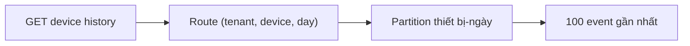
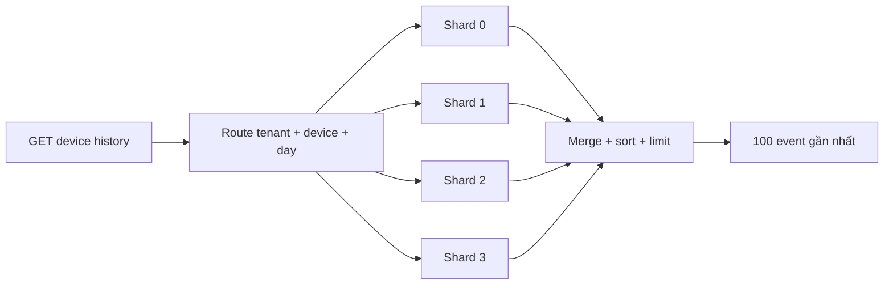

# Chọn khóa phân vùng theo phân bố dữ liệu và mẫu truy cập

Một hệ thống thu thập sự kiện từ nhiều khách hàng doanh nghiệp (*tenant*). Mỗi tenant có từ vài chục đến hàng triệu thiết bị; phần lớn yêu cầu API đọc **100 phép đo gần nhất của một thiết bị**, trong khi đội vận hành đôi lúc tìm **toàn bộ thiết bị có lỗi trong một giờ**. Nếu phân vùng chỉ theo `tenant_id`, tenant lớn có thể tạo phân vùng nóng; nếu phân vùng ngẫu nhiên theo `event_id`, việc lấy lịch sử một thiết bị phải quét nhiều nơi; nếu phân vùng chỉ theo ngày, các sự kiện cùng ngày dồn vào vài vùng dữ liệu.

**Khóa phân vùng (partition key)** là một quyết định thiết kế có ảnh hưởng đồng thời đến **định tuyến truy vấn, phân phối dữ liệu, phân phối tải, giới hạn mở rộng, tính toàn vẹn và chi phí vận hành**. Không có một khóa luôn tốt cho mọi workload.

Bài thuộc chương **Phân tán và phân vùng** của module **DATABASE_DATA_MODELING**. Mục tiêu của module là chuyển yêu cầu nghiệp vụ thành thực thể, quan hệ và ràng buộc rõ ràng, từ khóa, chỉ mục, chuẩn hóa đến lược đồ vật lý; so sánh cách mô hình hóa trên quan hệ, document, đồ thị và các hệ phân tích để lựa chọn cấu trúc dễ kiểm chứng, tiến hóa. Vì vậy, ta sẽ **bắt đầu từ grain, truy vấn và phân bố dữ liệu**, sau đó mới chọn kiểu phân vùng và hệ lưu trữ.

## 1. Phân vùng là gì, và có những loại “khóa” nào?

**Partitioning** là chia tập dữ liệu thành các phần theo một quy tắc xác định. **Sharding** thường được dùng khi các phần dữ liệu được đặt trên những node hoặc nhóm tài nguyên độc lập. Hai khái niệm có liên quan nhưng **không đồng nghĩa**: một bảng PostgreSQL được phân vùng theo tháng vẫn có thể nằm trên **một** máy; nó chưa tự trở thành cơ sở dữ liệu phân tán.

| Khái niệm | Câu hỏi nó trả lời | Ví dụ |
| --- | --- | --- |
| **Business key** | Dữ liệu thuộc thực thể nghiệp vụ nào? | `tenant_id`, `device_id`, `order_id` |
| **Primary key** | Một dòng được định danh duy nhất bằng gì? | `(tenant_id, device_id, event_time, event_id)` |
| **Partition/shard key** | Dòng được đưa vào partition/shard nào? | `(tenant_id, device_id, event_day)` |
| **Clustering/sort key** | Các dòng được sắp xếp trong partition như thế nào? | `event_time DESC, event_id` |
| **Secondary index** | Có đường truy cập khác ngoài khóa chính không? | Chỉ mục theo `status` trong engine phù hợp |
| **Logical partition** | Tập dữ liệu nào được coi là một đơn vị phân vùng? | Sự kiện của thiết bị D trong ngày 01/04 |
| **Physical placement** | Partition/replica nằm ở node/vùng lưu trữ nào? | Hash/token/metadata điều phối của hệ quản trị |

Trong **Apache Cassandra**, partition key là một phần của cấu trúc primary key theo CQL; nó định vị logical partition, còn các clustering column sắp thứ tự các row trong partition đó. Trong **PostgreSQL declarative partitioning**, partition key được định nghĩa ở bảng cha và quyết định row thuộc bảng con nào theo `RANGE`, `LIST` hoặc `HASH`. Trong **MongoDB sharded cluster**, shard key tham gia việc phân chia và định tuyến dữ liệu giữa các shard.

**Không áp một quy tắc của sản phẩm này sang sản phẩm khác:** cơ chế replica, routing, index, uniqueness, isolation và việc mở rộng node phụ thuộc từng hệ quản trị và phiên bản triển khai.

## 2. Viết bảng mẫu truy cập trước khi thiết kế partition key

Xét một event có grain: **một phép đo gốc do một thiết bị phát ra**, được nhận diện qua `(source_system, event_id)`. Trường dữ liệu:

| Trường | Kiểu khái niệm | Vai trò |
| --- | --- | --- |
| `tenant_id` | UUID/ID tenant | Ranh giới sở hữu và phân quyền |
| `device_id` | UUID/ID thiết bị | Thực thể được đọc nhiều nhất |
| `event_id` | UUID ổn định qua retry | Định danh sự kiện để chống ghi lặp |
| `event_time` | Instant UTC | Thời gian phép đo xảy ra |
| `received_at` | Instant UTC | Thời gian ingestion; có thể đến muộn |
| `temperature_c` | Decimal có đơn vị °C | Measure |
| `error_code` | Mã lỗi có thể vắng mặt | Lọc sự kiện lỗi |
| `region_id` | Mã khu vực | Phân tích khu vực, có thể thay đổi theo thời gian |

Các API và báo cáo có thể có hình dạng sau:

| ID | Mẫu truy cập | Khóa có sẵn | Kết quả | Mức ưu tiên |
| --- | --- | --- | --- | --- |
| Q1 | Lấy 100 sự kiện mới nhất của một thiết bị trong một ngày | Tenant + device + ngày | Tối đa 100 hàng, theo thời gian giảm dần | Cao |
| Q2 | Lịch sử một thiết bị trong 7 ngày | Tenant + device + khoảng ngày | Hàng trăm đến hàng nghìn hàng | Cao |
| Q3 | Lấy trạng thái mới nhất của mọi thiết bị thuộc một tenant | Tenant | Một hàng/thiết bị | Trung bình |
| Q4 | Đếm lỗi theo khu vực và giờ trên toàn hệ thống | Time range + region | Tổng hợp hàng triệu hàng | Trung bình |
| Q5 | Tra một event bằng ID để xử lý retry | Source + event ID | 0 hoặc 1 event | Bắt buộc cho ingestion |
| Q6 | Xóa toàn bộ dữ liệu thuộc tenant khi hết hợp đồng | Tenant | Có thể rất nhiều hàng | Vận hành |

Một partition key chỉ có `(tenant_id, device_id, event_day)` rất phù hợp **Q1/Q2**, nhưng **không tự giải quyết tốt Q3/Q4/Q5**. Để đáp ứng đồng thời, có thể cần bảng/projection khác, bảng tra `event_id` riêng, index phù hợp, hoặc đưa Q4 sang kho phân tích. **Lặp dữ liệu có kiểm soát theo mẫu truy cập** có thể hợp lý hơn cưỡng ép mọi truy vấn lên một bảng.

### Đừng viết yêu cầu chung chung

“Có 100 triệu row” chưa đủ. Cần bổ sung:

- Mỗi giây có bao nhiêu ghi/đọc? Độ lệch giữa tenant, device, khu vực và thời điểm?
- Truy vấn nào có **partition key đầy đủ**, truy vấn nào chỉ biết một phần?
- Một request được phép chạm tối đa bao nhiêu partition/node?
- Độ trễ p95/p99, thông lượng, độ mới và retention yêu cầu?
- Có update/delete hay chủ yếu append-only? Có event đến trễ, retry và correction?
- Có join/giao dịch trên nhiều thực thể hoặc quy định lưu trữ theo vùng pháp lý?

## 3. Đánh giá phân bố dữ liệu, không chỉ đếm số giá trị khác nhau

Một khóa tốt thường có **độ phân tán đủ lớn** (*cardinality*), nhưng “nhiều giá trị khác nhau” **không bảo đảm** dữ liệu hoặc tải cân bằng. Ví dụ hệ thống có một triệu thiết bị nhưng một thiết bị công nghiệp phát 30% tổng sự kiện, còn mỗi thiết bị khác chỉ gửi ít bản ghi.

### 3.1. Bốn loại phân bố cần đo

| Phân bố | Câu hỏi | Hậu quả nếu bỏ qua |
| --- | --- | --- |
| **Số row/byte theo key** | Partition lớn nhất chiếm bao nhiêu dung lượng? | Partition quá lớn, compaction/chia/di chuyển khó |
| **Write rate theo key** | Key nào nhận nhiều ghi nhất? | Hot partition, queue, retry, p99 ghi tăng |
| **Read rate theo key** | Key nào được tra cứu liên tục? | Hot read, cache/replica lệch tải |
| **Truy vấn theo tập key** | Một request đi qua bao nhiêu key? | Scatter-gather, chi phí network và tail latency |

Một khóa có số row khá đều nhưng một tenant nổi tiếng bị đọc gấp 1.000 lần vẫn có thể bị **hot read**. Ngược lại, tenant có nhiều dữ liệu lưu trữ nhưng ít traffic có thể ít gây áp lực latency tức thời. Cần đo cả **storage skew** lẫn **traffic skew**.

### 3.2. Những chỉ số nên kiểm tra

- Phân vị kích thước partition: p50, p95, p99, **max** (byte, hàng, tombstone).
- Tỷ lệ traffic từ **top 1%, top 10 key** và từng tenant lớn; chênh lệch max/median.
- Requests/second, bytes/second, queue depth và p99 đọc/ghi theo partition/node.
- Phần trăm request một partition, 2–10 partition, và hàng trăm partition.
- Tần suất query không có điều kiện lọc giúp partition pruning.
- Xu hướng tăng dung lượng theo key khi retention hoặc tần suất cảm biến thay đổi.

Không kết luận “phân bố đều” chỉ từ histogram số lượng tenant; phải kiểm tra **phân bố bên trong tenant** và những heavy hitter.

## 4. Những cách phân vùng phổ biến

| Chiến lược | Quy tắc minh họa | Mạnh ở đâu? | Dễ sai ở đâu? |
| --- | --- | --- | --- |
| **Hash** | `hash(tenant_id) mod N` | Phân tán nhiều key có tần suất tương đối đều | Một tenant nóng vẫn về **một** kết quả hash; đổi N đòi hỏi di chuyển |
| **Range** | Thời gian nằm trong tháng/ngày | Truy vấn theo dải, retention, pruning | Ghi mới dồn vào partition hiện tại; key tăng tuần tự có thể nóng |
| **List** | Một nhóm tenant/region được chỉ định | Chính sách lưu trữ, ranh giới vận hành | Phân bố không đều, cần bảo trì routing khi thêm nhóm |
| **Composite key** | `(tenant, device, day)` | Giữ truy vấn theo thực thể và bucket thời gian gần nhau | Mỗi query thiếu một phần khóa có thể phải fan-out |
| **Bucketing** | `event_day`, `event_hour` | Giới hạn kích thước phân vùng theo thời gian | Bucket quá nhỏ sinh nhiều partition và request |
| **Salting/sharding phụ** | `hash(event_id) mod S` | Chia một key quá nóng thành nhiều shard | Query một key phải đọc và merge **S** shard |
| **Geo-aware placement** | Route tenant theo khu vực được phép | Data residency, độ trễ liên vùng | Query xuyên vùng khó; phải kiểm soát di chuyển và độ tin cậy |

**Hash không luôn là consistent hashing.** Phép `hash(key) mod N` trong ứng dụng là một cách định tuyến đơn giản; khi N thay đổi, nhiều key có thể chuyển nơi. Một số hệ phân tán dùng token ring, metadata, range splitting hoặc cách đặt replica riêng. Không tự viết công thức hash rồi cho rằng nó khớp routing nội bộ của Cassandra, MongoDB hay hệ cloud.

### 4.1. Truy vấn phải có điều kiện tương thích

Nếu lưu theo `hash(event_id)`, lookup bằng event ID có thể nhanh, nhưng truy vấn “7 ngày của một device” phải biết và tìm nhiều shard. Nếu lưu theo `(tenant,device,day)`, query theo device/ngày nhắm đúng partition, nhưng báo cáo tổng số lỗi theo region phải đọc rất nhiều partition.

**Tối ưu một đường đọc thường làm các đường khác đắt hơn.** Chiến lược đúng dựa trên thứ tự ưu tiên workload, không phải tìm một khóa “cân bằng tuyệt đối” nhưng mọi truy vấn đều phải scatter.

## 5. Đánh đổi quan trọng: locality và phân tán tải

**Data locality** là khả năng dữ liệu cần cho một truy vấn cùng nằm trong một phạm vi truy cập hẹp. Trong mô hình theo tenant/device/ngày, một request gần như chỉ cần một partition:



Nhưng nếu chia một thiết bị thành nhiều shard để tránh hotspot:



Chi phí đọc có thể xấp xỉ theo **số bucket thời gian × số shard mỗi bucket**, chưa kể retry, replica, phân trang và merge. Nếu query 7 ngày và mỗi ngày 4 shard, ứng dụng có thể phải truy cập tới 28 partition. Không thể chỉ lấy `LIMIT 100` ở một shard rồi tin đó là top 100 toàn cục.

### 5.1. Không có ngưỡng partition size chung cho mọi engine

Một mô hình ước lượng đơn giản:

\[
\text{logical bytes per bucket}
\approx
\text{events per second} \times
\text{average logical bytes/event} \times
\text{bucket seconds}
\]

Giả sử một thiết bị rất nóng gửi **500 event/giây**, mỗi event trung bình **900 byte** ở tầng dữ liệu logic:

- Bucket **1 ngày**: khoảng 38,88 GB dữ liệu logic.
- Bucket **1 giờ**: khoảng 1,62 GB.
- Bucket **10 phút**: khoảng 270 MB.

Đây **không phải dung lượng trên đĩa**: còn phải tính encoding, index, compression, replica, tombstone và amplification. Không lấy các con số này làm giới hạn an toàn của Cassandra/PostgreSQL/HBase; cần thử nghiệm trên phiên bản engine và hardware mục tiêu.

Bucket nhỏ hơn giúp giảm kích thước partition nhưng tăng số partition, số query, metadata và chi phí đọc dải thời gian dài. Nếu một key có lưu lượng đột biến cực lớn, chỉ rút bucket từ ngày xuống giờ chưa chắc đủ; phải xem **write rate tại một thời điểm**, không chỉ tổng byte mỗi bucket.

## 6. Tình huống xuyên suốt: telemetry nhiều tenant

Giả sử ta chọn hệ thống vận hành ưu tiên:

1. Q1/Q2 phải trả lịch sử thiết bị nhanh.
2. Tenant thường bị giới hạn truy cập theo danh tính; mọi request có `tenant_id`.
3. Event có thể đến muộn vài giờ; timestamp không luôn theo thứ tự nhập.
4. Thiết bị thường có lưu lượng thấp, nhưng có nhóm industrial telemetry rất nóng.
5. Báo cáo toàn cục theo region được đưa sang hệ phân tích riêng nếu cần.

Những khóa ứng viên:

| Partition key | Q1/Q2 đọc theo device | Phân bố ghi | Điểm yếu |
| --- | --- | --- | --- |
| `tenant_id` | Phải lọc nhiều device trong một tenant | Tenant lớn thành hotspot | Partition có thể lớn không kiểm soát |
| `device_id` | Dễ đọc lịch sử device | Device cực nóng vẫn hotspot | Không khoanh tenant hoặc retention thời gian; cần scope bảo mật riêng |
| `event_day` | Không khoanh device | Ghi cùng ngày dồn vào ít key | Quét nhiều device, partition ngày khổng lồ |
| `hash(event_id)` | Fan-out rộng cho lịch sử device | Có thể rất đều | Mất locality theo thiết bị và thời gian |
| `(tenant_id,device_id,event_day)` | **Tốt** với ngày cụ thể | Tách tenant/device và ngày | Device cực nóng vẫn cần bucket/shard phụ; đọc nhiều ngày phải fan-out |
| `(tenant_id,device_id,event_day,shard)` | Tốt nếu biết và đọc các shard | Có thể chia tải device nóng | Một query phải merge nhiều shard |

**Lựa chọn ban đầu:** `(tenant_id, device_id, event_day)` là điểm xuất phát hợp lý **theo workload đã mô tả**, với việc đo heavy-device và dự phòng sharding phụ cho thiết bị cực nóng. Nó không phải khuyến nghị phổ quát, và không tự giải quyết Q3/Q4/Q5.

### 6.1. Tách thông số xác định partition khỏi thuộc tính lọc

`region_id` có thể đổi khi thiết bị được chuyển vị trí. Nếu dùng region làm phần chính của partition key, event lịch sử và event mới có thể được route khác; query một thiết bị phải biết lịch sử region. Không nên đưa một thuộc tính **thường xuyên thay đổi** vào key định tuyến chỉ vì dashboard có filter theo vùng.

Ngược lại, nếu phần lớn query thực tế là “lấy tất cả event lỗi ở region R trong 5 phút” và ít query theo device, read model theo `(region, time_bucket, ... )` có thể cần thiết. Hãy ưu tiên các query thực sự, không bị trói bởi ví dụ mẫu.

## 7. Cassandra: partition key, clustering và truy vấn biết khóa

Đây là một mô hình **Apache Cassandra CQL** minh họa Q1/Q2. Nó dùng composite partition key và clustering columns. Không coi câu lệnh CQL là cú pháp PostgreSQL.

### 7.1. Schema CQL theo thiết bị và ngày UTC

```sql
CREATE TABLE telemetry_by_device_day (
    tenant_id uuid,
    device_id uuid,
    event_day date,
    event_time timestamp,
    event_id uuid,
    received_at timestamp,
    temperature_c decimal,
    error_code text,
    PRIMARY KEY (
        (tenant_id, device_id, event_day),
        event_time,
        event_id
    )
) WITH CLUSTERING ORDER BY (
    event_time DESC,
    event_id ASC
);
```

Ý nghĩa:

- Bộ `(tenant_id, device_id, event_day)` định nghĩa **một logical partition**.
- `event_time` và `event_id` phân biệt các dòng trong partition. `event_id` cần ổn định qua retry nếu muốn ghi lại cùng một event không tạo thêm dòng.
- Clustering `event_time DESC` phù hợp đọc các event gần nhất trong phạm vi ngày; thứ tự khi timestamp bằng nhau được xác định tiếp bởi `event_id ASC`.
- `event_day` phải được tính từ `event_time` theo **quy tắc UTC cố định** ở ingestion. Không dùng ngày địa phương của server và ngày từ client lẫn lộn.
- Một partition phải có kích thước phù hợp workload, không chỉ vì key đã đủ điều kiện truy vấn.

Ví dụ truy vấn qua **prepared statement**; dấu `?` là tham số do driver bind:

```sql
-- Đọc 100 event gần nhất của một thiết bị trong một ngày.
SELECT event_time, event_id, temperature_c, error_code
FROM telemetry_by_device_day
WHERE tenant_id = ?
  AND device_id = ?
  AND event_day = ?
LIMIT 100;

-- Đọc một khoảng thời gian trong chính partition ấy.
SELECT event_time, event_id, temperature_c
FROM telemetry_by_device_day
WHERE tenant_id = ?
  AND device_id = ?
  AND event_day = ?
  AND event_time >= ?
  AND event_time < ?
LIMIT 500;
```

Một query dải 7 ngày phải xác định các ngày UTC giao với khoảng, đọc từng partition cần thiết rồi hợp nhất theo `(event_time, event_id)`; không tự kỳ vọng Cassandra `ORDER BY` tạo một thứ tự **toàn cục giữa nhiều partition**.

### 7.2. Truy vấn nào không phù hợp bảng này?

Các câu hỏi sau không có đường định tuyến hẹp chỉ từ schema này:

- “Tất cả event lỗi trong một giờ trên mọi device”.
- “Top 10 tenant có nhiệt độ cao nhất trong 90 ngày”.
- “Tra duy nhất `event_id` nhưng không biết tenant/device/ngày”.
- “Đọc latest của toàn bộ device trong tenant bằng một truy vấn đơn giản”.

Đừng lạm dụng `ALLOW FILTERING` để biến truy vấn quét nhiều partition thành API thời gian thực. Cân nhắc **projection** theo truy vấn, hệ tra ID riêng hoặc kho columnar cho tổng hợp lớn.

### 7.3. Phân vùng không phải replication và consistency

Partition key giúp định vị logical partition; replica placement, replication factor và consistency level thuộc cấu hình/mô hình của Cassandra. Việc chọn cùng partition không tự bảo đảm transaction nhiều bảng hay linearizable read cho mọi thao tác. Các tính chất đọc/ghi nhất quán phải được xác định theo API, mức consistency, đường ghi và yêu cầu đồng thời cụ thể.

Khi TTL và xóa được dùng để quản lý retention, cần theo dõi tombstone, compaction, repair và yêu cầu xóa bản sao. TTL thường liên quan thời điểm ghi, không tự hiểu là `event_time + retention` cho event đến muộn.

## 8. Thiết bị rất nóng: thêm bucket hoặc shard phụ?

Nếu một thiết bị gửi 500 event/s, việc giữ tất cả event trong cùng partition một ngày có thể gây cả **partition size** và **hot write**. Hai biện pháp khác nhau:

### 8.1. Rút thời lượng bucket

Thay `event_day` bằng `event_hour` hoặc `event_10m_bucket`. Điều đó giảm số event tích lũy mỗi partition, nhưng **tại thời điểm hiện tại** mọi event của thiết bị vẫn đang đổ vào bucket đang mở. Nếu throughput/partition quá cao, chỉ chia thời gian chưa chắc làm giảm hotspot tức thời.

Khi query 24 giờ, bucket giờ phải đọc tới 24 partition; bucket 10 phút có thể tới 144. Chi phí đọc dài hạn tăng cùng số bucket.

### 8.2. Shard đồng thời một thiết bị nóng

Một thiết kế có `shard` dựa trên định danh event:

```text
partition = (
    tenant_id,
    device_id,
    event_day,
    shard = stable_hash(event_id) mod shard_count
)
```

Ví dụ schema CQL có shard (là **một phương án khác** với bảng mục 7, không đổi schema ngầm):

```sql
CREATE TABLE telemetry_by_device_day_shard (
    tenant_id uuid,
    device_id uuid,
    event_day date,
    shard smallint,
    event_time timestamp,
    event_id uuid,
    temperature_c decimal,
    PRIMARY KEY (
        (tenant_id, device_id, event_day, shard),
        event_time,
        event_id
    )
) WITH CLUSTERING ORDER BY (
    event_time DESC,
    event_id ASC
);
```

Giả sử một thiết bị dùng `shard_count = 4`, hệ thống có thể phân phối nhiều event liên tiếp sang bốn partition để giảm tải trên một key. Nhưng Q1 phải đọc **cả bốn shard**, rồi merge theo thời gian. Mỗi shard cần được query đủ dữ liệu để bảo đảm top 100 toàn cục; một cách đơn giản là lấy tối đa 100 ứng viên từ **mỗi shard** rồi merge, không chỉ lấy 25 từ mỗi shard. Với paging xuyên nhiều shard, phải duy trì cursor/trạng thái của từng shard và thứ tự tie-break nhất quán.

**Cảnh báo migration:** Nếu đổi `shard_count` từ 4 sang 8 và chỉ dùng `mod S`, event cũ nằm theo routing 4 còn event mới theo routing 8. Reader phải biết **version routing theo thời gian hoặc metadata**, đọc cả cấu hình cũ trong giai đoạn chuyển tiếp hoặc backfill có kiểm soát. Không thay hằng số rồi cho rằng mọi event tự chuyển partition.

### 8.3. Mã Java 17+ tính đường phân vùng một cách xác định

Đây là ví dụ tự chứa chỉ minh họa **cách tạo key ở tầng ứng dụng**, không thay thế cơ chế token/replica routing của Cassandra. Không cần thư viện ngoài JDK.

```java
import java.time.Instant;
import java.time.LocalDate;
import java.time.ZoneOffset;
import java.util.Objects;
import java.util.UUID;

public class PartitionRoutingDemo {

    record Event(
        UUID tenantId,
        UUID deviceId,
        UUID eventId,
        Instant eventTime
    ) {
        Event {
            Objects.requireNonNull(tenantId);
            Objects.requireNonNull(deviceId);
            Objects.requireNonNull(eventId);
            Objects.requireNonNull(eventTime);
        }
    }

    record Route(
        UUID tenantId,
        UUID deviceId,
        LocalDate eventDayUtc,
        int shard
    ) {}

    static Route route(Event event, int shardCount) {
        Objects.requireNonNull(event, "event");
        if (shardCount <= 0) {
            throw new IllegalArgumentException("shardCount must be > 0");
        }
        LocalDate day = event.eventTime()
            .atZone(ZoneOffset.UTC)
            .toLocalDate();
        int shard = Math.floorMod(
            event.eventId().hashCode(), shardCount
        );
        return new Route(
            event.tenantId(),
            event.deviceId(),
            day,
            shard
        );
    }

    public static void main(String[] args) {
        Event e = new Event(
            UUID.randomUUID(),
            UUID.randomUUID(),
            UUID.fromString(
                "8b88bd8f-dc6f-46a9-b321-019196d5e31e"
            ),
            Instant.parse("2030-04-01T23:59:59Z")
        );

        Route a = route(e, 4);
        Route retry = route(e, 4);
        System.out.println(a.equals(retry)); // true
        System.out.println(a.eventDayUtc());  // 2030-04-01
        System.out.println(a.shard() >= 0 && a.shard() < 4); // true
    }
}
```

`UUID.hashCode()` là một lựa chọn minh họa **nội bộ Java**; nếu writer và reader được viết bằng nhiều ngôn ngữ, phải chốt **thuật toán hash, byte encoding, endianness, chuẩn hóa ID, shard count và routing version** như một hợp đồng chung. Hash này không phải hàm băm mật mã và không nên được xem là cơ chế chống tấn công phân phối key. Nếu hệ thống thực sự cần phân phối key do client không đáng tin chọn, phải đánh giá rủi ro key flooding và chính sách giới hạn tốc độ.

**Lưu ý về idempotency:** routing ổn định cho cùng `event_id` không tự chứng minh event ID **duy nhất trên toàn hệ thống** hoặc content không bị thay đổi khi retry. Cần khóa nhận diện nguồn, validation và quy tắc xử lý correction.

## 9. PostgreSQL: phân vùng theo thời gian khác sharding theo tenant

Với PostgreSQL, workload theo khoảng thời gian có thể dùng **declarative range partitioning**. Ví dụ này chạy trên **một hệ PostgreSQL**; các partition có thể ở tablespace khác nhau nhưng không tự định tuyến tới nhiều database server.

### 9.1. Bảng phân vùng theo tháng UTC

```sql
CREATE TABLE telemetry_event (
    tenant_id UUID NOT NULL,
    device_id UUID NOT NULL,
    event_time TIMESTAMPTZ NOT NULL,
    event_id UUID NOT NULL,
    received_at TIMESTAMPTZ NOT NULL DEFAULT now(),
    temperature_c NUMERIC(7, 3),
    error_code TEXT,

    CONSTRAINT pk_telemetry_event PRIMARY KEY (
        tenant_id, device_id, event_time, event_id
    ),
    CONSTRAINT ck_temperature_range CHECK (
        temperature_c IS NULL
        OR temperature_c BETWEEN -100 AND 200
    )
) PARTITION BY RANGE (event_time);

CREATE TABLE telemetry_event_2030_04
    PARTITION OF telemetry_event
    FOR VALUES FROM ('2030-04-01 00:00:00+00')
               TO ('2030-05-01 00:00:00+00');

CREATE TABLE telemetry_event_2030_05
    PARTITION OF telemetry_event
    FOR VALUES FROM ('2030-05-01 00:00:00+00')
               TO ('2030-06-01 00:00:00+00');

CREATE INDEX ix_telemetry_device_time
    ON telemetry_event (
        tenant_id, device_id, event_time DESC, event_id
    );
```

Đường đọc:

```sql
-- $1=tenant_id, $2=device_id, $3=from, $4=to
SELECT event_time, event_id, temperature_c, error_code
FROM telemetry_event
WHERE tenant_id = $1
  AND device_id = $2
  AND event_time >= $3
  AND event_time < $4
ORDER BY event_time DESC, event_id
LIMIT 100;
```

**Partition pruning** có thể bỏ qua các tháng không giao khoảng `event_time`; index hỗ trợ truy cập theo tenant/device và thứ tự trong partition. Nhưng một truy vấn thiếu điều kiện thời gian có thể phải xét nhiều partition. Tạo một partition/tháng thuận tiện retention nhưng chưa chắc là tối ưu cho số lượng dữ liệu thực; chọn ngày/tuần/tháng dựa trên **kích thước, số partition, nhu cầu quản trị và query windows**.

### 9.2. Khóa duy nhất trên bảng partitioned

Trong PostgreSQL declarative partitioning, ràng buộc primary/unique trên bảng phân vùng phải bao gồm **tất cả cột partition key** theo những giới hạn của phiên bản/cơ chế partition. Vì vậy ví dụ dùng `event_time` trong primary key. Điều này **không tự bảo đảm `event_id` duy nhất trên toàn bộ các tháng**, vì cùng event ID với timestamp khác có thể tạo hai row.

Nếu yêu cầu ingestion là “mỗi `(source_system,event_id)` chỉ ghi nhận đúng một lần trên toàn hệ thống”, cần cơ chế idempotency có uniqueness phù hợp (ví dụ bảng registry/ledger độc lập, event log đáng tin hoặc luồng xử lý có transactional check), chứ không kết luận uniqueness từ `PRIMARY KEY(tenant,device,event_time,event_id)`.

### 9.3. Hash partition trong PostgreSQL cũng không tự phân tán máy

Một bảng `tenant_settings` có thể dùng `PARTITION BY HASH(tenant_id)` để chia key-space thành nhiều partition **trong cùng database**. Hash sẽ phân phối các **tenant khác nhau** vào các bucket, nhưng **toàn bộ row của một tenant_id cụ thể** vẫn rơi vào cùng bucket.

Do đó, nếu vấn đề là một tenant chiếm 70% write traffic, hash theo tenant đơn thuần không giải quyết hotspot bên trong tenant. Đồng thời, hash partitioning của PostgreSQL không đồng nghĩa Cassandra token ring hoặc MongoDB sharding: phần mềm ứng dụng và hạ tầng vẫn cần cơ chế thực sự đặt dữ liệu trên các node độc lập nếu muốn scale-out ghi qua nhiều máy.

## 10. HBase, MongoDB và warehouse: cùng bài toán, quy tắc khác

### 10.1. HBase: row key và hot region

HBase định vị row bằng **row key có thứ tự** trong các region. Nếu row key bắt đầu bằng một timestamp **tăng liên tục**, các bản ghi mới có thể đổ vào vùng key cuối, gây hotspot. Kỹ thuật salting hoặc reverse timestamp có thể làm phân bố khác đi, nhưng làm query theo khoảng/range phải biết cấu trúc key và có thể scan nhiều prefix.

Một hình dạng row key minh họa:

```text
<salt>|<tenant>|<device>|<reverse_time>|<event_id>
```

Đây không phải lệnh HBase và cũng không phải gợi ý dùng một prefix salt cố định cho mọi workload. Số bucket salt, cách tạo reverse timestamp, kích thước row, thứ tự quét và cách đọc lại nhiều prefix phải được đo và tài liệu hóa.

### 10.2. MongoDB: shard key quyết định mức độ truy vấn nhắm đích

Trong MongoDB sharded cluster, lựa chọn **range/hashed shard key** và phân bố key ảnh hưởng cách dữ liệu được chia, định tuyến và cân bằng. Shard key có giá trị ổn định và hiện diện trong các truy vấn chính thường giúp targeted reads. Hashed key hỗ trợ phân tán giá trị tăng đơn điệu hoặc key có mẫu bất lợi trong một số workload, nhưng có thể làm truy vấn range trên field đã băm kém hiệu quả hơn.

Trước khi chọn hashed `tenant_id`, hãy kiểm tra một tenant lớn: mọi document cùng tenant vẫn chia sẻ một hashed tenant value. Cũng phải kiểm tra cơ chế uniqueness, chunk movement, shard-key updates và version triển khai; không suy rằng quy tắc unique index của RDBMS sẽ được bảo đảm y hệt trên cluster sharded.

### 10.3. Columnar analytics: partitioning để giảm quét

Với warehouse như BigQuery, một bảng event có thể **partition theo ngày** và **cluster theo tenant/device**, giúp prune dữ liệu cho query có time filter. Điều đó phục vụ scan/aggregation và chi phí đọc, không đồng nghĩa partition theo khóa Cassandra để phục vụ hàng trăm nghìn point query/giây.

Ví dụ **BigQuery Standard SQL**:

```sql
CREATE TABLE analytics.telemetry_events (
    tenant_id STRING NOT NULL,
    device_id STRING NOT NULL,
    event_id STRING NOT NULL,
    event_time TIMESTAMP NOT NULL,
    temperature_c NUMERIC,
    error_code STRING
)
PARTITION BY DATE(event_time)
CLUSTER BY tenant_id, device_id;
```

Một truy vấn toàn cục theo lỗi:

```sql
SELECT
    TIMESTAMP_TRUNC(event_time, HOUR) AS event_hour,
    error_code,
    COUNT(*) AS error_count
FROM analytics.telemetry_events
WHERE DATE(event_time) BETWEEN DATE '2030-04-01'
                            AND DATE '2030-04-07'
  AND error_code IS NOT NULL
GROUP BY event_hour, error_code
ORDER BY event_hour, error_code;
```

Đây là một **projection phân tích** khác với bảng Cassandra theo thiết bị/ngày. Nếu ingestion có retry, `COUNT(*)` chỉ đúng khi pipeline đã kiểm soát duplicate theo event ID; partitioning không giải quyết vấn đề đếm trùng.

### 10.4. Graph: locality của cạnh và đỉnh bậc cao

Với đồ thị, truy vấn thường đi từ một đỉnh qua các cạnh kề và có thể bước nhiều hop. Đặt những cạnh thường được duyệt gần nhau có thể quan trọng hơn hash ID sự kiện hoàn toàn ngẫu nhiên. Tuy nhiên đỉnh có bậc rất cao (*supernode*) lại có thể gây hotspot hoặc khối adjacency cực lớn. Chọn graph partitioning theo truy vấn traversal, độ dài hop và phân bố degree; không áp máy móc khóa tenant/device của time-series.

## 11. Key thay đổi theo thời gian và tính đúng của dữ liệu lịch sử

Một partition key lý tưởng ổn định trong suốt vòng đời của row. Các thuộc tính như `region_id`, `customer_segment`, `order_status` có thể thay đổi:

| Field | Khi dùng làm key có thể gây vấn đề gì? | Hướng xử lý |
| --- | --- | --- |
| `tenant_id` | Di chuyển tenant, sát nhập tenant, thay đổi ownership | Quy tắc tenant migration và định danh bền vững |
| `device_id` | Thiết bị được thay thế/đổi ID, nguồn dùng ID không nhất quán | Canonical identity, mapping nguồn, version |
| `event_day` | Event đến muộn nhưng route theo ngày nhận | Tính từ `event_time` UTC theo hợp đồng |
| `region_id` | Thiết bị chuyển vùng làm lịch sử phân mảnh | Tránh dùng làm key chính nếu query thường theo device |
| `status` | UPDATE trạng thái cần chuyển partition | Giữ status là thuộc tính/index hoặc projection khác |
| `hash(event_id) mod S` | S thay đổi gây lệch routing dữ liệu cũ | Routing version, dual-read/backfill có kiểm soát |

**Đừng coi partition key như một cách mã hóa quyền truy cập.** Dù tất cả event chứa tenant_id và routing theo tenant, mỗi truy vấn vẫn phải kiểm tra identity/authorization, ngăn cross-tenant data leak và cấu hình row-level security hoặc cơ chế kiểm soát phù hợp. Biết tên partition không đồng nghĩa được phép đọc nó.

Khi có data residency, placement theo vùng pháp lý có thể là ràng buộc cứng hơn mục tiêu phân phối tải. Tenant có dữ liệu ở hai khu vực cần hợp đồng rõ về dữ liệu nguồn, bản sao, truy vấn xuyên vùng và quy định chuyển vùng.

## 12. Kết hợp nhiều đường truy cập thay vì một khóa “vạn năng”

Từ cùng nguồn event, có thể tạo:

```text
Source event log (event_id ổn định)
   |
   +-- telemetry_by_device_day
   |      key=(tenant, device, UTC day)
   |      Q1/Q2: lịch sử thiết bị
   |
   +-- latest_telemetry_by_device
   |      key=(tenant, device)
   |      Q3: trạng thái hiện tại của một tập thiết bị
   |
   +-- event_id_registry
   |      key=(source, event_id)
   |      Q5: lookup/idempotency theo ID gốc
   |
   +-- analytics.telemetry_events
          partition theo ngày, cluster theo tenant/device
          Q4: phân tích toàn cục theo giờ/khu vực
```

Mỗi projection có **grain và khóa khác nhau**. Nếu làm vậy, phải giải quyết đồng bộ:

- **Source of truth:** event nào là bản gốc có quyền xác định dữ liệu?
- **Idempotency:** một event retry có tạo thêm hàng và làm sai tổng hay không?
- **Event time vs ingestion time:** bản đến trễ được route tới bucket lịch sử nào?
- **Latest-state rule:** một event cũ đến sau có được phép ghi đè trạng thái mới?
- **Freshness:** API vận hành và dashboard có thể thấy dữ liệu khác thời điểm; nêu SLA.
- **Corrections/deletes:** dữ liệu sửa hoặc xóa phải cập nhật tất cả projection liên quan.

Ví dụ, không làm `latest_telemetry_by_device` theo kiểu “ghi sau thắng” nếu định nghĩa **latest là event_time lớn nhất**. Cần compare-and-set, serial processing theo key hoặc logic so sánh có điều kiện phù hợp với engine và concurrency model.

Đây không phải lời kêu gọi luôn xây nhiều database. Nếu workload nhỏ và quan hệ phức tạp, một RDBMS với index và partitioning phù hợp có thể đơn giản, rẻ và an toàn hơn kiến trúc nhiều projection.

## 13. Khóa phân vùng và ràng buộc toàn vẹn

Partitioning quyết định **dữ liệu nằm ở đâu**; nó không tự giải quyết **dữ liệu có đúng hay không**.

### 13.1. Khóa duy nhất và duplicate

Nếu một event được nhận diện toàn cục bằng `(source, event_id)` nhưng partition theo ngày, retry với `received_at` khác có thể bị ghi vào ngày khác nếu ứng dụng route sai. Cần:

1. Lưu `event_id` ổn định, không sinh ID mới khi retry.
2. Chuẩn hóa `event_time` và bucket UTC trước khi route.
3. Có cơ chế idempotency theo danh tính sự kiện **trên phạm vi cần bảo đảm**, kể cả khi storage không hỗ trợ unique toàn cluster với key tùy ý.
4. Có chính sách correction nếu cùng event_id nhưng payload thay đổi.

Không suy rằng `PRIMARY KEY` dùng trong PostgreSQL hoặc Cassandra luôn là “unique event_id trên mọi partition”. Phạm vi uniqueness là một phần của thiết kế.

### 13.2. Join, giao dịch và co-location

Nếu phần lớn transaction cần cập nhật đồng thời `order` và `order_items`, việc đặt dữ liệu cùng shard theo `order_id` có thể giảm thao tác xuyên shard. Nhưng điều đó không tự tạo ACID cho mọi thao tác; phải xem khả năng transaction của từng engine. Nếu transaction lại cần cập nhật **số dư của hai tenant khác nhau**, đặt theo order_id có thể không giúp.

Đặt các thực thể liên quan cùng khóa là một cách đạt locality khi **đường nghiệp vụ** yêu cầu. Với query không cùng một partition, cần cân nhắc fan-out, denormalization, batch hoặc thay đổi ranh giới aggregate.

### 13.3. Index không sửa được mọi partition key sai

Secondary index có thể hỗ trợ một số truy vấn, nhưng nếu cấu trúc dữ liệu trải hàng trăm node, chỉ mục còn chịu chi phí lưu, ghi, đồng bộ và kế hoạch query. Đừng giả định “thêm index theo `region_id`” sẽ biến mọi truy vấn global thành targeted single-shard query. Kiểm tra execution plan, phân phối index và giới hạn sản phẩm.

## 14. Partition pruning và scatter-gather: tính đúng chi phí đọc

Một cách phân tích định tính:

\[
\text{Query latency}
\approx
\text{routing overhead}
+ \max(\text{latency of touched partitions})
+ \text{merge / network overhead}
\]

Đây **không phải** công thức dự đoán latency chính xác. Nó nhấn mạnh rằng một request chạm nhiều partition có thể bị kéo chậm bởi partition chậm nhất (*tail latency*) và chi phí merge. Hàng trăm query song song cũng chiếm tài nguyên cluster, dù latency bề ngoài vẫn chấp nhận được khi test tải thấp.

Trước khi chấp nhận key ứng viên, hãy mô phỏng với từng query:

| Query | Partition cần đọc | Có pruning tốt? | Cần merge? |
| --- | --- | --- | --- |
| Q1 thiết bị/ngày | 1 partition khi không shard phụ | Có | Không |
| Q2 thiết bị/7 ngày | Tới 7 partition ngày | Có theo tenant/device và các ngày | Có, nếu cần thứ tự toàn cục |
| Q1 với 4 shard/ngày | 4 partition | Có, biết shard set | Có, top-K |
| Q2 với 4 shard/ngày | Tới 28 partition | Có, nhưng nhiều request | Có |
| Q4 toàn hệ thống | Nhiều partition thiết bị | Kém ở operational table | Nên dùng projection/OLAP |
| Q5 chỉ event ID | Không xác định partition thiết bị nếu thiếu mapping | Không | Cần lookup registry hoặc index phù hợp |

Ngoài số partition, phải xét **byte đọc mỗi partition** và có filter pushdown/pruning hay không. Chạm một partition 40 GB không tự rẻ hơn đọc 20 partition nhỏ; cần kế hoạch truy vấn và profile thực tế.

## 15. Thử nghiệm chọn khóa trước khi triển khai

### 15.1. Lấy phân bố mẫu có ý nghĩa

Thu thập log/traces đại diện của ít nhất các giai đoạn:

- Giờ cao điểm/giờ thấp điểm, ngày thường/cuối tuần.
- Tenant lớn nhất, tenant trung bình, tenant nhỏ, thiết bị phát dữ liệu bất thường.
- Phần dữ liệu nóng so với dữ liệu lịch sử và tỷ lệ đến muộn.
- Query theo một partition, dải nhiều partition, và query toàn cục.
- Trường hợp bulk import, retry sau outage và backfill.

Nếu chưa có dữ liệu thật, tạo tải tổng hợp theo **phân bố giả định được ghi rõ**, gồm heavy hitters và bùng nổ traffic. Không chỉ test phân phối đều giả tạo rồi kết luận hash sẽ tốt.

### 15.2. Kịch bản so sánh

| Biến thể | Ghi dữ liệu | Q1/Q2 | Lưu giữ | Rủi ro |
| --- | --- | --- | --- | --- |
| A: tenant/device/day | Ít fan-out nhất | Q1 tốt, Q2 7 ngày | Bucket ngày dễ định vị | Device nóng |
| B: tenant/device/hour | Giảm tổng byte/partition | Q1 phải biết giờ, Q2 fan-out lớn | Nhiều partition | Chi phí metadata/read |
| C: tenant/device/day/shard4 | Chia ghi hot device | Q1 merge 4, Q2 tới 28 | Cần metadata shard | Routing version/merge |
| D: hash(event_id) | Phân phối event rộng | Q1/Q2 khó targeted | Không tự gắn lifecycle theo ngày/device | Scatter-gather |

Những chỉ số cần báo cáo: p50/p95/p99 đọc/ghi, tổng byte quét, number of touched partitions, tail retries, queue depth, partition size p99/max, cost, compaction, throughput và khả năng recovery. **Kết quả đo** mới quyết định giữa A/B/C, chứ không chỉ bảng lý thuyết.

### 15.3. Chọn shard count theo workload, không theo số node

Đừng lấy `shard_count = current node count` như một bất biến. Số node thay đổi theo autoscaling/rebalance, trong khi routing và dữ liệu lịch sử cần ổn định. Nếu có virtual shards/partitions, chọn phạm vi và metadata theo khả năng engine, kiểm soát placement riêng khỏi identity logic của dữ liệu.

## 16. Thay đổi partition key khi hệ thống đã vận hành

Partition key thường khó thay đổi hơn thêm một cột thông thường: thay key có thể **đổi vị trí vật lý của hàng tỷ bản ghi**, ảnh hưởng query, uniqueness, consumer và TTL.

Một kế hoạch chuyển từ `(tenant,device,day)` sang `(tenant,device,hour,shard)` có thể gồm:

1. **Đóng băng hợp đồng routing cũ:** phiên bản key/bucket/hash, định nghĩa UTC, số shard và nơi lưu metadata.
2. **Tạo schema/partition mới:** chỉ số, constraint, retention, quyền truy cập và query path.
3. **Chọn nguồn tin cậy để backfill:** event log hoặc bảng nguồn có identity ổn định; xử lý duplicate và correction.
4. **Kiểm tra canary:** số dòng theo grain, tổng measure, hash/checksum theo phạm vi, p99 và kết quả top-K.
5. **Triển khai reader tương thích:** biết đọc key cũ và mới trong giai đoạn chuyển tiếp; phân biệt event được viết trước/sau cutover.
6. **Chuyển writer có kiểm soát:** dùng feature flag, dual-write/CDC khi phù hợp; không giả định hai write luôn thành công nguyên tử.
7. **Đối soát và cutover:** dữ liệu đến muộn, retry, backfill, delete và TTL; chỉ rút đường cũ khi tiêu chí hoàn tất đạt.
8. **Rollback có kế hoạch:** không chỉ trả code cũ nếu dữ liệu mới đã được route sang partition mới; cần biết rollback reader/writer và trạng thái dữ liệu.

Nếu có hàng đang được cập nhật đồng thời, phải tránh mất cập nhật hoặc đếm hai lần khi đọc cả hai phiên bản. Có thể dùng event identity và version/timestamp đã định nghĩa để deduplicate kết quả, nhưng không đơn giản dùng `DISTINCT` trên toàn bộ payload rồi tin rằng đã sửa mọi trường hợp.

### Chú ý tới late events

Sau cutover, một event có `event_time` thuộc tháng trước có thể tới muộn. Nó cần được route theo quy tắc được hệ thống chọn **và được reader hiểu**: theo event time, theo routing epoch, hoặc được đưa vào version mới rồi backfill đồng bộ. Nếu không ghi rõ, một khoảng thời gian sẽ bị chia giữa các schema khiến query bị thiếu.

## 17. Những sai lầm phổ biến

| Sai lầm | Vì sao gây hại? | Cách sửa |
| --- | --- | --- |
| “Khóa có nhiều giá trị ⇒ đều tải” | Heavy hitter vẫn có thể chiếm phần lớn ghi/đọc | Đo top key, byte và traffic skew |
| Chỉ partition theo tenant | Một tenant lớn trở thành hot key | Thêm dimension ổn định/bucket/shard theo đường đọc |
| Chỉ partition theo ngày | Tất cả thiết bị đang ghi vào ít bucket | Kết hợp tenant/device hoặc key phù hợp |
| Hash ID sự kiện rồi kỳ vọng query device rất nhanh | Mất locality theo thiết bị | Tạo projection theo device/time |
| Chia shard phụ nhưng quên fan-out | Top-K và paging thiếu dữ liệu hoặc latency tăng | Đọc/merge đủ shard, duy trì cursor |
| Đổi `mod 4` thành `mod 8` không migration | Dữ liệu cũ và mới khác routing | Version routing và backfill/dual-read |
| Bucket ngày lấy từ `received_at` dù query theo `event_time` | Event đến muộn nằm sai ngày nghiệp vụ | Quy ước UTC và event time rõ ràng |
| Dùng khóa `status` hoặc `region` biến đổi liên tục | Mỗi update có thể di chuyển row | Tránh thuộc tính mutable trong key chính |
| Cho rằng PostgreSQL partitioned table là distributed DB | Không tăng thông lượng ghi qua nhiều node | Phân biệt partitioning và sharding |
| Cho rằng primary key CQL hỗ trợ mọi filter SQL | Query thiếu partition key rất tốn kém | Thiết kế theo truy vấn và projection |
| Dùng `ALLOW FILTERING` để “sửa” schema | Đọc rộng, unpredictable p99 | Read model/index phù hợp |
| Không giới hạn tenant nóng | Một tenant ảnh hưởng tenant khác | Admission control, quota, fair scheduling |
| Không có idempotency xuyên partition | Retry/correction làm duplicate event | Registry/unique contract và audit |
| Thay key không kiểm tra dữ liệu đến muộn | Mất event trong truy vấn lịch sử | Kế hoạch cutover theo event/routing version |
| Route theo tenant rồi bỏ kiểm tra quyền | Có nguy cơ rò dữ liệu cross-tenant | Authorization/RLS độc lập với routing |

## 18. Kiểm thử thiết kế và ràng buộc

| Ca kiểm thử | Điều cần xác nhận |
| --- | --- |
| Hai event cùng `event_time`, khác `event_id` | Cả hai tồn tại, tie-break xác định |
| Retry cùng `event_id` và payload | Không ghi trùng grain theo hợp đồng |
| Retry cùng `event_id` nhưng payload đổi | Có chính sách correction/conflict, không im lặng nhân bản |
| Event lúc `23:59:59Z` và `00:00:01Z` | Route hai bucket UTC khác nhau |
| Query 7 ngày qua ranh giới tháng | Không mất event ở partition tháng/ngày tiếp giáp |
| Device nóng đột biến 100× | Đo hotspot theo request/byte, không chỉ partition size |
| Một tenant chiếm 70% traffic | Thiết kế không hứa hash(tenant) sẽ chia một tenant |
| Query top 100 trên 4 shard | Merge đúng top 100, không chỉ top 25/shard |
| Paging top-K xuyên các shard | Không lặp/mất event do cursor và thứ tự tie-break |
| Q4 toàn cục | Query plan không ép quét wide-column operational store trong SLO không phù hợp |
| Đổi `shard_count` và cutover | Reader thấy đầy đủ dữ liệu từ cả hai phiên bản |
| Late event tới sau cutover | Route đúng, có thể truy vấn lịch sử |
| Xóa một tenant | Xóa/retention lan tới mọi projection/replica theo policy |
| PostgreSQL query có/không có filter `event_time` | Xác minh partition pruning và kế hoạch index |
| Key bị thay đổi do sửa region/status | Không làm mất dữ liệu hoặc tạo duplicate ngầm |
| Tenant A cố query tenant B | Authorization từ chối dù biết key của B |
| Backfill lớn | Có rate limit, tránh bóp nghẹt traffic vận hành |
| Projection analytics trễ 30 phút | Giao diện/báo cáo nêu freshness và watermark |

Chạy benchmark trên engine, phiên bản, số node, replication, cấu hình lưu trữ và quy mô gần thực tế. Một unit test Java cho routing chỉ chứng minh **kết quả hash và bucket là xác định**, không chứng minh rằng cluster đạt p99 hay consistency mục tiêu.

## 19. Bài tập vận dụng

### Bài tập A — Hệ thống đơn hàng đa tenant

Một SaaS có 50.000 tenant. 99% request lấy danh sách đơn của **một tenant** trong 30 ngày; 1% request tra đơn theo `order_id` từ webhook; một tenant chiếm 40% tổng traffic.

Hãy đánh giá các khóa `tenant_id`, `order_id`, `(tenant_id, month)`, `(tenant_id, month, shard)`. Đề xuất đường lookup webhook, chính sách chống hot tenant và bảng truy vấn để chứng minh lựa chọn.

**Gợi ý:** không có một khóa vừa tối ưu mọi query; dùng projection/registry theo order ID nếu cần. Tenant nóng có thể cần shard phụ hoặc tách tài nguyên; kết quả cần đo bằng phân bố traffic và p99.

### Bài tập B — Phép đo cảm biến xuyên ngày

Thiết bị D phát 100 event/s, khoảng 1 KB/event. Hãy ước lượng số byte logic mỗi ngày và mỗi giờ, rồi chọn bucket đủ phù hợp để thử nghiệm. API đọc lịch sử 48 giờ cần chạm bao nhiêu bucket khi chọn ngày, giờ và 10 phút?

**Gợi ý:** dùng công thức `rate × bytes/event × seconds`; kết quả chỉ là logical bytes, không phải dung lượng đĩa. Bucket nhỏ giảm dung lượng mỗi partition nhưng fan-out tăng.

### Bài tập C — Shard phụ và top-K

Một device được chia thành 8 shard theo `hash(event_id) mod 8`. Query muốn 100 event gần nhất của một ngày, có event đồng timestamp. Mô tả cách query từng shard, merge-sort theo `(event_time DESC, event_id ASC)`, phân trang và xử lý retry. Phân tích điều gì xảy ra khi chuyển sang 16 shard.

**Gợi ý:** lấy đủ ứng viên ở **mỗi** shard rồi chọn top-K toàn cục; khóa sắp xếp phải ổn định; shard count mới cần routing version/migration.

### Bài tập D — Phân vùng PostgreSQL và tính duy nhất

Thiết kế bảng `events` partition theo `event_time` hàng tháng, ứng dụng yêu cầu duy nhất toàn cục theo `(source,event_id)`. Giải thích vì sao chỉ đặt `PRIMARY KEY(event_time,source,event_id)` chưa đáp ứng yêu cầu này. Hãy đề xuất một cơ chế idempotency hoặc thay đổi cách lưu để bảo vệ uniqueness ngoài phạm vi một partition.

**Gợi ý:** primary key chứa partition key chỉ phân biệt key đầy đủ; cùng source/event ID với event_time khác vẫn có thể tồn tại. Cần registry hoặc transaction/ingest contract phù hợp.

### Bài tập E — Chọn key cho truy vấn đồ thị

Một mạng xã hội có người dùng bình thường với 20–100 quan hệ và một tài khoản phổ biến có 50 triệu cạnh. Query phổ biến là đọc bạn bè của một người và đi 2 hop. Phân tích vì sao hash mọi cạnh ngẫu nhiên và đặt toàn bộ cạnh của tài khoản phổ biến trong một partition đều có rủi ro. Đề xuất cách đánh giá locality, supernode, shard phụ và fan-out traversal.

**Gợi ý:** đo degree distribution và traversal patterns; đặt theo vertex giúp locality nhưng supernode cần chiến lược đặc biệt, cùng giới hạn query và caching.

## 20. Checklist trước khi chốt khóa phân vùng

- [ ] Đã viết **grain**, business key, primary key và phân biệt chúng với partition/shard key.
- [ ] Có danh sách truy vấn chính, điều kiện khóa luôn biết, số hàng trả về, SLO p95/p99 và tải đọc/ghi.
- [ ] Đã đo **phân bố thực**, top key/heavy hitter, số byte/partition và traffic skew, không chỉ cardinality.
- [ ] Đã chọn hash/range/list/composite/bucketing dựa trên truy vấn, retention và cơ chế của engine cụ thể.
- [ ] Đã tính số bucket/shard mỗi query phải chạm và chi phí merge/paging, nhất là top-K.
- [ ] Với hot key, đã phân biệt **partition lớn** với **write/read hotspot tức thời**; có thử nghiệm phù hợp.
- [ ] Quy ước `event_time`, UTC, bucket boundary, retry/late events và định danh event là nhất quán.
- [ ] Nếu có shard phụ, đã tài liệu hóa hash, encoding, shard count và routing version.
- [ ] Đã xác định phạm vi uniqueness/FK/transaction theo sản phẩm, có giải pháp idempotency xuyên partition nếu cần.
- [ ] Không nhầm PostgreSQL table partitioning với distributed sharding hoặc partition key với replication/authorization.
- [ ] Đã cân nhắc read model/index riêng cho truy vấn theo ID, latest state và phân tích toàn cục.
- [ ] Đã đánh giá dữ liệu/thuộc tính mutable, data residency, tenant isolation và xóa dữ liệu xuyên projection.
- [ ] Có khả năng quan sát partition size/skew/hotspot, queue depth, p99, fan-out và chi phí đọc.
- [ ] Đã có kế hoạch resharding/backfill/cutover/rollback trước khi key trở thành hợp đồng khó thay đổi.
- [ ] Đã kiểm thử dữ liệu thật hoặc mô phỏng phân bố lệch tải, không chỉ dùng dữ liệu đều hoàn hảo.

**Ghi nhớ:** Khóa phân vùng tốt không đơn thuần là khóa có nhiều giá trị hoặc hash “ngẫu nhiên”. Nó phải giữ **dữ liệu thường được đọc cùng nhau** trong phạm vi hợp lý, đồng thời tránh **key quá lớn hoặc quá nóng**, và cho phép hệ thống quản lý retention, phân quyền, idempotency cũng như thay đổi quy mô có kiểm soát. Hãy chọn khóa từ **phân bố dữ liệu và mẫu truy cập**, đo cả phân vùng nóng lẫn truy vấn fan-out, rồi mới chốt schema vật lý theo đặc tính của hệ quản trị thực tế.
