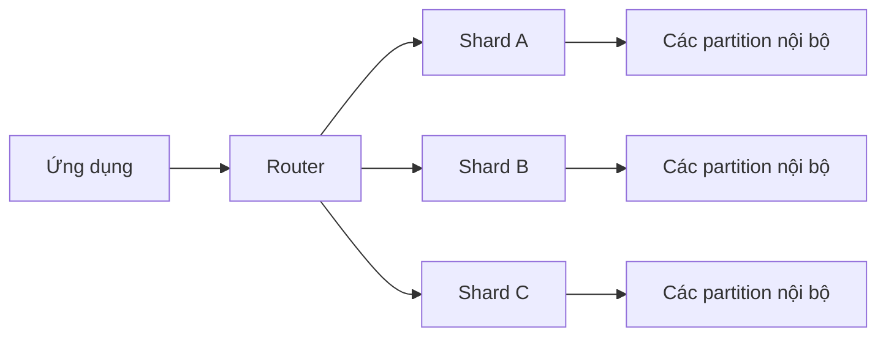
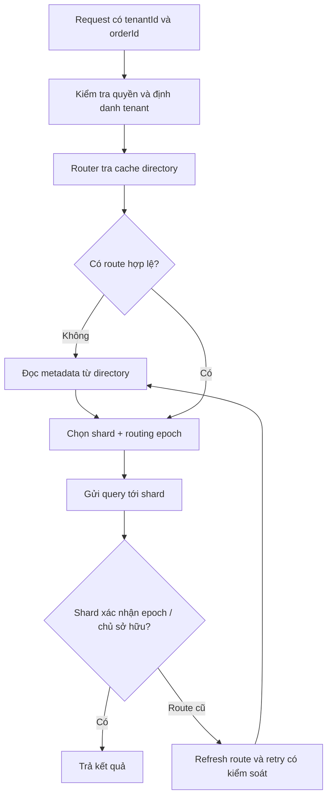
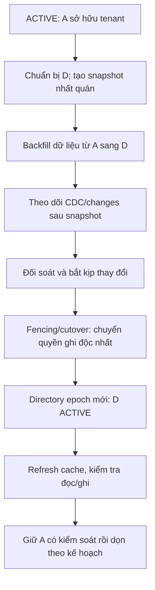

# Phân vùng theo khoảng, theo hàm băm hoặc theo thư mục định tuyến

## 1. Vì sao chọn phương pháp phân vùng là một quyết định mô hình dữ liệu?

Một hệ thống ban đầu có thể lưu tất cả đơn hàng, sự kiện hoặc tài khoản trong một bảng hoặc collection. Khi dữ liệu tăng đến hàng trăm triệu bản ghi, có hai áp lực xuất hiện: **mỗi truy vấn phải tìm dữ liệu ở đâu** và **tải đọc/ghi được phân bố lên những tài nguyên nào**.

Ví dụ, một nền tảng quản lý bán hàng cho nhiều tổ chức có các yêu cầu:

- Người dùng của một tổ chức xem các đơn mới nhất trong 30 ngày.
- Tác vụ tìm một đơn theo `tenantId` và `orderId` phải nhanh.
- Dữ liệu giao dịch được giữ nhiều năm, nhưng dữ liệu sự kiện chi tiết chỉ giữ 90 ngày.
- Một vài tổ chức lớn tạo ra phần lớn lưu lượng.
- Có báo cáo theo tháng trên toàn bộ tổ chức, nhưng giao dịch hàng ngày phải cô lập theo tenant.

Có thể chia dữ liệu **theo khoảng** (*range partitioning*), **theo hàm băm** (*hash partitioning*) hoặc **theo thư mục định tuyến** (*directory-based partitioning*). Ba cách đều nhằm quyết định một bản ghi thuộc phân vùng nào, nhưng chúng tối ưu cho **các kiểu truy vấn, tăng trưởng và vận hành khác nhau**.

Bài thuộc chương **Phân tán và phân vùng**, trong phạm vi **DATABASE_DATA_MODELING**. Mục tiêu của mô-đun là rèn khả năng chuyển yêu cầu nghiệp vụ thành mô hình dữ liệu có thực thể, quan hệ, ràng buộc, khóa, chỉ mục và lược đồ vật lý rõ ràng; đồng thời so sánh các cấu trúc quan hệ, document, đồ thị và phân tích để chọn thiết kế có thể tiến hóa và kiểm chứng.

**Sau bài này, bạn có thể:**

1. Phân biệt phân vùng logic, phân vùng vật lý, sharding, replication và routing.
2. Chọn khóa phân vùng từ **hình dạng truy vấn** (*query shape*), tải và ràng buộc nghiệp vụ.
3. So sánh range, hash và directory theo tính cục bộ, cân bằng tải, phân vùng nóng và khả năng di chuyển dữ liệu.
4. Thực hành cú pháp phân vùng khoảng và băm trong PostgreSQL, đọc kế hoạch thực thi và giới hạn unique key.
5. Thiết kế directory routing có quản lý phiên bản, cache, lỗi định tuyến và chuyển chủ sở hữu.
6. Đánh giá tác động tới giao dịch, tính duy nhất, JOIN, index, bảo mật và dữ liệu đến trễ.
7. Xây thử nghiệm với dữ liệu lệch, quan sát số đo và ghi quyết định kiến trúc có căn cứ.

## 2. Phân vùng khác sharding và replication ở điểm nào?

### 2.1. Phân vùng

**Partition** là một phần tập dữ liệu được xác định theo quy tắc: một khoảng thời gian, nhóm giá trị băm hoặc một tập khóa được map tới partition.

Ví dụ:

```text
orders
  2026-01 -> p_2026_01
  2026-02 -> p_2026_02
  2026-03 -> p_2026_03
```

Đây có thể chỉ là **phân vùng trong cùng một cơ sở dữ liệu**, không nhất thiết nằm trên nhiều máy. Trình tối ưu truy vấn có thể loại bỏ những phân vùng không phù hợp khi điều kiện lọc đủ rõ (*partition pruning*), nhưng cấu hình cụ thể phụ thuộc sản phẩm.

### 2.2. Sharding

**Sharding** là phân phối các phần dữ liệu trên nhiều shard hoặc đơn vị lưu trữ, thường để mở rộng dung lượng và throughput ngoài giới hạn một nút. Mỗi shard có thể dùng partition nội bộ.



Một query được định tuyến tới **một shard** thường dễ tối ưu hơn query phải gửi tới tất cả shard rồi hợp nhất kết quả, nhưng không phải mọi query đơn shard đều nhanh và không phải mọi query đa shard đều xấu.

### 2.3. Replication

**Replication** là duy trì bản sao dữ liệu nhằm tăng khả năng sẵn sàng, khôi phục hoặc phục vụ một số kiểu đọc. Nó không đồng nghĩa với phân vùng:

- Có thể có **một phân vùng và nhiều replica**.
- Có thể có **nhiều phân vùng, mỗi phân vùng có các replica**.
- Replication không tự làm tăng dung lượng dữ liệu logic có thể chứa như sharding; các replica vẫn chứa bản sao của phần dữ liệu được giao.

Nếu hệ thống có replica đọc trễ, một request định tuyến đúng shard nhưng đọc replica chưa bắt kịp có thể vẫn thấy dữ liệu cũ. Phải xác định yêu cầu nhất quán độc lập với cách phân vùng.

### 2.4. Ba khái niệm thường bị nhầm

| Khái niệm | Câu hỏi trả lời | Không tự bảo đảm |
| --- | --- | --- |
| **Partition key** | Bản ghi thuộc partition nào? | Khóa chính duy nhất toàn hệ thống |
| **Shard routing** | Yêu cầu nên được gửi tới nơi lưu nào? | Đọc nhất quán khi chuyển shard hoặc replica failover |
| **Replication policy** | Có bao nhiêu bản sao, ở đâu, theo chế độ nào? | Query chỉ quét một partition |
| **Business key** | Bản ghi đại diện cho thực thể nghiệp vụ nào? | Phân phối tải tốt |
| **Index key** | Tìm/lọc/sắp xếp bản ghi theo trường nào? | Phân vùng phù hợp và an toàn |

**Không chọn khóa phân vùng chỉ vì đó là primary key.** Phải đánh giá định tuyến truy vấn, phân bố dữ liệu và phạm vi bất biến.

## 3. Bắt đầu từ workload: truy vấn có chỉ ra nơi chứa dữ liệu không?

Trước khi so sánh ba phương pháp, hãy liệt kê các đường truy cập. Ví dụ hệ thống đơn hàng nhiều tenant:

| Mã | Nghiệp vụ | Điều kiện chính | Sort / phạm vi | Mức ưu tiên |
| --- | --- | --- | --- | --- |
| Q1 | Mở một đơn | `tenantId, orderId` | Một kết quả | Rất cao |
| Q2 | Danh sách đơn gần đây | `tenantId, createdAt` | Mới nhất trước, 20 dòng/trang | Rất cao |
| Q3 | Xem lịch sử một khách | `tenantId, customerId` | Theo thời gian | Cao |
| Q4 | Đếm đơn theo tháng | `createdAt` | Nhóm theo ngày/tháng | Theo batch |
| Q5 | Đối soát đơn lỗi | `status, updatedAt` | Nhiều tenant | Theo batch |
| Q6 | Xóa dữ liệu sự kiện hết hạn | `eventTime` | Theo khoảng thời gian | Định kỳ |
| Q7 | Chuyển dữ liệu một tenant sang vùng mới | `tenantId` | Toàn bộ dữ liệu tenant | Vận hành |

Những câu hỏi tiếp theo quyết định cấu trúc phân vùng:

- Q1 có cung cấp **đầy đủ partition key** không?
- Q2 chỉ đọc vài khoảng thời gian hay phải quét toàn bộ lịch sử?
- Q4 cần quét đa partition nhưng chạy ngoài giờ hay chạy trực tuyến?
- Một tenant rất lớn có thể tạo điểm nóng không?
- Q7 cần di chuyển **một tenant** độc lập hay phải di chuyển hàng triệu bản ghi rải nhiều nơi?
- Có bao nhiêu truy vấn không chứa partition key và chúng có cần SLA thấp không?

**Một truy vấn chỉ chứa `orderId` không tự truy ra được shard nếu router dùng `tenantId` và không có index hoặc directory toàn cục.** API, khóa và quyền truy cập phải được thiết kế đồng bộ.

### 3.1. Các tiêu chí định lượng nên thu thập

- Tổng bản ghi, kích thước dữ liệu/index và tốc độ tăng.
- Tỷ lệ đọc/ghi, QPS/peak QPS, p95/p99 latency.
- Cardinality của partition key: bao nhiêu giá trị và phân phối như thế nào?
- Tỷ lệ tenant lớn nhất trong dung lượng và throughput.
- Tần suất query điểm, query khoảng, query tổng hợp và query xuyên tenant.
- Kích thước kết quả, thứ tự phân trang, yêu cầu transaction/unique.
- Chính sách vị trí lưu dữ liệu, lưu giữ, backup và khôi phục.

Không chỉ đo trung bình. Một tenant tạo 40% tải có thể quyết định kiến trúc dù 99% tenant còn lại rất nhỏ.

## 4. Phân vùng theo khoảng: range partitioning

**Range partitioning** đặt các khóa nằm trong một khoảng giá trị liên tục vào cùng partition. Thường dùng với:

- Ngày giờ sự kiện: theo ngày, tuần hoặc tháng.
- Mã số theo dải, nếu nghiệp vụ cần scan theo dải.
- Các vùng giá trị có thứ tự, khi điều kiện truy vấn bám theo đúng khoảng.

Quy tắc ví dụ:

```text
createdAt ∈ [2026-01-01, 2026-02-01)  -> orders_2026_01
createdAt ∈ [2026-02-01, 2026-03-01)  -> orders_2026_02
createdAt ∈ [2026-03-01, 2026-04-01)  -> orders_2026_03
```

Dùng khoảng **nửa mở** `[start, end)` để một giá trị đúng bằng ranh giới chỉ thuộc partition phía sau, không thuộc cả hai.

### 4.1. Ưu điểm

1. **Phù hợp query theo khoảng:** nếu người dùng lọc tháng 2, planner có thể chỉ quét partition tháng 2.
2. **Vòng đời dữ liệu tự nhiên:** có thể lưu/xóa/di chuyển phân vùng theo tháng khi chính sách cho phép.
3. **Dễ quan sát dung lượng theo thời gian:** biết tháng nào tăng đột biến.
4. **Dữ liệu thời gian gần nhau được nhóm:** thuận tiện với một số query timeline và batch.
5. **Quy tắc giải thích được:** mọi bản ghi trong dải xác định nằm ở vùng nào.

### 4.2. Hạn chế

- **Write hotspot:** dữ liệu luôn ghi ở “tháng hiện tại” có thể dồn nhiều ghi vào một partition.
- **Skew:** tháng có chương trình khuyến mãi có lượng dữ liệu vượt xa tháng bình thường.
- **Query không lọc khóa khoảng:** tìm `orderId` toàn lịch sử có thể phải kiểm tra nhiều partition.
- **Ranh giới và lịch:** dữ liệu tới trễ, timezone, tuần bắt đầu ngày nào và thời gian lưu giữ cần được định nghĩa.
- **Quá nhiều partition nhỏ:** metadata, kế hoạch truy vấn, bảo trì và quản trị có thể tăng.
- **Phân vùng không tự chia tải qua nhiều máy:** nếu tất cả partition vẫn ở cùng một máy, điểm nghẽn CPU/IOPS vật lý chưa chắc giảm.

**Quan trọng:** range partitioning theo thời gian không tương đương dữ liệu theo time-series đã sắp xếp hoàn hảo. Index, clustering và storage engine vẫn ảnh hưởng tốc độ.

### 4.3. Khi nào nên chọn?

Range là ứng viên mạnh khi **phần lớn query và chính sách dữ liệu có giới hạn thời gian**. Nếu gần như mọi thao tác đều cần truy cập theo tenant, nhưng hiếm khi có bộ lọc ngày, chỉ range theo ngày có thể là phương án tồi cho workload đó.

## 5. Thực hành PostgreSQL: partition theo tháng

Ví dụ declarative partitioning của PostgreSQL; cú pháp dùng để giải thích một **cách triển khai trên một RDBMS**, không phải API chung cho mọi hệ lưu trữ.

```sql
CREATE TABLE orders_by_date (
    tenant_id text NOT NULL,
    order_id text NOT NULL,
    order_date date NOT NULL,
    status text NOT NULL,
    amount_minor bigint NOT NULL CHECK (amount_minor >= 0),
    PRIMARY KEY (tenant_id, order_date, order_id)
) PARTITION BY RANGE (order_date);

CREATE TABLE orders_2026_01 PARTITION OF orders_by_date
FOR VALUES FROM (DATE '2026-01-01') TO (DATE '2026-02-01');

CREATE TABLE orders_2026_02 PARTITION OF orders_by_date
FOR VALUES FROM (DATE '2026-02-01') TO (DATE '2026-03-01');

CREATE TABLE orders_other PARTITION OF orders_by_date DEFAULT;

CREATE INDEX orders_date_tenant_lookup
ON orders_by_date (tenant_id, order_date DESC, order_id);
```

Giải thích:

- Bản ghi có `order_date = '2026-02-01'` thuộc partition tháng 2, không thuộc tháng 1.
- Partition `DEFAULT` có thể tiếp nhận dữ liệu ngoài các khoảng đã khai báo; cần giám sát để không vô tình dồn toàn bộ tháng mới vào default.
- PostgreSQL có thể tạo index tương ứng trên các partition khi tạo index trên partitioned table; kiểm tra hành vi/phiên bản cụ thể và kế hoạch triển khai index lớn.
- Khóa chính ví dụ **bao gồm `order_date`**: với declarative partitioned table, các ràng buộc unique/primary key của PostgreSQL phải tuân theo giới hạn liên quan đến partition key.

**Giới hạn tính duy nhất:** `PRIMARY KEY (tenant_id, order_date, order_id)` không ngăn cùng `order_id` trong một tenant xuất hiện ở **hai ngày khác nhau**. Nếu nghiệp vụ yêu cầu `(tenant_id, order_id)` duy nhất xuyên mọi ngày, cần thiết kế thêm một nơi cấp ID/registry có ràng buộc hoặc chọn partition key khác; không được tuyên bố rằng ví dụ này đã bảo vệ yêu cầu đó.

### 5.1. Query theo khoảng có thể pruning

```sql
EXPLAIN (ANALYZE, BUFFERS)
SELECT order_id, amount_minor
FROM orders_by_date
WHERE tenant_id = 'ORG-07'
  AND order_date >= DATE '2026-02-01'
  AND order_date <  DATE '2026-03-01';
```

Hãy xem kế hoạch có truy cập đúng partition tháng 2 hay không. `EXPLAIN ANALYZE` thực thi truy vấn, chỉ dùng trên dữ liệu/môi trường phù hợp.

Truy vấn chỉ có:

```sql
SELECT *
FROM orders_by_date
WHERE tenant_id = 'ORG-07'
  AND order_id = 'O-100';
```

không chỉ rõ `order_date`, vì vậy có thể phải xét nhiều partition. **Index trên `order_id` không tự biến partition key thành khóa định tuyến.**

### 5.2. Cẩn thận khi lọc qua hàm

Nếu ứng dụng dùng `DATE_TRUNC` hoặc ép kiểu trên cột phân vùng trong điều kiện, tùy sản phẩm và kế hoạch, optimizer có thể không suy ra được cùng khoảng để pruning.

Thay vì chỉ dựa vào `date_trunc('month', order_timestamp) = ...`, thường nên cân nhắc điều kiện nửa mở trực tiếp trên trường đã chọn:

```sql
WHERE occurred_at >= TIMESTAMPTZ '2026-02-01 00:00:00+00'
  AND occurred_at <  TIMESTAMPTZ '2026-03-01 00:00:00+00'
```

Ví dụ này minh họa một bảng khác phân vùng bằng `occurred_at` kiểu timestamp. Không copy nguyên đoạn vào bảng `orders_by_date` ở trên vì bảng đó dùng `order_date` kiểu `date`. **Kiểu trường và timezone phải được thiết kế nhất quán.**

### 5.3. Dữ liệu đến muộn và vòng đời partition

Một đơn tháng 1 được bổ sung vào tháng 3 vẫn thuộc partition tháng 1 theo **order_date**, không thuộc tháng 3 theo thời điểm nạp. Nếu partition tháng 1 đã bị gỡ/xóa, phải có chính sách xử lý dữ liệu đến muộn:

- Từ chối và đưa vào hàng chờ đối soát.
- Khôi phục vùng dữ liệu thích hợp nếu chính sách cho phép.
- Lưu vào luồng hiệu chỉnh có lineage.
- Chọn khóa phân vùng khác nếu yêu cầu nghiệp vụ luôn sửa lịch sử xa.

Không dùng `DEFAULT` như “thùng chứa vô thời hạn” cho mọi bản ghi không khớp; nó sẽ làm phá vỡ cả mục tiêu pruning lẫn vòng đời dữ liệu.

## 6. Phân vùng theo hàm băm: hash partitioning

**Hash partitioning** tính một hàm băm trên partition key rồi chọn partition dựa trên kết quả. Mục tiêu thường là phân bổ nhiều khóa có giá trị khác nhau ra nhiều vùng tương đối đều.

Một cách minh họa đơn giản:

```text
partition = positive_hash(tenant_id) mod 8

tenant ORG-07 -> một trong 8 partition
tenant ORG-12 -> có thể sang partition khác
tenant ORG-23 -> có thể trùng partition với ORG-07
```

**Lưu ý:** đây là công thức khái niệm. Hàm hash, encoding, xử lý số âm, giá trị null và thuật toán phân vùng của từng hệ quản trị có thể khác; không tự tính trong ứng dụng rồi cho rằng khớp hash partitioning nội bộ của database.

### 6.1. Ưu điểm

- Không phụ thuộc thứ tự tăng dần của khóa; tránh việc mọi giá trị mới luôn dồn vào khoảng cuối khi khóa phù hợp.
- Thường cân bằng **số lượng khóa khác nhau** tốt hơn khi phân phối khóa đủ rộng.
- Phù hợp truy vấn điểm có đầy đủ partition key.
- Có thể tạo nhiều bucket/shard tương đối cân bằng cho các đối tượng có tải tương đương.
- Có thể kết hợp các chiến lược virtual bucket hoặc directory để quản trị phân phối vật lý.

### 6.2. Hạn chế

- Query theo khoảng của **khóa được băm** không thường được gom ở một nơi: `tenantId BETWEEN ...` có thể phải quét nhiều partition.
- Hash cân bằng số khóa **không tự cân bằng QPS** nếu một khóa cực nóng.
- Nếu băm theo `tenantId`, toàn bộ ghi của tenant lớn vẫn đến cùng vùng logic.
- Nếu băm theo `orderId`, dữ liệu một tenant bị rải, khiến truy vấn “tất cả đơn của tenant” khó giữ cục bộ.
- Đổi số partition bằng phép `mod N` trực tiếp có thể khiến nhiều khóa đổi partition, gây tái phân phối lớn.
- Hash không tự giải quyết query thiếu partition key, global uniqueness hoặc distributed transaction.

### 6.3. Một “tenant khổng lồ” phá giả định cân bằng

Giả sử có 1.000 tenant, được hash vào 16 partition. Nhưng một tenant duy nhất sinh ra **40% tổng lượt ghi**. Vì tất cả bản ghi của tenant này dùng cùng `tenantId`, partition chứa tenant đó sẽ gánh ít nhất 40% tải, dù các tenant khác phân tán rất đều.

Đây là hiện tượng **hot key / hot partition**, không phải hash kém ngẫu nhiên. Chọn khóa hash phải xét **trọng số tải của từng giá trị khóa**, không chỉ số lượng giá trị.

Nếu mục tiêu bắt buộc giữ toàn bộ đơn của tenant ở một shard để giao dịch nội tenant, có thể chấp nhận chênh lệch và **điều phối tenant lớn** sang tài nguyên riêng. Nếu mục tiêu phân tán tải cực cao của một tenant, có thể phải thêm bucket trong tenant, đổi lại truy vấn nội tenant phải fan-out qua các bucket.

## 7. Thực hành PostgreSQL: hash theo tenant

Ví dụ khác với bảng range ở phần 5; không chạy thay tên bảng rồi mong tự di chuyển dữ liệu giữa hai mô hình.

```sql
CREATE TABLE orders_by_tenant (
    tenant_id text NOT NULL,
    order_id text NOT NULL,
    order_date date NOT NULL,
    amount_minor bigint NOT NULL CHECK (amount_minor >= 0),
    PRIMARY KEY (tenant_id, order_id)
) PARTITION BY HASH (tenant_id);

CREATE TABLE orders_h0 PARTITION OF orders_by_tenant
FOR VALUES WITH (MODULUS 4, REMAINDER 0);

CREATE TABLE orders_h1 PARTITION OF orders_by_tenant
FOR VALUES WITH (MODULUS 4, REMAINDER 1);

CREATE TABLE orders_h2 PARTITION OF orders_by_tenant
FOR VALUES WITH (MODULUS 4, REMAINDER 2);

CREATE TABLE orders_h3 PARTITION OF orders_by_tenant
FOR VALUES WITH (MODULUS 4, REMAINDER 3);

CREATE INDEX orders_tenant_date_idx
ON orders_by_tenant (tenant_id, order_date DESC, order_id);
```

Bảng có bốn partition bằng các cặp `(modulus, remainder)`. Các bản ghi cùng `tenant_id` được định tuyến tới cùng partition logic theo cơ chế PostgreSQL.

Query:

```sql
EXPLAIN (ANALYZE, BUFFERS)
SELECT order_id, order_date, amount_minor
FROM orders_by_tenant
WHERE tenant_id = 'ORG-07'
  AND order_date >= DATE '2026-02-01'
  AND order_date <  DATE '2026-03-01'
ORDER BY order_date DESC, order_id
LIMIT 20;
```

Query có `tenant_id` bằng giá trị cụ thể nên **có điều kiện để pruning theo hash key**; index còn hỗ trợ tìm và sắp xếp bên trong partition phù hợp.

Nếu bỏ `tenant_id` nhưng lọc cả tháng 2, hash theo tenant **không giúp loại bỏ partition bằng điều kiện tháng**, và hệ thống có thể phải quét tất cả bốn partition.

**Đặc điểm quan trọng:** ở ví dụ này PostgreSQL phân vùng **trong hệ quản trị đó**, không khẳng định các partition đã nằm trên bốn máy khác nhau. Muốn phân phối đa nút cần khả năng hoặc kiến trúc sharding riêng.

## 8. Hash partitioning, consistent hashing và virtual buckets không phải một

Một số cuộc thảo luận dùng “hash” để chỉ nhiều cơ chế khác nhau.

| Cơ chế | Ý tưởng | Khi số nút thay đổi |
| --- | --- | --- |
| **Hash modulo cố định** | `h(key) mod N` | Đổi N có thể làm nhiều khóa chuyển nơi |
| **Consistent hashing** | Ánh xạ khóa và node/token lên một vòng hoặc không gian hash | Thường giảm tỷ lệ khóa phải đổi chủ so với modulo trực tiếp, phụ thuộc triển khai |
| **Virtual buckets/slots** | Băm khóa tới nhiều bucket logic cố định, sau đó gán bucket cho node | Có thể chuyển từng bucket mà không đổi hàm bucket |
| **Directory routing** | Lookup metadata từ khóa/bucket tới node | Di chuyển bằng cập nhật mapping được quản lý, cần hệ metadata đáng tin |

**Consistent hashing không phải là mặc định trong mọi “hash partition” của database.** PostgreSQL hash partitioning ở phần trước không tự mang theo semantics di chuyển node của một consistent-hash ring.

### 8.1. Vì sao virtual buckets hữu ích?

Thay vì `hash(key) mod số máy`, có thể dùng:

```text
logical_bucket = hash(key) mod 1024
physical_shard = directory[logical_bucket]
```

Ví dụ:

```text
Bucket 0000–0341 -> Shard A
Bucket 0342–0683 -> Shard B
Bucket 0684–1023 -> Shard C
```

Khi thêm Shard D, có thể chuyển một phần bucket từ A/B/C sang D mà không cần thay công thức tính `logical_bucket`.

**Đánh đổi:** bucket là đơn vị di chuyển. Nếu chỉ một bucket chứa khóa rất nóng, chuyển bucket sang máy khác không tự chia khóa đó thành nhiều phần. Kích thước và số bucket, phân bố tải và mức hạt cần được thiết kế từ đầu.

## 9. Phân vùng theo thư mục định tuyến: directory-based partitioning

Ở đây **directory** có nghĩa là **bảng hoặc dịch vụ metadata ánh xạ khóa logic tới nơi chứa dữ liệu**, không phải thư mục trên ổ đĩa.

Ví dụ:

```text
Tenant ORG-07 -> Shard A
Tenant ORG-12 -> Shard C
Tenant ORG-23 -> Shard B
```

Khi ứng dụng cần đọc đơn của `ORG-07`, router hỏi directory để biết shard có thẩm quyền rồi gửi query đến Shard A.

### 9.1. Cấu trúc directory tối thiểu

Một bảng mapping có thể là:

```text
tenant_routes
  tenant_id
  shard_id
  routing_epoch
  state
  updated_at
```

Trong đó:

- `tenant_id`: khóa logic mà router nhận được.
- `shard_id`: nơi đang hoặc sẽ chịu trách nhiệm.
- `routing_epoch`: số phiên bản tăng dần để phát hiện metadata cũ.
- `state`: trạng thái điều phối, ví dụ `ACTIVE` hoặc `MOVING`.
- `updated_at`: phục vụ quan sát, **không thay thế epoch**.

Ví dụ:

```text
tenant_id | shard_id | routing_epoch | state
----------+----------+---------------+--------
ORG-07    | A        | 17            | ACTIVE
ORG-12    | C        |  8            | ACTIVE
ORG-23    | B        |  5            | ACTIVE
```

Một số hệ dùng directory tập trung, một số phân phối hoặc cache directory. Tính đúng đắn phụ thuộc cách bảo đảm **cập nhật mapping, chủ sở hữu duy nhất và xử lý định tuyến cũ**.

### 9.2. Ưu điểm

- **Điều phối có chủ đích:** tenant lớn có thể được gán shard riêng.
- **Di chuyển một tenant dễ diễn đạt:** cập nhật mapping sau khi dữ liệu được chuyển và kiểm chứng.
- **Cách ly vị trí:** có thể chọn region, cụm máy hoặc lớp tài nguyên theo chính sách.
- **Không phụ thuộc thứ tự ID hoặc sự đồng đều của hash:** có thể phân bố theo tải, dung lượng và yêu cầu riêng.
- **Có thể dùng lookup theo bucket:** directory không nhất thiết có một dòng cho từng tài liệu.

### 9.3. Hạn chế

- Directory là **một thành phần trạng thái bổ sung**, cần availability, kiểm soát truy cập, backup và giám sát.
- Router có thể tốn một lần lookup hoặc cache miss trước mỗi nhóm request.
- Cache route cũ có thể dẫn tới shard sai sau khi chuyển dữ liệu.
- Khi directory không truy cập được, hệ thống phải có chiến lược rõ: từ chối ghi, dùng cache có giới hạn, hoặc chế độ read-only.
- Di chuyển dữ liệu không hoàn tất chỉ bằng UPDATE bảng directory: phải chuyển dữ liệu và bảo vệ ghi đang diễn ra.
- Một tenant cực lớn vẫn có thể làm một shard nóng nếu directory chỉ định tuyến theo tenant.

**Directory không tự đồng nghĩa “không có hotspot”.** Nó chỉ giúp người vận hành **điều chỉnh nơi đặt** các khóa hoặc bucket.

## 10. Luồng định tuyến qua directory



Đây là sơ đồ nguyên lý; không phải DB nào cũng có cơ chế xác thực epoch ở data plane. Nếu shard không kiểm tra chủ sở hữu và router có cache cũ, nguy cơ đọc cũ hoặc ghi sai nơi trong lúc migration sẽ tăng.

### 10.1. Pseudocode định tuyến an toàn

```text
function handleOrderRequest(request):
    assertAuthenticated(request.user)
    assertAuthorizedForTenant(request.user, request.tenantId)

    route = routingDirectory.resolve(request.tenantId)
    if route is missing:
        failClosed("Tenant route unavailable")

    if route.state is not ACTIVE:
        applyDefinedMovePolicyOrRetry()

    result = shardClient(route.shardId).execute(
        tenantId = request.tenantId,
        orderId = request.orderId,
        expectedEpoch = route.routingEpoch
    )

    if result indicates STALE_ROUTE:
        invalidateCachedRoute(request.tenantId)
        retryAtMostOnceAfterRefreshing()
    else:
        return result
```

**Lưu ý quan trọng:**

- Kiểm tra quyền tenant phải xuất phát từ hệ thống xác thực có thẩm quyền, không tin một `tenantId` tùy ý do client gửi.
- `expectedEpoch` chỉ có tác dụng nếu **phía shard hoặc cơ chế điều phối ghi thực sự thực thi fencing**.
- Retry ghi không tự an toàn. Cần **idempotency key**, điều kiện ghi hoặc giao dịch tương ứng để tránh tạo đơn hai lần nếu lần đầu đã commit nhưng phản hồi thất lạc.
- Nếu directory không sẵn sàng và cache đã hết hạn, **không tự đoán shard** từ tenantId khi kiến trúc dựa trên mapping.

### 10.2. Directory nên ở cấp tenant, bucket hay bản ghi?

| Cấp mapping | Số mục metadata | Dễ di chuyển | Hạn chế |
| --- | --- | --- | --- |
| **Một tenant → một shard** | Theo số tenant | Di chuyển cả tenant | Tenant quá lớn vẫn nóng một shard |
| **Một virtual bucket → một shard** | Theo số bucket cố định | Di chuyển bucket; cân bằng tốt hơn | Tenant có thể nằm nhiều shard nếu hash theo row |
| **Một range → một shard** | Theo số khoảng khóa | Tách/sát nhập khoảng | Quản trị ranh giới và dữ liệu lệch |
| **Một bản ghi → một shard** | Theo số bản ghi | Rất linh hoạt về vị trí | Metadata cực lớn, lookup và nhất quán phức tạp |

Không chọn directory per-record mặc định khi có thể định tuyến bằng tenant hoặc bucket; độ lớn directory có thể trở thành một cơ sở dữ liệu thứ hai cần vận hành ở quy mô gần dữ liệu gốc.

## 11. So sánh range, hash và directory

| Tiêu chí | Range | Hash | Directory |
| --- | --- | --- | --- |
| Nguyên tắc | Khóa thuộc khoảng liên tục | Hash của khóa chọn bucket | Metadata ánh xạ khóa/bucket tới nơi lưu |
| Query điểm có partition key | Thường định tuyến tốt | Thường định tuyến tốt | Cần lookup route, sau đó một nơi |
| Query theo khoảng **cùng khóa** | Thường có lợi thế pruning | Thường phải quét nhiều bucket | Tùy directory dựa trên range hay tenant |
| Dữ liệu tăng dần theo thời gian | Dễ phân vùng theo tháng, nhưng dễ nóng vùng mới | Phân tán được nếu hash theo khóa đủ đa dạng | Có thể gán thủ công/chuyển vùng tải cao |
| Cân bằng số bản ghi | Phụ thuộc ranh giới khoảng | Có xu hướng cân bằng nhiều khóa đa dạng | Phụ thuộc chính sách đặt dữ liệu |
| Cân bằng tải khi một khóa nóng | Không tự giải quyết | Không tự giải quyết nếu hash nguyên khóa nóng | Có thể chuyển khóa nóng sang shard riêng, chưa tự chia khóa |
| Retention theo thời gian | Thuận tiện khi partition trùng đơn vị giữ | Cần dọn trong nhiều bucket | Tùy cấu trúc và chính sách |
| Thêm/giảm shard | Tách và di chuyển khoảng | Phải có cơ chế rehash/rebalance | Cập nhật mapping sau migration |
| Cross-partition query | Có thể scatter khi thiếu khóa khoảng | Có thể scatter khi thiếu hash key | Có thể fan-out khi không biết route hoặc cần nhiều tenant |
| Chi phí metadata | Ranh giới partition | Hàm hash/bucket topology | Directory, cache và trạng thái migration |
| Phù hợp ban đầu | Time-series, retention, range scan | Key-value/đọc điểm với nhiều khóa | Multi-tenant, placement theo chính sách, chuyển tenant |

**Không có cột “nhanh nhất” chung.** Cùng một query có thể nhanh với range nhưng chậm với hash, hoặc ngược lại, vì partition key và vị trí lọc khác nhau.

## 12. Kết hợp các phương pháp theo hai chiều

Trong hệ thống thật, chỉ một cách phân vùng có thể không phục vụ đủ nhu cầu.

### 12.1. Theo tenant, rồi theo thời gian

Ví dụ muốn:

- Cô lập mỗi tenant vào một nhóm tài nguyên.
- Xóa dữ liệu cũ theo tháng.
- Truy vấn nội tenant trong 30 ngày.

Một mô hình là **định tuyến tenant tới shard**, sau đó **range partition theo tháng trong shard**:

```text
Router
  tenantId -> Shard B (directory)
      Shard B:
        orders_2026_01
        orders_2026_02
        orders_2026_03
```

Lợi ích: câu query chứa tenant được định tuyến tới một shard; điều kiện thời gian giúp pruning các partition nội bộ.

Đánh đổi: một tenant rất lớn vẫn nóng nếu chỉ có một shard cho tenant. Nếu cần chia tenant thành nhiều shard, phải thay đổi khóa định tuyến hoặc đưa thêm bucket.

### 12.2. Hash bucket, rồi range theo thời gian

Một lựa chọn khác:

```text
bucket = stable_hash(tenantId, orderId) mod 128
shard = directory[bucket]
partition_in_shard = month(orderDate)
```

Cách này có thể phân tán ghi của một tenant qua nhiều bucket. Nhưng truy vấn “mọi đơn của tenant” có thể phải hỏi nhiều bucket/shard, gây fan-out và tổng hợp kết quả.

### 12.3. Virtual bucket cố định để dễ rebalancing

Một bảng mapping:

```text
bucket_id -> shard_id

000–031 -> Shard A
032–063 -> Shard B
064–095 -> Shard C
096–127 -> Shard D
```

Khi một shard đầy, có thể di chuyển một số bucket sang shard khác mà **không đổi công thức key→bucket**.

Vẫn cần kế hoạch về **bucket bị lệch**. Nếu một tenant có tải quá lớn và tất cả đơn theo tenant ở một bucket, chỉ chuyển bucket không chia được tải bên trong.

### 12.4. Composite key không tự bảo đảm hợp lý

Băm `(tenantId, orderId)` giúp phân tán ghi theo đơn; băm chỉ `tenantId` giúp dữ liệu của tenant cục bộ. **Thêm thành phần vào hash key là đổi trade-off của truy vấn**, không đơn giản “cải thiện phân phối” mà không có giá phải trả.

## 13. Hotspot, skew và chỉ số phải đo

### 13.1. Phân biệt ba loại lệch

1. **Lệch dung lượng:** một partition có nhiều byte/row hơn partition khác.
2. **Lệch tải:** một partition nhận nhiều QPS, IOPS, CPU hoặc ghi hơn.
3. **Lệch thời gian:** một khoảng mới (tháng hiện tại) nóng dù các khoảng lịch sử gần như chỉ đọc.

Một partition có dung lượng nhỏ vẫn có thể là **hotspot** nếu chứa một khóa được truy cập hàng chục nghìn lần/giây. Một partition lớn nhưng gần như không đọc lại có thể không phải điểm nghẽn hiện tại.

### 13.2. Theo dõi tối thiểu

- Byte, row count và số index entries trên partition/shard.
- Read/write QPS; peak QPS và p95/p99 latency.
- CPU, bộ nhớ, cache hit, IOPS, network.
- Số request truy vấn một shard và số request fan-out.
- Tỷ lệ request bị retry do route cũ, chuyển chủ hoặc timeout.
- Khối lượng dữ liệu di chuyển khi rebalance.
- Distribution của tenant: p50, p95, p99, top-N theo QPS và dung lượng.
- Số lỗi unique, deadlock, cross-shard transaction và độ trễ replication.

### 13.3. Ví dụ tính tải

Giả sử hệ thống nhận **100.000 ghi/giây**, chia theo 20 partition. Nếu hoàn toàn đều:

```text
100.000 / 20 = 5.000 ghi/giây/partition
```

Nhưng một tenant tạo 40.000 ghi/giây và partition key là `tenantId`, partition chứa tenant đó nhận **ít nhất 40.000 ghi/giây**, chưa tính các tenant khác.

Kết luận không phải “cần hàm hash mạnh hơn”, mà là **thay đơn vị phân tải**: bucket trong tenant, cách ly tenant lên tài nguyên riêng, phân luồng ghi, hoặc thay kiến trúc nếu vẫn cần transaction nội tenant chặt.

Số trên chỉ minh họa nguyên tắc, không phải kết quả benchmark.

## 14. Partition key tác động tới tính duy nhất và giao dịch

### 14.1. Global unique constraint không phải lúc nào cũng miễn phí

Trong một bảng không phân vùng, unique index trên `(tenantId, orderId)` có thể ngăn trùng trong phạm vi được định nghĩa. Khi phân vùng theo `orderDate`, hai đơn cùng `(tenantId, orderId)` có thể nằm ở hai partition khác nhau.

Tùy sản phẩm, một unique constraint trên partitioned table có thể phải **bao gồm partition key** hoặc cần cơ chế global index/điều phối riêng.

Ví dụ đã thấy ở PostgreSQL:

```sql
PRIMARY KEY (tenant_id, order_date, order_id)
```

không đồng nghĩa với:

```sql
UNIQUE (tenant_id, order_id)
```

trên mọi `order_date`.

Nếu nghiệp vụ cần ID đơn duy nhất xuyên thời gian, có thể:

- Cấp ID qua một dịch vụ đáng tin và kiểm soát trùng.
- Lưu registry `(tenantId, orderId)` có ràng buộc mạnh riêng.
- Chọn partition key/primary key tương thích nhu cầu unique.
- Dùng global unique index nếu sản phẩm hỗ trợ đúng phạm vi.

**Đừng dựa hoàn toàn vào xác suất ID ngẫu nhiên không trùng** nếu quy tắc nghiệp vụ yêu cầu bảo đảm duy nhất tuyệt đối trong phạm vi có thể kiểm soát.

### 14.2. Transaction nội partition và xuyên partition

Nếu tạo đơn và cập nhật số dư liên quan cùng shard, giao dịch có thể dễ quản lý hơn so với việc hai thực thể nằm ở các shard khác nhau. Nhưng phạm vi nguyên tử thực tế phụ thuộc database/engine/isolation; việc “cùng shard” **không tự chứng minh** giao dịch đã được bao bọc đúng.

Nếu một thao tác cần cập nhật hai shard, cần kiểm tra:

- Hệ quản trị có hỗ trợ distributed transaction không?
- Độ trễ, khả năng thất bại và contention của giao dịch xuyên shard thế nào?
- Có thể tái thiết kế ranh giới dữ liệu để thao tác quan trọng nằm cùng shard?
- Nếu dùng quy trình không nguyên tử (saga/outbox), bất biến nào được giữ ở mỗi bước và cách bù/đối soát ra sao?

### 14.3. JOIN, foreign key và truy vấn tổng hợp

Khi `orders` và `order_items` cùng dùng `tenantId/orderId` để định tuyến, có cơ hội giữ các dòng liên quan cùng nơi, giảm network join. Nếu hai bảng được phân bố khác quy tắc, truy vấn có thể cần truyền dữ liệu giữa shard.

Không thể giả định mọi DB phân tán áp dụng foreign key xuyên shard như RDBMS đơn nút. Phải xác nhận khả năng sản phẩm và quy tắc xóa/cập nhật ở tầng nghiệp vụ.

### 14.4. Khóa định danh phải đủ cho đường API

Nếu router theo `tenantId`, endpoint chỉ nhận `/orders/{orderId}` không đủ để xác định shard, trừ khi có global ID mang thông tin định tuyến được thiết kế hoặc một lookup/index toàn cục.

Một API như:

```text
GET /tenants/{tenantId}/orders/{orderId}
```

thể hiện rõ tenant, nhưng **không tự bảo đảm người gọi được phép truy cập tenant đó**. Phải xác thực/ủy quyền trước khi trả dữ liệu.

## 15. Index, pruning và truy vấn đa shard

### 15.1. Partition pruning khác index scan

- **Partition pruning:** bỏ các partition chắc chắn không thể chứa kết quả.
- **Index scan:** tìm dòng trong một hoặc nhiều partition còn lại theo chỉ mục.

Ví dụ nếu range theo `orderDate`, query một tháng có thể prune tới tháng đó, rồi dùng index `(tenantId, orderDate)` để tìm bản ghi tenant. Nếu thiếu index, query vẫn có thể quét nhiều dòng trong partition tháng đó.

Ngược lại, có index rất tốt trong từng partition, nhưng query không cung cấp partition key thì có thể phải kiểm tra **mọi partition**.

### 15.2. Scatter–gather

Khi router không xác định một nơi chứa dữ liệu, nó có thể:

1. Gửi request tới nhiều shard.
2. Mỗi shard chạy query cục bộ.
3. Thu kết quả.
4. Merge/sort/aggregate.
5. Trả kết quả hoặc lỗi nếu một shard không phản hồi.

Ví dụ báo cáo “top 20 đơn mới nhất trên toàn hệ thống” ở hệ hash theo tenant cần cẩn thận: mỗi shard trả 20 đơn mới nhất, router merge thành 20 đơn cuối cùng. Nếu còn bộ lọc, điều kiện phân trang hoặc top-N theo hàm tổng hợp, thuật toán merge có thể phức tạp hơn.

**Scatter–gather không luôn sai**, nhất là batch analytics; nhưng với API p99 thấp, fan-out nhiều shard làm tăng điểm thất bại và khó kiểm soát latency.

### 15.3. Tối ưu theo loại workload

| Workload | Hướng thường phù hợp |
| --- | --- |
| API lấy một đơn theo tenant | Định tuyến tenant hoặc khóa có đủ thông tin |
| Danh sách đơn theo tenant và 30 ngày | Routing tenant + index/date partition trong shard |
| Báo cáo toàn hệ thống theo tháng | Range theo thời gian hoặc pipeline phân tích riêng |
| Tìm theo email khách trên mọi tenant | Global search/index có quyền truy cập hoặc nguồn mapping đáng tin |
| Xóa dữ liệu sự kiện quá 90 ngày | Range partition gắn retention, khi hỗ trợ |
| Ghi cực cao của một tenant | Sub-bucket trong tenant hoặc tách workload/hạ tầng |
| Chuyển một tenant sang region riêng | Directory và quy trình migration có kiểm soát |

Không thêm chỉ mục toàn cục mà không tính chi phí ghi, độ trễ đồng bộ và quy tắc nhất quán.

## 16. Rebalancing và thay đổi số partition/shard

Phân vùng phải được thiết kế để **có thể thay đổi**. Một quyết định tốt ở quy mô 10 GB có thể trở thành điểm nghẽn ở 10 TB.

### 16.1. Range: split hoặc merge theo ranh giới

Nếu một partition bao phủ cả năm và quá lớn, có thể muốn tách thành các tháng:

```text
Trước: [2026-01-01, 2027-01-01)

Sau:
[2026-01-01, 2026-02-01)
[2026-02-01, 2026-03-01)
...
[2026-12-01, 2027-01-01)
```

Cơ chế tách có thể online hoặc cần backfill/đổi routing theo sản phẩm. Không giả định chỉ đổi metadata là đủ: dữ liệu vật lý có thể phải được di chuyển, index xây lại hoặc khóa bảng theo quy tắc engine.

### 16.2. Hash: tăng N không chỉ là thêm máy

Nếu dùng `hash(key) mod 8` rồi chuyển thành `mod 16`, nhiều khóa đổi partition. Nếu ứng dụng thay công thức router trước khi dữ liệu được chuyển, query có thể tìm sai nơi.

Cần:

- Cơ chế rehash hoặc di chuyển bucket.
- Kế hoạch song song dữ liệu cũ/mới khi migration.
- Đảm bảo không có hai owner ghi cùng một logical key.
- Kiểm chứng số lượng/dữ liệu và cutover có khả năng rollback.

Consistent hashing hoặc virtual buckets có thể giảm lượng di chuyển, nhưng không loại bỏ yêu cầu đồng bộ và kiểm soát lỗi.

### 16.3. Directory: chuyển một tenant sang shard khác

Directory cho phép nói “ORG-07 chuyển từ A sang D”, nhưng **bản ghi không tự dịch chuyển**. Một quy trình minh họa:



Điểm khó nhất là **giữa backfill và cutover**:

- Ghi mới vẫn có thể vào A.
- CDC có thể đến trễ, bị phát lại hoặc ngoài thứ tự.
- Router dùng cache cũ có thể tiếp tục gửi yêu cầu tới A.
- Request đã commit ở A nhưng phản hồi mất có thể được retry ở D.
- Đọc từ A và D trong một khoảng ngắn có thể không đồng nhất.

Một thiết kế an toàn cần **quy tắc owner duy nhất**, fencing bằng epoch/lease hoặc cơ chế tương đương, xử lý in-flight requests, idempotency và quy trình kiểm chứng. Không thể mặc định UPDATE `tenant_routes.shard_id` là thao tác nguyên tử đối với **dữ liệu ở hai database khác nhau**.

### 16.4. Một state machine minh họa

```text
ACTIVE_A
  -> COPYING_TO_D
  -> CATCHING_UP
  -> CUTOVER_PENDING
  -> ACTIVE_D
  -> CLEANUP_A

On failure:
  - trước cutover: giữ A là write owner, hủy/khởi động lại copy có kiểm soát
  - sau cutover: không tùy tiện bật lại A để nhận ghi khi D đã có ghi mới
```

Tên trạng thái không quan trọng bằng **bất biến**: tại mỗi thời điểm chỉ có đúng một nơi có thẩm quyền nhận các thao tác ghi không thể hợp nhất. Nếu yêu cầu hoạt động đồng thời nhiều writer, bài toán chuyển thành multi-primary replication/conflict resolution với hợp đồng riêng, không còn là routing đơn giản.

## 17. Directory metadata: consistency, cache và lỗi

### 17.1. Directory phải có độ tin cậy cao hơn một “bảng tra cứu phụ”

Khi directory lỗi, nhiều request có thể không biết shard đích. Vì vậy phải thiết kế:

- Availability/replication và backup cho metadata.
- Kiểm soát quyền thay đổi route.
- Lưu lịch sử hoặc audit route, epoch và thao tác migration.
- Quy trình khôi phục khi metadata lệch với trạng thái shard thật.
- Cache TTL và quy tắc invalidation theo epoch.
- Giám sát tỷ lệ stale route, lookup errors và routing latency.

### 17.2. Cache giúp hiệu năng, nhưng tạo rủi ro cũ dữ liệu

Nếu route của ORG-07 đổi từ A sang D, một router có cache cũ vẫn tin A là owner. Chỉ giảm TTL từ 5 phút xuống 5 giây **không chứng minh an toàn trong 5 giây chuyển đổi**.

Các kỹ thuật cần đánh giá gồm:

- Mọi lệnh ghi mang `routingEpoch`, shard kiểm tra epoch/owner.
- Shard cũ từ chối ghi hoặc trả redirect/STALE_ROUTE sau cutover.
- Router refresh route khi nhận lỗi và retry có giới hạn.
- Các thao tác tạo đơn dùng idempotency key bền vững.
- Cutover chỉ hoàn tất sau khi xử lý dữ liệu chuyển tiếp và yêu cầu đang chạy.

Nếu database cũ **không thể chặn ghi cũ** khi route thay đổi, phải có cơ chế bên ngoài để điều phối chủ sở hữu. Không nên công bố “không mất dữ liệu” chỉ từ thiết kế cache.

### 17.3. Nếu directory không truy cập được?

Chọn hành vi theo mức rủi ro:

- **Write có yêu cầu chính xác cao:** thường fail closed hoặc dùng owner lease hợp lệ; tránh ghi vào shard do suy đoán.
- **Read có thể chấp nhận cũ:** có thể dùng cache còn hợp lệ theo SLA/lease rõ ràng.
- **Read cần độ mới mạnh:** có thể cần xác minh owner/replica hoặc từ chối khi không xác thực route.
- **Batch analytics:** có thể tạm dừng và chạy lại.

Đây là quyết định **consistency và availability**, không chỉ vấn đề tối ưu thêm một lần lookup.

## 18. Tenant isolation, vị trí dữ liệu và bảo mật

Partition/shard boundary có thể giúp tổ chức tài nguyên theo tenant hoặc region, nhưng **không thay thế phân quyền**.

- Một request chứa `tenantId` chỉ xác định phạm vi được yêu cầu, không chứng minh quyền.
- Nếu một query scatter qua nhiều shard, bộ lọc tenant/role vẫn phải được áp dụng với mọi kết quả.
- Nếu tenant phải ở một region xác định, directory và quy trình failover/migration phải tuân thủ quy định lưu trú dữ liệu áp dụng.
- Replica, backup, cache, search index và pipeline phân tích có thể sao chép dữ liệu sang nơi khác; cần chính sách tương ứng.
- Việc di chuyển tenant sang region khác phải xử lý cả bản sao, log và dữ liệu chưa dọn trên shard cũ.

### 18.1. Partition key có phải dữ liệu nhạy cảm không?

Có thể có. Không dùng email, số điện thoại hoặc mã giấy tờ làm partition key công khai chỉ vì nó có cardinality cao. Việc băm một định danh cá nhân không tự làm nó vô danh; trong một tập giá trị dễ đoán, hash vẫn có thể bị dò hoặc liên kết ngược.

Nên dùng định danh ổn định, được quản lý quyền, và xem xét chính sách xóa/lưu giữ.

## 19. Tính toán dung lượng và mức hạt phân vùng

### 19.1. Ước lượng ban đầu

Giả sử hệ thống có:

- 240 triệu bản ghi sự kiện/năm.
- Trung bình 1 KiB payload vật lý trên mỗi bản ghi (giả định để tính).
- Giữ một năm dữ liệu hoạt động.
- Dùng range theo tháng.

Ước lượng dữ liệu **payload thuần**:

```text
240.000.000 × 1 KiB ≈ 240.000.000 KiB
                        ≈ 229 GiB

Trung bình tháng:
240.000.000 / 12 ≈ 20.000.000 bản ghi
Payload ≈ 19,1 GiB/tháng
```

Chưa bao gồm index, metadata, WAL, replica, compression, bản ghi cập nhật, dữ liệu nóng/lạnh và dự phòng. Không dùng 229 GiB này làm sizing đĩa cuối cùng.

### 19.2. Quá ít partition và quá nhiều partition

- Một partition chứa 200 triệu bản ghi có thể quá lớn để quản lý theo chu kỳ bảo trì đã đặt.
- 10.000 partition mỗi partition vài nghìn dòng có thể gây overhead metadata/planning/bảo trì.
- Dải thời gian “một tháng” có thể phù hợp retention 12 tháng, nhưng không phù hợp nếu cần drop chính xác từng ngày.
- Virtual bucket 1.024 có thể giúp rebalancing tinh hơn 16 bucket, nhưng mỗi bucket có chi phí quản trị và metadata riêng.

Không có số partition “chuẩn” cho mọi hệ. Hãy chọn từ **mục tiêu kích thước, chu kỳ dọn dữ liệu, tần suất truy vấn, giới hạn engine và khả năng vận hành**.

### 19.3. Thiết kế capacity theo p99 thay vì trung bình

Nếu một ngày khuyến mãi tạo 10 lần QPS trung bình và đổ vào partition thời gian hiện tại, hệ thống cần xử lý peak. Nếu 1% tenant chiếm 50% dữ liệu, ước lượng tenant trung bình sẽ đánh giá thấp nhu cầu shard lớn.

Nên đo top tenants/top dates và mô phỏng thêm dữ liệu giả định có phân bố lệch, không chỉ chia tổng số row cho số partition.

## 20. Case study: nền tảng đơn hàng đa tenant

### 20.1. Bối cảnh

Một dịch vụ SaaS có:

- 800 tenant, trong đó 20 tenant tạo phần lớn đơn hàng.
- Một số tenant cần phân vùng dữ liệu theo region.
- 90% API đọc/ghi đều có `tenantId`.
- Các API quan trọng: mở đơn theo ID, danh sách đơn mới nhất, cập nhật trạng thái đơn cùng các dòng hàng.
- Báo cáo doanh thu theo tháng trên tất cả tenant chạy theo batch.
- Sự kiện vận hành được giữ 90 ngày; đơn hàng được lưu lâu hơn theo chính sách.

**Yêu cầu:** so sánh ba thiết kế.

### 20.2. Phương án A — range theo `createdAt`

```text
orders_2026_01
orders_2026_02
orders_2026_03
...
```

**Mạnh:** dễ truy vấn tháng và tổ chức retention theo thời gian.

**Yếu:** yêu cầu mở một đơn chỉ biết `tenantId, orderId` có thể phải tìm nhiều partition nếu không có index/registry hỗ trợ. Đơn mới dồn về partition thời gian hiện tại. Một tenant lớn không được tách tài nguyên chỉ nhờ range.

**Phù hợp hơn:** event log hoặc báo cáo time-series, nếu điều kiện thời gian là đường truy cập chính.

### 20.3. Phương án B — hash theo `tenantId`

```text
bucket = hash(tenantId) mod N
```

**Mạnh:** nhiều API nội tenant có thể nằm một partition/bucket, thuận lợi cho cục bộ dữ liệu.

**Yếu:** top tenant vẫn có thể gây hotspot; toàn hệ thống theo tháng phải quét nhiều bucket, hoặc cần mô hình phân tích riêng. Nếu dùng `mod N` trực tiếp, đổi N phải có kế hoạch di chuyển dữ liệu.

**Phù hợp hơn:** workload giao dịch nội tenant khi phân bố tenant đủ đều hoặc đã có giải pháp tenant lớn.

### 20.4. Phương án C — directory theo tenant + range bên trong shard

```text
tenant_routes:
  ORG-07 -> Shard A
  ORG-12 -> Shard C
  ORG-23 -> Shard B

Trong mỗi shard:
  orders_2026_01
  orders_2026_02
  orders_2026_03
```

**Mạnh:** API nội tenant được định tuyến rõ; có thể chuyển tenant lớn sang shard riêng; có thể đặt shard theo region; partition tháng hỗ trợ quản lý dữ liệu.

**Yếu:** thêm directory, cache, cutover và nguồn chịu trách nhiệm route; tenant rất nóng vẫn có thể vượt năng lực một shard; báo cáo toàn hệ thống nên có pipeline tổng hợp/warehouse hoặc fan-out được kiểm soát.

**Phù hợp hơn:** multi-tenant cần điều phối và vị trí dữ liệu theo yêu cầu.

### 20.5. Một quyết định có điều kiện

Với workload **90% nội tenant** và vài tenant lớn cần placement riêng, có thể chọn **directory theo tenant + range theo tháng trong shard**, đồng thời:

1. Duy trì registry ID hoặc route phù hợp để bảo vệ tính duy nhất `(tenantId, orderId)`.
2. Đặt `orders` và `order_items` cùng shard nếu giao dịch quan trọng đòi cục bộ.
3. Tách event log có retention 90 ngày thành bảng/time partitions riêng.
4. Đưa báo cáo toàn tenant theo tháng sang mô hình phân tích, có đối soát nguồn.
5. Giám sát top tenant. Nếu tenant vượt năng lực một shard, xem lại bucket trong tenant và phạm vi transaction.

Đó là **phương án ứng viên**, không phải kết luận trước benchmark. Nếu nhu cầu vùng dữ liệu không tồn tại và các tenant đủ đều, hash đơn giản có thể giảm chi phí vận hành đáng kể.

### 20.6. Architecture Decision Record mẫu

```text
Quyết định:
  Directory theo tenant -> shard.
  Range theo tháng trong shard cho orders.
  Event log phân vùng thời gian riêng.

Cơ sở:
  Đa số API có tenantId.
  Cần placement theo region và di chuyển tenant lớn.
  Đơn hàng thường được đọc theo tenant + khoảng ngày.

Đánh đổi:
  Thêm dịch vụ routing metadata và vận hành migration.
  Báo cáo xuyên tenant cần hệ phân tích hoặc fan-out.
  Tenant cực lớn có thể cần sub-bucket.

Điều kiện kiểm tra:
  p95/p99 API, QPS top tenant, tỷ lệ stale route,
  thời gian chuyển tenant, độ chính xác unique,
  số bản ghi/byte theo shard và chi phí báo cáo.

Không tuyên bố:
  "Không mất dữ liệu", "không downtime", "cân bằng tuyệt đối"
  khi chưa có kiểm thử và cơ chế bảo vệ cụ thể.
```

## 21. Benchmark công bằng: đo điều gì trước khi chọn?

Một benchmark nên dùng **cùng số bản ghi, cùng query shape, cùng yêu cầu kết quả** cho các phương án.

### 21.1. Tập thử tối thiểu

| Kịch bản | Điều cần kiểm tra |
| --- | --- |
| Query điểm `tenantId + orderId` | Có định tuyến một partition/shard? p95/p99 bao nhiêu? |
| Danh sách tenant trong 30 ngày | Có kết hợp pruning/index/sort hiệu quả? |
| Tìm orderId khi thiếu tenant | Có cần global index, directory hay scatter? |
| Truy vấn toàn hệ thống một tháng | Bao nhiêu partition, byte và thời gian phải quét? |
| Nhiều tenant nhỏ | Hash có phân phối tương đối đều không? |
| Một tenant 40% QPS | Tải nóng xuất hiện ở đâu? Có kế hoạch tách không? |
| Ngày khuyến mãi 10x ghi | Partition theo thời gian có bão hòa không? |
| Di chuyển một tenant khi có ghi đồng thời | Có mất/trùng/đọc cũ không? Epoch/fencing hoạt động? |
| Directory không sẵn sàng | Đường ghi/đọc phản ứng theo SLA đã định nghĩa? |
| Replica trễ hoặc shard failover | Router đọc đúng nơi và đạt yêu cầu nhất quán không? |
| Dữ liệu tới trễ | Có vào partition đúng, vượt retention hay default không? |
| Gỡ partition hết hạn | Có kiểm tra chính sách, foreign key, backup và lịch sử không? |

### 21.2. Thước đo cụ thể

- p50/p95/p99 latency, throughput và tỷ lệ lỗi.
- Số partition/shard được đọc cho mỗi query.
- Keys/rows examined, sort spill, CPU, memory và I/O.
- Dung lượng/index theo partition/shard.
- Tỷ lệ ghi retry, lỗi unique, lock contention hoặc transaction phân tán.
- Số stale routes, redirect và directory cache misses.
- Thời gian, lượng dữ liệu và số phiên bản cần đồng bộ khi migration.
- Chi phí backup, restore, thêm shard, dọn partition và vận hành.
- Tính đúng: tổng fact/đơn không thay đổi, không có bản ghi mồ côi hoặc quyền truy cập sai.

### 21.3. Cần so sánh toàn bộ kiến trúc

Nếu phương án range có một global index để tìm `orderId`, tính cả chi phí duy trì index đó. Nếu directory có một dịch vụ metadata replicated, tính cả latency, availability và vận hành. Nếu hash dựa trên consistent hashing, tính chi phí metadata/token và data movement khi node đổi.

Không chỉ so “SELECT nhanh hơn 5 ms” ở hệ đã được tiền xử lý mà bỏ chi phí đồng bộ, migration hoặc replica.

## 22. Bài tập: hệ thống sự kiện thiết bị IoT

**Bối cảnh:** Một hệ thống giám sát có 100.000 thiết bị thuộc nhiều khách hàng. Mỗi thiết bị gửi sự kiện timestamp, trạng thái và số đo. Người dùng cần:

1. Xem 24 giờ dữ liệu gần nhất của một thiết bị.
2. Tìm một sự kiện theo `deviceId + eventId`.
3. Xóa/đưa dữ liệu nóng quá 90 ngày sang tầng lưu trữ lạnh.
4. Tổng hợp toàn hệ thống theo ngày.
5. Một khách hàng công nghiệp có 40% lượng sự kiện.
6. Một số khách yêu cầu dữ liệu nằm ở region đã chỉ định.

### 22.1. Thiết kế ba ứng viên

**Range theo event time:**

```text
events_2026_11_20
events_2026_11_21
events_2026_11_22
```

Thuận retention và query theo ngày. Nhưng thiết bị cụ thể qua nhiều ngày phải đọc nhiều partitions, và sự kiện mới có thể dồn vào partition nóng.

**Hash theo deviceId:**

```text
hash(deviceId) mod 64
```

Thuận điểm truy cập của thiết bị, có thể phân tán nhiều thiết bị. Nhưng query toàn ngày và drop dữ liệu quá 90 ngày phải đi qua nhiều bucket hoặc có cơ chế nội bộ khác.

**Directory theo customer + range theo ngày trong shard:**

```text
customerId -> shard ở region phù hợp
trong shard -> day partitions
```

Thuận placement và retention, nhưng khách hàng công nghiệp cực lớn có thể cần tách thành các bucket theo `deviceId`. Đường đọc của một khách có thể fan-out trong các bucket đó.

### 22.2. Câu hỏi tự kiểm tra

1. Khi một thiết bị duy nhất gửi 30% QPS, hash theo `deviceId` có giải quyết hotspot không?
2. Nếu cần xóa theo `eventTime` nhưng hash theo thiết bị, chi phí retention ở đâu?
3. Nếu một sự kiện tới muộn 120 ngày, hệ thống nên đưa nó vào đâu?
4. `eventId` cần duy nhất trong một thiết bị, trong một tenant hay toàn hệ thống? Cấu trúc partition nào bảo vệ được?
5. Nếu người dùng quên gửi `customerId`, router có thể xác định shard qua `deviceId` như thế nào?
6. Nếu chuyển một khách sang region mới và cache route chưa hết hạn, ai có quyền ghi?
7. Những phép đo nào chứng minh rằng range theo ngày tốt hơn range theo tháng?
8. Có thể tách báo cáo ngày sang kho phân tích mà không làm sai số khi sự kiện đến muộn không?
9. Nếu chỉ có quyền xem một khách, scatter query nhiều shard cần lọc quyền ở tầng nào?
10. Khi dùng 1.024 virtual buckets, thêm node mới có làm đổi hàm hash key→bucket không?

**Đề xuất lời giải cần:** lược đồ khóa, query shapes, quyết định range/hash/directory, vị trí index, ranh giới transaction, chính sách retention, khả năng mở rộng tenant nóng và bộ số đo xác minh.

## 23. Sai lầm thường gặp

**Sai lầm 1 — Chọn khóa phân vùng từ khóa chính mà không xem workload.**  
Khóa chính có thể phân phối đều nhưng các query quan trọng không chứa khóa đó, gây scatter.

**Sai lầm 2 — Dùng range theo thời gian và tin rằng ghi mới đã được cân bằng.**  
Mọi ghi gần hiện tại vẫn có thể tập trung ở partition mới nhất.

**Sai lầm 3 — Dùng hash theo tenant và kết luận mọi partition có tải bằng nhau.**  
Tenant lớn tạo hot key; hash không tự chia một giá trị khóa.

**Sai lầm 4 — Tăng `mod N` trực tiếp khi thêm node.**  
Nhiều khóa đổi nơi. Cần migration, virtual buckets hoặc cơ chế consistent hash được kiểm chứng.

**Sai lầm 5 — Dùng directory nhưng không bảo vệ write owner khi cutover.**  
Cache cũ có thể tiếp tục ghi shard cũ. Cần fencing, epoch/lease, retry và idempotency.

**Sai lầm 6 — Tin rằng phân vùng tạo ra nhiều máy.**  
Một bảng partitioned ở một database vẫn có thể dùng cùng CPU/đĩa của một nút.

**Sai lầm 7 — Tạo unique index có partition key rồi tuyên bố toàn hệ unique theo business key khác.**  
Unique theo cặp có ngày không chứng minh unique xuyên ngày.

**Sai lầm 8 — Chỉ tối ưu partition pruning mà quên index.**  
Quét một partition còn 50 triệu row vẫn có thể chậm nếu thiếu đường truy cập phù hợp.

**Sai lầm 9 — Không lập chính sách late data và default partition.**  
Dữ liệu sai khoảng có thể bị từ chối, dồn vào default hoặc bị mất khỏi thống kê.

**Sai lầm 10 — Cho rằng shard routing đã đảm bảo tenant security.**  
Định tuyến đúng nơi không đồng nghĩa người gọi có quyền đọc dữ liệu đó.

**Sai lầm 11 — Đổi route trước khi dữ liệu mới bắt kịp.**  
Reader có thể thấy thiếu dữ liệu và writer có thể tạo trạng thái phân đôi.

**Sai lầm 12 — Benchmark chỉ bằng dữ liệu đồng đều.**  
Bỏ qua supertenant, peak khuyến mãi, tenant cực nóng và rebalancing gây sai quyết định.

## 24. Quy trình ra quyết định và checklist bàn giao

### 24.1. Quy trình mười bước

1. **Xác định thực thể và ràng buộc:** tenant, order, event, dòng hàng, định danh và phạm vi unique.
2. **Liệt kê query shapes:** tìm điểm, khoảng thời gian, danh sách, tổng hợp và cross-tenant.
3. **Đo phân phối tải:** top keys, p95/p99, dung lượng, peak và tăng trưởng.
4. **Chọn partition key ứng viên:** tenant, thời gian, device/order ID hoặc tổ hợp đã xác định.
5. **So sánh range/hash/directory:** pruning, cục bộ transaction, fan-out và retention.
6. **Định nghĩa index và uniqueness:** không nhầm partition key với business key.
7. **Thiết kế routing và consistency:** cache, replica, owner, epoch, lỗi metadata và quyền truy cập.
8. **Thiết kế rebalancing:** split, bucket migration, copy/CDC, cutover và rollback có điều kiện.
9. **Benchmark và đối soát:** query plans, p95/p99, dữ liệu lệch, chính xác khi concurrent write.
10. **Ghi quyết định và tín hiệu xem lại:** khi nào shard lớn/quá nóng, khi nào cần thêm bucket hoặc mô hình phân tích.

### 24.2. Checklist

- [ ] Phân biệt partitioning nội bộ, sharding đa nút và replication.
- [ ] Partition key được chọn theo query shapes và ràng buộc thật.
- [ ] Các query trọng yếu có khả năng định tuyến tới một hoặc ít partition.
- [ ] Có chiến lược cho query thiếu partition key, scatter–gather và aggregation.
- [ ] Range dùng ranh giới nửa mở, xử lý timezone và dữ liệu đến trễ.
- [ ] Hash có hợp đồng key và quy tắc rebalance khi số node/bucket thay đổi.
- [ ] Đã tính đến tenant/khóa cực nóng; không chỉ đo số lượng khóa.
- [ ] Directory có mapping, epoch, quyền thay đổi, backup và monitor.
- [ ] Khi migration, không tồn tại hai write owner không được điều phối.
- [ ] Cache route cũ có cách refresh/reject và retry ghi có idempotency.
- [ ] Unique constraint, foreign key và transaction được bảo vệ trong phạm vi sản phẩm hỗ trợ.
- [ ] Có index phù hợp bên trong các partition, không chỉ dựa vào pruning.
- [ ] Tính đúng và quyền truy cập tenant được kiểm tra ở mọi đường query.
- [ ] Retention, dọn partition và backup tuân thủ vòng đời dữ liệu.
- [ ] Bản sao và placement theo region tuân theo chính sách đã xác định.
- [ ] Có thử nghiệm query điểm, khoảng, đa shard, dữ liệu lệch và concurrent migration.
- [ ] Có số đo p95/p99, QPS, I/O, dữ liệu/partition và stale routing.
- [ ] Có kế hoạch tăng/giảm shard, chia bucket và sửa quyết định khi workload đổi.

**Điểm cần nhớ:** **Range** gom dữ liệu theo khoảng để phục vụ query theo dải và vòng đời dữ liệu; **hash** phân bố nhiều khóa để phục vụ truy cập điểm và san tải khi phân phối phù hợp; **directory** cho phép điều phối vị trí dữ liệu theo tenant, bucket hoặc chính sách vận hành. Không phương pháp nào tự đảm bảo cân bằng tuyệt đối, tính duy nhất toàn hệ hoặc giao dịch xuyên shard. Thiết kế đúng phải gắn **partition key, query shapes, ràng buộc nghiệp vụ, routing, khả năng di chuyển và số đo thực tế**.
