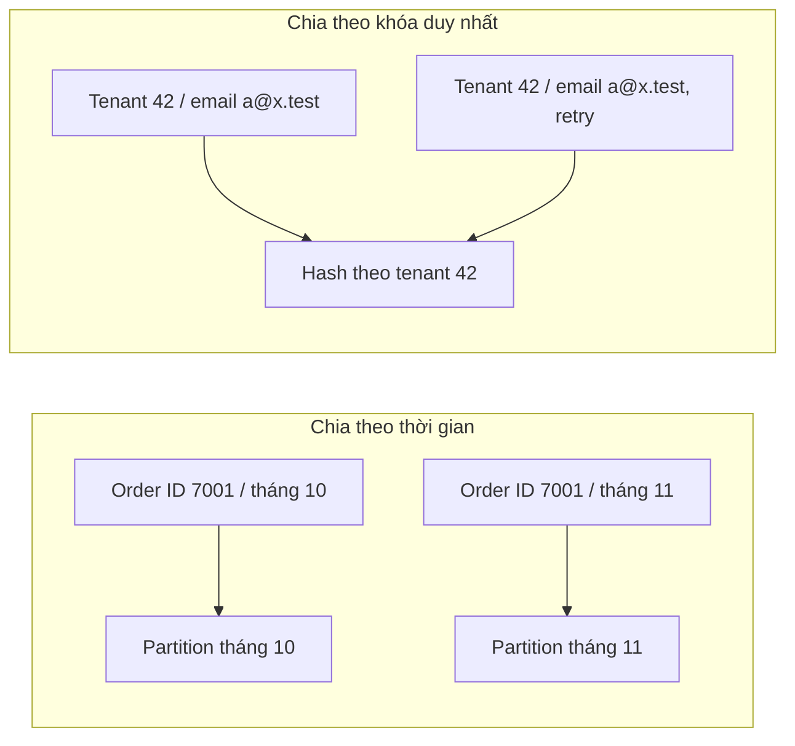
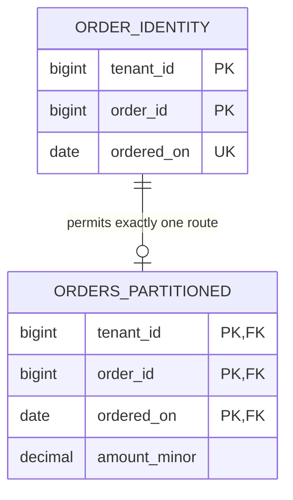
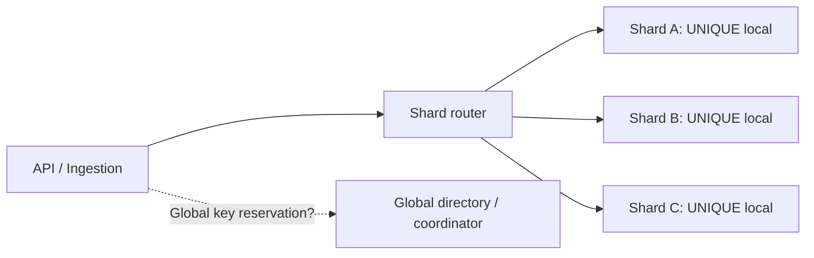

# Ràng buộc duy nhất trong một phân vùng so với toàn hệ thống

Khi một bảng còn nhỏ, câu lệnh `UNIQUE (order_id)` thường được hiểu đơn giản: “không có hai đơn hàng cùng ID”. Nhưng nếu dữ liệu được chia theo **tháng**, **tenant**, **khu vực** hoặc nhiều **shard**, câu hỏi quan trọng hơn xuất hiện: **duy nhất trong phạm vi nào và hệ thống nào thực sự có thể kiểm tra phạm vi ấy?**

Một chỉ mục duy nhất trên một phân vùng có thể từ chối hai dòng trùng nhau **trong phân vùng đó** mà vẫn cho phép cùng khóa xuất hiện ở một phân vùng khác. Một ID được sinh bởi ứng dụng có xác suất trùng rất thấp cũng không tự chứng minh rằng toàn bộ cụm lưu trữ có ràng buộc duy nhất. Khi chọn sai phạm vi, dữ liệu có thể hợp lệ về cú pháp nhưng sai nghiệp vụ: một đơn bị tạo hai lần, một email bị đăng ký trùng hoặc một sự kiện được ghi nhận lại ở tháng kế tiếp.

Bài thuộc chương **Phân tán và phân vùng** của module **DATABASE_DATA_MODELING**: rèn kỹ năng biến yêu cầu thành mô hình có thực thể, khóa, quan hệ, ràng buộc, chỉ mục và lược đồ vật lý rõ ràng; đánh giá lựa chọn giữa lưu trữ quan hệ, document, graph và phân tích. Trọng tâm là phân biệt **tính duy nhất trong một phân vùng** (*partition-local uniqueness*) với **tính duy nhất trên toàn tập dữ liệu logic** (*global uniqueness*), rồi lựa chọn thiết kế có thể kiểm chứng được.

Ví dụ SQL dùng **PostgreSQL 15+**. Các hệ quản trị và nền tảng phân tán có thể cung cấp cơ chế global index hoặc global transaction khác nhau; không suy ngược hành vi của PostgreSQL thành quy tắc phổ quát cho mọi công nghệ.

## 1. Bất biến nghiệp vụ phải nói rõ phạm vi

Ba câu dưới đây nghe gần giống nhau nhưng có nghĩa khác nhau:

1. “Một tenant không có hai khách hàng cùng email.” Nghĩa là duy nhất theo **`(tenant_id, normalized_email)`**.
2. “Một mã đơn chỉ được dùng một lần trong toàn doanh nghiệp.” Nghĩa là duy nhất theo **`order_id`**, hoặc theo **`(business_id, order_id)`** nếu phạm vi doanh nghiệp đã được xác định.
3. “Mỗi tháng, một tenant có thể cấp lại số hóa đơn từ 0001.” Nghĩa là duy nhất theo **`(tenant_id, invoice_month, invoice_number)`**, không phải chỉ theo số hóa đơn.

| Quy tắc | Bộ thuộc tính phải duy nhất | Hai dòng có thể cùng giá trị gì? |
|---|---|---|
| Email duy nhất trong tenant | `(tenant_id, normalized_email)` | Hai tenant có thể dùng cùng email |
| Mã đơn duy nhất toàn nền tảng | `order_id` | Không được có ID trùng dù khác ngày/tenant |
| Mã đơn duy nhất trong tenant | `(tenant_id, order_id)` | Hai tenant có thể có cùng `order_id` |
| Số hóa đơn duy nhất theo tháng | `(tenant_id, invoice_month, invoice_number)` | Tháng sau có thể dùng lại số 0001 |
| Event không được nạp lại | `(source_system, source_event_id)` hoặc bộ mở rộng có tenant | Hai lần gửi cùng event phải nhận diện là một |

**“Toàn hệ thống” cũng cần được định nghĩa**: toàn bảng logic trong **một database**, toàn bộ tenant thuộc **một cluster**, hay nhiều **region và database độc lập**? Một ràng buộc `UNIQUE` trong database A không mặc nhiên có hiệu lực với database B.

### Định nghĩa toán học

Cho tập bản ghi \(R\) và hàm khóa \(K(r)\). Bất biến duy nhất toàn tập là:

\[
\forall r_1,r_2\in R,\quad K(r_1)=K(r_2)\Rightarrow r_1=r_2.
\]

Nếu dữ liệu phân thành các tập con \(P_1,P_2,\ldots,P_n\), kiểm tra duy nhất **trong từng phân vùng** chỉ chứng minh:

\[
\forall i,\ \forall r_1,r_2\in P_i,\quad
K(r_1)=K(r_2)\Rightarrow r_1=r_2.
\]

Điều kiện thứ hai **không ngăn** một \(r_1\in P_i\) và \(r_2\in P_j\) với \(i\neq j\) dùng cùng khóa. Muốn suy ra duy nhất toàn tập từ các kiểm tra cục bộ, cần một điều kiện bổ sung như **mọi bản ghi có cùng khóa duy nhất luôn được định tuyến về cùng một phân vùng**.

## 2. Phân vùng, phân tán, sharding và replication khác nhau

| Khái niệm | Ý nghĩa | Điểm liên quan đến duy nhất |
|---|---|---|
| **Partitioning** | Chia một bảng logic thành các phần theo partition key | Cần biết unique index được cưỡng chế trên parent hay từng partition |
| **Range partition** | Chia theo khoảng ngày, ID, số đo... | Cùng `order_id` ở hai tháng có thể nằm trên hai partition |
| **Hash partition** | Chia theo hàm băm của một khóa | Cùng khóa băm/routing thường tới cùng partition nếu chính sách ổn định |
| **Sharding** | Chia dữ liệu ra nhiều nút/database có quyền ghi riêng | Unique cục bộ trên từng shard không đồng nghĩa unique toàn cụm |
| **Replication** | Sao chép cùng dữ liệu sang replica | Replica không phải những phần dữ liệu rời nhau; cần chính sách leader/quorum/ghi và xử lý xung đột |
| **Global index/directory** | Cấu trúc chứa hoặc định tuyến định danh trên toàn phạm vi | Có thể cưỡng chế global unique tùy khả năng giao dịch và engine |

Ví dụ một bảng chia theo **`created_at`** để xóa dữ liệu tháng cũ dễ hơn không đồng nghĩa đã được **shard theo `order_id`**. Với phân vùng theo thời gian, một `order_id` mới trùng ID cũ có thể được ghi ở tháng sau nếu mô hình không có cơ chế bảo vệ xuyên tháng.

Ngược lại, nếu chia bằng hash theo chính **khóa cần duy nhất**, mọi bản ghi cùng khóa sẽ gặp cùng điểm kiểm tra cục bộ, giả sử định tuyến và tái phân bố được thực hiện nhất quán. Điều đó có thể biến unique cục bộ thành bảo đảm logic toàn phạm vi mà **không cần một index vật lý trải trên mọi node**.

### Sơ đồ hai cách tổ chức



Trong nhánh thời gian, hai bản ghi trùng ID có thể đi vào **hai partition khác nhau**. Trong nhánh hash tenant, hai email trùng **trong cùng tenant** được định tuyến tới **cùng partition**, nơi một chỉ mục unique theo `(tenant_id, email)` có thể ngăn chúng.

## 3. Phân biệt khóa chính, khóa nghiệp vụ và khóa phân vùng

Một bảng đơn hàng thường có ba loại khóa/thuộc tính định danh:

- **Khóa nghiệp vụ:** `order_number` do doanh nghiệp cấp; có thể duy nhất theo tenant, năm hoặc toàn nền tảng.
- **Khóa kỹ thuật:** `order_id` ổn định để tham chiếu; có thể là số, UUID hoặc kiểu khác.
- **Khóa phân vùng:** `ordered_on` hoặc `tenant_id` để quyết định dữ liệu nằm ở phần nào.

Chúng **có thể trùng, giao nhau hoặc độc lập**. Không nên chọn `ordered_on` vào khóa nghiệp vụ chỉ vì database buộc một unique constraint phải chứa partition key.

Ví dụ bảng có PK `(tenant_id, order_id, ordered_on)` vẫn **không chứng minh** `(tenant_id, order_id)` duy nhất trong cả năm. Nó chỉ chứng minh không trùng **cả ba giá trị**. Nếu đơn có `order_id=7001` ở hai ngày khác nhau, cả hai khóa ghép đều khác.

| Cách nhìn | Câu hỏi cần kiểm tra |
|---|---|
| **Danh tính nghiệp vụ** | Hai hàng cùng `order_id` nhưng khác ngày có là **cùng một đơn bị ghi lặp** không? |
| **Danh tính lưu trữ** | Những cột nào thực sự thuộc `PRIMARY KEY`/`UNIQUE`? |
| **Định tuyến phân vùng** | Hai hàng trùng business key có chắc chắn nằm cùng partition không? |
| **Tham chiếu** | Một FK chỉ có `order_id` có nhận diện được dòng cha nào không? |
| **Thời gian và sửa đổi** | Có cho phép đổi ngày tạo khiến bản ghi phải chuyển partition không? |

Đừng coi một surrogate ID “được sinh rất tốt” là thay thế cho **ràng buộc duy nhất có thể thực thi**, nhất là khi dữ liệu từ nhiều hệ thống được import hoặc sao chép.

## 4. Ví dụ PostgreSQL: chia đơn hàng theo tháng

Giả sử doanh nghiệp lưu đơn nhiều năm và muốn partition theo ngày đặt để quét/xóa dữ liệu lịch sử nhanh hơn.

### 4.1. DDL của bảng partitioned

```sql
CREATE TABLE sales_orders_by_date (
    tenant_id BIGINT NOT NULL,
    order_id BIGINT NOT NULL,
    ordered_on DATE NOT NULL,
    customer_id BIGINT NOT NULL,
    amount_minor NUMERIC(20, 0) NOT NULL,

    CONSTRAINT pk_sales_orders_by_date
        PRIMARY KEY (tenant_id, order_id, ordered_on),
    CONSTRAINT ck_order_amount CHECK (amount_minor >= 0)
) PARTITION BY RANGE (ordered_on);

CREATE TABLE sales_orders_2026_10
    PARTITION OF sales_orders_by_date
    FOR VALUES FROM ('2026-10-01') TO ('2026-11-01');

CREATE TABLE sales_orders_2026_11
    PARTITION OF sales_orders_by_date
    FOR VALUES FROM ('2026-11-01') TO ('2026-12-01');
```

Khóa chính `(tenant_id, order_id, ordered_on)` **hợp lệ về cấu trúc** vì có chứa partition key `ordered_on`. PostgreSQL tổ chức index tương ứng trên các partition; không có một index global độc lập kiểm tra `(tenant_id, order_id)` xuyên tháng.

### 4.2. Hai dòng cùng ID ở hai tháng vẫn được phép

```sql
INSERT INTO sales_orders_by_date
    (tenant_id, order_id, ordered_on, customer_id, amount_minor)
VALUES
    (42, 7001, DATE '2026-10-18', 501, 100000),
    (42, 7001, DATE '2026-11-02', 501, 200000);

SELECT tenant_id, order_id, ordered_on, amount_minor
FROM sales_orders_by_date
WHERE tenant_id = 42 AND order_id = 7001
ORDER BY ordered_on;
```

Kết quả:

| `tenant_id` | `order_id` | `ordered_on` | `amount_minor` |
|---:|---:|---|---:|
| 42 | 7001 | 2026-10-18 | 100000 |
| 42 | 7001 | 2026-11-02 | 200000 |

PostgreSQL không xem đây là trùng khóa chính vì `ordered_on` khác nhau. **Nếu nghiệp vụ nói `order_id` chỉ được dùng một lần trong tenant, mô hình này chưa đáp ứng yêu cầu.**

Ngay cả hai đơn trong **cùng tháng** nhưng khác `ordered_on` cũng có thể dùng cùng ID, vì PK kiểm tra bộ ba, không kiểm tra bộ đôi. Điều đó khác với “unique `(tenant_id,order_id)` trong mỗi partition”.

### 4.3. Vì sao không thêm được unique mong muốn trên parent?

Đoạn dưới là **ví dụ phải thất bại**, không chạy nếu đang làm một migration thật:

```sql
-- PostgreSQL 15+: không hợp lệ vì thiếu partition key ordered_on.
ALTER TABLE sales_orders_by_date
    ADD CONSTRAINT uq_order_id_in_tenant
    UNIQUE (tenant_id, order_id);
```

Với **declarative partitioning** trên PostgreSQL 15, để tạo PK/UNIQUE trên bảng partitioned, các cột khóa của constraint phải bao gồm **toàn bộ các cột partition key** liên quan, và partition key không được là biểu thức/hàm trong trường hợp áp ràng buộc ấy. Với partitioning nhiều cấp, cũng cần xét khóa phân vùng của các bảng con theo quy tắc của PostgreSQL.

Lý do: PostgreSQL sử dụng các index trên từng partition cho ràng buộc unique của parent. Khi bộ cột unique **có chứa partition key**, hai hàng trùng toàn bộ unique key sẽ phải được định tuyến vào cùng partition. Nếu thiếu partition key, hai hàng có thể nằm ở hai partition khác nhau và các index cục bộ không thấy nhau.

**Không dùng `UNIQUE (tenant_id, order_id, ordered_on)` rồi quảng bá rằng `order_id` duy nhất toàn tenant.** Database chỉ bảo đảm đúng bộ cột mà constraint khai báo.

## 5. Unique cục bộ trên partition không phải unique toàn bảng

Có thể tạo một **unique index trực tiếp trên từng partition**:

```sql
CREATE UNIQUE INDEX uq_orders_oct_tenant_id
    ON sales_orders_2026_10 (tenant_id, order_id);

CREATE UNIQUE INDEX uq_orders_nov_tenant_id
    ON sales_orders_2026_11 (tenant_id, order_id);
```

Những index này làm cho một tenant không thể có hai `order_id=7001` **trong cùng partition tháng 10**, và tương tự đối với tháng 11. Nhưng hai dòng ở **hai tháng khác nhau** trong dữ liệu phần 4.2 vẫn hợp lệ.

Điểm cần nhớ:

- Index trên partition tháng 10 **không nhìn thấy** dữ liệu tháng 11.
- Thêm một partition tháng 12 phải bảo đảm index cục bộ tương tự được tạo và vận hành; không được mặc định index tự sinh từ một constraint parent **không tồn tại**.
- Ràng buộc cục bộ theo tháng chỉ phù hợp nếu nghiệp vụ thực sự cho phép dùng lại mã ở tháng sau.
- Nếu một tenant có hai dòng cùng ID khác ngày trong cùng tháng, unique index cục bộ mới sẽ từ chối chúng — khác với PK có ngày.

### Khi unique theo tháng là yêu cầu thật

Giả sử quy tắc là **số hóa đơn được phép lặp ở tháng khác**. Thay vì chọn `created_at` theo ngày rồi cố suy ra uniqueness theo tháng, có thể đưa tháng nghiệp vụ vào **khóa logic và khóa phân vùng**:

```sql
CREATE TABLE monthly_invoices (
    tenant_id BIGINT NOT NULL,
    invoice_month DATE NOT NULL,
    invoice_number TEXT NOT NULL,
    total_minor NUMERIC(20,0) NOT NULL,

    CONSTRAINT pk_monthly_invoices
        PRIMARY KEY (tenant_id, invoice_month, invoice_number),
    CONSTRAINT ck_month_first_day
        CHECK (EXTRACT(DAY FROM invoice_month) = 1),
    CONSTRAINT ck_invoice_number
        CHECK (btrim(invoice_number) <> ''),
    CONSTRAINT ck_invoice_total
        CHECK (total_minor >= 0)
) PARTITION BY RANGE (invoice_month);

CREATE TABLE monthly_invoices_2026_10
    PARTITION OF monthly_invoices
    FOR VALUES FROM ('2026-10-01') TO ('2026-11-01');

CREATE TABLE monthly_invoices_2026_11
    PARTITION OF monthly_invoices
    FOR VALUES FROM ('2026-11-01') TO ('2026-12-01');
```

Ở đây `(tenant_id, invoice_month, invoice_number)` **chính là khóa nghiệp vụ đã thống nhất**. Tháng 10 và tháng 11 có thể cùng dùng số `0001`; hai hóa đơn số `0001` của cùng tenant **trong cùng tháng** sẽ bị PK từ chối.

Tuy nhiên, `invoice_month` phải được định nghĩa từ **tháng hóa đơn theo quy tắc kế toán**, không phải tính ngẫu nhiên từ ngày server ghi dữ liệu. Một hóa đơn ghi nhận muộn vẫn có thể thuộc kỳ nghiệp vụ cũ. Nếu luật yêu cầu số hóa đơn duy nhất cả năm hoặc không tái sử dụng, ví dụ này không còn đúng.

## 6. Khi partition key trùng với phạm vi uniqueness

Một chiến lược tự nhiên là phân vùng theo **tenant** khi yêu cầu chính là uniqueness **trong tenant**.

### 6.1. Hash partition theo tenant

```sql
CREATE TABLE customer_accounts_by_tenant (
    tenant_id BIGINT NOT NULL,
    customer_id BIGINT NOT NULL,
    normalized_email TEXT NOT NULL,
    display_name TEXT NOT NULL,

    CONSTRAINT pk_accounts
        PRIMARY KEY (tenant_id, customer_id),
    CONSTRAINT uq_email_in_tenant
        UNIQUE (tenant_id, normalized_email),
    CONSTRAINT ck_normalized_email
        CHECK (
            normalized_email = lower(btrim(normalized_email))
            AND normalized_email <> ''
        ),
    CONSTRAINT ck_display_name
        CHECK (btrim(display_name) <> '')
) PARTITION BY HASH (tenant_id);

CREATE TABLE customer_accounts_h0
    PARTITION OF customer_accounts_by_tenant
    FOR VALUES WITH (MODULUS 2, REMAINDER 0);

CREATE TABLE customer_accounts_h1
    PARTITION OF customer_accounts_by_tenant
    FOR VALUES WITH (MODULUS 2, REMAINDER 1);
```

Vì cùng `tenant_id` được định tuyến vào **cùng hash partition** (theo định nghĩa và cấu hình hiện tại), unique trên `(tenant_id, normalized_email)` có thể bảo đảm một email chuẩn hóa không xuất hiện hai lần **trong cùng tenant**, dù bảng có nhiều partition.

```sql
INSERT INTO customer_accounts_by_tenant
    (tenant_id, customer_id, normalized_email, display_name)
VALUES
    (42, 1, 'a@example.test', 'An'),
    (43, 1, 'a@example.test', 'Bình');

-- Phải bị từ chối: tenant 42 đã có email này.
INSERT INTO customer_accounts_by_tenant
    (tenant_id, customer_id, normalized_email, display_name)
VALUES
    (42, 2, 'a@example.test', 'Anh');
```

Hai tenant có thể có cùng email, đúng theo bất biến. Chỉ mục unique của parent vẫn là **duy nhất trên toàn tập đối với bộ `(tenant_id, normalized_email)`** vì không có hai partition khác nhau chứa cùng tenant khi routing đúng.

### 6.2. Điều gì không được bảo vệ?

Nếu yêu cầu mới là “mỗi email chỉ được đăng ký một lần **trong toàn nền tảng**, bất kể tenant”, ràng buộc `UNIQUE (tenant_id, normalized_email)` **không đủ**. Thử thêm `UNIQUE (normalized_email)` trên parent partition by hash tenant sẽ gặp hạn chế vì thiếu partition key.

Cũng vậy, `customer_id=1` xuất hiện ở tenant 42 và 43 là hợp lệ với PK ghép. Nếu API công khai chỉ nhận `customer_id=1` mà không nhận tenant, truy vấn trở nên mơ hồ và có nguy cơ lộ dữ liệu. **Khóa phải được hiểu cùng phạm vi**, cả khi lưu, tìm, FK và kiểm tra quyền.

### 6.3. Cần định nghĩa email chuẩn hóa

Ví dụ dùng `lower(btrim(email))` để minh họa nhưng **không khẳng định** đây là chuẩn email hoàn chỉnh. Quy tắc domain có thể cần xử lý Unicode, collation, xác minh địa chỉ, cách so sánh chữ hoa/thường và chính sách provider. Không nên mặc định bỏ dấu chấm hay phần `+tag` trong email của mọi nhà cung cấp. Các bộ dữ liệu phải dùng **cùng một thuật toán chuẩn hóa đã được kiểm soát và phiên bản hóa**.

Với `normalized_email NOT NULL`, ví dụ tránh trường hợp nhiều `NULL` gây diễn giải uniqueness khác nhau. Nếu email là tùy chọn, cần quyết định liệu nhiều tài khoản thiếu email được phép tồn tại và DBMS xử lý `NULL` trong unique như thế nào.

## 7. Chứng minh khi nào local unique suy ra global unique

Một quy tắc cốt lõi:

> Nếu mọi bản ghi có cùng bộ khóa cần duy nhất đều được định tuyến tới **cùng một nơi cưỡng chế unique**, và nơi đó kiểm tra unique nguyên tử, thì local uniqueness có thể suy ra global uniqueness trong phạm vi định tuyến ấy.

Gọi \(h(K)\) là hàm chọn partition/shard từ khóa \(K\). Nếu hai dòng có cùng \(K\) luôn có cùng \(h(K)\), thì vi phạm unique của \(K\) buộc phải xuất hiện trong một partition và bị chỉ mục tại đó phát hiện.

Ví dụ:

- Hash theo `tenant_id`, unique `(tenant_id, email)`: hai bộ trùng có cùng tenant, được định tuyến cùng nơi → phù hợp.
- Range theo `ordered_on`, unique mong muốn `(tenant_id, order_id)`: hai bộ trùng có thể có ngày khác → **không** đảm bảo cùng partition.
- Hash theo `order_id`, unique `order_id`: mọi ID trùng tới cùng shard → có thể dùng unique cục bộ nếu thiết kế phân tán bảo đảm routing/transaction đúng.

### Ba điều kiện không được lược bỏ

1. **Hàm định tuyến ổn định và có thẩm quyền:** mọi writer, kể cả import/batch, dùng cùng quy tắc; khi rebalancing phải duy trì uniqueness.
2. **Kiểm tra nguyên tử trên nơi sở hữu khóa:** hai request đồng thời không được cùng thấy “trống” rồi cùng ghi thành công.
3. **Không có đường ghi bypass:** không cho phép viết trực tiếp vào một shard bất kỳ để né routing/constraint.

Nếu một shard bị chia lại thành nhiều shard mới, phải đảm bảo cùng khóa vẫn được dẫn đến cùng chủ sở hữu logic, và quá trình di chuyển không để một khóa xuất hiện đồng thời dưới hai điểm nhận ghi hợp lệ.

## 8. Unique toàn cục bằng một bảng đăng ký khóa

Khi nghiệp vụ cần `(tenant_id, order_id)` **duy nhất xuyên các tháng** nhưng bảng chính phải partition theo ngày, một giải pháp trong **một PostgreSQL database** là lưu **bảng đăng ký danh tính không partition theo ngày** (*identity registry*).

Bảng registry phải không chỉ chứa ID mà còn có **giá trị partition key đã chốt**, để ngăn hai dòng vật lý ở hai partition cùng “mượn” một đăng ký hợp lệ.

### 8.1. ERD registry và bảng partitioned



Quan hệ trong sơ đồ là **tối đa một dòng đơn theo mỗi đăng ký**, khi các constraint bên dưới được áp dụng. Nhưng nó **không bắt buộc** mỗi registry row đã có dòng đơn: cần transaction/đối soát để xử lý đăng ký chưa hoàn tất.

### 8.2. DDL PostgreSQL minh họa

```sql
CREATE TABLE order_identity (
    tenant_id BIGINT NOT NULL,
    order_id BIGINT NOT NULL,
    ordered_on DATE NOT NULL,

    -- Mỗi order ID chỉ được đăng ký một lần trong tenant.
    CONSTRAINT pk_order_identity
        PRIMARY KEY (tenant_id, order_id),

    -- Khóa đích cho FK có kiểm tra đúng ngày phân vùng.
    CONSTRAINT uq_order_identity_route
        UNIQUE (tenant_id, order_id, ordered_on)
);

CREATE TABLE orders_partitioned (
    tenant_id BIGINT NOT NULL,
    order_id BIGINT NOT NULL,
    ordered_on DATE NOT NULL,
    amount_minor NUMERIC(20, 0) NOT NULL,

    CONSTRAINT pk_orders_partitioned
        PRIMARY KEY (tenant_id, order_id, ordered_on),

    CONSTRAINT fk_orders_registered_route
        FOREIGN KEY (tenant_id, order_id, ordered_on)
        REFERENCES order_identity (tenant_id, order_id, ordered_on)
        ON UPDATE RESTRICT
        ON DELETE RESTRICT,

    CONSTRAINT ck_orders_partitioned_amount
        CHECK (amount_minor >= 0)
) PARTITION BY RANGE (ordered_on);

CREATE TABLE orders_partitioned_2026_10
    PARTITION OF orders_partitioned
    FOR VALUES FROM ('2026-10-01') TO ('2026-11-01');

CREATE TABLE orders_partitioned_2026_11
    PARTITION OF orders_partitioned
    FOR VALUES FROM ('2026-11-01') TO ('2026-12-01');
```

Bảo đảm được hình thành từ **hai lớp ràng buộc cùng lúc**:

- `order_identity` chỉ có **một** dòng trên `(tenant_id, order_id)`.
- Dòng `orders_partitioned` bắt buộc tham chiếu tới **đúng bộ `(tenant_id, order_id, ordered_on)`** của registry.
- Trong cùng bộ ba, PK của `orders_partitioned` không cho phép có hai dòng trùng.

Suy ra: nếu cùng tenant/order ID xuất hiện ở hai `ordered_on` khác nhau, **ít nhất một dòng không thể tham chiếu đúng một registry route đã chốt**. Đây là chứng minh toàn vẹn dựa trên FK ghép **và** PK hai bảng, không chỉ dựa trên một registry rời rạc.

**Phản ví dụ thiết kế sai:** nếu orders chỉ có FK `(tenant_id, order_id)` tới registry, hai dòng cùng ID ở hai tháng **đều có thể dùng cùng một đăng ký**. Registry unique riêng lẻ **không tự giới hạn số dòng con** trỏ tới nó. Phải khóa chặt cả route/partition key hoặc áp một cơ chế khác chứng minh “một identity → một bản ghi logic”.

### 8.3. Tạo đơn nguyên tử

```sql
BEGIN;

INSERT INTO order_identity (tenant_id, order_id, ordered_on)
VALUES (42, 9001, DATE '2026-10-20');

INSERT INTO orders_partitioned
    (tenant_id, order_id, ordered_on, amount_minor)
VALUES
    (42, 9001, DATE '2026-10-20', 150000);

COMMIT;
```

Nếu transaction lỗi ở một trong hai câu lệnh, **rollback cả hai**. Nếu hai request đồng thời cố đăng ký `(42,9001)` với ngày khác, PK registry sẽ chỉ cho tối đa một transaction đăng ký thành công; transaction kia phải xử lý xung đột, không ghi đơn mà không có registry.

Bây giờ thử chèn trực tiếp cùng ID ở tháng 11:

```sql
-- Phải thất bại: registry của (42,9001) có ordered_on=2026-10-20.
INSERT INTO orders_partitioned
    (tenant_id, order_id, ordered_on, amount_minor)
VALUES
    (42, 9001, DATE '2026-11-03', 200000);
```

Dòng này có bộ ba khác bộ đăng ký, nên FK từ chối. Nếu cố thay `ordered_on` của registry sang tháng 11 để hợp thức hóa, `ON UPDATE RESTRICT` chặn khi đã có dòng đơn tham chiếu route cũ.

### 8.4. Giới hạn và chi phí của registry

- Bảng registry là **điểm phối hợp ghi**; với khối lượng rất lớn, có thể trở thành nút thắt throughput hoặc vận hành.
- Mỗi lần tạo đơn cần ít nhất hai thao tác/khóa dữ liệu, transaction và thêm dung lượng.
- Nếu chỉ thêm registry mà chưa thêm order, ta có thể có **identity được giữ chỗ nhưng chưa có bản ghi chính**; đó là trạng thái cần xử lý/reconcile. FK từ order tới registry không ép chiều ngược.
- Nếu xóa hoặc detach partition để retention, registry có thể còn các identity lịch sử. Cần quyết định **có cho tái sử dụng ID không**; thường nên giữ tombstone/registry tối thiểu nếu invariant là “không bao giờ tái sử dụng”.
- Bảng registry trong **một database** chỉ bảo vệ phạm vi database đó. Nếu có nhiều database ghi độc lập, phải dùng một cơ chế điều phối chung hoặc quy tắc routing phân tán đáng tin cậy.
- FK tới bảng partitioned của các bảng con khác có thể cần cả partition key nếu tham chiếu trực tiếp. Có thể trỏ tới registry bằng `(tenant_id,order_id)` nếu nó đại diện cho danh tính ổn định, rồi xác định cách giữ vòng đời và toàn vẹn đối tượng liên quan.

Registry là **một lựa chọn thiết kế**, không phải câu trả lời mặc định cho mọi bảng partitioned. Nếu không cần global order ID, hãy giữ unique theo phạm vi thực sự và tránh gánh thêm cấu trúc.

## 9. Vì sao kiểm tra `SELECT` trước `INSERT` không đảm bảo duy nhất?

Một lỗi ứng dụng thường thấy:

```text
T1: SELECT ... WHERE order_id = 9001 -> không thấy
T2: SELECT ... WHERE order_id = 9001 -> không thấy
T1: INSERT order_id = 9001 -> thành công
T2: INSERT order_id = 9001 -> cũng thành công nếu không có unique chung
```

Hai request cùng kiểm tra “chưa tồn tại” có thể **đều đúng tại thời điểm kiểm tra** nhưng tạo bản ghi trùng sau đó. Đây là lỗi **check-then-act** và không được giải quyết bằng cách “kiểm tra nhanh hơn”.

**Cơ chế an toàn** thường là:

- Một `UNIQUE`/PK thực thi nguyên tử tại **nơi chịu trách nhiệm cho khóa**, hoặc
- Một thao tác reserve/compare-and-insert nguyên tử trong registry/coordination service, hoặc
- Một giao thức giao dịch và cô lập thực sự có khả năng cưỡng chế invariant trong phạm vi tất cả nơi ghi liên quan.

Một lock ở process Java **không bảo vệ** khi ứng dụng có nhiều instance. Một cache với `SET` không nguyên tử hoặc một message “đã có khóa” có thể trễ cũng không phải bảo đảm uniqueness toàn hệ thống.

Nếu dùng distributed lock, cần xem TTL, fencing token, crash recovery, network partition và sự liên kết **nguyên tử** giữa quyền giữ khóa với thao tác ghi. Một khóa hết hạn giữa transaction có thể cho phép writer thứ hai xuất hiện; vì vậy nhiều bài toán đơn giản hơn nếu dựa vào unique constraint của nơi sở hữu key.

## 10. Sharding: ràng buộc nào nằm ở đâu?

Giả sử một nền tảng lưu khách hàng trên ba shard độc lập:



Nếu định tuyến theo `tenant_id`:

- `UNIQUE (tenant_id, normalized_email)` trong từng shard có thể bảo vệ email không trùng **trong tenant**, nếu mọi bản ghi của một tenant luôn cùng shard.
- `UNIQUE (normalized_email)` trong từng shard **không đủ** để bảo vệ “email duy nhất ở mọi tenant trên toàn nền tảng”.
- Một khách di chuyển tenant hoặc tenant được chuyển shard cần có giao thức migration an toàn để không có hai nơi **cùng sở hữu quyền ghi** cho cùng khóa.

Nếu định tuyến theo `normalized_email`, mọi email giống nhau có thể đi cùng shard và được unique cục bộ bảo vệ ở phạm vi toàn nền tảng, nhưng truy vấn **theo tenant** có thể phải quét nhiều shard. Chọn shard key là bài toán cân bằng giữa **bất biến**, **mẫu truy vấn**, **phân bố tải**, **di chuyển dữ liệu** và **yêu cầu sẵn sàng**.

### Ba phương án global uniqueness thường gặp

| Phương án | Cách bảo vệ | Đánh đổi |
|---|---|---|
| **Định tuyến theo khóa cần unique** | Cùng key tới cùng shard có unique constraint | Tốt cho uniqueness theo key; truy vấn khác key có thể phân tán |
| **Global index/directory có giao dịch** | Một dịch vụ/tầng metadata đăng ký key một lần | Cần điều phối, xử lý sự cố và đánh giá bottleneck |
| **Distributed transaction/serializable constraint do engine hỗ trợ** | Hệ quản trị phối hợp giữa shard khi ghi | Phụ thuộc engine, topology, latency, chính sách partition/failure |

Một “global index” chỉ có tính năng tra cứu nhanh nhưng **không được cập nhật nguyên tử với ghi dữ liệu** có thể không đủ cưỡng chế uniqueness. Cần xác định rõ guarantee của hệ quản trị: mạnh tại commit hay chỉ eventual consistency?

### Không nhầm “unique ID generator” với global unique constraint

UUID ngẫu nhiên, UUIDv7, Snowflake-like ID hoặc ID chứa mã shard có thể **giảm rủi ro va chạm** và hỗ trợ định tuyến. Nhưng:

- UUID ngẫu nhiên bảo đảm xác suất va chạm rất thấp, **không phải bằng chứng toán học tuyệt đối rằng không thể trùng**.
- Bộ sinh ID dựa trên đồng hồ/máy cần cấu hình node ID, xử lý clock rollback/restart và chia phạm vi.
- Import dữ liệu từ hệ cũ có thể mang ID đã tồn tại dù generator mới không tạo trùng.
- ID kỹ thuật độc nhất không tự ngăn **đăng ký email trùng** hoặc **cùng business request được xử lý hai lần**.

Vì vậy vẫn cần xác định **ràng buộc nghiệp vụ** và cơ chế nhận diện trùng yêu cầu.

## 11. Global uniqueness, idempotency và exactly-once không giống nhau

Một API `POST /orders` có thể nhận lại cùng request vì client timeout. Có ba câu hỏi riêng:

1. **`order_id` có bị trùng không?** PK/unique theo phạm vi định danh bảo vệ.
2. **Một yêu cầu nghiệp vụ có tạo hai đơn với hai ID khác nhau không?** Cần `idempotency_key` theo phạm vi caller/use case, hoặc mã nghiệp vụ duy nhất.
3. **Một event được áp dụng hai lần vào chỉ số/tồn kho không?** Cần idempotent consumer, transaction và event identity.

Một bảng idempotency cho tenant có thể dùng:

```sql
CREATE TABLE order_request_keys (
    tenant_id BIGINT NOT NULL,
    idempotency_key TEXT NOT NULL,
    request_fingerprint TEXT NOT NULL,
    order_id BIGINT,
    created_at TIMESTAMPTZ NOT NULL DEFAULT CURRENT_TIMESTAMP,
    CONSTRAINT pk_order_request_keys
        PRIMARY KEY (tenant_id, idempotency_key),
    CONSTRAINT ck_request_fingerprint
        CHECK (btrim(request_fingerprint) <> '')
);
```

Bảng này giả định **một database ghi có thẩm quyền**, không nằm rải rác trên các shard không phối hợp. Trong transaction tạo đơn, cần kiểm tra cùng `idempotency_key` có **cùng fingerprint payload** và trả cùng kết quả đã ghi; nếu payload khác phải báo conflict. Dòng `order_id NULL` có thể đại diện request đang xử lý/đã reserve; cần trạng thái, timeout và recovery rõ ràng.

Nếu khóa idempotency chỉ lưu trong cache có TTL ngắn, sau khi hết TTL cùng request có thể tạo đơn mới. Đó có thể là chính sách chấp nhận được cho một số API, nhưng không tương đương với “không bao giờ trùng đơn” trong hệ thống giao dịch.

### `ON CONFLICT` chỉ bảo vệ khóa có unique thực

Trên bảng partitioned theo ngày ở phần 4, câu lệnh:

```sql
-- Không có unique/PK matching chỉ (tenant_id,order_id)
-- trên parent, nên không thể dùng làm arbiter như kỳ vọng.
INSERT INTO sales_orders_by_date
    (tenant_id, order_id, ordered_on, customer_id, amount_minor)
VALUES
    (42, 7001, DATE '2026-11-03', 501, 100000)
ON CONFLICT (tenant_id, order_id) DO NOTHING;
```

không thể “tự phát hiện ID đã tồn tại ở tháng trước”: không có constraint parent tương ứng với hai cột ấy. Một `ON CONFLICT` với đủ ba cột chỉ bảo vệ bộ ba `(tenant_id,order_id,ordered_on)`; nó **không** đổi phạm vi uniqueness của `(tenant_id,order_id)`.

Đối với bảng registry, `ON CONFLICT (tenant_id,order_id)` có thể làm việc vì `order_identity` thực sự có PK đó. Tuy nhiên `DO NOTHING` phải đi cùng kiểm tra **ngày phân vùng và payload của yêu cầu**; không nên âm thầm coi hai yêu cầu khác nhau nhưng trùng ID là cùng một hành động hợp lệ.

## 12. Khóa ngoại và quan hệ khi bảng cha được phân vùng

Với bảng đơn `sales_orders_by_date`, khóa tham chiếu hợp lệ ở mức parent là bộ `(tenant_id, order_id, ordered_on)`. Một bảng dòng đơn có thể cần:

```sql
CREATE TABLE sales_order_lines_by_date (
    tenant_id BIGINT NOT NULL,
    order_id BIGINT NOT NULL,
    ordered_on DATE NOT NULL,
    line_no INTEGER NOT NULL,
    amount_minor NUMERIC(20,0) NOT NULL,

    CONSTRAINT pk_order_line_by_date
        PRIMARY KEY (tenant_id, order_id, ordered_on, line_no),
    CONSTRAINT fk_line_order_by_date
        FOREIGN KEY (tenant_id, order_id, ordered_on)
        REFERENCES sales_orders_by_date
            (tenant_id, order_id, ordered_on)
        ON DELETE RESTRICT,
    CONSTRAINT ck_order_line_no CHECK (line_no > 0)
);
```

Bảng con trong ví dụ **chưa cần partition**, nhưng có thể được partition theo `ordered_on` để phân bố và retention tương tự. Quan hệ FK ghép ngăn dòng trỏ tới một đơn khác ngày; đây là **điểm mạnh về toàn vẹn**, nhưng cũng làm API/ETL cần biết hoặc tìm được `ordered_on` để tạo dòng.

### Không tự suy “FK theo order_id là đủ” từ việc ID được sinh ngẫu nhiên

Dù ứng dụng cam kết phát ra ID hiếm khi trùng, database **không tự có** unique trên `order_id`. Vì thế việc tạo FK chỉ theo `order_id` tới bảng parent partitioned thường không thể lấy một khóa unique hợp lệ làm đích, và nếu dùng cách ứng dụng tự ghép thì có nguy cơ trỏ mơ hồ.

Một **registry định danh** có PK `(tenant_id,order_id)` có thể phục vụ những bảng chỉ cần tham chiếu identity ổn định. Nhưng phải xác định rõ các bảng con đang tham chiếu **một identity đã được reserve** hay **một đơn thực sự tồn tại**: FK tới registry không tự buộc có dòng order khi registry vẫn chưa hoàn tất.

### Hậu quả của đổi partition key

Nếu `ordered_on` thay đổi, một số engine có thể phải **di chuyển bản ghi sang partition khác**. Nó có thể ảnh hưởng PK/FK, index, khoá và hệ thống downstream đang dùng partition key trong identity. Nếu ngày đặt hàng là **sự thật nghiệp vụ đã chốt**, thường nên giữ bất biến; nếu cho sửa, cần quy trình có transaction cập nhật quan hệ và chính sách audit.

Với hệ thống phân tán, di chuyển partition/shard còn đòi hỏi kiểm soát quyền ghi và mapping route; không chỉ là một lệnh `UPDATE` cột ngày.

## 13. Chọn partition key theo uniqueness hay theo workload?

Một partition key tốt không chỉ thỏa điều kiện dữ liệu được chia đều. Nó phải tương thích với:

- **Phạm vi unique** và địa điểm cưỡng chế constraint.
- **Các truy vấn chính**: lọc theo tenant, ngày, order ID, email hay sản phẩm?
- **Retention**: có cần xóa/archiving dữ liệu cả tháng?
- **Khối lượng ghi và hot partitions**: một tenant quá lớn có làm một shard nóng?
- **Quan hệ FK và joins**: các bảng thường join có cùng routing key để tránh distributed join không?
- **Chuyển partition**: khóa phân vùng có bất biến trong vòng đời bản ghi không?
- **Quyền truy cập và residency**: tenant/region có yêu cầu dữ liệu không được đi khỏi vùng?
- **Quản trị dữ liệu lịch sử**: uniqueness có còn phải giữ sau khi xóa partition không?

### Ma trận lựa chọn

| Nhu cầu chính | Thiết kế nên cân nhắc | Cảnh báo |
|---|---|---|
| Đọc/xóa theo tháng, ID chỉ duy nhất theo ngày | Range theo ngày + unique chứa ngày | Chỉ đúng nếu nghiệp vụ cho phép ID tái sử dụng giữa ngày |
| Đọc/xóa theo tháng, order ID duy nhất suốt đời | Range theo ngày + global identity registry / cơ chế global index | Thêm ghi phối hợp và retention registry |
| Email duy nhất trong tenant | Hash/range theo tenant + unique `(tenant,email)` | Tenant cực lớn, resharding và normalize email |
| Email duy nhất toàn nền tảng | Route theo email hoặc global registry/constraint | Không thể dựa trên unique cục bộ của shard theo tenant |
| Số hóa đơn tái sử dụng theo tháng | Partition theo `invoice_month` + key gồm tháng | Tháng phải là khái niệm nghiệp vụ chuẩn |
| Event ID duy nhất toàn nguồn | Route theo event ID hoặc bảng dedupe chung | Late events qua tháng và retry |
| Tồn kho theo kho/SKU, đọc đồng thời nhiều vùng | Phân theo kho/tenant tùy mẫu giao dịch | Quy tắc unique và atomic update theo SKU–kho |
| Analytics append-only theo ngày | Range theo event date + fact key và dedupe upstream | UNIQUE theo partition date không thay thế event identity |

**Không có một partition key tối ưu cho mọi loại uniqueness, mọi join và mọi truy vấn**. Nếu bất biến bắt buộc không trùng trên toàn hệ thống quan trọng hơn tốc độ drop partition, cần ưu tiên khả năng cưỡng chế bất biến rồi tối ưu trên nền tảng đó.

## 14. Khác biệt giữa local index, partitioned index và global index

Ba tên gọi thường gây hiểu nhầm:

1. **Local index:** index vật lý nằm trên một partition/shard, chỉ kiểm tra các dòng trong phạm vi ấy.
2. **Partitioned index:** một cấu trúc index ở mức parent được quản lý trên các index con. Trong PostgreSQL 15, unique của parent partitioned dùng các index partition tương ứng và **phải có partition key** để đảm bảo không trùng logic.
3. **Global index:** index có khả năng tra cứu/cưỡng chế khóa trên nhiều partition/shard, nếu engine hỗ trợ thực sự.

Một **partitioned index** không đồng nghĩa **global index** trong nghĩa cưỡng chế mọi business key thiếu partition key.

### Câu hỏi phải tra từ tài liệu engine

- Unique/PK ở parent có bao gồm **mọi partition key** không?
- Có hỗ trợ **global unique index** độc lập partition key không?
- Index global có được cập nhật **nguyên tử cùng bản ghi** khi insert/update/delete không?
- Khi detach/drop/move partition, index có còn bảo đảm uniqueness không?
- Khi online rebuild hoặc attach partition đã có dữ liệu, hệ thống **kiểm tra trùng** thế nào?
- NULL, collation và expression index ảnh hưởng unique ra sao?
- FK tới bảng partitioned hoặc shard phân tán có được **thực thi** không?
- Sự cố network/leader failover có thể khiến hai nơi cùng nhận ghi cho một key không?

Không nên sao chép một ví dụ PostgreSQL rồi kết luận SQL Server, Oracle, MySQL, MongoDB hoặc một hệ distributed SQL có cùng tập khả năng. Cơ chế global index, shard-key uniqueness, transaction và hỗ trợ FK khác nhau giữa phiên bản và cách triển khai.

## 15. Ngữ nghĩa NULL, chuẩn hóa mã và chỉ mục unique

Một unique constraint chỉ đúng với **giá trị thực được so sánh**. Trước khi kết luận “không trùng email”, cần biết DB so gì:

- Có phân biệt chữ hoa/thường? `User@Example.test` và `user@example.test` có coi là một không?
- Có coi khoảng trắng đầu/cuối là có nghĩa không?
- Unicode/collation xử lý thế nào?
- Nếu trường là `NULL`, một hay nhiều dòng thiếu giá trị có được phép?
- Nếu uniqueness chỉ áp dụng cho bản ghi đang hoạt động, trạng thái `deleted_at`/`is_active` nằm trong điều kiện nào?

### Ví dụ chỉ unique với bản ghi đang hoạt động

Với bảng **không partitioned**, PostgreSQL có thể tạo partial unique index:

```sql
-- Bảng ví dụ giả định:
-- customer_accounts(tenant_id, normalized_email, deleted_at, ...).
CREATE UNIQUE INDEX uq_active_email_per_tenant
    ON customer_accounts (tenant_id, normalized_email)
    WHERE deleted_at IS NULL;
```

Đây là **ví dụ mô hình khác**, không chạy trên bảng `customer_accounts_by_tenant` ở phần 6 vì bảng ấy chưa có `deleted_at`. Với bảng partitioned/sharded, phải kiểm tra liệu điều kiện và bộ khóa **có được bảo vệ xuyên partition** hay chỉ trên từng phần. Một partial index **không tự biến** phạm vi local thành global.

Nếu chính sách pháp lý không cho đăng ký lại email đã xóa, unique chỉ trên bản ghi active sẽ là sai bất biến. Nếu cho đăng ký lại, phải giải quyết hệ quả lịch sử: email cũ đã xuất hiện trong audit, hóa đơn hoặc thông báo của tài khoản đã ngừng.

**PostgreSQL 15** có cơ chế `NULLS NOT DISTINCT` cho unique constraint/index trong những trường hợp phù hợp, nhưng việc có dùng nó hay không phải xuất phát từ ngữ nghĩa thiếu dữ liệu. Không nên ép `NULL` thành chuỗi rỗng để “làm unique dễ hơn”.

## 16. Thay đổi partition và migration mà không làm mất uniqueness

Một hệ thống cũ có bảng đơn không partitioned với `UNIQUE (tenant_id,order_id)`. Nếu chuyển sang range partition theo `ordered_on`, không thể mặc nhiên giữ unique parent cũ trên PostgreSQL 15. Đây là **thay đổi hợp đồng dữ liệu**, không chỉ thao tác hạ tầng.

### Quy trình chuyển đổi an toàn

1. **Đọc bất biến hiện tại:** các bảng, API, message và báo cáo nào xem `(tenant_id,order_id)` là danh tính toàn kỳ?
2. **Đo dữ liệu:** tìm ID bị trùng, `NULL`, mã không chuẩn, FK tham chiếu sai và bản ghi có ngày tạo sai.
3. **Chọn partition key và cơ chế uniqueness:** đổi key logic có chủ ý, dùng global registry, đổi cách routing, hoặc chọn DBMS có global constraint phù hợp.
4. **Thiết kế bảng mới và những quan hệ liên quan:** bao gồm FK của order lines/payments, index, quyền truy cập và retention.
5. **Backfill theo lô:** với registry, tạo identity trước rồi gắn route; xử lý xung đột dữ liệu cũ, không âm thầm chọn một bản bất kỳ.
6. **Bảo vệ ghi đồng thời:** dual-write có transaction hoặc CDC/cutover có watermark và quy tắc điều phối; không để hai hệ cùng có quyền tạo cùng key.
7. **Đối soát:** cùng số identity logic, cùng số order, không trùng ID xuyên partition, không orphan registry, FK đúng route, tổng tiền và trạng thái không đổi.
8. **Cutover có kiểm soát:** chuyển đường ghi/đọc, đo conflict/latency, giữ cơ chế quay lại khi cần.
9. **Dọn schema cũ:** chỉ sau khi mọi downstream và import job đã chuyển đúng khóa/route mới.
10. **Diễn tập failover và retention:** kiểm tra thêm partition, detach, reshard và khôi phục từ backup có giữ được uniqueness không.

### Truy vấn kiểm tra trùng trên toàn bảng logic

```sql
SELECT
    tenant_id,
    order_id,
    COUNT(*) AS rows_with_same_logical_id,
    MIN(ordered_on) AS earliest_day,
    MAX(ordered_on) AS latest_day
FROM sales_orders_by_date
GROUP BY tenant_id, order_id
HAVING COUNT(*) > 1
ORDER BY rows_with_same_logical_id DESC, tenant_id, order_id;
```

Trên bộ dữ liệu phần 4, truy vấn tìm `(42,7001)` có hai dòng. Đây là **bằng chứng kiểm tra dữ liệu**, không phải constraint chống được hai transaction cùng ghi trùng trong tương lai. Cần biện pháp cưỡng chế ở đường ghi.

### Đối soát bảng registry có identity chưa có order

```sql
SELECT
    k.tenant_id,
    k.order_id,
    k.ordered_on
FROM order_identity AS k
LEFT JOIN orders_partitioned AS o
  ON o.tenant_id = k.tenant_id
 AND o.order_id = k.order_id
 AND o.ordered_on = k.ordered_on
WHERE o.order_id IS NULL;
```

Dòng trả về có thể là **reservation đang xử lý**, **đăng ký sót sau sự cố** hoặc **tombstone giữ ID không tái sử dụng**. Phải phân loại theo trạng thái và chính sách thời gian trước khi xóa; nếu xóa toàn bộ “orphan” có thể làm mất bảo đảm không tái sử dụng mã đơn.

Đối soát nên chạy trên snapshot nhất quán hoặc có watermark; nếu đọc registry và orders ở các thời điểm khác nhau, một đơn đang được tạo hợp lệ có thể bị nhận nhầm thành orphan tạm thời.

## 17. Chỉ mục truy vấn, partition pruning và chi phí global lookup

Chọn range partition theo ngày giúp một truy vấn có điều kiện:

```sql
SELECT tenant_id, order_id, ordered_on, amount_minor
FROM sales_orders_by_date
WHERE tenant_id = 42
  AND ordered_on >= DATE '2026-10-01'
  AND ordered_on < DATE '2026-11-01';
```

đọc phần dữ liệu tháng 10 thay vì cần xem toàn bộ lịch sử, nếu planner nhận diện được điều kiện để **partition pruning**.

Ngược lại, truy vấn chỉ biết `order_id`:

```sql
SELECT *
FROM sales_orders_by_date
WHERE tenant_id = 42 AND order_id = 7001;
```

không có điều kiện ngày. Nó có thể phải kiểm tra **nhiều partition** để tìm dòng, kể cả khi mỗi partition có index `order_id`. Đây là đánh đổi giữa **partition theo thời gian** và **lookup theo định danh**.

Một registry chứa `(tenant_id,order_id,ordered_on)` giúp ứng dụng tìm partition key trước:

```sql
SELECT ordered_on
FROM order_identity
WHERE tenant_id = 42 AND order_id = 9001;
```

sau đó truy vấn order với `ordered_on`. Cần xử lý trường hợp registry tồn tại nhưng order chưa được tạo hoặc đã được lưu trữ. **Index phục vụ tra cứu** và **unique phục vụ ràng buộc** có liên quan nhưng không đồng nghĩa: thêm index nhanh hơn không tự giải quyết tính duy nhất xuyên partition.

### Chi phí ghi và contention

Một global registry/unique index có thể làm tăng write amplification, log, lock và latency. Một hot key hoặc một tenant có lưu lượng quá lớn có thể tạo tranh chấp. Cần benchmark ở tỉ lệ và mẫu ghi thực tế:

- `INSERT` đơn mới mỗi giây và xung đột key.
- P95/P99 latency khi registry chịu tải.
- Index size và cache hit ratio.
- Số partition được quét khi tra cứu ID không có ngày.
- Tốc độ attach/detach và rebuild index.
- Tỉ lệ retry/deadlock/serialization failure.
- Ảnh hưởng khi một region/shard mất kết nối.

Nếu yêu cầu uniqueness tuyệt đối, không được “tăng throughput” bằng cách tắt check mà không thay bằng cơ chế có cùng bảo đảm.

## 18. Retention, archive và tính duy nhất “suốt đời”

Một đơn phát sinh năm 2021 đã được xóa khỏi bảng online vì hết thời hạn lưu trữ. Năm 2026 có cho phép dùng lại `order_id` ấy không?

**Không có câu trả lời kỹ thuật tự động.** Phải quyết định chính sách:

- **Unique trên dữ liệu đang hoạt động:** ID có thể được tái sử dụng sau khi dữ liệu cũ được xóa theo chính sách; cần đánh giá consumer còn giữ ID cũ.
- **Unique trong cửa sổ retention:** ID chỉ không trùng trong N tháng; hệ thống ngoài cửa sổ phải biết mốc thời gian để định danh.
- **Unique suốt vòng đời doanh nghiệp:** ID không bao giờ được tái sử dụng; cần giữ registry/tombstone tối thiểu hoặc cấp ID được điều phối và bảo vệ phù hợp.

### Xóa partition không tương đương xóa lịch sử tham chiếu

Nếu có hóa đơn, thanh toán, tranh chấp hoặc event bên ngoài còn tham chiếu `order_id`, xóa partition orders có thể khiến những liên kết ấy không còn đối tượng giải thích. Thiết kế có thể tách identity/lịch sử tối thiểu ở bảng không cùng vòng retention, hoặc archive với cơ chế lookup và ràng buộc riêng.

Một hệ thống dùng **global registry** phải quyết định có giữ row khi partition dữ liệu chính hết hạn không. Xóa registry để giải phóng dung lượng có thể làm **mất bảo đảm “không tái sử dụng ID”**. Giữ registry thì cần chính sách bảo mật, quyền truy cập và retention độc lập.

### Chuyển partition/shard không được có hai nơi cùng sở hữu ghi

Trong lúc di chuyển một tenant từ shard A sang B, nếu cả A và B đều chấp nhận tạo khách với cùng email, **hai ràng buộc cục bộ** có thể đều cho thành công. Quy trình cần quiesce/forward writes, fencing hay một cơ chế quyền ghi đơn nhất, đối soát dữ liệu trước–sau và rollback nếu migration thất bại.

## 19. Quan hệ với document, graph và hệ phân tích

### Quan hệ

Trong RDBMS, PK/UNIQUE/FK là công cụ tự nhiên để diễn đạt danh tính và tham chiếu. Nhưng khi bảng được partition, phải đọc **phạm vi thực sự được engine cưỡng chế**. Một unique index local không biến thành global chỉ vì người dùng truy vấn qua một tên bảng parent.

### Document

Trong document database, một collection được shard theo `tenant_id` có thể cưỡng chế unique bằng index có bao gồm shard key, tùy sản phẩm và phiên bản. Nếu cần unique `normalized_email` **toàn hệ thống** nhưng shard theo tenant, phải kiểm tra hỗ trợ global index/unique thực tế hoặc dùng cơ chế đăng ký/định tuyến riêng. Không mặc định unique index ở từng shard đủ cho cả cluster.

Một document chứa mảng ID cũng không tự bảo đảm các ID ở document khác là duy nhất. Khi ingest nhiều nguồn, cần idempotency và chính sách nhận dạng chuẩn tương ứng.

### Graph

Một graph có node `Customer`, `Order` và cạnh `PLACED`. Nếu graph được partition theo cộng đồng/tenant, việc một node có thuộc tính `order_id=7001` ở hai vùng khác nhau có bị chặn không phụ thuộc **unique constraint và phạm vi phân tán của graph engine**, chứ không phụ thuộc việc nó là graph.

Cạnh có thể nối tới hai node cùng business key nếu không có cơ chế quản lý identity. Khi trộn graph giữa các tenant hoặc kết hợp dữ liệu nguồn, cần khóa chuẩn và scope rõ ràng.

### Phân tích

Fact table thường partition theo ngày để nạp và quét theo kỳ. Khóa nguồn `(source_system,event_id)` có thể trùng xuyên các ngày vì event đến muộn hoặc được replay. Một unique constraint gồm `event_date` **không** bảo vệ dedupe theo event ID trên toàn lịch sử.

Kho phân tích có thể chọn một **bảng registry/deduplication upstream**, một bảng identity mapping, hoặc kiểm thử batch/stream bảo đảm mỗi event có một canonical key. Nếu warehouse không thực thi PK/FK, schema được khai báo chỉ là metadata; phải có **assertion dữ liệu, watermark và đối soát**.

Đặc biệt, một fact được nạp hai lần có thể **nhân đôi doanh thu** dù mọi dimension FK và grain được mô tả đúng. Global uniqueness của **event identity** là bất biến riêng, không phải vấn đề chỉ mục đơn thuần.

## 20. Kiểm thử ràng buộc dưới tải và sự cố

| Tình huống kiểm thử | Kết quả mong đợi |
|---|---|
| Cùng `(tenant,order_id,ordered_on)` trong bảng range | PK từ chối dòng thứ hai |
| Cùng `(tenant,order_id)` ở hai tháng trên bảng range **không registry** | **Được phép**, chứng minh constraint hiện tại không global theo ID |
| Cùng `(tenant,order_id)` hai ngày trong cùng tháng trên PK ghép theo ngày | Có thể được phép nếu khác ngày, trừ khi có unique local riêng |
| Hai `order_id` trùng trong cùng monthly partition có index local `(tenant,order_id)` | Index local từ chối |
| Cùng `(tenant,email)` trên hash partition tenant | Unique từ chối |
| Cùng email ở hai tenant trên hash partition tenant | Được phép theo chính sách mẫu |
| Tạo `UNIQUE(normalized_email)` trên parent hash tenant | Không phù hợp vì thiếu partition key |
| Registry có một ID nhưng order cố dùng `ordered_on` khác | FK ghép từ chối |
| Hai request đồng thời reserve cùng `(tenant,order_id)` | Tối đa một transaction tạo registry thành công |
| Insert order không có registry | FK ghép từ chối |
| Insert registry nhưng transaction lỗi trước insert order | Rollback cả hai nếu cùng transaction |
| Tồn tại registry/tombstone nhưng chưa có order | Đối soát phát hiện và phân loại theo chính sách |
| Request retry với cùng idempotency key nhưng payload khác | Conflict; không tự coi là cùng yêu cầu |
| Import ID đã tồn tại từ hệ cũ | Unique/registry hoặc pipeline ngăn tạo trùng |
| Shard migration và hai writer hoạt động cùng lúc | Giao thức quyền ghi ngăn split-brain về identity |
| Xóa một partition cũ, thử tái dùng ID suốt đời | Bị chặn nếu policy cần global identity tồn tại lâu hơn retention |
| Query theo order ID thiếu ngày | Có kế hoạch lookup hoặc scan nhiều partition có kiểm soát |
| Fact event late vào tháng sau | Dedupe theo event identity, không chỉ partition date |
| Email `NULL` hoặc khác hoa/thường | Phải tuân đúng chính sách chuẩn hóa/NULL đã chốt |
| Warehouse nhận cùng event hai lần | Đối soát phát hiện duplicate global source identity |

### Thử cạnh tranh thật, không chỉ câu lệnh tuần tự

Để thử đồng thời, dùng **hai session/transaction**:

1. T1 bắt đầu đăng ký `(42,9001)` trong registry nhưng chưa commit.
2. T2 cố đăng ký **cùng bộ** với ngày khác.
3. T1 commit hoặc rollback theo kịch bản.
4. T2 phải chờ/nhận conflict hoặc được tiếp tục nếu T1 rollback, theo cơ chế DB.
5. Kiểm tra cuối cùng **không có hai bản ghi order cùng identity**.

Chạy liên tục một session `SELECT` rồi `INSERT` không chứng minh an toàn trước race. Với nhiều shard, phải kiểm thử network partition/failover và quá trình đổi router — nếu nền tảng không hỗ trợ giao dịch strong consistency cho invariant cần thiết, thiết kế phải công bố giới hạn chứ không gọi nó là uniqueness tuyệt đối.

## 21. Bài tập thực hành: nền tảng đa tenant có đơn và sự kiện

Một nền tảng SaaS có các yêu cầu:

- Mỗi tenant có khách hàng, email chuẩn hóa **duy nhất trong tenant**.
- Mỗi đơn có `order_id` duy nhất **trong tenant**, không được tái dùng dù đơn đã cũ.
- Đơn hàng cần được partition theo tháng để lưu trữ và xóa dữ liệu theo kỳ.
- API tạo đơn nhận `idempotency_key` từ client; cùng request retry không được tạo hai đơn.
- Một hệ thống thanh toán lưu `payment` tham chiếu đơn nhưng không phải lúc nào cũng biết tháng tạo đơn.
- Stream sự kiện bán hàng có thể replay cùng `source_event_id` qua các ngày.
- Dữ liệu được triển khai ở nhiều shard theo tenant và có kế hoạch chuyển tenant lớn sang shard mới.

Hãy thực hiện:

1. Liệt kê **từng bất biến uniqueness**, phạm vi và nguồn dữ liệu có thẩm quyền; phân biệt ID kỹ thuật, mã đơn, email và idempotency key.
2. Đề xuất mô hình hash theo tenant cho khách hàng với `UNIQUE(tenant_id, normalized_email)` và kiểm chứng khi hai tenant cùng email.
3. Viết DDL range partition đơn theo tháng và giải thích vì sao PK chứa `ordered_on` chưa bảo vệ `(tenant_id,order_id)` toàn thời gian.
4. Thiết kế registry `(tenant_id,order_id,ordered_on)` cùng FK/PK đủ mạnh để **không có hai order khác tháng dùng một identity**.
5. Trình bày transaction tạo đơn gồm đăng ký identity, ghi order và idempotency record; mô tả xử lý lỗi/retry.
6. Thiết kế payment FK/lookup thích hợp khi payment không có `ordered_on`; phân biệt tham chiếu identity và đơn vật lý hiện tồn tại.
7. Đề xuất khóa dedup cho sự kiện nguồn và giải thích vì sao unique theo `(event_date,source_event_id)` có thể lọt replay tháng sau.
8. Trình bày cách chuyển tenant giữa các shard mà không có **hai nơi cùng quyền tạo khóa**.
9. Thiết kế chiến lược retention giữ identity/tombstone bao lâu để đáp ứng không tái dùng ID.
10. Lập ít nhất 12 ca kiểm thử, gồm two-session concurrency, trùng xuyên tháng, thiếu registry, idempotency payload khác, failover và import lịch sử.
11. So sánh lựa chọn global registry, route theo key và distributed SQL có global index, dựa trên latency/throughput, HA và chi phí migration.
12. Đề xuất cách đối soát định kỳ uniqueness toàn phạm vi, orphan registry, FK cùng tenant, duplicate event và truy vấn lookup thiếu partition key.

**Tiêu chí đạt:** chỉ rõ **ràng buộc nào bảo vệ phạm vi nào**, không đánh tráo tính duy nhất của bộ `(tenant_id,order_id,ordered_on)` thành của `(tenant_id,order_id)`, và không coi sinh UUID hoặc `SELECT` trước `INSERT` là cơ chế uniqueness tuyệt đối.

## 22. Tổng kết

- **Tính duy nhất là bất biến của một bộ khóa trên một phạm vi được định nghĩa**, không chỉ là một chỉ mục có tên “unique”.
- **Unique cục bộ** trên từng partition/shard không mặc nhiên suy ra **unique toàn tập**. Muốn suy ra, các khóa trùng phải được định tuyến tới **cùng điểm cưỡng chế nguyên tử**.
- Trên **PostgreSQL 15 declarative partitioning**, PK/UNIQUE ở parent phải chứa các cột partition key; `UNIQUE(tenant_id,order_id,ordered_on)` không bảo vệ `(tenant_id,order_id)` xuyên tháng.
- **Partition theo tenant** phù hợp với unique theo tenant; **partition theo ngày** phù hợp retention nhưng thường đòi cơ chế khác nếu order ID không được trùng xuyên ngày.
- **Registry + FK gồm routing key** có thể chứng minh một identity chỉ ánh xạ tới tối đa một bản ghi partitioned trong một database; registry chỉ chứa ID và FK không gồm route là **chưa đủ**.
- **Global unique ID generation, idempotency, email uniqueness và event deduplication** là các yêu cầu khác nhau, cần thiết kế và kiểm thử riêng.
- Khi sharding, phải có **điểm sở hữu khóa** và giao thức ghi/cutover rõ; kiểm tra bằng `SELECT` trước `INSERT` không loại được race.
- Đánh giá **NULL, normalization, FK, UPSERT, partition pruning, retention và resharding** cùng với uniqueness vì chúng quyết định tính đúng của dữ liệu theo thời gian.
- Với document, graph và warehouse, vẫn phải xác nhận **engine có cưỡng chế global unique thật không**; nếu không, pipeline/coordination và đối soát phải bù đắp.
