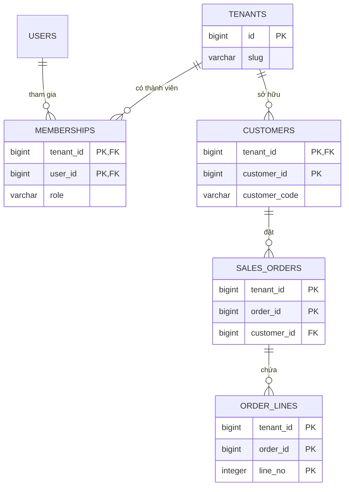
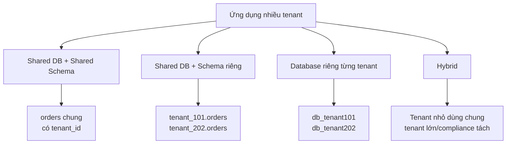
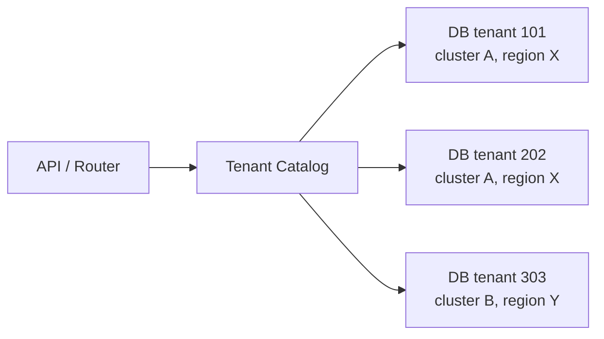
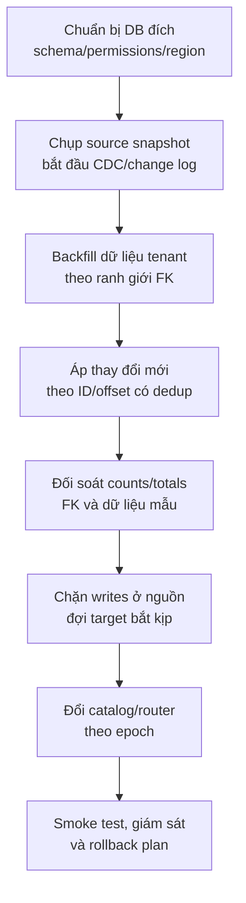

# Dữ liệu nhiều tổ chức với bảng dùng chung hoặc vùng lưu trữ tách biệt

Một nền tảng SaaS quản lý bán hàng phục vụ hàng nghìn doanh nghiệp. Doanh nghiệp A và B đều có khách hàng mang mã `CUS-001`, nhưng không được nhìn thấy, sửa, tham chiếu hoặc khôi phục nhầm dữ liệu của nhau. Một doanh nghiệp lớn muốn hiệu năng ổn định, sao lưu độc lập và lưu dữ liệu tại một khu vực địa lý cụ thể. Nền tảng nên dùng **bảng chung có `tenant_id`**, **schema riêng**, **database riêng**, hay kết hợp nhiều phương án?

Đây là bài toán **multi-tenancy** (nhiều tổ chức trên một hệ thống) trong chương **Phân tán và phân vùng** của module **DATABASE_DATA_MODELING**. Trọng tâm không chỉ là cấu hình nơi lưu trữ, mà là chuyển yêu cầu nghiệp vụ thành khóa, quan hệ, ràng buộc, chỉ mục, phạm vi truy vấn và cơ chế cô lập có thể kiểm chứng. Một phương án thiết kế tốt phải cân bằng **tính toàn vẹn, quyền riêng tư, hiệu năng, chi phí, khả năng di chuyển và vận hành**.

## 1. Hiểu đúng tenant, schema, partition, shard và database

**Tenant** là một tổ chức có ranh giới quyền truy cập và dữ liệu riêng. Trong ví dụ, một tenant là một doanh nghiệp sử dụng SaaS. Một người dùng có thể thuộc **nhiều tenant** với vai trò khác nhau; không nên đồng nhất `user_id` với `tenant_id`.

| Khái niệm | Vai trò | Ví dụ |
|---|---|---|
| Tenant | Ranh giới sở hữu và quyền nghiệp vụ | Công ty A |
| `tenant_id` | Định danh ổn định cho ranh giới ấy | `101` |
| Schema | Namespace cho bảng, view và object của DB | `tenant_101.orders` |
| Database | Ranh giới catalog, kết nối và cơ chế vận hành DB | `database_tenant_101` |
| Partition | Một phần vật lý của một bảng logic | Hash theo `tenant_id` |
| Shard | Phần dữ liệu được phân phối tới node/database khác | Tenant A tại shard 1 |
| Cluster/instance | Tài nguyên xử lý/lưu trữ hạ tầng | Một máy/nhóm DB server |
| Replica | Bản sao để đọc, dự phòng hoặc phục hồi | Read replica theo region |

**Schema riêng không đồng nghĩa máy chủ riêng; partition riêng không đồng nghĩa có quyền truy cập riêng; database riêng trên cùng instance vẫn có thể chia CPU, RAM, I/O và failure domain.** Thiết kế phải ghi rõ ta tách điều gì: hàng, bảng, schema, database, compute, region, credentials, mã hóa hay backup.

### 1.1. Những yêu cầu phải được diễn đạt thành bất biến

1. **Isolation:** user có quyền ở tenant 101 không được tự đọc/sửa dữ liệu tenant 202.
2. **Integrity:** đơn hàng tenant 101 không được tham chiếu khách hàng tenant 202.
3. **Scoped uniqueness:** hai tenant có thể cùng dùng mã `CUS-001`, nhưng một tenant không được tạo hai khách cùng mã nếu quy tắc yêu cầu.
4. **Scalability:** tenant lớn không được chiếm tài nguyên ngoài giới hạn khiến toàn bộ tenant nhỏ bị suy giảm không kiểm soát.
5. **Lifecycle:** có thể onboard, migration, export, backup, restore và offboard một tenant.
6. **Data residency:** primary, replica, backup và dữ liệu trích xuất phải ở vùng được phép khi hợp đồng yêu cầu.

Một điều kiện `WHERE tenant_id = ?` trong vài truy vấn chỉ giải quyết **một phần** yêu cầu. Cần bảo vệ toàn bộ đường đọc, ghi, đồng bộ, cache, báo cáo và vận hành.

## 2. Mô hình domain và grain có tenant boundary

Giả sử các thực thể: `Tenant`, `User`, `Membership`, `Customer`, `SalesOrder`, `OrderLine`.



Grain:

- `tenants`: một hàng trên một doanh nghiệp.
- `users`: một hàng trên một danh tính người dùng chung nền tảng, **nếu** chính sách tài khoản sử dụng kiểu danh tính toàn cục.
- `memberships`: một hàng cho quyền của một user trong một tenant.
- `customers`: một khách hàng **trong phạm vi tenant**.
- `sales_orders`: một đơn hàng **trong phạm vi tenant**.
- `order_lines`: một dòng thuộc đúng một đơn của tenant.

`tenant_id` nên ổn định và không bị tái sử dụng tùy tiện. `tenant_slug` thường là mã hiển thị hoặc lookup có thể đổi, không nên tự động làm thành FK ở hàng triệu bảng. **Biết tenant ID không chứng minh có quyền truy cập**; server phải kiểm tra user, membership và quyền tương ứng.

### 2.1. Không phải dữ liệu nào cũng thuộc một tenant

Một số bảng là **platform-global** như `countries`, `currency_codes` hoặc gói dịch vụ. Một số bảng là **tenant-owned** như `orders` và `invoices`. Dữ liệu được chia sẻ có điều kiện, ví dụ một user thuộc nhiều tenant, cần bảng cấp quyền riêng thay vì mặc định thuộc cùng một chủ thể.

| Loại | Mô hình thường dùng | Câu hỏi bảo mật |
|---|---|---|
| Tenant-owned | `tenant_id` hoặc namespace/DB riêng | Mọi FK/query có đúng phạm vi không? |
| Platform-global | Bảng tham chiếu chung | Tenant có được sửa dữ liệu này không? |
| Shared-with-permission | Entity và bảng quyền chia sẻ | Ai được xem/sửa, trong khoảng nào? |
| Cross-tenant analytics | Kho/bảng tổng hợp có quyền riêng | Có vô tình lộ dữ liệu thô không? |

Không nên rải `tenant_id IS NULL` cho dữ liệu toàn cục rồi thêm `OR tenant_id IS NULL` vào mọi truy vấn mà chưa định nghĩa chính sách quyền và ràng buộc.

## 3. Bốn kiểu bố trí lưu trữ



| Tiêu chí | Shared-table | Schema riêng | DB riêng | Instance/cluster riêng |
|---|---|---|---|---|
| Tách dữ liệu | Theo hàng | Theo đối tượng schema | Theo DB | Theo hạ tầng |
| Chi phí nhiều tenant nhỏ | Thường thấp | Tăng theo số object | Tăng theo DB/pool | Thường cao |
| Đường truy vấn | Tenant filter/RLS | Chọn schema đúng | Chọn kết nối đúng | Định tuyến cluster |
| Migration | Một schema chung | Lặp trên mọi schema | Lặp trên mọi DB | Lặp trên mọi cluster |
| Backup/restore riêng tenant | Phức tạp | Dễ phân loại object hơn | Thường rõ phạm vi hơn | Thường mạnh hơn |
| Noisy neighbor | Cao nếu không có giới hạn | Vẫn dùng chung instance | Có thể còn chung instance | Dễ tách tài nguyên hơn |
| Khả năng khác biệt schema | Khó, cần extension/data model | Có thể linh hoạt | Linh hoạt hơn | Linh hoạt nhất nhưng tốn kém |

Đây là **xu hướng thiết kế**, không phải cam kết của một DB engine hay dịch vụ managed cụ thể. Một số nền tảng có quota, restore, resource group và partitioning tiên tiến hơn; phải kiểm chứng theo môi trường triển khai.

### 3.1. Shared-table phù hợp khi nào?

Hàng nghìn tenant nhỏ dùng cùng domain và schema; cần onboarding nhanh, chi phí thấp và migrations đồng bộ. Đổi lại, tenant scope phải được áp dụng nhất quán ở **mọi** đường ghi/đọc, và tenant lớn có thể tạo hotspot.

### 3.2. Schema-per-tenant phù hợp khi nào?

Muốn tách object/namespace hoặc tùy chỉnh một phần schema, nhưng vẫn chấp nhận dùng chung DB/instance. Phải đầu tư migration orchestration, quản lý nhiều schema và kiểm soát context/`search_path`.

### 3.3. Database-per-tenant phù hợp khi nào?

Cần tách backup/restore, cấu hình, quyền database hoặc vị trí dữ liệu; có tenant lớn hay yêu cầu chuyên biệt. Phải quản lý nhiều connection, pool, DB migrations và analytics xuyên tenant.

### 3.4. Hybrid phù hợp khi nào?

Phần lớn tenant nhỏ dùng shared DB, còn tenant lớn hoặc cần region/tuân thủ riêng dùng dedicated DB/cluster. Khi đó **tenant catalog và khả năng di chuyển tenant** là kiến trúc cốt lõi.

## 4. Shared-table: khóa và FK phải thể hiện cùng tenant

Ví dụ PostgreSQL cho shared database/shared schema:

```sql
CREATE TABLE tenants (
    id BIGINT PRIMARY KEY,
    slug VARCHAR(80) NOT NULL UNIQUE,
    status VARCHAR(20) NOT NULL
        CHECK (status IN ('ACTIVE', 'SUSPENDED', 'CLOSED'))
);

CREATE TABLE users (
    id BIGINT PRIMARY KEY,
    login_name VARCHAR(160) NOT NULL UNIQUE
);

CREATE TABLE memberships (
    tenant_id BIGINT NOT NULL REFERENCES tenants(id),
    user_id BIGINT NOT NULL REFERENCES users(id),
    role VARCHAR(30) NOT NULL,
    PRIMARY KEY (tenant_id, user_id)
);

CREATE TABLE customers (
    tenant_id BIGINT NOT NULL REFERENCES tenants(id),
    customer_id BIGINT NOT NULL,
    customer_code VARCHAR(64) NOT NULL,
    display_name VARCHAR(200) NOT NULL,
    PRIMARY KEY (tenant_id, customer_id),
    UNIQUE (tenant_id, customer_code)
);

CREATE TABLE sales_orders (
    tenant_id BIGINT NOT NULL,
    order_id BIGINT NOT NULL,
    customer_id BIGINT NOT NULL,
    status VARCHAR(20) NOT NULL
        CHECK (status IN ('DRAFT', 'CONFIRMED', 'CANCELLED')),
    created_at TIMESTAMPTZ NOT NULL,
    total_amount NUMERIC(19, 2) NOT NULL
        CHECK (total_amount >= 0),
    PRIMARY KEY (tenant_id, order_id),
    CONSTRAINT fk_order_customer_same_tenant
        FOREIGN KEY (tenant_id, customer_id)
        REFERENCES customers(tenant_id, customer_id)
);

CREATE TABLE order_lines (
    tenant_id BIGINT NOT NULL,
    order_id BIGINT NOT NULL,
    line_no INTEGER NOT NULL CHECK (line_no > 0),
    sku VARCHAR(80) NOT NULL,
    quantity INTEGER NOT NULL CHECK (quantity > 0),
    PRIMARY KEY (tenant_id, order_id, line_no),
    CONSTRAINT fk_line_order_same_tenant
        FOREIGN KEY (tenant_id, order_id)
        REFERENCES sales_orders(tenant_id, order_id)
);

CREATE INDEX idx_orders_tenant_created
    ON sales_orders(tenant_id, created_at DESC, order_id DESC);
```

Giả định: `tenant_id`, `customer_id`, `order_id` và `users.id` được cấp bằng cơ chế an toàn riêng, không được DDL tự sinh trong ví dụ. `customer_id`/`order_id` chỉ phải duy nhất **trong phạm vi tenant**. Có thể dùng UUID/global sequence hoặc bộ cấp ID theo tenant; mọi phương án đều phải tránh trùng khi ghi đồng thời.

### 4.1. Vì sao FK cần thêm tenant ID?

Giả sử:

```text
Tenant 101: Customer (101, 7)
Tenant 202: Customer (202, 7)
```

`customer_id = 7` không xác định đủ một khách hàng trên toàn hệ thống. FK `(tenant_id, customer_id)` bảo đảm đơn tenant 101 chỉ tham chiếu khách tenant 101. Một thử nghiệm:

```sql
-- Giả định chỉ có Customer (202, 9), không có Customer (101, 9).
INSERT INTO sales_orders (
    tenant_id, order_id, customer_id,
    status, created_at, total_amount
)
VALUES (101, 1001, 9, 'DRAFT', CURRENT_TIMESTAMP, 100.00);
-- Kỳ vọng: FK same-tenant từ chối.
```

Không đủ nếu hai bảng chỉ *cùng có* cột `tenant_id` nhưng constraint FK không dùng nó. SQL database phải bảo vệ quan hệ ngay cả khi ứng dụng gửi nhầm ID.

### 4.2. Khóa thay thế toàn cục vẫn có thể dùng FK ghép

Phương án **thay thế** dùng `id` tự sinh toàn cục:

```sql
-- Đây là phiên bản thiết kế THAY THẾ, không chạy đồng thời
-- trên các bảng customers/sales_orders của lược đồ trước.
CREATE TABLE customers (
    id BIGINT GENERATED ALWAYS AS IDENTITY PRIMARY KEY,
    tenant_id BIGINT NOT NULL REFERENCES tenants(id),
    customer_code VARCHAR(64) NOT NULL,
    UNIQUE (tenant_id, id),
    UNIQUE (tenant_id, customer_code)
);

CREATE TABLE sales_orders (
    id BIGINT GENERATED ALWAYS AS IDENTITY PRIMARY KEY,
    tenant_id BIGINT NOT NULL REFERENCES tenants(id),
    customer_id BIGINT NOT NULL,
    FOREIGN KEY (tenant_id, customer_id)
        REFERENCES customers(tenant_id, id)
);
```

`id` là PK một cột nhưng `UNIQUE(tenant_id, id)` làm mục tiêu hợp lệ cho **FK ghép bảo vệ same-tenant**. Ràng buộc này có thể trông dư vì `id` đã unique toàn cục, song nó phục vụ yêu cầu tham chiếu có tenant scope. Không bắt buộc composite PK cho mọi bảng multi-tenant; hãy xét độ dài FK, chuyển tenant, truy vấn và kiến trúc ORM.

## 5. Truy vấn theo tenant và lỗi rò dữ liệu

Truy vấn danh sách:

```sql
SELECT order_id, created_at, status, total_amount
FROM sales_orders
WHERE tenant_id = :tenant_id
  AND created_at >= :from_time
  AND created_at < :to_time
ORDER BY created_at DESC, order_id DESC
LIMIT 50;
```

Các lỗi hay gặp:

- Query danh sách có tenant filter nhưng query chi tiết chỉ dùng `WHERE order_id = ?`.
- `UPDATE`/`DELETE` và bulk operation thiếu tenant scope.
- Cache key chỉ gồm `order_id` trong khi ID có thể trùng giữa tenant.
- Query report hoặc full-text search bỏ `tenant_id`.
- ORM fetch association không có ràng buộc cùng tenant.
- Tenant context lấy thẳng từ header mà chưa xác minh membership.
- Worker/ETL chạy dưới quyền admin quét nhầm nhiều tenant.

Đường xử lý cần:

```text
Authenticate user
  -> resolve requested tenant
  -> verify active membership + permission
  -> establish trusted tenant context
  -> read/write only scoped rows
  -> return only authorized fields
```

**Độ khó đoán của ID không phải bằng chứng phân quyền.** Ngay cả khi dùng UUID toàn cục, API vẫn phải kiểm tra quyền đối với tenant và đối tượng được truy cập.

## 6. PostgreSQL Row-Level Security bảo vệ ở database

**Row-Level Security (RLS)** bổ sung điều kiện đọc/ghi hàng do DB áp dụng, giảm rủi ro khi một query ứng dụng quên tenant filter. Ví dụ dùng PostgreSQL với role runtime `app_runtime` **đã được tạo và cấp quyền cần thiết**, không phải chủ bảng/superuser và không có quyền `BYPASSRLS`.

### 6.1. Bật RLS với tenant context trong transaction

```sql
ALTER TABLE customers ENABLE ROW LEVEL SECURITY;
ALTER TABLE customers FORCE ROW LEVEL SECURITY;

CREATE POLICY customers_tenant_policy
ON customers
FOR ALL TO app_runtime
USING (
    tenant_id =
    NULLIF(current_setting('app.current_tenant', true), '')::BIGINT
)
WITH CHECK (
    tenant_id =
    NULLIF(current_setting('app.current_tenant', true), '')::BIGINT
);

ALTER TABLE sales_orders ENABLE ROW LEVEL SECURITY;
ALTER TABLE sales_orders FORCE ROW LEVEL SECURITY;

CREATE POLICY orders_tenant_policy
ON sales_orders
FOR ALL TO app_runtime
USING (
    tenant_id =
    NULLIF(current_setting('app.current_tenant', true), '')::BIGINT
)
WITH CHECK (
    tenant_id =
    NULLIF(current_setting('app.current_tenant', true), '')::BIGINT
);

ALTER TABLE order_lines ENABLE ROW LEVEL SECURITY;
ALTER TABLE order_lines FORCE ROW LEVEL SECURITY;

CREATE POLICY lines_tenant_policy
ON order_lines
FOR ALL TO app_runtime
USING (
    tenant_id =
    NULLIF(current_setting('app.current_tenant', true), '')::BIGINT
)
WITH CHECK (
    tenant_id =
    NULLIF(current_setting('app.current_tenant', true), '')::BIGINT
);
```

`USING` giới hạn những hàng role được đọc hoặc nhắm đến khi update/delete. `WITH CHECK` kiểm tra giá trị hàng mới khi insert/update. `current_setting(..., true)` không ném lỗi khi setting chưa tồn tại; `NULLIF(..., '')::BIGINT` cho phép trường hợp thiếu/chuỗi rỗng trở thành `NULL` để điều kiện tenant **không khớp** thay vì mở truy cập.

Trong một transaction ứng dụng:

```sql
BEGIN;
SELECT set_config('app.current_tenant', '101', true);

SELECT order_id, status
FROM sales_orders
ORDER BY order_id;
-- Dưới role app_runtime có policy: chỉ hàng tenant_id=101.

COMMIT;
```

Tham số `true` của `set_config` làm giá trị tồn tại trong **transaction hiện tại**. Connection pool phải đảm bảo thiết lập tenant trên **đúng kết nối và sau BEGIN** trước mọi truy vấn cần nó. Với transaction pooling, không thể giả định một session giữ cùng tenant suốt đời kết nối.

### 6.2. RLS không thay thế xác thực và quyền

Một custom GUC như `app.current_tenant` không phải bằng chứng tenant đã được xác thực. Runtime có thể đặt cấu hình này bằng SQL trong một số bối cảnh. Vì vậy:

1. **Server**, không phải client, xác minh user được vào tenant nào.
2. Các truy vấn phải được tham số hóa; SQL injection có thể phá nhiều cơ chế kiểm soát, kể cả đổi custom setting.
3. Runtime DB role dùng quyền tối thiểu, không phải owner, superuser hay `BYPASSRLS`.
4. Tránh đường vòng qua hàm `SECURITY DEFINER`, view hoặc job chạy bằng quyền quá cao không được kiểm soát.
5. Dùng tenant-scoped FK/UNIQUE ngay cả khi đã bật RLS.
6. Test trong đúng vai trò runtime, không chỉ bằng tài khoản admin.

RLS giúp phòng lỗi truy vấn khi mô hình đe dọa và quản trị role được thiết kế phù hợp; **không phải hàng rào hoàn hảo trước khả năng thực thi SQL tùy ý từ tenant** nếu runtime có thể tự đổi tenant context. Với yêu cầu cô lập mạnh hơn, cân nhắc role DB được ràng buộc chặt, database riêng hoặc ranh giới hạ tầng khác, tùy threat model.

### 6.3. Ví dụ kiểm chứng policy

| Thao tác trong context tenant 101 | Kỳ vọng |
|---|---|
| `SELECT` đơn tenant 101 | Đọc được nếu role có quyền |
| `SELECT` đơn tenant 202 | Không trả hàng |
| `UPDATE` trạng thái đơn tenant 202 | Không được sửa |
| `INSERT` khách với `tenant_id=202` | `WITH CHECK` từ chối |
| `UPDATE` tenant ID của một hàng từ 101 → 202 | `WITH CHECK`/FK từ chối |
| Không đặt tenant context | Không thấy hàng tenant-owned, hoặc bị chặn |

Hệ thống thật có thể chọn policy khác theo command, vai trò support hoặc ghi dữ liệu toàn cục. Quyền admin và đường cấp hỗ trợ cần được cấp hạn chế, audit riêng, không dùng chung vai trò truy vấn bình thường.

## 7. Thiết kế chỉ mục theo tenant và phân bố dữ liệu

Với workload “xem 50 đơn `CONFIRMED` gần nhất của một tenant”, một chỉ mục B-tree phù hợp để thử nghiệm:

```sql
CREATE INDEX idx_orders_tenant_status_time
ON sales_orders (
    tenant_id, status, created_at DESC, order_id DESC
);
```

`tenant_id, status` là các điều kiện bằng, tiếp theo là thứ tự thời gian/ID. Kiểm tra với:

```sql
EXPLAIN (ANALYZE, BUFFERS)
SELECT order_id, created_at, total_amount
FROM sales_orders
WHERE tenant_id = 101
  AND status = 'CONFIRMED'
ORDER BY created_at DESC, order_id DESC
LIMIT 50;
```

Không nên mặc định mọi truy vấn đều cần cùng chỉ mục. Query tìm `customer_code` có thể cần `UNIQUE(tenant_id, customer_code)`; query tổng hợp theo tháng cần plan khác. PK/UNIQUE đã tạo index phù hợp trong PostgreSQL thì tránh tạo index trùng vô ích.

### 7.1. Tenant lớn là một kiểu dữ liệu lệch phân bố

```text
Tenant 101: 4.000.000 orders
Tenant 202:       400 orders
Tenant 303:     1.200 orders
```

Số lượng tenant tổng cộng không thể hiện một tenant lớn đang dùng phần lớn CPU, bộ nhớ hoặc I/O. Query nhỏ của tenant 202 có thể chịu ảnh hưởng nếu tenant 101 chạy import hoặc aggregate nặng.

Một bảng có `tenant_id` **không tự chia** connection slots, locks, buffer cache và tài nguyên riêng từng tenant. Để kiểm soát noisy neighbor cần giới hạn truy vấn/timeout, queue, quota, index, batch hợp lý hoặc di chuyển tenant lớn sang vùng riêng.

### 7.2. Query dùng tenant scope phải được thực thi nhất quán

Với pagination, điều kiện `tenant_id` phải áp dụng từ truy vấn count, truy vấn lấy ID cho tới truy vấn chi tiết. Cùng lúc, cache key phải chứa đủ phạm vi:

```text
Sai:   cache["order:50"]
Đúng:  cache["tenant:101:order:50"]
```

Ngay cả khi ID toàn cục, kiểm tra authorization vẫn cần có; thay cache key không phải giải pháp thay thế phân quyền.

## 8. Partition theo tenant: quyết định vật lý, không phải quyền truy cập

Partitioning chia **một bảng logic** thành các phần vật lý để quản lý dữ liệu, pruning và bảo trì. Nó không phải policy bảo mật.

### 8.1. Ví dụ hash partition ở PostgreSQL

Ví dụ độc lập với bảng `sales_orders` phía trên:

```sql
CREATE TABLE tenant_orders_partitioned (
    tenant_id BIGINT NOT NULL,
    order_id BIGINT NOT NULL,
    created_at TIMESTAMPTZ NOT NULL,
    status VARCHAR(20) NOT NULL,
    PRIMARY KEY (tenant_id, order_id)
) PARTITION BY HASH (tenant_id);

CREATE TABLE tenant_orders_p0
    PARTITION OF tenant_orders_partitioned
    FOR VALUES WITH (MODULUS 4, REMAINDER 0);
CREATE TABLE tenant_orders_p1
    PARTITION OF tenant_orders_partitioned
    FOR VALUES WITH (MODULUS 4, REMAINDER 1);
CREATE TABLE tenant_orders_p2
    PARTITION OF tenant_orders_partitioned
    FOR VALUES WITH (MODULUS 4, REMAINDER 2);
CREATE TABLE tenant_orders_p3
    PARTITION OF tenant_orders_partitioned
    FOR VALUES WITH (MODULUS 4, REMAINDER 3);

CREATE INDEX idx_partitioned_tenant_time
    ON tenant_orders_partitioned(
        tenant_id, created_at DESC, order_id DESC
    );
```

Hash partition **không có nghĩa mỗi tenant một partition**. Nhiều tenant được phân vào một phần theo hàm hash. Query có điều kiện `WHERE tenant_id = 101` có thể được planner *partition pruning* để không đọc các phần khác; phải xác minh bằng query plan và workload.

### 8.2. Chú ý tính duy nhất trên bảng partitioned

Trong PostgreSQL, khóa unique/PK của một bảng partitioned phải tuân quy tắc bao gồm partition key để có thể cưỡng chế uniqueness qua các partition. Với partition theo `tenant_id`, `PRIMARY KEY(tenant_id, order_id)` phù hợp. Không mặc định có thể tạo `UNIQUE(order_id)` toàn bảng nếu thiếu partition key.

Nếu nghiệp vụ đòi ID toàn cục, có thể cấp UUID/sequence từ một dịch vụ đáng tin cậy và kiểm chứng ràng buộc toàn cục theo kiến trúc, hoặc thay lựa chọn partition. **Không sửa định nghĩa khóa nghiệp vụ chỉ để DDL phân vùng dễ chạy**.

### 8.3. Chọn partition key từ workload

| Workload | Hướng cân nhắc | Đánh đổi |
|---|---|---|
| Truy vấn hầu như luôn theo tenant | Hash/list theo tenant | Tenant lớn có thể vẫn nóng |
| Lịch sử event và retention theo tháng | Range theo thời gian | Query theo tenant lâu năm đi qua nhiều partition |
| Vừa tenant vừa thời gian | Hai cấp partition nếu dữ liệu đủ lớn | Nhiều object, chi phí planner/maintenance |
| Dữ liệu vượt một node | Sharding sang nhiều DB/node | Routing, distributed query và di chuyển dữ liệu |

Tạo **một partition cho từng tenant** có thể khiến hàng nghìn partition khó quản lý metadata, migration và kế hoạch truy vấn. Lựa chọn cần được đo chứ không suy từ ý tưởng “tách mỗi tenant là tốt nhất”.

## 9. Schema riêng cho từng tenant

Với **shared database, separate schemas**:

```text
database: saas_app
├── public
│   └── tenant_catalog
├── tenant_101
│   ├── customers
│   ├── sales_orders
│   └── order_lines
└── tenant_202
    ├── customers
    ├── sales_orders
    └── order_lines
```

Ví dụ:

```sql
CREATE SCHEMA tenant_101;
CREATE SCHEMA tenant_202;

CREATE TABLE tenant_101.customers (
    id BIGINT GENERATED ALWAYS AS IDENTITY PRIMARY KEY,
    customer_code VARCHAR(64) NOT NULL UNIQUE,
    display_name VARCHAR(200) NOT NULL
);

CREATE TABLE tenant_202.customers (
    id BIGINT GENERATED ALWAYS AS IDENTITY PRIMARY KEY,
    customer_code VARCHAR(64) NOT NULL UNIQUE,
    display_name VARCHAR(200) NOT NULL
);
```

Cả hai schema có thể chứa `customer_code='CUS-001'` mà không vi phạm UNIQUE vì đây là **hai bảng riêng**.

### 9.1. Lợi ích

- Namespace bảng/index/constraint rõ ràng theo tenant.
- Có thể phân quyền theo schema/bảng, phù hợp một số mô hình bảo mật.
- Dễ phân loại object để dump/export riêng hơn bảng chung trong một số tình huống.
- Cho phép một số tùy chỉnh schema theo tenant, nếu tổ chức kiểm soát version tốt.

### 9.2. Chi phí

- Mỗi tenant mới tạo thêm các bảng, index, trigger và đối tượng quản lý.
- Mỗi migration phải áp dụng trên **từng schema**, ghi nhận tenant nào đã xong và tenant nào lỗi.
- CPU, I/O, WAL, storage, connection limit và backup vật lý vẫn có thể thuộc **một database chung**.
- Query tổng hợp xuyên tenant khó hơn vì phải truy vấn nhiều schema hoặc đồng bộ vào warehouse.
- `search_path` có thể rò giữa request nếu dùng connection pool sai.

### 9.3. Chọn schema an toàn

Không lấy tên schema từ request rồi ghép thẳng vào SQL:

```java
// Không an toàn nếu tenantSlug tới từ dữ liệu không tin cậy:
String sql = "SELECT * FROM " + request.getTenantSlug() + ".customers";
```

Server phải xác thực/ủy quyền tenant, tra tên schema trong **tenant catalog tin cậy**, và sử dụng cách xử lý/quote identifier an toàn theo driver/ORM. Binding `?` thông thường dành cho **giá trị**, không thể mặc định thay một tên schema/table.

Nếu dùng session `search_path`, cần kiểm soát vòng đời connection/transaction và reset chắc chắn; nếu dùng fully qualified table names, vẫn phải chặn việc chọn namespace ngoài quyền. **Schema riêng không tự ngăn một DB role có quyền trên mọi schema truy cập sai schema**.

## 10. Database riêng theo tenant

Trong **database-per-tenant**, mỗi doanh nghiệp có DB riêng, có thể chạy chung một instance hoặc ở server/region khác nhau.



Ưu điểm thường là quyền/backup và schema migration **có ranh giới rõ hơn**, dễ chọn vị trí và cấu hình cho tenant cụ thể; hỗ trợ chuyển tenant lớn tới hạ tầng riêng.

Đổi lại:

- Nhiều DB tạo chi phí pool, connection, giám sát, backup, restore và migrations.
- Nếu cùng instance, tenant vẫn chia sẻ một phần tài nguyên/failure domain.
- Query hoặc transaction xuyên tenant/DB không đơn giản như join trong một DB.
- Báo cáo toàn nền tảng thường cần ETL/warehouse với quyền riêng.
- Dùng DB riêng không chứng minh backup, replicas, logs và object storage đều nằm trong region được phép.

**Database-per-tenant không đồng nghĩa instance-per-tenant.** Phải nói rõ ranh giới cô lập là database, cluster, region hay cả đường kết nối và mã hóa.

### 10.1. Tenant catalog quyết định nơi kết nối

| tenant_id | placement_mode | region | storage_locator | schema_version |
|---:|---|---|---|---:|
| 101 | SHARED | region-a | shared-db-01 | 12 |
| 202 | DEDICATED_DB | region-a | db-tenant-202 | 12 |
| 303 | DEDICATED_CLUSTER | region-b | cluster-303 | 12 |

Catalog chỉ lưu **định danh đích** đủ để router lấy cấu hình kết nối từ hệ thống bí mật an toàn, không nên nhét password plaintext hoặc cho client chỉ định trực tiếp database URL. Catalog cần bảo vệ quyền truy cập, audit và đồng bộ khi chuyển tenant.

## 11. Hybrid: nhóm tenant nhỏ và tenant đặc biệt

Một chiến lược thực tế: tenant nhỏ dùng bảng chung, tenant lớn hoặc cần cô lập cao có DB/cluster riêng. Điều kiện tiên quyết là domain/API không gắn cứng tenant với một máy chủ; tenant placement được tra từ catalog đáng tin.

```text
Authenticate user
  -> authorize tenant_id
  -> resolve placement from trusted catalog
  -> choose pool/connection and tenant scope
  -> execute a scoped transaction
  -> record tenant-aware telemetry/audit
```

Với hybrid, phải hỗ trợ **chuyển tenant giữa các vùng** mà không đổi ID nghiệp vụ. Router cache không được giữ placement vô thời hạn vì có thể ghi vào DB cũ sau cutover. Một routing generation/epoch và cơ chế chặn writer cũ giúp phòng ngừa **split brain**.

### 11.1. Ranh giới transaction giữa nhiều DB

Một transaction local có thể cập nhật nhiều bảng cùng commit/rollback. Nhưng nếu một use case yêu cầu ghi ở hai DB/region khác nhau, không được mặc định có ACID đơn giản xuyên các đích. Cần xem xét idempotency, outbox, saga hoặc quy trình điều phối có kiểm soát tùy invariant.

Không tách dữ liệu chỉ để tối ưu một query nếu việc tách khiến một bất biến cốt lõi phải dựa trên distributed transaction quá phức tạp.

## 12. Partition, shard và replica không phải một cơ chế

### 12.1. Partitioning

Một bảng logic được chia thành các phần vật lý, thường vẫn được query bằng cùng tên bảng. Mục đích là partition pruning, quản lý retention, bảo trì index và thao tác dữ liệu theo phần. Hash `tenant_id` hoặc range theo `created_at` là những phương án phổ biến, nhưng chúng không tự tạo quyền tenant.

### 12.2. Sharding

Dữ liệu được **phân phối sang các database/node**. Router có thể tính shard từ `tenant_id` hoặc tra mapping tenant→shard:

```text
tenant 101 -> shard A
tenant 202 -> shard B
tenant 303 -> shard B
```

Shard theo tenant thường giữ những bảng sở hữu bởi cùng tenant ở cùng đích, giúp giảm join xuyên shard. Tuy vậy, tenant 101 quá lớn vẫn có thể gây hotspot cho toàn shard A. Khi cần thêm shard, hash cố định đơn giản có thể phải di chuyển nhiều tenant; một **placement catalog** hoặc nhất quán hashing có thể hỗ trợ tái cân bằng, nhưng cần quy trình cutover và consistency.

### 12.3. Replication

Replica tăng khả năng dự phòng hoặc cung cấp read capacity. Nhưng read replica có thể **trễ** so với primary. Người dùng vừa ghi một hóa đơn rồi đọc ngay replica có thể thấy dữ liệu cũ. Với workflow yêu cầu read-your-writes, phải có chính sách định tuyến hoặc độ nhất quán phù hợp.

Replica không thay thế kiểm tra tenant scope; bản sao của shared DB vẫn chứa dữ liệu nhiều tenant và cần chính sách quyền giống như primary.

### 12.4. So sánh ngắn

| Cơ chế | Chủ đích | Không tự giải quyết |
|---|---|---|
| Partition | Lọc, lưu và quản lý một phần bảng | Phân quyền và tài nguyên riêng |
| Shard | Chia dung lượng/tải nhiều node | Join/transaction đơn giản xuyên node |
| Replica | Đọc và dự phòng | Trạng thái đọc luôn mới nhất |
| DB riêng | Tách một phạm vi catalog/quyền/backup | CPU riêng nếu dùng chung instance |
| Cluster riêng | Tách nhiều tài nguyên và failure domain | Đúng toàn bộ tenant authorization ở application |

## 13. Noisy neighbor và giới hạn tài nguyên theo tenant

Trong shared DB, một tenant có thể gây ảnh hưởng tới những tenant khác bằng:

- Báo cáo quét rất nhiều hàng, sort/group lớn và chiếm CPU/RAM.
- Batch import hàng triệu dòng khiến WAL/I/O tăng.
- Giao dịch dài giữ lock, chờ lock hoặc connection.
- Lượng dữ liệu khổng lồ khiến cache hit ratio của tenant nhỏ giảm.
- Nhiều background job của một tenant chiếm toàn bộ worker slots.

**Tenant filter không đồng nghĩa resource isolation.** Cần phân biệt query không tối ưu với nhu cầu hợp lệ thật sự lớn.

### 13.1. Các biện pháp theo lớp

1. **Application:** giới hạn request rate, batch size, query timeout, API pagination, số job đồng thời.
2. **Database:** index đúng workload, transaction ngắn, giới hạn connection/statement timeout và workload group nếu DB hỗ trợ.
3. **Queue:** giới hạn concurrency theo tenant, ưu tiên job tương tác hơn export dài.
4. **Analytics:** tách workload báo cáo khỏi OLTP bằng warehouse hoặc replica đọc phù hợp.
5. **Placement:** chuyển tenant có nhu cầu cao sang DB/cluster riêng khi lợi ích vượt chi phí.

Không nên chỉ tăng CPU vì một report thiếu `WHERE tenant_id` đang full scan toàn bảng.

### 13.2. Telemetry theo tenant

Theo dõi:

- QPS, tỷ lệ lỗi, p95/p99 latency theo tenant hoặc lớp tenant.
- Số hàng, storage, index size và tốc độ tăng trưởng.
- Số kết nối, active transactions, lock wait, I/O và cache hit.
- Thời gian backup/restore, replication lag, job queue latency.
- Schema version, placement version và các lần chuyển vùng.

Telemetry cũng có dữ liệu nhạy cảm: dashboard khách hàng không được vô tình thấy mức sử dụng hoặc tên riêng của tenant khác nếu không có quyền.

## 14. Sao lưu, khôi phục và xóa dữ liệu riêng tenant

### 14.1. Backup vật lý shared DB thường phục hồi cả DB

Trong mô hình bảng chung, point-in-time recovery/backup vật lý thường gắn với **cả database**, không phải một tenant. Muốn khôi phục tenant 101 mà giữ nguyên tenant 202:

1. Phục hồi backup vào môi trường tách biệt.
2. Trích đúng hàng tenant 101 của tất cả bảng tenant-owned theo khóa và FK.
3. Đối chiếu schema version và những dữ liệu toàn cục được tham chiếu.
4. Tính đến đơn/hóa đơn phát sinh **sau thời điểm backup** ở production.
5. Hợp nhất/khôi phục bằng giao dịch và quyền phù hợp, không overwrite tenant khác.
6. Kiểm tra row count, FK, mẫu dữ liệu và audit sau phục hồi.

Schema riêng có thể giúp export object của tenant dễ hơn, nhưng WAL và backup vật lý vẫn có thể thuộc shared DB. Database riêng thường cho ranh giới restore rõ hơn, song tính năng thật tùy DB/managed service.

### 14.2. Offboarding một tenant

Quy trình không chỉ là:

```sql
-- Không đủ để kết luận đã xóa toàn bộ tenant:
DELETE FROM customers WHERE tenant_id = 101;
```

Dữ liệu còn nằm ở orders, lines, invoices, payment, audit, object storage, cache, search index, queue, analytics, backup và bản sao. Hãy:

- Chặn quyền truy cập/write và ngừng job của tenant cần offboard.
- Export dữ liệu được phép theo hợp đồng.
- Phân loại dữ liệu cần xóa, ẩn danh hoặc giữ theo retention áp dụng.
- Xử lý các dependent records đúng thứ tự và audit kết quả.
- Áp chính sách lên logs, object storage, search, analytics và backup trong phạm vi cho phép.
- Cập nhật tenant catalog, chứng minh không còn đường routing vào dữ liệu bị thu hồi.

Đừng mặc định “xóa database riêng” xóa luôn thông tin trong payment provider, email platform hoặc backups. Ngược lại, giữ mọi dữ liệu vĩnh viễn cũng không tự là giải pháp đúng khi có chính sách xóa/ẩn danh.

### 14.3. RTO, RPO và backup boundary

**RTO** là mục tiêu thời gian khôi phục; **RPO** là khoảng mất dữ liệu tối đa chấp nhận. Nếu một tenant cần RTO rất ngắn và restore riêng, shared-table có thể khiến khôi phục quá phức tạp. Đó là lý do **yêu cầu vận hành** có thể dẫn tới database riêng dù lượng dữ liệu chưa lớn.

Cần thử diễn tập khôi phục, không chỉ đọc tài liệu nói backup hằng ngày. Một file backup chưa từng restore chưa chứng minh được RTO/RPO thực tế.

## 15. Region, data residency và mã hóa

Yêu cầu “dữ liệu tenant nằm tại region X” đòi kiểm tra **toàn bộ luồng dữ liệu**:

| Thành phần | Vấn đề phải xác minh |
|---|---|
| Primary DB | Đặt tại region được phép |
| Read replica / standby | Có sao chép sang region khác không? |
| Backup / DR | Lưu ở đâu, retention bao lâu? |
| Object storage | File đính kèm có cùng chính sách không? |
| Search index / analytics | Có bản sao dữ liệu nhạy cảm ngoài region? |
| Logs / tracing / crash dump | Có ghi tenant data/PII không? |
| Queue / event stream | Message body và retention nằm ở đâu? |
| Hỗ trợ vận hành | Ai được truy cập dữ liệu, từ vùng nào? |

Database ở region X chưa đủ nếu ETL sao chép toàn bộ hóa đơn sang warehouse đặt vùng Y mà yêu cầu không cho phép. Data residency là ràng buộc **end-to-end**, cần mô tả cả các bản sao và đường export.

### 15.1. Mã hóa không thay thế authorization

Encryption at rest bảo vệ storage; TLS bảo vệ đường truyền. Nhưng ứng dụng vẫn có thể đọc/giải mã mọi hàng nếu role của nó có quyền lớn. Nếu query bỏ tenant scope, mã hóa không cứu được rò dữ liệu qua API.

Mã hóa theo tenant/key riêng có thể giúp tách quyền/rotation trong một số kiến trúc, nhưng cần quy trình sao lưu khóa, phục hồi, thay khóa, quyền cấp khóa và bảo đảm không trao mọi khóa cho cùng một role thiếu kiểm soát.

## 16. Migration từ shared-table sang dedicated DB

Giả sử tenant 202 tăng từ vài nghìn lên 50 triệu đơn, cần chuyển sang DB riêng. Mục tiêu là **giữ tenant ID, ID nghiệp vụ và toàn vẹn**, không mất write trong lúc copy.



### 16.1. Các bước có thể kiểm chứng

**Chuẩn bị:** tạo database và schema ở target, secrets/quyền, index, extension, schema migration tương thích và backup. Đảm bảo target nằm đúng region.

**Backfill:** đọc tất cả bảng tenant 202 tại một snapshot nhất quán hoặc quy trình có offset; chuyển theo thứ tự FK. Với bảng toàn cục, quyết định dữ liệu nào sao chép, dữ liệu nào vẫn phải tham chiếu trung tâm.

**Change capture:** khi source vẫn nhận write, theo dõi CDC/change log và áp vào target một cách idempotent. Một message retry không được tạo trùng đơn; delete/correction phải được áp đúng thứ tự.

**Đối soát:** kiểm tra row count, tổng tiền, số dòng, trạng thái, FK, checksum/hash theo nhóm và bản ghi mẫu. Tổng bằng nhau **không chứng minh** mọi hàng đúng vì hai lỗi có thể triệt tiêu.

**Cutover:** dừng/fence writes cũ, đợi target bắt kịp offset đã xác định, sau đó đổi placement trong catalog. Router và connection pool phải nhận biết placement **generation/epoch**; writer giữ routing cũ không được lén ghi tiếp.

**Quan sát và phục hồi:** chạy smoke test, kiểm tra RLS/credentials ở đích, latency, backups và read-after-write. Giữ source read-only đủ cho rollback/đối soát theo chính sách; không để source và target cùng chấp nhận write độc lập.

### 16.2. Vì sao copy rồi đổi route là nguy hiểm?

```text
10:00 bắt đầu copy tenant 202
10:05 user tạo Order #5001 ở source
10:10 copy hoàn tất nhưng không có CDC của #5001
10:11 router chuyển sang target
=> Order #5001 biến mất khỏi view của tenant ở target
```

Một rủi ro khác là **split brain**: một app instance đã route tới target, instance khác còn route tới source và cả hai đều nhận write. Cần điểm cutover có fencing và xử lý stale placement.

### 16.3. Đối soát độc lập ở hai nơi

Ví dụ cùng một câu SQL chạy tại source và target (nếu đều dùng schema có `tenant_id`):

```sql
SELECT tenant_id,
       COUNT(*) AS order_count,
       SUM(total_amount) AS total_amount
FROM sales_orders
WHERE tenant_id = 202
GROUP BY tenant_id;
```

Nếu target dùng schema/table không còn cột `tenant_id`, query đối soát phải được chuyển đổi phù hợp. Nên đối chiếu thêm số dòng, khóa, hash/canonical representation, tiền tệ và các nhóm thời gian. Không xóa dữ liệu source chỉ dựa vào một phép `COUNT(*)`.

### 16.4. Rollback cần được chuẩn bị trước cutover

Nếu target đã nhận write mới, quay router về source cũ **không an toàn** khi source chưa có các write ấy. Phải có cách đồng bộ ngược hoặc quy trình dừng write/khôi phục với điều kiện rõ. Kế hoạch rollback không phải “đổi lại một giá trị trong catalog” sau khi đã có trạng thái phân kỳ.

## 17. Kiểm thử multi-tenant từ cấu trúc đến vận hành

### 17.1. Bộ dữ liệu đối kháng nhỏ

Tạo:

```text
Tenant 101:
  Customer (101, 7), code CUS-001
  Order (101, 50) -> Customer (101, 7)

Tenant 202:
  Customer (202, 7), code CUS-001
  Order (202, 50) -> Customer (202, 7)
```

Các ID **được phép trùng** giữa tenant. Kiểm tra:

1. `UNIQUE(tenant_id, customer_code)` cho phép CUS-001 ở 101 và 202 nhưng chặn trùng trong 101.
2. FK không cho tạo Order (101, 51) tham chiếu Customer chỉ tồn tại ở 202.
3. Đọc/sửa/xóa Order 50 trong context 101 không tác động Order (202, 50).
4. API user chỉ thuộc tenant 101 không thể truy cập 202 dù biết ID.
5. Query search, export, pagination, bulk update và cache đều giữ tenant scope.
6. User có role VIEWER ở tenant 202 không được dùng quyền EDITOR ở tenant 101 để sửa 202.

### 17.2. Kiểm thử RLS và connection pool

- Dưới role `app_runtime`, thiếu tenant context phải fail-closed.
- Context 101 chỉ thấy hàng 101, không đọc/update/delete 202.
- `INSERT` tenant 202 khi context 101 bị `WITH CHECK` từ chối.
- Cố đổi `tenant_id` ở một hàng đang quản lý phải bị policy/FK chặn.
- Hai request 101 → 202 tái sử dụng connection pool không làm rò setting 101; thử cả lỗi transaction/rollback.
- Thử một đường admin/support riêng, xác nhận audit và quyền tối thiểu.
- Thử SQL injection/đầu vào tenant không được xác thực không thể tự đặt context.

**Không chạy toàn bộ test dưới table owner/superuser rồi kết luận RLS hoạt động**: những vai trò này có quyền đặc biệt.

### 17.3. Kiểm thử kích thước tenant và partition pruning

Trong môi trường có một tenant hàng triệu đơn và nhiều tenant vài trăm đơn:

```sql
EXPLAIN (ANALYZE, BUFFERS)
SELECT order_id, total_amount
FROM sales_orders
WHERE tenant_id = 101
  AND status = 'CONFIRMED'
ORDER BY created_at DESC, order_id DESC
LIMIT 50;
```

Đo query count, số hàng, p95 latency, lock wait, index/partition pruning và ảnh hưởng của batch lớn. Với bảng partitioned, chạy query trên bảng partitioned cụ thể thay vì giả định `sales_orders` của ví dụ đã partition.

### 17.4. Thử phục hồi/migration, không chỉ CRUD

Thực hành restore tenant từ shared backup vào môi trường riêng; kiểm tra FK và không bao gồm dữ liệu của tenant khác. Khi thử chuyển tenant 202 sang DB riêng, phát write mới trong thời gian backfill, kiểm tra CDC, route epoch và các request giữ placement cũ phải bị từ chối.

Một thiết kế multi-tenant chỉ được kiểm chứng nghiêm túc khi đã thử **lỗi cấu hình, đường ghi nền, backup, context leak và chuyển vùng**, không chỉ một endpoint list thành công.

## 18. Ma trận quyết định chọn nơi lưu

| Điều kiện ưu tiên | Hướng khởi đầu | Điều cần chứng minh |
|---|---|---|
| Hàng nghìn tenant nhỏ, một schema nghiệp vụ, chi phí thấp | Shared-table + tenant scope + quyền/RLS | Mọi read/write và FK đúng tenant |
| Muốn object namespace riêng và tùy chỉnh schema giới hạn | Schema-per-tenant | Quản lý migration, role và connection context |
| Cần backup/restore độc lập hoặc cấu hình DB riêng | Database-per-tenant | Chi phí DB/pool, lifecycle, quyền và analytics |
| Một tenant lớn gây noisy neighbor | Dedicated DB/cluster cho tenant lớn | Hiệu năng sau tách và chi phí tăng |
| Tenant có yêu cầu vùng địa lý khác nhau | Routing theo region, thường hybrid | Primary, backups, replicas, logs và analytics cùng tuân ràng buộc |
| Bảng event lớn, retention theo thời gian | Partition theo thời gian | Pruning, retention và uniqueness |
| Truy vấn chủ yếu theo tenant ở bảng rất lớn | Partition/hash hoặc shard theo tenant | Bảo vệ PK/UNIQUE, tránh hotspot, khả năng di chuyển |
| Cần nhiều phiên bản schema tùy tenant | Schema/DB riêng có kiểm soát | Migration orchestrator và số lượng phiên bản hỗ trợ |

### 18.1. Quy trình lựa chọn từng bước

**Bước 1 — Xác định ranh giới tenant.** User thuộc nhiều tổ chức không? Dữ liệu nào shared, tenant-owned hoặc được chia sẻ có quyền?

**Bước 2 — Viết invariant.** Cần isolation đọc/ghi, FK same-tenant, unique trong tenant, phân quyền trong tenant và giới hạn dữ liệu nhạy cảm nào?

**Bước 3 — Định nghĩa grain/khóa.** Chọn `tenant_id` ổn định, composite PK hoặc surrogate PK với composite FK/UNIQUE phù hợp.

**Bước 4 — Lượng hóa workload.** Bao nhiêu tenant, bao nhiêu hàng/tenant, tăng trưởng, tenant lớn nhất, p95 latency và tần suất báo cáo?

**Bước 5 — Chọn mô hình lưu sơ bộ.** Đánh đổi shared-table, schema, database hoặc cluster riêng theo yêu cầu thật.

**Bước 6 — Thiết kế routing và bảo vệ.** App authorization, RLS/DB roles, catalog, cache key, transaction context và index/partition.

**Bước 7 — Thiết kế vận hành trước khi mở rộng.** Onboarding, migrations, backups, restore, offboarding, region và tenant move.

**Bước 8 — Kiểm thử đối kháng, tải và phục hồi.** ID trùng giữa tenant, query thiếu filter, FK sai, context pool leak, RLS bypass, noisy neighbor, cutover có ghi đồng thời.

## 19. Những sai lầm thường gặp

**Sai lầm 1 — “Thêm `tenant_id` là đủ.”** Cột chỉ là metadata nếu query, authorization và FK không ràng buộc đúng phạm vi.

**Sai lầm 2 — “Khóa UUID rất khó đoán nên không cần kiểm tra quyền.”** ID không phải secret và biết ID không phải quyền đọc.

**Sai lầm 3 — “FK chỉ theo `customer_id` vẫn an toàn vì ứng dụng luôn filter tenant.”** Một batch/import sai có thể chèn tham chiếu chéo; FK ghép bảo vệ tại database.

**Sai lầm 4 — “`UNIQUE(customer_code)` trên toàn bảng luôn tốt hơn.”** Làm hai tenant không thể dùng cùng mã nghiệp vụ, trái yêu cầu scoped uniqueness.

**Sai lầm 5 — “Dùng RLS với custom setting là không thể bị vượt qua.”** Phải xác thực tenant context, bảo vệ SQL và tránh runtime có quyền bypass.

**Sai lầm 6 — “Đổi `search_path` theo request luôn an toàn.”** Connection pool tái sử dụng session có thể chọn nhầm schema nếu vòng đời context không được kiểm soát.

**Sai lầm 7 — “Partition theo tenant là permission boundary.”** Partition là tối ưu vật lý, không thay authorization/RLS.

**Sai lầm 8 — “Mỗi tenant một partition thì khả năng mở rộng vô hạn.”** Hàng nghìn partition tạo chi phí object metadata, DDL, planner và bảo trì.

**Sai lầm 9 — “Database riêng nghĩa là tài nguyên riêng.”** Các database vẫn có thể cùng một instance, CPU và storage.

**Sai lầm 10 — “Database trong region được chọn là đủ data residency.”** Replica, backup, logs, object storage và analytics có thể sao chép ra ngoài region.

**Sai lầm 11 — “Tenant ID ở header request luôn đáng tin.”** Phải có authenticated user và xác minh membership/quyền ở server.

**Sai lầm 12 — “Cache key chỉ cần ID object.”** Nếu ID local trùng giữa tenant, cache có thể trả dữ liệu chéo; mọi API vẫn phải thực hiện authorization.

**Sai lầm 13 — “Cross-tenant analytics cứ đọc trực tiếp dưới role API admin.”** Báo cáo tổng hợp cần quyền riêng, giới hạn dữ liệu và chính sách truy vết.

**Sai lầm 14 — “Copy dữ liệu rồi đổi router là xong.”** Write phát sinh trong khi copy và route stale có thể làm mất dữ liệu hoặc split brain.

**Sai lầm 15 — “Có backup shared DB thì có thể restore riêng tenant dễ dàng.”** Phải chứng minh quy trình tách dữ liệu, xử lý FK, version và không ghi đè tenant khác.

**Sai lầm 16 — “Tenant lớn chậm thì cứ scale up.”** Cần đo query plan và tài nguyên; chuyển dedicated placement đôi khi là giải pháp đúng hơn.

**Sai lầm 17 — “Đã tách DB thì không cần kiểm tra quyền.”** Router, credential hoặc catalog sai vẫn có thể dẫn tới DB khác; quyền phải được bảo vệ ở mọi tầng.

## 20. Bài tập thực hành: SaaS quản lý dự án nhiều tổ chức

**Bối cảnh:** nền tảng có 5.000 doanh nghiệp, mỗi doanh nghiệp có `Project`, `Task`, `Client` và `Invoice`. Một user có thể tham gia nhiều doanh nghiệp với các vai trò khác nhau. Khoảng 99% doanh nghiệp nhỏ có dưới 50.000 task; 1% có hàng triệu task. Một số khách yêu cầu backup/restore độc lập và dữ liệu chỉ được lưu trong region chỉ định.

### 20.1. Câu hỏi

1. Nên đặt nhóm tenant nhỏ vào mô hình nào lúc khởi đầu? Điều kiện nào có thể khiến lựa chọn đó thay đổi?
2. Viết PK và `UNIQUE` cho `clients` nếu mỗi `client_code` chỉ duy nhất trong tenant.
3. Viết FK `tasks → projects` sao cho task của A không tham chiếu project của B.
4. User có role EDITOR ở A và VIEWER ở B. Làm sao đảm bảo user không thể cập nhật task B bằng role A?
5. Khi dùng PostgreSQL RLS, `WITH CHECK` bảo vệ hành vi nào? Tại sao vẫn cần chống SQL injection và role bypass?
6. Thiết kế index cho truy vấn “50 task mới nhất trong một project của một tenant”.
7. Nếu hệ thống tạo 5.000 partition theo tenant, vấn đề vận hành nào cần đo?
8. Tenant lớn đạt p95 latency rất cao: nên thêm index, tăng quota hay chuyển dedicated DB? Dựa vào số liệu nào?
9. Nếu tenant yêu cầu region X, dữ liệu nào ngoài primary DB cần kiểm tra vị trí?
10. Mô tả backfill/CDC và điều kiện cutover để không mất task được tạo trong lúc di chuyển.
11. Làm sao kiểm tra connection pool không dùng lại tenant context từ request trước?
12. Làm sao restore riêng tenant từ shared backup mà vẫn giữ nguyên dữ liệu tenant khác?

### 20.2. Một lược đồ SQL tham khảo

Ví dụ độc lập, sử dụng PK ghép theo tenant:

```sql
CREATE TABLE projects (
    tenant_id BIGINT NOT NULL,
    project_id BIGINT NOT NULL,
    project_code VARCHAR(80) NOT NULL,
    PRIMARY KEY (tenant_id, project_id),
    UNIQUE (tenant_id, project_code)
);

CREATE TABLE tasks (
    tenant_id BIGINT NOT NULL,
    task_id BIGINT NOT NULL,
    project_id BIGINT NOT NULL,
    title VARCHAR(300) NOT NULL,
    created_at TIMESTAMPTZ NOT NULL,
    PRIMARY KEY (tenant_id, task_id),
    CONSTRAINT fk_task_project_same_tenant
        FOREIGN KEY (tenant_id, project_id)
        REFERENCES projects(tenant_id, project_id)
);

CREATE INDEX idx_tasks_tenant_project_time
ON tasks(tenant_id, project_id, created_at DESC, task_id DESC);
```

Đoạn lược đồ minh họa cốt lõi; triển khai đầy đủ cần thêm FK tới `tenants`, bảng membership, quy tắc trạng thái, phân quyền và generator ID. ID local có thể trùng ở tenant khác.

Query:

```sql
SELECT task_id, title, created_at
FROM tasks
WHERE tenant_id = :tenant_id
  AND project_id = :project_id
ORDER BY created_at DESC, task_id DESC
LIMIT 50;
```

### 20.3. Hướng giải tham khảo

- Bắt đầu bằng **shared-table** cho tenant nhỏ khi schema thống nhất và chi phí quan trọng; dùng tenant-scoped khóa/FK/UNIQUE, authorization và lớp DB phù hợp. Tenant có data residency hoặc nhu cầu đặc biệt có thể đi thẳng vào dedicated placement.
- `clients` có thể dùng `PRIMARY KEY(tenant_id, client_id)` và `UNIQUE(tenant_id, client_code)`; nếu dùng ID toàn cục làm PK, vẫn cần unique nghiệp vụ và same-tenant FK.
- `tasks` dùng `FOREIGN KEY(tenant_id, project_id) REFERENCES projects(tenant_id, project_id)`.
- Role được kiểm tra **trong đúng membership của tenant đã chọn**. Quyền EDITOR ở tenant A không cấp quyền viết ở tenant B.
- RLS `WITH CHECK` chặn insert/update tạo ra hàng ngoài tenant context. Nó không xác thực người dùng và không ngăn mọi đường SQL tùy ý khi runtime có quyền vượt qua policy.
- Index `(tenant_id, project_id, created_at DESC, task_id DESC)` theo hai điều kiện bằng và thứ tự; xác minh bằng query plan/đo thực tế.
- 5.000 partition cần đánh giá số DB objects, planner, migrations, thời gian tạo/sửa index và chi phí retention; có thể thử hash partition theo nhóm tenant thay thế.
- Đo slow query, lock wait, I/O, p95/p99, số hàng/tenant và tải job. Tối ưu query/index trước; nếu tenant lớn thật sự chiếm tài nguyên, cân nhắc dedicated DB/cluster.
- Kiểm tra primary, replica, backups, DR, logs, object storage, search index, event stream và analytics có cùng chính sách region.
- Chuyển tenant bằng snapshot/backfill + CDC idempotent, đối soát, fence source writes, target bắt kịp, đổi route theo epoch và kiểm tra sau cutover.
- Test các request tenant A rồi B trên pool tái sử dụng, kể cả rollback, transaction lỗi và request thiếu context; kết quả không được rò dữ liệu.
- Shared backup phải restore vào môi trường tách biệt rồi xuất/merge đúng dữ liệu tenant, giữ FK và trạng thái mới; không restore đè cả production shared database.

### 20.4. Bài kiểm tra đối kháng tự làm

Tạo Project `(101, 1)`, Project `(202, 1)`, Task `(101, 9)` và Task `(202, 9)`. Sau đó tạo một Task ở tenant 101 tham chiếu `project_id = 7` chỉ tồn tại ở tenant 202: FK phải từ chối. Thử gọi API đọc/sửa Task 9 dưới user chỉ thuộc tenant 101; không được thấy/sửa task của 202. Lặp lại qua cache, background job và connection pool. Một mô hình chỉ đạt yêu cầu khi **mọi đường truy cập** giữ đúng tenant boundary.

## 21. Ghi nhớ

**Bảng chung** có chi phí tốt và quản lý schema đơn giản nhưng cần tenant-scoped key, FK, query, quyền và cơ chế chống lỗi truy cập. **Schema riêng** tách namespace nhưng vẫn có thể chia database và làm migrations nhiều lần. **Database/cluster riêng** tăng khả năng tách vận hành, vị trí và tài nguyên nhưng kéo theo nhiều điểm quản lý. **Hybrid** kết hợp các phương án và đòi tenant catalog, router cũng như quy trình di chuyển dữ liệu có kiểm soát.

Đừng nhầm **partitioning với tenant isolation**. Partition giúp tổ chức dữ liệu vật lý và cải thiện truy vấn trong điều kiện phù hợp; bảo vệ ranh giới tenant phải được xây dựng bằng **authorization, database privileges/RLS, khóa ngoại/unique có tenant scope, kiểm soát context và vận hành an toàn**. Việc dùng chung bảng hoặc tách nơi lưu đều phải được kiểm chứng với ID trùng giữa tenant, đường query thiếu filter, FK chéo tenant, context connection pool, phục hồi riêng tenant và di chuyển có ghi đồng thời.

Thiết kế tốt không phải luôn tách càng nhiều càng tốt, mà là đặt **đúng ranh giới cho dữ liệu, quyền và tài nguyên**, có bằng chứng kiểm chứng, đồng thời đủ linh hoạt để từng tổ chức tăng trưởng hoặc chuyển vùng mà không ảnh hưởng tính toàn vẹn và quyền riêng tư của những tổ chức còn lại.
