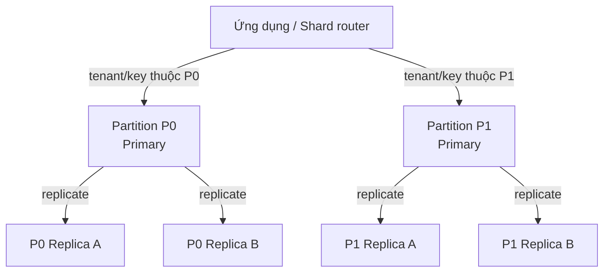
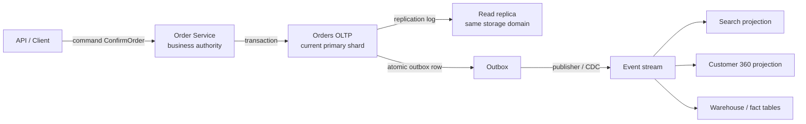

# Nhân bản dữ liệu và xác định nguồn chịu trách nhiệm

Một đơn hàng vừa được xác nhận trong hệ thống giao dịch, nhưng màn hình tìm kiếm vẫn hiển thị trạng thái “chờ xác nhận”. Một khách hàng đổi số điện thoại, nhưng hệ thống chăm sóc khách hàng vẫn đọc thông tin cũ. Một vùng máy chủ gặp sự cố, hệ thống chuyển sang replica, rồi phát hiện hai nơi đã chấp nhận những cập nhật khác nhau. Cả ba tình huống cùng đặt ra một câu hỏi cốt lõi: **bản dữ liệu nào có thẩm quyền quyết định sự thật, bản nào chỉ là bản sao, và khi các bản chưa đồng nhất thì hệ thống phải làm gì?**

Trong chương **Phân tán và phân vùng** của học phần **DATABASE_DATA_MODELING**, việc thiết kế dữ liệu không chỉ là chọn bảng, đỉnh/cạnh hay document. Cần xác định **định danh, khóa, ràng buộc, nơi được phép ghi, cách nhân bản, chính sách đọc và quy trình kiểm chứng**. Bài học này tập trung vào **nhân bản dữ liệu (replication)** và **xác định nguồn chịu trách nhiệm/nguồn có thẩm quyền (data ownership, authoritative source)**, đồng thời liên hệ với mô hình quan hệ, document, đồ thị và phân tích để thiết kế cấu trúc phù hợp với hệ thống thực.

Sau bài học, bạn có thể:

- Phân biệt **nguồn sự thật nghiệp vụ**, **primary/leader của một shard**, **read replica**, **cache** và **read model dẫn xuất**.
- Lập bảng sở hữu dữ liệu cho từng thực thể, thuộc tính, hành động ghi, chủ thể chịu trách nhiệm và đường cập nhật.
- So sánh **nhân bản đồng bộ, bất đồng bộ, logical replication, CDC, snapshot và materialized projection**.
- Hiểu hệ quả của **replication lag**, các mức nhất quán và sự khác nhau giữa **read-your-writes**, **eventual consistency** và **linearizable reads**.
- Thiết kế luồng **transactional outbox → sự kiện → projection** với **idempotency, versioning, tombstone và reconciliation**.
- Nhận diện rủi ro **split-brain, ghi nhầm replica, multi-writer conflict, failover không fencing**, sai tenant và xóa dữ liệu không lan truyền.
- Xác định kiểm thử, metric và quy trình vận hành khi dữ liệu đã được phân vùng và nhân bản.

## 1. Ba câu hỏi khác nhau thường bị nhập làm một

Trước khi thiết kế nhân bản, tách bạch ba loại trách nhiệm:

| Câu hỏi | Ý nghĩa | Ví dụ |
| --- | --- | --- |
| **Ai có quyền thay đổi sự thật nghiệp vụ?** | Chủ sở hữu dữ liệu (*business/data authority*) | `Order Service` duyệt thay đổi trạng thái đơn |
| **Node nào nhận ghi cho một bản lưu vật lý?** | Primary/leader của một shard hoặc nhóm replica | Node `db-order-shard-2-primary` nhận transaction |
| **Hệ thống nào có bản sao để phục vụ đọc?** | Read replica, cache, index, projection | Search index, Customer 360, warehouse |

Ba vai trò này có thể ở các tầng khác nhau:

- `Order Service` là **chủ sở hữu nghiệp vụ** của trạng thái đơn hàng.
- Sau failover, một node khác trở thành **primary vật lý** cho shard lưu đơn hàng.
- Search index có thể giữ **bản sao** trạng thái đơn; nó không được tự chấp nhận lệnh “xác nhận đơn” chỉ vì có cột `status` giống nguồn.

**Primary vật lý thay đổi không mặc nhiên chuyển quyền sở hữu nghiệp vụ.** Ngược lại, có nhiều nguồn dữ liệu được gọi là “master” không đủ để xác định chúng sở hữu những **field, command và phiên bản** nào.

### 1.1. Định nghĩa thực dụng về “nguồn sự thật”

Một **authoritative source** là nguồn mà chính sách hệ thống công nhận có thẩm quyền quyết định giá trị của một dữ kiện trong một phạm vi và thời điểm nhất định. Thông thường, đó là một hệ thống/giao diện ghi được bảo vệ bởi transaction và ràng buộc; không nhất thiết là một **máy chủ cụ thể**.

Ví dụ:

```text
Order.status, Order.lines     → Order Service / OLTP order store
Product.title, Product.sku    → Catalog Service
Stock.availableToPromise     → Inventory Service (theo quy tắc giữ chỗ)
Payment.settlementStatus     → nguồn thanh toán đã được xác minh
Customer.verifiedPhone       → hồ sơ khách được quản trị/kiểm chứng
BI.dailyRevenue              → phép tính dẫn xuất từ nguồn giao dịch
Search.orderDocument         → projection của dữ liệu đơn
```

Tên service chỉ là ví dụ phân quyền trách nhiệm. Trong thực tế, một dữ kiện có thể trải qua nhiều bước xác nhận: đối tác thanh toán là nguồn các **sự kiện settlement**, trong khi `Payment Service` chịu trách nhiệm **xác minh, ánh xạ và diễn giải trạng thái thanh toán nội bộ**. Cần ghi rõ quyền và nguồn chứng cứ ở từng giai đoạn, không mặc định mọi webhook bên ngoài là sự thật cuối cùng.

### 1.2. Nhân bản không tạo thêm quyền sở hữu

Từ một hàng `orders.status = 'CONFIRMED'`, hệ thống có thể tạo:

1. Bản cùng dữ liệu trên **physical read replica**.
2. Một document trong **search index**.
3. Một trường `lastOrderStatus` trong **Customer 360 projection**.
4. Dòng sự kiện/fact trong **data warehouse**.
5. Một bản trong **cache**.

Các nơi đó có thể đọc khác nhau tại một thời điểm do độ trễ hoặc lỗi đồng bộ. **Không dùng phép “đa số bản sao nói gì” để thay thế quy tắc nguồn nghiệp vụ**, trừ khi đang sử dụng một **giao thức đồng thuận/quorum được thiết kế cụ thể** trong cùng nhóm lưu trữ dữ liệu đó. Nhiều ứng dụng độc lập cùng giữ bản sao không tạo thành một hệ đồng thuận phân tán.

## 2. Replication và partitioning là hai trục thiết kế độc lập

**Partitioning/sharding** là chia tập dữ liệu thành nhiều phần theo khóa hoặc quy tắc phân vùng. **Replication** là giữ nhiều bản của một phần dữ liệu nhằm cải thiện sẵn sàng, khả năng đọc hoặc độ bền. Một hệ thống có thể áp dụng cả hai.



Ở đây:

- P0 và P1 giữ **những tập khóa khác nhau**.
- Mỗi partition có **nhiều bản sao**.
- Một lệnh ghi phải được định tuyến tới **đúng partition và node có quyền nhận ghi** theo giao thức hiện hành.
- Một bản sao của P0 **không thay thế được P1**, kể cả P0 có ba replica.
- Nếu primary P0 hỏng, một replica đủ điều kiện có thể được bầu/promote thành primary mới theo cơ chế failover; không thể suy ra rằng mọi replica đều có dữ liệu mới nhất.

### 2.1. Ví dụ phân vùng theo tenant hoặc khóa

| Chiến lược | Ví dụ | Rủi ro cần kiểm tra |
| --- | --- | --- |
| Theo `tenant_id` | Tất cả đơn một tenant vào cùng shard | Tenant rất lớn có thể làm shard nóng |
| Theo hash `(tenant_id, order_id)` | Phân tán đơn tương đối đều | Tìm mọi đơn của một tenant có thể phải fan-out |
| Theo thời gian | `order_date` chia theo tháng | Truy vấn một đơn theo ID có thể cần biết partition hoặc dùng index phụ |
| Theo vùng/địa lý | Tenant được đặt tại một vùng quy định | Di chuyển vùng và yêu cầu lưu trú dữ liệu phức tạp |
| Kết hợp | Tenant/region rồi theo khoảng thời gian | Định tuyến, rebalancing và khóa phân vùng khó hơn |

Chọn partition key từ **workload và quy tắc nhất quán**, không chỉ từ kích thước bảng. Nếu một lệnh cần cập nhật đơn, giữ chỗ tồn kho và ghi thanh toán ở **ba shard/service độc lập**, một transaction cục bộ trong `orders` không tự làm toàn bộ thao tác thành nguyên tử.

### 2.2. Các loại bản sao phục vụ mục đích khác nhau

| Loại bản sao | Dữ liệu giữ | Ai được ghi? | Đặc điểm |
| --- | --- | --- | --- |
| **Physical/storage replica** | Tương đương dữ liệu vật lý/log của một database | Theo giao thức primary/consensus | Có thể hỗ trợ HA, failover, đọc |
| **Logical replica** | Bảng/đối tượng hoặc thay đổi logic đã chọn | Thường từ nguồn publish; có ngoại lệ sản phẩm | Có thể khác schema/phiên bản |
| **Read replica** | Bản phục vụ truy vấn đọc | Thường không nhận ghi nghiệp vụ trực tiếp | Có thể trễ so với leader |
| **Cache** | Một phần dữ liệu thường đọc | Được điền/xóa theo chính sách | TTL/invalidation không bảo đảm luôn mới |
| **Search projection** | Document phục vụ tra cứu văn bản/lọc | Consumer cập nhật từ sự kiện nguồn | Có thể khác cấu trúc và trễ |
| **Analytical replica / warehouse** | Fact/dimension/rollup lịch sử | Pipeline ETL/ELT, không nhận command OLTP | Độ trễ, xử lý bổ sung, định nghĩa KPI riêng |

Một replica có thể chính xác về byte hoặc không. **Search projection** không phải là read replica vật lý: nó được **biến đổi theo schema riêng**, có thể bỏ field, tổng hợp dữ liệu hoặc cập nhật theo chính sách khác.

## 3. Các chiến lược nhân bản và đánh đổi

### 3.1. Nhân bản đồng bộ và bất đồng bộ

**Đồng bộ (synchronous replication)** nghĩa là đường ghi chờ một điều kiện xác nhận từ một số bản sao trước khi trả thành công. Điều kiện đó có thể là “đã nhận log”, “đã ghi bền vững” hoặc “đã áp dụng” tùy **sản phẩm và cấu hình**. Không được mặc định cứ nói “sync” là mọi replica đã có cùng trạng thái có thể đọc ngay.

**Bất đồng bộ (asynchronous replication)** cho phép nơi nhận ghi trả kết quả trước khi các replica khác nhận hoặc áp dụng thay đổi. Điều đó thường giảm độ trễ ghi, nhưng tạo **replication lag** và có nguy cơ mất những commit chưa được nhân bản khi primary hỏng trong một số cấu hình.

| Tiêu chí | Sync (theo chính sách ACK) | Async |
| --- | --- | --- |
| Độ trễ ghi | Có thể cao hơn do chờ replica | Thường thấp hơn |
| Khả năng ghi khi replica/mạng lỗi | Có thể bị hạn chế nếu không đủ xác nhận | Primary có thể tiếp tục trong một số kiến trúc |
| Đọc từ follower | Vẫn phải xem đã **apply** tới đâu | Có thể đọc giá trị cũ |
| Độ bền khi mất primary | Phụ thuộc ngưỡng ACK và failover an toàn | Commit chưa tới replica có nguy cơ mất |
| Vận hành | Quản lý quorum, timeout, topology | Quản lý lag, replay và rủi ro dữ liệu |

Độ bền không chỉ phụ thuộc vào nhãn “sync/async”. Cần xem **RPO**, cơ chế log, quorum, thời điểm ACK, bầu leader, vị trí dữ liệu và khả năng rebuild.

### 3.2. Single-leader, multi-leader và leaderless

**Single-leader:** một leader nhận ghi cho phạm vi dữ liệu; follower lấy thay đổi từ leader. Đây là mô hình thường gặp cho dữ liệu giao dịch có cập nhật nhiều lần.

**Multi-leader:** nhiều nơi có thể nhận ghi cho cùng tập dữ liệu và phải đồng bộ/giải quyết xung đột. Có thể phục vụ đa vùng hoặc ghi offline nhưng phức tạp với cập nhật cùng đối tượng.

**Leaderless/quorum-based:** không có một leader cố định theo mô hình hệ thống cụ thể; client hoặc coordinator ghi/đọc từ nhiều replica theo chính sách quorum. Các mức nhất quán phụ thuộc thuật toán, xử lý version, partition, hinted handoff và cấu hình thực tế.

**Không được đồng nhất “nhiều replica” với “có thể ghi ở bất kỳ replica nào”.** Cơ chế single-leader, multi-leader và leaderless có điều kiện an toàn khác nhau. Một hệ thống có quorum không mặc nhiên bảo đảm mọi trường hợp tuyến tính hóa nếu quorum, mạng và giao thức không đáp ứng các giả định cần thiết.

### 3.3. Khi nào chấp nhận ghi nhiều nơi?

Một danh mục nội dung cho phép chỉnh metadata theo từng vùng có thể có chính sách hợp nhất rõ ràng. Nhưng **số dư tiền, lượng tồn kho cần giữ chỗ, trạng thái thanh toán hoặc quyền truy cập nhạy cảm** thường khó giải quyết bằng cách “ai ghi cuối thắng” vì làm mất cập nhật hay vi phạm bất biến.

Ví dụ hai vùng cùng nhận hai lệnh giảm một đơn vị tồn từ 1:

```text
Inventory còn 1
Region A đọc 1, chấp nhận giữ chỗ 1
Region B cũng đọc 1, chấp nhận giữ chỗ 1
Hợp nhất cuối: có hai reservation hợp lệ nhưng chỉ một hàng
```

Không có chiến lược giải quyết conflict bằng timestamp đơn giản nào tự trả lời được “giữ chỗ nào phải bị từ chối”. Cần thiết kế **quyền ghi có thẩm quyền**, partition ownership, reservation protocol, transaction hay mô hình giới hạn quota theo vùng tùy bài toán.

## 4. Xác định chủ sở hữu theo thực thể, field và hành động

Một hệ thống lớn thường có nhiều service cùng nhìn thấy `Customer`, `Order`, `Product`, `Stock`. Đừng chỉ tuyên bố “database A là source of truth” cho toàn doanh nghiệp. Hãy lập **ownership matrix**.

### 4.1. Ví dụ bảng sở hữu dữ liệu

| Dữ kiện/command | Nguồn chịu trách nhiệm | Bản sao/consumer | Quy tắc thay đổi |
| --- | --- | --- | --- |
| `Order.lines`, `Order.status` | Order Service + order store | Search, warehouse, Customer 360 | Chỉ Order Service nhận command; phát sự kiện sau commit |
| `Product.title`, `Product.sku` | Catalog Service | Order snapshot, search, BI | Catalog sửa; đơn cũ giữ snapshot tên/giá nếu quy tắc đòi |
| `Inventory.availableToPromise` | Inventory Service | Product page, analytics | Reservation/stock phải theo logic kho, không sửa cache |
| `Payment.settlementState` nội bộ | Payment Service sau xác minh nguồn thanh toán | Order view, BI | Phân biệt webhook nhận được và kết quả đã xác thực |
| `Customer.verifiedPhone` | Customer Profile Service | CRM, support screen | Ghi qua quy trình xác minh, không chỉnh CRM copy độc lập |
| `Search.orderDocument` | Search projection consumer | Search UI | Chỉ consumer cập nhật theo log thay đổi nguồn |
| `BI.netRevenue` | Analytics pipeline/metric owner | Dashboard | Measure dẫn xuất từ sự kiện và chính sách doanh thu |

**Một field chỉ nên có một quyền ghi có thẩm quyền tại một thời điểm theo chính sách quản trị**, nhưng có thể có **nhiều bản sao phục vụ các truy vấn khác nhau**. Định nghĩa ownership gồm cả quyền phê duyệt thay đổi schema, định nghĩa trạng thái, xử lý lỗi đồng bộ và trách nhiệm đối soát.

### 4.2. “Chủ sở hữu dữ liệu” khác “đội vận hành máy chủ”

Đội nền tảng có thể vận hành database, backup và failover, nhưng không có quyền quyết định `Order.status = 'PAID'` về mặt nghiệp vụ. Đội nghiệp vụ có thể sở hữu quy trình xác nhận đơn, nhưng không tự thao tác thẳng vào replica phục vụ phân tích.

Nên xác định riêng:

- **Business owner:** định nghĩa và phê duyệt ý nghĩa dữ liệu.
- **Write/command owner:** giao diện ghi hợp lệ và luật chuyển trạng thái.
- **Storage operator:** vận hành primary, replica, backup, failover.
- **Data product/projection owner:** chịu trách nhiệm chất lượng bản dẫn xuất.
- **Consumer owner:** xác định yêu cầu độ mới, độ chính xác và xử lý trạng thái stale.

Khi có sự cố, việc phân vai này giúp biết **ai được phép sửa dữ liệu nguồn** và **ai chỉ được dựng lại projection**, tránh tình trạng nhiều đội cùng “chữa” bản sao rồi tạo xung đột.

### 4.3. Hợp đồng ownership nên có những trường nào?

```text
Data asset: Order
Authoritative writer: Order Service
Primary business key: (tenant_id, order_id)
Write API/commands: CreateOrder, ConfirmOrder, CancelOrder
Invariants: valid status transition, tenant isolation,
            item ownership, amount/currency semantics
Event envelope: event_id, aggregate_id, aggregate_version,
                event_type, occurred_at, schema_version
Downstream copies: SearchOrder, Customer360, WarehouseFact
Freshness objective: search lag target, BI batch SLA
Read-after-write requirement: order detail must reflect commit
Correction path: source command -> outbox -> consumers
Deletion/retention: tombstone or authorized purge with lineage
Operational contacts: owner, on-call, escalation
```

Cần phân biệt **sự kiện nguồn đã cam kết** với một thông báo chưa được kiểm chứng, và **tài liệu dẫn xuất** với bản cập nhật nghiệp vụ. Không có hợp đồng ownership, một nhóm có thể sửa trực tiếp search document vì “nhanh hơn”, khiến search khác bản ghi gốc và bị ghi đè lại ở lần đồng bộ sau.

## 5. Ví dụ xuyên suốt: đơn hàng được nhân bản tới search và analytics

Giả sử cửa hàng có:

- `Order Service` quản lý đơn trong relational OLTP, phân vùng theo tenant/shard.
- `Search Service` dùng document projection để tra cứu nhanh theo mã, tên khách hoặc trạng thái.
- `Analytics Service` tạo bảng fact/dimension phục vụ báo cáo.
- `Customer 360` giữ danh sách đơn gần đây trong một document tổng hợp.
- `Order Detail API` cần phản ánh thay đổi vừa được xác nhận, không chấp nhận đọc bản stale trong trải nghiệm người dùng đó.



**Nguồn nghiệp vụ:** `Order Service` cùng giao dịch OLTP. **Nguồn chứng cứ thay đổi:** commit và outbox cùng transaction. **Bản sao đọc:** read replica, search, Customer 360, warehouse.

Nếu `Search Service` trễ hai giây, không nên cho phép nó gửi một trạng thái cũ ngược về `Order Service` như thể đây là command mới. Projection được phép **xây dựng lại** từ nguồn, không được trở thành một chủ thể ghi đồng cấp vô tình.

### 5.1. Đặt grain và khóa cho bản gốc

Một hàng `orders` đại diện cho **một đơn nghiệp vụ** xác định bằng `(tenant_id, order_id)`. Nếu đơn có nhiều dòng, `order_lines` ở grain **một dòng hàng**, không được gộp cùng một bảng projection rồi đếm `COUNT(*)` là số đơn.

Ví dụ schema nguồn:

```sql
-- PostgreSQL, ví dụ nghiệp vụ đơn giản hóa.
CREATE TABLE orders (
    tenant_id VARCHAR(32) NOT NULL,
    order_id VARCHAR(40) NOT NULL,
    order_version BIGINT NOT NULL DEFAULT 1,
    status VARCHAR(24) NOT NULL,
    amount_minor BIGINT NOT NULL,
    currency_code CHAR(3) NOT NULL,
    updated_at TIMESTAMPTZ NOT NULL,
    PRIMARY KEY (tenant_id, order_id),
    CHECK (order_version > 0),
    CHECK (amount_minor >= 0),
    CHECK (status IN ('CREATED', 'CONFIRMED', 'CANCELLED'))
);

CREATE INDEX orders_tenant_status_idx
    ON orders (tenant_id, status, updated_at);
```

`amount_minor` chỉ có nghĩa khi `currency_code` và quy ước **đơn vị nhỏ nhất/scale** được xác định. Ví dụ VND có thể dùng đơn vị VND nguyên theo chính sách nguồn; không mặc định mọi currency có hai chữ số thập phân.

`order_version` là **phiên bản logic tăng đơn điệu của mỗi đơn** tại source. Cột này có ích cho bản sao dẫn xuất vì nó giúp xử lý sự kiện gửi trùng hoặc đến sai thứ tự. Nếu có migrate/reset version, phải có chiến lược **epoch/identity** và không được so sánh các version từ hai nguồn khác nhau như thể chung một trục.

### 5.2. Transactional outbox: commit dữ liệu và cam kết phát sự kiện

Nếu code cập nhật `orders` thành công rồi bị crash **trước khi publish event**, search có thể kẹt mãi ở trạng thái cũ. Nếu publish trước rồi transaction rollback, consumer lại nhận **sự kiện không có commit nguồn**.

**Transactional outbox pattern** ghi thay đổi nghiệp vụ và một bản ghi outbox **trong cùng transaction của database nguồn**. Publisher đọc outbox rồi gửi ra broker; việc gửi có thể lặp, vì vậy consumer phải idempotent.

Bảng outbox:

```sql
CREATE TABLE order_outbox (
    event_id UUID PRIMARY KEY,
    tenant_id VARCHAR(32) NOT NULL,
    aggregate_type VARCHAR(40) NOT NULL,
    aggregate_id VARCHAR(40) NOT NULL,
    aggregate_version BIGINT NOT NULL,
    event_type VARCHAR(80) NOT NULL,
    schema_version INTEGER NOT NULL,
    payload JSONB NOT NULL,
    occurred_at TIMESTAMPTZ NOT NULL,
    published_at TIMESTAMPTZ,
    UNIQUE (
        tenant_id, aggregate_type,
        aggregate_id, aggregate_version
    )
);

CREATE INDEX order_outbox_pending_idx
    ON order_outbox (occurred_at)
    WHERE published_at IS NULL;
```

Ví dụ transaction xác nhận đơn, sau khi API đã **xác thực quyền và điều kiện nghiệp vụ**:

```sql
BEGIN;

WITH changed AS (
    UPDATE orders
    SET
        status = 'CONFIRMED',
        order_version = order_version + 1,
        updated_at = CURRENT_TIMESTAMP
    WHERE tenant_id = :tenant_id
      AND order_id = :order_id
      AND status = 'CREATED'
    RETURNING
        tenant_id, order_id, order_version,
        status, amount_minor, currency_code, updated_at
)
INSERT INTO order_outbox (
    event_id, tenant_id, aggregate_type, aggregate_id,
    aggregate_version, event_type, schema_version,
    payload, occurred_at
)
SELECT
    :event_id,
    tenant_id, 'Order', order_id,
    order_version, 'OrderConfirmed', 1,
    jsonb_build_object(
        'orderId', order_id,
        'status', status,
        'amountMinor', amount_minor,
        'currencyCode', currency_code,
        'updatedAt', updated_at
    ),
    updated_at
FROM changed;

COMMIT;
```

Nếu `UPDATE` không đổi hàng nào (đơn không tồn tại, sai trạng thái, hoặc yêu cầu đã xử lý trước), `INSERT ... SELECT` cũng không có hàng. **Ứng dụng phải kiểm tra số hàng bị thay đổi**, phân biệt *already confirmed* với *not found* và *invalid transition*; không mặc định trả thành công chỉ vì câu lệnh SQL không báo lỗi.

Ví dụ chỉ minh họa **một transaction cục bộ**. Nó không tự bảo đảm dữ liệu đã tới broker, search hay warehouse tại lúc `COMMIT` thành công. Publisher cần retry; consumer phải chịu được event trùng. Nếu có nhiều worker publish, cần quy tắc **ordering theo từng aggregate** hoặc cơ chế version/gap handling phù hợp.

### 5.3. Hình dạng sự kiện cần đủ để kiểm soát bản sao

```json
{
  "eventId": "a5c3a2f1-1111-4f00-8c00-000000000041",
  "eventType": "OrderConfirmed",
  "schemaVersion": 1,
  "tenantId": "T-01",
  "aggregateType": "Order",
  "aggregateId": "O-101",
  "aggregateVersion": 41,
  "occurredAt": "2026-10-01T10:00:02Z",
  "data": {
    "orderId": "O-101",
    "status": "CONFIRMED",
    "amountMinor": 1250000,
    "currencyCode": "VND",
    "updatedAt": "2026-10-01T10:00:02Z"
  }
}
```

Đây là **một envelope minh họa**. Quy tắc contract cần nêu:

- `eventId` nhận diện **một lần phát biểu sự kiện**, giúp dedup và tracing.
- `tenantId` và `aggregateId` xác định phạm vi khóa.
- `aggregateVersion` là phiên bản thay đổi được cấp từ nguồn, giúp so mới/cũ.
- `schemaVersion` dùng cho thay đổi cấu trúc payload, **không phải phiên bản đơn hàng**.
- `occurredAt` là thời điểm nguồn ghi nhận nghiệp vụ; thời điểm consumer nhận có thể khác.
- `data` là **trạng thái snapshot** hoặc **delta event**, cần khai báo rõ.

**Cực kỳ quan trọng:** event `OrderConfirmed` bên trên chứa một phần trạng thái nguồn có ý nghĩa. Nếu consumer có khả năng bỏ qua phiên bản cũ và nhảy tới phiên bản mới, payload phải **đủ dữ liệu để dựng lại những field được projection quản lý**. Nếu chỉ phát delta kiểu “cộng thêm 10” mà bỏ version 40, nhận thẳng version 41 có thể làm mất cập nhật. Với delta, thường cần xử lý **chuỗi liên tục, phát hiện gap và replay/snapshot recovery**.

## 6. Consumer nhận event lặp và sai thứ tự

Broker, mạng và retry có thể khiến cùng event được giao nhiều lần hoặc event mới đến trước event cũ. Một projection bền vững nên có cách phân biệt **phiên bản nguồn** thay vì dùng `received_at` của consumer để quyết định sự thật.

### 6.1. Timeline minh họa

| Thời điểm | Nguồn | Event/replica | Điều cần hiểu |
| --- | --- | --- | --- |
| 10:00:00 | O-101 version 40, `CREATED` | Search version 40 | Đồng nhất |
| 10:00:02 | Source commit version 41, `CONFIRMED` | Outbox v41 | Nguồn đã thay đổi |
| 10:00:02.2 | Source v41 | Search vẫn v40 | **Stale read**, không phải nguồn rollback |
| 10:00:03 | Source v41 | Search áp dụng v41 | Bắt kịp |
| 10:00:04 | Source v41 | Broker gửi lại v41 | Consumer phải bỏ qua duplicate |
| 10:00:05 | Source v41 | Một event v39 tới muộn | Consumer không được ghi đè v41 bằng v39 |

Với data model này, **search nhận ghi từ consumer** nhưng quyền quyết định trạng thái vẫn ở Order Service. Nếu một user mở màn hình đơn ngay sau khi xác nhận, ứng dụng có thể đọc trực tiếp source hoặc chờ projection đã đạt ít nhất version 41, thay vì đọc search v40 rồi hiển thị “chưa xác nhận” như sự thật cuối.

### 6.2. Bảng projection có version nguồn

```sql
CREATE TABLE order_search_projection (
    tenant_id VARCHAR(32) NOT NULL,
    order_id VARCHAR(40) NOT NULL,
    source_version BIGINT NOT NULL,
    status VARCHAR(24) NOT NULL,
    amount_minor BIGINT NOT NULL,
    currency_code CHAR(3) NOT NULL,
    source_updated_at TIMESTAMPTZ NOT NULL,
    projected_at TIMESTAMPTZ NOT NULL,
    is_deleted BOOLEAN NOT NULL DEFAULT FALSE,
    PRIMARY KEY (tenant_id, order_id)
);
```

Projection dùng cùng **business key `(tenant_id, order_id)`**, còn `source_version` thể hiện trạng thái mới nhất đã áp dụng tại bản sao. Nó **không được tự phát minh** một phiên bản nguồn khi chỉ sửa mapping hay index.

### 6.3. Upsert chỉ áp dụng phiên bản mới hơn

Ví dụ PostgreSQL, giả định payload chứa **toàn bộ trạng thái cần thiết** cho projection và consumer đã xác thực nguồn sự kiện:

```sql
INSERT INTO order_search_projection (
    tenant_id, order_id, source_version,
    status, amount_minor, currency_code,
    source_updated_at, projected_at, is_deleted
)
VALUES (
    :tenant_id, :order_id, :source_version,
    :status, :amount_minor, :currency_code,
    :source_updated_at, CURRENT_TIMESTAMP, FALSE
)
ON CONFLICT (tenant_id, order_id) DO UPDATE SET
    source_version = EXCLUDED.source_version,
    status = EXCLUDED.status,
    amount_minor = EXCLUDED.amount_minor,
    currency_code = EXCLUDED.currency_code,
    source_updated_at = EXCLUDED.source_updated_at,
    projected_at = EXCLUDED.projected_at,
    is_deleted = EXCLUDED.is_deleted
WHERE order_search_projection.source_version <
      EXCLUDED.source_version;
```

Lợi ích:

- Nhận lại **version 41**: không thay đổi projection.
- Nhận **version 39** sau version 41: không rollback.
- Nhận version 42 mới hơn: cập nhật nếu payload là **snapshot đầy đủ** theo contract.
- Khóa chính giữ một row projection cho mỗi đơn trong tenant.

**Giới hạn quan trọng:** query trên **không bảo đảm không mất version giữa chừng**. Nó phù hợp để cập nhật trạng thái hiện tại từ **full-state event**; nếu consumer cần tính số tiền tích lũy từ delta, phải kiểm tra `expected_next_version = applied_version + 1` và replay/gap recovery. Nếu có hai event khác nội dung nhưng cùng version do nguồn lỗi, upsert bỏ bản đến sau; cần cảnh báo **conflicting duplicate**, không lặng lẽ chấp nhận.

### 6.4. “Exactly once” không được suy ra từ công cụ

Trong một pipeline thực tế có những điểm có thể retry:

```text
source commit → outbox poll → broker publish
→ consumer receive → projection write → broker ack
```

Một crash sau projection write nhưng trước ack khiến broker gửi lại event. **Idempotent consumer** cho phép replay mà không nhân kết quả. Transactional outbox giải quyết **dual write với database nguồn**, không tự biến toàn bộ pipeline thành “end-to-end exactly once”.

Ngay cả khi broker hỗ trợ exactly-once trong một phạm vi nhất định, nghiệp vụ phải xác định **phạm vi transaction** (broker stream hay cả database ngoài), idempotency key, retention và cách replay. Với dữ kiện tiền, tồn kho, số lượng, không bao giờ chỉ `amount = amount + delta` mỗi lần nhận event khi chưa có cơ chế chống cộng hai lần.

## 7. Độ mới và mức nhất quán quyết định đường đọc

### 7.1. Những mức bảo đảm thường gặp

| Thuộc tính nhất quán | Ý nghĩa thực dụng | Ví dụ yêu cầu |
| --- | --- | --- |
| **Eventual consistency** | Nếu không còn cập nhật và hệ khỏe, replica/projection cuối cùng hội tụ | Danh sách sản phẩm tìm kiếm có thể trễ ngắn |
| **Read-your-writes** | Sau lệnh ghi thành công, cùng phiên đọc thấy ít nhất cập nhật của mình | Trang chi tiết đơn vừa xác nhận |
| **Monotonic reads** | Phiên đọc không thấy phiên bản cũ hơn phiên bản đã thấy trước đó | Không quay từ `CONFIRMED` về `CREATED` khi đổi replica |
| **Bounded staleness** | Đọc có giới hạn độ cũ đã định nếu hệ có cơ chế bảo đảm/đo | Dashboard cho phép trễ tối đa 30 giây |
| **Linearizable read** | Đọc phản ánh thứ tự thực của các thao tác thành công theo giao thức | Kiểm tra quyền/tồn kho nhạy cảm, khi hệ hỗ trợ |
| **Snapshot consistency** | Các giá trị đọc thuộc một snapshot nhất quán | Báo cáo không trộn các phiên bản tại những thời điểm khác nhau |

Các bảo đảm này **không tự sinh ra** khi chọn tên sản phẩm database. Phải kiểm tra cấu hình read preference, leader/quorum, session token, transaction/snapshot và cách failover. **“Đọc primary”** cũng không giải quyết mọi vấn đề nếu request đi sai shard, failover chưa hoàn tất hoặc ứng dụng sử dụng cache cũ.

### 7.2. Chọn đường đọc theo mục đích

| Truy vấn | Đề xuất thiết kế | Tại sao |
| --- | --- | --- |
| Chi tiết đơn ngay sau ConfirmOrder | Source/primary hoặc projection đã đạt version trả về | Cần read-your-writes |
| Tìm kiếm đơn theo từ khóa | Search projection với chỉ báo độ mới | Có thể chấp nhận eventual consistency |
| Báo cáo doanh thu ngày | Warehouse với watermark/kỳ chốt | Độ trễ có chủ đích, đo chất lượng dữ liệu |
| Tra cứu catalog công khai | Cache/read replica trong freshness SLO | Ưu tiên tốc độ, có TTL/invalidation |
| Xác nhận số lượng còn bán để giữ chỗ | Inventory Service có quyền ghi và ràng buộc | Không được quyết định từ cache tồn kho trễ |
| Kiểm tra quyền truy cập nhạy cảm | Policy decision point với dữ liệu đủ mới/đáng tin | Quyền bị thu hồi không được tiếp tục chỉ vì replica cũ |

Một hệ thống có thể hiển thị **“đang đồng bộ”** khi chỉ có bản đọc cũ, hoặc điều hướng tới source cho những thao tác có tính nhân quả, thay vì trả giá trị stale như không có vấn đề.

### 7.3. Dùng source version để đạt read-your-writes

Ví dụ sau lệnh cập nhật, API trả:

```json
{
  "orderId": "O-101",
  "status": "CONFIRMED",
  "sourceVersion": 41
}
```

Ở lượt đọc tiếp theo, ứng dụng có thể:

1. Đọc source có bảo đảm phù hợp.
2. Hoặc yêu cầu projection đạt `source_version >= 41` rồi mới dùng giá trị đó.
3. Nếu quá thời hạn chờ, **fallback** sang source hoặc thông báo “chưa đồng bộ”, theo hợp đồng trải nghiệm.

**Không biến polling vô hạn thành điều kiện hoàn tất.** Nếu projection bị lỗi hoặc một version không được xử lý, phải có timeout, circuit breaker và kênh sửa dữ liệu. Nếu version được tạo riêng cho từng aggregate, **chỉ so version trong đúng `(tenant_id, order_id)`**, không lấy version 41 của đơn này so với version 41 của đơn khác.

### 7.4. Replication lag không chỉ là một số giây

Có thể đo các khía cạnh khác nhau:

- **Transport lag:** log/event đã gửi tới replica/broker chưa?
- **Apply lag:** replica/consumer đã áp dụng thay đổi tới đâu?
- **Projection lag:** projection đã cập nhật phiên bản nào?
- **Wall-clock freshness:** thời gian kể từ nguồn cập nhật đến lúc bản sao áp dụng.
- **Backlog:** bao nhiêu log/event chưa xử lý.
- **Per-aggregate version gap:** một đơn đã tới version 41 trong source, projection còn 39.

Clock skew khiến phép trừ timestamp từ hai máy có thể sai. Khi cần bảo đảm phiên bản, ưu tiên **log position/offset/source version hoặc snapshot watermark** kết hợp các metric thời gian đã đồng bộ.

## 8. Failover: ai là primary và làm sao tránh hai nơi cùng ghi?

### 8.1. Sự cố cơ bản

```text
t0: Primary A nhận ghi cho shard P0
t1: Mạng chia cắt; B không liên lạc được với A
t2: Hệ quản lý promote B thành primary mới
t3: A vẫn sống và nghĩ mình là primary
t4: Hai client gửi ghi tới A và B
```

Nếu không có cơ chế ngăn stale primary, xuất hiện **split-brain**: hai nơi cùng chấp nhận ghi cho cùng phạm vi dữ liệu, dẫn tới khác biệt trạng thái và khó hội tụ đúng.

### 8.2. Leader election chưa đủ nếu thiếu fencing

Các hệ thống thường dùng kết hợp:

- **Term/epoch/lease:** mỗi nhiệm kỳ primary mang định danh thế hệ mới.
- **Quorum/consensus:** chỉ một bên đáp ứng điều kiện nhận ghi theo giao thức được thiết kế.
- **Fencing token:** thao tác từ primary cũ với epoch thấp bị từ chối ở tài nguyên nhận ghi.
- **Routing update:** client/router ngừng gửi lệnh đến node cũ.
- **Promotion/replay:** replica mới bắt kịp tới mốc log/commit phù hợp trước khi phục vụ theo yêu cầu.
- **Operational procedure:** xác nhận primary cũ không còn được ghi, đối chiếu RPO/RTO và khôi phục các request không rõ kết quả.

Đặc biệt, **chỉ dùng timeout để suy ra node A chết không đủ**: A có thể còn sống nhưng bị tách mạng. Một giao thức failover đúng phải bảo đảm an toàn khi có partition, thay vì chỉ cố tăng tính sẵn sàng bằng cách cho mọi phía nhận ghi.

### 8.3. RPO và RTO khác nhau

- **RPO (Recovery Point Objective):** mức dữ liệu có thể mất tối đa theo mục tiêu khôi phục, ví dụ số giây thay đổi chưa được nhân bản.
- **RTO (Recovery Time Objective):** thời gian mục tiêu để khôi phục dịch vụ.

RPO bằng 0 là một mục tiêu nghiêm ngặt, không tự đạt được chỉ vì có hai replica. RTO thấp cũng không chứng minh đã bảo toàn mọi ghi. Cần đánh giá **thời điểm ACK, quorum, log durability, đường promotion, backup và thử failover**.

## 9. Conflict trong nhiều nguồn ghi

### 9.1. LWW có thể làm mất thông tin

Trong **last-write-wins (LWW)**, hệ thống chọn một giá trị theo timestamp/ordering. Ví dụ:

```text
A ghi Customer.email = "a@example.org" ở vùng 1
B ghi Customer.email = "b@example.org" ở vùng 2
Hợp nhất theo timestamp: chọn B, mất giá trị của A
```

Điều này có thể chấp nhận nếu nghiệp vụ cho phép **ghi đè** và có audit, nhưng không có nghĩa B thật sự là thay đổi “đúng hơn”. Nếu đồng hồ hai vùng lệch, “ghi cuối” theo timestamp còn có thể khác thứ tự người dùng thực hiện.

Đối với **số dư, điểm thưởng, tồn kho, quyền và trạng thái thanh toán**, LWW thường không đủ để bảo toàn bất biến. Một phép merge tự động phải được chứng minh phù hợp với **phép toán nghiệp vụ**, không chỉ với kiểu dữ liệu.

### 9.2. Khi nào có thể hợp nhất dữ liệu?

Một số loại dữ liệu có phép hợp nhất có tính chất phù hợp:

- **Set các tag đã duyệt**, nếu chính sách định nghĩa rõ thêm/xóa và xung đột.
- **Counter dạng CRDT** cho phép hợp nhất số tăng từ nhiều nguồn trong một số bài toán; cần quản lý duplicate identity và cách dùng đúng.
- **Bản nháp ngoại tuyến** có thể yêu cầu người dùng giải quyết conflict thay vì tự merge.
- **Metadata phân biệt theo field owner**: hai đội sửa hai trường không chồng nhau, nếu schema và quy tắc cho phép.

Không suy ra “CRDT giải quyết mọi xung đột”: CRDT có mô hình dữ liệu, thao tác và điều kiện hội tụ riêng; không tự bảo vệ giao dịch thanh toán hoặc mọi constraint xuyên đối tượng.

### 9.3. Cách giảm xung đột từ khâu mô hình

Nếu mỗi `Order` có một nguồn ghi có thẩm quyền, các consumer chỉ cập nhật projection, ta loại bỏ hẳn một nhóm xung đột multi-writer. Khi cần ghi đa vùng, có thể xem xét:

- **Partition ownership/affinity** theo tenant hoặc aggregate, mỗi khóa có một chủ ghi tại một thời điểm.
- **Command forwarding** từ các vùng tới owner.
- **Reservation/escrow** phân bổ quota theo vùng với quy tắc tổng không vượt nguồn.
- **Conflict detection + manual resolution** cho dữ liệu thích hợp.
- **Version precondition (optimistic concurrency)**: command chỉ áp dụng nếu nguồn vẫn ở version đã kỳ vọng.

Lựa chọn phụ thuộc loại dữ liệu, độ trễ chấp nhận được và bất biến bắt buộc. Không dùng một thuật toán conflict chung cho mọi aggregate.

## 10. Xóa, chỉnh sửa hồi tố và bảo mật bản sao

### 10.1. Xóa nguồn phải lan truyền tới bản sao

Nếu một khách yêu cầu xóa hoặc hạn chế dữ liệu theo chính sách áp dụng, không thể chỉ xóa hàng trong OLTP trong khi cache, search và warehouse vẫn giữ các trường cá nhân không còn được phép lưu.

Cần lập **copy inventory**:

```text
Customer Profile:
  source: customers
  replicas: read replicas
  projections: CRM, Customer360, Search
  analytics: customer dimension / events
  caches: profile cache
  archives/backups: theo retention và quy định áp dụng
```

Chiến lược có thể gồm **delete event/tombstone**, invalidation cache, xử lý trong analytical datasets và quy trình đối với backup theo policy pháp lý/bảo mật. Những nơi có nghĩa vụ lưu giao dịch hoặc audit có thể dùng **ẩn danh/hạn chế truy cập**, không tùy tiện xóa dữ liệu có nghĩa vụ bảo toàn.

### 10.2. Tombstone nên mang version

Nếu xóa O-101 và gửi một event “deleted” nhưng consumer chỉ xóa row projection, một **event cũ đến muộn** có thể tạo lại O-101. Cách xử lý thường dùng:

```text
OrderDeleted {
  tenant_id = T-01
  order_id = O-101
  source_version = 52
}
```

Projection giữ **tombstone với version 52** để từ chối các sự kiện version 51 hoặc cũ hơn. Tombstone có thể là `is_deleted = true` kèm version trong bảng projection, hoặc cấu trúc riêng tùy hệ. Chỉ được dọn tombstone khi có **chính sách retention, watermark và bảo đảm replay**; xóa quá sớm có thể làm bản ghi cũ “sống lại”.

### 10.3. Field-level ownership và hạn chế lan truyền PII

Search index có thể chỉ cần `customerId` và `orderStatus`, không cần số điện thoại đã xác minh, địa chỉ chi tiết hay thông tin thanh toán. **Nhân bản không có nghĩa phải copy tất cả field**.

Một hợp đồng projection nên nêu:

- Danh sách field được phép nhận, nguồn và mục đích.
- Quy tắc masking/tokenization/encryption nếu cần.
- Tenant và scope được phép đọc.
- Retention và thời hạn cập nhật/xóa.
- Cách audit truy cập và tác nhân có thể sửa projection.

Chỉ định source of truth không đủ cho bảo mật nếu consumer có thể lấy dữ liệu của tenant khác hoặc phát tán bản sao sang nơi không có quyền truy cập phù hợp.

## 11. Theo dõi tính đúng đắn và độ tươi của bản sao

### 11.1. Những metric nên có

| Metric | Ý nghĩa | Dấu hiệu cần điều tra |
| --- | --- | --- |
| `outbox_unpublished_count` | Số event chưa publish | Liên tục tăng |
| `outbox_oldest_age` | Tuổi event pending lâu nhất | Vượt mục tiêu freshness |
| `consumer_lag_offsets` | Consumer cách head bao nhiêu offset | Backlog tăng nhanh |
| `projection_apply_lag` | Thời gian từ commit nguồn tới apply | Vượt SLO truy vấn |
| `projection_version_gap` | Chênh giữa version nguồn và projection theo aggregate | Có aggregate bị kẹt |
| `duplicate_event_count` | Event retry/trùng được phát hiện | Tăng bất thường hoặc consumer không idempotent |
| `out_of_order_count` | Event version cũ hơn hiện trạng | Ordering/broker/rewind bất thường |
| `dead_letter_count` | Event không xử lý được | Có schema hoặc dữ liệu lỗi |
| `reconciliation_mismatch_count` | Số aggregate khác nguồn sau đối soát | Có drift/copy thiếu |
| `cross_tenant_violation_count` | Liên kết dữ liệu ngoài tenant | Rủi ro bảo mật nghiêm trọng |
| `replica_failover_count` | Số lần chuyển primary | Đánh giá ổn định và root cause |

Độ trễ cần đo theo **SLO cụ thể**: search có thể cho phép trễ 10 giây, warehouse 15 phút; kiểm tra quyền truy cập có thể yêu cầu độ mới mạnh hơn nhiều. Không có một con số lag “ổn” cho mọi dữ kiện.

### 11.2. Reconciliation không nên chỉ dựa vào COUNT

Kiểm tra số hàng nguồn và projection bằng nhau **chưa đủ**: có thể cùng số lượng nhưng khác trạng thái, tiền hoặc tenant. Đối soát nên xét:

- Tập khóa `(tenant_id, order_id)` và trạng thái tồn tại/xóa.
- `source_version` lớn nhất đã áp dụng.
- Những field quan trọng: `status`, `amount_minor`, `currency_code`.
- Checksum theo **schema và thứ tự chuẩn hóa** hoặc so từng trường có ý nghĩa.
- Độ trễ từ snapshot nguồn tới lúc so, tránh đánh dấu chênh lệch tạm thời là lỗi lâu dài.
- Số dữ kiện chưa được chuyển đổi hoặc không đủ quyền lưu trữ tại projection.

Nếu event stream giữ log trong thời gian hữu hạn, consumer bị dừng quá lâu có thể **không còn đủ event để replay**. Cần chiến lược **backfill/rebuild từ snapshot source** và nối tiếp log mà không bỏ sót/đếm trùng thay đổi ở ranh giới snapshot.

### 11.3. Một cơ chế kiểm tra nguồn và projection

Ví dụ SQL đối soát trong môi trường có thể truy cập hai bảng để minh họa:

```sql
SELECT
    s.tenant_id,
    s.order_id,
    s.order_version AS source_version,
    p.source_version AS projection_version,
    s.status AS source_status,
    p.status AS projection_status
FROM orders AS s
LEFT JOIN order_search_projection AS p
  ON p.tenant_id = s.tenant_id
 AND p.order_id = s.order_id
WHERE s.tenant_id = :tenant_id
  AND (
    p.order_id IS NULL
    OR p.source_version < s.order_version
    OR (
      p.source_version = s.order_version
      AND p.status IS DISTINCT FROM s.status
    )
  );
```

Trong thực tế, nguồn và projection thường ở **hai hệ lưu trữ khác nhau**, không thể JOIN trực tiếp như trên. Khi đó một job reconciliation có thể xuất **snapshot/manifest có watermark** về cùng nơi kiểm tra hoặc gọi API đối chiếu. Phải phân biệt **replication lag trong SLO** với **drift dài hạn** và không mặc định mọi chênh lệch tức thời là lỗi dữ liệu.

## 12. Dữ liệu nhân bản ảnh hưởng tới thiết kế relational, document, graph và analytical

### 12.1. Relational/OLTP

Quan hệ khóa ngoại, transaction, uniqueness constraint và kiểm soát version giúp bảo đảm bất biến cục bộ. Một order row với `PRIMARY KEY (tenant_id, order_id)` cùng outbox trong transaction là một điểm khởi đầu tốt. Nhưng **foreign key ở source không được tự sao chép thành tính nhất quán xuyên nhiều database**; consumer phải xử lý ordering, missing reference, schema evolution và validation.

### 12.2. Document/read model

Một document phục vụ màn hình có thể chứa `Order`, tên khách và một số dòng hàng trong cùng object. Điều đó giúp đọc nhanh, nhưng **dữ liệu khách trong document là bản sao**. Nếu số điện thoại/tên khách đổi, cần biết field nào **nằm dưới owner nào** và cập nhật đúng projection; một event Order không nhất thiết mang mọi cập nhật Customer.

Có thể dùng hai stream (Order + Customer) hoặc cơ chế rebuild; khi kết hợp cần thiết kế **version theo từng nguồn**, tránh so `Customer.version = 5` với `Order.version = 41` như cùng một chuỗi.

### 12.3. Property graph

Một graph có thể chứa đỉnh `Customer`, `Order`, `Device` và cạnh `PLACED`, `USED_DEVICE`. Nó hữu ích để truy vấn quan hệ nhiều bước, nhưng nếu graph được dựng từ OLTP events, **nó là projection**. Trước khi đưa kết luận gian lận hay quyền truy cập, phải xem độ mới, nguồn, bằng chứng và phạm vi các cạnh.

Nếu một đơn bị xóa hoặc sửa người đặt, không được chỉ thêm cạnh mới rồi giữ cạnh cũ vô thời hạn; cần có quy tắc **thay thế/xóa cạnh dẫn xuất**, event identity và version.

### 12.4. Analytical warehouse

Fact/dimension thường được nạp qua CDC/ETL; một fact có thể phản ánh **trạng thái nguồn theo thời điểm chốt**, không phải trạng thái giao dịch đang thay đổi trong từng mili-giây. Cần:

- **Grain rõ** cho fact, ví dụ một dòng đơn hoặc một payment.
- **Source IDs** để truy ngược sự kiện.
- **As-of/watermark** để nói dataset phản ánh dữ liệu tới lúc nào.
- Chính sách SCD và điều chỉnh hồi tố cho dimension/fact.
- Metric contract và đối soát tiền, currency, quantity.

Không dùng mỗi bản sao warehouse để ra quyết định giữ chỗ tồn kho tức thời, trừ khi hệ được thiết kế đặc biệt cho bảo đảm đó.

### 12.5. Bảng so sánh vai trò

| Hệ lưu | Sở hữu command? | Truy vấn trọng tâm | Rủi ro khi hiểu sai |
| --- | --- | --- | --- |
| Order OLTP | Có, với Order | Giao dịch và bất biến | Ghi vòng qua API hoặc sai shard |
| Read replica OLTP | Theo giao thức replication, thường read-only | Đọc phân tải | Đọc stale sau ghi |
| Search index | Không; nhận dữ liệu từ projection consumer | Tìm kiếm, lọc | Search sai trạng thái, phản hồi stale |
| Customer 360 document | Không sở hữu tất cả field được gom | Một màn hình tổng hợp | Field của nhiều owner lệch phiên bản |
| Graph projection | Thường không, nếu dựng từ nguồn | Duyệt quan hệ | Cạnh cũ tạo liên kết giả |
| Analytics warehouse | Thường không, đối với giao dịch nguồn | KPI, lịch sử, BI | Sai grain, thời gian và lịch sử |
| Cache | Không | Đọc nhanh | TTL chưa hết dù nguồn đã thu hồi |

## 13. Quy trình thiết kế từng bước

### Bước 1 — Viết ownership matrix trước khi copy dữ liệu

Liệt kê từng domain, field quan trọng, command ghi hợp lệ và owner. Phân biệt bản **canonical** với **derived**. Nếu có hai nơi cùng nhận ghi cho một field, hãy viết rõ **quy tắc conflict** hoặc thay thiết kế thành một owner.

### Bước 2 — Chọn khóa toàn hệ và khóa phân vùng

Ví dụ `(tenant_id, order_id)` để định danh đơn trong miền nghiệp vụ. Cần giữ đúng khóa ở source, message, cache, search và warehouse. Chọn partition key từ workload, locality, tenant isolation và nhu cầu giao dịch. Cần strategy khi chuyển shard/rebalance và routing version.

### Bước 3 — Xác định mô hình nhân bản và nguồn nhận ACK

Chọn primary–follower, synchronous/asynchronous, CDC/logical stream hay mô hình khác dựa trên SLO/RPO/RTO và chi phí. Ghi cụ thể điều kiện write ACK, read preference, cơ chế failover và fencing. Đừng giả định cấu hình mặc định của một hệ sẽ luôn đáp ứng yêu cầu.

### Bước 4 — Định nghĩa event contract và projection grain

Mỗi event cần ID, aggregate key, version, schema version, payload semantics và timestamp. Mỗi projection cần biết một hàng đại diện cho cái gì, field từ owner nào, quy tắc update/delete và tính mới. Với full-state và delta event, chiến lược xử lý gap khác nhau.

### Bước 5 — Thiết kế consumer idempotent và thứ tự

Xử lý retry, duplicate, out-of-order, schema evolution, error queue và rebuild. Với projection current-state, chỉ áp dụng version mới hơn; với delta, cần chuỗi liên tục và dedup theo event. Nếu một aggregate có nhiều nguồn ảnh hưởng, **không dùng một scalar version chung** khi thực tế mỗi owner có timeline riêng.

### Bước 6 — Xác định chính sách đọc theo độ mới

Phân loại từng API: chấp nhận stale hay cần read-your-writes, monotonic, bounded staleness hoặc bảo đảm mạnh hơn. Trả phiên bản nguồn từ command nếu cần. Với nguồn có tính bảo mật/tài chính, không dùng eventual replica làm điểm quyết định cuối nếu chính sách yêu cầu trạng thái mới hơn.

### Bước 7 — Chuẩn bị failover, tombstone và đối soát

Thử primary mất kết nối, promote follower, stale leader, lag lớn, event gửi lại, event cũ đến sau delete, backfill sau retention. Thiết kế fencing, rollback/reconcile và cách khôi phục những request có kết quả không rõ.

### Bước 8 — Đo trên workload thực tế

Thử số partition, độ lệch tenant/shard, tốc độ ghi, số consumer, độ trễ mạng/vùng, dung lượng log, thời gian catch-up, rebuild và chi phí. Đo **p95/p99 freshness**, không chỉ trung bình, và phân biệt độ trễ ứng dụng với độ trễ nhân bản.

## 14. Các tình huống biên phải kiểm thử

| Tình huống | Hành vi đúng cần thiết kế |
| --- | --- |
| Publisher crash sau commit source | Outbox còn, được publish lại an toàn |
| Consumer crash sau ghi projection nhưng trước ACK | Replay không nhân bản/trừ tiền hai lần |
| Event v41 đến trước v40 | Projection current-state không bị rollback; delta phát hiện gap |
| Event v41 gửi hai lần | Version/event ID được kiểm tra; không tạo hai hiệu ứng |
| Search còn v40 ngay sau source v41 | Read-your-writes dùng source hoặc chờ tới v41, không đánh lừa người dùng |
| Follower chưa apply commit mới | Không gán kết quả stale là trạng thái mới nhất |
| Failover khi mạng chia cắt | Stale primary bị fencing; không nhận ghi hai nơi |
| Shard migration | Router theo ownership/routing epoch; không ghi nhầm shard |
| Order xóa v52, sau đó event v50 tới muộn | Tombstone v52 ngăn resurrect |
| Customer sửa field ở source khác với Order | Mỗi field/projection có owner/version riêng |
| Consumer bỏ lỡ log quá thời hạn retention | Rebuild từ snapshot có watermark và catch-up đúng ranh giới |
| Cache chưa hết TTL sau khi quyền bị thu hồi | Không dùng cache stale để cho phép hành động nhạy cảm |
| Cùng `order_id` ở hai tenant | Không bao giờ gộp hoặc cập nhật nhầm |
| Warehouse có cùng count nhưng tiền khác | Reconciliation kiểm tra cả giá trị, currency, version và grain |

## 15. Những sai lầm phổ biến

1. **Gọi mọi bản sao là source of truth.** Có dữ liệu không đồng nghĩa có quyền sửa nghiệp vụ.
2. **Nhầm primary vật lý với chủ sở hữu domain.** Failover đổi node không tự đổi logic nghiệp vụ.
3. **Cho search index sửa trạng thái đơn rồi đẩy ngược về source.** Tạo vòng đồng bộ và xung đột không có quy tắc.
4. **Tin rằng có ba replica thì an toàn trước mọi mất dữ liệu.** Cần xem ACK, quorum, log durability và failover.
5. **Đọc follower ngay sau ghi rồi kết luận transaction rollback.** Có thể chỉ là replication lag.
6. **Nhân bản bất đồng bộ nhưng không đo lag.** Consumer có thể kẹt vô hạn mà UI không biết.
7. **Cập nhật DB rồi publish event ngoài transaction và coi đó là nguyên tử.** Có dual-write failure window.
8. **Tin outbox tạo exactly-once end-to-end.** Publisher và consumer vẫn có thể retry.
9. **Dùng `occurred_at` hoặc `received_at` để quyết định event mới nhất khi đồng hồ khác nhau.** Nên có thứ tự/phiên bản nguồn phù hợp.
10. **Bỏ qua event cũ mà không kiểm tra gap ở payload delta.** Có thể mất thay đổi tích lũy.
11. **Dùng LWW cho stock hoặc số dư.** Có thể làm mất cập nhật và vi phạm bất biến.
12. **Promote replica mà không fencing primary cũ.** Có thể split-brain.
13. **Xóa projection row nhưng không giữ tombstone/version.** Event cũ có thể phục hồi bản ghi đã xóa.
14. **Chỉ so số row để đối soát.** Có thể bằng số lượng nhưng khác trạng thái, tiền hoặc danh tính.
15. **Dùng version chung giữa hai aggregate hoặc hai owner độc lập.** Không có quan hệ thứ tự cần thiết.
16. **Quên tenant trong key/event/consumer.** Dễ trộn đơn và rò rỉ dữ liệu nhiều tenant.
17. **Đánh giá mọi bản copy theo cùng freshness SLO.** Search, BI, quyền và tồn kho có yêu cầu rất khác nhau.
18. **Không có cơ chế rebuild sau log retention.** Consumer chậm lâu có thể không còn đủ event để bắt kịp.
19. **Nhân bản toàn bộ PII sang mọi nơi.** Tăng rủi ro bảo mật và khó quản lý xóa dữ liệu.
20. **Tối ưu replication trước khi làm rõ source owner và query contract.** Tạo nhiều bản dữ liệu nhưng không biết bản nào đúng.

## 16. Bài tập thực hành và gợi ý đáp án

### Bài tập 1 — Ai là nguồn chịu trách nhiệm?

Order Service lưu `Order.status`, Search lưu `orderDocument.status` và warehouse lưu `fact_order_status`. Nhân viên muốn sửa trạng thái đơn bị sai.

**Yêu cầu:** sửa ở đâu để không bị projection ghi đè? Ai chịu trách nhiệm kiểm tra?

**Gợi ý:** sửa qua **command hợp lệ của Order Service/source OLTP**, sau khi xác minh điều kiện nghiệp vụ. Search và warehouse cập nhật từ sự kiện/snapshot nguồn. Data owner quyết định nghĩa trạng thái; đội projection chịu trách nhiệm bắt kịp và đối soát.

### Bài tập 2 — Primary và replica có cùng quyền không?

Shard P0 có primary A và followers B/C. Ứng dụng ghi vào A thành công rồi đọc B thấy giá trị cũ.

**Yêu cầu:** có chắc transaction bị rollback? Có được tự ghi vào B để “sửa” không?

**Gợi ý:** **không**. B có thể chưa apply log. Không ghi trực tiếp follower nếu hệ dùng single-leader. Để có read-your-writes, đọc từ đường có bảo đảm mạnh hơn hoặc chờ B đạt version/log position tương ứng.

### Bài tập 3 — Event bị phát lại

Source order version 41 có trạng thái `CONFIRMED`. Consumer đã áp dụng v41, nhưng broker gửi lại chính event v41 ba lần.

**Yêu cầu:** projection nên ra sao? Nếu event v39 tới sau đó thì sao?

**Gợi ý:** projection vẫn **v41, CONFIRMED**; duplicate và old event không thay đổi trạng thái. Idempotency dựa trên aggregate key/version hoặc event ID theo contract. Nếu consumer làm **side effect khác** như gửi email, cần idempotency riêng cho side effect, không chỉ upsert bảng projection.

### Bài tập 4 — Full-state và delta event

Consumer hiện giữ `count = 10` ở version 5. Nó nhận sự kiện `v7: +3` nhưng chưa thấy `v6: +2`.

**Yêu cầu:** được cập nhật thành 13 ngay không? Nếu v7 là snapshot `count = 15` thì khác gì?

**Gợi ý:** Với **delta**, bỏ v6 sẽ mất tăng 2; cần gap detection, replay hoặc snapshot để đạt đúng **15**. Với **snapshot đầy đủ v7**, consumer có thể đặt trạng thái **15** và loại event cũ nếu contract và quy tắc version bảo đảm nó đầy đủ.

### Bài tập 5 — Transactional outbox

Ứng dụng cập nhật đơn rồi gửi sự kiện ra broker bằng hai thao tác độc lập. Nó crash sau khi commit đơn nhưng trước khi gửi event.

**Yêu cầu:** lỗi nào xảy ra? Outbox giúp ở đâu, còn điều gì chưa được giải quyết?

**Gợi ý:** Search/warehouse không nhận thông báo và có thể stale kéo dài. Outbox ghi thay đổi và bản ghi event trong **một transaction source**, giúp publisher retry. Nhưng broker vẫn có thể gửi trùng và consumer phải idempotent; outbox không tự là “exactly once” toàn hệ thống.

### Bài tập 6 — Failover và split-brain

A là primary, mạng chia cắt khiến quản lý promote B. A vẫn phục vụ lệnh ghi của một nhóm client.

**Yêu cầu:** nguy cơ là gì? Cơ chế nào phải có?

**Gợi ý:** **split-brain**. Dùng leader term/epoch, quorum/consensus hoặc fencing token phù hợp, cập nhật router và bảo đảm stale primary bị từ chối ghi; không chỉ dựa vào timeout hay tên “primary” trong cấu hình cũ.

### Bài tập 7 — RPO/RTO

Một cấu hình trả ACK ngay khi primary ghi log, async replica có thể trễ 5 giây. Primary mất toàn bộ dữ liệu trước khi log mới kịp sang replica.

**Yêu cầu:** có bảo đảm không mất commit vừa ACK không? RPO và RTO phản ánh điều gì?

**Gợi ý:** không có bảo đảm như vậy chỉ từ async replication. RPO là mức mất dữ liệu chấp nhận theo mục tiêu, RTO là thời gian phục hồi mục tiêu. Cần xác minh ACK durability, replication policy và quy trình failover để đánh giá.

### Bài tập 8 — Xóa và sự kiện đến muộn

Source gửi `OrderDeleted v52`, consumer xóa document, rồi nhận `OrderUpdated v51`.

**Yêu cầu:** làm sao tránh tạo lại tài liệu đã xóa?

**Gợi ý:** giữ **tombstone kèm source_version 52**, từ chối v51; chỉ dọn tombstone khi quy tắc retention/replay cho phép. Nếu chỉ xóa row không lưu version, event cũ có thể resurrect dữ liệu.

### Bài tập 9 — Nhiều tenant và shard

Hai tenant T-01 và T-02 cùng có đơn `O-101`. Search projection dùng khóa duy nhất `order_id`.

**Yêu cầu:** điều gì có thể xảy ra? Sửa cấu trúc nào?

**Gợi ý:** hai đơn bị ghi đè/gộp sai; tạo khóa **`(tenant_id, order_id)`** xuyên source, message, projection và query. Partition router cũng phải xét phạm vi tenant, và backend phải kiểm soát quyền truy cập.

### Bài tập 10 — Ba hệ cùng biết tên khách

Customer Service sở hữu `Customer.verifiedName`. Order Service giữ snapshot tên lúc đặt, Search hiển thị tên hiện tại, warehouse cần cả “tên lúc giao dịch” và “tên hiện hành”.

**Yêu cầu:** đây có phải ba nguồn sự thật mâu thuẫn không? Thiết kế thế nào?

**Gợi ý:** không nhất thiết. **Tên đã xác minh hiện tại** do Customer Service sở hữu; **tên snapshot lúc đặt** là dữ liệu lịch sử của sự kiện Order; **BI hiện tại/lịch sử** là hai ngữ nghĩa phân tích khác nhau. Cần lưu rõ timestamp/owner, phiên bản dimension hoặc snapshot và hợp đồng xử lý thay đổi. Không đồng bộ đè tên lúc đặt bằng tên hiện tại nếu yêu cầu truy vết lịch sử.

### Bài tập 11 — Chính sách đọc cho hai tính năng

Sau khi đổi trạng thái đơn, trang chi tiết phải hiển thị kết quả ngay. Trang tìm kiếm chấp nhận trễ tối đa 10 giây.

**Yêu cầu:** có cần buộc mọi truy vấn đọc primary không?

**Gợi ý:** không. Trang chi tiết dùng **source/read-your-writes**, hoặc projection đã bắt kịp version. Search có thể dùng async projection và theo dõi lag với SLO 10 giây. Mức nhất quán phải được thiết kế **theo truy vấn**, không áp một mức cho tất cả.

### Bài tập 12 — Đối soát có watermark

Source có 10.000 đơn, search cũng có 10.000 documents nhưng 20 trạng thái và 5 số tiền không trùng.

**Yêu cầu:** phép kiểm tra COUNT đã đủ chưa? Đối soát thế nào?

**Gợi ý:** chưa đủ. Đối chiếu khóa, tenant, version, status, amount/currency và delete marker trên **snapshot/watermark xác định**. Chỉ phân loại mismatch là drift khi đã xét độ trễ trong SLO; sự khác biệt có thể yêu cầu replay/rebuild hoặc điều tra sự kiện nguồn.

## Tổng kết

**Nhân bản dữ liệu** tạo thêm bản phục vụ độ bền, sẵn sàng, tốc độ đọc hoặc phân tích; nó **không tự tạo thêm nguồn có thẩm quyền sửa sự thật nghiệp vụ**. Trong thiết kế phân tán, cần xác định **owner theo thực thể/field/command**, **primary vật lý cho từng partition**, **khóa và phạm vi tenant**, **mức nhất quán theo truy vấn**, cùng **cơ chế cập nhật projection có version/idempotency**. Replication đồng bộ/bất đồng bộ, outbox, CDC, failover/fencing và tombstone đều có giới hạn cần mô tả rõ. Một mô hình dữ liệu đáng tin không chỉ bảo đảm có nhiều bản sao, mà còn trả lời được: **ai được ghi, bản sao mới tới đâu, vì sao khác nguồn, và hệ thống sẽ đối soát hoặc khôi phục thế nào khi có lỗi**.
