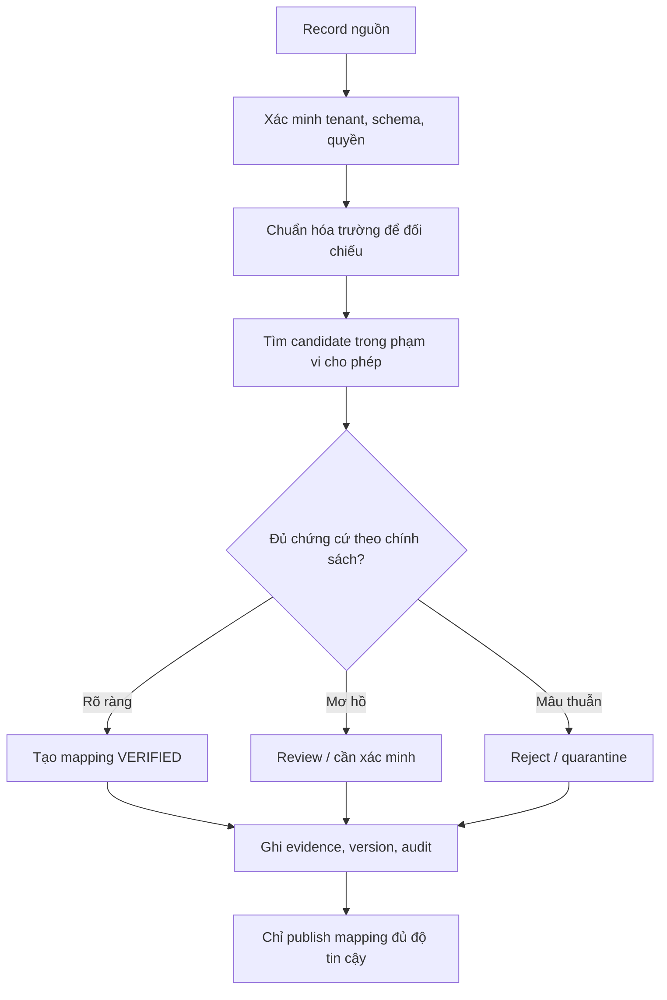
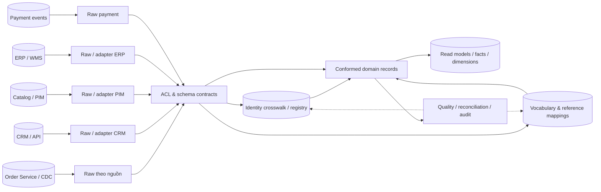

# Đối chiếu định danh, thuật ngữ và dữ liệu danh mục giữa các nguồn

## Mục tiêu học tập

Sau bài học, bạn có thể:

- Phân biệt **định danh tại nguồn**, **định danh chuẩn**, **khóa nghiệp vụ**, **khóa thay thế**, **mã danh mục** và **tên hiển thị**; biết vì sao hai ID giống nhau chưa chắc là một thực thể.
- Xây dựng bảng **đối chiếu định danh (identity crosswalk)** có không gian tên, phạm vi tenant, nguồn gốc, phiên bản và thời gian hiệu lực.
- Giải thích sự khác nhau giữa **cùng thực thể**, **cùng thuật ngữ** và **cùng ngữ nghĩa**; nhận diện khi nào một ánh xạ 1–1 là sai.
- Thiết kế **từ điển dữ liệu**, **bộ mã chuẩn**, **anti-corruption layer** và quy tắc ánh xạ trạng thái nghiệp vụ giữa các bounded context.
- Đối chiếu **danh mục sản phẩm, vùng địa lý, đơn vị đo, tiền tệ và phân cấp phân loại** với nguồn quản lý có thẩm quyền.
- Xử lý đối tượng trùng, thay định danh, nhập/tách thực thể, phân loại theo nhiều danh mục, lịch sử hiệu lực và dữ liệu đến muộn.
- Phân biệt **master data**, **reference data**, **transaction data** và **read model**, xác định chủ sở hữu của từng trường.
- Đề xuất cơ chế đồng bộ, đối soát và kiểm thử để việc tích hợp nhiều nguồn không làm mất dữ liệu, nhân bản KPI hoặc hợp nhất nhầm dữ liệu cá nhân.

Trong **DATABASE_DATA_MODELING**, chúng ta rèn kỹ năng biến yêu cầu nghiệp vụ thành thực thể, quan hệ, ràng buộc, chuẩn hóa, khóa, chỉ mục và lược đồ vật lý có thể kiểm chứng. Chương **Ranh giới và tích hợp** bổ sung một lớp câu hỏi: khi mỗi hệ thống tự có mô hình dữ liệu đúng với nghiệp vụ của nó, **làm sao kết nối chúng mà không đánh mất định danh, ngữ nghĩa và lịch sử?**

Một bảng join chạy được về mặt cú pháp chưa chắc nối đúng đối tượng. Một cột cùng tên `status` chưa chắc có cùng ý nghĩa. Một mã danh mục `CAT01` có thể chỉ là “Gia dụng” ở một nguồn nhưng là “Chăm sóc nhà cửa” ở nguồn khác hoặc ở phiên bản phân loại mới. Tích hợp đáng tin cậy cần **hợp đồng ý nghĩa**, không chỉ đổi tên trường.

---

## 1. Bối cảnh: năm nguồn cùng nói về một giao dịch bán hàng

Giả sử một nền tảng bán hàng tích hợp các hệ:

| Hệ nguồn | Chức năng | Định danh và trường điển hình |
| --- | --- | --- |
| **Order Service** | Tạo và quản lý đơn | `shopId`, `orderId`, `customerId`, `orderStatus` |
| **CRM** | Hồ sơ, liên hệ và quan hệ khách | `contactId`, `accountId`, email, số điện thoại |
| **Catalog/PIM** | SKU, biến thể, thương hiệu và danh mục | `productId`, `variantId`, `sellerSku`, `categoryCode` |
| **ERP/WMS** | Mã hàng kho, tồn và đơn vị đóng gói | `itemCode`, `warehouseId`, `unitCode` |
| **Payment Service** | Giao dịch thu/hoàn tiền | `paymentId`, `providerTxnId`, `paymentStatus`, `amountMinor` |

Ví dụ dữ liệu:

```text
Order Service:
  orderId=ord_908, customerId=user_42, sku=A17,
  status=COMPLETED, quantity=2

CRM:
  contactId=c-0199, accountId=acc_77, email=an@example.test

Catalog:
  variantId=var_813, sellerSku=A17,
  categoryCode=HOME_02

ERP:
  itemCode=000A17, unitCode=BOX, packSize=6

Payment:
  paymentId=pay_510, providerTxnId=tr_991,
  status=CAPTURED
```

Nhìn qua, ta có thể muốn join `customerId` với `contactId`, `sku` với `itemCode` và kết luận `COMPLETED` = `CAPTURED`. Cả ba phép suy luận đều cần **quy tắc xác minh**:

- Một khách trong Order có thể liên kết nhiều contact CRM hoặc một contact đại diện nhiều tài khoản tùy nghiệp vụ.
- `A17` có thể là SKU của **shop 17**, không phải SKU duy nhất trên toàn nền tảng; ERP có thể đóng gói hàng thành hộp 6 chiếc.
- Đơn `COMPLETED` là trạng thái quy trình đặt/giao; thanh toán `CAPTURED` là trạng thái tiền đã thu theo nguồn thanh toán. Hai trạng thái có thể xảy ra khác thời điểm và không suy ra lẫn nhau.

### 1.1. Ba bài toán tích hợp cần xử lý riêng

| Bài toán | Câu hỏi | Kết quả mong muốn |
| --- | --- | --- |
| **Đối chiếu định danh** | “`user_42` và `c-0199` có phải cùng một người/liên hệ?” | Quan hệ crosswalk có nguồn chứng cứ và phạm vi |
| **Đối chiếu thuật ngữ** | “`COMPLETED` của Order có nghĩa như `CAPTURED` của Payment không?” | Từ điển nghiệp vụ và ánh xạ trạng thái theo ngữ cảnh |
| **Đối chiếu danh mục** | “`HOME_02` của PIM thuộc nhóm báo cáo nào tại thời điểm bán?” | Taxonomy chuẩn, mapping version và hiệu lực |

Ba bài toán này liên quan nhưng **không thể giải bằng một bảng mapping chung chỉ gồm `source_code` và `target_code`**.

## 2. Không gian tên: ID chỉ có nghĩa trong phạm vi được cấp

Một định danh không đứng một mình. Trong nhiều hệ, **khóa thực tế** gồm nguồn phát sinh, loại đối tượng, phạm vi tenant và giá trị ID.

Ví dụ:

```text
("order-service", "shop_17", "CUSTOMER", "42")
("crm",           "global",  "CONTACT",  "42")
("catalog",       "shop_17", "SELLER_SKU", "A17")
("catalog",       "shop_18", "SELLER_SKU", "A17")
```

Hai chuỗi `42` không nhất thiết cùng người; hai chuỗi `A17` có thể là hai sản phẩm khác nhau ở hai shop.

### 2.1. Những loại khóa thường gặp

| Loại khóa | Ý nghĩa | Cần chú ý |
| --- | --- | --- |
| **Source ID/external ID** | ID do hệ nguồn cấp | Không tự duy nhất qua mọi nguồn/tenant |
| **Business/natural key** | Thuộc tính được nghiệp vụ coi là định danh | Có thể đổi hoặc bị tái sử dụng tùy chính sách |
| **Canonical ID** | Định danh nội bộ thống nhất cho thực thể được đối chiếu | Cần registry, quy tắc merge/split và governance |
| **Surrogate key** | Khóa kỹ thuật của bảng/dimension/version | Không mặc nhiên là cùng định danh giữa hệ |
| **Composite key** | Nhiều thành phần tạo phạm vi duy nhất | Ví dụ `(shopId, orderId)` |
| **Event ID** | Một thay đổi/sự kiện đã phát | Khác ID thực thể; có nhiều event cho một order |
| **Locator/route key** | Cho biết bản ghi nằm ở shard/partition nào | Không nên thành business ID bất biến |
| **Category code** | Mã của một giá trị trong bộ danh mục | Cần taxonomy và phiên bản; không phải ID sản phẩm |

**Quy tắc thiết kế:** trước khi join hai trường ID, hỏi “**do ai cấp, duy nhất trong phạm vi nào, có thể đổi/tái dùng không, và có ý nghĩa gì?**”.

### 2.2. Không dùng email hoặc số điện thoại làm khóa hợp nhất mặc định

Email có thể đổi, được chia sẻ giữa nhiều người hoặc được tái cấp. Số điện thoại có thể thuộc tổng đài doanh nghiệp, được chuyển chủ hoặc nhập sai. Những thuộc tính này có thể là **tín hiệu đối chiếu có kiểm soát**, không phải bằng chứng chắc chắn rằng hai hồ sơ phải được gộp.

Đối chiếu sai khách hàng gây rủi ro nghiêm trọng hơn một báo cáo lệch số: đơn hàng, địa chỉ và dữ liệu nhạy cảm của người này có thể bị hiển thị cho người khác.

### 2.3. ID ổn định và chu kỳ tồn tại

Nếu ERP tái dùng `itemCode=000A17` sau khi ngừng một sản phẩm cũ, `(source, itemCode)` không còn xác định duy nhất một thực thể **qua toàn bộ thời gian**. Có thể cần:

- Epoch hoặc mã phiên bản phát hành định danh của nguồn.
- Khoảng hiệu lực `valid_from`–`valid_to`.
- Trạng thái retire/reassign có lịch sử và dấu vết phê duyệt.
- Ràng buộc không cho một ID nguồn ánh xạ sang hai canonical ID **cùng hiệu lực** nếu nghiệp vụ yêu cầu đơn trị.

Không thay đổi canonical ID của mọi giao dịch lịch sử chỉ vì một ID nguồn được tái cấp sau đó.

## 3. Bảng đối chiếu định danh (identity crosswalk)

Một **crosswalk** lưu quan hệ giữa định danh tại nguồn và định danh chuẩn, hoặc giữa hai không gian tên có xác minh. Đó là dữ liệu nghiệp vụ của lớp tích hợp, **không phải một phép replace string**.

Ví dụ ánh xạ:

| source_system | source_tenant | entity_type | source_id | canonical_id | Cách xác minh |
| --- | --- | --- | --- | --- | --- |
| order | shop_17 | CUSTOMER | user_42 | cust_880 | Account link đã xác thực |
| crm | global | CONTACT | c-0199 | cust_880 | Liên kết do chủ hồ sơ xác nhận |
| catalog | shop_17 | PRODUCT_VARIANT | var_813 | prodvar_240 | Mapping từ PIM |
| erp | wh_3 | STOCK_ITEM | 000A17 | stockitem_710 | Mapping quản lý kho |

**Không tự suy ra** `prodvar_240 = stockitem_710`. Một product variant bán lẻ có thể tương ứng một hay nhiều stock items, kit hoặc quy cách đóng gói. Nếu cần quan hệ giữa chúng, mô hình hóa **quan hệ chuyển đổi**, không cưỡng ép dùng cùng canonical ID.

### 3.1. Trường crosswalk cần lưu

| Trường | Vì sao cần |
| --- | --- |
| `source_system` | Tên nguồn cấp ID |
| `source_tenant_scope` | Phạm vi tenant/đơn vị của nguồn |
| `entity_type` | CUSTOMER, CONTACT, PRODUCT_VARIANT, STOCK_ITEM... |
| `source_id` | Giá trị ID từ nguồn, giữ nguyên dạng đã chuẩn về encoding |
| `canonical_id` | ID của thực thể chuẩn trong **đúng loại** |
| `valid_from`, `valid_to` | Khoảng hiệu lực theo thời gian nghiệp vụ, nếu mapping biến đổi |
| `mapping_status` | VERIFIED, PROVISIONAL, REJECTED, RETIRED... |
| `match_method` | SYSTEM_LINK, SOURCE_ASSERTION, MANUAL, RULE, MODEL |
| `decision_id` / `evidence_ref` | Dấu vết có phân quyền về quyết định đối chiếu |
| `mapping_version` / `recorded_at` | Hỗ trợ đồng bộ, thay đổi và audit |
| `owner` | Ai được quyền sửa/gỡ ánh xạ |

Có thể dùng nguyên tắc khoảng **`[valid_from, valid_to)`**: bao gồm thời điểm đầu, không gồm thời điểm cuối. Với mapping đang hiệu lực, `valid_to` có thể là NULL. Cần kiểm tra **không giao nhau** của các khoảng trên cùng khóa nguồn khi nghiệp vụ yêu cầu một mapping hoạt động tại một thời điểm.

### 3.2. Ví dụ SQL cho một bảng mapping

DDL mang tính minh họa kiểu PostgreSQL; tùy engine, constraint và kiểu thời gian phải thay đổi. `source_tenant_scope` được làm **NOT NULL**, dùng một giá trị quy ước như `GLOBAL` để tránh vấn đề tính duy nhất của NULL.

```sql
CREATE TABLE identity_crosswalk (
    mapping_id           BIGINT GENERATED ALWAYS AS IDENTITY PRIMARY KEY,
    source_system        VARCHAR(80) NOT NULL,
    source_tenant_scope  VARCHAR(80) NOT NULL,
    entity_type          VARCHAR(60) NOT NULL,
    source_id            VARCHAR(180) NOT NULL,
    canonical_id         VARCHAR(180) NOT NULL,

    valid_from           TIMESTAMPTZ NOT NULL,
    valid_to             TIMESTAMPTZ NULL,
    mapping_status       VARCHAR(24) NOT NULL,
    match_method         VARCHAR(40) NOT NULL,
    decision_id          VARCHAR(100),
    mapping_version      BIGINT NOT NULL,

    CHECK (valid_to IS NULL OR valid_to > valid_from),
    UNIQUE (
        source_system, source_tenant_scope, entity_type,
        source_id, valid_from
    )
);
```

Ràng buộc `UNIQUE(..., valid_from)` **chưa cấm được hai khoảng hiệu lực chồng nhau**. Nếu hệ hỗ trợ exclusion constraint/range types, có thể bổ sung; nếu không, phải có thao tác điều phối, transaction và kiểm thử ngăn overlap. Nếu một nguồn được phép định danh lại đối tượng qua epoch, thêm `identity_epoch` vào mô hình thay vì thay canonical ID tùy tiện.

**Quan trọng:** đây là bảng **ánh xạ của các loại đối tượng tương thích**, không phải giấy phép gộp CONTACT với CUSTOMER hoặc STOCK_ITEM với PRODUCT_VARIANT thành một thực thể khi chưa có định nghĩa quan hệ rõ.

### 3.3. Quy tắc lookup tại một thời điểm

```sql
-- Tìm canonical customer của source ID tại thời điểm sự kiện.
SELECT canonical_id
FROM identity_crosswalk
WHERE source_system = 'order'
  AND source_tenant_scope = 'shop_17'
  AND entity_type = 'CUSTOMER'
  AND source_id = 'user_42'
  AND mapping_status = 'VERIFIED'
  AND valid_from <= :event_time
  AND (valid_to IS NULL OR :event_time < valid_to);
```

Query này **phải trả tối đa một hàng** theo hợp đồng. Nếu trả 0: thiếu mapping hoặc chưa duyệt. Nếu trả hơn 1: lỗi chất lượng/overlap cần cách ly; không chọn “hàng đầu tiên” bằng `LIMIT 1` để che lỗi.

Truy vấn thực tế còn cần chính sách “ngữ nghĩa mapping theo event time hay theo thời điểm đã được ghi nhận (system time)”; nếu mapping được sửa hồi tố, kết quả truy vấn lịch sử có thể thay đổi và cần version báo cáo.

## 4. Cùng một thực thể chưa chắc có quan hệ 1–1 giữa hai hệ

Các quan hệ thường phức tạp hơn một cặp mã:

| Trường hợp | Ví dụ | Mô hình phù hợp |
| --- | --- | --- |
| 1–1 đã xác minh | Order user ID ↔ canonical account | Crosswalk đơn trị theo thời gian |
| N–1 | Hai tài khoản nguồn đã được gộp thành một canonical customer | Nhiều source IDs cùng trỏ một canonical ID, có quyết định merge |
| 1–N theo nghiệp vụ | Một CRM account có nhiều contact | Bảng quan hệ ACCOUNT–CONTACT, không ép mỗi contact là cùng một người |
| N–M | Một kit bán hàng gồm nhiều stock items; một stock item thuộc nhiều kit | Bridge có số lượng/quy tắc hiệu lực |
| 1–N theo thời gian | ERP tái dùng itemCode cho sản phẩm khác ở thời kỳ sau | Crosswalk có khoảng hiệu lực hoặc epoch |
| Chưa rõ | Hai bản ghi giống tên nhưng khác ngày sinh/địa chỉ | Provisional + manual review hoặc từ chối gộp |

**Lỗi thường gặp:** đặt cột `canonical_id` vào bảng nguồn rồi giả định mọi quan hệ đều đơn trị và vĩnh viễn. Khi một khách hợp nhất hai tài khoản, một SKU được tái sử dụng hoặc một kit tách linh kiện, mô hình không còn biểu đạt đúng nghiệp vụ.

### 4.1. Hợp nhất (merge) và tách (split)

Giả sử `cust_880` và `cust_991` được xác định là cùng chủ thể theo quy trình được phép. Hệ thống cần quyết định:

- ID nào trở thành ID đại diện? Có giữ **alias/redirect** từ ID cũ không?
- Các đơn lịch sử sẽ tham chiếu ID cũ hay được remap theo chính sách?
- Các metric “số khách duy nhất” trong báo cáo đã chốt có được tính lại không?
- Quá trình merge có ảnh hưởng quyền truy cập dữ liệu hoặc sở hữu tài khoản không?
- Làm sao rollback khi kết luận merge sai?

Ngược lại, khi phát hiện **gộp nhầm hai người**, phải có quy trình **split** và khôi phục quan hệ chính xác, bao gồm các read model/search/export đã nhận ID gộp. Đây không chỉ là một `UPDATE` của crosswalk.

### 4.2. Phân biệt định danh với quan hệ

Một `CRM account` có thể đại diện doanh nghiệp, một `contact` đại diện cá nhân liên hệ và một `customer` trong order service đại diện đối tượng mua/được lập hóa đơn. Cần mô hình các quan hệ như:

```text
CRM Account acc_77
    ├── HAS_CONTACT -> c-0199
    └── HAS_CONTACT -> c-0215

Order Customer user_42
    └── BILL_TO_ACCOUNT -> acc_77

Canonical Person cust_880
    └── VERIFIED_CONTACT -> c-0199
```

Không suy ra `acc_77`, `c-0199` và `user_42` đều là “cùng một thực thể”. Chúng có thể liên quan qua **các loại cạnh khác nhau**.

## 5. Quy trình so khớp định danh: xác định, gợi ý, phê duyệt

Không phải nguồn nào cũng có sẵn foreign key hoặc mapping đáng tin. Khi đó cần một quy trình **entity resolution**.

### 5.1. Mức độ bằng chứng

1. **Liên kết xác thực từ nguồn có thẩm quyền:** người dùng thực hiện account linking, nguồn cung cấp định danh đã được ký/xác minh hoặc hợp đồng có khóa ngoại tin cậy.
2. **Khóa đối chiếu bền vững được quản lý:** ví dụ một mã doanh nghiệp đã được kiểm tra theo phạm vi và thời hạn hợp lệ.
3. **Quy tắc xác định có kiểm chứng:** kết hợp các thuộc tính được chuẩn hóa và điều kiện nghiệp vụ, với tỷ lệ sai đã đo.
4. **So khớp xác suất:** mô hình dự đoán/điểm tương đồng dựa trên nhiều tín hiệu, cần ngưỡng và cơ chế giải trình.
5. **Xác minh thủ công:** xử lý trường hợp mơ hồ, mâu thuẫn hoặc có rủi ro cao.

**Không dùng tên, email, số điện thoại hay địa chỉ như sự thật tuyệt đối** nếu ràng buộc nghiệp vụ chưa bảo đảm duy nhất.

### 5.2. Pipeline so khớp có kiểm soát



Đối với dữ liệu cá nhân, việc so khớp giữa tenant/nguồn phải có cơ sở sử dụng hợp lệ, phạm vi quyền và nguyên tắc tối thiểu hóa dữ liệu. Không gom mọi email của khách nhiều tổ chức thành một kho identity công khai để “match nhanh”.

### 5.3. Ngưỡng match không có giá trị phổ quát

Ví dụ một mô hình trả `score=0.93`. Điều này **không tự có nghĩa xác suất đúng là 93%** nếu điểm số chưa được hiệu chuẩn và kiểm chứng. Phải đo false match, missed match, phân bố theo nhóm dữ liệu và chi phí hậu quả.

| Lỗi | Hậu quả | Biện pháp |
| --- | --- | --- |
| **False positive**: gộp hai đối tượng khác nhau | Rò dữ liệu, sai quyền, sai báo cáo | Ưu tiên precision, review và split/rollback |
| **False negative**: bỏ sót hai ID cùng đối tượng | Đếm trùng, thiếu thông tin hợp nhất | Theo dõi unresolved, cải thiện candidate và mapping |
| **Đối chiếu sai thời điểm** | Gắn ID cũ sau khi nguồn tái dùng | Mapping theo hiệu lực/epoch |
| **Đối chiếu không đúng loại thực thể** | Nhầm contact với account, SKU với stock item | Định nghĩa entity type và relationship type |

Trong bối cảnh cấp quyền hoặc tài chính, false positive có thể nguy hiểm hơn việc tạm giữ đối tượng ở trạng thái chưa được đối chiếu.

## 6. Thuật ngữ: một từ giống nhau chưa có nghĩa giống nhau

Trong bounded context, mỗi dịch vụ có thể sử dụng một ngôn ngữ đúng với trách nhiệm của nó.

Ví dụ:

```text
Order context:     status = COMPLETED
Payment context:   status = CAPTURED
Fulfillment:       status = DELIVERED
Accounting:        posting_status = POSTED
```

Các trạng thái này **không tương đương**:

- `COMPLETED`: quy trình đơn đã đạt mốc kết thúc **theo định nghĩa Order**.
- `CAPTURED`: yêu cầu thu tiền đã được hệ thanh toán ghi nhận **theo định nghĩa Payment**.
- `DELIVERED`: việc giao hàng đã được xác nhận **theo định nghĩa Fulfillment**.
- `POSTED`: bút toán được ghi vào sổ **theo định nghĩa Accounting**.

Một đơn có thể thanh toán thành công nhưng chưa giao; một đơn giao thành công có thể đang chờ đối soát tiền; một khoản thanh toán bị hoàn một phần sau khi đơn hoàn tất.

### 6.1. Bảng từ điển nghiệp vụ

| Thuật ngữ chuẩn | Định nghĩa và phạm vi | Nguồn có thẩm quyền | Không được suy ra |
| --- | --- | --- | --- |
| `order_created` | Lệnh tạo đơn hợp lệ đã commit | Order Service | Tiền đã thu |
| `order_completed` | Đơn đạt trạng thái hoàn tất theo workflow được định nghĩa | Order Service | Đã ghi doanh thu kế toán |
| `payment_captured` | Giao dịch tiền được thu theo hợp đồng gateway | Payment Service | Hàng đã giao |
| `shipment_delivered` | Kiện được xác nhận giao thành công | Fulfillment/WMS | Toàn đơn đã được giao nếu nhiều kiện |
| `stock_reserved` | Số lượng được giữ tại nguồn tồn kho | Inventory Service | Tiền đã thu |
| `accounting_posted` | Ghi nhận sổ cái đã hoàn tất | Accounting/ERP | Các trạng thái tác nghiệp tương đương |

Một **data dictionary** nên ghi: thuật ngữ, định nghĩa, đơn vị đo, phạm vi, owner, điều kiện, trạng thái loại trừ, ví dụ, phiên bản và đường dẫn chứng cứ. Từ điển không chỉ là tập các cột với kiểu `VARCHAR`.

### 6.2. Không ép nhiều state machine thành một enum

Một cách sai:

```text
global_status = {
  NEW, PAID, SHIPPED, DONE, REFUNDED
}
```

Nếu dùng nó thay mọi trạng thái của Order, Payment và Shipping, hệ sẽ mất thông tin như **một đơn có hai lần thanh toán, một khoản refund một phần hoặc nhiều kiện giao độc lập**.

Cách khác là mô hình hóa riêng:

```text
order_status
payment_capture_status
refund_status
shipment_status
accounting_posting_status
```

Sau đó, nếu UI cần một nhãn tổng hợp, tạo **derived display status** với công thức, quyền sở hữu và mức nhất quán rõ. Nó là **read model**, không thay nguồn trạng thái nghiệp vụ của từng domain.

## 7. Bảng ánh xạ thuật ngữ có ngữ cảnh và phiên bản

Một nguồn có thể dùng `DONE` để chỉ “đã giao”, trong khi nguồn khác dùng `DONE` để chỉ “đã thanh toán”. Vì thế khóa mapping tối thiểu nên bao gồm:

```text
(source_system, source_entity, source_field,
 source_code, vocabulary_version, effective_time)
    -> canonical_concept
```

Ví dụ:

| Hệ/field | Mã nguồn | Concept chuẩn | Lưu ý |
| --- | --- | --- | --- |
| order.v3 / `order_state` | `DONE` | `ORDER_WORKFLOW_COMPLETED` | Theo hợp đồng Order v3 |
| payment.v2 / `txn_state` | `SUCCESS` | `PAYMENT_CAPTURED` | Chỉ với loại giao dịch CAPTURE |
| wms.v5 / `delivery_state` | `DONE` | `SHIPMENT_DELIVERED` | Theo kiện, không theo đơn |
| refund.v2 / `refund_state` | `DONE` | `REFUND_PROCESSED` | Một refund event, có thể chỉ một phần |

Nếu quy tắc nguồn đổi, **mapping version** cũng có thể phải đổi. Không gán vĩnh viễn `DONE -> COMPLETED` mà bỏ qua nguồn và loại record.

### 7.1. Một mã nguồn có thể không quy về một concept

Ví dụ nguồn có `ORDER_STATE = CLOSED`. Để biết là đơn hoàn tất, hủy hay hết hạn, cần xem thêm `close_reason`:

```text
CLOSED + reason=FULFILLED -> ORDER_COMPLETED
CLOSED + reason=CANCELLED -> ORDER_CANCELLED
CLOSED + reason=EXPIRED   -> ORDER_EXPIRED
```

Đây là **mapping theo tập điều kiện**, không phải một `Map<String,String>` độc lập với ngữ cảnh. Nếu thiếu `close_reason`, phải trả `UNMAPPED/AMBIGUOUS` hoặc theo chính sách đã phê duyệt; không âm thầm chọn giá trị thuận tiện cho báo cáo.

### 7.2. Mẫu hợp đồng ánh xạ

```yaml
mappingName: order-close-reason-v2
source:
  system: order-service
  schemaVersion: orders.v3
  field: order_state
canonical:
  vocabulary: order-lifecycle
  vocabularyVersion: 2
rules:
  - when:
      order_state: CLOSED
      close_reason: FULFILLED
    emit: ORDER_COMPLETED
  - when:
      order_state: CLOSED
      close_reason: CANCELLED
    emit: ORDER_CANCELLED
onUnmapped: QUARANTINE
owner: order-domain
```

Đây là YAML minh họa **hợp đồng mapping**, không phải cấu hình của một công cụ cụ thể. Với yêu cầu vận hành thực, hợp đồng cần test fixtures, đường release, owner phê duyệt và kế hoạch rollback.

## 8. Dữ liệu danh mục (reference data) và dữ liệu chủ (master data)

Hai khái niệm thường được gọi chung là “danh mục”, nhưng trách nhiệm khác nhau.

| Loại dữ liệu | Ví dụ | Ranh giới quản lý |
| --- | --- | --- |
| **Reference data** | Mã tiền, nước, đơn vị đo, trạng thái chuẩn, loại thuế, taxonomy code | Bộ giá trị có quản lý, phiên bản, hiệu lực |
| **Master data** | Sản phẩm, khách hàng, nhà cung cấp, kho, tổ chức | Thực thể được nhiều hệ tham chiếu và có lifecycle |
| **Transaction data** | Đơn, payment, refund, inventory movement | Sự kiện/nghiệp vụ phát sinh theo thời gian |
| **Metadata/mapping** | Crosswalk, code-set mapping, lineage, owner | Mô tả cách hai không gian dữ liệu liên hệ |
| **Read model** | Danh sách đơn theo khách, bảng doanh số theo danh mục | Bản dẫn xuất tối ưu truy vấn, có nguồn chân lý |

**Reference data** có thể là bộ mã nhỏ nhưng cực kỳ quan trọng: thay định nghĩa mã trạng thái có thể ảnh hưởng hàng triệu sự kiện lịch sử. **Master data** có thể có nhiều nguồn cùng cung cấp các thuộc tính, nhưng phải xác định ai có quyền quyết định từng trường.

### 8.1. Không nhầm mã với nhãn

Ví dụ:

```text
source categoryCode = HOME_02
source label vi      = "Đồ dùng nhà cửa"
source label en      = "Home essentials"
canonical categoryId = cat_120
```

Nhãn có thể đổi vì dịch thuật hoặc thương hiệu mà danh tính danh mục vẫn giữ. Mặt khác, mã `HOME_02` có thể được **tái phân loại** khi taxonomy đổi phiên bản. Vì vậy không nên dùng nhãn text làm khóa hoặc join theo tên đã trim/lowercase mà không có quy tắc.

### 8.2. Taxonomy và phân cấp

Một danh mục có thể có:

```text
CATALOG taxonomy v2
  Home (cat_100)
    ├── Kitchen (cat_110)
    └── Cleaning (cat_120)
        └── Detergents (cat_121)
```

Cần mô hình:

- `category_id` ổn định trong phạm vi taxonomy đã định nghĩa.
- `parent_category_id` hoặc bảng quan hệ cha–con theo version.
- `taxonomy_id`, `taxonomy_version`, thời gian hiệu lực nếu áp dụng.
- Trạng thái active/retired và nhãn theo locale.
- Kiểm tra **không có chu trình** trong cây nếu taxonomy yêu cầu cấu trúc cây.
- Nếu một danh mục có nhiều cha, đó là **đồ thị/DAG** chứ không còn cây đơn giản; phải định nghĩa cách tổng hợp tránh đếm trùng.

Tổng doanh số theo **nhóm cha** cần quy tắc roll-up. Nếu một sản phẩm có mặt trong hai nhánh, chỉ join tất cả nhánh rồi `SUM` có thể **nhân đôi doanh số**.

## 9. Ánh xạ danh mục giữa hai nguồn không nhất thiết 1–1

Giả sử PIM dùng:

```text
PIM:
  HOME_02 = Cleaning & Laundry
  ELEC_01 = Consumer Electronics
```

Trong kho phân tích, taxonomy có:

```text
Enterprise taxonomy:
  cat_120 = Cleaning Supplies
  cat_130 = Laundry Care
  cat_210 = Consumer Electronics
```

`HOME_02` chứa cả hai ý nghĩa `cat_120` và `cat_130`. Nếu ép mapping:

```text
HOME_02 -> cat_120
```

thì các sản phẩm giặt là bị phân loại sai. Có ba phương án tùy yêu cầu:

1. **Mapping theo SKU/variant:** khi SKU đã có danh mục chi tiết, dùng ID sản phẩm + taxonomy để phân loại.
2. **Mapping N–M có quan hệ:** giữ liên kết đến nhiều category và quy định primary/secondary membership.
3. **Chưa xác định:** lưu trạng thái `UNMAPPED/AMBIGUOUS` và đưa review nếu không có dữ liệu đủ để quyết định.

### 9.1. Bảng category mapping có hiệu lực

Ví dụ:

| source_system | source_taxonomy_version | source_code | target_taxonomy_version | target_category | valid_from | valid_to | mapping_type |
| --- | --- | --- | --- | --- | --- | --- | --- |
| pim | v2 | ELEC_01 | corp_v4 | cat_210 | 2026-01-01 | NULL | EXACT |
| pim | v2 | HOME_02 | corp_v4 | cat_120 | 2026-01-01 | NULL | BROADER |
| pim | v2 | HOME_02 | corp_v4 | cat_130 | 2026-01-01 | NULL | BROADER |

Trong ví dụ, `HOME_02` **không có một đích EXACT**. Hai dòng `BROADER` là quan hệ mô tả phạm vi, **không phải lời hứa rằng mỗi giao dịch thuộc cả hai đích**.

Một hệ quả: query báo cáo không nên tự join `HOME_02` vào cả `cat_120` và `cat_130` rồi cộng cả hai. Cần chọn sản phẩm cụ thể, primary assignment, quy tắc phân bổ có kiểm chứng hoặc từ chối xuất metric chưa rõ nghĩa.

### 9.2. Primary category và multi-label

Một sản phẩm có thể đồng thời được gắn:

- Primary category cho báo cáo doanh số **cộng được**.
- Nhiều nhãn/secondary categories để tìm kiếm và recommendation.
- Category theo từng kênh bán hàng.

Nếu báo cáo yêu cầu **một đồng doanh số chỉ xuất hiện một lần khi cộng tất cả primary categories**, cần bất biến **một primary category có hiệu lực trên mỗi sản phẩm/đơn vị phân loại tại một thời điểm**. Với nhãn nhiều–nhiều, số tiền không có tính cộng tự động xuyên nhãn.

Nếu nghiệp vụ thật sự cần phân bổ doanh số sang nhiều nhóm, thêm trọng số:

```text
category_allocation:
  productId=prodvar_240, version=v4, cat_120, weight=0.60
  productId=prodvar_240, version=v4, cat_130, weight=0.40
```

và ràng buộc `sum(weight) = 1` trong **đúng tập phân bổ có hiệu lực**. Trọng số phải được chủ sở hữu metric phê duyệt; không tự chia đều cho các nhãn để làm số liệu “khớp”.

## 10. Thời gian hiệu lực và sự thay đổi danh mục

Giả sử sản phẩm A17 chuyển từ “Gia dụng” sang “Chăm sóc nhà cửa” vào ngày 15/11. Một đơn bán ngày 10/11 nhưng CDC đến ngày 20/11.

Có hai báo cáo khác nhau:

- **Theo danh mục tại thời điểm bán:** đơn ngày 10/11 thuộc phân loại có hiệu lực **10/11**.
- **Theo danh mục hiện tại:** cùng đơn có thể được hiển thị theo phân loại mới ở ngày chạy báo cáo.

Nếu không ghi rõ, kết quả đổi theo thời gian và không thể giải thích.

### 10.1. Hai trục thời gian cần phân biệt

| Trục | Câu hỏi | Ví dụ |
| --- | --- | --- |
| **Valid time / business effective time** | “Phân loại có hiệu lực với giao dịch ngày nào?” | Từ 15/11 |
| **System/recorded time** | “Kho dữ liệu biết/ghi mapping này từ lúc nào?” | Nhận cập nhật ngày 20/11 |

Một mapping có thể được ghi ngày 20/11 nhưng áp dụng hồi tố từ 15/11. Nếu cần tái tạo báo cáo đúng như lúc công bố ngày 18/11, có thể cần **bitemporal history**: lưu cả thời gian nghiệp vụ và thời gian hệ thống biết.

**Không đồng nhất `ingested_at` với `valid_from`.** Dữ liệu đến muộn không làm thay đổi thời điểm danh mục có hiệu lực.

### 10.2. SCD Type 2 và taxonomy version

Một chiều sản phẩm/danh mục có thể lưu:

| product_sk | canonical_product_id | category_id | valid_from | valid_to |
| ---: | --- | --- | --- | --- |
| 101 | prodvar_240 | cat_100 | 2026-01-01 | 2026-11-15 |
| 205 | prodvar_240 | cat_120 | 2026-11-15 | NULL |

Với quy tắc `[valid_from, valid_to)`, đơn hoàn tất 10/11 chọn `product_sk=101`, đơn hoàn tất 22/11 chọn `205`. Chỉ gọi đây là “danh mục thời điểm bán” nếu `completed_at` là **mốc ngày** được chủ sở hữu KPI xác nhận; một metric theo ngày tạo đơn có thể dùng mốc khác.

**SCD2 không thay thế taxonomy version.** Một sản phẩm đổi category theo thời gian là một loại lịch sử; chính cấu trúc cây/danh mục cũng có thể thay version toàn bộ. Cần quyết định phiên bản taxonomy mà từng báo cáo dùng.

### 10.3. Query as-of minh họa

```sql
-- Giả sử dimension có tối đa một version hợp lệ cho
-- mỗi canonical_product_id tại một business instant.
SELECT
    f.order_id,
    f.line_id,
    f.completed_at_utc,
    p.category_id_at_time,
    f.line_amount_minor
FROM fact_order_line AS f
JOIN dim_product_history AS p
  ON p.canonical_product_id = f.canonical_product_id
 AND p.valid_from <= f.completed_at_utc
 AND (
     p.valid_to IS NULL
     OR f.completed_at_utc < p.valid_to
 );
```

Trước khi tổng hợp, phải kiểm chứng **mỗi fact line khớp đúng một dimension version** nếu đây là yêu cầu. Nếu khớp hai hàng do overlap, `SUM` sẽ nhân tiền. Nếu không khớp hàng nào, cần quy tắc unknown/unmapped, không loại mất doanh số im lặng.

## 11. Đơn vị đo, tiền tệ và các mã chuẩn khác

Không phải mọi “danh mục” là category sản phẩm. Những bộ mã nhỏ như đơn vị đo, tiền, quốc gia, thuế cũng cần đối chiếu.

### 11.1. Đơn vị đo (unit of measure)

ERP cung cấp:

```text
ERP itemCode=000A17
unitCode=BOX
packSize=6 PIECE
quantity=2 BOX
```

Order cung cấp:

```text
sellerSku=A17
quantity=12 PIECE
```

Hai số `2` và `12` không mâu thuẫn nếu có mapping **đúng item và quy cách đóng gói**:

\[
2\ \text{BOX} \times 6\ \frac{\text{PIECE}}{\text{BOX}}
= 12\ \text{PIECE}
\]

Nhưng không được tạo ánh xạ toàn cục `BOX = 6 PIECE`: một hộp pin có thể chứa 4 chiếc, còn hộp giấy có 12. Conversion factor có thể phụ thuộc **stock item, packaging variant, source và thời gian hiệu lực**.

Cần kiểm tra:

- Giá trị `quantity` thuộc đơn vị nào, có làm tròn không?
- Một “piece” có nghĩa là hàng hóa bán lẻ, thành phẩm hay đơn vị tồn kho?
- Quy đổi theo khối lượng cần độ chính xác/số chữ số như thế nào?
- Thay đổi đóng gói có áp dụng cho giao dịch lịch sử không?
- Số lượng âm có là một giao dịch trả hàng hợp lệ không?

### 11.2. Tiền tệ

`amount=219000` không đủ để biết là 219.000 VND, 2.190,00 đơn vị tiền hay 219.000 cents. Hợp đồng cần `currency_code`, **đơn vị tiền**, scale và rounding.

Không cộng:

```text
1.000.000 VND + 100 USD = 1.000.100 "tiền"
```

Nếu báo cáo muốn tiền quy đổi, phải có bảng tỷ giá với:

- Nguồn tỷ giá, loại tỷ giá và quyền phê duyệt.
- Thời điểm hiệu lực, cặp tiền và hướng chuyển.
- Nguyên tắc rounding, độ chính xác và xử lý thiếu rate.
- Cả số tiền gốc lẫn số tiền quy đổi, nếu cần đối soát.

### 11.3. Quốc gia, vùng và timezone

Mã quốc gia có thể theo ISO hoặc mã nội bộ; mã vùng hành chính có thể được đổi/tách. Một timestamp không kèm timezone không thể tự gắn ngày địa phương chính xác nếu nguồn không cung cấp quy tắc.

Quy tắc dữ liệu chuẩn nên lưu **IANA timezone ID** khi có nguồn đáng tin (ví dụ `Asia/Ho_Chi_Minh`), giữ instant UTC cho sự kiện và tính business date theo zone có hiệu lực. Đối với vùng có DST, local time không kèm offset có thể mơ hồ.

**Reference code có thể chuẩn về hình thức nhưng sai về ngữ nghĩa** nếu không kiểm tra scope, version và thời điểm.

## 12. Chủ sở hữu dữ liệu: ai có quyền quyết định từng trường?

Một sai lầm phổ biến là tuyên bố “CRM là nguồn chân lý của khách” rồi copy tất cả trường từ CRM sang Order, Payment, Analytics. Thực tế quyền sở hữu thường theo **thực thể và trường**, không chỉ tên hệ.

| Đối tượng/thuộc tính | Nguồn có thẩm quyền gợi ý | Nguồn không nên ghi đè tùy tiện |
| --- | --- | --- |
| Trạng thái đơn | Order Service | CRM/PIM |
| Trạng thái thu tiền | Payment Service/gateway theo hợp đồng | Trường `orderStatus` |
| Tồn khả dụng theo kho–SKU | Inventory/ERP | Cache sản phẩm |
| Danh tính variant bán hàng | PIM/Catalog | ERP itemCode nếu quy cách khác |
| Quan hệ liên hệ CRM | CRM | Order user ID khi chưa có xác minh |
| Taxonomy báo cáo | Data governance/Domain owner được chỉ định | Nhãn tự do của từng shop |
| Số tiền ghi sổ | Accounting/Finance | Tổng đơn chưa xử lý kế toán |
| Quyền truy cập hồ sơ | Identity/Authorization service | Crosswalk chưa được kiểm duyệt |

Bảng là **một đề xuất kiến trúc**, không phải định luật cho mọi doanh nghiệp. Cần xác định quyền sở hữu thực tế bằng hợp đồng và người chịu trách nhiệm.

### 12.1. Quy tắc survivorship khi nguồn bất đồng

Nếu hai nguồn đưa giá trị khác nhau, không nên mặc định “giá trị cập nhật gần nhất thắng”:

```text
CRM:   customerName = "Nguyễn An", updatedAt=10:00
Order: customerName = "An Nguyễn", updatedAt=12:00
```

Tên trong Order có thể là **tên người nhận trên một đơn**, không phải tên hồ sơ pháp lý của khách. Hai trường khác ngữ nghĩa nên **không cạnh tranh** để giành một cột canonical `customerName`.

Với trường thật sự cùng nghĩa, quy tắc có thể xét:

1. Nguồn ưu tiên cho **thuộc tính đó**.
2. Tính xác thực/chất lượng/độ tin cậy.
3. Thời gian hiệu lực nghiệp vụ.
4. Phiên bản/correction từ nguồn có thẩm quyền.
5. Quy tắc giải quyết xung đột và trường hợp chuyển review.

Giữ **provenance**: nguồn, version, evidence và thời điểm quyết định để biết tại sao một giá trị được chọn.

## 13. Mô hình tích hợp: chống làm bẩn miền nghiệp vụ

Trong thiết kế theo bounded context, **anti-corruption layer (ACL)** là lớp adapter/translation giúp một domain không bị ép dùng mô hình hoặc thuật ngữ của hệ khác như thể đó là dữ liệu nội tại.

Ví dụ Order API cần:

```text
OrderPaymentProjection:
  orderId
  capturedAmountMinor
  currencyCode
  paymentState
  lastSourceVersion
```

Payment Service có thể cung cấp các event riêng `AUTHORIZATION`, `CAPTURE`, `REFUND`. ACL chuyển những event được xác nhận thành **projection dành cho Order**, nhưng **không đổi nghĩa** `CAPTURE` thành `ORDER_COMPLETED`.

### 13.1. Kiến trúc minh họa



Mỗi nguồn vẫn có chủ sở hữu của nó. Registry và mapping không tự biến thành một **database giao dịch tập trung nắm quyền ghi mọi domain**. Chúng hỗ trợ tích hợp, truy vết và dữ liệu phục vụ đọc/phân tích.

### 13.2. Đối chiếu ở đâu trong pipeline?

| Hoạt động | Ranh giới phù hợp | Lý do |
| --- | --- | --- |
| Giữ raw ID và trạng thái nguồn | Landing/ingestion | Không mất khả năng replay, debug |
| Xác minh tenant, schema, operation, source version | Adapter/ACL | Ngăn dữ liệu sai đi sâu vào hệ |
| Map ID nguồn sang canonical | Integration registry/conformed | Dùng chung logic, có lịch sử |
| Map code trạng thái và đơn vị | Vocabulary/UOM mapping | Tránh mỗi consumer tự diễn giải |
| Tạo fact với business time và category as-of | Conformed/serving | Định nghĩa grain và thời gian |
| Tạo dashboard theo taxonomy doanh nghiệp | Serving/semantic layer | Gắn với KPI và phiên bản chỉ số |
| Xử lý mã không biết | Quarantine/review/unknown theo hợp đồng | Không tự sửa nguồn không chứng cứ |

Nếu sản phẩm cần tra cứu thời gian thực, ACL có thể chạy ngay trong đường request; nếu dữ liệu phục vụ báo cáo, mapping có thể chạy trong ETL/stream. Chọn theo latency và khả năng nhất quán, không theo tên lớp.

## 14. Quy trình xử lý một bản ghi từ nguồn đến mô hình chuẩn

Giả sử hệ Order phát:

```json
{
  "eventId": "orders:000891",
  "sourceVersion": 12,
  "shopId": "shop_17",
  "orderId": "ord_908",
  "customerId": "user_42",
  "sellerSku": "A17",
  "quantity": 2,
  "unitCode": "PIECE",
  "orderStatus": "COMPLETED",
  "occurredAt": "2026-11-22T10:30:00Z"
}
```

Pipeline cần quyết định:

1. **Nhận diện nguồn, tenant, schema/version và idempotency ID**.
2. Giữ dữ liệu gốc/các metadata cần replay theo chính sách.
3. Xác minh `(shop_17, user_42)` có mapping CUSTOMER đã được phép dùng.
4. Resolve `(shop_17, A17)` sang variant phù hợp; **không** join SKU toàn cục.
5. Kiểm tra `quantity` và `unitCode`; nếu cần ERP stock item, dùng bridge/conversion.
6. Ánh xạ `orderStatus` theo **Order schema vX**, không theo Payment status.
7. Chọn category theo taxonomy và business time đã định nghĩa cho metric.
8. Upsert trạng thái chuẩn hoặc fact đúng grain, có kiểm soát version.
9. Ghi lineage: source event, mapping version, identity decision, taxonomy version.
10. Nếu thiếu mapping, **không tự chọn mã gần giống**: xử lý unresolved theo mức độ quan trọng.
11. Đối soát số bản ghi, các khoản tiền/số lượng và độ trễ trước khi công bố.

### 14.1. Giả mã tích hợp an toàn khi retry

```text
processOrderLine(event):
    assertTrustedTenant(event.shopId)
    assertValidSourceContract(event)

    key = (event.shopId, event.orderId, event.lineId)
    current = conformedLines.get(key)

    if current exists and event.sourceVersion <= current.sourceVersion:
        return  # event cũ/trùng theo hợp đồng version

    customer = crosswalk.lookup(
        source="order", scope=event.shopId,
        entityType="CUSTOMER", id=event.customerId,
        at=event.occurredAt
    )

    product = productResolver.lookup(
        seller=event.shopId,
        sellerSku=event.sellerSku,
        at=event.occurredAt
    )

    state = orderVocabulary.resolve(
        schemaVersion=event.schemaVersion,
        orderStatus=event.orderStatus,
        context=event
    )

    if customer is ambiguous or product is ambiguous or state is unmapped:
        quarantine(event, reason="MAPPING_UNRESOLVED")
        return

    desired = buildCanonicalLine(
        event, customer, product, state
    )

    # So sánh version và ghi phải được bảo vệ chống
    # nhiều worker áp cập nhật đồng thời.
    conformedLines.conditionalUpsert(key, desired, event.sourceVersion)
    recordLineageAndAppliedMappingVersion(key, desired)
```

Đây là **giả mã ý tưởng**, không phải transaction hoàn chỉnh. Nếu lưu bản canonical và lineage/checkpoint ở những hệ khác nhau, lỗi từng phần vẫn có thể xảy ra; cần thiết kế retry/reconciliation. Ngoài ra, nếu `event` thiếu `lineId`, không thể tự giả định một đơn có một dòng: phải yêu cầu khóa nguồn hợp lệ cho grain đã chọn.

### 14.2. Trường hợp mapping đến sau sự kiện

Một đơn có thể được gửi trước khi PIM công bố mapping của SKU mới. Hai lựa chọn:

- **Staging/quarantine có retry:** giữ bản chưa resolve và xử lý khi mapping đến.
- **Unknown/unmapped member có kiểm soát:** cho phép fact vào báo cáo ở nhóm chưa phân loại, đồng thời gắn cờ và xử lý lại sau.

Không âm thầm bỏ đơn khỏi doanh số chỉ vì SKU chưa tìm được. Nhưng cũng không ghi nhận doanh số vào một danh mục tùy tiện để biểu đồ “đẹp”.

## 15. Đồng bộ mapping, CDC và dữ liệu đến muộn

Crosswalk và reference mapping cũng **thay đổi theo thời gian**, không chỉ bản ghi nghiệp vụ.

Có thể xảy ra trình tự:

```text
T1: Order event về SKU A17 (sourceVersion 12)
T2: PIM gửi category mapping mới, hiệu lực từ T0 < T1
T3: ERP sửa packSize của item, hiệu lực từ T2
T4: CDC gửi lại Order event version 11
```

Pipeline phải phân biệt:

- **Source record version:** phiên bản đơn/dòng đơn.
- **Mapping version:** phiên bản cách dịch SKU, trạng thái, category.
- **Business effective time:** mốc áp dụng mapping.
- **Ingestion/processing time:** khi hệ tích hợp nhận và xử lý.

Một event cũ có thể vẫn cần được **tính lại theo mapping mới** khi nghiệp vụ yêu cầu restatement, dù không được phép ghi đè trạng thái Order bằng version cũ. Do đó, chống trùng ở **lớp ingest** và **rebuild theo logic mới** là hai việc khác nhau.

### 15.1. Chống lỗi dual-write và phát lại sự kiện

Khi Order thay trạng thái, việc cập nhật nguồn và phát event cần cơ chế tin cậy: transactional outbox nếu nguồn hỗ trợ commit cùng transaction, hoặc CDC từ log đã commit. Nhưng event có thể được giao lại; consumer phải idempotent.

Không coi “exactly once” là mặc định cho toàn pipeline, đặc biệt khi qua nhiều hệ và registry. Thiết kế:

- ID event ổn định và source version theo đúng phạm vi.
- Checkpoint/ack sau khi trạng thái cần khôi phục đã bền vững.
- Conditional upsert/CAS hoặc serial processing đúng phạm vi key.
- Xử lý DELETE và **deletion fence** tránh event cũ tái tạo bản ghi.
- Reconciliation và dead-letter/retry có owner rõ ràng.

### 15.2. Mapping mới có nên sửa dữ liệu quá khứ?

Có ba chính sách khác nhau:

| Chính sách | Ý nghĩa | Kết quả |
| --- | --- | --- |
| **As-was** | Giữ phân loại mà giao dịch biết/áp dụng tại thời điểm đó | Dễ so báo cáo lịch sử đã chốt |
| **As-of business time** | Áp mapping có hiệu lực vào thời điểm nghiệp vụ | Dữ liệu đến muộn được gắn đúng thời kỳ |
| **As-is/current view** | Trình bày tất cả lịch sử theo taxonomy hiện tại | Hữu ích phân tích danh mục hiện hành, không phải báo cáo as-was |

Không tự chọn một chính sách cho mọi báo cáo. Khi mapping thay đổi hồi tố, cần biết metric nào phải **restate**, metric nào giữ phiên bản đã công bố, và cách ghi nhận tác động.

## 16. Từ dữ liệu chuẩn sang báo cáo mà không nhân số tiền

Giả sử đơn `ord_908` có hai dòng hàng, và một sản phẩm được gắn hai nhãn danh mục:

```text
fact_order_line:
  (ord_908, line_1, prodvar_240, amount=190000 VND)
  (ord_908, line_2, prodvar_241, amount= 29000 VND)

product_category_labels:
  prodvar_240 -> Cleaning
  prodvar_240 -> Laundry
  prodvar_241 -> Kitchen
```

Nếu join trực tiếp fact vào bảng labels rồi `SUM(amount)`:

```sql
-- Sai nếu muốn tổng giá trị hàng duy nhất theo đơn.
SELECT SUM(f.line_amount_minor)
FROM fact_order_line AS f
JOIN product_category_labels AS l
  ON l.canonical_product_id = f.canonical_product_id;
```

Dòng `line_1` xuất hiện **hai lần**, tổng có thể thành:

```text
190000 + 190000 + 29000 = 409000
```

thay vì **219000**.

### 16.1. Hai cách thiết kế đúng theo hai loại câu hỏi

**Nếu báo cáo tổng doanh số theo primary category:** dùng một bảng assignment có **đúng một primary category hiệu lực** cho mỗi variant tại business time.

```sql
SELECT
    a.primary_category_id,
    f.currency_code,
    SUM(f.line_amount_minor) AS gross_minor
FROM fact_order_line AS f
JOIN product_primary_category_history AS a
  ON a.canonical_product_id = f.canonical_product_id
 AND a.valid_from <= f.completed_at_utc
 AND (
     a.valid_to IS NULL
     OR f.completed_at_utc < a.valid_to
 )
GROUP BY
    a.primary_category_id,
    f.currency_code;
```

Vẫn phải kiểm chứng **mỗi dòng fact khớp đúng một assignment**; nếu không có mapping, chuyển vào nhóm Unknown được quy định hoặc cách ly tùy SLA. Bảng assignment cần kiểm soát không overlap.

**Nếu báo cáo doanh số theo nhiều nhãn:** phải ghi rõ đây là **doanh số của các sản phẩm có nhãn**, không được cộng tổng các nhãn để ra doanh số toàn công ty. Nếu cần phân bổ tổng sao cho cộng được, dùng allocation weights có hợp đồng.

### 16.2. Grain trước, mapping sau

Trình tự đúng:

1. Xác định fact grain: **một dòng đơn** theo `(shopId, orderId, lineId)`.
2. Đảm bảo uniqueness tại grain và đúng monetary unit.
3. Resolve product/variant ID.
4. Ánh xạ category theo version/time.
5. Kiểm tra cardinality của join.
6. Mới `SUM` theo danh mục.

Không dùng `SUM(DISTINCT amount)` để “vá” fan-out: hai dòng có giá trị bằng nhau là hai dòng hợp lệ, và `DISTINCT` trên amount có thể làm **thiếu** doanh số.

## 17. Đối soát: không chỉ đếm số hàng

Hệ tích hợp phải chứng minh số liệu và quan hệ tương ứng còn đúng sau map, backfill, retry hoặc di trú.

### 17.1. Bốn lớp đối soát

| Lớp | Cần kiểm tra | Ví dụ |
| --- | --- | --- |
| **Tiếp nhận nguồn** | Số event/file, checksum, offset, schema version | Không bỏ một đoạn CDC log |
| **Định danh** | Số ID nguồn đã resolve, ambiguity, duplicate, overlap | Một `source_id` có hai mapping active |
| **Thuật ngữ/danh mục** | Code coverage, mapping version, taxonomy validity | Mã `CLOSED` không có `close_reason` |
| **Kết quả nghiệp vụ** | Số thực thể/fact đúng grain, tổng theo currency, version | Tổng gross theo shop/ngày trước/sau map |

Đối soát đơn giản “tổng số dòng bằng nhau” không đủ. Hai tập có thể cùng 1 triệu dòng nhưng khác ID, customer, status hoặc danh mục.

### 17.2. Một bảng theo dõi độ phủ

| Chỉ số | Ý nghĩa |
| --- | --- |
| `identity_resolution_rate` | Tỷ lệ ID hợp lệ đã resolve trong phạm vi yêu cầu |
| `ambiguous_match_rate` | Tỷ lệ ID có nhiều candidate chưa duyệt |
| `false_merge_incidents` | Sự cố hợp nhất sai đã được phát hiện |
| `unmapped_vocabulary_rate` | Tỷ lệ mã trạng thái không dịch được |
| `unknown_category_share` | Tỷ trọng fact/giá trị ở nhóm category chưa xác định |
| `mapping_overlap_count` | Số khóa/phiên bản có khoảng hiệu lực giao nhau |
| `mapping_drift_count` | Số mapping đổi ngoài kế hoạch |
| `join_cardinality_violations` | Fact bị nhân hoặc mất do join |
| `reconciliation_delta_minor` | Chênh tiền theo đúng currency và grain |
| `mapping_backfill_lag` | Thời gian chờ dữ liệu lịch sử phản ánh mapping mới |
| `source_to_serving_freshness` | Độ trễ từ commit nguồn đến có thể dùng trong serving |

Mục tiêu của từng chỉ số cần được định nghĩa theo mức rủi ro. Ví dụ một sai lệch ID khách gây truy cập nhầm dữ liệu có thể yêu cầu **chặn phát hành** dù tỷ lệ lỗi rất thấp; trong khi category chưa xác định có thể tạm hiển thị “Chưa phân loại” ở báo cáo nội bộ.

### 17.3. Công thức kiểm tra đối soát tiền

Với metric có tính cộng, có thể đối soát theo `shopId, businessDate, currencyCode`:

\[
\Delta =
\sum \text{amountMinor}_{\text{source-eligible}}
-
\sum \text{amountMinor}_{\text{conformed}}
\]

Chỉ so hai tập cùng **định nghĩa đủ điều kiện**, cùng ngày nghiệp vụ, currency, chính sách hoàn tiền và phiên bản dữ liệu. Nếu không, chênh lệch có thể do **khác nghĩa** chứ không phải mất sự kiện.

Khi drill-down, truy vết tới `(shopId, orderId, lineId)`, source event và mapping version để tìm cụ thể bản ghi nào sai.

## 18. Quyền truy cập và bảo vệ dữ liệu khi hợp nhất nguồn

Crosswalk có thể nối nhiều hệ dữ liệu cá nhân, tạo khả năng nhận diện rộng hơn từng hệ ban đầu. Vì vậy chính sách quyền phải là một phần của thiết kế.

### 18.1. Các rủi ro

- Gộp nhầm hai khách và làm lộ đơn hàng người khác.
- Dùng ID liên hệ CRM để suy luận dữ liệu cá nhân từ Order mà không có quyền.
- Crosswalk chứa email, số điện thoại, địa chỉ dưới dạng plaintext phục vụ match.
- Lưu chứng cứ match có PII trong log hoặc bảng public.
- Một sự kiện xóa hồ sơ không được chuyển đến tất cả hệ dẫn xuất.
- Replay/backfill từ raw cũ **tái tạo đối tượng đã bị xóa**.

### 18.2. Biện pháp thiết kế

1. **Phân quyền theo mục đích và tenant:** user/service nào được phép đối chiếu hoặc đọc kết quả.
2. **Tối thiểu hóa thuộc tính:** khi có ID xác minh được, không nhân bản email/phone vào mọi bảng.
3. **Tách evidence nhạy cảm:** crosswalk lưu reference tới bằng chứng có phân quyền, không lưu payload tràn lan.
4. **Mã hóa và audit:** bảo vệ kho mapping, log quyết định match/merge/split.
5. **Giới hạn xuất dữ liệu:** public API không lộ canonical IDs/cross-tenant links nếu không cần.
6. **Deletion workflow:** xử lý nguồn, crosswalk, read model, cache, search, analytics, snapshot/backup theo chính sách.
7. **Chống tái tạo:** deletion/version fence khi consumer replay event cũ; kiểm tra sau restore.
8. **Review con người cho tác động cao:** không dùng match xác suất làm cơ chế cấp quyền mới.

Không coi `tenantId` trong khóa là cơ chế phân quyền tự động. Xác thực/ủy quyền phải đến từ nguồn tin cậy và được thực hiện tại đường truy cập.

## 19. Thay đổi hợp đồng và di trú mapping

Nguồn có thể đổi enum, cấu trúc ID, taxonomy hoặc đơn vị đo. Một thay đổi nhỏ về schema có thể gây lỗi dữ liệu lớn.

Ví dụ PIM v2 có `categoryCode=HOME_02`; PIM v3 đổi sang `categoryId=cat_120` và định nghĩa lại nhánh phân loại. Nếu pipeline đổi ngay mapping mà không version:

- Event v2 được replay có thể được diễn giải theo quy tắc v3.
- Báo cáo lịch sử có thể thay đổi ngoài ý định.
- Consumer cũ tiếp tục gửi `HOME_02` nhưng hệ đã ngừng nhận.
- Không thể đối soát theo phiên bản logic đã dùng ở lần publish cũ.

### 19.1. Kế hoạch thay đổi có kiểm soát


Cần xác định:

- Mốc hiệu lực của vocabulary/taxonomy.
- Tập bản ghi lịch sử phải tính lại hay giữ nguyên.
- Cơ chế lookup khi cả hai phiên bản tồn tại.
- Cách tránh **dual-write inconsistency** nếu ghi hai mô hình.
- Cách xử lý dữ liệu đã xóa hoặc mapping bị thu hồi trong backfill.
- Khi nào cutover và rollback an toàn; làm sao xác minh kết quả.

### 19.2. Giữ nguyên nguồn, version hóa diễn giải

Một thiết kế dễ sửa là giữ:

```text
raw.source_id
raw.source_code
raw.source_schema_version
raw.event_time
raw.source_position

conformed.canonical_id
conformed.canonical_concept
conformed.identity_mapping_version
conformed.vocabulary_mapping_version
conformed.taxonomy_version
```

Khi quy tắc đổi, hệ có thể dựng lại projection theo đúng version và đối soát thay vì phá hủy thông tin nguồn. Retention của raw vẫn phải theo quy định; không mặc định có quyền lưu mọi dữ liệu vô hạn chỉ để dễ replay.

## 20. Checklist thiết kế cross-system mapping

### 20.1. Định danh

- Mỗi nguồn có một **namespace** rõ: system, entity type, tenant/scope.
- Source ID có thể đổi/tái dùng hay không, theo thời điểm nào?
- Canonical ID có ý nghĩa ổn định hay là surrogate key cho một version?
- Quan hệ thực tế là 1–1, N–1, 1–N hay N–M?
- Match dựa vào chứng cứ nào, có phạm vi quyền không?
- Unresolved/ambiguous được xử lý ở đâu, ai review?
- Merge/split có lịch sử, rollback và tác động permission không?
- Lookup as-of có nhiều hơn một kết quả không?

### 20.2. Thuật ngữ

- Mỗi field có định nghĩa nghiệp vụ, kiểu, đơn vị, owner không?
- Mapping có dựa trên system/entity/schema version không?
- Cùng một code có thể mang nhiều nghĩa theo context không?
- Có bảo tồn nguồn gốc và trạng thái chưa dịch được không?
- Có cấm dùng trạng thái Payment như trạng thái Order không?
- Thay đổi mapping được phê duyệt/test/version thế nào?

### 20.3. Danh mục

- Nguồn quản lý taxonomy/code set là ai?
- Code/label/category ID có được phân biệt rõ không?
- Parent–child relation có hiệu lực/version không?
- Có danh mục đa nhãn, phân cấp nhiều cha hoặc kit không?
- Tổng hợp tiền qua category có tránh join fan-out không?
- Theo taxonomy as-was, as-of hay current?
- Đơn vị đo, tiền và timezone đã xác định đúng scope/time chưa?

### 20.4. Đồng bộ và quản trị

- Idempotency, source version và CDC ordering đã rõ không?
- Event xóa có khiến mapping/read model được dọn không?
- Raw/lineage đủ để giải trình nhưng vẫn tuân bảo mật không?
- Metric reconcile theo grain/currency/business date không?
- Mapping version mới có kế hoạch backfill và rollback không?
- Có owner, SLA, metric và runbook cho mapping chưa resolve không?

## 21. Bộ kiểm thử bắt buộc

| Tình huống | Kết quả cần chứng minh |
| --- | --- |
| Hai shop cùng có `sellerSku=A17` | Không gộp SKU chéo shop khi chưa có quan hệ hợp lệ |
| CRM contact ID và Order customer ID có cùng chuỗi | Không tự match vì giống text |
| Một CRM account có hai contact | Giữ đúng hai loại thực thể và relationship |
| Một source ID được tái sử dụng sau khi retire | Lookup as-of trả thực thể đúng từng giai đoạn |
| Hai mapping hiệu lực giao nhau | Bị phát hiện/chặn, không `LIMIT 1` che lỗi |
| Hai canonical IDs được merge | Alias/lịch sử và quyền đúng; báo cáo chịu tác động có phiên bản |
| Merge sai cần split | Không truy cập lẫn dữ liệu của hai chủ thể sau khôi phục |
| Mã `DONE` từ Order và WMS | Được dịch sang concept riêng, không gộp trạng thái |
| `CLOSED` thiếu `close_reason` | Trả unmapped/ambiguous, không đoán |
| Category mã nguồn đổi label | Không coi tên hiển thị là khóa mới |
| Category mapping N–M | Không nhân đôi doanh số khi roll-up |
| Một sản phẩm đổi category ngày 15/11 | Join as-of ngày 10/11 và 22/11 ra version phù hợp |
| Event đến muộn | Không dùng ingest time thay business effective time |
| ERP `BOX=6 PIECE` chỉ cho một item | Không áp conversion cho mọi item |
| Cùng amount nhưng khác currency | Không cộng sai đơn vị |
| Event source version 8 tới trước 7 | Không bị dữ liệu cũ ghi đè |
| Projection crash giữa hai bảng | Có retry/idempotency/reconciliation |
| Mapping mới backfill lịch sử | Kết quả không thiếu/trùng, giữ metric versions đúng |
| Source DELETE rồi CDC cũ replay | Dữ liệu đã xóa không bị tái tạo ngoài chính sách |
| Identity match sai phạm vi tenant | Bị từ chối, không làm lộ dữ liệu chéo tenant |
| Báo cáo tổng theo category | Sum sau join khớp fact theo đúng grain/currency |
| Quarantine backlog tăng | Có cảnh báo, owner và cách xử lý không mất dữ liệu |

### 21.1. Chỉ số vận hành cần theo dõi

- Số source IDs chưa resolve, ambiguity và thời gian chờ review.
- Mapping overlaps, false merge/split incidents, ID reuse detected.
- Unmapped terminology/category ratio và tỷ lệ quarantine theo phiên bản nguồn.
- Sai lệch metric theo shop/ngày/currency; join duplication rate.
- Lag từ source event đến conformed và serving; backlog backfill.
- Mức độ thay đổi taxonomy, tuổi mapping, tỷ lệ sử dụng fallback/unknown.
- Số event/retry idempotent, lỗi out-of-order và deletion replay.
- Quyền truy cập trái phép bị chặn, các lần truy xuất evidence nhạy cảm.
- p95/p99 độ trễ lookup crosswalk nếu đường tích hợp nằm trong request trực tuyến.

Không đặt một ngưỡng chung cho mọi tổ chức: mức độ sai khác có thể chấp nhận tùy việc dữ liệu phục vụ UI, phân tích, thanh toán hay phân quyền.

## 22. Những sai lầm thường gặp

| Sai lầm | Vì sao sai | Cách cải thiện |
| --- | --- | --- |
| Join ID chỉ vì cùng giá trị chuỗi | Mỗi nguồn có namespace khác | Khóa ghép source/scope/entity type |
| Dùng email làm khóa chính xuyên mọi nguồn | Email đổi, chia sẻ, tái cấp và nhạy cảm | Link đã xác minh, crosswalk có quyền |
| Ép CONTACT, ACCOUNT và CUSTOMER thành một loại | Khác thực thể và quan hệ | Mô hình entity types và relationship types |
| Đồng nhất `COMPLETED` với `CAPTURED` | Khác state machine | Dictionary theo bounded context |
| Mapping `DONE -> COMPLETED` cho mọi hệ | Bỏ nguồn/field/version/close reason | Mapping theo context và điều kiện |
| Dùng tên category thay ID | Nhãn đổi, đa ngôn ngữ, không duy nhất | Taxonomy ID, version và locale |
| Cho mọi code nguồn một category mặc định | Mapping N–M/ambiguous bị che | Chọn theo SKU, primary hoặc review |
| Join fact vào multi-label rồi SUM | Fan-out nhân số tiền | Xác nhận grain, primary/allocation |
| Sử dụng taxonomy hiện tại cho báo cáo lịch sử không chủ ý | Kết quả thay đổi âm thầm | As-was/as-of/current rõ ràng |
| Quy đổi `BOX` thành số PIECE cố định toàn hệ | Pack size phụ thuộc item/phiên bản | UOM mapping theo item và hiệu lực |
| Cộng currency khác nhau | Tổng không có nghĩa | Giữ currency, quy tắc FX được quản lý |
| Tuyên bố CRM sở hữu mọi trường khách | Field ownership có thể khác nhau | Authority per attribute |
| Bỏ record thiếu mapping khỏi fact | KPI thiếu dữ liệu mà không có cảnh báo | Unknown/quarantine, reconciliation |
| Chỉ giữ canonical value, xóa raw code | Không replay/đối soát được | Giữ provenance theo retention |
| Last-write-wins theo ingest time | Event đến muộn có thể ghi đè bản mới | Source version và business effective time |
| Sửa crosswalk bằng UPDATE không audit | Không biết vì sao và khi nào đổi match | Decision history, version, owner |
| Dùng match xác suất để cấp quyền | False positive có thể lộ dữ liệu | Chứng cứ xác minh và kiểm soát quyền |
| Backfill mới mà quên DELETE đã phát | Dữ liệu cũ có thể sống lại | Deletion/version fence |
| Chỉ so tổng số dòng sau migration | Tập có thể cùng count nhưng sai ID | Đối soát theo key, status, amount, version |

## 23. Bài tập vận dụng

### Bài tập A — Trùng SKU giữa hai shop

`shop_17` và `shop_18` đều bán mã `A17`, nhưng là hai sản phẩm khác nhau. Bảng crosswalk hiện chỉ có cột `sourceSku` và `canonicalProductId`.

**Câu hỏi:** thay đổi khóa mapping như thế nào? Nếu có SKU được tái sử dụng sau khi đổi mẫu sản phẩm, cần thêm gì?

**Gợi ý:** định danh theo `source_system, seller/shop scope, entity type, sourceSku`; nếu tái dùng, thêm epoch hoặc hiệu lực. Không dùng giá trị SKU đơn lẻ làm khóa toàn cục.

### Bài tập B — CRM account và contact

Một `accountId=acc_77` có hai contact `c-0199` và `c-0215`. Order `user_42` thuộc doanh nghiệp đó, nhưng quyền xem đơn chỉ thuộc contact đã được cấp quyền.

**Câu hỏi:** nên gộp cả ba ID thành một canonicalCustomerId không? Mô hình nào đúng hơn?

**Gợi ý:** tách account, contact, user/customer và quan hệ giữa chúng; quyền xem phải dựa vào authorization có thẩm quyền, không vì một quan hệ doanh nghiệp mà cho mọi contact thấy mọi đơn.

### Bài tập C — Trạng thái `DONE`

Order v3 gửi `DONE` cho đơn hoàn tất quy trình, Payment v2 gửi `DONE` cho một refund xử lý xong, WMS gửi `DONE` cho một kiện đã giao.

**Câu hỏi:** bảng `source_code -> canonical_code` có đủ không?

**Gợi ý:** không. Cần source, entity, field, version và ngữ cảnh; các concept chuẩn khác nhau vì bounded context khác nhau.

### Bài tập D — Danh mục đa nhãn

Một dòng fact có giá trị 190.000 VND. Variant thuộc hai nhãn Cleaning và Laundry. Analyst join labels rồi thấy 380.000 VND.

**Câu hỏi:** vì sao? Đề xuất thiết kế cho báo cáo “doanh số theo primary category” và báo cáo “doanh số sản phẩm có nhãn”.

**Gợi ý:** join N–M nhân dòng fact; dùng primary assignment duy nhất cho phép cộng theo category; báo cáo multi-label phải công bố số liệu có thể trùng khi cộng chéo nhãn.

### Bài tập E — Đơn vị đóng gói

ERP báo `2 BOX` của SKU A17, mỗi BOX có 6 PIECE; Order ghi `12 PIECE`. SKU khác đóng gói 4 PIECE/BOX.

**Câu hỏi:** cần khóa mapping và công thức nào để đối soát mà không đổi sai SKU khác?

**Gợi ý:** UOM conversion theo stock item/packaging variant, source và hiệu lực; chuẩn hóa về base unit, kiểm tra precision và quy tắc làm tròn.

### Bài tập F — Mapping đổi hồi tố

Ngày 20/11, PIM thông báo category của A17 được sửa có hiệu lực từ 15/11. Một đơn bán 16/11 đã có trong báo cáo công bố ngày 18/11.

**Câu hỏi:** số liệu ngày 18/11 có đổi không? Làm sao xây hai kiểu báo cáo “đã công bố” và “được tính lại theo mapping mới”?

**Gợi ý:** cần xác định as-was/as-of và bản ghi system time; version hóa kết quả/metric, backfill có kiểm soát và đối soát theo grain.

### Bài tập G — Dữ liệu match mơ hồ

Hai CRM contacts có cùng email doanh nghiệp được chia sẻ, trong khi Order chỉ có email đó. Business yêu cầu gộp ngay để cá nhân hóa đơn.

**Câu hỏi:** có thể match tự động không? Cần cách xử lý nào nếu không đủ chứng cứ?

**Gợi ý:** không coi email là danh tính duy nhất; chuyển review/xác minh, giữ mapping chưa xác nhận và không dùng nó để cấp quyền hay tiết lộ đơn hàng.

### Bài tập H — Thiết kế kiểm thử và SLA

Một pipeline tích hợp từ Order, Catalog và ERP chạy mỗi 5 phút. Trong tuần này có 2% SKU chưa resolve, mapping category overlap và độ trễ backfill 3 giờ.

**Câu hỏi:** những chỉ số và điều kiện chặn phát hành nào nên có? Có thể xuất doanh số theo currency và category khi còn mapping chưa xác minh không?

**Gợi ý:** đo coverage theo giá trị tiền và số dòng, overlap/duplicate fact, reconciliation delta và lag; xác định Unknown/quarantine theo SLA, không tự loại SKU hay chọn mapping ngẫu nhiên để xuất kết quả.

## Tổng kết kiến thức

**Đối chiếu định danh** không chỉ là nối hai cột ID. Cần hiểu không gian tên, loại thực thể, tenant, hiệu lực, bằng chứng và quan hệ 1–1/N–M; quản lý merge/split và tránh cấp quyền dựa trên match chưa được xác minh.

**Đối chiếu thuật ngữ** là thống nhất ý nghĩa trong khi tôn trọng **bounded context**: `COMPLETED` của đơn, `CAPTURED` của thanh toán và `DELIVERED` của vận chuyển là những trạng thái khác nhau. Từ điển, vocabulary mapping theo nguồn/phiên bản và anti-corruption layer giúp domain không bị ép dùng sai ngôn ngữ.

**Đối chiếu dữ liệu danh mục** đòi hỏi taxonomy, mã và nhãn riêng biệt, quy tắc hiệu lực/as-of, cardinality và cách tổng hợp có kiểm chứng. Đơn vị đo, tiền tệ, vùng và múi giờ cũng cần hợp đồng chuyển đổi, không chỉ đổi tên cột.

Trước khi chốt lược đồ tích hợp, hãy tự hỏi: **“Tôi biết chắc hai ID đại diện cùng đối tượng theo phạm vi nào chưa? Hai thuật ngữ có thật cùng nghĩa trong các domain không? Danh mục và đơn vị đo có đúng phiên bản/thời điểm không? Nếu mapping đổi, tôi có thể truy vết, chạy lại, đối soát và bảo vệ quyền dữ liệu mà không làm sai kết quả hay không?”**
