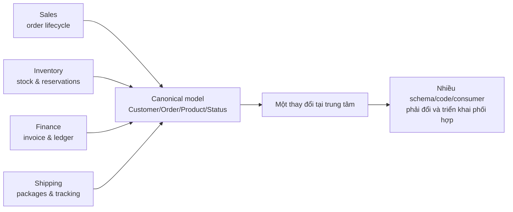
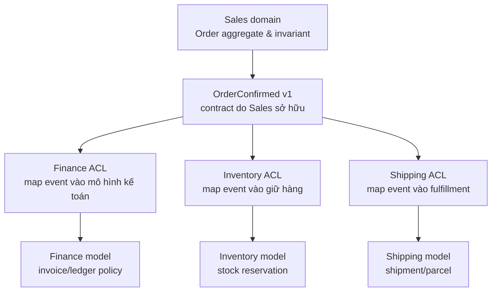

# Mô hình chuẩn dùng chung và nguy cơ trở thành điểm phụ thuộc quá lớn

## 1. Một mô hình chung có thể giảm tích hợp, nhưng cũng có thể tạo “đơn khối dữ liệu”

Trong module `DATABASE_DATA_MODELING`, mục tiêu là chuyển yêu cầu nghiệp vụ thành mô hình dữ liệu rõ ràng: từ thực thể, quan hệ và ràng buộc đến chuẩn hóa, khóa, chỉ mục và lược đồ vật lý; đồng thời so sánh cách mô hình hóa trong hệ quan hệ, document, graph và phân tích. Đến chương **Ranh giới và tích hợp**, ta phải trả lời câu hỏi rộng hơn: *mô hình nào nên được sở hữu trong từng miền nghiệp vụ, và thông tin nào mới thực sự cần được thống nhất giữa các miền?*

Giả sử nền tảng thương mại có các miền:

- **Sales:** nhận đơn, giữ giá đã chốt và trạng thái đơn.
- **Inventory:** quản lý hàng tồn theo SKU, kho, lô và lượng có thể đặt.
- **Finance:** lập hóa đơn, thuế, công nợ và ghi sổ theo quy tắc kế toán.
- **Shipping:** đóng gói, vận chuyển và theo dõi giao hàng.

Ban đầu, các hệ trao đổi nhiều payload riêng. Nhóm kiến trúc đề xuất một **Canonical Data Model (CDM)** với những thực thể chung như `Customer`, `Product`, `Order`, `Payment`, `Address`, cùng trạng thái và kiểu dữ liệu thống nhất. Ý tưởng hấp dẫn: mọi hệ đều biết cách đọc một định dạng.

Nhưng sau đó Finance cần tách `bill_to_party` khỏi `sold_to_party`; Inventory cần `stock_item` và `batch` thay vì `product`; Shipping cần nhiều kiện trên một đơn; Sales muốn thêm trạng thái `PARTIALLY_CONFIRMED`. Nếu mọi miền phải nâng chung thư viện, bảng hoặc định dạng để hỗ trợ những thay đổi đó, mô hình chuẩn trở thành **điểm phụ thuộc quá lớn** (*coupling hotspot*). Lúc này “chuẩn hóa tích hợp” đã biến thành một dạng **distributed monolith** ở tầng dữ liệu.

**Thông điệp cốt lõi:** mô hình chuẩn dùng chung là một **lựa chọn có phạm vi và chi phí**, không phải một thực thể dữ liệu duy nhất “đúng cho mọi miền”. Chỉ nên thống nhất phần ngữ nghĩa thực sự ổn định và cần trao đổi; phần còn lại thuộc quyền sở hữu của từng ranh giới nghiệp vụ.

### Kết quả học tập

Sau bài này, người học có thể:

1. Phân biệt **mô hình khái niệm chung**, **canonical integration model**, **shared database schema**, **API/event contract**, **master data** và **conformed dimension**.
2. Nêu điều kiện một CDM giảm chi phí tích hợp, và các dấu hiệu nó đã trở thành điểm phụ thuộc quá lớn.
3. Định nghĩa **bounded context**, quyền sở hữu dữ liệu, *published language* và *anti-corruption layer* (ACL).
4. Chọn giữa canonical model có giới hạn, hợp đồng theo miền, mapping cặp miền, integration hub và read model.
5. Thiết kế định danh, thời gian, đơn vị, trạng thái, version và ràng buộc cho một hợp đồng trao đổi.
6. Minh họa outbox/inbox, schema evolution, kiểm thử hợp đồng và migration an toàn mà không ép hai hệ dùng chung bảng dữ liệu.
7. Đánh giá tính nhất quán, bảo mật, vận hành và chi phí thay đổi xuyên miền bằng ví dụ cụ thể.

## 2. “Mô hình chuẩn dùng chung” có nhiều nghĩa khác nhau

Trước khi chấp nhận yêu cầu “hãy dùng chung model”, phải hỏi **chung ở tầng nào**.

| Khái niệm | Dùng chung cái gì? | Mục tiêu chính | Điểm cần phân biệt |
|---|---|---|---|
| **Conceptual enterprise model** | Từ vựng và các khái niệm ở mức doanh nghiệp | Giao tiếp, nhận diện miền, quản trị thuật ngữ | Không nhất thiết là schema để ghi/đọc trực tiếp |
| **Canonical integration model** | Định dạng trung gian để trao đổi giữa một số hệ | Giảm số biến thể mapping, chuẩn hóa contract | Có thể là **mô hình truyền thông**, không phải dữ liệu gốc |
| **Published API/event schema** | Hợp đồng của một capability hoặc sự kiện miền | Cho consumer tích hợp ổn định | Producer sở hữu ý nghĩa; không đòi mọi hệ có entity nội bộ giống nhau |
| **Shared database schema** | Cùng bảng và thường cả mô hình khóa/ràng buộc | Dễ join và dùng chung dữ liệu trong một DB | Tạo coupling mạnh về migration, quyền ghi và triển khai |
| **Master Data Management (MDM)** | Danh tính và quy trình đối soát các thực thể chủ | Giảm trùng danh tính khách, sản phẩm, nhà cung cấp | “Golden record” không thay toàn bộ lifecycle/semantics của miền |
| **Conformed dimension** | Một chiều phân tích tương thích giữa các data mart | So sánh số liệu giữa fact và các phòng ban | Phục vụ báo cáo; không tự là write model giao dịch |
| **Shared code/DTO library** | Kiểu dữ liệu và class dùng chung trong ứng dụng | Giảm mã lặp khi serialize/validate | Dễ tạo lockstep deployment nếu chứa entity nghiệp vụ biến động |

Một đội có thể nói “chúng ta có canonical customer” nhưng thực tế chỉ cần **một định danh tham chiếu liên miền**; ép mọi thuộc tính của CRM, Billing và Support vào cùng một bảng `customer` là quyết định lớn hơn rất nhiều.

**CDM hữu ích nhất khi phạm vi, owner, phiên bản, ngữ nghĩa và cơ chế dịch đều rõ.** Nó nguy hiểm nhất khi được coi là “schema nội bộ chuẩn mà mọi hệ phải trực tiếp phụ thuộc”.

## 3. Vì sao một mô hình chung xuất hiện trong kiến trúc tích hợp?

Giả sử có bốn hệ A, B, C, D. Nếu mỗi cặp trao đổi trực tiếp theo định dạng riêng của đối tác, số quan hệ tiềm năng là:

\[
\frac{n(n-1)}{2}
\]

Với \(n=4\), có sáu cặp; với \(n=10\), có 45 cặp. Nếu mọi cặp cần **hai hướng chuyển đổi riêng**, số adapter còn có thể lớn hơn.

Một canonical format có thể đổi thành:

```text
A ----> [Canonical exchange] <---- B
                 ^
                 |
C ---------------+--------------- D
```

Mỗi hệ ánh xạ vào/ra hợp đồng trung gian, thay vì viết bản dịch mới cho mọi cặp.

**Lợi ích có thể có:**

- Giảm lặp lại các quy tắc chuyển đổi **thật sự chung**, ví dụ định dạng thời điểm UTC và chuẩn hóa mã quốc gia.
- Dùng chung contract validation, schema registry, công cụ test và quan sát chất lượng dữ liệu.
- Dễ tích hợp hệ cũ có định dạng đặc thù nếu canonical format ổn định.
- Cải thiện khả năng truy vết nguồn và đối chiếu định danh.
- Hỗ trợ governance cho các dữ liệu cần được thống nhất ở cấp doanh nghiệp.

Tuy nhiên, con số `n(n-1)/2` là **mô hình liên kết lý tưởng**, không phải chứng minh mọi kiến trúc point-to-point đều có 45 adapter hoặc một hub luôn tốt hơn. Trong thực tế, ít hệ có nhu cầu trao đổi với tất cả hệ khác; nhiều consumer chỉ cần một event hoặc một API chuyên biệt. Nếu canonical format liên tục mở rộng để phục vụ tất cả, chi phí duy trì **ngữ nghĩa trung tâm** có thể lớn hơn số adapter được tiết kiệm.

## 4. Bounded context: cùng một từ, nhiều sự thật nghiệp vụ

**Bounded context** là phạm vi mà một mô hình nghiệp vụ có nghĩa nhất quán, được quản lý bởi một nhóm/chức năng rõ ràng. Cùng thuật ngữ `Customer` hoặc `Order` không bắt buộc có cùng cấu trúc và quy tắc ở mọi miền.

| Từ dùng chung | Sales hiểu là | Finance hiểu là | Shipping/Inventory hiểu là |
|---|---|---|---|
| **Customer** | Người mua/đặt đơn, có thể là khách vãng lai | Chủ thể lập hóa đơn, nghĩa vụ thanh toán và mã số thuế | Người nhận/giao hàng, địa chỉ liên lạc |
| **Product** | Biến thể bán với giá, khuyến mãi | Phân loại hạch toán, thuế, doanh thu | SKU tồn kho, đơn vị đóng gói, lô hoặc vật tư |
| **Order** | Cam kết bán theo dòng sản phẩm và trạng thái chấp nhận | Chưa chắc là doanh thu đã được ghi nhận | Có thể tách thành nhiều đợt xuất kho/kiện hàng |
| **Price** | Giá đã báo/đã chốt cho giao dịch | Giá chưa thuế, giá chịu thuế, khoản phải thu | Có thể không cần biết |
| **Status** | DRAFT, CONFIRMED, CANCELLED | Chưa ghi nhận, đã lập hóa đơn, đã thanh toán | READY, PACKED, SHIPPED, DELIVERED |

Nếu tạo một enum chung `OrderStatus` chứa mọi trạng thái, mỗi miền sẽ phải hiểu những giá trị không thuộc lifecycle của mình. Tệ hơn, một trạng thái `DELIVERED` của Shipping có thể bị hiểu nhầm là `REVENUE_RECOGNIZED` của Finance, dù hai quyết định kế toán và vận hành không đồng nhất.

**Quy tắc:** một tên giống nhau không bảo đảm cùng định nghĩa, phạm vi, ràng buộc, owner hoặc mốc thời gian. Khi hai miền có nghĩa khác nhau, **hai model riêng và phép dịch có kiểm soát** thường an toàn hơn một lớp chung ngày càng phình to.

## 5. Điểm phụ thuộc quá lớn hình thành như thế nào?



Nhiều phụ thuộc là vấn đề khi:

1. **Chuyển thay đổi nội bộ thành thay đổi toàn cục:** thêm thuộc tính riêng của Finance yêu cầu sửa model được import bởi Inventory.
2. **Ngữ nghĩa bị làm phẳng:** một field `customer_id` được dùng cho buyer, payer và receiver dù ba vai trò có thể khác người.
3. **Version chạy đồng bộ:** mọi service phải nâng cùng một version SDK/DDL để một service release.
4. **Schema trở thành cơ chế chia sẻ quyền ghi:** nhiều đội trực tiếp `UPDATE` cùng bảng canonical và không ai thực sự sở hữu bất biến.
5. **Thay đổi chậm lại vì phê duyệt trung tâm:** một owner/board phải review mọi field ngay cả khi thay đổi không ảnh hưởng integration.
6. **Phát sinh giá trị chung mơ hồ:** `status = 'OTHER'`, `metadata_json` và cột tùy chọn trở thành nơi giấu sự khác biệt.
7. **Thử nghiệm thiếu độc lập:** service A không thể kiểm thử hay deploy mà không cần environment/schema của service B.

Một mô hình chuẩn càng lớn không nhất thiết càng hoàn chỉnh; nó có thể chỉ đang tích lũy các ngoại lệ chưa được mô hình hóa đúng ranh giới.

### Nhận diện “distributed monolith” về dữ liệu

Dấu hiệu mạnh là **thay đổi nhỏ ở một miền yêu cầu nhiều miền đổi cùng lúc** dù không có thay đổi trong năng lực mà consumer đang sử dụng. Rủi ro không nằm ở việc có tài liệu chung mà ở **phụ thuộc khi chạy, khi deploy và khi hiểu nghĩa dữ liệu**.

## 6. Một sơ đồ đối lập: tích hợp qua hợp đồng theo miền



Trong cấu trúc này:

- **Sales** sở hữu ý nghĩa `OrderConfirmed`: sự kiện đơn đạt điều kiện chấp nhận theo Sales, **không khẳng định doanh thu đã được ghi nhận**.
- **Finance** có lớp chuyển đổi (*anti-corruption layer*, ACL) để ánh xạ order reference sang account/invoice và quyết định khi nào ghi nhận doanh thu theo chính sách kế toán.
- **Inventory** diễn giải dòng đơn thành nhu cầu giữ/xuất SKU theo quy tắc kho.
- **Shipping** diễn giải thông tin giao nhận thành các shipment/parcel, có thể có nhiều kiện cho một đơn.

Từng consumer không cần dùng chung cấu trúc bảng, enum nội bộ hoặc lifecycle với Sales. Họ chỉ cần hiểu **hợp đồng được phát hành** và quy tắc dịch tương ứng.

Sơ đồ trên là mẫu tích hợp **event-oriented**. Khi consumer cần kết quả đồng bộ, API capability theo miền có thể phù hợp hơn. Chọn giao tiếp đồng bộ hay bất đồng bộ dựa trên yêu cầu latency, tính nhất quán và lỗi, không dựa trên khẩu hiệu “mọi thứ đều event”.

## 7. Ngữ nghĩa chung thực sự cần thống nhất là gì?

Một canonical contract tốt phải nói nhiều hơn “field này là `string`”.

| Thuộc tính hợp đồng | Ví dụ cần mô tả | Rủi ro nếu bỏ qua |
|---|---|---|
| **Tên/định nghĩa** | `confirmed_at` = thời điểm Sales chấp nhận đơn | Finance hiểu nhầm là thời điểm thanh toán |
| **Nguồn sở hữu** | Sales phát sự kiện, chịu trách nhiệm schema | Không biết ai được quyền đổi nghĩa |
| **Phạm vi danh tính** | `order_ref` duy nhất trong (`tenant_id`, `source_system`) | Hai tenant có mã `0001` bị nhập làm một |
| **Kiểu và độ chính xác** | Số tiền decimal, số lượng fractional hay integer | Làm tròn hoặc overflow âm thầm |
| **Đơn vị** | `quantity` theo piece; tiền kèm `currency_code` | Cộng kg với piece hoặc VND với USD |
| **Thời điểm** | UTC instant, event time khác published time | Gán sai kỳ báo cáo hoặc phiên bản tham chiếu |
| **Null/missing** | Địa chỉ giao nhận có thể vắng ở đơn digital | Consumer hiểu vắng = chuỗi rỗng |
| **Cardinality** | Một đơn có 1..n dòng; một đơn có 0..n shipment | Chọn sai grain và nhân/giảm fact |
| **Enum/state** | Khi thêm giá trị enum, consumer cũ xử lý thế nào? | Consumer đổ lỗi khi gặp trạng thái mới |
| **Bảo mật** | Field có PII không? Ai được nhận? | Phát tán số điện thoại/địa chỉ quá phạm vi |
| **Version/compatibility** | Schema v1, v2 và lộ trình ngừng v1 | Consumer cũ đột ngột hỏng |
| **Idempotency/ordering** | `event_id` duy nhất theo producer, thứ tự theo aggregate | Nạp trùng hoặc áp event sai thứ tự |
| **Delivery SLA** | Có thể retry, mất kết nối, nhận muộn | Consumer giả định mỗi event đến đúng một lần |

**Schema syntax** chỉ giải quyết phần cấu trúc; **semantic contract** phải mô tả các bất biến mà các đội cùng dựa vào. Hai JSON cùng hợp lệ có thể mang nghĩa khác nhau nếu một bên dùng `amount` trước thuế, bên kia hiểu sau thuế.

## 8. Phân biệt ba lớp khóa qua ranh giới hệ thống

Ví dụ một người mua có:

- `sales.buyer_id = 412` trong hệ Sales.
- `finance.party_id = 8801` trong Finance.
- `shipping.recipient_ref = 'R-002'` trong Shipping.

Không được suy ra ba mã này cùng một danh tính chỉ vì đều được đặt tên `customer_id`. Bên mua, chủ thể trả tiền và người nhận có thể là **ba người/tổ chức khác nhau**.

### Ba loại ID cần tách

1. **Local surrogate key:** ID nội bộ bảng/aggregate, do miền sở hữu. Consumer không tự dùng nó như khóa chính trong DB mình.
2. **External/business reference:** ID được phát hành trong contract, có namespace, owner và chính sách ổn định.
3. **Cross-domain identity mapping:** bảng ánh xạ được xác minh, có nguồn chứng cứ và đôi khi có hiệu lực theo thời gian; không tự động coi ánh xạ là 1–1 vĩnh viễn.

Ví dụ map một `buyer_ref` tới `billing_party_id` phải có **quy tắc chấp nhận**. Trong một đơn cá nhân, buyer và payer có thể trùng; trong đơn doanh nghiệp, người đặt là nhân viên nhưng bên trả là pháp nhân.

### Nguy cơ dùng một “global customer_id”

Global identifier có thể hữu ích khi một thực thể thực sự có định danh thống nhất được quản trị ở cấp doanh nghiệp. Nhưng nếu nó khiến mọi miền bắt buộc gộp **buyer, payer, recipient, contact, legal entity** vào cùng một entity mà không cho phân vai, hệ thống có thể mất nghĩa nghiệp vụ. Dùng **global reference** chỉ ở phạm vi được xác minh và vẫn giữ **vai trò** trong từng miền.

## 9. Không dùng shared database như phương tiện tích hợp mặc định

Một lựa chọn dễ ban đầu là cho Sales, Finance và Shipping cùng truy cập trực tiếp các bảng `customer`, `order`, `product` trong một database.

**Vấn đề của nhiều owner cùng ghi:**

- Ai được phép đổi `order.status`, và enum đó có nghĩa gì với mỗi hệ?
- Một migration cột ở Sales có thể khóa truy vấn Finance hoặc làm gãy ORM Shipping.
- Transaction xuyên các workflow bị trộn, tạo phụ thuộc thời gian chạy và rollback.
- Các đội khó kiểm soát quyền cột/hàng và phân biệt PII cần thiết.
- Tối ưu index cho một workload gây chi phí ghi và cạnh tranh lock với workload khác.
- Dữ liệu có thể bị sửa trực tiếp, bypass logic nghiệp vụ mà chủ sở hữu aggregate cần bảo vệ.

**Không có nghĩa shared DB luôn sai.** Trong một ứng dụng nguyên khối có **một owner của bất biến và vòng đời deploy chung**, schema dùng chung có thể là lựa chọn đơn giản và đúng. Vấn đề xuất hiện khi có **nhiều nhóm muốn thay đổi độc lập** nhưng vẫn chia sẻ mô hình ghi không có chủ sở hữu.

Một nguyên tắc tốt cho hệ đa miền: **data ownership** cần rõ. Consumer khác nên lấy dữ liệu qua API/event/read model/published contract phù hợp; không xem quyền `SELECT` trực tiếp vào bảng nội bộ là hợp đồng công khai lâu dài.

## 10. Chọn giữa chuẩn trung tâm và hợp đồng theo miền

Không chỉ có hai lựa chọn “một canonical model cho cả doanh nghiệp” hoặc “mỗi hệ tự làm tùy ý”.

| Phương án | Khi có thể hợp lý | Rủi ro và giới hạn |
|---|---|---|
| **Enterprise-wide CDM lớn** | Hệ có miền tương đối đồng nhất, governance mạnh, thay đổi chậm | Semantics bị ép chung, migration/deploy đồng bộ, mọi đội phụ thuộc |
| **Canonical exchange model có giới hạn** | Nhiều hệ legacy cùng trao đổi bộ khái niệm ổn định, số mapping thực sự giảm | Hub/schema trung tâm có thể thành nút thắt khi scope phình |
| **Domain-owned published contracts** | Nhiều bounded contexts tự tiến hóa, event/API có owner rõ | Mỗi consumer phải map hợp đồng vào model địa phương |
| **Anti-corruption layer (ACL)** | Kết nối với legacy/đối tác có khái niệm không tương thích | Chi phí code mapping, cần test semantics và quan sát |
| **MDM / identity registry** | Nhu cầu đối soát danh tính khách/đối tác/sản phẩm | Không thay toàn bộ bảng nghiệp vụ hay lifecycle |
| **Read projection/serving model** | Consumer cần tìm nhanh/đọc tổng hợp từ nhiều miền | Dữ liệu dẫn xuất có độ trễ, cần replay/reconciliation |
| **Conformed dimensions trong warehouse** | Báo cáo cross-domain cần cùng định nghĩa thời gian/khách/khu vực | Chỉ là tiêu chuẩn phân tích, không ép OLTP cùng schema |

**Lựa chọn tốt thường là hỗn hợp:** một tập thuật ngữ/định danh được quản trị, hợp đồng do miền sở hữu, ACL cho ranh giới khác nghĩa và conformed dimensions cho báo cáo. Không cần phải chọn một chuẩn tuyệt đối ở mọi tầng.

## 11. Ranh giới tối thiểu nên dùng chung: hợp đồng, không phải bảng nội bộ

Một *event envelope* có thể thống nhất các trường metadata ổn định:

```json
{
  "event_id": "54a66833-b20d-4761-b0d9-607ac24bd2e9",
  "event_type": "sales.order-confirmed",
  "schema_version": 1,
  "producer": "sales",
  "tenant_ref": "tenant-42",
  "aggregate_ref": "sales-order-8071",
  "occurred_at": "2027-03-15T10:15:00Z",
  "published_at": "2027-03-15T10:15:03Z",
  "data": {
    "order_ref": "SO-8071",
    "buyer_ref": "buyer-19",
    "currency_code": "VND",
    "merchandise_subtotal": "150000.00",
    "lines": [
      {
        "line_ref": "L01",
        "sales_item_ref": "ITEM-58",
        "quantity": "2",
        "unit_price": "75000.00"
      }
    ]
  }
}
```

Đây là **hợp đồng minh họa**, không phải schema chuẩn duy nhất. Cần diễn giải chính xác:

- `event_id`: định danh sự kiện có tính ổn định khi retry, không tạo mới cho cùng một lần phát lại.
- `event_type` và `schema_version`: phân loại nội dung; v1 có định nghĩa đã công bố.
- `tenant_ref` và `aggregate_ref`: tham chiếu với namespace rõ; không tự là FK chéo database.
- `occurred_at`: thời điểm đơn **được xác nhận** trong Sales theo hợp đồng; `published_at` là thời điểm giao tiếp, không thay thế event time.
- `merchandise_subtotal`: giá hàng hóa **trước thuế, phí vận chuyển và các điều chỉnh khác** theo giả định ví dụ; chuỗi decimal được parse chính xác. Nó **không tự bằng doanh thu kế toán đã ghi nhận**.
- `lines`: mỗi dòng có `line_ref` duy nhất trong đơn; `sales_item_ref` không buộc Inventory dùng cùng ID SKU.
- `buyer_ref`: người mua theo Sales, không khẳng định luôn là `billing_party_id` của Finance.

**Tránh công bố toàn bộ record nội bộ** dưới tên event. Một contract có chủ đích thường chỉ mang các sự kiện và thuộc tính consumer được phép/cần dùng, với lifecycle/retention rõ ràng.

## 12. Đặt tên sự kiện theo sự thật miền, không theo thao tác CRUD

So sánh:

| Event | Người nhận biết được gì? | Nguy cơ |
|---|---|---|
| `CustomerUpdated` | Một record nào đó thay đổi | Không rõ thuộc tính nào mang nghĩa nghiệp vụ, dễ lệ thuộc schema nội bộ |
| `OrderRowChanged` | Hàng DB thay đổi | Consumer phải suy trạng thái từ cột trước/sau |
| `sales.order-confirmed` | Sales đã chấp nhận một đơn theo quy tắc của Sales | Không tự nói gì về invoice/revenue nếu contract không định nghĩa |
| `billing.invoice-issued` | Billing phát hành hóa đơn theo chính sách của Billing | Consumer hiểu đúng ranh giới phát sinh invoice |
| `inventory.stock-reserved` | Kho đã ghi nhận giữ hàng theo quy tắc Inventory | Không tự đồng nghĩa hàng đã được xuất |

Các sự kiện theo nghiệp vụ không phải “các lệnh trực tiếp cho mọi consumer”. Một event phản ánh việc đã xảy ra trong miền nguồn. Consumer quyết định hành động tương ứng theo luật của mình; cùng một event có thể có nhiều consumer mà không yêu cầu emitter biết toàn bộ consumer.

Nếu dữ liệu cần **đồng bộ theo yêu cầu**, API như `GetOrderSummary(order_ref)` hoặc `ReserveStock(request)` có thể phù hợp hơn phát event rồi chờ. Tránh nhầm event `OrderConfirmed` với command `ReserveStock`: một bên ghi lại sự thật, bên kia yêu cầu một capability thực hiện việc gì đó.

## 13. Ví dụ mô hình quan hệ tách ranh giới Sales và Finance

Để minh họa cách tránh “một bảng order chung”, ta đặt hai schema **logic** trong cùng môi trường PostgreSQL 16. Việc dùng cùng PostgreSQL trong ví dụ **không có nghĩa hai service production nên cùng truy cập trực tiếp schema của nhau**; trong thực tế chúng có thể nằm trên database độc lập, kết nối qua event/API.

### 13.1. Sales sở hữu vòng đời đơn

```sql
CREATE SCHEMA sales;
CREATE SCHEMA finance;

CREATE TABLE sales.order_header (
    sales_order_id BIGINT GENERATED ALWAYS AS IDENTITY PRIMARY KEY,
    tenant_id BIGINT NOT NULL,
    source_system VARCHAR(40) NOT NULL,
    order_ref VARCHAR(80) NOT NULL,
    buyer_ref VARCHAR(80) NOT NULL,
    order_status VARCHAR(20) NOT NULL DEFAULT 'DRAFT',
    currency_code VARCHAR(3) NOT NULL,
    merchandise_subtotal NUMERIC(18,2) NOT NULL,
    confirmed_at TIMESTAMPTZ,

    CONSTRAINT uq_sales_order_ref
        UNIQUE (tenant_id, source_system, order_ref),
    CONSTRAINT ck_sales_status
        CHECK (order_status IN ('DRAFT','CONFIRMED','CANCELLED')),
    CONSTRAINT ck_sales_subtotal
        CHECK (
            merchandise_subtotal >= 0
            AND merchandise_subtotal <> 'NaN'::numeric
        ),
    CONSTRAINT ck_sales_currency_code
        CHECK (currency_code ~ '^[A-Z]{3}$'),
    CONSTRAINT ck_sales_confirmation
        CHECK (
            (order_status = 'CONFIRMED' AND confirmed_at IS NOT NULL)
            OR (order_status <> 'CONFIRMED')
        )
);

CREATE TABLE sales.order_line (
    sales_order_id BIGINT NOT NULL
        REFERENCES sales.order_header (sales_order_id),
    line_ref VARCHAR(40) NOT NULL,
    sales_item_ref VARCHAR(80) NOT NULL,
    quantity NUMERIC(16,3) NOT NULL,
    unit_price NUMERIC(18,2) NOT NULL,
    CONSTRAINT pk_sales_order_line
        PRIMARY KEY (sales_order_id, line_ref),
    CONSTRAINT ck_sales_line_quantity CHECK (quantity > 0),
    CONSTRAINT ck_sales_line_price
        CHECK (unit_price >= 0 AND unit_price <> 'NaN'::numeric)
);
```

**Phạm vi bảo đảm của ví dụ:**

- `order_status` là **trạng thái của Sales**, không là enum doanh nghiệp dùng chung. `CONFIRMED` yêu cầu `confirmed_at`, nhưng `CHECK` chưa kiểm tra vòng đời chuyển trạng thái hay số dòng đơn.
- `merchandise_subtotal` là giá trị đã được Sales tính/chốt theo quy tắc không có discount/tax của ví dụ. DB không tự bảo đảm nó bằng tổng các dòng vì `CHECK` không kiểm tra liên bảng. Ứng dụng/giao dịch phải xác nhận subtotal trước khi xác nhận đơn.
- `buyer_ref` có namespace (`tenant_id`, `source_system`); không tự FK tới bảng party của Finance.
- Ví dụ chỉ có một `currency_code` ở header, giả định các dòng cùng currency. Nếu có nhiều currency/thuế, phải mở rộng hợp đồng đúng nghiệp vụ thay vì ép vào trường chung thiếu nghĩa.

### 13.2. Finance có mô hình danh tính và giao dịch riêng

```sql
CREATE TABLE finance.billing_party (
    billing_party_id BIGINT GENERATED ALWAYS AS IDENTITY PRIMARY KEY,
    tenant_id BIGINT NOT NULL,
    legal_name TEXT NOT NULL,
    tax_identifier VARCHAR(80),
    CONSTRAINT uq_finance_party_tenant_id
        UNIQUE (tenant_id, billing_party_id)
);

CREATE TABLE finance.buyer_reference_map (
    tenant_id BIGINT NOT NULL,
    source_system VARCHAR(40) NOT NULL,
    external_buyer_ref VARCHAR(80) NOT NULL,
    billing_party_id BIGINT NOT NULL,
    mapping_status VARCHAR(16) NOT NULL DEFAULT 'VERIFIED',
    verified_at TIMESTAMPTZ NOT NULL DEFAULT clock_timestamp(),
    CONSTRAINT pk_buyer_reference_map
        PRIMARY KEY (tenant_id, source_system, external_buyer_ref),
    CONSTRAINT fk_map_billing_party_same_tenant
        FOREIGN KEY (tenant_id, billing_party_id)
        REFERENCES finance.billing_party (tenant_id, billing_party_id),
    CONSTRAINT ck_map_status
        CHECK (mapping_status IN ('VERIFIED','PENDING','REJECTED'))
);
```

Ở đây, `billing_party_id` **không phải** `sales.buyer_ref`. Mapping đòi quy tắc xác minh danh tính. `mapping_status` trong ví dụ chưa tự ngăn truy vấn dùng mapping `PENDING`: adapter phải chỉ dùng hàng được duyệt, hoặc quy trình dữ liệu phải thiết kế constraint/hàng chờ nghiêm ngặt hơn.

**Không tạo FK từ `sales.order_header.buyer_ref` trực tiếp tới `finance.billing_party`.** Trong môi trường các service độc lập, một FK xuyên database/service thường không khả dụng và làm vòng đời deploy phụ thuộc. Ràng buộc thực sự là hợp đồng và quy trình ánh xạ/đối soát; FK nội bộ Finance chỉ bảo vệ các hàng **trong Finance**.

### 13.3. Quan hệ đổi theo thời gian

Một người mua có thể đổi chủ thể thanh toán được ủy quyền; một doanh nghiệp có thể đổi pháp nhân hoặc merge/split. Nếu mapping cần tái lập lịch sử, bảng map hiện tại là **chưa đủ**: phải có `valid_from/valid_to`, cơ chế chống overlap và giải thích trường hợp một buyer có nhiều payer. Đừng coi PK trên (`tenant_id`, `source_system`, `external_buyer_ref`) là bằng chứng ánh xạ 1–1 vĩnh viễn đúng nghiệp vụ.

## 14. Transactional outbox: phát hợp đồng mà không mất tính nhất quán cục bộ

Nếu Sales commit trạng thái đơn rồi **gọi broker** ở bước ngoài giao dịch, tiến trình có thể chết giữa hai bước: đơn đã xác nhận nhưng event chưa được gửi. Nếu gửi event trước commit, consumer có thể thấy một đơn mà DB sau đó rollback.

**Transactional outbox** lưu sự kiện cùng transaction với thay đổi aggregate trong DB Sales:

```sql
CREATE TABLE sales.integration_outbox (
    event_id UUID PRIMARY KEY,
    tenant_id BIGINT NOT NULL,
    aggregate_type VARCHAR(60) NOT NULL,
    aggregate_ref VARCHAR(120) NOT NULL,
    event_type VARCHAR(100) NOT NULL,
    schema_version INTEGER NOT NULL,
    occurred_at TIMESTAMPTZ NOT NULL,
    payload JSONB NOT NULL,
    published_at TIMESTAMPTZ,
    CONSTRAINT ck_outbox_schema_version
        CHECK (schema_version > 0),
    CONSTRAINT ck_outbox_payload_object
        CHECK (jsonb_typeof(payload) = 'object')
);

-- Chỉ là một ứng viên index cho publisher polling.
CREATE INDEX idx_sales_outbox_unpublished
    ON sales.integration_outbox (occurred_at, event_id)
    WHERE published_at IS NULL;
```

### 14.1. Một bước xác nhận đơn và ghi outbox

Giả sử đơn đã được tạo ở trạng thái DRAFT, đã được kiểm tra subtotal và dòng; đoạn dưới minh họa nguyên tắc atomicity:

```sql
BEGIN;

WITH confirmed AS (
    UPDATE sales.order_header
       SET order_status = 'CONFIRMED',
           confirmed_at = clock_timestamp()
     WHERE tenant_id = 42
       AND source_system = 'WEB'
       AND order_ref = 'SO-8071'
       AND order_status = 'DRAFT'
     RETURNING sales_order_id, tenant_id, source_system,
               order_ref, buyer_ref, currency_code,
               merchandise_subtotal, confirmed_at
)
INSERT INTO sales.integration_outbox (
    event_id, tenant_id, aggregate_type, aggregate_ref,
    event_type, schema_version, occurred_at, payload
)
SELECT
    gen_random_uuid(),
    c.tenant_id,
    'SalesOrder',
    c.order_ref,
    'sales.order-confirmed',
    1,
    c.confirmed_at,
    jsonb_build_object(
        'order_ref', c.order_ref,
        'source_system', c.source_system,
        'buyer_ref', c.buyer_ref,
        'currency_code', c.currency_code,
        'merchandise_subtotal', c.merchandise_subtotal::text,
        'confirmed_at', to_char(
            c.confirmed_at AT TIME ZONE 'UTC',
            'YYYY-MM-DD"T"HH24:MI:SS.US"Z"'
        )
    )
FROM confirmed AS c
RETURNING event_id, event_type, occurred_at;

-- Chỉ COMMIT khi số hàng đã đổi trạng thái và số outbox event
-- đều đúng kỳ vọng. Nếu không: ROLLBACK và xử lý trạng thái.
COMMIT;
```

Nếu `UPDATE` khớp 0 hàng, `INSERT ... SELECT` cũng ghi 0 event; ứng dụng phải kiểm tra kết quả và không tự công bố “đã xác nhận thành công”. Nếu đồng thời hai yêu cầu xác nhận cùng đơn, điều kiện `order_status='DRAFT'` giúp chỉ một yêu cầu chuyển trạng thái theo cách thông thường của PostgreSQL.

Ví dụ chỉ ghi **payload rút gọn**, chưa bao gồm `lines` như contract mẫu ở mục 11. Khi thiết kế production, phải tạo **event đầy đủ theo schema đã công bố** (có dòng từ trạng thái nhất quán), kiểm tra validation, identity, thứ tự và version; không được phát sự kiện thiếu field bắt buộc rồi gọi nó là `OrderConfirmed v1` hoàn chỉnh.

### 14.2. Outbox không tự bảo đảm exactly-once

Một publisher có thể gửi event đến broker, bị mất ACK rồi gửi lại; consumer nhận **ít nhất một lần** hoặc nhận trùng tùy hạ tầng. `published_at` có thể bị cập nhật chậm; broker/consumer có thể có ordering và retention riêng. Vì vậy:

- Producer cần một `event_id` ổn định và retry với **cùng ID**.
- Consumer phải có cơ chế dedup/idempotency.
- Quy tắc ordering theo **aggregate_ref** hoặc sequence cần được định nghĩa nếu consumer phụ thuộc thứ tự.
- Outbox/publisher có giám sát backlog, dead-letter và chính sách phục hồi.
- Không khẳng định toàn bộ tác động xuyên service được commit atomically chỉ nhờ outbox.

## 15. Consumer inbox và mapping: tiếp nhận không đồng nghĩa thực hiện nghiệp vụ

Finance cần nhận `sales.order-confirmed` và dùng nó để chuẩn bị quy trình lập hóa đơn/đối soát, không được tự động coi sự kiện là “đã thu tiền”.

```sql
CREATE TABLE finance.integration_inbox (
    producer VARCHAR(40) NOT NULL,
    event_id UUID NOT NULL,
    tenant_id BIGINT NOT NULL,
    event_type VARCHAR(100) NOT NULL,
    schema_version INTEGER NOT NULL,
    payload JSONB NOT NULL,
    received_at TIMESTAMPTZ NOT NULL DEFAULT clock_timestamp(),
    processed_at TIMESTAMPTZ,
    process_status VARCHAR(12) NOT NULL DEFAULT 'RECEIVED',
    CONSTRAINT pk_finance_inbox PRIMARY KEY (producer, event_id),
    CONSTRAINT ck_finance_inbox_version CHECK (schema_version > 0),
    CONSTRAINT ck_finance_inbox_status
        CHECK (process_status IN ('RECEIVED','PROCESSED','FAILED')),
    CONSTRAINT ck_finance_inbox_payload
        CHECK (jsonb_typeof(payload) = 'object')
);
```

**Hai mức idempotency khác nhau:**

1. `UNIQUE(producer,event_id)` đảm bảo cùng event không được chèn nhiều hàng inbox.
2. **Tác động nghiệp vụ** trong Finance (tạo yêu cầu invoice, cập nhật trạng thái, ghi ledger...) cũng phải idempotent theo business key/command, thực hiện trong transaction phù hợp với trạng thái inbox. Một handler có thể tạo invoice rồi chết trước khi đánh dấu inbox `PROCESSED` nếu hai thao tác không được phối hợp.

### Đừng để thiếu mapping biến thành mất sự kiện

Giả sử event có `buyer_ref='buyer-19'` nhưng Finance chưa có một `billing_party_id` được xác minh. Cách tiếp cận sai là `INNER JOIN finance.buyer_reference_map` rồi mặc nhiên **loại mất** event không khớp.

Quy trình đúng hơn:

- Ghi event vào inbox/staging và kiểm tra schema, namespace, version.
- Tra mapping ở trạng thái `VERIFIED` theo đúng phạm vi tenant/nguồn.
- Nếu thiếu hoặc mơ hồ, đưa event vào hàng chờ xử lý, không ghi nhầm vào party hiện tại.
- Theo dõi tuổi chờ/SLA, retry sau khi có mapping, hoặc yêu cầu bổ sung chứng cứ.
- Đối soát số event đã nhận, đang chờ, bị từ chối và đã xử lý.

**Chú ý:** một Sales buyer có thể không có quyền được lập hóa đơn, hoặc payer khác buyer. Consumer phải dùng **quy tắc của Finance**, không lấy kết quả mapping đơn thuần thay cho quyết định nghiệp vụ.

## 16. Anti-corruption layer (ACL): dịch nghĩa, không chỉ đổi tên field

ACL bảo vệ model nội bộ khỏi assumptions của hệ nguồn, nhất là khi tích hợp legacy hoặc đối tác có khái niệm khác.

Ví dụ `OrderConfirmed` từ Sales được Finance tiếp nhận:

```text
Sales event: buyer_ref, merchandise_subtotal, confirmed_at
       |
       v
Finance ACL
  1. Validate event schema/version/tenant.
  2. Resolve buyer_ref -> billing_party candidate.
  3. Check invoice recipient/tax rules; may require separate data.
  4. Create a request to finance workflow with source event id.
  5. Record mapping/decision/errors for replay.
       |
       v
Finance domain: invoice_request (not automatically revenue ledger)
```

ACL không phải lớp sao chép field:

```text
source.customerId -> target.customerId
source.amount     -> target.revenue
source.status     -> target.status
```

Ba dòng này có thể **sai nghĩa** dù kiểu dữ liệu đều trùng. Cần kiểm tra vai trò party, định nghĩa amount, lifecycle và thời điểm. Nếu hợp đồng nguồn không đủ dữ liệu để quyết định, ACL phải **yêu cầu thêm thông tin hoặc đánh dấu chưa xử lý**, không bịa giá trị cho đầy schema đích.

### Ví dụ bảng ánh xạ ngữ nghĩa

| Trường Sales | Trường/khái niệm Finance | Quy tắc |
|---|---|---|
| `buyer_ref` | `billing_party_id` | Tra mapping có xác minh; có thể không khớp 1–1 |
| `merchandise_subtotal` | `invoice_merchandise_base` | Chỉ sử dụng theo định nghĩa trước thuế/phí của contract; phải thêm quy tắc thuế |
| `confirmed_at` | `order_confirmed_at` | Là event time nguồn; **không** là `invoice_issued_at` |
| `order_ref` | `source_order_reference` | Giữ namespace + tenant để tránh trùng |
| `order_status` | Không map trực tiếp sang `payment_status` | Hai lifecycle khác nhau |
| `sales_item_ref` | `accounting_item_code` | Cần bảng mã/phân loại do Finance quản lý |

Đây là ví dụ *semantic mapping*. Nếu hai hệ thống thực sự có nghĩa trùng và ổn định, ACL có thể đơn giản; không cần tạo tầng dịch phức tạp chỉ vì tên pattern.

## 17. Versioning: thêm field không đồng nghĩa luôn tương thích

Hợp đồng tích hợp cần có chính sách evolution ngay từ đầu:

| Thay đổi | Thường có thể tương thích khi... | Dễ gây breaking khi... |
|---|---|---|
| Thêm field tùy chọn | Consumer bỏ qua field chưa biết và có default hợp lý | Consumer validator cấm unknown fields, hoặc field trở thành bắt buộc ngay |
| Thêm giá trị enum | Consumer có nhánh xử lý unknown theo chính sách | Consumer dùng exhaustive switch và crash với giá trị mới |
| Đổi tên field | Có giai đoạn alias/dual read | Bỏ tên cũ trước khi consumer nâng |
| Đổi `amount` từ integer minor units sang decimal string | Có tên field mới và diễn giải rõ | Giữ tên cũ nhưng đổi kiểu/đơn vị |
| Tách `customer_id` thành buyer/payer | Contract mới mô tả vai trò và mapping | Consumer cũ tự lấy buyer làm payer |
| Thêm phiên bản event | Producer duy trì các version theo cam kết | Chỉ phát v2 trong khi v1 vẫn còn consumer |
| Đổi nghĩa thời điểm | Có field mới và migration được duyệt | Dùng `occurred_at` lúc trước là confirm time, sau đổi thành publish time |
| Đổi nguồn/khóa định danh | Có bảng ánh xạ và idempotency migration | Reuse ID cũ cho entity khác hoặc đổi namespace ngầm |

**Compatibility có nhiều chiều:**

- *Backward compatibility:* consumer mới đọc được dữ liệu/payload cũ?
- *Forward compatibility:* consumer cũ có chịu được producer phát nội dung mới?
- *Semantic compatibility:* dù parse được, phép tính/diễn giải có còn **đúng nghiệp vụ** không?
- *Operational compatibility:* trong giai đoạn rolling deploy, các version cũ và mới có cùng tồn tại an toàn không?

JSON schema hoặc Avro/Protobuf schema registry có thể kiểm tra một số thay đổi **cấu trúc**, nhưng không chứng minh semantic compatibility. Ví dụ đổi `amount` từ “trước thuế” thành “sau thuế” mà giữ kiểu decimal là lỗi **không nhất thiết bị schema checker phát hiện**.

### Một lộ trình v1 → v2 minh họa

Giả sử event v1 có `buyer_ref` nhưng v2 tách `buyer_ref` và `bill_to_ref` theo yêu cầu mới:

1. Công bố v2 với định nghĩa rõ, không âm thầm đổi nghĩa `buyer_ref` của v1.
2. Producer hỗ trợ hai phiên bản trong thời gian chuyển hoặc giữ v1 cùng field mới tùy contract.
3. Consumer cập nhật ACL để xử lý v1/v2 và có fallback **được chứng minh**; nếu v1 không có `bill_to_ref` thì không tự suy mọi trường hợp `bill_to_ref=buyer_ref`.
4. Thực hiện consumer-driven contract tests bằng payload mẫu và ca thiếu mapping.
5. Giám sát số consumer còn dùng v1, lỗi parse, lỗi ngữ nghĩa và tuổi backlog.
6. Chỉ ngừng v1 sau khi xác nhận các consumer, replay/reprocessing và chính sách retention.

Trong các event được lưu nhiều tháng để replay, việc ngừng phát v1 **không** có nghĩa consumer mới không bao giờ gặp payload v1. Một upgrade path cần giữ decoder/mapping cũ hoặc migration dữ liệu lưu trữ.

## 18. Ký kết hợp đồng bằng test, không chỉ tài liệu

Một **data contract** không chỉ là file schema:

- Có **producer/owner** chịu trách nhiệm định nghĩa, phiên bản và chất lượng dữ liệu.
- Có **consumer** và mục đích sử dụng đã biết ở phạm vi cần thiết.
- Có **schema validation** theo định dạng và version.
- Có **semantic examples**: buyer ≠ payer, amount trước/sau thuế, UTC/business time, currency.
- Có **contract tests**: producer phát payload đúng, consumer decode/dịch nghĩa đúng.
- Có **nonfunctional contract**: độ trễ, retry, thứ tự, duplicate, retention, privacy, availability.
- Có **deprecation policy**: nâng version, chấp nhận thời gian song song và xử lý dữ liệu lịch sử.

### Bộ ca kiểm thử tối thiểu

| Ca | Đầu vào/thay đổi | Điều cần chứng minh |
|---|---|---|
| T1 | Hai tenant có `order_ref='0001'` | Không hợp nhất nhầm định danh |
| T2 | Cùng `event_id` phát hai lần | Inbox và business effect idempotent |
| T3 | Cùng ID nhưng payload khác | Cảnh báo vi phạm contract hoặc quy tắc correction; không im lặng bỏ |
| T4 | Producer thêm field không bắt buộc | Consumer cũ xử lý theo compatibility policy |
| T5 | Producer thêm giá trị enum | Consumer không hiểu giá trị mới có hành vi xác định |
| T6 | V2 thêm `bill_to_ref` khác buyer | Finance không coi buyer và payer là một |
| T7 | Event đến trễ, `occurred_at` thuộc tháng cũ | Phân bổ thời gian đúng theo quy tắc nghiệp vụ |
| T8 | Event v1 được replay sau khi triển khai v2 | Decoder/mapping vẫn đọc được |
| T9 | Mapping Finance thiếu hoặc `PENDING` | Event không mất, không tự tạo invoice sai party |
| T10 | Finance đã xử lý nhưng ACK broker thất bại | Retry không tạo thêm effect |
| T11 | Consumer downtime và backlog tăng | Có SLA, cảnh báo và cơ chế bắt kịp |
| T12 | Product đổi mã, inventory không nhận diện | Mapping alias/version và quy tắc lỗi rõ |
| T13 | Trường mới chứa PII không thuộc quyền consumer | Contract/policy chặn phát tán hoặc kiểm soát truy cập |
| T14 | Sales đổi schema bảng nội bộ, event giữ v1 | Consumer không phải deploy theo Sales |

**Một trường hợp test để chứng minh độc lập:** thay tên cột nội bộ `sales.order_header.buyer_ref` thành tên khác trong phiên bản Sales mới nhưng vẫn phát `OrderConfirmed v1` giống hệt theo contract. Nếu Finance và Inventory không cần sửa, ranh giới đã được bảo vệ tốt hơn so với dùng chung ORM entity.

## 19. Hợp đồng và schema không thay thế mô hình nhất quán phân tán

Khi Sales, Inventory và Finance không chia một giao dịch ACID toàn cục, dữ liệu có thể nhất quán **sau một độ trễ**. Một canonical format không giải quyết được bản chất phân tán này.

Các vấn đề cần thiết kế:

1. **Delivery:** event có thể lặp, đến muộn hoặc tạm thời không đến.
2. **Ordering:** thứ tự trong một stream/aggregate có thể được bảo đảm theo điều kiện hạ tầng, nhưng không tự có thứ tự toàn cục cho mọi service.
3. **Retries:** consumer phải xác định retry có an toàn khi tác động đã thành công trước đó hay không.
4. **Idempotency:** event ID, command ID và business key có vai trò khác nhau.
5. **Compensation:** giữ hàng thành công nhưng invoice thất bại cần workflow bù/tiếp tục, không tự rollback Inventory qua FK chung.
6. **Reconciliation:** số lượng đơn được Sales xác nhận, giữ hàng trong Inventory và invoice trong Finance có thể khác tại thời điểm đo; cần giải thích trạng thái trung gian thay vì ép bằng nhau ngay.
7. **Latency/SLA:** read model dẫn xuất có thể cũ; UI cần timestamp và ngữ nghĩa độ mới.

Ví dụ workflow:

```text
Sales: OrderConfirmed
   -> Inventory: ReserveStock (thành công hoặc thất bại)
   -> Billing: InvoicePreparation (sau điều kiện riêng)
   -> Shipping: CreateFulfillment (khi sẵn sàng)
```

Đây là một **quy trình nghiệp vụ đa bước**, không phải một transaction database duy nhất. Nếu đặt tên chung là `Order.status = COMPLETED`, cần định nghĩa “completed” ở ranh giới nào; không sử dụng nó thay thế tất cả trạng thái nội bộ.

## 20. Phạm vi chung tối thiểu và tính sở hữu dữ liệu

Một cách tránh phình canonical model là thống nhất **ít và rõ**:

| Dữ liệu có thể chuẩn hóa | Điều kiện để dùng chung | Không nên ép dùng chung |
|---|---|---|
| Mã currency ISO, ngày/UTC instant | Chuẩn và phiên bản được công bố, quy tắc múi giờ rõ | Ngày ghi nhận doanh thu của mọi miền phải giống nhau |
| Namespace tenant/source/event ID | Quy tắc định danh, idempotency và privacy nhất quán | PK tự tăng nội bộ của mọi service |
| Country code, đơn vị đo | Định nghĩa chuẩn, chuyển đổi và locale rõ | Đơn vị nghiệp vụ riêng không có phép map an toàn |
| Reference ID/identity registry | Có quy trình đối soát, phân vai và quyền truy cập | Gộp buyer/payer/receiver thành “customer” duy nhất |
| Event envelope (id, type, version, time) | Consumer cần hạ tầng chung | Một payload entity khổng lồ cho mọi loại event |
| Conformed reporting dimension | Mục tiêu phân tích cross-domain có cùng nghĩa | Lifecycle OLTP, state machine hoặc ràng buộc ghi của từng miền |

**Phần dùng chung nên có tốc độ thay đổi chậm hơn phần nội bộ.** Nếu nó thường xuyên thay đổi theo yêu cầu của một service, đó có thể là dấu hiệu nó thuộc về service đó và chỉ nên được xuất ra qua contract.

Một bộ phận quản trị kiến trúc vẫn có vai trò: quản lý thuật ngữ, định danh, chuẩn bảo mật và compatibility. Nhưng governance nên giữ **hợp đồng giữa các miền**, không buộc mọi nhóm xin phép để đổi mọi cột nội bộ.

## 21. Phân biệt canonical operational model với conformed dimension phân tích

Trong hệ phân tích, việc có một `dim_customer` hoặc `dim_date` dùng chung giữa nhiều data mart có thể rất hữu ích. Nhưng mục tiêu của **conformed dimension** là để các fact được so sánh dưới **cùng định nghĩa phân tích**; không phải chỉ định tất cả các service giao dịch dùng cùng bảng Customer.

Ví dụ:

- Sales có `buyer_ref` và thời điểm đặt đơn.
- Finance có `billing_party_id` và thời điểm phát hành hóa đơn.
- Data warehouse tạo một conformed dimension `dim_legal_entity` để báo cáo đã phê duyệt theo pháp nhân.

Một mapping có thể giúp hai fact dùng cùng dimension khi ngữ nghĩa **thực sự phù hợp**. Nếu buyer là cá nhân nhưng payer là công ty, không thể join hai fact vào cùng một key “customer” bằng cách sửa tên cột. Warehouse cần phân biệt **vai trò** hoặc dùng các chiều khác nhau.

### SCD Type 2 và thời gian tham chiếu

Một conformed dimension có phiên bản SCD2 có thể có `customer_sk` riêng cho mỗi khoảng hiệu lực, còn fact lưu SK của version đúng thời điểm. Nếu sửa hồi tố, phải có chính sách **as booked** hay **restated**. Chia sẻ dimension không xóa vấn đề thời gian; ngược lại, một version sai được nhiều data mart dùng chung có thể nhân rộng sai số toàn doanh nghiệp.

**Master data ≠ universal domain model ≠ conformed dimension.** Một registry danh tính, một model trao đổi và một dimension phân tích có những owner và độ trễ/nguồn sự thật khác nhau; có thể phối hợp mà không phải là một bảng.

## 22. Kiến trúc document, graph và quan hệ cũng có ranh giới ngữ nghĩa

### Quan hệ

Các bảng chuẩn hóa, PK/FK/UNIQUE giúp bảo vệ toàn vẹn **trong một database**. Nhưng FK **không diễn đạt** mọi quan hệ liên miền, nhất là khi hệ thống độc lập và có thời gian hiệu lực khác nhau. Dùng event/API và mapping có kiểm chứng khi không có giao dịch xuyên DB.

### Document

Một canonical JSON payload có thể dễ truyền giữa hệ thống, nhưng cùng JSON Schema chưa bảo đảm cùng ý nghĩa. Một document `customer` chứa address, orders và preferences là cách nhúng phù hợp trong một bounded context, không phải lý do mọi consumer được phép đọc tất cả thông tin. Khi cập nhật một trường, phải xác định event nào cần phát và consumer nào thực sự có quyền.

### Graph

Graph có thể dùng registry liên kết `buyer → legal party → recipient` và các quan hệ có hiệu lực theo thời gian để hỗ trợ identity resolution. Tuy nhiên, một cạnh `SAME_AS` giữa hai ID chưa chứng minh mọi vai trò/thuộc tính có thể thay thế nhau. Khi traversal đi qua nhiều hệ, cần provenance, confidence, nguồn chứng minh và quyền riêng tư.

### Phân tích/columnar

Kho dữ liệu có thể xây read model và conformed dimensions tối ưu cho truy vấn cross-domain. Một số hệ phân tích dùng PK/FK làm metadata hoặc không enforce giống OLTP; pipeline phải kiểm tra identity mapping, fact grain, phiên bản dimension và lỗi trùng. Không lấy mô hình tổng hợp thuận tiện làm write schema bắt buộc của tất cả service.

**Ranh giới nghĩa tồn tại trong mọi mô hình lưu trữ.** Chuyển sang JSON hoặc graph chỉ thay cách biểu diễn, không tự xóa coupling.

## 23. An toàn dữ liệu và quyền riêng tư khi chia sẻ model

Mô hình chuẩn càng nhiều trường càng dễ làm nhiều consumer nhận dữ liệu **không cần thiết**. Đặc biệt với customer/party, payload toàn diện có thể chứa:

- Tên pháp lý, mã thuế, số điện thoại, email.
- Địa chỉ giao hàng, địa chỉ thanh toán và thông tin người nhận.
- Lịch sử mua sắm, phân khúc, trạng thái thanh toán.
- Dữ liệu được xử lý theo mục đích, cơ sở pháp lý hoặc vùng lưu trữ khác nhau.

Nguyên tắc:

1. **Data minimization:** contract chỉ có dữ liệu cần cho mục đích, không phát cả bảng `customer` theo thói quen.
2. **Purpose limitation:** event order không tự cho Finance, Shipping hoặc Analytics quyền dùng mọi thông tin cho mục đích khác.
3. **Tenant isolation:** `tenant_id` trên payload không thay cơ chế xác thực và phân quyền; consumer phải kiểm tra quyền theo tenant.
4. **Encryption/access control:** bảo vệ dữ liệu khi truyền, khi lưu trong broker, DLQ, staging, log và backup.
5. **Retention/deletion:** xóa hoặc hạn chế PII có thể cần phối hợp nhiều consumer; event log bất biến vẫn phải tuân thủ chính sách phù hợp.
6. **Schema registry security:** schema metadata có thể bộc lộ tên field nhạy cảm; giới hạn quyền truy cập khi cần.

**Không giải quyết privacy bằng cách tạo một “canonical customer” chứa tất cả dữ liệu rồi đặt quyền đọc chung.** Mô hình chia sẻ tối thiểu thường an toàn và dễ quản trị hơn.

## 24. Đo coupling bằng số liệu thay vì cảm giác

Một mô hình dùng chung đang đem lại lợi ích hay tạo điểm nghẽn? Có thể quan sát:

| Chỉ số | Tín hiệu cần theo dõi | Cách diễn giải |
|---|---|---|
| **Change propagation** | Một thay đổi nội bộ khiến bao nhiêu service phải sửa/triển khai? | Nhiều service bị bắt buộc đồng bộ là dấu hiệu coupling |
| **Lead time for change** | Từ yêu cầu tới phát hành contract/mapping mới | Chậm do phê duyệt schema chung có thể là bottleneck |
| **Breaking contract rate** | Số lỗi consumer sau đổi schema/version | Cần test compatibility và deprecation tốt hơn |
| **Mapping exceptions** | Số event thiếu hoặc mơ hồ identity mapping | Hợp đồng/MDM chưa đủ hoặc nghiệp vụ chưa chốt |
| **Integration backlog age** | Độ trễ outbox, broker, inbox, quarantine | Canonical hub có thể là điểm nghẽn vận hành |
| **Direct DB access count** | Bao nhiêu consumer đọc bảng nội bộ của owner? | Chi phí đổi schema cao và quyền dữ liệu khó kiểm soát |
| **Field utilization** | Tỉ lệ field canonical được từng consumer thực sự dùng | Nhiều trường hiếm dùng có thể báo hiệu model phình |
| **Duplicate transformations** | Cùng phép chuyển đổi đơn vị/ID được viết bao lần? | Cơ hội chuẩn hóa nhỏ có giá trị |
| **Semantic incidents** | Báo cáo sai vì buyer/payer, amount, timezone, status | Đo độ đúng nghĩa, không chỉ API uptime |
| **Independence test** | Một service deploy không đụng consumer nội bộ khác? | Bằng chứng ranh giới có hiệu quả |

**Không tối ưu duy nhất một chỉ số.** Ví dụ giảm số adapter xuống còn một shared library lớn có thể giảm code lặp nhưng tăng lead time và rủi ro rollout. Lợi ích kỹ thuật phải được so với tốc độ tiến hóa, tính đúng ngữ nghĩa và chi phí vận hành.

## 25. Migration từ “một schema dùng chung” sang contract theo miền

Giả sử hiện có một DB với bảng `common_order` do nhiều service cùng cập nhật, và mục tiêu là tách dần để Sales sở hữu đơn, Finance sở hữu invoice, Shipping sở hữu shipment. Không cần big-bang rewrite.

### Bước 1. Lập bản đồ quyền sở hữu

Liệt kê từng field, bảng, workflow và đường đọc/ghi:

- Ai hiện **ghi** giá trị đó? Ai quyết định ý nghĩa và luật hợp lệ?
- Ai **đọc** và dùng để quyết định gì?
- Có field nào mang hai nghĩa theo hai miền?
- Có transaction/trigger/FK hoặc job đang cập nhật xuyên ranh giới không?
- Dữ liệu lịch sử, timezone, tenant, privacy và retention có giới hạn nào?

Kết quả quan trọng là **ownership + semantic map**, không phải danh sách endpoint dài.

### Bước 2. Tách contract tối thiểu

Định nghĩa một hoặc vài API/event theo capability nguồn, ví dụ `sales.order-confirmed`, `billing.invoice-issued` và `shipping.shipment-created`. Mỗi contract có owner, ID, version, timeline và data examples; không tạo một event `CanonicalEntityUpdated` để thay thế mọi business event.

### Bước 3. Dựng adapter và phép dịch

Consumer mới lấy dữ liệu từ hợp đồng công khai và map vào model nội bộ. Consumer cũ có thể được giữ tạm qua compatibility facade, nhưng phải đánh dấu ngày ngừng và giám sát phụ thuộc.

### Bước 4. Thêm outbox/inbox và replay/đối soát

Tạo outbox theo giao dịch ở miền nguồn, xử lý retry, namespace event ID và cảnh báo backlog. Consumer ghi inbox/dedup và có quarantine cho payload/version/mapping lỗi. Duy trì **đường tái dựng read model** từ dữ liệu nguồn đủ tin cậy.

### Bước 5. Chuyển quyền ghi

Mỗi aggregate có một owner ghi. Những consumer đang sửa bảng nội bộ phải chuyển sang gọi capability/API/command hoặc tạo yêu cầu workflow qua owner. Không coi một cột `updated_by_service` trong bảng chung là ranh giới đủ mạnh.

### Bước 6. Đối soát và cutover từng đường đọc

Đối chiếu số đơn theo tenant/ngày, tổng giá trị trong cùng currency/định nghĩa amount, số event chậm, số mapping thiếu, trạng thái invoice và shipping. Khi số liệu khác nhau, trước hết phân biệt **độ trễ hợp lệ** với **sai ngữ nghĩa**.

### Bước 7. Dừng phụ thuộc cũ có kiểm soát

Chỉ thu hồi quyền đọc trực tiếp/dừng shared DTO sau khi có bằng chứng consumer đã chuyển, runbook rollback và thử replay. Với schema shared cũ có dữ liệu lịch sử, lưu nguồn phục vụ kiểm toán theo chính sách thay vì xóa tự phát.

## 26. Những ngộ nhận và lỗi thiết kế thường gặp

| Ngộ nhận | Vì sao rủi ro | Cách điều chỉnh |
|---|---|---|
| “Một Customer chung giúp mọi service đồng nghĩa.” | Buyer, payer, recipient có vai trò khác | Tách model theo bounded context và mapping được chứng minh |
| “Dùng cùng DTO sẽ giảm mọi coupling.” | Shared class thay đổi khiến mọi service phải nâng | Chia sẻ contract/version, không chia sẻ entity nội bộ biến động |
| “Canonical schema phải chứa mọi field của mọi service.” | Phình, nhiều null, owner mơ hồ | Chỉ chuẩn hóa ngữ nghĩa ổn định/cần trao đổi |
| “Có JSON Schema thì đã thống nhất nghiệp vụ.” | Parse đúng nhưng amount/time/status vẫn có thể sai nghĩa | Semantic contract + test hành vi |
| “Có global ID thì mọi vai trò pháp lý là một.” | Danh tính và role không đồng nhất | Map các vai trò và namespace rõ |
| “Shared DB làm nhất quán xuyên service tự động.” | Lệ thuộc triển khai, khóa và bypass domain invariants | Owner ghi rõ, API/event và transaction boundary |
| “Outbox gửi event đúng một lần tuyệt đối.” | Publisher/consumer retry có thể tạo trùng | Inbox/idempotency, ordering và replay |
| “Consumer join mapping không thấy thì bỏ event.” | Mất giao dịch hoặc báo cáo thiếu | Quarantine, SLA, xử lý mapping lỗi |
| “OrderConfirmed là doanh thu đã ghi nhận.” | Trạng thái Sales khác nghiệp vụ kế toán | Finance quyết định invoice/revenue theo quy tắc riêng |
| “Thêm field/enum lúc nào cũng backward compatible.” | Strict decoder/exhaustive switch có thể lỗi | Kiểm tra consumer compatibility |
| “Schema registry kiểm chứng cả semantic change.” | Kiểu không đổi dù nghĩa của field thay | Hợp đồng ngữ nghĩa, regression/consumer tests |
| “Mọi service phải cùng release version canonical mới.” | Lockstep deployment, distributed monolith | Version overlap và adapter ở ranh giới |
| “MDM là một database Customer cho toàn doanh nghiệp.” | Identity registry không thay mọi lifecycle | Tách MDM/semantic map/domain write models |
| “Data warehouse dimension dùng chung nên OLTP cũng phải chung.” | Mục tiêu báo cáo khác mục tiêu giao dịch | Conformed dimension trong analytical context |
| “Đổi sang event/document/graph sẽ hết coupling.” | Ngữ nghĩa sai vẫn truyền qua edge/payload | Ownership, mapping, test và ranh giới |

## 27. Bài thực hành: thiết kế ranh giới cho bốn miền của marketplace

**Bối cảnh:** một doanh nghiệp có Sales, Inventory, Finance và Shipping. Hiện tại bốn đội cùng phụ thuộc một thư viện `CanonicalOrder` gồm 120 field và enum `OrderStatus` với 24 trạng thái. Mỗi quý có khoảng 15 thay đổi schema; trung bình bốn service phải redeploy cho một thay đổi. Finance yêu cầu phân biệt buyer và payer, Inventory muốn theo dõi lô hàng, Shipping muốn nhiều shipment cho một đơn. Warehouse cần báo cáo doanh thu theo tenant, nhóm sản phẩm và tháng.

Các tình huống thử:

- Sales xác nhận một đơn 2 dòng; Inventory chỉ đủ hàng cho 1 dòng.
- Người đặt là nhân viên nhưng chủ thể thanh toán là công ty.
- Một đơn giao thành 3 kiện, có một kiện hoàn về.
- Hệ nguồn gửi lại cùng `OrderConfirmed` do mất ACK.
- Finance không nhận ra buyer_ref trong registry party.
- Sales thêm trạng thái mới phục vụ tách đơn, không làm thay đổi hợp đồng xác nhận.
- Bảng phân loại sản phẩm thay đổi hồi tố; warehouse cần cả báo cáo nguyên trạng và restated.

### Yêu cầu thực hành

1. **Vẽ context map:** xác định từng miền sở hữu những dữ liệu và bất biến nào; chỉ rõ domain events và commands giữa các miền.
2. **Phân tích semantic drift:** chọn ít nhất năm field của `CanonicalOrder` có nghĩa khác nhau giữa miền; giải thích vì sao không dùng một enum/ID chung.
3. **Đề xuất kiến trúc thay thế:** so sánh canonical exchange model có giới hạn, domain-owned events + ACL và shared DB theo lead time, số mapping, quyền ghi và lỗi vận hành.
4. **Thiết kế contract `OrderConfirmed v1`:** nêu event ID, tenant namespace, mốc thời gian, mỗi line ID, currency, số tiền trước/sau thuế, null/missing, schema version và chính sách retry.
5. **Thiết kế Finance ACL:** ánh xạ buyer/payer, giải quyết missing mapping và tránh coi OrderConfirmed là revenue-recognized.
6. **Thiết kế Inventory ACL:** map `sales_item_ref` sang SKU/stock item có hiệu lực, xử lý thiếu hàng và không thay đổi fact Sales bằng cách cập nhật bảng nội bộ.
7. **Thiết kế Shipping workflow:** một order có nhiều shipment, phân biệt delivered và invoiced; xác định event ID/idempotency.
8. **Phân tích evolution:** v2 bổ sung `bill_to_ref` và giá trị enum mới. Viết lộ trình song song v1/v2, tests và cơ chế replay event v1 sau khi đã ngừng phát v1.
9. **Đối soát:** đưa ra bảng kiểm tra theo tenant/ngày/currency số `OrderConfirmed`, `StockReserved`, `InvoiceIssued`, `ShipmentCreated` và lý do hợp lệ khiến số lượng khác nhau tại một mốc.
10. **Bảo mật:** chỉ rõ consumer nào cần địa chỉ, mã thuế, số điện thoại; chọn cách tránh phát PII trong event không cần thiết.
11. **Kho phân tích:** thiết kế mapping sang conformed dimensions và fact, phân biệt role buyer/payer, grain order line vs shipment vs invoice line.
12. **Đo kết quả:** đặt chỉ số mong muốn giảm change propagation, lead time, số lỗi semantic, tỉ lệ mapping thiếu, backlog và khả năng deploy độc lập.

### Checklist quyết định kiến trúc

- [ ] Đã xác định phạm vi thực sự cần mô hình chuẩn; không đồng nhất conceptual model, CDM, shared DB, MDM và conformed dimension.
- [ ] Mỗi bounded context có owner, khóa, trạng thái và bất biến riêng.
- [ ] Thuật ngữ trùng tên được so sánh **ngữ nghĩa**, không chỉ tên hoặc kiểu dữ liệu.
- [ ] Contract trao đổi có ID/namespace, unit, time, cardinality, null, security và version rõ.
- [ ] Các mapping buyer/payer/product/SKU được kiểm chứng; thiếu hoặc mơ hồ phải có đường xử lý.
- [ ] API/event và các ACL bảo vệ model nội bộ khỏi thay đổi từ đối tác/legacy.
- [ ] Outbox/inbox, retry, idempotency, ordering và reconciliation được thiết kế theo khả năng hạ tầng.
- [ ] Có contract tests, semantic tests và chính sách cùng tồn tại nhiều version.
- [ ] Không có một nhóm khác tùy ý `UPDATE` bảng nội bộ thuộc owner mà không qua capability được công bố.
- [ ] Dữ liệu cá nhân được tối thiểu hóa, có quyền truy cập, retention và truy vết.
- [ ] Chỉ số coupling và độc lập triển khai được đo trước/sau thay đổi kiến trúc.
- [ ] Khi cần dữ liệu chung cho báo cáo, có conformed dimensions/read models nhưng không ép OLTP dùng chung write schema.

**Một mô hình chuẩn tốt là cầu nối, không phải chiếc khuôn buộc mọi miền phải giống nhau.** Nó tạo giá trị khi giảm các khác biệt hình thức mà vẫn giữ nguyên những khác biệt nghiệp vụ có thật. Khi chuẩn được mở rộng đến mức mọi service phải thay đổi cùng nhau, chi phí phụ thuộc có thể vượt lợi ích tái sử dụng. Thiết kế bền vững bắt đầu bằng ownership và bounded context, chỉ chia sẻ hợp đồng ngữ nghĩa cần thiết, dùng ACL để dịch giữa các miền và kiểm chứng sự tương thích bằng dữ liệu lẫn hành vi thực tế.
