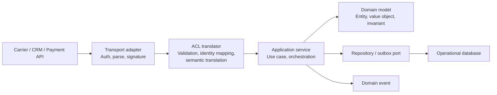
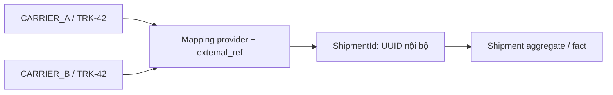
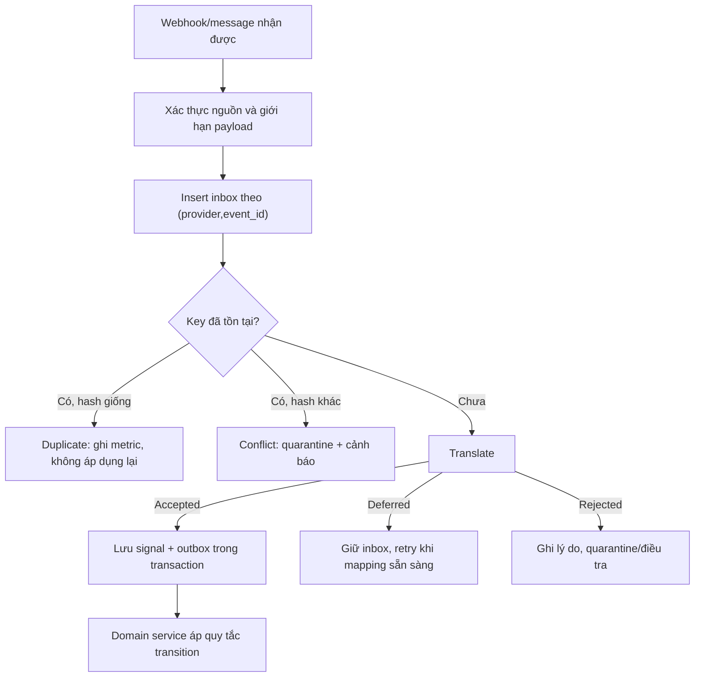

# Lớp chuyển đổi để bảo vệ mô hình khỏi cách hiểu bên ngoài

Một hệ thống bán hàng nhận webhook của hãng vận chuyển với trạng thái `DLV`, được phía đối tác gọi là **delivered**. Trong mô hình nghiệp vụ nội bộ, “hoàn tất giao hàng” lại yêu cầu **bằng chứng bàn giao được xác minh**, không chỉ một dòng trạng thái do tài xế cập nhật. Nếu API adapter lấy ngay chuỗi `DLV` rồi gán `order.status = COMPLETED`, một từ giống nhau đã che giấu **hai khái niệm khác nhau**.

Một ví dụ khác: đối tác báo `totalAmount = 125000` theo **đơn vị tiền nhỏ nhất**, còn mô hình bán hàng dùng `Money(amount, currency)` và phân biệt doanh thu hàng hóa, thuế, phí giao. Nếu đổi thẳng `125000` thành “doanh thu 125.000 VND”, báo cáo có thể ghi nhận sai cả đơn vị lẫn bản chất số tiền.

Giải pháp thường dùng trong thiết kế miền là **lớp chống nhiễm mô hình** (*Anti-Corruption Layer — ACL*): một ranh giới có trách nhiệm **hiểu hợp đồng bên ngoài, kiểm tra và chuyển đổi ngữ nghĩa sang ngôn ngữ của mô hình nội bộ**, để sự thay đổi, mơ hồ hay sai lệch của đối tác không lan trực tiếp vào entity, schema và quy tắc cốt lõi.

Bài thuộc chương **Ranh giới và tích hợp** của module **DATABASE_DATA_MODELING**. Mục tiêu của module là chuyển yêu cầu nghiệp vụ thành thực thể, quan hệ, khóa, ràng buộc và lược đồ vật lý rõ ràng; đánh giá mô hình quan hệ, document, đồ thị và phân tích để cấu trúc có thể tiến hóa và kiểm chứng. Vì vậy, ta sẽ xem ACL **không chỉ là mã mapping DTO** mà còn là quyết định **ai sở hữu ý nghĩa dữ liệu**, cách lưu định danh và provenance, bảo vệ invariant, xử lý event đến trễ và duy trì tính đúng của dữ liệu ở các hệ tích hợp.

## 1. Khi nào một lớp chuyển đổi thực sự cần thiết?

Ranh giới xuất hiện khi hai bên có **ngôn ngữ và quy tắc nghiệp vụ độc lập** (*bounded contexts*) hoặc vòng đời dữ liệu không đồng nhất.

| Ngữ cảnh ngoài | Ngữ cảnh nội bộ | Rủi ro nếu nối thẳng |
| --- | --- | --- |
| Hãng vận chuyển: `DLV` nghĩa là tài xế báo đã giao | Đơn hàng: hoàn tất khi có bằng chứng nhận hàng thỏa chính sách | Đơn bị đóng sớm, khiếu nại bị bỏ qua |
| Cổng thanh toán: `AUTHORIZED` nghĩa là tiền được giữ hạn mức | Kế toán: doanh thu hoặc tiền đã thu cần quy tắc capture/settlement | Ghi nhận doanh thu trước khi tiền được thu |
| CRM: `customer_id = "42"` trong namespace CRM | Domain: `CustomerId` là định danh nội bộ | Nhầm `"42"` của CRM với `"42"` của POS |
| Đối tác: số tiền `1999` tính bằng cent | Domain: `Money` có đơn vị tiền và scale xác định | Sai tiền do nhân/chia 100 hoặc trộn currency |
| Nguồn: `NULL` là “không gửi trường” trong PATCH | Domain: xóa giá trị là thao tác có chủ đích | Bị xóa dữ liệu khi cập nhật từng phần |
| Đối tác: thời điểm là giờ địa phương, không kèm múi giờ | Domain: `Instant` UTC, cộng thêm ngày nghiệp vụ nếu cần | Gắn sai ngày chốt, TTL, kỳ báo cáo |
| Nguồn: một “đơn” gồm nhiều gói vận chuyển | Domain: một đơn có thể có nhiều shipment | Mất bản ghi hoặc vi phạm cardinality |

**Không phải mọi lần gọi REST đều cần một ACL lớn.** Nếu hai hợp đồng thực sự có cùng ý nghĩa và được quản trị chung, một adapter đơn giản có thể đủ. ACL có giá trị khi cần **bảo vệ mô hình cốt lõi khỏi cách hiểu, thay đổi hoặc sai lệch** mà nhóm bên ngoài không kiểm soát.

### 1.1. Phân biệt chuyển đổi cú pháp và chuyển đổi ngữ nghĩa

- **Cú pháp:** JSON `"2026-11-22T09:00:00Z"` → `Instant`; JSON string → enum hoặc mã đã kiểm tra.
- **Ngữ nghĩa:** “carrier báo đã giao” → **một tín hiệu từ hãng**, **không** phải “khách đã xác nhận nhận”; `AUTHORIZED` → **đã cấp phép**, không phải “đã thanh toán”.
- **Định danh:** `external_tracking_no` → `ShipmentId` nội bộ qua bảng mapping; không ép tracking number thành UUID của domain.
- **Cấu trúc:** một event đối tác có thể cần tách thành nhiều khái niệm domain, hoặc nhiều message ngoài mới đủ để kết luận một trạng thái nội bộ.
- **Chính sách:** mã ngoài không biết hoặc dữ liệu thiếu → từ chối/cách ly/chờ bổ sung theo quy tắc; không ngầm chọn giá trị gần giống.

Một mapper chỉ đổi tên `customerId` thành `customer_id` chưa chắc là ACL. Giá trị của ACL nằm ở **quyết định ý nghĩa**.

## 2. Thiết kế chiều phụ thuộc: domain không biết kiểu của đối tác

Kiến trúc khuyến nghị tách các vai trò:



**Mũi tên phụ thuộc ở mã nguồn phải được kiểm soát:** domain type không import SDK hay enum do hãng vận chuyển phát hành. Adapter và ACL được phép phụ thuộc vào hợp đồng ngoài và các **port** do phía trong sở hữu; domain không nên đổi class chỉ vì hãng đổi `"DLV"` thành `"DELIVERED"`.

| Thành phần | Trách nhiệm chính | Không nên làm |
| --- | --- | --- |
| **Transport adapter** | HTTP/Kafka/file, xác thực nguồn, parse JSON, giới hạn kích thước, mã phản hồi | Tự đổi trạng thái aggregate theo tên trường JSON |
| **External DTO** | Thể hiện chính xác contract của nguồn theo version | Trở thành entity cốt lõi chỉ vì tiện deserialize |
| **ACL translator** | Chuẩn hóa, kiểm tra, tra ID, phân loại và diễn giải ý nghĩa, tạo lệnh/tín hiệu nội bộ | Gán mặc định gây mất ý nghĩa; tự thay rule domain |
| **Application service** | Điều phối transaction, idempotency, gọi domain, xử lý kết quả translator | Phụ thuộc rải rác vào mọi mã enum ngoài |
| **Domain model** | Quy tắc nghiệp vụ, aggregate, invariant, danh tính và trạng thái thật | Biết `carrierCode`, JSON field, HTTP status của vendor |
| **Repository/outbox** | Lưu theo model, transaction và phát message đáng tin | Coi raw payload là schema domain |

ACL có thể nằm cùng service với adapter hoặc là một thành phần độc lập; không bắt buộc tạo microservice mới. **Tách trách nhiệm logic trước**, chỉ tách tiến trình khi có yêu cầu vận hành đủ mạnh.

## 3. Xác định hợp đồng của miền trước khi xem JSON ngoài

Trong ví dụ giao hàng, miền nội bộ có các định nghĩa:

| Khái niệm miền | Định nghĩa cần bảo vệ |
| --- | --- |
| `ShipmentId` | Định danh lô/gói vận chuyển do hệ nội bộ quản lý |
| `DeliveryReported` | Hãng thông báo giao hàng thành công; chưa chứng minh người nhận được xác minh |
| `ProofOfDeliverySubmitted` | Hãng gửi một tham chiếu bằng chứng bàn giao; chưa có nghĩa bằng chứng đã được phê duyệt |
| `ReturnedToSender` | Hãng báo đang/đã trả hàng về người gửi theo contract cụ thể |
| `MovementObserved` | Hãng báo có quét vận chuyển; không đồng nghĩa đã giao |
| `DeliveryConfirmed` | Domain đã kiểm tra những điều kiện xác nhận bàn giao theo chính sách nghiệp vụ |

Một tên event không phải sự thật tuyệt đối. `ProofOfDeliverySubmitted` chỉ cho biết **nguồn đã nộp tham chiếu**; bước xác minh chữ ký, vị trí, người nhận hay chứng từ có thể nằm ở một quy trình khác. Không chuyển `POD` trực tiếp thành `DeliveryConfirmed`.

### 3.1. Bảng chuyển đổi theo ngữ nghĩa

Giả sử hãng `CARRIER_A` có hợp đồng ví dụ:

| Mã nguồn | Nghĩa đã xác minh trong contract nguồn | Tín hiệu domain đề xuất | Xử lý nếu thiếu dữ liệu |
| --- | --- | --- | --- |
| `SCAN` | Có lượt quét trong quá trình vận chuyển | `MovementObserved` | Thiếu thời điểm/ID → từ chối |
| `DLV` | Hãng đánh dấu đã giao | `DeliveryReported` | Không tự hoàn tất đơn |
| `POD` | Hãng gửi tham chiếu bằng chứng giao | `ProofOfDeliverySubmitted` | Thiếu tham chiếu → từ chối/cách ly |
| `RTS` | Báo trả hàng về người gửi | `ReturnedToSender` | Domain xử lý mâu thuẫn với trạng thái hiện tại |
| Mã mới/chưa biết | Chưa có định nghĩa đáng tin | **Không suy đoán** | Quarantine/alert, bổ sung translator theo version |

Bảng này là **hợp đồng minh họa**, không phải khẳng định các mã `DLV`, `POD`, `RTS` có cùng nghĩa ở mọi hãng. Khi thêm hãng B, cần một map được kiểm chứng riêng thay vì dùng chung chuỗi status chỉ vì trông giống nhau.

### 3.2. Một trường ngoài có thể không có một đối tượng nội bộ tương ứng

Nếu đối tác gửi `order_status = "COMPLETE"`, cần hỏi:

1. “Complete” nghĩa là hoàn tất xử lý kho, hoàn tất thanh toán, hay khách đã nhận?
2. Một order có thể có nhiều shipment chưa hoàn tất không?
3. Giá trị có thể bị đảo/reverse sau đó không?
4. Có bằng chứng nào trong payload hoặc API tra cứu khác để xác nhận?

Đáp án có thể là **tạo một IntegrationSignal để domain xử lý** hoặc **chờ dữ liệu bổ sung**, không nhất thiết là set enum tương ứng. ACL không ép ngữ nghĩa nhiều-một bằng phép đổi tên nếu phép đổi tên làm mất thông tin.

## 4. Phân biệt ba kết quả của translation

Không phải mọi input đều hợp lệ hoặc có thể chuyển thành ngay một domain event.

| Kết quả | Ý nghĩa | Hành vi tiếp theo |
| --- | --- | --- |
| **Accepted** | Hợp đồng nguồn hợp lệ, ánh xạ được ID và ngữ nghĩa | Gửi tín hiệu/lệnh nội bộ vào application service |
| **Deferred** | Message hợp lệ nhưng thiếu dependency có thể tới sau (ví dụ mapping tracking → ShipmentId) | Giữ trong inbox, retry theo lịch/backoff; không mất raw event |
| **Rejected/Quarantined** | Không hợp đồng, mã chưa hỗ trợ, dữ liệu bất hợp lệ hoặc xung đột | Lưu lý do có kiểm soát, alert/điều tra; không tự ép nghĩa |

Không để code:

```java
// Anti-pattern: mọi mã không biết bị coi là một trạng thái thành công.
if ("DLV".equals(externalCode)) {
    order.setStatus(OrderStatus.COMPLETED);
} else {
    order.setStatus(OrderStatus.IN_TRANSIT);
}
```

Đoạn trên cùng lúc vi phạm ba điều: `DLV` bị hiểu quá mức, mã `POD/RTS` bị diễn giải sai và mã lạ bị rơi vào trạng thái mặc định. Hãy **phân loại kết quả** trước khi thay đổi aggregate.

## 5. Ví dụ Java 17+ tự chứa: chuyển event của hãng vận chuyển

Ví dụ sử dụng Java 17, không cần framework hay thư viện bên ngoài. `ExternalCarrierEvent` là DTO của hợp đồng `CARRIER_A`; domain chỉ thấy `ShipmentId` và các tín hiệu có ngữ nghĩa nội bộ. Translator trả về `Accepted`, `Deferred` hoặc `Rejected` mà không tự cập nhật database.

Lưu toàn bộ chương trình sau vào `CarrierTranslationDemo.java`:

```java
import java.time.Instant;
import java.time.format.DateTimeParseException;
import java.util.Map;
import java.util.Objects;
import java.util.UUID;

public class CarrierTranslationDemo {

    // DTO thuộc biên ngoài, không đem vào domain entity.
    record ExternalCarrierEvent(
        String eventId,
        String trackingNumber,
        String statusCode,
        String occurredAt,
        String proofReference
    ) {}

    record ShipmentId(UUID value) {
        ShipmentId {
            Objects.requireNonNull(value, "shipmentId");
        }
    }

    record SourceEventKey(String provider, String eventId) {
        SourceEventKey {
            provider = required(provider, "provider");
            eventId = required(eventId, "eventId");
        }
    }

    record ProofReference(String value) {
        ProofReference {
            value = required(value, "proofReference");
        }
    }

    // Tập tín hiệu mà miền chấp nhận; không chứa mã trạng thái vendor.
    sealed interface ShipmentSignal
        permits MovementObserved, DeliveryReported,
                ProofOfDeliverySubmitted, ReturnedToSender {}

    record MovementObserved(ShipmentId shipment, Instant at)
        implements ShipmentSignal {}

    record DeliveryReported(ShipmentId shipment, Instant at)
        implements ShipmentSignal {}

    record ProofOfDeliverySubmitted(
        ShipmentId shipment, ProofReference proof, Instant at
    ) implements ShipmentSignal {}

    record ReturnedToSender(ShipmentId shipment, Instant at)
        implements ShipmentSignal {}

    // Giữ nguồn để audit/dedup ở application/integration layer.
    record NormalizedMessage(
        SourceEventKey source, ShipmentSignal signal
    ) {}

    sealed interface TranslationResult
        permits Accepted, Deferred, Rejected {}

    record Accepted(NormalizedMessage message)
        implements TranslationResult {}

    record Deferred(String reason) implements TranslationResult {}

    record Rejected(String reason) implements TranslationResult {}

    // Port do phía trong sở hữu. Thực tế triển khai bằng repository/mapping.
    interface ShipmentLookup {
        ShipmentId find(String provider, String trackingNumber);
    }

    static String trimToEmpty(String raw) {
        return raw == null ? "" : raw.strip();
    }

    static String required(String raw, String field) {
        String s = trimToEmpty(raw);
        if (s.isEmpty()) {
            throw new IllegalArgumentException(field + " is blank");
        }
        return s;
    }

    static TranslationResult translate(
        String provider,
        ExternalCarrierEvent input,
        ShipmentLookup lookup
    ) {
        Objects.requireNonNull(lookup, "lookup");

        // Contract này chỉ dành cho CARRIER_A.
        if (!"CARRIER_A".equals(provider)) {
            return new Rejected("UNSUPPORTED_PROVIDER");
        }
        if (input == null) {
            return new Rejected("EMPTY_PAYLOAD");
        }

        String sourceId = trimToEmpty(input.eventId());
        String tracking = trimToEmpty(input.trackingNumber());
        String status = trimToEmpty(input.statusCode());

        if (sourceId.isEmpty() || tracking.isEmpty()
            || status.isEmpty()) {
            return new Rejected("MISSING_REQUIRED_FIELD");
        }

        Instant eventTime;
        try {
            // Yêu cầu UTC ISO-8601 có offset/Z; không đoán timezone.
            eventTime = Instant.parse(
                required(input.occurredAt(), "occurredAt")
            );
        } catch (DateTimeParseException
                 | IllegalArgumentException e) {
            return new Rejected("INVALID_EVENT_TIME");
        }

        // Mã ngoài lạ bị từ chối, không fallback thành IN_TRANSIT.
        if (!status.equals("SCAN") && !status.equals("DLV")
            && !status.equals("POD") && !status.equals("RTS")) {
            return new Rejected("UNSUPPORTED_STATUS_CODE");
        }
        if (status.equals("POD")
            && trimToEmpty(input.proofReference()).isEmpty()) {
            return new Rejected("MISSING_PROOF_REFERENCE");
        }

        ShipmentId shipment = lookup.find(provider, tracking);
        if (shipment == null) {
            // Mapping có thể được nạp sau: giữ event và xử lý lại.
            return new Deferred("SHIPMENT_MAPPING_NOT_READY");
        }

        ShipmentSignal signal = switch (status) {
            case "SCAN" -> new MovementObserved(shipment, eventTime);
            case "DLV" -> new DeliveryReported(shipment, eventTime);
            case "POD" -> new ProofOfDeliverySubmitted(
                shipment,
                new ProofReference(input.proofReference()),
                eventTime
            );
            case "RTS" -> new ReturnedToSender(shipment, eventTime);
            default -> throw new IllegalStateException(
                "Status prevalidation failed"
            );
        };

        return new Accepted(
            new NormalizedMessage(
                new SourceEventKey(provider, sourceId),
                signal
            )
        );
    }

    record TrackingKey(String provider, String tracking) {}

    public static void main(String[] args) {
        ShipmentId shipment = new ShipmentId(
            UUID.fromString("68221ee1-2a88-46ef-b6de-e3498bf36929")
        );
        Map<TrackingKey, ShipmentId> mapping = Map.of(
            new TrackingKey("CARRIER_A", "TRK-42"), shipment
        );
        ShipmentLookup lookup = (provider, tracking) ->
            mapping.get(new TrackingKey(provider, tracking));

        TranslationResult reported = translate(
            "CARRIER_A",
            new ExternalCarrierEvent(
                "evt-01", "TRK-42", "DLV",
                "2030-05-01T10:00:00Z", null
            ),
            lookup
        );
        System.out.println(reported);
        // Accepted(DeliveryReported), KHÔNG phải DeliveryConfirmed.

        TranslationResult proof = translate(
            "CARRIER_A",
            new ExternalCarrierEvent(
                "evt-02", "TRK-42", "POD",
                "2030-05-01T10:05:00Z", "proof-123"
            ),
            lookup
        );
        System.out.println(proof);
        // Accepted(ProofOfDeliverySubmitted); cần kiểm chứng riêng.

        System.out.println(translate(
            "CARRIER_A",
            new ExternalCarrierEvent(
                "evt-03", "TRK-UNKNOWN", "RTS",
                "2030-05-02T01:00:00Z", null
            ),
            lookup
        )); // Deferred: chưa có mapping.

        System.out.println(translate(
            "CARRIER_A",
            new ExternalCarrierEvent(
                "evt-04", "TRK-42", "NEW_CODE",
                "2030-05-02T02:00:00Z", null
            ),
            lookup
        )); // Rejected: mã chưa hỗ trợ.
    }
}
```

### 5.1. Điều gì đã được bảo vệ?

- **Không rò SDK/DTO:** domain dùng `ShipmentId` và `ShipmentSignal`, không import `ExternalCarrierEvent`.
- **Không nhầm ý nghĩa:** `DLV` thành `DeliveryReported`; `POD` thành `ProofOfDeliverySubmitted`, chưa có event nào tự xác nhận đơn hàng hoàn tất.
- **Không ép tracking number thành ID:** tra cứu qua một `ShipmentLookup` với namespace provider.
- **Không tự bịa giá trị:** timestamp phải parse được; proof bắt buộc với `POD`; mã mới bị từ chối có tên lý do.
- **Phân biệt thiếu dependency:** mapping chưa sẵn sàng → `Deferred`, khác payload sai → `Rejected`.
- **Ghi nhận nguồn:** `SourceEventKey(provider,eventId)` giúp xử lý một event lặp lại và audit ở tầng integration.

Đây là chương trình minh họa, **không tự xử lý webhook authentication, transaction, retry hay persist**. Chúng thuộc adapter/application/infrastructure; cần triển khai thêm để hệ thống đáng tin khi chạy thật.

### 5.2. Vì sao không dùng một enum trạng thái thống nhất?

Nếu tạo enum chung `IN_TRANSIT, DELIVERED, RETURNED` rồi bắt cả carrier, warehouse, sales và customer support dùng chung, sự khác nhau của “delivered” bị che đi. Model cốt lõi cần sở hữu ngôn ngữ của nó; từng đối tác có thể có mã và workflow riêng ở ranh giới.

Một nguồn có thể gửi nhiều event cho một domain state, hoặc một event cần đối chiếu trạng thái trước đó mới biết có thể áp dụng hay không. **Mapping không bắt buộc 1–1**.

## 6. Dùng ACL để bảo vệ kiểu dữ liệu, đơn vị và ràng buộc

Chuyển đổi semantic không chỉ áp dụng với status:

| Nhóm | Giá trị ngoài | Domain mong muốn | Kiểm tra bắt buộc |
| --- | --- | --- | --- |
| Tiền | `125000` “minor units”, `currency=VND` | `Money(125000, VND)` nếu quy ước minor unit là 1 VND | ISO currency, exponent theo policy, không suy từ locale |
| Tiền | `1999` “cents”, `currency=USD` | `Money(19.99, USD)` hoặc lưu nguyên 1999 cent | Đúng scale, không dùng `double` cho tiền |
| Khối lượng | `2500` gram | `Weight(2.5 kg)` nếu domain dùng kg | Đơn vị, giá trị âm, làm tròn |
| Thời gian | `"01/05/2030 17:00"` không timezone | `Instant` hoặc `LocalDateTime` có context | Không đoán UTC; hỏi offset/zone của contract |
| Danh tính | `tracking="TRK-42"` | `ShipmentId(UUID)` | Đúng provider, phiên bản mapping, tránh collision |
| Nullable field | Thiếu `address` trong PATCH | “Giữ nguyên” nếu contract định nghĩa omitted như vậy | Phân biệt field thiếu, explicit null và giá trị rỗng |
| Trạng thái | `"CLOSED"` ở ticket ngoài | Domain có nhiều lý do đóng | Không gán `RESOLVED` nếu không có resolution |
| Cardinality | Đối tác một order có nhiều kiện | Domain `Order` có tập `Shipment` | Không lấy một kiện đầu tiên và bỏ phần còn lại |

### 6.1. Ví dụ đổi đơn vị tiền

Nếu đối tác bảo đảm `amount_minor` và `currency` theo ISO-4217, có thể biểu diễn **giá trị gốc** một cách chính xác:

```java
import java.math.BigDecimal;
import java.util.Currency;

record Money(BigDecimal amount, Currency currency) {}

static Money fromMinor(long minorUnits, String currencyCode) {
    Currency currency = Currency.getInstance(currencyCode);
    int fractionDigits = currency.getDefaultFractionDigits();
    if (fractionDigits < 0) {
        throw new IllegalArgumentException(
            "Currency exponent not defined"
        );
    }
    return new Money(
        BigDecimal.valueOf(minorUnits, fractionDigits),
        currency
    );
}
```

Đoạn này minh họa trong class Java phù hợp, không tự là một chương trình hoàn chỉnh. **Không** áp dụng máy móc cho mọi API: đối tác có thể dùng exponent riêng, currency dạng nội bộ, cách xử lý tiền tệ phi fiat hoặc quy tắc làm tròn khác. Quan trọng nhất là **hợp đồng nguồn và chính sách tiền tệ trong miền** phải được so khớp, không suy từ tên field.

Ngay cả khi quy đổi tiền đúng, `order_total` có thể bao gồm thuế, giao hàng và voucher; nó **không tự trở thành** `net_revenue`. Nếu domain cần tách thành phần mà nguồn chỉ có tổng, ACL nên báo **không đủ thông tin** hoặc dùng API bổ sung, chứ không tự đặt tax/shipping bằng 0.

### 6.2. Giá trị thiếu không phải “không áp dụng”

Ví dụ CRM gửi `region = null`. Nó có thể nghĩa là chưa phân loại, nguồn giấu vì quyền riêng tư, hoặc địa chỉ khách không có khu vực trong mô hình đó. Nếu domain phân biệt `UNKNOWN`, `NOT_APPLICABLE` và `REDACTED`, ACL cần phân loại từ **context/metadata có thẩm quyền**; không biến mọi `null` thành “unknown” hoặc chuỗi rỗng.

Với PATCH, một field **không xuất hiện**, field xuất hiện với `null` và field xuất hiện với `""` có thể là ba thao tác khác nhau. Cần đọc hợp đồng HTTP/JSON cụ thể rồi chuyển thành các lệnh như `Unchanged`, `Clear` và `Replace(value)`; không đặt `null` vào entity trước khi xác định ý nghĩa.

## 7. Mapping danh tính giữa các hệ là một phần của mô hình dữ liệu

Một mã ngoài thường chỉ duy nhất **trong namespace của nguồn**. Ví dụ `trackingNumber="TRK-42"` của hãng A không có quan hệ mặc định với `"TRK-42"` của hãng B. Domain nên dùng danh tính có ý nghĩa và ổn định riêng, thường là surrogate ID.



Hai mã nguồn giống nhau không được tự nhập thành cùng shipment. Một mapping table điển hình cần:

- `provider` hoặc `source_system`;
- `external_tracking_no`, định dạng và quy tắc chuẩn hóa;
- `shipment_id` nội bộ;
- metadata như `created_at`, `verified_at`, version hợp đồng, nguồn đối soát;
- nếu mã ngoài được **tái sử dụng**, thêm khoảng hiệu lực/lịch sử và quy tắc ánh xạ theo thời gian.

**Điểm khó:** ánh xạ có thể là 1–N, N–1 hoặc thay đổi theo thời gian. Nếu bên ngoài quản lý một “consignment” gồm nhiều gói, không ép một mã consignment thành một `ShipmentId` khi domain có nhiều shipment. Lúc đó phải chọn cấp danh tính đúng hoặc tạo thực thể liên kết.

## 8. Thiết kế PostgreSQL: inbox, bảng mapping và tín hiệu đã chuẩn hóa

Một lớp chuyển đổi đáng tin cần **khả năng giải thích** điều gì đến từ đâu, xử lý lại được khi phụ thuộc đến trễ và chống nhân đôi sự kiện. Lược đồ PostgreSQL dưới đây là **một phương án minh họa**, không phải thiết kế bắt buộc cho mọi queue/warehouse.

### 8.1. Thực thể nội bộ và mapping ngoài

```sql
CREATE TABLE shipment (
    shipment_id UUID PRIMARY KEY,
    order_id UUID NOT NULL,
    fulfillment_state VARCHAR(32) NOT NULL
        CHECK (fulfillment_state IN (
            'CREATED', 'IN_TRANSIT', 'REPORTED_DELIVERED',
            'CONFIRMED_DELIVERED', 'RETURNED'
        )),
    version BIGINT NOT NULL DEFAULT 0 CHECK (version >= 0)
);

CREATE TABLE carrier_shipment_link (
    provider TEXT NOT NULL,
    external_tracking_no TEXT NOT NULL,
    shipment_id UUID NOT NULL REFERENCES shipment(shipment_id),
    linked_at TIMESTAMPTZ NOT NULL DEFAULT now(),
    PRIMARY KEY (provider, external_tracking_no),
    CONSTRAINT ck_tracking_nonempty CHECK (
        length(btrim(provider)) > 0
        AND length(btrim(external_tracking_no)) > 0
    )
);
```

`shipment` sử dụng **trạng thái do domain quản lý**. `carrier_shipment_link` là ánh xạ tích hợp, không phải khóa chính của shipment; điều đó cho phép đổi nhà vận chuyển mà không đổi toàn bộ danh tính nội bộ.

Lược đồ giả định một tracking number chỉ gắn một shipment **trong phạm vi đời sống dữ liệu được giữ** của một provider. Nếu mã được tái sử dụng, cần đổi unique key và thiết kế ánh xạ theo thời gian hoặc shipment lifecycle trước khi áp dụng.

`fulfillment_state` minh họa các trạng thái có thể hiển thị; **không** được cập nhật `CONFIRMED_DELIVERED` chỉ vì ACL nhận `DLV` hay `POD`. Aggregate/domain service phải kiểm tra transition hợp lệ, bằng chứng và race với return/cancellation.

### 8.2. Inbox giữ sự kiện ngoài và kết quả phân loại

```sql
CREATE TABLE carrier_inbox (
    provider TEXT NOT NULL,
    external_event_id TEXT NOT NULL,
    contract_version TEXT NOT NULL,
    received_at TIMESTAMPTZ NOT NULL DEFAULT now(),
    occurred_at TIMESTAMPTZ,
    payload_sha256 CHAR(64) NOT NULL,
    raw_payload JSONB NOT NULL,
    processing_state VARCHAR(16) NOT NULL
        DEFAULT 'RECEIVED'
        CHECK (processing_state IN (
            'RECEIVED', 'DEFERRED', 'REJECTED', 'NORMALIZED'
        )),
    reason_code TEXT,
    PRIMARY KEY (provider, external_event_id),
    CONSTRAINT ck_inbox_identity CHECK (
        length(btrim(provider)) > 0
        AND length(btrim(external_event_id)) > 0
        AND length(btrim(contract_version)) > 0
    )
);

CREATE INDEX ix_carrier_inbox_pending
    ON carrier_inbox (processing_state, received_at)
    WHERE processing_state IN ('RECEIVED', 'DEFERRED');
```

Lợi ích:

1. `(provider, external_event_id)` làm **dedup key**, với điều kiện hợp đồng xác nhận ID là duy nhất trong phạm vi đó. Nếu provider tái sử dụng event ID theo account/tenant, phải thêm namespace thích hợp.
2. `payload_sha256` hỗ trợ phân biệt **retry cùng nội dung** với **xung đột cùng ID nhưng payload khác**; không dùng hash thay cho định danh có thẩm quyền.
3. `raw_payload` chỉ nhằm audit/reprocess trong giới hạn retention và quyền truy cập. Không lưu bí mật, PII, token hoặc bằng chứng nhạy cảm không cần thiết vào log không bảo vệ.
4. `processing_state` và `reason_code` cho phép theo dõi deferred/rejected thay vì trả HTTP 200 rồi đánh mất event.

**Chú ý:** nếu cần chữ ký số của webhook, kiểm tra chữ ký trên **raw bytes gốc** trước khi parse/chuẩn hóa JSON; `JSONB` có thể thay đổi cách biểu diễn thứ tự field/spacing nên không dùng giá trị đã parse để tái tạo thông điệp cho xác minh chữ ký. Có thể lưu một hash của raw bytes đã nhận và chỉ giữ payload đã làm sạch theo chính sách.

### 8.3. Tín hiệu nội bộ đã chuẩn hóa

```sql
CREATE TABLE shipment_signal (
    provider TEXT NOT NULL,
    external_event_id TEXT NOT NULL,
    shipment_id UUID NOT NULL REFERENCES shipment(shipment_id),
    signal_kind VARCHAR(32) NOT NULL,
    event_time TIMESTAMPTZ NOT NULL,
    proof_reference TEXT,
    normalized_at TIMESTAMPTZ NOT NULL DEFAULT now(),

    PRIMARY KEY (provider, external_event_id),
    FOREIGN KEY (provider, external_event_id)
        REFERENCES carrier_inbox(provider, external_event_id),
    CONSTRAINT ck_signal_kind CHECK (
        signal_kind IN (
            'MOVEMENT_OBSERVED',
            'DELIVERY_REPORTED',
            'PROOF_SUBMITTED',
            'RETURNED_TO_SENDER'
        )
    ),
    CONSTRAINT ck_signal_proof_shape CHECK (
        (
            signal_kind = 'PROOF_SUBMITTED'
            AND proof_reference IS NOT NULL
            AND length(btrim(proof_reference)) > 0
        )
        OR
        (
            signal_kind <> 'PROOF_SUBMITTED'
            AND proof_reference IS NULL
        )
    )
);

CREATE INDEX ix_shipment_signal_timeline
    ON shipment_signal (shipment_id, event_time, external_event_id);
```

Ràng buộc `ck_signal_proof_shape` ngăn một bản `PROOF_SUBMITTED` thiếu tham chiếu và ngăn cột proof trôi sang tín hiệu khác trong ví dụ này. Nếu nguồn thật cho phép thêm proof trên `DLV`, hợp đồng cần thiết kế lại thay vì âm thầm bỏ thông tin.

Các dòng `shipment_signal` là **bằng chứng/tín hiệu từ nguồn**; chưa nhất thiết là lịch sử state transition cuối cùng của aggregate. Tách hai khái niệm để sau này có thể sửa logic xác minh mà vẫn giữ nguồn gốc dữ liệu.

## 9. Xử lý trùng, retry và transaction

Webhooks/message bus có thể giao lại một sự kiện do timeout, retry hoặc consumer restart. **At-least-once delivery** là giả định vận hành an toàn thường dùng; đừng xây logic dựa trên việc source chắc chắn gửi đúng một lần.

Một workflow có thể là:



### 9.1. Không chỉ dùng `ON CONFLICT DO NOTHING` rồi quên

Ví dụ insert nguyên tắc:

```sql
INSERT INTO carrier_inbox (
    provider, external_event_id, contract_version,
    payload_sha256, raw_payload
) VALUES (
    'CARRIER_A', 'evt-01', 'v1',
    '0123456789abcdef0123456789abcdef0123456789abcdef0123456789abcdef',
    '{"eventId":"evt-01","statusCode":"DLV"}'::jsonb
)
ON CONFLICT (provider, external_event_id)
    DO NOTHING
RETURNING provider, external_event_id;
```

Nếu `RETURNING` có hàng, đó là một inbox entry mới. Nếu không có, phải **đọc lại entry đã có và so hash/payload policy**: trùng đúng → kết thúc idempotent; trùng key nhưng nội dung khác → conflict, không lặng lẽ bỏ một correction. Hash nên được tính từ raw bytes hoặc biểu diễn canonical được quy định; không trộn hai cách băm rồi báo conflict giả.

### 9.2. Ranh giới transaction

Trong một PostgreSQL database, việc chuyển inbox từ RECEIVED → NORMALIZED, tạo `shipment_signal` và ghi **outbox message** có thể thực hiện trong **một transaction**. Consumer khác xuất outbox ra message broker và có thể retry. Nhờ vậy, hệ thống tránh tình huống “đã cập nhật DB nhưng crash trước khi gửi event” theo mô hình outbox được triển khai đúng.

Lược đồ outbox tối thiểu:

```sql
CREATE TABLE integration_outbox (
    outbox_id UUID PRIMARY KEY,
    provider TEXT NOT NULL,
    external_event_id TEXT NOT NULL,
    shipment_id UUID NOT NULL REFERENCES shipment(shipment_id),
    message_kind TEXT NOT NULL,
    message_body JSONB NOT NULL,
    created_at TIMESTAMPTZ NOT NULL DEFAULT now(),
    published_at TIMESTAMPTZ,
    UNIQUE (provider, external_event_id),
    FOREIGN KEY (provider, external_event_id)
        REFERENCES shipment_signal(provider, external_event_id)
);
```

Để **không tạo outbox thừa**, implementation phải kiểm tra insert `shipment_signal` thực sự là mới/đủ điều kiện; sử dụng transaction, unique constraint và idempotent application logic. Một outbox message đã gửi nhưng chưa đánh dấu `published_at` có thể bị phát lại sau crash, vì vậy **consumer vẫn phải idempotent**. Transactional outbox không tự tạo “exactly once” end-to-end qua nhiều hệ.

### 9.3. Xử lý song song và ordering

Hai sự kiện cùng shipment có thể đến ngược thứ tự:

```text
event_time 10:00:00  Carrier: DLV
event_time 10:01:00  Carrier: POD

arrival 10:02:00     POD tới trước
arrival 10:05:00     DLV tới sau do retry
```

Nếu application service gán `shipment.state = REPORTED_DELIVERED` mỗi khi nhận `DLV`, nó có thể **hạ trạng thái** sau khi đã có bằng chứng được xác minh. Domain phải kiểm tra state transition theo **version, event time, business rule và mức tin cậy của bằng chứng**, không dựa đơn thuần vào thứ tự arrival.

Trường hợp đảo ngược/return, chargeback, callback correction có thể cần một event mới có ý nghĩa riêng. Không giải quyết bằng “luôn chọn trạng thái có ordinal enum lớn nhất” vì workflow thường **không đơn điệu** và có đường hoàn/đảo trạng thái hợp lệ.

## 10. Ranh giới dữ liệu: raw, normalized và domain state

Ba lớp dữ liệu khác nhau phục vụ ba câu hỏi khác nhau:

| Lớp | Câu hỏi trả lời | Ví dụ | Tính chất |
| --- | --- | --- | --- |
| **Raw/inbox** | Nguồn đã gửi cái gì, lúc nào, theo contract nào? | `statusCode="DLV"`, raw hash, receivedAt | Bất biến/audit có retention và kiểm soát PII |
| **Normalized integration event** | Ta đã hiểu tín hiệu ấy thế nào sau dịch? | `DeliveryReported(ShipmentId, at)` | Mã/ID và ý nghĩa phía trong đã được kiểm tra |
| **Domain state/ledger** | Sau khi áp mọi quy tắc, shipment hiện có trạng thái gì? | `IN_TRANSIT`, `CONFIRMED_DELIVERED`, version | Cập nhật qua aggregate/application transaction |

Không nên dùng một cột `carrier_status` trong bảng `shipment` rồi cho tất cả báo cáo/ứng dụng đọc trực tiếp nó như chân lý nội bộ. Domain state có thể phụ thuộc **nhiều nguồn**: hãng vận chuyển, kho, khách xác nhận, xử lý khiếu nại, bằng chứng đã duyệt.

### 10.1. Bảng mapping không phải domain entity

`carrier_shipment_link` nên thuộc dữ liệu tích hợp hoặc repository mapping. Nó giúp trả lời “mã theo hãng A tương ứng shipment nào?” nhưng không nhất thiết trở thành một thuộc tính của `Order` dùng ở mọi use case.

**Ngoại lệ:** nếu tracking number có ý nghĩa nghiệp vụ cốt lõi (tra cứu hỗ trợ khách, xác nhận bàn giao), domain có thể cần một value object `TrackingNumber`. Điều đó **không** có nghĩa domain phụ thuộc vào class SDK hoặc tự biết cú pháp mã lỗi của hãng A. Ranh giới được xác định theo **sở hữu khái niệm**, không phải quy tắc “cấm mọi field từ bên ngoài”.

## 11. Lưu ý về thời gian và lịch sử

Các mốc thời gian thường xuất hiện cùng một event:

- `occurred_at`: nguồn tuyên bố sự kiện **đã xảy ra** lúc nào;
- `received_at`: hệ thống nhận message lúc nào;
- `normalized_at`: ACL xử lý thành công khi nào;
- `effective_at`: domain chọn thời điểm nào để hiệu lực nghiệp vụ, nếu có;
- `published_at`: integration outbox thực sự gửi đi lúc nào.

Chúng **không thay thế nhau**. Nếu nguồn gửi local time không kèm múi giờ, `Instant.parse` không thể suy đúng thời điểm; nên từ chối hoặc tra theo timezone hợp đồng đáng tin. Khi đồng bộ đa vùng, đổi giờ mùa hè và thứ tự event đến muộn là nguồn sai lệch lớn.

Với kho phân tích, cần xác định:

1. Sự kiện được phân vùng theo thời điểm nào (`occurred_at` hay `received_at`)?
2. Một signal được xác minh muộn có cần **restatement** báo cáo tháng trước?
3. Khi đối tác sửa event gốc, warehouse lưu revision hay ghi đè?
4. Báo cáo “đã giao hôm qua” dựa vào **hãng thông báo**, **bằng chứng nộp** hay **domain xác nhận**?

Một ACL tốt giúp phân biệt **event nguồn** với **sự thật nghiệp vụ đã được xác nhận**; do đó tránh một dashboard “Delivered” có mẫu số khác với hệ chăm sóc khách hàng mà không ai biết.

## 12. Hợp đồng thay đổi và nhiều version

Hãng A có thể đổi từ:

```json
{
  "eventId": "evt-01",
  "trackingNumber": "TRK-42",
  "statusCode": "DLV",
  "occurredAt": "2030-05-01T10:00:00Z"
}
```

sang:

```json
{
  "event_id": "evt-01",
  "tracking_no": "TRK-42",
  "delivery_status": "DELIVERED_TO_SAFE_PLACE",
  "event_time_ms": 1903860000000,
  "schema_version": 2
}
```

**Đây chỉ là payload minh họa, không phải contract hãng thật.** Mã `DELIVERED_TO_SAFE_PLACE` có thể không đồng nghĩa “khách đã nhận”. `event_time_ms` phải được hiểu rõ là Unix epoch **millisecond**, không phải second. Trước khi viết translator v2, phải xác minh semantics và đơn vị thay vì đổi tên field rồi dùng code v1.

Một cấu trúc triển khai:

```text
Carrier A v1 DTO/parser -> CarrierATranslatorV1 -> internal signal
Carrier A v2 DTO/parser -> CarrierATranslatorV2 -> internal signal
Carrier B v3 DTO/parser -> CarrierBTranslatorV3 -> internal signal
                                             |
                                             v
                                    Domain application port
```

Trong giai đoạn chuyển phiên bản, inbox nên lưu version gốc. Khi reprocess event cũ, chọn đúng translator v1 hoặc một migration đã được kiểm chứng. **Không luôn lấy translator mới nhất** để đọc payload lịch sử nếu semantics đã thay đổi.

### 12.1. Chuyển đổi có thể mất thông tin

Nếu chuyển `"DELIVERED_TO_SAFE_PLACE"` và `"DELIVERED_TO_RECIPIENT"` thành cùng `DeliveryReported`, ta mất khả năng phân biệt loại bàn giao. Điều đó chỉ chấp nhận khi:

- domain thực sự không cần phân biệt tại mọi use case liên quan;
- source payload hoặc metadata quan trọng được giữ an toàn để audit;
- các hệ báo cáo không cần phân tích sự khác nhau, hoặc có thêm trường normalized hỗ trợ.

Nếu phân biệt này ảnh hưởng trách nhiệm giao hàng, phải **mở rộng domain signal** hoặc giữ thuộc tính ngữ nghĩa tương ứng thay vì “nén” dữ liệu. Một mapping lossy nên được **ghi rõ và phê duyệt**, không là tác dụng phụ của code ngắn.

## 13. Kiểm thử hợp đồng của lớp chuyển đổi

Không chỉ test “JSON deserialize thành công”. Test phải xác nhận **ý nghĩa sau chuyển đổi** và cách hệ thống ứng xử khi dữ liệu ngoài xấu/đến trễ.

| Trường hợp | Kết quả mong muốn |
| --- | --- |
| `DLV` với timestamp hợp lệ và tracking có mapping | `Accepted(DeliveryReported)`, không `DeliveryConfirmed` |
| `POD` có proof reference | `Accepted(ProofOfDeliverySubmitted)`, domain vẫn xác minh proof |
| `POD` thiếu proof | `Rejected(MISSING_PROOF_REFERENCE)` |
| `RTS` sau event delivered | Signal được chấp nhận nhưng domain kiểm tra transition theo policy |
| Mã `NEW_CODE` | Rejected/quarantine, không fallback `IN_TRANSIT` |
| Timestamp thiếu offset/không parse được | Rejected, không mặc định giờ server |
| Tracking number của hãng A chưa được map | Deferred; giữ raw event để xử lý lại |
| Hai hãng dùng cùng tracking string | Không nhập làm một shipment |
| Hai webhook cùng `(provider,eventId)` và hash giống | Dedup, không nhân signal/outbox |
| Cùng event ID nhưng payload khác | Conflict/audit, không silent overwrite |
| Sự kiện đến muộn | Giữ `occurred_at` và `received_at`, domain không tự hạ trạng thái |
| Domain yêu cầu bằng chứng xác minh | `DLV` đơn lẻ không đủ để hoàn tất |
| Nguồn đổi mã v1 → v2 | Mỗi version dùng đúng translator, contract tests có fixture |
| Trường không hiện diện trong PATCH | Không tự hiểu là yêu cầu xóa |
| Giá tiền USD 1999 cents | 19.99 USD nếu contract thật xác nhận 2 số lẻ |
| `order_total` gồm tax/shipping | Không tự ghi thành `net_revenue` |
| Mapping một ngoài-nhiều nội bộ | Không mất shipment/consolidation |
| Service restart sau ghi outbox nhưng trước publish | Có thể phát lại nhưng consumer idempotent |

### 13.1. Các lớp test nên phối hợp

**Unit test translator:** dùng fixture v1/v2, kiểm tra input → `Accepted/Deferred/Rejected`, kể cả chuỗi rỗng, timestamp sai, mã lạ, dữ liệu cực trị. Test này có thể chạy không cần DB.

**Contract test:** kiểm tra fixture/schema thực của partner hoặc giao thức do hai bên thỏa thuận; đặt cảnh báo khi mã mới xuất hiện. Dựa vào contract đã xác minh, không chỉ dựa trên tên trường do người viết code suy đoán.

**Integration test:** kiểm tra mapping table, unique key inbox, FK, transaction, outbox, concurrent webhook và reprocess; xác minh một retry không làm tăng dòng `shipment_signal` hoặc count báo cáo.

**End-to-end/domain test:** chứng minh signal `DLV` không đóng đơn, proof đã được xác minh mới kích hoạt transition thích hợp; test trường hợp return/cancel tranh chấp.

**Replay test:** lấy một bộ event đã được làm sạch/anonymize, chạy translator mới trong chế độ shadow và so sánh kết quả với bản đã công bố; tránh phát lại side effect khi chỉ muốn kiểm thử.

## 14. Vận hành: quarantine, retry và quan sát chất lượng dữ liệu

Không có pipeline tích hợp nào chỉ gặp dữ liệu hợp lệ. Một ACL hoạt động tốt cần **khả năng nhìn thấy các trường hợp chưa hiểu hoặc chưa đủ dữ liệu**.

Các metric phù hợp:

- Số event `Accepted`, `Deferred`, `Rejected` theo provider, version và reason code.
- Tuổi event lâu nhất ở trạng thái `DEFERRED`, thời gian từ `received_at` đến normalized.
- Số mã status chưa được hỗ trợ và tần suất xuất hiện.
- Số xung đột cùng source event ID khác hash.
- Tỷ lệ tìm thấy mapping tracking → shipment, thời gian hoàn chỉnh mapping.
- Số signal bị domain bỏ qua do duplicate/stale/invalid transition.
- Độ trễ outbox và consumer, số retry, poison message và DLQ.
- Đối soát tổng event nhận/gửi, tổng normalized, tổng applied và số còn chờ.

**Không tự retry vô hạn mọi loại lỗi.** `Deferred(SHIPMENT_MAPPING_NOT_READY)` có thể được retry theo backoff và SLA; `Rejected(UNSUPPORTED_STATUS_CODE)` thường cần cập nhật contract/translator trước, không gửi vào một vòng lặp vô ích. Nếu bị lỗi do partner gửi event chưa ký xác thực, phải từ chối ngay tại biên bảo mật, không cố retry xử lý như dữ liệu hợp lệ.

### 14.1. Dữ liệu nhạy cảm và phân quyền

Webhook có thể chứa địa chỉ, số điện thoại, mã bằng chứng, chữ ký, URL ảnh. Trước khi lưu raw payload:

- Xác thực nguồn, giới hạn kích thước và tần suất.
- Giảm tối đa dữ liệu không cần thiết; che/mã hóa PII và secret theo chính sách.
- Phân quyền riêng cho inbox/quarantine và bảng mapping định danh.
- Thiết lập retention, quy trình xóa và audit truy cập.
- Tránh ghi toàn payload vào log lỗi hoặc metric có nhãn cardinality cao.
- Nếu chứng từ có thể chứa dữ liệu nhạy cảm, chỉ lưu **tham chiếu có quyền truy cập** và thời hạn phù hợp.

ACL là một ranh giới tin cậy **về dữ liệu và ngữ nghĩa**, không thay thế xác thực HTTP, mã hóa hay kiểm tra quyền người dùng.

## 15. Chiều chuyển đổi ngược: domain → đối tác

ACL cũng có thể bảo vệ domain khi **gửi dữ liệu ra ngoài**.

Ví dụ hệ thống nội bộ có:

```text
ShipmentReadyForPickup(shipmentId, pickupWindow, address)
```

Hãng A cần:

```json
{
  "pickup_ref": "PK-123",
  "window_start": "2030-05-02T08:00:00Z",
  "window_end": "2030-05-02T10:00:00Z",
  "service_code": "STANDARD"
}
```

Lớp chuyển đổi **outbound** cần giải quyết:

1. `ShipmentId` → `pickup_ref` của hãng theo mapping/registration;
2. `pickupWindow` trong UTC → định dạng/timezone hãng yêu cầu;
3. `service_code` chọn theo khả năng và chính sách của từng hãng;
4. payload có trường bắt buộc không? Có giới hạn chiều dài/đơn vị không?
5. Retry tạo hai booking hay dùng **idempotency key** để đối tác nhận cùng một yêu cầu?
6. Phản hồi lỗi ngoài phải thành **kết quả ứng dụng** có ý nghĩa, không làm domain phụ thuộc HTTP code cụ thể.

Chuyển đổi outbound **không nhất thiết đảo ngược được** inbound: contract nguồn và đích có thể khác cardinality, precision, default hay workflow. Không cố thiết kế một hàm `toExternal(toInternal(x)) == x` nếu thông tin bị chuẩn hóa hoặc quan hệ không 1–1.

## 16. So sánh với các lựa chọn kiến trúc khác

| Cách tiếp cận | Ý tưởng | Khi hợp lý | Nguy cơ |
| --- | --- | --- | --- |
| **Gọi thẳng DTO/SDK ngoài trong domain** | Entity dùng trực tiếp enum/field của vendor | Chỉ phù hợp đoạn thử nghiệm rất nhỏ, ngữ nghĩa trùng hoàn toàn | Tăng coupling và lan semantic sai |
| **Adapter đơn giản** | Parse/đổi trường sang một API ổn định | Contract ngoài có cùng nghĩa, ít rule | Có thể bỏ qua khác biệt business semantics |
| **Anti-Corruption Layer** | Dịch định danh, dữ liệu, workflow sang model phía trong | Hai bounded context khác nghĩa hoặc đổi độc lập | Thêm thành phần, cần test/version/observability |
| **Published Language / Open Host Service** | Hai bên thỏa thuận contract dùng chung và quản trị thay đổi | Hai tổ chức/nhóm thật sự chia sẻ một ngôn ngữ chuẩn | Vẫn có thể khác ngữ nghĩa khi đưa vào từng domain |
| **Canonical Data Model toàn doanh nghiệp** | Một schema chung cho nhiều tích hợp | Có thể giúp chuẩn hóa một số dữ liệu trao đổi | Dễ biến thành “god schema”, ép mọi bounded context dùng cùng nghĩa |
| **Data replication/CDC thuần** | Sao chép hàng bảng/đổi log | Projection, replication khi semantics đã rõ | Không tự giải quyết khác biệt meaning, lifecycle, key và time |

**Điểm quyết định:** ACL thuộc trách nhiệm của bên **muốn giữ mô hình của mình độc lập**. Bên ngoài có thể không biết sự tồn tại của nó. Nó có thể dùng DTO mapper, adapter, table mapping, translator, message handler hoặc một pipeline riêng; **tên class “Mapper” hay “ACL” không bảo đảm chất lượng thiết kế**.

## 17. Ranh giới giữa relational, document, graph và analytics

| Mô hình lưu trữ | Rủi ro khi nhận dữ liệu bên ngoài | Cách ACL giúp bảo vệ |
| --- | --- | --- |
| **Quan hệ** | FK từ ID ngoài không khớp ID nội bộ; enum ngoài ép vào `CHECK`; bỏ mất fact vì inner join | Mapping namespace → SK/PK, trạng thái đặc biệt/Deferred, constraint riêng |
| **Document** | JSON schema thay đổi, field omitted/null/empty khác nghĩa; dạng object nested không tương ứng aggregate | Versioned parser, validation, canonical domain command, giữ raw có kiểm soát |
| **Đồ thị** | Cạnh ngoài “related_to” không rõ quan hệ nghiệp vụ; một mã ngoài biểu thị nhiều đỉnh/cạnh | Chuyển thành loại quan hệ chính xác, kiểm cardinality và thời điểm hiệu lực |
| **Wide-column/KV** | Chọn partition key từ field ngoài có thể thay đổi, ID collision giữa nguồn | Canonical ID, routing version, read model theo truy vấn nội bộ |
| **Warehouse/columnar analytics** | Tổng/đơn giá/ratio bị diễn giải sai; thời điểm event và ingestion bị trộn; history restatement | Định nghĩa fact grain/measure, sự kiện normalized có provenance, version và chính sách tái lập |

Với warehouse, không nên chỉ nạp `carrier_status="DLV"` rồi đặt tên KPI **Completed Orders**. Nếu cần hai KPI, hãy định nghĩa rõ:

- `carrier_reported_deliveries`: số shipment có tín hiệu hãng đã giao, dedup theo shipment/event và thời gian theo contract;
- `confirmed_deliveries`: số shipment đã qua điều kiện xác nhận domain.

Hai KPI có thể chênh lệch hợp lệ. **Tách nghĩa** giúp số liệu đáng tin hơn so với ép đồng nhất nhãn trạng thái.

## 18. Sai lầm thường gặp và cách sửa

| Sai lầm | Hệ quả | Cách sửa |
| --- | --- | --- |
| Dùng enum vendor trong entity | Một mã mới buộc sửa domain hoặc làm vỡ runtime | Translator versioned, domain type riêng |
| `DLV` → `COMPLETED` trực tiếp | Bỏ qua bước xác minh bằng chứng | `DeliveryReported`; domain kiểm điều kiện |
| `UNKNOWN_STATUS` → `IN_TRANSIT` mặc định | Giấu sai sót, báo cáo/luồng nghiệp vụ lệch | Reject/quarantine và cảnh báo mã lạ |
| Coi ID ngoài là ID nội bộ | Collision, khó đổi vendor, sai ranh giới thực thể | Mapping theo provider/namespace |
| Chỉ đổi tên field và gọi đó là ACL | Không xử lý meaning, precision, cardinality | Viết bảng semantic mapping và invariant |
| Số tiền minor unit bị chia 100 vô điều kiện | Sai tiền tệ/exponent hoặc ý nghĩa total | Contract currency/units + Money |
| Thiếu timezone thì dùng giờ server | Sai thứ tự và kỳ báo cáo | Xác minh timezone hoặc reject |
| Raw payload lưu vào mọi entity domain | Dính coupling, PII và schema vendor | Inbox/audit có quyền và retention riêng |
| Không giữ event ID/correlation | Retry nhân đôi tín hiệu/doanh thu | Dedup key có namespace, outbox/inbox |
| Cùng ID nhưng hash khác bị bỏ qua | Mất correction hoặc phát hiện data corruption | Phân loại conflict và audit |
| Mapping tracking đến muộn bị xem là payload sai | Mất sự kiện hợp lệ | Deferred + retry/reconciliation |
| Domain state chỉ lấy event cuối cùng **đến** | Event cũ có thể hạ trạng thái | Kiểm state transition/version/occurred time |
| Chỉ cập nhật translator mới cho payload cũ | Replay sai nghĩa khi contract đã đổi | Dùng đúng translator/schema version |
| Coi ACL là microservice bắt buộc | Thêm latency/operational cost không cần thiết | Ranh giới logic rõ trước; tách deploy khi cần |
| Mọi lỗi đều retry vô hạn | Poison message chiếm tài nguyên | Phân biệt transient/unknown/permanent |
| Test chỉ có happy path | Không phát hiện mất nghĩa dưới dữ liệu xấu | Unit + contract + integration + replay |

## 19. Bài tập thực hành

### Bài tập A — Hãng vận chuyển đổi trạng thái

Hãng A thêm `SAFE_DROP` (đặt hàng tại vị trí an toàn, không giao trực tiếp cho người nhận), còn domain chỉ cho phép “xác nhận giao tận tay” nếu có xác minh.

Hãy đề xuất tín hiệu domain riêng hoặc quy trình chờ xác minh, xác định dữ liệu cần có, sửa bảng translator và cách xử lý các event `SAFE_DROP` đã bị đưa vào quarantine trước khi deploy version mới.

**Gợi ý:** không tự map `SAFE_DROP` thành `DeliveryConfirmed`; xem bằng chứng và chính sách giao hàng an toàn. Dùng versioned translator và reprocess có kiểm soát.

### Bài tập B — Tiền và thuế từ marketplace

Marketplace gửi `total_minor=125000`, `currency=VND`, `tax_minor=10000` và `shipping_minor=15000`. Domain cần **doanh thu hàng hóa chưa thuế và chưa phí vận chuyển**. Hãy xác định hợp đồng cần xác minh (discount/refund, đã gồm thuế hay chưa), công thức khi có đủ dữ liệu và các trường hợp phải từ chối do thiếu thông tin.

**Gợi ý:** nếu total bao gồm đủ tax và shipping, không có thành phần khác, doanh thu hàng hóa là `125000 - 10000 - 15000 = 100000` theo cùng đơn vị; nhưng không dùng phép trừ khi contract không xác nhận định nghĩa total và các điều chỉnh.

### Bài tập C — Hai nguồn cùng dùng mã khách “42”

CRM A và POS B đều xuất `customer_id="42"` nhưng hai người khác nhau. Thiết kế mapping `(source_system, external_customer_id)` → `CustomerId`, uniqueness, trường hợp hợp nhất danh tính sau đối soát và cách không đổi ID lịch sử bừa bãi.

**Gợi ý:** domain identity không được suy chỉ từ giá trị string; việc merge cần quyết định nghiệp vụ, audit và có thể yêu cầu remap fact/foreign key theo policy.

### Bài tập D — Webhook gửi trùng và đến sai thứ tự

Một shipment nhận theo thứ tự arrival: `POD(eventTime=10:05)`, `DLV(eventTime=10:00)`, rồi `POD` trùng ID. Hãy thiết kế inbox, dedup, translator và domain transition để không phát event hai lần, không hạ state và không xác nhận giao chỉ vì tồn tại một link proof chưa kiểm tra.

**Gợi ý:** unique `(provider,event_id)`, proof signal chờ domain validation; state transition có version và invariant, không chỉ so ordinal.

### Bài tập E — Dữ liệu số dư từ hệ cũ

Hệ thống ngoài gửi `available_balance` và `book_balance` nhưng nguồn có thời điểm chốt khác với sổ cái nội bộ. Hãy mô tả vì sao không nhập hai field thành một `closing_balance`, đề xuất signal/adapter riêng và bảng đối soát khi kho dữ liệu cần tính số dư cuối ngày.

**Gợi ý:** phải xác định account, currency, effective time, pending holds, cách hạch toán và độ tin cậy. Một phép copy field có thể làm sai số dư báo cáo.

### Bài tập F — Version 2 đổi đơn vị thời gian

Contract v1 gửi `occurred_at` dạng ISO-8601 UTC; v2 gửi `occurred_at_ms` Unix milliseconds. Hãy xây versioned parser, bộ fixture test và cách replay inbox của cả hai version. Chỉ ra nguy cơ khi nhầm millisecond với second và khi payload v2 có trạng thái mới chưa định nghĩa.

**Gợi ý:** lưu `contract_version` và raw/canonical hash có kiểm soát; dùng đúng translator cho từng version; unknown status phải có đường xử lý riêng.

## 20. Checklist trước khi tích hợp mô hình bên ngoài

- [ ] Đã xác định bounded context nào **sở hữu ngữ nghĩa** của từng khái niệm.
- [ ] Domain không import enum/DTO/SDK ngoài hoặc phụ thuộc vào field/path HTTP cụ thể.
- [ ] Có **bảng semantic mapping** cho mã, trạng thái, ID, đơn vị, thời gian, null/omitted và cardinality.
- [ ] Mỗi chuyển đổi có bằng chứng hợp đồng; không suy nghĩa chỉ từ tên trường.
- [ ] Các trường hợp không biết/không đủ dependency được phân thành **Rejected/Deferred** hoặc kết quả có nghĩa khác, không fallback im lặng.
- [ ] ID ngoài được gắn **namespace provider/tenant**, map sang ID nội bộ và xử lý khả năng tái sử dụng.
- [ ] Đã xác định invariant của entity, aggregate và điều kiện state transition; ACL không tự vượt qua chúng.
- [ ] Tiền/tỷ lệ/đơn vị/timezone được chuyển có scale, policy và độ chính xác rõ ràng.
- [ ] Có inbox, source event key, payload hash/version và quy trình idempotency/conflict theo yêu cầu.
- [ ] Transaction/outbox/consumer xử lý crash/retry mà không nhân đôi side effect.
- [ ] Event time, received time, normalized time và effective time được phân biệt.
- [ ] Có chiến lược xử lý sự kiện đến trễ, sai thứ tự, correction và dữ liệu lịch sử.
- [ ] Hợp đồng v1/v2 dùng translator và fixture tương ứng; không replay bằng cách hiểu mới nếu chưa được kiểm chứng.
- [ ] Có retention, bảo vệ PII/secret, xác thực nguồn và kiểm soát quyền truy cập raw/mapping.
- [ ] Đã kiểm thử unit, contract, integration, replay và đối soát các aggregate/report sau chuyển đổi.
- [ ] Có metric accepted/deferred/rejected, tuổi backlog, mã lạ, mapping miss, conflict và độ trễ outbox.
- [ ] Ranh giới logic rõ ràng, không tạo microservice riêng nếu chưa có nhu cầu thực tế.

**Ghi nhớ:** Lớp chuyển đổi không chỉ khiến JSON bên ngoài “khớp kiểu Java”. Nó giữ cho **mô hình nội bộ sở hữu ý nghĩa của chính mình**: phân biệt điều đối tác *báo* với điều domain *xác nhận*, bảo vệ danh tính, đơn vị đo và thời gian, đồng thời để lại provenance và quy trình xử lý khi dữ liệu đến muộn hoặc thay đổi. Một ranh giới tốt khiến **đổi API đối tác không bắt mô hình cốt lõi đổi nghĩa**, và khiến việc tích hợp có thể được kiểm chứng từ event nguồn tới bản ghi và KPI cuối cùng.
